# 🎬 Claude Code is Better at n8n than I am (Beginner's Guide)

> **Chaîne** : [Nate Herk | AI Automation](https://www.youtube.com/@nateherk/featured)  
> **Lien YouTube** : [https://www.youtube.com/watch?v=B6k_vAjndMo](https://www.youtube.com/watch?v=B6k_vAjndMo)  
> **Date de publication** : 20260114  
> **Durée** : 00:28:06  
> **Identifiant vidéo** : `B6k_vAjndMo`  
> **Transcription & Analyse** : `whisper-v3-large-turbo+gemini-3.5-flash-lite`  

---

## 📌 Synthèse Exécutive & Outils

### 💡 Résumé
Dans cette vidéo intitulée **Claude Code is Better at n8n than I am (Beginner's Guide)**, Nate Herk décortique les capacités pratiques d'automatisation et de développement propulsées par les modèles de pointe.

### 🛠️ Outils, Modèles & Logiciels Présentés
- **Opus 5.5 & Claude Code** : Modèles d'ingénierie et agents de codage autonome.

### 🔑 Points Clés & Enseignements Stratégiques
- Optimiser le niveau d'effort et le raisonnement des modèles IA pour des résultats industriels.
- Automatiser les cycles de création logicielle de bout en bout.

---

## ⏱️ Chronologie & Transcription Complète Audio & Visuelle (Mot pour Mot)

### ⏱️ `[00:00:00 - 00:00:24]` | Segment #01

**🔊 Audio (Transcription Intégrale Mot pour Mot en Français) :**
> All right, so I just brain dumped a manual process into ChatGPT and it spit this out for me. And now I'm going to come into Claude Code and just say, hey Claude, build me this end-to-end workflow. And I'm just going to paste in that information and shoot that off. And I'll check in with you guys when we get that workflow back. Okay, so that took about three minutes. And you can see now that the workflow has finished. So let me open up this link. Wow. I mean, for me to be able to just brain dump into Claude Code and have it spit this out, now all I have to do is connect my credentials and I should be good to go.

**👁️ Analyse Visuelle d'Écran (gemini-3.5-flash-lite) :**
**Interface & Outils** : Présentation ou face-caméra explicatif sans interface logicielle partagée.

**Contenu textuel & Code** : Explications orales et mise en contexte méthodologique.

**Action / Démonstration** : Explications face caméra et démonstration conceptuelle.

---

### ⏱️ `[00:00:24 - 00:00:46]` | Segment #02

**🔊 Audio (Transcription Intégrale Mot pour Mot en Français) :**
> And just a real quick breakdown of what actually happened here. You can see that it's not perfect. It creates a to-do list. It starts to slowly go through each of its tasks and check them off as done. It's searching through documentation to figure out what nodes to use and how to set them up. And the cool thing about Cloud Code is when it runs into issues, it literally figures out why it went wrong and then it fixes it. Right here you can see, I see there are some issues with the CodeNode parameters and SlackNode configuration.

**👁️ Analyse Visuelle d'Écran (gemini-3.5-flash-lite) :**
**Interface & Outils** : Présentation ou face-caméra explicatif sans interface logicielle partagée.

**Contenu textuel & Code** : Explications orales et mise en contexte méthodologique.

**Action / Démonstration** : Explications face caméra et démonstration conceptuelle.

---

### ⏱️ `[00:00:46 - 00:01:06]` | Segment #03

**🔊 Audio (Transcription Intégrale Mot pour Mot en Français) :**
> Let me fix these by updating the workflow. It happened two more times. I see the SlackNode configuration uses this. Let me fix it. I see the CodeNode needs this. Let me fix it. And that's the power of using these super strong models like Opus 4.5 in Cloud Code paired with MCP servers and tools and skills. So I'm gonna show you exactly how we set this up today. And trust me, I know it might look a little intimidating, but I'm gonna make it super, super simple.

**👁️ Analyse Visuelle d'Écran (gemini-3.5-flash-lite) :**
**Interface & Outils** : Présentation ou face-caméra explicatif sans interface logicielle partagée.

**Contenu textuel & Code** : Explications orales et mise en contexte méthodologique.

**Action / Démonstration** : Explications face caméra et démonstration conceptuelle.

---

### ⏱️ `[00:01:07 - 00:01:39]` | Segment #04

**🔊 Audio (Transcription Intégrale Mot pour Mot en Français) :**
> So let's get into it. All right, so you guys know that my job is to make complicated and intimidating things as simple as possible. So even if you're not super interested in this specific use case of CloudCode building NN workflows, I still would highly recommend that you watch this video. I really think learning CloudCode is the future of AI automation. I've been all in on NNN, but lately I've been going all in on CloudCode, and I'm gonna be bringing a lot more of this type of content to my channel. And so I think if you take the next hour and just follow along with this video and do the steps that I'm showing in this tutorial, it will be an amazing investment of your time because inevitably later when you realize you need to get into Cloud Code,

**👁️ Analyse Visuelle d'Écran (gemini-3.5-flash-lite) :**
**Interface & Outils** : Présentation ou face-caméra explicatif sans interface logicielle partagée.

**Contenu textuel & Code** : Explications orales et mise en contexte méthodologique.

**Action / Démonstration** : Explications face caméra et démonstration conceptuelle.

---

### ⏱️ `[00:01:39 - 00:02:11]` | Segment #05

**🔊 Audio (Transcription Intégrale Mot pour Mot en Français) :**
> it's going to make it so much easier because we're going to break everything down today super simply. So the first thing you're going to want to do is go to your browser and download Visual Studio Code, which you can just go to a browser and type it in and then it will look like this and you'll just go ahead and download that for your system. Visual Studio Code is just an interface that's going to let us connect and use CloudCode through an extension. And the reason why I chose VS Code is because it's just the cleanest and it looks the least codey in my opinion, because you could do it on something like cursor, or of course you could just access CloudCode in your terminal like this, but I don't want to be looking at this at all. And I know that

**👁️ Analyse Visuelle d'Écran (gemini-3.5-flash-lite) :**
**Interface & Outils** : Présentation ou face-caméra explicatif sans interface logicielle partagée.

**Contenu textuel & Code** : Explications orales et mise en contexte méthodologique.

**Action / Démonstration** : Explications face caméra et démonstration conceptuelle.

---

### ⏱️ `[00:02:11 - 00:02:43]` | Segment #06

**🔊 Audio (Transcription Intégrale Mot pour Mot en Français) :**
> 80% or more of you guys don't want to be looking at this either. So we're going to do it in VS Code and it's going to be pretty simple and I'll show you guys how. All right. So once we're in here, you're going to go over to the left-hand side and you're going to click on extensions. Once you get here, you're going to type in Claude code and it should pop up right there and you'll click on Claude code and then just go ahead and install it. When you install this, it should automatically pop up and just have you sign into your Anthropic Claude account, which would be the same as if you went to Google Chrome and typed in Claude and you were talking to Claude right there. It'll have you logging over there so that you can use your plan in VS Code with the extension. Now from here,

**👁️ Analyse Visuelle d'Écran (gemini-3.5-flash-lite) :**
**Interface & Outils** : Visual Studio Code.

**Contenu textuel & Code** : Documentation de l'extension "Claude Code for VS Code" incluant les fonctionnalités, l'identifiant et les statistiques d'utilisation.

**Action / Démonstration** : Navigation dans l'éditeur vers la section des extensions pour localiser et installer l'outil Claude Code.

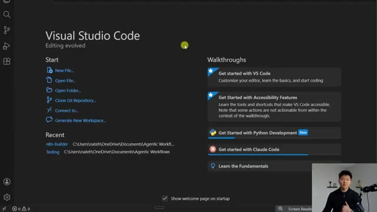
*⏱️ 00:02:19 — Page d'accueil de Visual Studio Code affichant les options de démarrage et les guides d'apprentissage (Walkthroughs).*

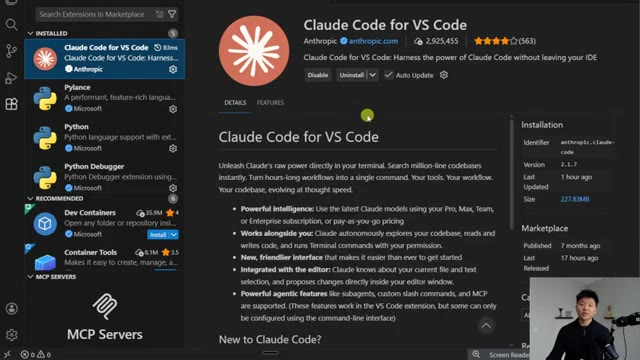
*⏱️ 00:02:27 — Interface de gestion des extensions dans VS Code, affichant la page détaillée de l'extension "Claude Code for VS Code".*

---

### ⏱️ `[00:02:43 - 00:03:04]` | Segment #07

**🔊 Audio (Transcription Intégrale Mot pour Mot en Français) :**
> you're going to go over to the left-hand side and click on Explorer. And this just basically means that we have to open up a folder to work inside of for this specific project. And so what I did in my documents folder, I made a folder called agentic workflows, where I'm just going to have a bunch of different projects for cloud code. And I'm going to open up this one called NN builder, which has nothing in it. So it's a fresh project and I'm going to select it.

**👁️ Analyse Visuelle d'Écran (gemini-3.5-flash-lite) :**
**Interface & Outils** : Présentation ou face-caméra explicatif sans interface logicielle partagée.

**Contenu textuel & Code** : Explications orales et mise en contexte méthodologique.

**Action / Démonstration** : Explications face caméra et démonstration conceptuelle.

---

### ⏱️ `[00:03:04 - 00:03:40]` | Segment #08

**🔊 Audio (Transcription Intégrale Mot pour Mot en Français) :**
> And what you can see here is now on the left-hand side, we have this project, which is NN builder and different files will pop up as we start making things in here. And then on the right-hand side, we've got the actual interface where we're going to talk to cloud. And the way that you do that is on the top, right, you'll see this little extension button and you can open up cloud code, close out of this and now we have Claude code ready to go working in this project for us and this looks very similar to when you would use like a chat GPT or Claude on the web. So the first thing you want to think about doing in a project is actually telling Claude code what you want to do in this project. So giving it a bit of a system prompt as far as this is the environment

**👁️ Analyse Visuelle d'Écran (gemini-3.5-flash-lite) :**
**Interface & Outils** : Présentation ou face-caméra explicatif sans interface logicielle partagée.

**Contenu textuel & Code** : Explications orales et mise en contexte méthodologique.

**Action / Démonstration** : Explications face caméra et démonstration conceptuelle.

---

### ⏱️ `[00:03:40 - 00:04:13]` | Segment #09

**🔊 Audio (Transcription Intégrale Mot pour Mot en Français) :**
> you're in and this is what we're going to do together. You can even see right here it says tired of repeating yourself tell Claude to remember what you've told it using Claude.md. So what we're gonna do is come over to our Explorer. I'm gonna click on new file and I'm gonna type in Claude.md and this just creates a markdown file for us that is Essentially think of it as the system prompt for this project So when we're in the file, we can actually look at it We could also close out of it and if we wanted to we could open it back up again But that's just like the interface that we're working in here And the first thing that I actually want to do is I want to put in that system prompt and what we're gonna

**👁️ Analyse Visuelle d'Écran (gemini-3.5-flash-lite) :**
**Interface & Outils** : Visual Studio Code (avec l'extension ou interface Claude Code intégrée).

**Contenu textuel & Code** : Texte affiché : "Tired of repeating yourself? Tell Claude to remember what you've told it using CLAUDE.md." et une zone de saisie en bas avec l'instruction "ctrl esc to focus or unfocus Claude".

**Action / Démonstration** : Le présentateur présente l'interface d'accueil de Claude Code avant de procéder à la création du fichier de configuration.

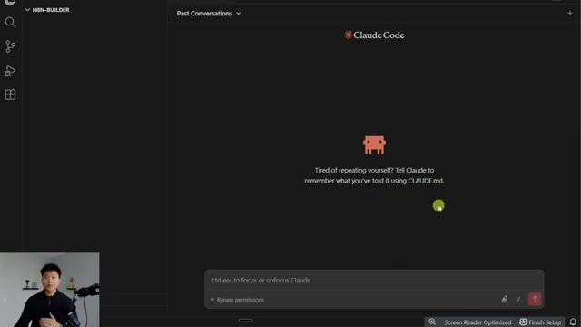
*⏱️ 00:03:48 — Interface de l'outil Claude Code dans VS Code affichant un message d'accueil et une invite pour créer un fichier CLAUDE.md.*

---

### ⏱️ `[00:04:13 - 00:04:32]` | Segment #10

**🔊 Audio (Transcription Intégrale Mot pour Mot en Français) :**
> Do is use Claude to build that system prompt One thing that I want you guys to take note of is down here, we've got different modes. So right now we're on bypass permissions, which just means that Cloud doesn't have to ask us anything. It can just go ahead and take action and execute things, which is really good to be in later when we want it to actually run for us. But right now, what I want to do is go to plan mode.

**👁️ Analyse Visuelle d'Écran (gemini-3.5-flash-lite) :**
**Interface & Outils** : VS Code avec l'interface de ligne de commande (CLI) "Claude Code".

**Contenu textuel & Code** : Le message central indique "Tired of repeating yourself? Tell Claude to remember what you've told it using CLAUDE.md". En bas, la barre de contrôle affiche le mode "Bypass permissions" sélectionné.

**Action / Démonstration** : Configuration et visualisation des paramètres de permissions de l'agent Claude dans l'environnement de développement.

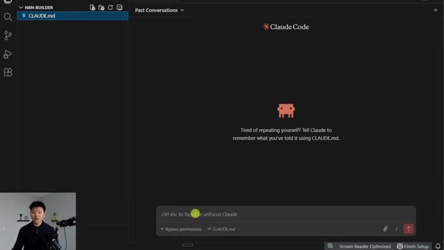
*⏱️ 00:04:18 — L'interface de Claude Code intégrée dans un éditeur de code, montrant le mode de permission "Bypass" activé.*

---

### ⏱️ `[00:04:32 - 00:05:05]` | Segment #11

**🔊 Audio (Transcription Intégrale Mot pour Mot en Français) :**
> You can see there's also ask before edits, there's edit automatically, but what we're going to do pretty much every time before we actually say, okay, go ahead and do that for me, is we're going to work on plan mode. And if you're cycling through right now and you don't see the bypass permissions, The reason why is because you're gonna have to go to your settings, which is in here. You're gonna go ahead and type in Claude code and then when you get there you should see Allow dangerously skip permissions and you have to turn that on if you want to allow bypass permissions mode Now it seems dangerous But it's really not because you are still in control and you can watch it and once you set up different like prompts and different

**👁️ Analyse Visuelle d'Écran (gemini-3.5-flash-lite) :**
**Interface & Outils** : Présentation ou face-caméra explicatif sans interface logicielle partagée.

**Contenu textuel & Code** : Explications orales et mise en contexte méthodologique.

**Action / Démonstration** : Explications face caméra et démonstration conceptuelle.

---

### ⏱️ `[00:05:05 - 00:05:28]` | Segment #12

**🔊 Audio (Transcription Intégrale Mot pour Mot en Français) :**
> You know instructions it will pretty much work inside that environment But that's just how you get that setting So I'm just going to explain to Claude what I want to do, and then it's going to help me plan out to create that Claude.md system prompt. So I'm just going to say, hey Claude, I need you to help me create the Claude.md file for this project. Basically what I've set up this project for is just to help me create workflows in N8N using you.

**👁️ Analyse Visuelle d'Écran (gemini-3.5-flash-lite) :**
**Interface & Outils** : VS Code avec l'extension ou le terminal Claude Code.

**Contenu textuel & Code** : Texte affiché : "Tired of repeating yourself? Tell Claude to remember what you've told it using CLAUDE.md." et barre de saisie de commande avec l'option "Plan mode" activée.

**Action / Démonstration** : Le présentateur s'apprête à interagir avec l'assistant Claude via la barre de saisie pour planifier la création du fichier de configuration système CLAUDE.md.

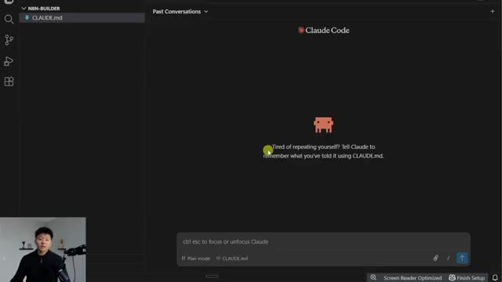
*⏱️ 00:05:11 — Interface de l'outil Claude Code intégrée dans VS Code, affichant l'écran d'accueil avec une incitation à configurer un fichier CLAUDE.md.*

---

### ⏱️ `[00:05:28 - 00:05:52]` | Segment #13

**🔊 Audio (Transcription Intégrale Mot pour Mot en Français) :**
> So I'm going to give you access to a few different tools. One of them will be the N8N MCP server, and one of them will be N8N skills. and you'll use those in combination with my request to help build workflows in my end in an instance that are high quality. So the end in MCP server and the end in skills, right after we set up this file, I'll show you guys what those are and explain how those are gonna work together with us.

**👁️ Analyse Visuelle d'Écran (gemini-3.5-flash-lite) :**
**Interface & Outils** : Présentation ou face-caméra explicatif sans interface logicielle partagée.

**Contenu textuel & Code** : Explications orales et mise en contexte méthodologique.

**Action / Démonstration** : Explications face caméra et démonstration conceptuelle.

---

### ⏱️ `[00:05:52 - 00:06:27]` | Segment #14

**🔊 Audio (Transcription Intégrale Mot pour Mot en Français) :**
> But right now, let's just basically take a look at what's going on. So when you send off a request to Claude in this environment, it's gonna start doing some stuff. But the cool thing about this is if you just play around with it and talk to it, it will basically walk you through what's going on in its mind. So you can see it started off by saying, I'll help you create the claw.md file for this NNN workflow builder project. Let me first explore what's already in here. And you can see on this left-hand side in our file explorer, there's nothing in here already. So it's going to search through it for a bit, and then it's going to come back and give us some more information. And I know that clawed code might seem intimidating, but really it's just as simple as if you can talk to a

**👁️ Analyse Visuelle d'Écran (gemini-3.5-flash-lite) :**
**Interface & Outils** : VS Code avec l'extension/interface Claude Code (ou équivalent)

**Contenu textuel & Code** : Prompt utilisateur : "say hey Claude, I need you to help me create the CLAUDE.md file...". Réponse de l'IA : "I'll help you create the CLAUDE.md file... Task: Explore n8n builder project". Commande terminal : `ls -la "C:\Users\nateh\OneDrive\Documents\Agentic Workflows\n8n-builder"`.

**Action / Démonstration** : L'agent IA analyse la structure du répertoire local via une commande terminal pour préparer la création d'un fichier de documentation (`CLAUDE.md`).

*⏱️ 00:06:00 — L'interface de l'agent Claude dans VS Code affiche une interaction où l'utilisateur demande la création d'un fichier CLAUDE.md pour un projet n8n. L'IA a répondu en définissant une tâche d'exploration du projet et en exécutant une commande Bash `ls -la` pour lister le contenu du répertoire courant.*

---

### ⏱️ `[00:06:27 - 00:07:00]` | Segment #15

**🔊 Audio (Transcription Intégrale Mot pour Mot en Français) :**
> developer or if you can talk to a brainstorm partner, you can use clawed code. The key is not being able to know how to read code and understand what it's doing. The key is, can you clearly communicate what you want. Because if you can communicate the end goal, Claude will help you get there. Because what it does is it asks you questions like, hey, did you mean this or this? Or do you want this or this? And because Opus models and Sonnet models are so good, they'll help you do pretty much anything you want. And if you ever get confused, you just say, hey, that doesn't make sense. Can you explain that to me? Or why'd you do that? And it really, really helps you get things done fast. So now it's asking us some questions already. So it says, what NNN MCP server

**👁️ Analyse Visuelle d'Écran (gemini-3.5-flash-lite) :**
**Interface & Outils** : VS Code avec terminal intégré (Claude Code) et une interface de configuration interactive (MCP Tools).

**Contenu textuel & Code** : Commandes bash pour localiser des fichiers ("find"), lecture du fichier "CLAUDE.md", et sélection d'options pour le serveur MCP n8n ("I'll provide details", "Standard n8n API").

**Action / Démonstration** : Configuration des outils MCP (Model Context Protocol) pour permettre à l'agent IA d'interagir avec n8n.

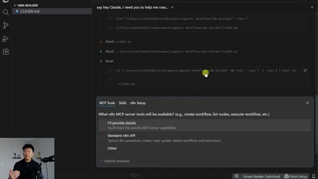
*⏱️ 00:06:35 — Une interface VS Code montrant l'utilisation de Claude Code (CLI) avec un historique de commandes bash et une fenêtre de configuration MCP pour n8n.*

---

### ⏱️ `[00:07:00 - 00:07:33]` | Segment #16

**🔊 Audio (Transcription Intégrale Mot pour Mot en Français) :**
> tools will be available. And I will say, I will share those details. It asks about the skills and I will once again, provide those details. And then for the NNN setup, it asks what our setup is. And I'm just going to say that I'm using NNN cloud and submit those answers, which once again, all of this information is going to help it create its system prompt so that everything works better in the future. Okay, cool. So it says, awesome. You're using NNN cloud and you will provide the details for the NNN MCP server and the NNN skills. And so now that it's asking for that information, I'm just going to go ahead and open up those GitHub repositories and show you guys what they are and what they do.

**👁️ Analyse Visuelle d'Écran (gemini-3.5-flash-lite) :**
**Interface & Outils** : VS Code (avec extension Claude Code / Agent).

**Contenu textuel & Code** : Menu de sélection "n8n Setup" avec les options : "Self-hosted n8n", "n8n Cloud", "Both/varies" et "Other". Historique des commandes bash en arrière-plan.

**Action / Démonstration** : L'utilisateur est en train de configurer les paramètres de l'agent en sélectionnant son instance n8n avant de cliquer sur "Submit answers".

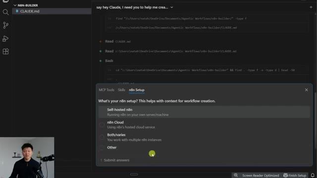
*⏱️ 00:07:08 — Interface de configuration de Claude Code affichant les options de déploiement de n8n à l'intérieur de VS Code.*

---

### ⏱️ `[00:07:33 - 00:07:52]` | Segment #17

**🔊 Audio (Transcription Intégrale Mot pour Mot en Français) :**
> And then we're going to just give Claude the URL so it can search, read, research, and just figure out for itself. But of course, before we do that, you know I have to pull up a whiteboard. So what we're looking at is basically at a high level, what we're actually building today in this N&M project. So we have us over here on the left-hand side. And what we're doing is we're talking to Claude Code.

**👁️ Analyse Visuelle d'Écran (gemini-3.5-flash-lite) :**
**Interface & Outils** : VS Code (avec extension Claude), Tableau blanc numérique (type Excalidraw).

**Contenu textuel & Code** : Historique de discussion de l'agent demandant : "The n8n MCP server tools - What operations/endpoints are available? The n8n skills - What skill definitions will Claude have access to?". Le diagramme montre les relations entre l'utilisateur, l'agent Claude et l'écosystème n8n.

**Action / Démonstration** : Analyse et configuration initiale du projet "n8n-builder" par l'agent Claude dans VS Code, suivie d'une présentation visuelle de l'architecture du workflow sur un tableau blanc.

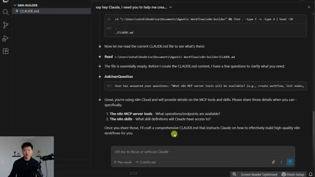
*⏱️ 00:07:38 — Interface de VS Code montrant l'agent Claude en pleine interaction, analysant les fichiers du répertoire "n8n-builder" et demandant des précisions sur les outils MCP.*

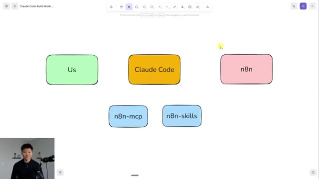
*⏱️ 00:07:43 — Diagramme conceptuel sur un tableau blanc numérique illustrant les composants du projet : "Us", "Claude Code", "n8n", "n8n-mcp" et "n8n-skills".*

---

### ⏱️ `[00:07:52 - 00:08:16]` | Segment #18

**🔊 Audio (Transcription Intégrale Mot pour Mot en Français) :**
> And ultimately, what we want Claude Code to do is talk to our N&M to build workflows for us. Now, Cloud Code by itself is smart and it knows JSON, but it doesn't yet understand NN nodes and NN expression syntax and configuration and parameters. So what we need to do is give it access to different tools to do so. So the first one of those is NNN MCP server, which is this NNN MCP server right here.

**👁️ Analyse Visuelle d'Écran (gemini-3.5-flash-lite) :**
**Interface & Outils** : Excalidraw (outil de tableau blanc numérique).

**Contenu textuel & Code** : Diagramme de flux composé de trois blocs principaux reliés par des flèches : "Us" (vert), "Claude Code" (orange) et "n8n" (rose). Deux boîtes bleues isolées contiennent les textes "n8n-mcp" et "n8n-skills".

**Action / Démonstration** : Le présentateur utilise le tableau blanc pour conceptualiser l'architecture de l'intégration entre Claude Code et l'écosystème n8n via des composants MCP.

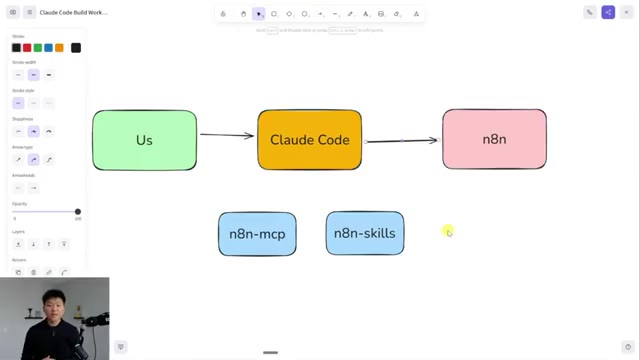
*⏱️ 00:07:58 — Un schéma illustrant le flux de travail entre l'utilisateur ("Us"), Claude Code et n8n, incluant deux composants supplémentaires ("n8n-mcp" et "n8n-skills") placés en dessous.*

---

### ⏱️ `[00:08:17 - 00:08:53]` | Segment #19

**🔊 Audio (Transcription Intégrale Mot pour Mot en Français) :**
> It's on GitHub. I'll leave a link to this down in the description. And also shout out to this guy. I'm not even going to try to pronounce his name because he built both this MCP and he also built the skills, which we'll show you in a second. So in this repo, you can actually read about what this is and what it does, but I'm actually just going to go to the website that he built for it, which basically says to connect your AI to NNN and let it build, deploy, and debug workflows for you. So it makes it super easy. Now, how does it actually do that? Well, it has complete node coverage. So all of the 1100 nodes with 99% property accuracy, so parameters, options, and all that kind of stuff perfectly documented. It's got over 2700 workflow templates, so it can

**👁️ Analyse Visuelle d'Écran (gemini-3.5-flash-lite) :**
**Interface & Outils** : Navigateur web (site n8n-ai/site vitrine), outil de schéma en ligne (type Excalidraw ou Miro).

**Contenu textuel & Code** : Textes explicatifs sur les workflows IA, statistiques de plateforme (28,959+ utilisateurs), liste de fonctionnalités techniques (Complete Node Coverage, 2,700+ Workflow Templates).

**Action / Démonstration** : Présentation visuelle de l'architecture du système et démonstration des capacités de l'outil d'automatisation n8n piloté par IA.

*⏱️ 00:08:26 — Un schéma conceptuel illustrant l'intégration entre l'utilisateur, Claude Code, n8n, et les outils spécifiques "n8n-mcp" et "n8n-skills".*

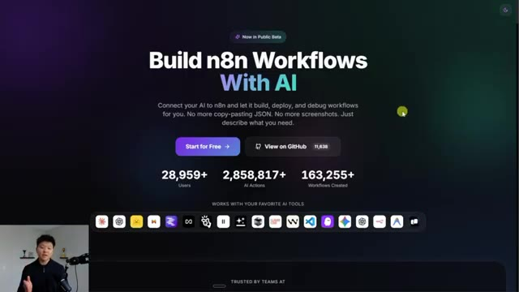
*⏱️ 00:08:35 — Page d'accueil du site web présentant la solution "Build n8n Workflows With AI", mettant en avant les statistiques d'utilisation et les outils compatibles.*

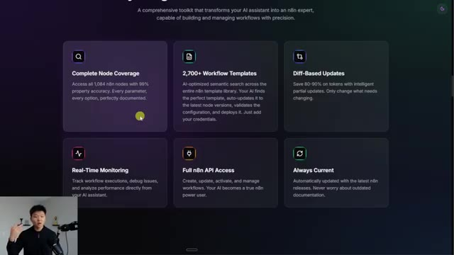
*⏱️ 00:08:44 — Capture d'écran détaillant les fonctionnalités clés de l'outil, notamment la couverture des nœuds, les templates de workflows, le monitoring et l'accès API.*

---

### ⏱️ `[00:08:53 - 00:09:30]` | Segment #20

**🔊 Audio (Transcription Intégrale Mot pour Mot en Français) :**
> look through those, pull different elements from them and get some inspiration. All these other benefits, of course, and the ability to create, update, activate and manage your NNN workflows. So really simply, all I'm going to do is copy the URL from this GitHub repo, go into VS Code. And first of all, just say, here is the NNN MCP server and link that in there. And then let's go back into Chrome and let me talk about the NNN skills, which once again is a GitHub repo. And basically what it says here is NNN skill set for Cloud Code to build flawless NNN workflows. So basically what this is, is it teaches the AI model. So it'll teach Cloud Code how to use this. And so if you've never

**👁️ Analyse Visuelle d'Écran (gemini-3.5-flash-lite) :**
**Interface & Outils** : Présentation ou face-caméra explicatif sans interface logicielle partagée.

**Contenu textuel & Code** : Explications orales et mise en contexte méthodologique.

**Action / Démonstration** : Explications face caméra et démonstration conceptuelle.

---

### ⏱️ `[00:09:30 - 00:10:06]` | Segment #21

**🔊 Audio (Transcription Intégrale Mot pour Mot en Français) :**
> heard of like a Cloud skill, basically just think of them like system instructions. And the benefit here is that Cloud only reads through them when it needs to. So if you think about this master Cloud Code agent having all of this context of all the nodes and all of the different ways to use them, every time you talk to it, it would use so many tokens to read through all that. And so essentially these are tools because it knows I have access to this stuff, but I'm only going to call it when I know that I need it. And so it basically uses the skills, it uses the MCP server, and then it's able to actually build really nice workflows in NNN. And so in the NNN skills repo, if you scroll down, which you guys can read about, here are the seven skills that it gets access to. It knows about

**👁️ Analyse Visuelle d'Écran (gemini-3.5-flash-lite) :**
**Interface & Outils** : Présentation ou face-caméra explicatif sans interface logicielle partagée.

**Contenu textuel & Code** : Explications orales et mise en contexte méthodologique.

**Action / Démonstration** : Explications face caméra et démonstration conceptuelle.

---

### ⏱️ `[00:10:06 - 00:10:25]` | Segment #22

**🔊 Audio (Transcription Intégrale Mot pour Mot en Français) :**
> expression syntax, which is really important. It knows how to use that MCP server that we just looked at. It knows workflow patterns. It knows how to validate them. It knows how the nodes are configured and then also knows how to code both in JavaScript and Python. So now when we give our Claude code access to these two things, it basically just becomes supercharged in building NNN workflows.

**👁️ Analyse Visuelle d'Écran (gemini-3.5-flash-lite) :**
**Interface & Outils** : Éditeur de texte ou visualiseur de documentation (probablement Obsidian ou un fichier Markdown sur GitHub/VS Code).

**Contenu textuel & Code** : Texte détaillé présentant des fonctionnalités comme "5 proven architectural patterns", "Webhook processing", "HTTP API", "database", "AI", "scheduled", ainsi que des conseils sur la validation des erreurs et la gestion des faux positifs.

**Action / Démonstration** : Présentation statique des capacités de l'agent IA à travers une documentation technique de référence pour l'automatisation.

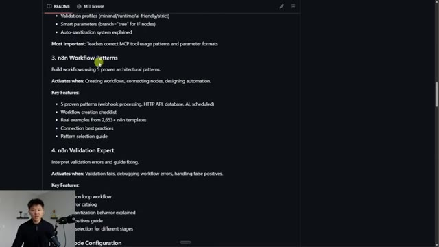
*⏱️ 00:10:11 — Capture d'écran montrant un fichier README affichant une documentation structurée sur les capacités d'un agent IA pour n8n, incluant les sections "n8n Workflow Patterns" et "n8n Validation Expert".*

---

### ⏱️ `[00:10:26 - 00:11:00]` | Segment #23

**🔊 Audio (Transcription Intégrale Mot pour Mot en Français) :**
> So I'm going to go ahead and copy the URL to the NNN skills, open up our Claude code, and then just say here are the NNN skills. You can go ahead and research them so that you can make the Claude.mb file better. So go ahead and shoot that off and it will continue to build out a plan for our system prompts for this project. You can see what it's doing right now is researching those and it's using a web fetch for those URLs just like we kind of wanted it to do. Okay so here's the plan that it came up with. It has an overview, a research summary, it has the skills, the structure, and all

**👁️ Analyse Visuelle d'Écran (gemini-3.5-flash-lite) :**
**Interface & Outils** : Visual Studio Code (utilisant l'interface de Claude Code).

**Contenu textuel & Code** : Historique de discussion : l'agent liste des questions sur les outils n8n MCP et les définitions de compétences. L'utilisateur a saisi : "n8n-MCP server: https://github.com/czlk/ntowskov/n8n-mcp" et "n8n skills: https://github.com/czlonkowski/n8n-skills-".

**Action / Démonstration** : L'utilisateur soumet des liens de documentation (GitHub) à l'agent Claude Code pour qu'il puisse configurer et améliorer le fichier `CLAUDE.md`.

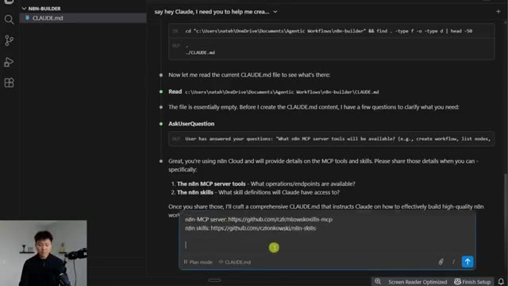
*⏱️ 00:10:34 — L'interface de l'agent "Claude Code" au sein de VS Code, montrant un historique de conversation où l'IA demande des détails sur les outils MCP et les compétences n8n, avec une réponse utilisateur contenant les liens GitHub.*

---

### ⏱️ `[00:11:00 - 00:11:33]` | Segment #24

**🔊 Audio (Transcription Intégrale Mot pour Mot en Français) :**
> this kind of stuff. You could obviously go ahead and read through all of that and then you could tell it to keep planning but in this case let's just go ahead and auto accept this plan so that will update that Claude file for us. Okay, so it finished up that Claude.md file and it goes over environment, MCP tools, skills, workflow building, safety rules, all this kind of stuff. So if I actually click into this file, we should now see that we have a pretty nice breakdown of what we actually want to do in this project. So you can see for the workflow building, we have to understand requirements, we search templates, we research nodes, we build, we validate, and then we deploy.

**👁️ Analyse Visuelle d'Écran (gemini-3.5-flash-lite) :**
**Interface & Outils** : Éditeur VS Code avec l'interface intégrée de l'outil Claude Code.

**Contenu textuel & Code** : Plan détaillé comprenant : Project Purpose, Available Tools (MCP), Available Skills, Workflow Building Guidelines, Safety Rules, Quality Standards, Common Patterns. Section "Files to Modify" ciblant CLAUDE.md et étape de "Verification".

**Action / Démonstration** : L'agent présente un plan de travail et attend une validation utilisateur pour procéder à la création ou à la modification du fichier CLAUDE.md.

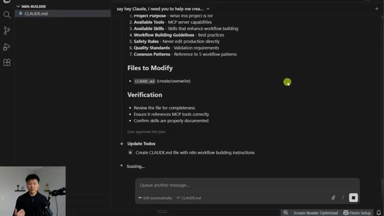
*⏱️ 00:11:08 — Interface de l'agent IA affichant un plan d'action structuré pour la création du fichier CLAUDE.md au sein d'un environnement de développement.*

---

### ⏱️ `[00:11:33 - 00:12:05]` | Segment #25

**🔊 Audio (Transcription Intégrale Mot pour Mot en Français) :**
> And so just giving our project a lot more structure as far as like what files it will have what the end goal is It just makes the whole thing better because otherwise if we didn't have a cloud.md file We would just start creating files willy-nilly and then cloud itself would have no idea how to look through those and what it's trying to do Okay, but the next step now is we need to actually go ahead and install those Two things the mtp server and the skills So what I'm gonna do is we're going to open up the slash which has a bunch of different slash commands that's how you can change the thinking model. You can do different plugins and things like that.

**👁️ Analyse Visuelle d'Écran (gemini-3.5-flash-lite) :**
**Interface & Outils** : Éditeur de code Cursor (avec l'interface de chat Claude intégrée).

**Contenu textuel & Code** : Le fichier "CLAUDE.md" détaille les instructions de configuration pour Claude : sections "Environment", "MCP Tools", "Skills", "Workflow Building Process", "Safety Rules", "Quality Standards", "Workflow Patterns", "Expression Syntax" et "Common Mistakes".

**Action / Démonstration** : Le modèle affiche le résultat de la création du fichier "CLAUDE.md" pour structurer le projet n8n, répondant à une demande de l'utilisateur.

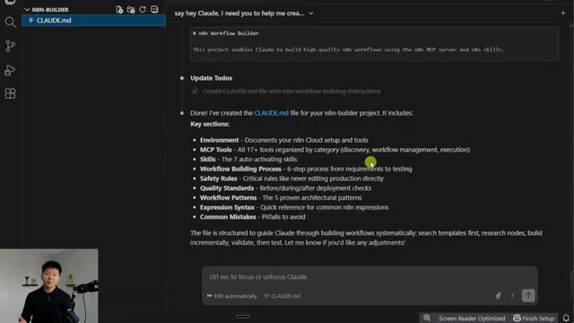
*⏱️ 00:11:41 — Une capture d'écran de l'interface de l'éditeur Cursor affichant le contenu du fichier "CLAUDE.md" dans un projet nommé "n8n-builder".*

---

### ⏱️ `[00:12:05 - 00:12:36]` | Segment #26

**🔊 Audio (Transcription Intégrale Mot pour Mot en Français) :**
> What I'm going to do is slash clear, which just lets us clear the conversation and how we get to start fresh. So in the GitHub repo for both of these things, if you keep scrolling down, it'll basically go over how to install these things. And you've got these different like mcp.json files that you could do in order to install this stuff. Same thing if we go to the skills and you can see if I scroll down, it shows installation. But what's so much easier is what we did earlier where we say, hey, Claude, here are the two GitHub repos we want to get in our project.

**👁️ Analyse Visuelle d'Écran (gemini-3.5-flash-lite) :**
**Interface & Outils** : Navigateur web affichant l'interface GitHub.

**Contenu textuel & Code** : Arborescence du dépôt (dossiers .claude, .github, data, deploy, etc.) et informations sur le projet (11.6k stars, version v2.33.2).

**Action / Démonstration** : Navigation sur la page principale du dépôt GitHub pour présenter les ressources d'installation du projet.

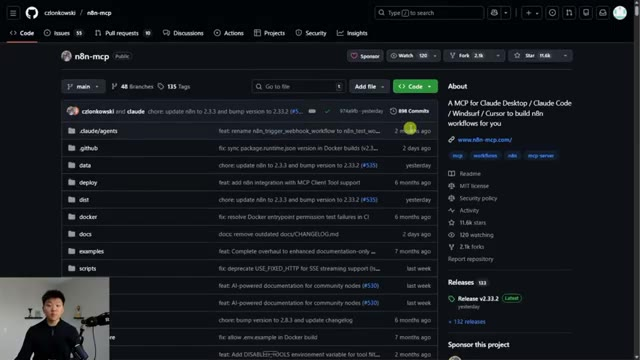
*⏱️ 00:12:13 — Capture d'écran montrant le dépôt GitHub "n8n-mcp" de l'utilisateur czionkowski, affichant la structure des fichiers du projet et les derniers commits.*

---

### ⏱️ `[00:12:36 - 00:13:10]` | Segment #27

**🔊 Audio (Transcription Intégrale Mot pour Mot en Français) :**
> Just go ahead and install them. So I'm on bypass permissions mode. So I don't have to say yes anything. And I told it to install the server, install the skills. And I also said, make sure they are accessible by Claude code in this project so that we can build flawless NNN workflows. And I'm going to let this run. And then I'll check in with you guys when we get some sort of response back. Now, the one thing about bypass permissions is it still won't bypass permissions if it doesn't have enough information, which is great. Because in this case, if you remember, the NNN MCP server is supposed to also be able to create, manage, and update workflows in your instance. And I didn't give it my instance information. So here it says, do you have a cloud

**👁️ Analyse Visuelle d'Écran (gemini-3.5-flash-lite) :**
**Interface & Outils** : Claude Code / VS Code.

**Contenu textuel & Code** : Prompts utilisateur : "install this MCP server: https://github.com/czlonkowski/n8n-mcp", "install these skills: https://github.com/czlonkowski/n8n-skills", "Make sure they are accessible by Claude Code in this project...". Réponse de l'agent : "I'll help you install the n8n MCP server and skills... Web Fetch... Actioning...".

**Action / Démonstration** : L'agent IA traite la demande, effectue une recherche web (Web Fetch) sur les dépôts GitHub fournis et commence l'installation des outils pour la création de workflows n8n.

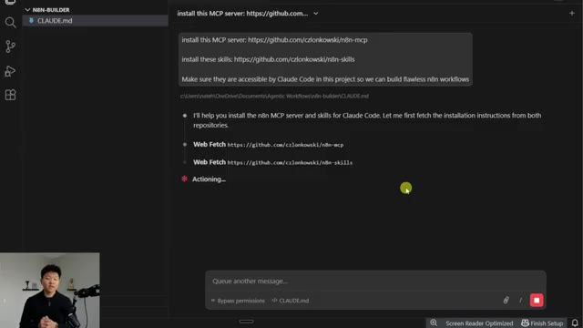
*⏱️ 00:12:45 — Interface de Claude Code au sein d'un éditeur (VS Code), affichant les instructions de l'utilisateur pour installer un serveur MCP et des compétences n8n.*

---

### ⏱️ `[00:13:10 - 00:13:29]` | Segment #28

**🔊 Audio (Transcription Intégrale Mot pour Mot en Français) :**
> instance that you want to connect for workflow management? If yes, I need the URL and API key. So I'm going to say, yes, I have NNN cloud and submit that. And then it's probably going to come back and say, okay, cool. Can you give me that information? So let me just show you real quick how we can get that. And right on Q, it asks for both of those. So I'm just going to say, I'll provide So let me go over to NNN and let's actually get that information.

**👁️ Analyse Visuelle d'Écran (gemini-3.5-flash-lite) :**
**Interface & Outils** : VS Code (avec une interface de configuration de serveur MCP intégrée).

**Contenu textuel & Code** : Formulaire interactif proposant les options : "Yes, I have n8n Cloud", "No, documentation only", et "Other". Le texte demande spécifiquement une URL API et une clé API pour la gestion des workflows.

**Action / Démonstration** : L'utilisateur est sur le point de sélectionner l'option "Yes, I have n8n Cloud" pour procéder à la configuration de son instance n8n.

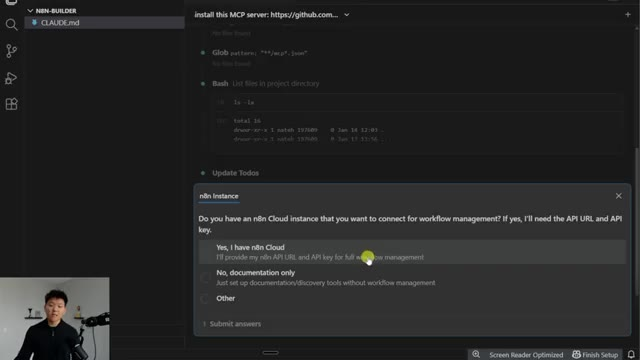
*⏱️ 00:13:15 — Une interface de configuration interactive s'affiche au sein d'un éditeur de code, demandant à l'utilisateur s'il souhaite connecter une instance n8n Cloud.*

---

### ⏱️ `[00:13:30 - 00:13:48]` | Segment #29

**🔊 Audio (Transcription Intégrale Mot pour Mot en Français) :**
> So I'm in my NNN cloud instance. And first of all, let's get the URL. So up top, I'm just going to grab everything before the slash home, which is, you know, it should end in dot cloud if you're on the cloud. And I'll come back in here and I'll say I have both of these credentials ready. So it's actually just prompting us for them. So enter your NNN API URL.

**👁️ Analyse Visuelle d'Écran (gemini-3.5-flash-lite) :**
**Interface & Outils** : Plateforme d'automatisation n8n (instance cloud).

**Contenu textuel & Code** : Tableau de bord affichant les statistiques d'exécution (75 exécutions, 3 échecs, 4% de taux d'échec) et la liste des workflows récents (Migrate Workflows, From Process Map to Nodes, Meeting Recording Automations).

**Action / Démonstration** : Navigation dans l'interface de l'instance cloud n8n pour localiser l'URL de l'instance avant de procéder à la configuration des identifiants.

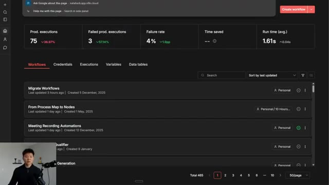
*⏱️ 00:13:34 — Capture d'écran de l'interface principale de n8n montrant le tableau de bord des workflows.*

---

### ⏱️ `[00:13:49 - 00:14:21]` | Segment #30

**🔊 Audio (Transcription Intégrale Mot pour Mot en Français) :**
> So I'm just going to go ahead and paste that in there as you can see. And now we're going to head back into NNN and I'm going to go to my settings. I'm going to go to NNN API. I'm going to create a new one, call this one Claude Code Demo, and copy that API key right there. And now right on cue again, it's asking us for the key. I'll say other. I'll paste it in right there. And then we will go ahead and submit those answers. So now it should be able to create the MCP configuration like we see right here. And then it's also going to clone those NNN skills for us. You can see there's the to-do list. So it did the NNN MCP

**👁️ Analyse Visuelle d'Écran (gemini-3.5-flash-lite) :**
**Interface & Outils** : Présentation ou face-caméra explicatif sans interface logicielle partagée.

**Contenu textuel & Code** : Explications orales et mise en contexte méthodologique.

**Action / Démonstration** : Explications face caméra et démonstration conceptuelle.

---

### ⏱️ `[00:14:21 - 00:14:55]` | Segment #31

**🔊 Audio (Transcription Intégrale Mot pour Mot en Français) :**
> server. Now it's installing the skills, which you can see just got put in right there. So right here we have the MCP JSON file with our information. We have the end of end skills, which are being added in, which if I click under here, we should see now we have those seven skills that it talked about in the repo. And so hopefully Claude will be able to look at these two things to help us actually build out our workflows after this is done. Okay. So I know we're moving a little fast, but let's just do a quick recap. Left-hand side, we're operating inside a project. This is a file in your computer. So I was in my documents in a folder called agentic workflows in a fresh folder

**👁️ Analyse Visuelle d'Écran (gemini-3.5-flash-lite) :**
**Interface & Outils** : Cursor (éditeur de code basé sur VS Code).

**Contenu textuel & Code** : Arborescence de fichiers (n8n-skills, dist, .mcp.json), commandes Bash (git clone, ls -la) et logs de sortie dans le panneau latéral de l'IA.

**Action / Démonstration** : Installation et clonage du dépôt n8n-skills via l'assistant IA intégré à l'éditeur.

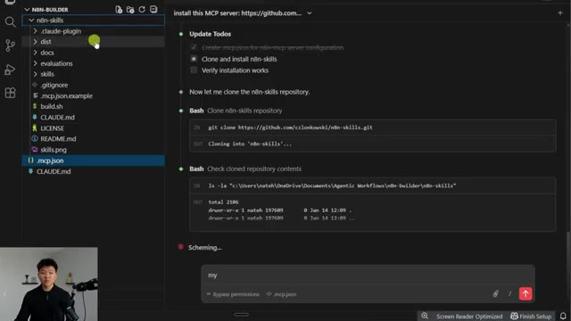
*⏱️ 00:14:29 — Interface de l'éditeur de code Cursor affichant l'arborescence des fichiers d'un projet n8n-builder et une session de chat active avec l'IA.*

---

### ⏱️ `[00:14:55 - 00:15:32]` | Segment #32

**🔊 Audio (Transcription Intégrale Mot pour Mot en Français) :**
> called nnn builder. What we see here are we have different files that we've created in this project. So we've got claw.md, which is kind of like the system prompt. It runs through what this project is actually built for. We have connected our MCP server, which is the mcp.json right here, which is the nnnmcp. And we've added those seven nnn skills, as you can see here, expression, syntax, tools expert, blah, blah, blah. And those can be found in here under skills, which is what we connected from the GitHub repo. And in the middle, what we're looking at is talking to Claude itself. And as we're talking to it, it basically makes to-do lists, it makes plans, and it tells

**👁️ Analyse Visuelle d'Écran (gemini-3.5-flash-lite) :**
**Interface & Outils** : Présentation ou face-caméra explicatif sans interface logicielle partagée.

**Contenu textuel & Code** : Explications orales et mise en contexte méthodologique.

**Action / Démonstration** : Explications face caméra et démonstration conceptuelle.

---

### ⏱️ `[00:15:32 - 00:15:52]` | Segment #33

**🔊 Audio (Transcription Intégrale Mot pour Mot en Français) :**
> us what it's thinking. So hopefully by now we're not too intimidated. So what it's telling us now is to restart Claude code in order to actually load those servers and skills. After restarted, just test by asking, can you search for the webhook node using MCP? So let me just actually copy this right there. And then it says the NNN skills folder was cloned for reference.

**👁️ Analyse Visuelle d'Écran (gemini-3.5-flash-lite) :**
**Interface & Outils** : VS Code (Visual Studio Code)

**Contenu textuel & Code** : Documentation Markdown listant les "Skills Installed" (n8n-expression-syntax, n8n-mcp-tools-expert, etc.) et les "Next Steps" à suivre pour redémarrer Claude Code et tester l'intégration avec une requête spécifique.

**Action / Démonstration** : Présentation de la documentation technique pour finaliser l'installation du serveur MCP et préparer la phase de test de l'agent.

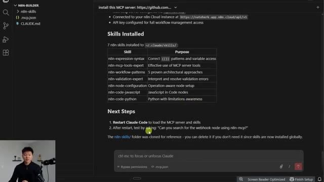
*⏱️ 00:15:37 — Capture d'écran de l'éditeur VS Code affichant un fichier Markdown détaillant les étapes d'installation et de configuration des skills n8n pour Claude Code.*

---

### ⏱️ `[00:15:52 - 00:16:27]` | Segment #34

**🔊 Audio (Transcription Intégrale Mot pour Mot en Français) :**
> So they basically just cloned it from the GitHub repo, which is why we see so much more stuff in here than just the actual seven skills itself. And it tells us that we can delete it if we don't need it since the skills are installed globally. So right now I'm not going to worry about deleting that. But if we wanted to clean some stuff up, we could obviously have Claude walk us through how to delete just those things that we don't need. So I'm going to go ahead and close out of this conversation, exit out of VS Code. And as we open it back up, we are already still in our folder. If we weren't in this one, we would just go to file and we would open folder and hop back into it. But now we're going to open up Claude once again. And I am just going to say, hey, just

**👁️ Analyse Visuelle d'Écran (gemini-3.5-flash-lite) :**
**Interface & Outils** : Visual Studio Code (éditeur de texte).

**Contenu textuel & Code** : Documentation Markdown listant 7 compétences n8n installées dans `~/.claude/skills/`, incluant des descriptions pour 'n8n-expression-syntax', 'n8n-mcp-tools-expert', 'n8n-workflow-patterns', etc., ainsi que des instructions pour redémarrer Claude Code.

**Action / Démonstration** : Le présentateur consulte la documentation générée après l'installation d'un serveur MCP pour n8n, confirmant que les compétences sont bien installées globalement.

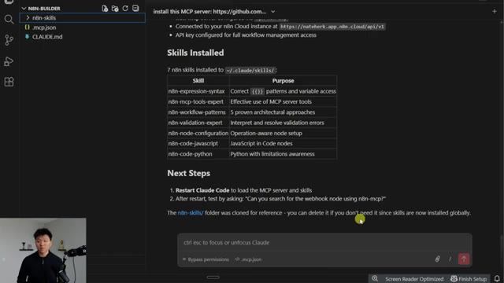
*⏱️ 00:16:01 — Une capture d'écran de l'éditeur VS Code affichant un fichier Markdown (README) détaillant les compétences n8n (n8n skills) installées localement.*

---

### ⏱️ `[00:16:27 - 00:17:01]` | Segment #35

**🔊 Audio (Transcription Intégrale Mot pour Mot en Français) :**
> wanted to check that you were able to successfully install and use the NNN MCP and NNN skills. And then I'm going to paste in that one test thing that it asked us to do, which was, can you search for the webhook node using the NNN MCP server? So it says I'll test the NNN MCP connection by searching for the node. You can see right here that it's actually using it. It's calling the search nodes function and it says yep I was able to find 13 results for webhook, also found Facebook ads, WhatsApp, Slack, blah blah blah. So it sounds like we're all successfully ready to go with building NNN workflows. So remember how I said that if you are getting

**👁️ Analyse Visuelle d'Écran (gemini-3.5-flash-lite) :**
**Interface & Outils** : VS Code avec l'extension/outil Claude Code intégré.

**Contenu textuel & Code** : Le prompt suivant est visible dans la zone de saisie : "hey, just wanted to check that you were able to successfully install and use the n8n MCP and n8n skills. Can you search for the webhook node using n8n-mcp?".

**Action / Démonstration** : L'utilisateur saisit une instruction pour tester la connexion entre Claude Code et le serveur MCP n8n en recherchant spécifiquement un nœud "webhook".

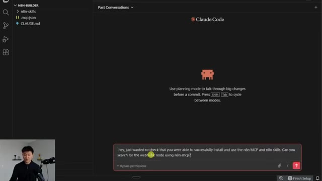
*⏱️ 00:16:35 — Capture d'écran montrant l'interface de "Claude Code" au sein de VS Code, avec un prompt saisi dans la zone de texte.*

---

### ⏱️ `[00:17:01 - 00:17:24]` | Segment #36

**🔊 Audio (Transcription Intégrale Mot pour Mot en Français) :**
> confused or if you don't understand how something's working you just ask? Well here's an example of me just checking, are you also able to create workflows in my instance? It verified with the MCP server and it said, yep, here's information about your instance. Here's what I can do. And then I said, do you also have the seven NNN skills that we need to build workflows? And it went ahead and it looked through everything and it made sure we did have them. And it does, in fact, have them. So now it says ready to build some workflows whenever you are.

**👁️ Analyse Visuelle d'Écran (gemini-3.5-flash-lite) :**
**Interface & Outils** : Interface utilisateur de Claude dans un éditeur type VS Code/IDE.

**Contenu textuel & Code** : Historique de conversation : la question "are you also able to create workflows in my n8n instance?" suivie de la réponse de l'IA détaillant un "mcp_n8n_health_check" réussi et confirmant l'accès à l'instance "nateherk.app.n8n.cloud".

**Action / Démonstration** : L'IA exécute une vérification de santé (health check) via le protocole MCP pour confirmer sa capacité à interagir avec l'instance n8n de l'utilisateur.

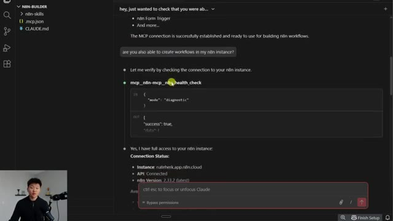
*⏱️ 00:17:06 — Une capture d'écran de l'interface Claude montrant une interaction où l'IA vérifie la connexion MCP à une instance n8n.*

---

### ⏱️ `[00:17:24 - 00:17:58]` | Segment #37

**🔊 Audio (Transcription Intégrale Mot pour Mot en Français) :**
> So I'm going to go ahead and do slash clear. We're going to clear the conversation and let's prompt it with a workflow that we want to build. Okay. So remember earlier, we talked about the different modes. What I always want to do when I'm first starting off with some sort of plan is obviously to go in plan mode so we can make sure we have a really nice prompt before we go ahead and let Claude code loose. So I'm in plan mode and I'm going to start to explain a workflow that I want. Hey Claude, I'd love to build a workflow where we have an AI agent and I want you to build this workflow in my NNN instance. I want this AI agent to go off every morning at 7am

**👁️ Analyse Visuelle d'Écran (gemini-3.5-flash-lite) :**
**Interface & Outils** : VS Code (ou éditeur compatible avec l'extension Claude Code).

**Contenu textuel & Code** : Texte de guidage pour le raccourci clavier, icône d'attachement, barre de commandes slash et bouton d'envoi.

**Action / Démonstration** : Le présentateur s'apprête à utiliser la commande "/clear" pour réinitialiser la conversation avec l'agent IA avant de définir un nouveau workflow.

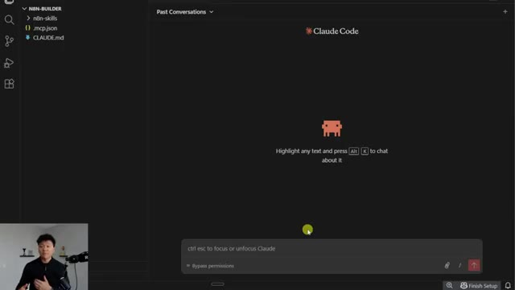
*⏱️ 00:17:32 — L'interface de Claude Code intégrée dans un environnement de développement, affichant une zone de saisie de texte avec le placeholder "ctrl esc to focus or unfocus Claude" et l'option "Bypass permissions".*

---

### ⏱️ `[00:17:58 - 00:18:17]` | Segment #38

**🔊 Audio (Transcription Intégrale Mot pour Mot en Français) :**
> and I want it to do research for me to help me find out information for my business. I have an AI automation agency, so I wanna make sure that every morning I'm getting insights as far as any AI developments or specifically AI automation related developments for voice agents, because that's the niche of my agency.

**👁️ Analyse Visuelle d'Écran (gemini-3.5-flash-lite) :**
**Interface & Outils** : VS Code avec l'extension/interface Claude Code.

**Contenu textuel & Code** : Texte dans la barre de saisie : "ctrl esc to focus / unfocus Claude" et mention "Plan mode".

**Action / Démonstration** : L'outil est en attente d'une instruction utilisateur pour lancer une recherche ou une automatisation de développement.

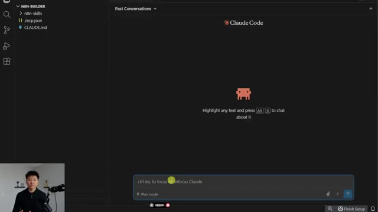
*⏱️ 00:18:02 — Une vue de l'interface de Claude Code intégrée au sein de l'éditeur de code VS Code, montrant la zone de saisie des prompts en mode « Plan mode ».*

---

### ⏱️ `[00:18:17 - 00:18:41]` | Segment #39

**🔊 Audio (Transcription Intégrale Mot pour Mot en Français) :**
> Once it has that information, after it's done research, I want it to create an HTML styled newsletter for me and send it to my email through Gmail. And I want two separate AI agents I want the first one that does research to use OpenRouter and to use ChatGPT 5. And I want the second agent that writes the email and stylizes it in HTML to use OpenRouter, but I want it to use Anthropic Sonnet 4.5.

**👁️ Analyse Visuelle d'Écran (gemini-3.5-flash-lite) :**
**Interface & Outils** : Visual Studio Code (ou éditeur similaire) avec l'extension/outil Claude Code.

**Contenu textuel & Code** : Texte dans la zone de saisie : "Ctrl esc to focus / unfocus Claude" et mention du mode "Plan mode".

**Action / Démonstration** : L'utilisateur est prêt à interagir avec l'agent Claude Code pour planifier ou exécuter des tâches de développement.

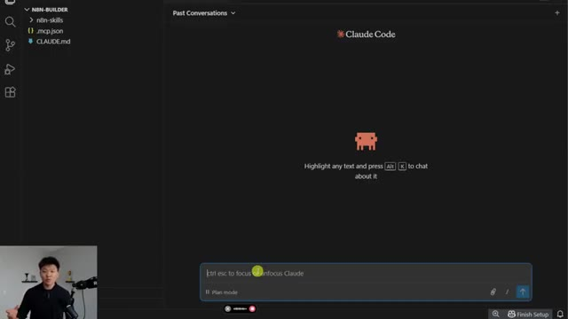
*⏱️ 00:18:23 — Une capture d'écran de l'interface de "Claude Code" intégrée au sein d'un éditeur de code, avec une barre de saisie de texte en bas et une icône de pixel art au centre.*

---

### ⏱️ `[00:18:43 - 00:19:04]` | Segment #40

**🔊 Audio (Transcription Intégrale Mot pour Mot en Français) :**
> Okay, so that is our request. We are going to shoot that off in plan mode. And now it's going to come back, ask us some questions maybe, and build out a plan. And then we'll be able to go ahead and approve that. And so this is exactly what we wanted. What it's doing is it is creating a task. It's exploring through the MCP servers to search for different nodes, and then it's going to build us an implementation plan. So I'll check in with you guys when that plan is all ready.

**👁️ Analyse Visuelle d'Écran (gemini-3.5-flash-lite) :**
**Interface & Outils** : Cursor (éditeur de code avec intégration d'IA).

**Contenu textuel & Code** : Un prompt détaillé décrivant la création d'un workflow n8n automatisé pour la recherche quotidienne et l'envoi d'emails via Gmail, utilisant des modèles comme OpenRouter, ChatGPT 5 et Anthropic Sonnet 4.5. L'IA affiche l'état "Philosophising...".

**Action / Démonstration** : L'utilisateur soumet une requête complexe à l'IA, qui est en cours d'analyse ("Philosophising") pour générer un plan de construction du workflow.

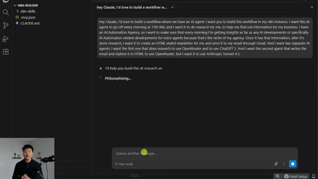
*⏱️ 00:18:48 — Interface de l'éditeur de code Cursor affichant une conversation avec l'agent Claude dans le volet de discussion (Composer).*

---

### ⏱️ `[00:19:05 - 00:19:32]` | Segment #41

**🔊 Audio (Transcription Intégrale Mot pour Mot en Français) :**
> All right. So it's a little bit darker, but it says I have a good understanding of the requirements. Let me ask a few clarification questions. The first one is which email address should the newsletter be sent to? I'm just going to go ahead and type in nateatexample.com just to shoot that off. We've got the search tool. Which web search tool do you want to use. Okay, we've got SERP API, GINA, HTTP. I'm going to go ahead and say other, and I actually want to use perplexity. And then for time zone, it says what time zone do you want to send from?

**👁️ Analyse Visuelle d'Écran (gemini-3.5-flash-lite) :**
**Interface & Outils** : Présentation ou face-caméra explicatif sans interface logicielle partagée.

**Contenu textuel & Code** : Explications orales et mise en contexte méthodologique.

**Action / Démonstration** : Explications face caméra et démonstration conceptuelle.

---

### ⏱️ `[00:19:32 - 00:19:51]` | Segment #42

**🔊 Audio (Transcription Intégrale Mot pour Mot en Français) :**
> And I'm just going to go ahead and say Eastern time, which I'm not even in Eastern time, but just to make it easier, shoot off those questions. Okay, so we've got a pretty comprehensive plan here, as you can see. It is our AI research newsletter workflow plan. It's got some architecture, so the different nodes, the schedule trigger, all this kind of stuff, the configuration details of each of these.

**👁️ Analyse Visuelle d'Écran (gemini-3.5-flash-lite) :**
**Interface & Outils** : Présentation ou face-caméra explicatif sans interface logicielle partagée.

**Contenu textuel & Code** : Explications orales et mise en contexte méthodologique.

**Action / Démonstration** : Explications face caméra et démonstration conceptuelle.

---

### ⏱️ `[00:19:51 - 00:20:11]` | Segment #43

**🔊 Audio (Transcription Intégrale Mot pour Mot en Français) :**
> Obviously, we could read through all of this and make some changes if we want. What I'm gonna do is we're just gonna go ahead and auto accept this to see how well it did on its own. And we will see what happens next. Oh, wait, actually, I'm going to stop this real quick because what I noticed is that it said what I'm creating is a single workflow file in JSON. But actually what we wanna do is have it created in our edit instance.

**👁️ Analyse Visuelle d'Écran (gemini-3.5-flash-lite) :**
**Interface & Outils** : Présentation ou face-caméra explicatif sans interface logicielle partagée.

**Contenu textuel & Code** : Explications orales et mise en contexte méthodologique.

**Action / Démonstration** : Explications face caméra et démonstration conceptuelle.

---

### ⏱️ `[00:20:11 - 00:20:45]` | Segment #44

**🔊 Audio (Transcription Intégrale Mot pour Mot en Français) :**
> So I'm just gonna go ahead and change this to bypass permissions. And I'm gonna say, that plan looks great. I want you to just go ahead and create that in my end in an instance and just give me a link so that I can go look at it All right, so there we go You can see it had a to-do list with three items One was to create the workflow one was to validate it and then one was to report completion And so we have the link and then we have some next steps as far as connecting your credentials making it active things like that So let's click into the link Okay, we can see we've got the workflow right here with our schedule trigger our research agent our newsletter writer and our newsletter gmail tool

**👁️ Analyse Visuelle d'Écran (gemini-3.5-flash-lite) :**
**Interface & Outils** : Présentation ou face-caméra explicatif sans interface logicielle partagée.

**Contenu textuel & Code** : Explications orales et mise en contexte méthodologique.

**Action / Démonstration** : Explications face caméra et démonstration conceptuelle.

---

### ⏱️ `[00:20:45 - 00:21:19]` | Segment #45

**🔊 Audio (Transcription Intégrale Mot pour Mot en Français) :**
> So let me real quick just connect all these credentials Okay, now that that's set up, we're going to go ahead and run this. So pretending that this went off at 7 a.m. Eastern time, we can see that it's using its perplexity tool, its open router. And let me just also make sure this one was supposed to be GPT 5, which this one's 4.1. So it messed up a little bit there. It filled in tokens and temperature, which is kind of funny. This one was supposed to be sun at 4.5 and it was sun at 4. So it messed up a little bit on that actual configuration, but that's not a huge deal. You can see that it's searching perplexity. It's actually done three searches already. So if I click into the research agent, we can see that we

**👁️ Analyse Visuelle d'Écran (gemini-3.5-flash-lite) :**
**Interface & Outils** : Présentation ou face-caméra explicatif sans interface logicielle partagée.

**Contenu textuel & Code** : Explications orales et mise en contexte méthodologique.

**Action / Démonstration** : Explications face caméra et démonstration conceptuelle.

---

### ⏱️ `[00:21:19 - 00:21:53]` | Segment #46

**🔊 Audio (Transcription Intégrale Mot pour Mot en Français) :**
> have a user message, which is to research the latest developments. Actually, let me just make this full screen. Research the latest developments in AI automation and voice agent technology from the past week. Focus on these five things, search for these four things, and then compile your findings. It also says to source citations, which is nice. And then if we go into the actual system message, let's see what we've got in here. You are an AI research analyst specializing in AI automation and voice agent technology. Your role is to gather relevant information, be thorough, be concise, prioritize actionable insights that would help an agency owner stay ahead of industry trends.

**👁️ Analyse Visuelle d'Écran (gemini-3.5-flash-lite) :**
**Interface & Outils** : Présentation ou face-caméra explicatif sans interface logicielle partagée.

**Contenu textuel & Code** : Explications orales et mise en contexte méthodologique.

**Action / Démonstration** : Explications face caméra et démonstration conceptuelle.

---

### ⏱️ `[00:21:53 - 00:22:28]` | Segment #47

**🔊 Audio (Transcription Intégrale Mot pour Mot en Français) :**
> So it's really good that it's making these prompts pretty nice for us. Once this research finishes up, we will go over to the newsletter writer. So let's take a look at this prompt. Okay, cool. So the user message was already an expression because it knows that it needs all of the research from the previous agent. And we can see that we've got it coming through right here. and then it says transform the above research findings into a professional html newsletter follow the styling guide in your system prompt okay so we'll take a look at that styling guide in a sec what we can see here is the we get the actual results of the research from the previous agent so we've got breaking news and ai we've got voice agent and conversational developments

**👁️ Analyse Visuelle d'Écran (gemini-3.5-flash-lite) :**
**Interface & Outils** : Présentation ou face-caméra explicatif sans interface logicielle partagée.

**Contenu textuel & Code** : Explications orales et mise en contexte méthodologique.

**Action / Démonstration** : Explications face caméra et démonstration conceptuelle.

---

### ⏱️ `[00:22:28 - 00:22:48]` | Segment #48

**🔊 Audio (Transcription Intégrale Mot pour Mot en Français) :**
> ai automation tools and platforms industry trends affecting ai agencies and new voice ai products and then some headlines and action for agency owners. Super cool. And then real quick, just to take a look at the actual system message, it basically gives us a HTML styling guide and some newsletter structure, which is great.

**👁️ Analyse Visuelle d'Écran (gemini-3.5-flash-lite) :**
**Interface & Outils** : Présentation ou face-caméra explicatif sans interface logicielle partagée.

**Contenu textuel & Code** : Explications orales et mise en contexte méthodologique.

**Action / Démonstration** : Explications face caméra et démonstration conceptuelle.

---

### ⏱️ `[00:22:49 - 00:23:24]` | Segment #49

**🔊 Audio (Transcription Intégrale Mot pour Mot en Français) :**
> So it looks like that all finished up and it got sent to the correct email, I hope, which was nateatexample.com. It comes through as AI Automation Daily Brief with the date and it's formatted, which is nice. And then we have the actual message and it even turned off the append, edit, and attribution, which I don't think I explicitly told it to do. So that's pretty cool. But let me go to the email and let's take a look. Okay. Wow. Look at this. We've got our AI automation daily brief for January 14th. It's obviously stylized in HTML. We've got an executive summary with the agentic AI market exploding. We've got top stories. So we've got some headlines like the agentic AI market

**👁️ Analyse Visuelle d'Écran (gemini-3.5-flash-lite) :**
**Interface & Outils** : Présentation ou face-caméra explicatif sans interface logicielle partagée.

**Contenu textuel & Code** : Explications orales et mise en contexte méthodologique.

**Action / Démonstration** : Explications face caméra et démonstration conceptuelle.

---

### ⏱️ `[00:23:24 - 00:23:43]` | Segment #50

**🔊 Audio (Transcription Intégrale Mot pour Mot en Français) :**
> is set for growth, enterprise agent ops, hardware breakthrough. We've got some voice agent focus because that's what I told it was my niche. So we've got emotionally intelligent agents, global support, new voice AI integrations, some quick hits, some action items for agency owners, and then at the bottom we've got a bunch of sources, which is pretty cool as well.

**👁️ Analyse Visuelle d'Écran (gemini-3.5-flash-lite) :**
**Interface & Outils** : Présentation ou face-caméra explicatif sans interface logicielle partagée.

**Contenu textuel & Code** : Explications orales et mise en contexte méthodologique.

**Action / Démonstration** : Explications face caméra et démonstration conceptuelle.

---

### ⏱️ `[00:23:43 - 00:24:17]` | Segment #51

**🔊 Audio (Transcription Intégrale Mot pour Mot en Français) :**
> So obviously this was our one-shot prompt for this workflow. If we wanted to iterate upon this, we could go ahead and come back into VS Code with our Cloud Code and say, hey, this workflow is great. Can you make these changes to the prompt or could you switch out some things here? And it would actually be able to take that instance, change it, and then we'd see those changes reflected in our NNN cloud. This workflow obviously wouldn't take me, you know, any more than an hour if I was building it myself in NNN, but hopefully you can see if you're a beginner and you need to help brainstorm through some things, CloudCode is going to help you out a ton. And also if you think about as you scale up to some more complex use cases where maybe you need to think

**👁️ Analyse Visuelle d'Écran (gemini-3.5-flash-lite) :**
**Interface & Outils** : Présentation ou face-caméra explicatif sans interface logicielle partagée.

**Contenu textuel & Code** : Explications orales et mise en contexte méthodologique.

**Action / Démonstration** : Explications face caméra et démonstration conceptuelle.

---

### ⏱️ `[00:24:17 - 00:24:49]` | Segment #52

**🔊 Audio (Transcription Intégrale Mot pour Mot en Français) :**
> about how you're going to handle the data and things like that, using CloudCode in plan mode is really, really going to help you out because it's going to ask you a lot of questions that you may not have thought of yourself when you're building out your workflow. And something else that I talk a lot about in my plus community is the importance of wireframing things out, as you guys could tell earlier when I did this. And so I imagine if you wireframed out a workflow and you gave that screenshot to a cloud projects like this, a cloud code project like this, it would be able to do a lot better too, because it already knows kind of like the general architecture and structure that you're thinking of for your NNN workflow. Like I said, that's

**👁️ Analyse Visuelle d'Écran (gemini-3.5-flash-lite) :**
**Interface & Outils** : Présentation ou face-caméra explicatif sans interface logicielle partagée.

**Contenu textuel & Code** : Explications orales et mise en contexte méthodologique.

**Action / Démonstration** : Explications face caméra et démonstration conceptuelle.

---

### ⏱️ `[00:24:49 - 00:25:10]` | Segment #53

**🔊 Audio (Transcription Intégrale Mot pour Mot en Français) :**
> something I talk a lot about in my plus community with full courses on NNN and building agencies and stuff like that. So if you're interested, the link for that would be down in the description. So let's just do a quick recap of what we actually talked about today. We got familiar with VS Code and Cloud Code, and we understand that the left-hand side is our project, where we have different files, and we have basically a system prompt that explains what this project is going to do.

**👁️ Analyse Visuelle d'Écran (gemini-3.5-flash-lite) :**
**Interface & Outils** : Présentation ou face-caméra explicatif sans interface logicielle partagée.

**Contenu textuel & Code** : Explications orales et mise en contexte méthodologique.

**Action / Démonstration** : Explications face caméra et démonstration conceptuelle.

---

### ⏱️ `[00:25:10 - 00:25:29]` | Segment #54

**🔊 Audio (Transcription Intégrale Mot pour Mot en Français) :**
> We've got the middle section, where we actually talk to, either we look at our files or we talk to Cloud Code itself. We have different modes to talk to Cloud Code, like bypass permissions, ask before edits, edit automatically, or plan mode, which is really important when you're actually trying to figure out what you want to do. And then we talked about how you can give it access to MCP servers, skills.

**👁️ Analyse Visuelle d'Écran (gemini-3.5-flash-lite) :**
**Interface & Outils** : Présentation ou face-caméra explicatif sans interface logicielle partagée.

**Contenu textuel & Code** : Explications orales et mise en contexte méthodologique.

**Action / Démonstration** : Explications face caméra et démonstration conceptuelle.

---

### ⏱️ `[00:25:29 - 00:25:49]` | Segment #55

**🔊 Audio (Transcription Intégrale Mot pour Mot en Français) :**
> And rather than trying to figure out how to configure it yourself, just make CloudCode do the research. And something funny about CloudCode is sometimes it'll do the research and say, hey, you know, I can do this for you, or you could just install it yourself. And a lot of times you just have to say, no, you do it. Like, I don't want to do anything. I just want you to do everything for me. And it will do it all for you. So key lesson, don't be intimidated by CloudCode.

**👁️ Analyse Visuelle d'Écran (gemini-3.5-flash-lite) :**
**Interface & Outils** : Présentation ou face-caméra explicatif sans interface logicielle partagée.

**Contenu textuel & Code** : Explications orales et mise en contexte méthodologique.

**Action / Démonstration** : Explications face caméra et démonstration conceptuelle.

---

### ⏱️ `[00:25:49 - 00:26:23]` | Segment #56

**🔊 Audio (Transcription Intégrale Mot pour Mot en Français) :**
> I'm going to have a lot more content around this coming. So please let me know what type of use cases you guys want to see when it comes to automating things with CloudCode. The thing you need to remember is all that matters is can you communicate clearly what you want as if you were talking to a human developer or a human project manager or even just a regular human. If you can communicate it clearly and if you can ask questions when you're confused, you will be fine with CloudCode. And once again, the interface is going to get better, the models are going to get better. So the earlier you jump on this, the easier it's going to be when inevitably every person in the world starts using CloudCode. Okay, one final thing that I wanted to

**👁️ Analyse Visuelle d'Écran (gemini-3.5-flash-lite) :**
**Interface & Outils** : Présentation ou face-caméra explicatif sans interface logicielle partagée.

**Contenu textuel & Code** : Explications orales et mise en contexte méthodologique.

**Action / Démonstration** : Explications face caméra et démonstration conceptuelle.

---

### ⏱️ `[00:26:23 - 00:26:48]` | Segment #57

**🔊 Audio (Transcription Intégrale Mot pour Mot en Français) :**
> just make sure you guys were aware of is it has its limits. So obviously I was trying to get to that line and see how far I could push it. And I was able to build some really complicated workflows and some cool agents, but I tried building one where it was going to be like 60 nodes. And what ended up happening is it basically like throttled the API and it just like became unresponsive. And this was like over an hour ago and my NNN cloud is still down.

**👁️ Analyse Visuelle d'Écran (gemini-3.5-flash-lite) :**
**Interface & Outils** : Présentation ou face-caméra explicatif sans interface logicielle partagée.

**Contenu textuel & Code** : Explications orales et mise en contexte méthodologique.

**Action / Démonstration** : Explications face caméra et démonstration conceptuelle.

---

### ⏱️ `[00:26:48 - 00:27:10]` | Segment #58

**🔊 Audio (Transcription Intégrale Mot pour Mot en Français) :**
> And so the thing is here, N8N's cloud server is what's down, specifically for my domain here. But if I open up a different cloud instance that I own from N8N, that one's working. So there's an error going on here. You can see it's 522. And I'm basically, I think, gonna have to reach out to them and have them reboot the server or something like that. If you were doing this on self-hosted, you'd be able to reboot it yourself and you'd be good to go.

**👁️ Analyse Visuelle d'Écran (gemini-3.5-flash-lite) :**
**Interface & Outils** : Présentation ou face-caméra explicatif sans interface logicielle partagée.

**Contenu textuel & Code** : Explications orales et mise en contexte méthodologique.

**Action / Démonstration** : Explications face caméra et démonstration conceptuelle.

---

### ⏱️ `[00:27:10 - 00:27:35]` | Segment #59

**🔊 Audio (Transcription Intégrale Mot pour Mot en Français) :**
> But this is something I wanted to at least let you guys be aware of, is that if you do make some massive, crazy requests and it's timing out and then it's trying again And it's just like, you know, just trying to do way too much. This may happen. So I just felt like I was obligated to at least tell you guys that. So anyways, and if it helps you guys out, I will drop this claw.md file, which keep in mind, I one-shotted with plan mode, but I will drop this in my free school community.

**👁️ Analyse Visuelle d'Écran (gemini-3.5-flash-lite) :**
**Interface & Outils** : Présentation ou face-caméra explicatif sans interface logicielle partagée.

**Contenu textuel & Code** : Explications orales et mise en contexte méthodologique.

**Action / Démonstration** : Explications face caméra et démonstration conceptuelle.

---

### ⏱️ `[00:27:35 - 00:28:00]` | Segment #60

**🔊 Audio (Transcription Intégrale Mot pour Mot en Français) :**
> If you want to grab that for free, the link for that is down in the description. It will look like this. All you have to do is get in here and I'll have a post associated with this video. And like, let's pretend it's this post. you would just see right here, I would attach a JSON file or a doc with that exact cloud.md file in there so that you guys could just paste that over to your cloud code if you want to play around with this use case. But anyways, that is going to do it for today. So if you enjoyed the video, or if you learned something new, please give it a like. It definitely helps me out a ton.

**👁️ Analyse Visuelle d'Écran (gemini-3.5-flash-lite) :**
**Interface & Outils** : Présentation ou face-caméra explicatif sans interface logicielle partagée.

**Contenu textuel & Code** : Explications orales et mise en contexte méthodologique.

**Action / Démonstration** : Explications face caméra et démonstration conceptuelle.

---

### ⏱️ `[00:28:01 - 00:28:06]` | Segment #61

**🔊 Audio (Transcription Intégrale Mot pour Mot en Français) :**
> And as always, I appreciate you guys making it to the end of the video. So I will see you on the next one. Thanks so much, guys.

**👁️ Analyse Visuelle d'Écran (gemini-3.5-flash-lite) :**
**Interface & Outils** : Présentation ou face-caméra explicatif sans interface logicielle partagée.

**Contenu textuel & Code** : Explications orales et mise en contexte méthodologique.

**Action / Démonstration** : Explications face caméra et démonstration conceptuelle.

---

