# 🎬 Build ANYTHING with Claude Code & n8n (Beginner's Guide)

> **Chaîne** : [Nate Herk | AI Automation](https://www.youtube.com/@nateherk/featured)  
> **Lien YouTube** : [https://www.youtube.com/watch?v=OCO3aq3G0mk](https://www.youtube.com/watch?v=OCO3aq3G0mk)  
> **Date de publication** : 20260116  
> **Durée** : 00:39:58  
> **Identifiant vidéo** : `OCO3aq3G0mk`  
> **Transcription & Analyse** : `whisper-v3-large-turbo+gemini-3.5-flash-lite`  

---

## 📌 Synthèse Exécutive & Outils

### 💡 Résumé
Dans cette vidéo intitulée **Build ANYTHING with Claude Code & n8n (Beginner's Guide)**, Nate Herk décortique les capacités pratiques d'automatisation et de développement propulsées par les modèles de pointe.

### 🛠️ Outils, Modèles & Logiciels Présentés
- **Opus 5.5 & Claude Code** : Modèles d'ingénierie et agents de codage autonome.

### 🔑 Points Clés & Enseignements Stratégiques
- Optimiser le niveau d'effort et le raisonnement des modèles IA pour des résultats industriels.
- Automatiser les cycles de création logicielle de bout en bout.

---

## ⏱️ Chronologie & Transcription Complète Audio & Visuelle (Mot pour Mot)

### ⏱️ `[00:00:00 - 00:00:36]` | Segment #01

**🔊 Audio (Transcription Intégrale Mot pour Mot en Français) :**
> All right, so a lot of us have been building NNN workflows for a while now. So today I'm going to show you how you can take any of your NNN workflows that you already have and turn that into a web app. And I'm not talking about just showing you something like lovable to build a front end and then connecting it to your NNN webhook. I'm talking about Claude Code having the ability to look at your workflow, essentially audit it to make sure it's ready to go for an app, and then make any of the changes that you need on the back end before you build the front end. But let me show you guys what I actually mean by that. Otherwise, it just sounds like a bunch of gibberish. So here's a workflow that I wanted to turn into a web app. It takes a form submission where we get information from a user like product name, product photo, avatar, features, and video setting, and it turns

**👁️ Analyse Visuelle d'Écran (gemini-3.5-flash-lite) :**
**Interface & Outils** : n8n (éditeur de workflow), interface utilisateur web de fitness.

**Contenu textuel & Code** : Nœuds de workflow : On form submission, Get URL, Veo Image Prompt, GPT-5-mini, Wait, Get Nano Image, If, Analyze image, Final URL.

**Action / Démonstration** : Exécution et visualisation de la logique d'automatisation des flux de travail au sein de l'éditeur n8n.

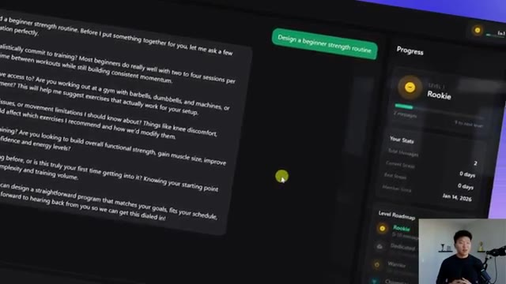
*⏱️ 00:00:09 — Interface d'une application web de fitness avec un chatbot interactif et un tableau de bord de progression utilisateur affichant "Rookie" et les statistiques.*

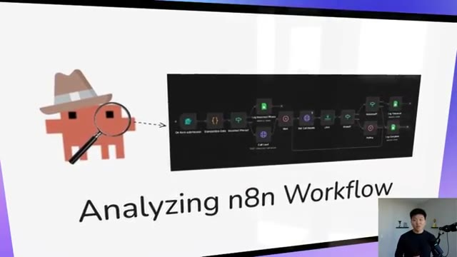
*⏱️ 00:00:18 — Slide de présentation illustrée montrant le logo de n8n avec une loupe, accompagnée d'un diagramme de workflow complexe pour l'analyse de processus.*

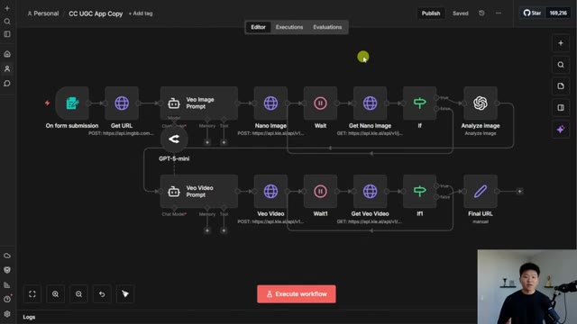
*⏱️ 00:00:27 — Éditeur visuel de workflows n8n montrant un pipeline automatisé complexe utilisant des nœuds GPT-5-mini, Veo Image/Video et des fonctions de conditionnement (If/Wait).*

---

### ⏱️ `[00:00:36 - 00:01:01]` | Segment #02

**🔊 Audio (Transcription Intégrale Mot pour Mot en Français) :**
> that into a UGC ad with this workflow as you can see right here. So what I told Claude Code to do was look at this workflow and then just optimize it so I could actually use it and connect it to a front end. And what it did is it changed the workflow to look like this. There are actually a lot of changes that it made here, and I need you guys to believe me when I said I was seriously impressed when I saw this. So real quick, just wanted to put these side by side so you can actually see what it did. On the left was the original and on the right is what CloudCode built.

**👁️ Analyse Visuelle d'Écran (gemini-3.5-flash-lite) :**
**Interface & Outils** : n8n (outil d'automatisation de workflows).

**Contenu textuel & Code** : Nœuds de workflow : « On form submission », « Get URL », « Veo Image Prompt », « Nano Image », « Wait », « Get Nano Image », « If », « Analyze image », « Veo Video Prompt », « Veo Video », « Final URL ». Utilisation des modèles « GPT-4o-mini » (mentionné comme GPT-4-mini sur le nœud).

**Action / Démonstration** : Visualisation du workflow optimisé par l'IA pour connecter un formulaire à une génération automatisée de contenu UGC.

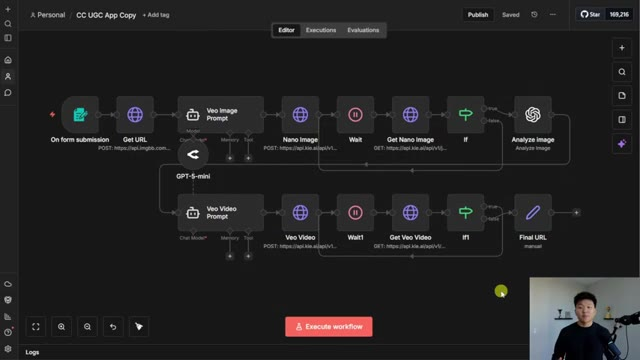
*⏱️ 00:00:42 — Interface de l'outil d'automatisation n8n affichant un workflow complexe d'IA pour la génération de contenu UGC, avec deux branches parallèles traitant les images et les vidéos via des modèles d'IA.*

---

### ⏱️ `[00:01:01 - 00:01:35]` | Segment #03

**🔊 Audio (Transcription Intégrale Mot pour Mot en Français) :**
> So first of all, it switched out the form submission trigger to be a webhook. Not too hard, but that's what it did. So if you remember, one of the raw inputs it gets was a photo. So CloudCode actually realized that it's going to come through as a base64 string when we send it over webhook and it has to convert that. And then at the end, what we had to do was we had to figure out how did we want this to be displayed in the front end. So we basically are sending back a message, whether it was successful or not, and we're sending over the URL so it can be embedded in the actual landing page. And it also changed all of these HTTP requests to be continue with an error output, and it routed the error to a different branch, which would send the front end an error

**👁️ Analyse Visuelle d'Écran (gemini-3.5-flash-lite) :**
**Interface & Outils** : CloudCode (Plateforme d'automatisation de workflow)

**Contenu textuel & Code** : Diagrammes de flux de travail composés de nœuds : Webhook, Convert to File, GPT-4o-mini, Veo Image/Video Prompt, Nano Image, et étapes Wait.

**Action / Démonstration** : Le présentateur compare l'ancienne version du workflow avec la nouvelle version modifiée pour accepter des données d'image via un webhook au lieu d'un formulaire standard.

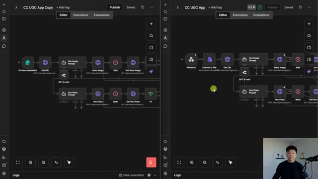
*⏱️ 00:01:09 — Comparaison côte à côte de deux interfaces de workflow (CloudCode), montrant à gauche le déclencheur original « On form submission » et à droite la version mise à jour avec « Webhook » et une étape « Convert to File » pour gérer les chaînes base64.*

---

### ⏱️ `[00:01:35 - 00:02:08]` | Segment #04

**🔊 Audio (Transcription Intégrale Mot pour Mot en Français) :**
> message. And another cool thing to realize is that when it changes the actual source of the input data, it had to change the variables everywhere else. So it really thought about the actual node by node flow, not just changing the input and the output. So if you don't understand all of those changes that I just explained and like why that's important, it's not a huge deal. The point I was trying to make there was just showing you that Claude will look at your workflows and fix them for you before you ever turn them into a front end. And you guys know that my job is to make complex or intimidating things as simple as possible. So that's exactly what I'm going to do today. We're going to walk through it all step by step and you're going to realize how easy it actually is. So real quick,

**👁️ Analyse Visuelle d'Écran (gemini-3.5-flash-lite) :**
**Interface & Outils** : n8n (éditeur de workflow visuel).

**Contenu textuel & Code** : Nœuds de workflow : Webhook, Convert to File, Get URL, Veo Image Prompt, Nano Image, Wait, Get Nano Image, If, Analyze image, Veo Video Prompt, Veo Video, Wait1, Get Veo Video, If, Callback Success, Callback Error.

**Action / Démonstration** : Visualisation et édition d'un workflow automatisé incluant des appels API et des conditions logiques pour le traitement de médias.

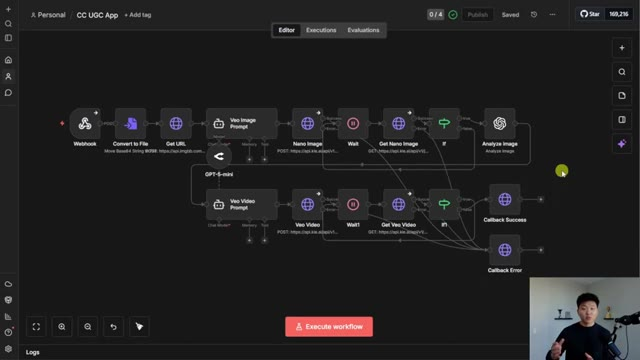
*⏱️ 00:01:43 — Interface d'édition de workflow automatisé présentant deux branches parallèles complexes pour le traitement d'images et de vidéos via des prompts Veo.*

---

### ⏱️ `[00:02:08 - 00:02:37]` | Segment #05

**🔊 Audio (Transcription Intégrale Mot pour Mot en Français) :**
> before we get into that, I just want to do a quick demo of the final product of this that took me basically 40 minutes where I started with this workflow, Claude Code turned it into this workflow. And now we have this front end where I can put in the information. And let me just show you guys a quick demo. So I put in some information, I put in a product photo, and I'm going to go ahead and hit generate. And now what happens is it basically tells us on this right hand side that we have this one job processing. If I go into the actual edit and workflow that it's hitting right now, and I go to executions, you can see that there were some failures when I was doing testing and stuff.

**👁️ Analyse Visuelle d'Écran (gemini-3.5-flash-lite) :**
**Interface & Outils** : n8n (outil d'automatisation de workflow) et interface web personnalisée de l'application "Instant UGC".

**Contenu textuel & Code** : Dans l'image 1 : Nœuds de workflow (Webhook, Convert to File, Veo Image/Video Prompt, Wait, Get Nano Image, If, etc.). Dans l'image 2 : Formulaire de saisie utilisateur (Product Name: "Cologne", Product Photo: "Cologne.jpg", Avatar: "Young adult male", Product Features, Video Setting).

**Action / Démonstration** : Présentation visuelle de l'architecture technique (workflow) suivie de la démonstration de l'interface utilisateur finale générée par l'agent IA.

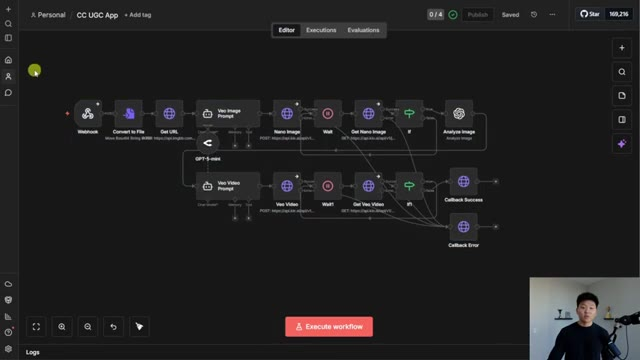
*⏱️ 00:02:16 — Interface de conception de workflow automatisé présentant un flux logique avec plusieurs nœuds connectés pour le traitement d'images et de vidéos (Veo, GPT-4o-mini).*

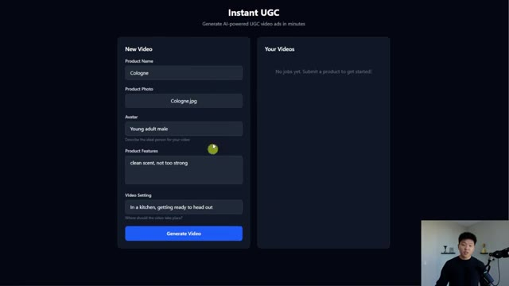
*⏱️ 00:02:23 — Interface utilisateur (Front-end) de l'application nommée "Instant UGC" permettant de saisir des paramètres pour générer des publicités vidéo par IA.*

---

### ⏱️ `[00:02:37 - 00:02:58]` | Segment #06

**🔊 Audio (Transcription Intégrale Mot pour Mot en Français) :**
> But what we're going to notice is that we get a new execution right here, pop through. And then when that's finished, it will automatically display right here where we can see the video and we'll be able to download it. So you can see that the workflow just finished up and you can see we have our video right here, which is displayed in the website. We can click on this link to download it. And also just for reference, here's the original cologne image that I uploaded.

**👁️ Analyse Visuelle d'Écran (gemini-3.5-flash-lite) :**
**Interface & Outils** : n8n (workflow automation), application web personnalisée "Instant UGC".

**Contenu textuel & Code** : Nœuds de workflow (Webhook, Veo Image Prompt, GPT-4o-mini, etc.) dans n8n ; formulaires de configuration produit (Nom, Photo, Avatar, Caractéristiques) dans l'application web.

**Action / Démonstration** : Visualisation du succès d'une exécution de workflow dans n8n, suivie de l'affichage de la vidéo générée dans l'interface utilisateur pour téléchargement.

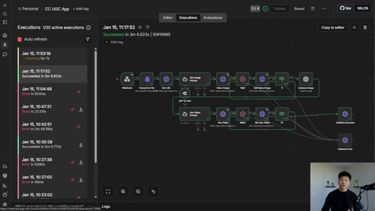
*⏱️ 00:02:42 — Interface du workflow d'automatisation n8n montrant l'historique des exécutions d'un pipeline nommé "CC UGC App" avec un graphe de nœuds connecté.*

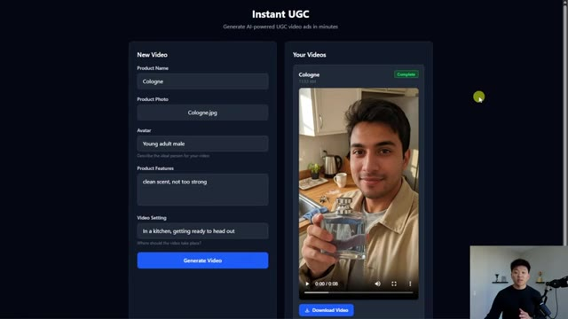
*⏱️ 00:02:47 — Interface de l'application web "Instant UGC" avec un formulaire de saisie à gauche et une fenêtre de visualisation du résultat vidéo généré ("Cologne") à droite.*

---

### ⏱️ `[00:02:58 - 00:03:20]` | Segment #07

**🔊 Audio (Transcription Intégrale Mot pour Mot en Français) :**
> So you can see that it pretty much looks the exact same. So I'm not going to be diving into this actual workflow that produced the results. I already made a video about this. So if you want to check it out, I'll link it up there. All right. Hopefully I'm not losing you already. I know that this workflow and this demo may seem a little bit complex, but we're going to set up everything step-by-step from the full process of taking and edit in workflow, optimizing it with Claude, and then getting it onto a front end and deploying it.

**👁️ Analyse Visuelle d'Écran (gemini-3.5-flash-lite) :**
**Interface & Outils** : n8n (éditeur de workflow low-code).

**Contenu textuel & Code** : Diagramme de flux comprenant des nœuds tels que "On form submission", "Veo Image Prompt", "Nano Image", "GPT-4o-mini" (indiqué comme modèle de chat), "Wait", et "Final URL". Le workflow traite des données via des requêtes POST/GET.

**Action / Démonstration** : Visualisation et présentation d'un workflow d'automatisation déjà configuré ; le bouton "Execute workflow" est présent en bas de l'écran.

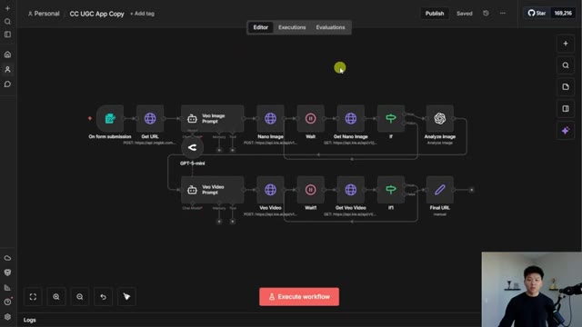
*⏱️ 00:03:03 — Interface d'édition de workflow automatisé dans l'outil n8n, montrant deux branches parallèles de traitement d'images et de vidéos connectées à des modèles d'IA.*

---

### ⏱️ `[00:03:20 - 00:03:41]` | Segment #08

**🔊 Audio (Transcription Intégrale Mot pour Mot en Français) :**
> Okay, so step one is open up VS Code. This is where I like to work with Cloud Code as an extension because the actual visual interface is just so much cleaner, it's so much better, and you don't have to look at your nasty terminal or anything like that. VS Code's been around for a long time and it's a very trusted platform. So once you're in here, you're gonna click on this left-hand side and go to extensions, and then you're gonna type in up here, Cloud Code.

**👁️ Analyse Visuelle d'Écran (gemini-3.5-flash-lite) :**
**Interface & Outils** : Visual Studio Code (VS Code)

**Contenu textuel & Code** : Menu de démarrage "Start", section "Walkthroughs" incluant "Get started with Claude Code", et liste de projets récents ("Agentic Workflows").

**Action / Démonstration** : Ouverture de l'éditeur VS Code par le présentateur pour introduire le flux de travail.

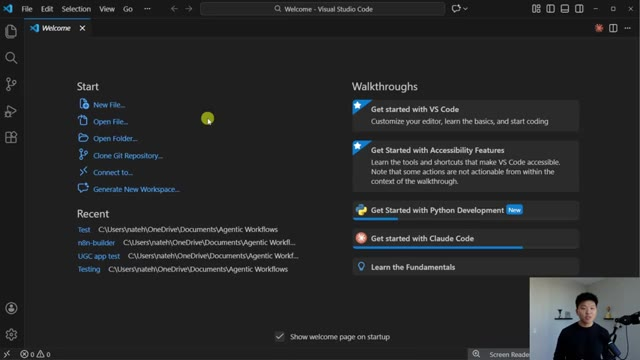
*⏱️ 00:03:25 — L'écran affiche la page d'accueil (Welcome) de Visual Studio Code avec les options de démarrage rapide et la liste des projets récents.*

---

### ⏱️ `[00:03:41 - 00:04:05]` | Segment #09

**🔊 Audio (Transcription Intégrale Mot pour Mot en Français) :**
> Once you do that, just click on Cloud Code and then go ahead and install it. And when you install it, it should prompt you to sign in with your Anthropic, with your Cloud account, and that's how you actually link them together. Now, once we have that extension installed, we actually need to start up a project. So what I'm gonna do here is I'm going to go to the left-hand side and go up to this button right here, which is the File Explorer, and it says, you have not opened a folder yet, so go ahead and open one up.

**👁️ Analyse Visuelle d'Écran (gemini-3.5-flash-lite) :**
**Interface & Outils** : Visual Studio Code (VS Code).

**Contenu textuel & Code** : Page de description de l'extension Anthropic "Claude Code for VS Code" incluant les fonctionnalités, l'identifiant, la version et le bouton d'installation.

**Action / Démonstration** : Installation et vérification de l'extension Claude Code au sein de l'éditeur de code VS Code.

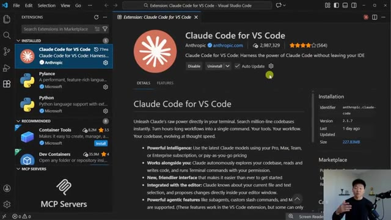
*⏱️ 00:03:47 — Interface VS Code affichant la page de détails de l'extension "Claude Code for VS Code" dans le panneau des extensions.*

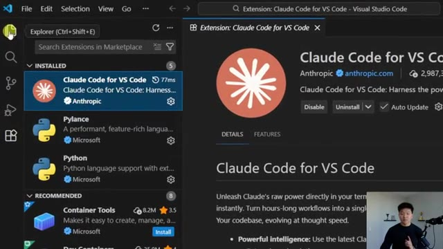
*⏱️ 00:03:59 — Interface VS Code similaire à l'image 1, montrant le focus sur la barre latérale des extensions avec "Claude Code for VS Code" sélectionné.*

---

### ⏱️ `[00:04:05 - 00:04:25]` | Segment #10

**🔊 Audio (Transcription Intégrale Mot pour Mot en Français) :**
> So I'm in my documents, I'm in a folder called Agentec Workflows, and then I'm drilling down to another folder called EditIntoApp, which has nothing in it, so it's a blank folder, it's a blank project, and I'm gonna select it, which now gets us into this environment. So you can see up top, we've got NNN to App, which is our project. And on the left-hand side over here, we're gonna see all the other files that we add to this or that get created.

**👁️ Analyse Visuelle d'Écran (gemini-3.5-flash-lite) :**
**Interface & Outils** : Visual Studio Code (VS Code).

**Contenu textuel & Code** : Explorateur de fichiers vide, page d'accueil de VS Code, volet de chat "Build with Agent" avec option "Generate Agent Instructions".

**Action / Démonstration** : Sélection d'un dossier vide dans le système de fichiers pour initialiser un nouvel environnement de développement.

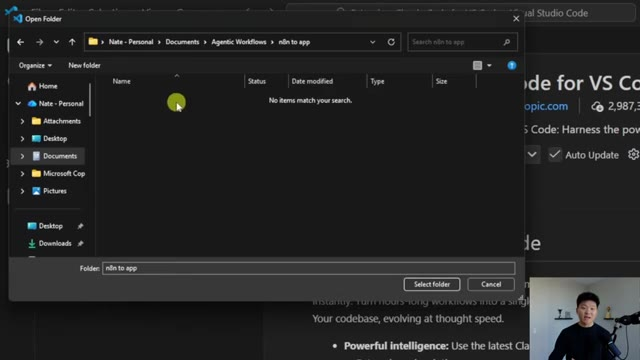
*⏱️ 00:04:10 — Fenêtre de sélection de dossier Windows affichant le chemin "Agentic Workflows > n8n to app" pour ouvrir un projet dans l'éditeur.*

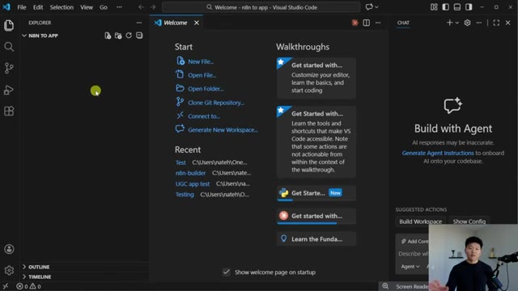
*⏱️ 00:04:20 — Interface de Visual Studio Code ouverte sur le dossier vide "N8N TO APP", avec la page d'accueil par défaut et le volet latéral "Build with Agent".*

---

### ⏱️ `[00:04:25 - 00:04:45]` | Segment #11

**🔊 Audio (Transcription Intégrale Mot pour Mot en Français) :**
> In the middle is where we're gonna actually be chatting with Claude Code. And the way we do that is by clicking on this little Claude Code extension button right here, and then closing out of whatever else we don't want. And on the right-hand side is where we have the actual like VS Code agent chat, which means we can talk to this agent about like what's going on in here. And honestly, I never really use this because the Cloud Code agent is smart enough.

**👁️ Analyse Visuelle d'Écran (gemini-3.5-flash-lite) :**
**Interface & Outils** : Visual Studio Code (VS Code) avec l'extension Claude Code.

**Contenu textuel & Code** : Interface utilisateur de bienvenue de VS Code, panneau de chat "Build with Agent", et icône de l'extension Claude Code en haut de l'éditeur.

**Action / Démonstration** : Le curseur survole l'icône de l'extension "Claude Code" en haut de la fenêtre principale pour initier son ouverture.

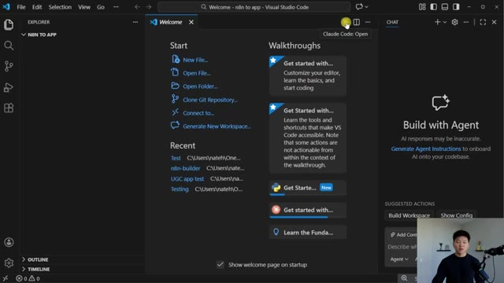
*⏱️ 00:04:30 — Capture d'écran de l'interface VS Code montrant la page d'accueil centrale, la barre latérale "Explorer" à gauche et le panneau "Chat" avec l'agent IA à droite.*

---

### ⏱️ `[00:04:45 - 00:05:10]` | Segment #12

**🔊 Audio (Transcription Intégrale Mot pour Mot en Français) :**
> So that's kind of the interface we're looking at. I know it may seem a bit overwhelming right now because there's lots of new buttons and there's lots of places to look, but I'm basically just gonna tell you guys about what you need to know. And if you follow this demo all the way through, by the end of it, you'll have a really good understanding of what you're looking at and how to work with Cloud Code. All right, so the first thing that we wanna do whenever we start up a new project is we wanna give it some sort of guidelines about what are we actually doing in this project.

**👁️ Analyse Visuelle d'Écran (gemini-3.5-flash-lite) :**
**Interface & Outils** : Visual Studio Code (avec l'extension Claude Code active).

**Contenu textuel & Code** : Interface utilisateur de Claude Code affichant : "Use planning mode to talk through big changes before a commit. Press Shift+Tab to cycle between modes." et "ctrl esc to focus or unfocus Claude".

**Action / Démonstration** : Présentation de l'interface de travail de l'agent Claude Code au sein de l'éditeur de code.

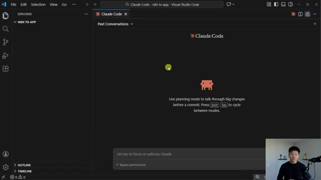
*⏱️ 00:04:51 — L'interface de l'extension Claude Code intégrée dans Visual Studio Code, affichant l'écran d'accueil avec une icône de pixel art et des instructions sur le "planning mode".*

---

### ⏱️ `[00:05:10 - 00:05:29]` | Segment #13

**🔊 Audio (Transcription Intégrale Mot pour Mot en Français) :**
> And the way we actually do that is we just have to create a file, which is essentially the system prompt. And it's gonna be called claude.md. And so what you could do is come over to the left-hand side and you could click on new file, you could type in claude.md, and then we could basically just start working in this file or we could have claude itself edit the file.

**👁️ Analyse Visuelle d'Écran (gemini-3.5-flash-lite) :**
**Interface & Outils** : Visual Studio Code avec l'extension Claude Code.

**Contenu textuel & Code** : Interface centrale de Claude Code avec le message : "Use planning mode to talk through big changes before a commit. Press Shift + Tab to cycle between modes." et la barre de saisie "ctrl esc to focus or unfocus Claude".

**Action / Démonstration** : Le présentateur explique la procédure pour configurer un prompt système en créant un fichier, ici au sein de l'environnement de développement.

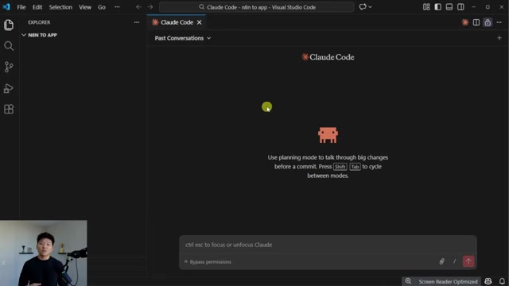
*⏱️ 00:05:15 — Capture d'écran de l'éditeur Visual Studio Code affichant l'interface de l'extension Claude Code avec le présentateur en médaillon en bas à gauche.*

---

### ⏱️ `[00:05:29 - 00:05:47]` | Segment #14

**🔊 Audio (Transcription Intégrale Mot pour Mot en Français) :**
> And the reason why this popped up over here is just so we could view it. You could close it, you could open it back up, you could open up like 10 different files at the same time if you want to, but let's just keep our screen clean and keep open just the claude code for now. Okay, so what I'm gonna do is have Cloud Code help us write that Cloud.md file. So let me just read out what I actually wrote to it.

**👁️ Analyse Visuelle d'Écran (gemini-3.5-flash-lite) :**
**Interface & Outils** : Visual Studio Code (VS Code) avec l'extension/intégration Claude Code.

**Contenu textuel & Code** : Explorateur de fichiers avec 'claude.md', interface de chat Claude Code ("Past Conversations", icône de personnage, champ de saisie avec "ctrl esc to focus"), et fichier Markdown vide avec instructions de génération de code.

**Action / Démonstration** : Le présentateur illustre la gestion de l'interface en montrant comment les différents fichiers et panneaux de l'agent peuvent être organisés dans l'éditeur.

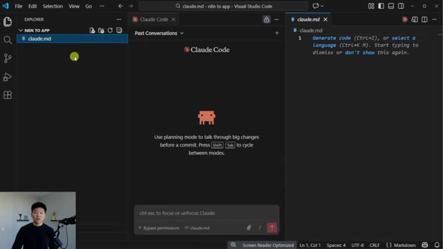
*⏱️ 00:05:33 — Interface VS Code affichant l'explorateur de fichiers à gauche et deux volets ouverts : le panneau interactif de Claude Code au centre et le fichier 'claude.md' à droite.*

---

### ⏱️ `[00:05:47 - 00:06:09]` | Segment #15

**🔊 Audio (Transcription Intégrale Mot pour Mot en Français) :**
> So I said, help me create a Cloud.md file in this project to set up what we wanna do here. This project is essentially built to help me turn my NNN workflows into apps. So there's gonna be a few pieces. The first piece is going to look at my workflows in NNN to make sure that they're ready to go as far as having the right intake of data and output of data so that if it's a web app, when the app sends data to NNN, it can properly receive it.

**👁️ Analyse Visuelle d'Écran (gemini-3.5-flash-lite) :**
**Interface & Outils** : Claude Code (Interface en ligne de commande/terminal).

**Contenu textuel & Code** : Le prompt de l'utilisateur : "help me create a claude.md file in this project to set up what we want to do here. So this project is essentially built to help me turn n8n workflows into apps. So there's going to be a couple pieces. The first piece is going to look at my workflows in n8n..."

**Action / Démonstration** : Saisie d'une demande de planification de projet visant à structurer la conversion de workflows n8n en applications autonomes via Claude Code.

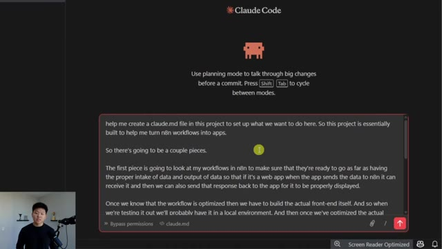
*⏱️ 00:05:53 — L'interface de l'outil Claude Code affichant un prompt utilisateur détaillant la création d'un fichier 'claude.md' pour transformer des workflows n8n en applications.*

---

### ⏱️ `[00:06:09 - 00:06:30]` | Segment #16

**🔊 Audio (Transcription Intégrale Mot pour Mot en Français) :**
> And then also when NNN sends a response back to the front end, it's properly displayed. Just like we saw here in this example, I wanted to make sure that when NN sends the response back to the app, it could be displayed as an embedded video. And I also wanted to make sure that when we sent over a JPEG file to NNN, it could receive it properly. Then I came back and said, once we know the workflow's optimized, then we have to start building the front end.

**👁️ Analyse Visuelle d'Écran (gemini-3.5-flash-lite) :**
**Interface & Outils** : Interface utilisateur web (Dashboard de génération vidéo).

**Contenu textuel & Code** : Formulaire de saisie : "Product Name" (Cologne), "Product Photo" (Cologne.jpg), "Avatar" (Young adult male), "Product Features" (clean scent, not too strong), "Video Setting" (In a kitchen, getting ready to head out). Lecteur vidéo affichant un clip de 8 secondes.

**Action / Démonstration** : Démonstration du résultat final : le système a traité les entrées pour générer et intégrer une vidéo publicitaire dans l'interface.

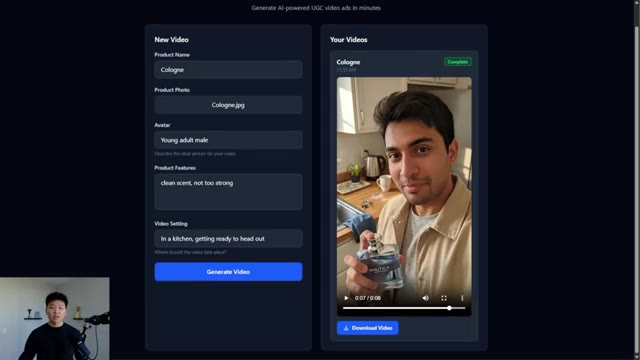
*⏱️ 00:06:14 — Interface web d'une application de génération de vidéos publicitaires IA, affichant à gauche les champs de saisie pour le produit et à droite la prévisualisation du résultat vidéo généré.*

---

### ⏱️ `[00:06:30 - 00:06:51]` | Segment #17

**🔊 Audio (Transcription Intégrale Mot pour Mot en Français) :**
> So we're gonna start building it and testing it in a local environment. And then once we like how the app looks and functions, then we'll push it to GitHub. And GitHub is basically just a home for our code and it will let us do different versions and see all the changes. And then what happens is our code lives in GitHub, but then we're going to have Vercel sync up to it. And Vercel is where we actually deploy those apps on the web.

**👁️ Analyse Visuelle d'Écran (gemini-3.5-flash-lite) :**
**Interface & Outils** : Claude Code (CLI).

**Contenu textuel & Code** : Texte détaillé expliquant les étapes de développement : déploiement sur Vercel après un push GitHub, utilisation de Next.js/React, et intégration de n8n via MCP.

**Action / Démonstration** : Le présentateur utilise l'interface de l'agent Claude Code pour documenter ou générer un plan de workflow de développement.

*⏱️ 00:06:35 — L'interface en ligne de commande de Claude Code affichant un long bloc de texte explicatif sur le workflow de développement (Next.js, GitHub, Vercel, n8n).*

---

### ⏱️ `[00:06:51 - 00:07:15]` | Segment #18

**🔊 Audio (Transcription Intégrale Mot pour Mot en Français) :**
> And I have a diagram to break this down in a few minutes here, but essentially the idea is we work in Cloud Code, we push changes to GitHub, and then our actual real web app on the public URL always reflects the most recent version. So it's just super easy. So there's also a couple of things that we're gonna utilize. One of them will be the NNN MCP so that you can understand NNN nodes, configurations, templates, and you can look through my NNN instance and create and edit workflows and things like that.

**👁️ Analyse Visuelle d'Écran (gemini-3.5-flash-lite) :**
**Interface & Outils** : Claude Code (interface de ligne de commande interactive)

**Contenu textuel & Code** : Texte descriptif expliquant l'optimisation des workflows, l'utilisation de Next.js/React, la synchronisation via GitHub et le déploiement automatique sur Vercel, ainsi que l'utilisation du MCP n8n.

**Action / Démonstration** : L'agent Claude Code affiche une réponse textuelle détaillée pour planifier ou expliquer les prochaines étapes du développement.

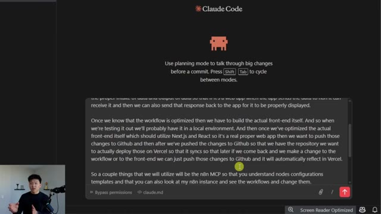
*⏱️ 00:06:57 — Capture d'écran de l'interface "Claude Code" affichant un long paragraphe explicatif sur le workflow de développement, incluant le déploiement sur Vercel.*

---

### ⏱️ `[00:07:15 - 00:07:34]` | Segment #19

**🔊 Audio (Transcription Intégrale Mot pour Mot en Français) :**
> I'm also gonna give you access to two skills, the NNN skills and the front end developer skills. And I'm gonna give you access to the GitHub MCP so that you can actually push changes to my GitHub. And then I finished that off by saying, with all that in mind, ask me any questions that you may need and help me make this file concise so that we keep everything neat and lean.

**👁️ Analyse Visuelle d'Écran (gemini-3.5-flash-lite) :**
**Interface & Outils** : Claude Code (CLI)

**Contenu textuel & Code** : Texte du prompt : "So a couple things that we will utilize will be the n8n MCP... I'll also give you access to two skills the n8n skills and the front-end designer skill and then we'll also need to give you the GitHub MCP so you can actually push my changes to Github."

**Action / Démonstration** : L'utilisateur soumet ses instructions de configuration et ses autorisations d'outils (MCP) à l'agent Claude Code pour initialiser le projet.

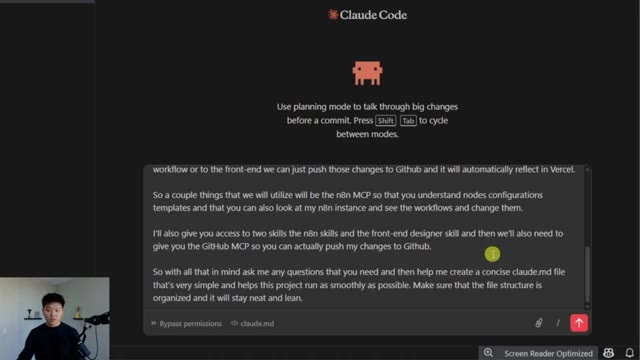
*⏱️ 00:07:20 — Interface de terminal Claude Code affichant un prompt détaillé détaillant les capacités accordées à l'IA, incluant l'accès aux outils n8n et GitHub MCP.*

---

### ⏱️ `[00:07:34 - 00:07:56]` | Segment #20

**🔊 Audio (Transcription Intégrale Mot pour Mot en Français) :**
> So before I send this off, I wanted to talk about these different modes. So right here you can see I'm on bypass permissions, which is orange. We could go to ask before edits, which is a lighter orange. We could go to edit automatically, which is white, or we could go to plan mode, which is blue. And so whenever I'm doing something like this, or whenever we're setting up an initial prompt, I always like to use plan mode because it thinks a lot better and it asks you questions.

**👁️ Analyse Visuelle d'Écran (gemini-3.5-flash-lite) :**
**Interface & Outils** : Claude Code (CLI/Terminal UI)

**Contenu textuel & Code** : Texte du prompt décrivant la configuration de n8n, les compétences (skills) d'accès à GitHub et la création d'un fichier claude.md.

**Action / Démonstration** : Sélection du mode opératoire « Bypass permissions » de l'agent Claude Code pour permettre l'exécution automatique des modifications.

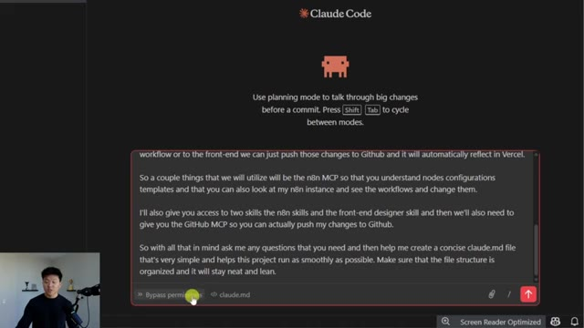
*⏱️ 00:07:39 — L'interface de Claude Code affichant un prompt utilisateur détaillant l'utilisation de n8n MCP et GitHub MCP, avec le sélecteur de mode réglé sur « Bypass permissions » en bas à gauche de la zone de saisie.*

---

### ⏱️ `[00:07:56 - 00:08:14]` | Segment #21

**🔊 Audio (Transcription Intégrale Mot pour Mot en Français) :**
> And it basically just lets you guys have a conversation before you actually do anything. So I'm gonna go ahead and shoot off this prompt in plan mode, and we're gonna see Claude Code think about what it needs to do. It's gonna first look through the current structure to see if there's any files. It's gonna understand what we're doing here. And you can see right here, it said, before I draft the file, I've got a few clarification questions.

**👁️ Analyse Visuelle d'Écran (gemini-3.5-flash-lite) :**
**Interface & Outils** : Claude Code (CLI/Interface interactive)

**Contenu textuel & Code** : - Image 1 : Prompt détaillé sur la configuration de n8n, les compétences (skills) front-end et GitHub.
- Image 2 : Commande "Read" pointant vers le chemin local "C:\Users\nateh\OneDrive\Documents\Agentic Workflows\n8n to app\claude.md" avec l'état "Mustering...".

**Action / Démonstration** : Envoi d'un prompt en "Plan mode" suivi de l'exécution automatique par l'agent pour lire la structure des fichiers du projet.

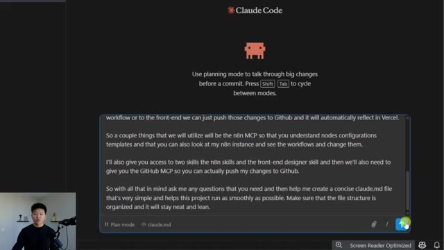
*⏱️ 00:08:00 — L'interface de Claude Code affichant un prompt utilisateur détaillant l'utilisation de n8n MCP, de GitHub MCP et la création d'un fichier claude.md.*

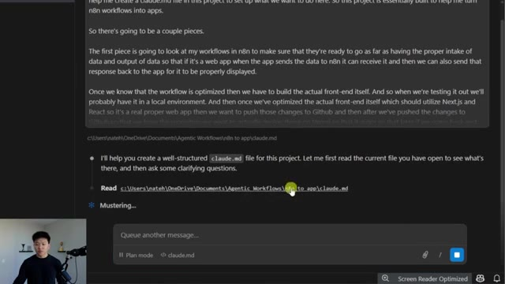
*⏱️ 00:08:05 — L'interface de Claude Code montrant la réponse de l'IA qui commence à analyser le fichier claude.md local.*

---

### ⏱️ `[00:08:14 - 00:08:34]` | Segment #22

**🔊 Audio (Transcription Intégrale Mot pour Mot en Français) :**
> So what's the typical structure of the workflow that you wanna turn into an app? Right now, let's just say various triggers because we don't actually know what we wanna turn into an app yet. For the project structure, do you have a preferred project structure in mind? I'm just gonna say propose, structure, whatever, I don't really care. Repo strategy, should each workflow become its own repo in GitHub?

**👁️ Analyse Visuelle d'Écran (gemini-3.5-flash-lite) :**
**Interface & Outils** : Interface web d'assistant de configuration ou de chatbot (type interface de projet IA).

**Contenu textuel & Code** : Question affichée : "What's the typical structure of a workflow you want to turn into an app? (e.g., webhook trigger -> processing -> response, or scheduled tasks, etc.)". Options : Webhook-based, Mixed types, Various triggers (sélectionné), Other.

**Action / Démonstration** : L'utilisateur sélectionne l'option "Various triggers" dans le questionnaire interactif pour définir la logique du workflow à automatiser.

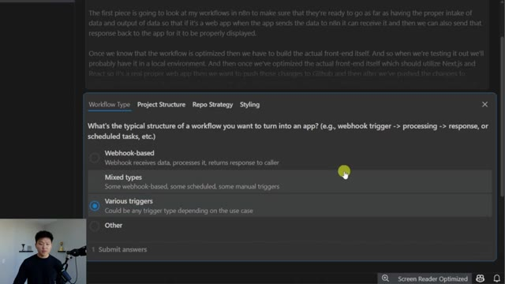
*⏱️ 00:08:19 — Une interface de formulaire interactif ou d'assistant IA posant une question sur la structure d'un workflow, avec des options de sélection comme "Webhook-based", "Mixed types", et "Various triggers".*

---

### ⏱️ `[00:08:34 - 00:08:54]` | Segment #23

**🔊 Audio (Transcription Intégrale Mot pour Mot en Français) :**
> Yep, we'll just do separate repos, one for each app. And then for styling, we'll just go ahead and go with Tailwind CSS. And if you don't know what this stuff means, you can just go ahead and ask it too. That's the beauty of Cloud Code, is that we don't have to really understand all the code and exactly what it's doing. We just have to be able to communicate our thoughts clearly. And if we get confused, just ask Cloud what it's doing and why, because it's really good at that.

**👁️ Analyse Visuelle d'Écran (gemini-3.5-flash-lite) :**
**Interface & Outils** : Visual Studio Code, interface interactive de Claude Code.

**Contenu textuel & Code** : - Image 1 : Sélection d'options : "Tailwind CSS", "shadcn/ui + Tailwind", "Flexible", "Other".
- Image 2 : Logs d'exécution de l'agent : "Read claude.md", "AskUserQuestion", "Unfurling...".

**Action / Démonstration** : - Image 1 : Sélection de l'option "Tailwind CSS" par l'utilisateur.
- Image 2 : L'agent IA analyse le fichier de projet et pose des questions clarificatrices pour structurer le workflow.

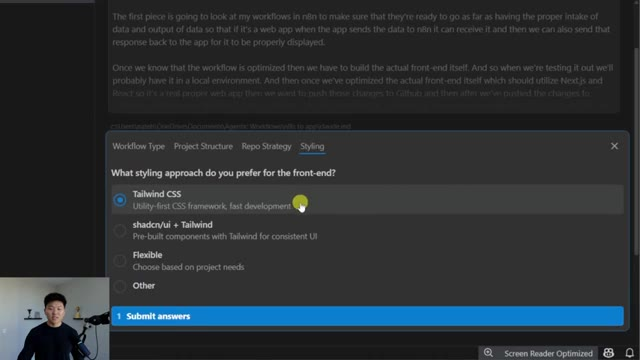
*⏱️ 00:08:39 — Une interface de configuration interactive dans une fenêtre de chat, proposant des options de stylisation pour une application front-end.*

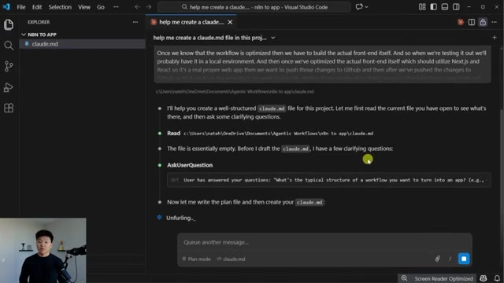
*⏱️ 00:08:44 — L'interface de Visual Studio Code affichant une interaction avec un agent IA (Claude Code) en mode planification dans un fichier "claude.md".*

---

### ⏱️ `[00:08:54 - 00:09:29]` | Segment #24

**🔊 Audio (Transcription Intégrale Mot pour Mot en Français) :**
> So you can see it gave us this plan for the Cloud file. And I said, yep, that sounds good. I'm going to go ahead and auto accept. And now it's going to update this Cloud MD file, which right now has nothing in it, as you can see. And it's going to basically just write in the system prompt. and you can see that it just happened in real time right there. Okay, our system prompt is configured. So next, what we have to do is give it access to all of those things that we mentioned, like the skills, the servers, whatever, the MCP. But before we do that, let me just show you guys exactly what we're doing here on a whiteboard. So it all makes way more sense. So in my last video, I showed you guys how we can use Cloud Code and give it the NNN MCP and the NNN skills to build

**👁️ Analyse Visuelle d'Écran (gemini-3.5-flash-lite) :**
**Interface & Outils** : Visual Studio Code (Image 1), Interface de dessin/canvas de Claude Code (Image 2).

**Contenu textuel & Code** : Plan de projet avec structure de fichiers (/api, /components, /lib, .env.local), variables d'environnement et étapes de vérification. Schéma conceptuel reliant les outils d'automatisation.

**Action / Démonstration** : L'agent IA propose un plan de création de fichier, le fichier 'claude.md' est en attente de remplissage automatique par l'agent.

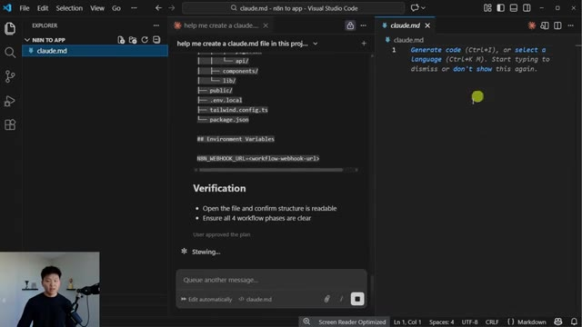
*⏱️ 00:09:03 — Interface VS Code affichant un fichier 'claude.md' vide avec un panneau latéral montrant un plan généré par une IA pour un projet n8n.*

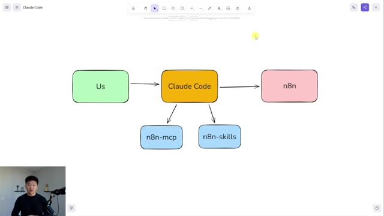
*⏱️ 00:09:21 — Diagramme de workflow illustrant l'architecture de connexion entre l'utilisateur, Claude Code, n8n, n8n-mcp et n8n-skills.*

---

### ⏱️ `[00:09:29 - 00:09:53]` | Segment #25

**🔊 Audio (Transcription Intégrale Mot pour Mot en Français) :**
> workflows for us in our own NNN instance. So we're kind of building on top of that here. If you haven't watched that video, that one might be a good one to start with and then come back to this one. So I'll tag that right up here. But essentially the NNN MCP gives Cloud Code access to all the nodes, configurations, workflow patterns, things like that. And NNN Skills gives Cloud Code all the knowledge about expressions, how to use this MCP server, how to code, all this kind of stuff.

**👁️ Analyse Visuelle d'Écran (gemini-3.5-flash-lite) :**
**Interface & Outils** : Logiciel de création de diagrammes (type Excalidraw ou similaire).

**Contenu textuel & Code** : Un diagramme montrant les relations entre "Us" (l'utilisateur), "Claude Code" (au centre), et "n8n", avec deux dépendances connectées à Claude Code : "n8n-mcp" et "n8n-skills".

**Action / Démonstration** : Présentation visuelle de l'architecture du workflow pour expliquer comment Claude Code interagit avec l'instance n8n.

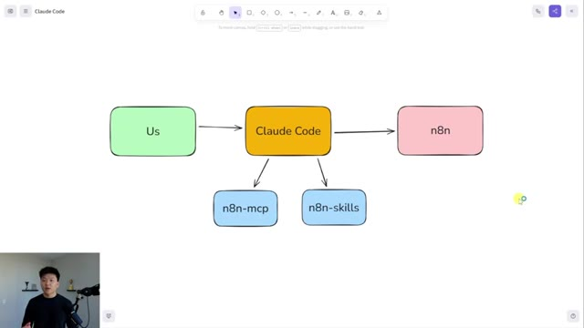
*⏱️ 00:09:35 — Un schéma architectural simplifié illustrant l'intégration de "Claude Code" avec n8n via des composants MCP.*

---

### ⏱️ `[00:09:53 - 00:10:12]` | Segment #26

**🔊 Audio (Transcription Intégrale Mot pour Mot en Français) :**
> So the TLDR is you're essentially giving one of the smartest brains in the world access to all of the information about NNN that you could possibly need. So now we're building on top of that and we're creating web apps. So what we do here is we've got once again, Cloud Code with MCP servers and with different skills. And now what we wanted to do is create us a web app.

**👁️ Analyse Visuelle d'Écran (gemini-3.5-flash-lite) :**
**Interface & Outils** : Outil de diagramme collaboratif (probablement Excalidraw ou similaire).

**Contenu textuel & Code** : Le diagramme montre un flux logique : "Us" pointe vers "Claude Code", qui est connecté à "n8n", "n8n-mcp" et "n8n-skills".

**Action / Démonstration** : Illustration visuelle du workflow d'automatisation expliquant comment Claude Code sert de moteur central pour orchestrer des serveurs MCP et des compétences spécifiques à n8n.

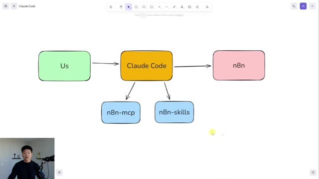
*⏱️ 00:09:57 — Un schéma conceptuel illustrant l'architecture d'un système utilisant Claude Code pour interagir avec n8n via des serveurs MCP.*

---

### ⏱️ `[00:10:12 - 00:10:33]` | Segment #27

**🔊 Audio (Transcription Intégrale Mot pour Mot en Français) :**
> So in order to create that web app, first of all, we use NNN to see the backend automation that we want to turn into an app. And we create the front end to actually like collaborate with that. Now, what is the front end? It's actually just code. So Cloud Code is building the code that displays the website. And what we do with that code is we push that to GitHub in something called a repository or what a lot of people just call a GitHub repo.

**👁️ Analyse Visuelle d'Écran (gemini-3.5-flash-lite) :**
**Interface & Outils** : Outil de tableau blanc virtuel (type Excalidraw ou similaire intégré à l'environnement).

**Contenu textuel & Code** : Schéma en blocs montrant les interactions entre "n8n" (backend), "Claude Code" (avec MCP et Skills), une "Web App" (visualisée en tant que produit final), "Code", "GitHub" (dépôt) et "Vercel" (hébergement).

**Action / Démonstration** : Présentation visuelle de l'architecture logicielle expliquant comment Claude Code génère le front-end et orchestre le déploiement.

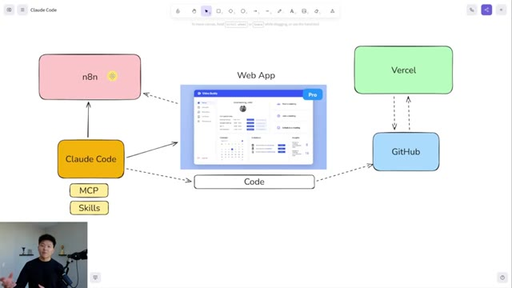
*⏱️ 00:10:17 — Un schéma architectural réalisé sur un tableau blanc virtuel illustrant le flux de travail pour la création d'une application web, connectant n8n, Claude Code, GitHub et Vercel.*

---

### ⏱️ `[00:10:33 - 00:10:57]` | Segment #28

**🔊 Audio (Transcription Intégrale Mot pour Mot en Français) :**
> And then we have Vercel, which actually deploys it on the internet so that other people could access this app. And Vercel is constantly looking at your GitHub repos so that if anything changes over there, you can basically have that change be instantly reflected on your real app. So like with this web app, the actual code for this lives in my Cloud Code locally. It's also reflected on GitHub and then Vercel has deployed it. So let's say I wanted to make this green instead of blue.

**👁️ Analyse Visuelle d'Écran (gemini-3.5-flash-lite) :**
**Interface & Outils** : Outil de schéma (ex: Excalidraw ou similaire) ; Application web "Instant UGC" (interface personnalisée).

**Contenu textuel & Code** : Schéma avec des blocs nommés "n8n", "Claude Code", "Web App", "Vercel" et "GitHub" avec des flèches directionnelles ; Champs de formulaire (Product Name, Product Photo, Avatar, etc.) pour la création de contenu vidéo.

**Action / Démonstration** : Illustration visuelle du workflow de déploiement et d'intégration continue ; démonstration du résultat final de l'application générée par l'IA.

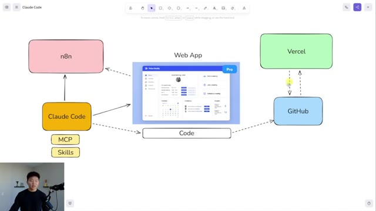
*⏱️ 00:10:39 — Un schéma architectural présentant les flux de données entre Claude Code, n8n, GitHub et Vercel pour le déploiement d'une application web.*

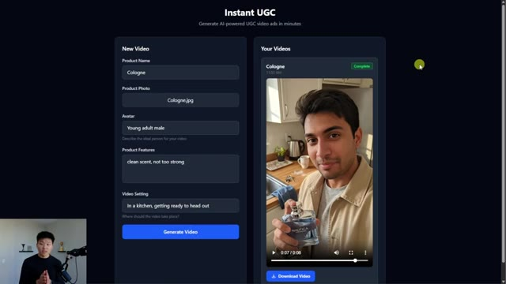
*⏱️ 00:10:51 — L'interface utilisateur de l'application "Instant UGC", montrant un formulaire de génération de vidéo à gauche et une vidéo générée d'un homme tenant un parfum à droite.*

---

### ⏱️ `[00:10:57 - 00:11:15]` | Segment #29

**🔊 Audio (Transcription Intégrale Mot pour Mot en Français) :**
> I could tell CloudCode to change the code to make it green. And then I could say, push this to GitHub. So GitHub would grab it. And then Vercel would grab it from GitHub. And then in like 20 seconds, we would see that this website would be green instead of blue. Hopefully that architecture makes sense now. Let's get back into CloudCode and let's start connecting all these things that we need.

**👁️ Analyse Visuelle d'Écran (gemini-3.5-flash-lite) :**
**Interface & Outils** : Logiciel de dessin/schématisation (ex: Excalidraw) affichant un diagramme de flux de données.

**Contenu textuel & Code** : Schéma technique reliant "Claude Code" à "n8n", "Code" (dépôt), "GitHub" et "Vercel" par des flèches directionnelles.

**Action / Démonstration** : Illustration visuelle du processus automatisé : le code est modifié par l'agent, poussé vers GitHub, puis automatiquement déployé via Vercel.

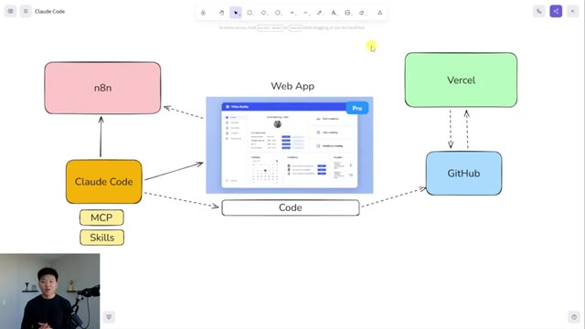
*⏱️ 00:11:10 — Diagramme de workflow illustrant l'architecture technique incluant Claude Code, n8n, GitHub et Vercel pour le déploiement continu d'une application web.*

---

### ⏱️ `[00:11:15 - 00:11:50]` | Segment #30

**🔊 Audio (Transcription Intégrale Mot pour Mot en Français) :**
> So now what I'm doing is I'm saying, connect all of these MCP servers and skills and just let me know if you need anything else. So I'm giving it the URL for the NNN MCP server. I'm giving it my cloud URL. I'm giving it my NNAPI key. I'm giving it the GitHub MCP server URL. I'm giving it my GitHub personal access token. I'm giving it the repo for the NNN skills, and I'm giving it the repo for the front end design skills. All of these links that you'll need, I'll just put in the description of this video. And what I'm going to do is I'm going to turn this on bypass permissions mode because I just want it to go without me having to approve everything. So I'm going to go ahead and

**👁️ Analyse Visuelle d'Écran (gemini-3.5-flash-lite) :**
**Interface & Outils** : VS Code (éditeur de texte avec fenêtre de chat d'IA intégrée).

**Contenu textuel & Code** : Le chat affiche le message de l'utilisateur fournissant les détails de connexion : l'URL du serveur MCP n8n (https://github.com/czlonkowski/n8n-mcp), l'URL du cloud n8n personnel et la clé API n8n. Le haut du chat récapitule une structure de projet en 4 phases : Validate, Build, Push, Deploy.

**Action / Démonstration** : L'utilisateur configure l'agent IA en lui fournissant les accès nécessaires (serveurs MCP, URLs et clés API) pour initialiser un workflow de déploiement d'applications web via n8n.

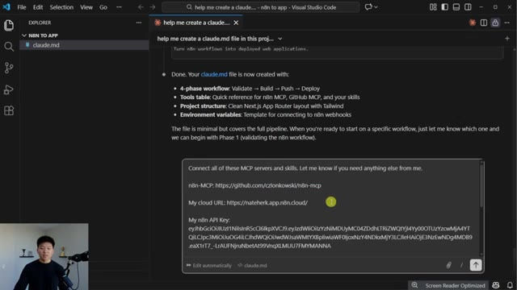
*⏱️ 00:11:24 — Une capture d'écran de l'interface VS Code montrant une interaction avec un agent IA (probablement Claude) qui confirme la création d'un fichier 'claude.md' et attend des informations de configuration.*

---

### ⏱️ `[00:11:50 - 00:12:20]` | Segment #31

**🔊 Audio (Transcription Intégrale Mot pour Mot en Français) :**
> shoot this off and let it work its magic. And while that's running, I'll show you guys two things. The first one is how do you get bypass permissions mode if you don't see it natively right there? Well, you go to your settings down here and then you would type in Claude code. And then right here, you just have to turn this check mark on that says allow dangerously skip permissions. Now, I know it sounds dangerous, but it's not too bad as long as you're watching it and like, you know, making sure that you're not telling it to go delete all your files and things like that. Now, the second thing I wanted to show you is how to get your GitHub personal access token.

**👁️ Analyse Visuelle d'Écran (gemini-3.5-flash-lite) :**
**Interface & Outils** : Visual Studio Code (VS Code) avec l'extension ou le terminal Claude Code intégré.

**Contenu textuel & Code** : Historique de discussion affichant des requêtes "Web Fetch" pour divers dépôts GitHub (n8n-mcp, github-mcp-server, n8n-skills), une clé API n8n visible et un état "Cerebrating..." (en cours de réflexion).

**Action / Démonstration** : L'agent automatise la connexion et la récupération des instructions de configuration pour les serveurs MCP.

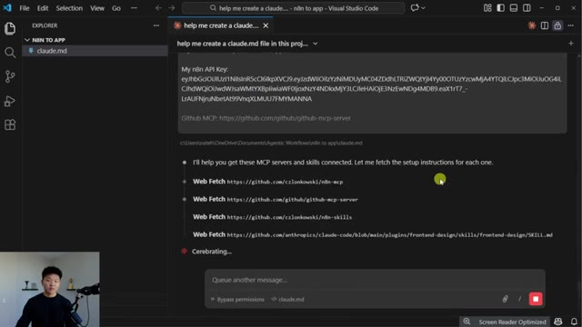
*⏱️ 00:11:58 — Une capture d'écran de l'interface VS Code montrant une interaction avec l'agent Claude Code, avec des logs de récupération de serveurs MCP et un champ de saisie en bas.*

---

### ⏱️ `[00:12:20 - 00:12:39]` | Segment #32

**🔊 Audio (Transcription Intégrale Mot pour Mot en Français) :**
> So here is my GitHub. All you have to do is just go to GitHub, create an account. It's free to create an account. And then you're going to go up here to your settings. And then at the bottom of your settings, you should see developer settings. And you're going to go ahead and create one of these personal access tokens. And you'll create a fine grained token. So that's all you have to do. It'll give you basically an API key.

**👁️ Analyse Visuelle d'Écran (gemini-3.5-flash-lite) :**
**Interface & Outils** : GitHub (interface web).

**Contenu textuel & Code** : Menus de configuration GitHub, liste de dépôts, options de profil et de sécurité.

**Action / Démonstration** : Navigation dans les paramètres du compte GitHub pour accéder aux options de développement (création de tokens/applications).

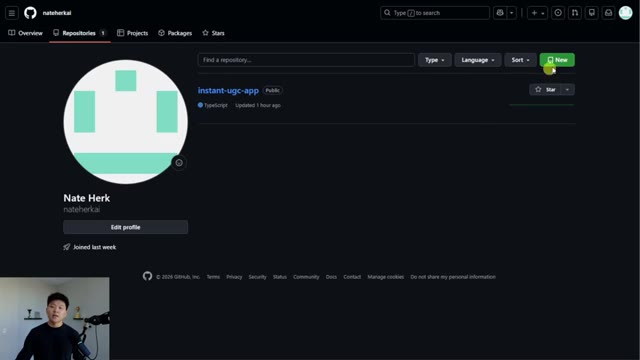
*⏱️ 00:12:25 — Page de profil GitHub utilisateur montrant les dépôts et le bouton "New" pour en créer un.*

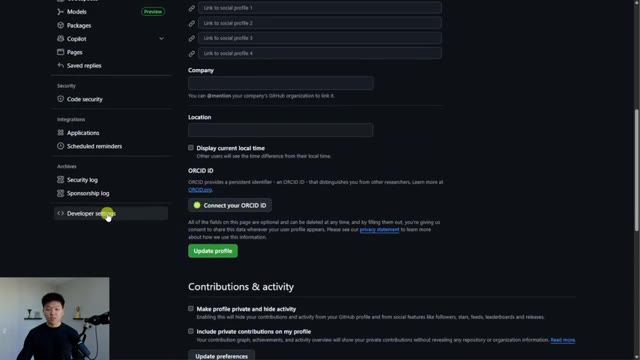
*⏱️ 00:12:30 — Page des paramètres utilisateur GitHub avec la barre latérale gauche mettant en évidence l'option "Developer settings".*

---

### ⏱️ `[00:12:39 - 00:13:01]` | Segment #33

**🔊 Audio (Transcription Intégrale Mot pour Mot en Français) :**
> And then that's what you're going to give to CloudCode here so that it can set everything up. And when you actually go to create this token, pretty much just given a name, I leave mine on public repositories. I change the expiration to never. And then the last thing is about permissions. And usually what I do is I just add all of these. There's like 23 or something, but just add all of them. If you realize later you want to restrict something else, you can just go ahead and create a new one or restrict it in Cloud Code.

**👁️ Analyse Visuelle d'Écran (gemini-3.5-flash-lite) :**
**Interface & Outils** : Navigateur web (GitHub - Developer Settings).

**Contenu textuel & Code** : Formulaire de création de jeton d'accès : champs "Token name", "Description", sélection "Resource owner" (nateherkai), menu déroulant "Expiration" (30 jours par défaut), et options de "Repository access" (Public repositories, All repositories, Only select repositories).

**Action / Démonstration** : Configuration des paramètres de sécurité pour la génération d'un token GitHub, comme décrit par le présentateur.

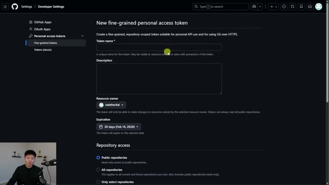
*⏱️ 00:12:45 — Interface GitHub affichant la page de création d'un "fine-grained personal access token" avec les champs de configuration (nom, description, expiration et accès aux dépôts).*

---

### ⏱️ `[00:13:01 - 00:13:22]` | Segment #34

**🔊 Audio (Transcription Intégrale Mot pour Mot en Français) :**
> It's not a huge deal. And then generate the token and pop it over to Cloud Code. And so the other thing to look at, and throughout this tutorial, you might see me use like the slash clear or some other things. But if you hit slash, you can see that there's other things that we can look at. So we can attach a file. We can mention a file from a project. We can switch the model. So we can go from default or Sonnet 4.5, Opus, Haiku.

**👁️ Analyse Visuelle d'Écran (gemini-3.5-flash-lite) :**
**Interface & Outils** : Visual Studio Code, extension Claude Code.

**Contenu textuel & Code** : Zone de saisie avec le texte "ctrl esc to focus or unfocus Claude", incluant des options pour "Bypass permissions" et le fichier ".mcp.json".

**Action / Démonstration** : Le présentateur explique comment interagir avec l'outil via des commandes (notamment la barre oblique '/') dans l'interface de Claude Code.

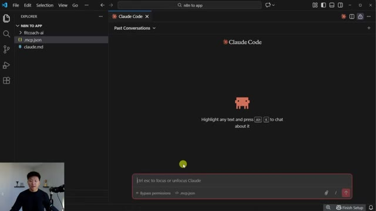
*⏱️ 00:13:06 — Une capture d'écran montrant l'interface de VS Code avec l'extension Claude Code active, affichant une zone de saisie pour les commandes et les interactions.*

---

### ⏱️ `[00:13:23 - 00:13:48]` | Segment #35

**🔊 Audio (Transcription Intégrale Mot pour Mot en Français) :**
> We could also turn on thinking. We can manage our MCP servers, agents, hooks, memory. We can do all of these other slash commands as well. And then if you actually use Cloud Code in something like Cursor or in the terminal environment, there's even more commands and more things you can do with agents and plan mode and things like that. But like I said, VS Code just makes this all look a lot cleaner and a lot less intimidating, which is why I wanted to do Cloud Code on VS Code in this tutorial.

**👁️ Analyse Visuelle d'Écran (gemini-3.5-flash-lite) :**
**Interface & Outils** : Éditeur de code (VS Code ou similaire) avec l'extension Claude Code.

**Contenu textuel & Code** : Liste de commandes : /n8n-workflow-patterns, /pr-comments, /release-notes, /review, /security-review. Champ de saisie actif avec le caractère "/".

**Action / Démonstration** : L'utilisateur consulte le menu des commandes slash disponibles pour interagir avec l'agent Claude Code.

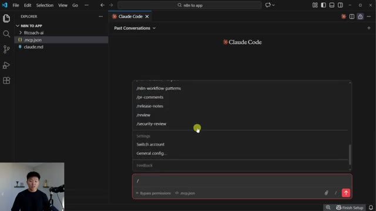
*⏱️ 00:13:29 — Une vue de l'interface de l'extension « Claude Code » intégrée dans un éditeur de code, affichant une liste de commandes disponibles (slash commands) comme /review ou /release-notes.*

---

### ⏱️ `[00:13:48 - 00:14:09]` | Segment #36

**🔊 Audio (Transcription Intégrale Mot pour Mot en Français) :**
> So now it's asking me, how would you like me to configure all of this stuff? I'm just gonna say, create the MCP JSON file because I don't wanna do it myself. I just want you to go ahead and take care of all of this stuff. And that's the thing that's interesting about this because when you go to a lot of these MCP servers or skills, it'll basically tell you installation steps and it will say, hey, go add this to your Cloud Code file or hey, go install this plugin.

**👁️ Analyse Visuelle d'Écran (gemini-3.5-flash-lite) :**
**Interface & Outils** : Visual Studio Code (éditeur de texte).

**Contenu textuel & Code** : Le menu interactif propose les options suivantes : "Create .mcp.json file", "Show combined config", "Guide me step-by-step" et "Other". L'option "Create .mcp.json file" est sélectionnée.

**Action / Démonstration** : L'utilisateur est en train de sélectionner l'option pour que l'IA génère automatiquement le fichier de configuration JSON pour les outils MCP au sein du projet.

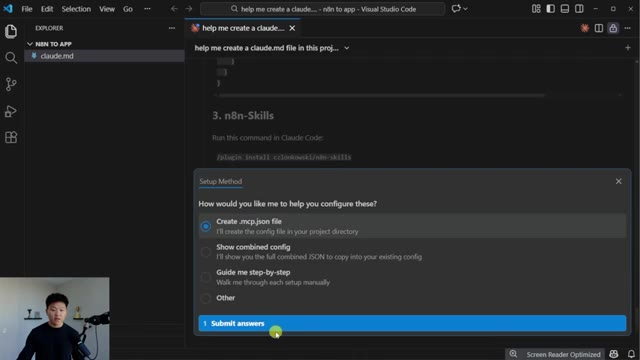
*⏱️ 00:13:53 — Une capture d'écran de Visual Studio Code montrant une interface de configuration interactive (Setup Method) proposée par un agent IA pour configurer des outils MCP.*

---

### ⏱️ `[00:14:10 - 00:14:30]` | Segment #37

**🔊 Audio (Transcription Intégrale Mot pour Mot en Français) :**
> And I don't wanna actually do that. I just want Cloud Code to do it. So all I do is I give it the raw URLs and what you can see here is when I give it the raw URLs, it just uses its web search tool and it reads the page and understands installation and then just does it. So a lot of times if Cloud Code comes back to you and says, hey, what you need to do is do this. You can come back to it and just say, no, you do it.

**👁️ Analyse Visuelle d'Écran (gemini-3.5-flash-lite) :**
**Interface & Outils** : Visual Studio Code avec le panneau de discussion Claude Code.

**Contenu textuel & Code** : URL de n8n, clé API n8n, et liens vers des dépôts GitHub (n8n-mcp, github-mcp-server) avec des messages de confirmation "Web Fetch".

**Action / Démonstration** : L'agent effectue une recherche web pour récupérer et configurer automatiquement les instructions d'installation des serveurs MCP à partir des URLs fournies.

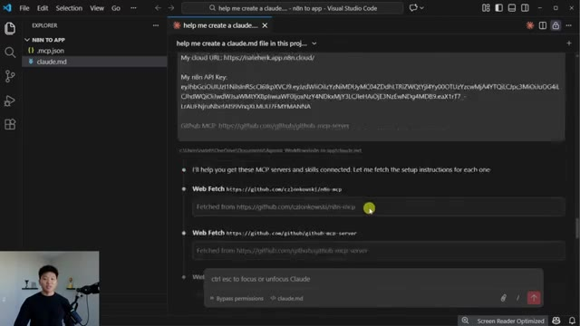
*⏱️ 00:14:15 — Une interface VS Code avec l'agent Claude Code en pleine interaction, montrant l'analyse automatique d'URLs de serveurs MCP.*

---

### ⏱️ `[00:14:30 - 00:15:05]` | Segment #38

**🔊 Audio (Transcription Intégrale Mot pour Mot en Français) :**
> And most of the time it'll just do it. Every once in a while it'll say, I actually can't, I need you to do this. But most of the time you can just tell it to do it for you. Like right here, it says install the skills by running these commands after restart. I'm gonna say, I don't wanna install those commands, can't you just do it for me? And what do you know? done, both skill sets are now installed. So I didn't have to do any of that. So right here we have the mcp.json file and this is where you can see we have our NNN MCP server and we have our GitHub MCP server. And you'll notice that we don't actually see the skills in here. And the reason why is because the skills were installed globally, not just within this one project that we're working in

**👁️ Analyse Visuelle d'Écran (gemini-3.5-flash-lite) :**
**Interface & Outils** : Visual Studio Code avec l'extension Claude Code.

**Contenu textuel & Code** : Instructions d'installation pour des plugins : `/plugin install czlonkowski/n8n-skills` et `/plugin install anthropics/claude-code --path plugins/frontend-design`, suivies de recommandations pour Docker et Node.js.

**Action / Démonstration** : L'assistant IA présente une liste de tâches à effectuer manuellement par l'utilisateur après le redémarrage.

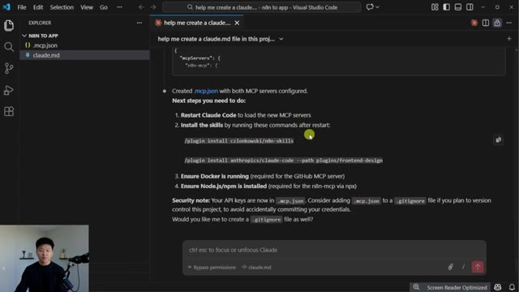
*⏱️ 00:14:39 — Interface de Claude Code dans VS Code affichant une liste d'instructions pour finaliser la configuration de serveurs MCP.*

---

### ⏱️ `[00:15:05 - 00:15:25]` | Segment #39

**🔊 Audio (Transcription Intégrale Mot pour Mot en Français) :**
> called NNN to app, which is cool because later if we make another project, we already have those skills installed. And if you don't believe me or you get confused, you just ask Claude. I said, why don't I see the N8N skills in this project? And it basically just came down and said, yeah, they're installed globally. Here are the seven N8N skills. And for some reason it said six, so not the best at counting, but then we also have the front end skill down here.

**👁️ Analyse Visuelle d'Écran (gemini-3.5-flash-lite) :**
**Interface & Outils** : Visual Studio Code (ou Cursor)

**Contenu textuel & Code** : Fichier `mcp.json` détaillant la configuration des serveurs "n8n-mcp" (avec URL API et clé) et "github" (via Docker).

**Action / Démonstration** : Configuration des paramètres de connexion (MCP - Model Context Protocol) pour permettre à l'IA d'interagir avec les outils n8n et GitHub.

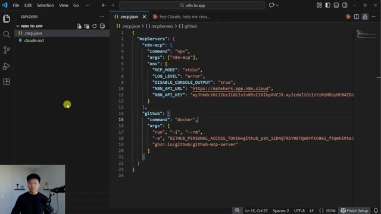
*⏱️ 00:15:10 — Éditeur de code VS Code montrant la configuration d'un fichier MCP pour intégrer n8n et GitHub en tant que serveurs.*

---

### ⏱️ `[00:15:25 - 00:15:45]` | Segment #40

**🔊 Audio (Transcription Intégrale Mot pour Mot en Français) :**
> So that's just to prove that they are actually installed, even though you don't see them over here on the file explorer. Now something else to keep in mind about this MCP JSON file is that it has your real GitHub token and your real API key in here. So if you've shared this file for some reason or someone had access to this, they would be able to do anything in your NNN because they have this information.

**👁️ Analyse Visuelle d'Écran (gemini-3.5-flash-lite) :**
**Interface & Outils** : VS Code avec l'extension Claude Code.

**Contenu textuel & Code** : Liste des compétences n8n (n8n-code-javascript, python, expression-syntax, mcp-tools-expert, etc.) et de la compétence Front-End (frontend-design). Notification système en bas à droite demandant la permission pour "ExitPlanMode".

**Action / Démonstration** : Consultation de la liste des outils MCP disponibles et interaction avec l'agent Claude pour confirmer l'installation des compétences.

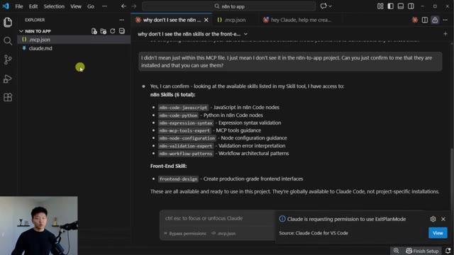
*⏱️ 00:15:30 — Interface de VS Code montrant un fichier .mcp.json dans l'explorateur et une conversation active avec Claude dans l'éditeur.*

---

### ⏱️ `[00:15:46 - 00:16:04]` | Segment #41

**🔊 Audio (Transcription Intégrale Mot pour Mot en Français) :**
> So obviously I'll be deleting these credentials after this video goes live, but just something else that I wanted to make sure you guys were aware of. That is why typically when you're doing certain things, you're gonna have like a .env file and you'll have your actual scripts and things call on those credentials so they only use them when they need them. And like all those .env files are encrypted.

**👁️ Analyse Visuelle d'Écran (gemini-3.5-flash-lite) :**
**Interface & Outils** : VS Code

**Contenu textuel & Code** : Fichier JSON contenant des configurations pour 'n8n-mcp' et 'github', incluant des clés API ('N8N_API_KEY') et des tokens d'accès personnels GitHub ('GITHUB_PERSONAL_ACCESS_TOKEN') en clair.

**Action / Démonstration** : Le présentateur explique l'importance de sécuriser les identifiants en montrant une configuration MCP où les secrets sont directement intégrés dans le fichier de configuration.

*⏱️ 00:15:50 — Éditeur VS Code affichant le fichier de configuration 'mcp.json' avec des variables d'environnement exposées.*

---

### ⏱️ `[00:16:05 - 00:16:27]` | Segment #42

**🔊 Audio (Transcription Intégrale Mot pour Mot en Français) :**
> So don't wanna confuse you guys. We're not gonna dive into that right now. Just something that you should be aware of. All right, so what I'm gonna do now is I have to restart Cloud Code. Otherwise, it won't actually reflect all that. So really what I'm going to do is just close out of VS Code and then we're going to open it back up and then everything should be all set. All right, so I'm going to go ahead and do a slash command. I'm going to do slash clear just to get rid of this conversation so we can start fresh on a new context.

**👁️ Analyse Visuelle d'Écran (gemini-3.5-flash-lite) :**
**Interface & Outils** : Présentation ou face-caméra explicatif sans interface logicielle partagée.

**Contenu textuel & Code** : Explications orales et mise en contexte méthodologique.

**Action / Démonstration** : Explications face caméra et démonstration conceptuelle.

---

### ⏱️ `[00:16:27 - 00:16:59]` | Segment #43

**🔊 Audio (Transcription Intégrale Mot pour Mot en Français) :**
> But keep in mind, every time we talk to Cloud Code, it's still going to be reading through our cloud.md system prompt to understand what we're doing in this project. Okay, so what actually are we going to turn into a web app? Well, let's make it pretty simple. I've got this workflow here, which is just an AI agent and it's a chat window here and it's called fitness coach. So in here, I basically just have a system prompt prompting this agent to be a fitness coach with stuff like, you know, weightlifting, working out, some basic nutrition stuff, just so we can make a little demo here. But you can see that this is not ready to go to be turned into a web app, not really at

**👁️ Analyse Visuelle d'Écran (gemini-3.5-flash-lite) :**
**Interface & Outils** : VS Code (avec extension Claude Code) et n8n (éditeur de workflow/agent).

**Contenu textuel & Code** : - Image 1 : Fichier 'claude.md' présent dans l'arborescence, barre de commande Claude Code avec option "Bypass permissions".
- Image 2 : Code de système prompt définissant les règles pour un "evidence-based fitness coach AI" (règles de sécurité, nutrition, étirements, style de coaching).

**Action / Démonstration** : - Image 1 : Préparation de l'environnement de développement pour interagir avec l'agent Claude.
- Image 2 : Consultation ou édition des instructions systèmes (System Prompt) de l'agent fitness au sein de l'automatisation n8n.

*⏱️ 00:16:35 — Interface de VS Code montrant l'extension Claude Code active avec le fichier 'claude.md' ouvert dans l'explorateur de projet.*

*⏱️ 00:16:51 — Interface de configuration d'un nœud dans n8n, affichant un "system prompt" détaillé pour un agent IA spécialisé en coaching fitness.*

---

### ⏱️ `[00:16:59 - 00:17:30]` | Segment #44

**🔊 Audio (Transcription Intégrale Mot pour Mot en Français) :**
> least. But all I'm going to do is just tell CloudCode to look for this workflow and help me turn it into a web app. So we're going to go back into Cloud Code. I'm going to change this to plan mode because we want to like brainstorm how we're going to do this. And I'm going to say, I've got a workflow in my NNN instance called Fitness Coach. I want to turn this into a web app. So before we do that, please take a look at it and help me change it so that it's ready to go and I can talk to it from a front end. So I'll shoot this off and we're basically just going to watch it think.

**👁️ Analyse Visuelle d'Écran (gemini-3.5-flash-lite) :**
**Interface & Outils** : Interface web de plateforme d'automatisation/workflow (type Vercel AI SDK ou plateforme low-code pour agents IA).

**Contenu textuel & Code** : Diagramme de nœuds : "When chat message received" -> "Fitness Coach" (connecté à un "OpenRouter Chat Model"). En bas à droite, une vignette miniature de terminal "Claude Code".

**Action / Démonstration** : Le présentateur affiche le workflow existant ("Fitness Coach") avant de basculer vers Claude Code pour planifier sa conversion en application web.

*⏱️ 00:17:07 — Interface d'édition de workflow dans l'application Vercel AI SDK ou plateforme similaire, montrant le diagramme d'un agent "Fitness Coach" connecté à un modèle OpenRouter.*

---

### ⏱️ `[00:17:30 - 00:17:55]` | Segment #45

**🔊 Audio (Transcription Intégrale Mot pour Mot en Français) :**
> It's going to walk through its steps. And what you can see right now is that it's using the ended in MCP to find our workflows. Now it was able to find the fitness coach. So it's going to analyze it. And you can see that it found the workflow, but there's an issue, which is it's using the chat trigger, which is not really designed for a custom front end. So it's going to write up a plan to change this workflow for us. So here it asks, do you want the fitness coach to remember conversation history? Because right now in the actual workflow, there's no memory.

**👁️ Analyse Visuelle d'Écran (gemini-3.5-flash-lite) :**
**Interface & Outils** : VS Code avec l'extension Claude (interface de chat AI).

**Contenu textuel & Code** : Historique de discussion de l'IA : "I can see there are many workflows. Let me search for the 'Fitness Coach' workflow specifically.", suivi de l'appel de fonction `mcp_n8n-mcp_n8n_list_workflows` et de ses paramètres d'entrée/sortie JSON.

**Action / Démonstration** : L'agent IA exécute des commandes via MCP pour lister et rechercher un workflow spécifique nommé "Fitness Coach" au sein d'une instance n8n connectée.

*⏱️ 00:17:37 — Une vue de l'interface de l'éditeur VS Code affichant un panneau de chat (Claude) interagissant avec un serveur MCP n8n pour localiser des workflows.*

---

### ⏱️ `[00:17:56 - 00:18:17]` | Segment #46

**🔊 Audio (Transcription Intégrale Mot pour Mot en Français) :**
> So what I'm going to do is say, yeah, that's a great feature. We want the coach to be able to remember like it's having a conversation. Okay. So here it came up with a plan, which is to prepare the fitness coach workflow to be a web app. So it tells us what the problem is. It tells us what it's going to do. So it's going to replace the chat trigger with a web hook. It's going to add a window buffer. It's going to add a window buffer memory. It's going to update all these connections.

**👁️ Analyse Visuelle d'Écran (gemini-3.5-flash-lite) :**
**Interface & Outils** : VS Code avec l'extension/chat Claude (Claude Code).

**Contenu textuel & Code** : Texte affichant : "The current trigger (n8n/n8n-nodes-langchain.chatTrigger) is designed for n8n's embedded chat widget... Let me write up a plan for the changes needed." incluant un fichier "valiant-noodling-newt.md" avec le titre "Plan: Prepare Fitness Coach Workflow for Web App Integration".

**Action / Démonstration** : L'agent IA analyse le problème technique et pose une question de clarification à l'utilisateur concernant la gestion de l'historique des conversations (multi-turn chat) pour le coach fitness.

*⏱️ 00:18:01 — Interface de VS Code montrant l'agent Claude en train de formuler un plan technique pour modifier un workflow n8n afin de l'intégrer à une application web.*

---

### ⏱️ `[00:18:17 - 00:18:51]` | Segment #47

**🔊 Audio (Transcription Intégrale Mot pour Mot en Français) :**
> It's going to configure the agent input, and then it's going to publish the workflow as well. And so we could obviously make some changes here if we want. I want to see how it did on its own. So I'm going to go ahead and just auto accept all these changes. I'm going to make this bypass permissions so that we can just basically see when it's done. And what it does is it creates a to-do list, which is really cool because it helps the actual model stay on track, but it also helps us understand its thought process and what stage it's on. So that way, a lot of times when you're working with Cloud Code, you can have it open on one monitor. You can be doing something else, watching a YouTube video, whatever you want to do, and just kind of checking in and making sure that

**👁️ Analyse Visuelle d'Écran (gemini-3.5-flash-lite) :**
**Interface & Outils** : Visual Studio Code (avec une extension de type Claude Code ou outil d'automatisation IA).

**Contenu textuel & Code** : Un plan étape par étape numéroté (1 à 6) concernant la configuration d'un workflow n8n (test de requête POST, vérification de la mémoire, activation pour la production), ainsi qu'une section « Accept this plan? » avec l'option « Yes, and auto-accept » mise en surbrillance.

**Action / Démonstration** : L'utilisateur est sur le point de sélectionner l'option « Yes, and auto-accept » pour valider automatiquement les modifications suggérées par l'agent IA.

*⏱️ 00:18:26 — Une interface de chat d'assistant IA intégrée à VS Code, présentant un plan de workflow n8n et une invite de sélection pour l'approbation des modifications par l'utilisateur.*

---

### ⏱️ `[00:18:51 - 00:19:27]` | Segment #48

**🔊 Audio (Transcription Intégrale Mot pour Mot en Français) :**
> it's staying on the right path. And a lot of times it's not perfect, but what's so cool about Cloud Code is that it runs into issues and it analyzes what went wrong and then fixes it. So right here you can see that there was an error because the key parameter for the session ID for the memory was missing. And so it figured out that the body's actually nested and then it went ahead and just, you know, changed the workflow after it realized that. So it's all about how much context you give it and how clearly you can explain what you want. And that's also why the planning mode is so helpful. But it looks like that workflow has been updated now. What I'm going to do is go back into NNN, which was this workflow right here, and I'm going to hit refresh. And we

**👁️ Analyse Visuelle d'Écran (gemini-3.5-flash-lite) :**
**Interface & Outils** : VS Code avec extension/interface Claude Code (Chat interface).

**Contenu textuel & Code** : Logs d'exécution indiquant "Key parameter is empty", analyse de la structure imbriquée `$json.body.sessionId` et correction des expressions JSON.

**Action / Démonstration** : Diagnostic automatique d'une erreur de mapping de données et suggestion de correction par l'agent IA pour le workflow n8n.

*⏱️ 00:19:00 — Interface de VS Code montrant l'agent Claude Code en train d'analyser une erreur d'exécution liée à une structure de données JSON dans un workflow n8n et proposant une correction.*

---

### ⏱️ `[00:19:27 - 00:19:47]` | Segment #49

**🔊 Audio (Transcription Intégrale Mot pour Mot en Français) :**
> should now see that the workflow is changed and it should be ready to go for our web app. So we've got a webhook, which is post request. We've got our memory. And let's see if it changed the actual configuration of the user message, which it did. So we also, I noticed, don't have a respond to webhook node. So what it's doing is it's using respond when the last node finishes with the first entry.

**👁️ Analyse Visuelle d'Écran (gemini-3.5-flash-lite) :**
**Interface & Outils** : n8n (éditeur de workflow d'automatisation)

**Contenu textuel & Code** : Configuration du "System Message" : "You are an evidence-based fitness coach AI that helps generally healthy adults with weightlifting, yoga, stretching/mobility, and balanced nutrition..." et expression dynamique pour le prompt utilisateur : `{{ $('Webhook').item.json.body.message }}`.

**Action / Démonstration** : Navigation et inspection des paramètres de configuration du nœud "Fitness Coach" au sein du workflow d'automatisation.

*⏱️ 00:19:32 — Vue d'ensemble du canevas de workflow montrant le nœud Webhook connecté au nœud Fitness Coach, avec des connexions aux modules OpenRouter Chat Model et Window Buffer Memory.*

*⏱️ 00:19:37 — Interface de configuration détaillée du nœud Fitness Coach, affichant les paramètres du prompt "User Message" et le "System Message" définissant le rôle de l'IA.*

*⏱️ 00:19:42 — Retour à la vue globale du workflow dans l'éditeur, avec le curseur survolant le nœud Webhook.*

---

### ⏱️ `[00:19:47 - 00:20:07]` | Segment #50

**🔊 Audio (Transcription Intégrale Mot pour Mot en Français) :**
> So I think we should be all right. But later, if we end up needing to change something, we would just say, hey, Claude, this didn't work. Go fix the workflow. All right, so back in Claude, what I'm gonna do now is I'm going to clear out this context once again, and I'm gonna go back into plan mode. And we're gonna talk about what we want this actual web app to look like. Hey, Claude, help me create a plan to actually build out this front end for the NNN workflow.

**👁️ Analyse Visuelle d'Écran (gemini-3.5-flash-lite) :**
**Interface & Outils** : VS Code avec l'extension Claude (interface de chat intégrée).

**Contenu textuel & Code** : Résumé "Verified Working" (Webhook, AI Agent, Memory, Workflow) et "Next Steps" listant des instructions pour Next.js, incluant une variable d'environnement N8N_WEBHOOK_URL.

**Action / Démonstration** : Consultation de l'état actuel du workflow généré par l'IA avant de passer au mode "plan" pour la suite du développement.

*⏱️ 00:19:52 — Une interface VS Code affichant une conversation avec l'agent Claude, résumant les étapes validées du workflow n8n et les prochaines étapes pour créer l'interface front-end.*

---

### ⏱️ `[00:20:08 - 00:20:29]` | Segment #51

**🔊 Audio (Transcription Intégrale Mot pour Mot en Français) :**
> I wanna make sure that in your plan, you're going to be using the front end designer skill, the NNN tools skill, and all of the resources that you have to make this as good as possible. We don't want the web app to look AI vibe coded. We want it to look professional, very minimalistic, and we want it to be super clean. We also want it to be a little bit gamified to incentivize people to come in and to talk to the fitness coach.

**👁️ Analyse Visuelle d'Écran (gemini-3.5-flash-lite) :**
**Interface & Outils** : VS Code avec l'extension Claude Code.

**Contenu textuel & Code** : Explorateur de fichiers affichant `mcp.json` et `claude.md` ; fenêtre de chat avec le message : "Make a CLAUDE.md file for instructions Claude will read every single time." et la barre de saisie indiquant "ctrl esc to focus or unfocus Claude".

**Action / Démonstration** : Préparation de la configuration de l'agent IA via un fichier d'instructions (CLAUDE.md) pour définir le comportement du projet.

*⏱️ 00:20:13 — Une capture d'écran de l'éditeur VS Code montrant l'interface de l'extension « Claude Code » avec une invite pour créer un fichier CLAUDE.md.*

---

### ⏱️ `[00:20:29 - 00:21:05]` | Segment #52

**🔊 Audio (Transcription Intégrale Mot pour Mot en Français) :**
> Maybe we can have the main chat interface and then on the right-hand side, we can have a little bit of gamification with a tracker for how many times people have talked to the fitness coach and maybe they can level up after every five or 10 messages or something like that. ask me clarification questions to make sure that we're not leaving any holes in our plan here and any suggestions that you may want to make that I didn't yet think of. All right, I'm shooting that off. I'll let you guys know if anything important happens. All right, so I got some questions here. The first one is which NNN workflow should this front end connect to? We're going to do the existing workflow, which it should be able to find. Now we have what core features should the

**👁️ Analyse Visuelle d'Écran (gemini-3.5-flash-lite) :**
**Interface & Outils** : Visual Studio Code (VS Code) avec l'extension/terminal Claude Code actif.

**Contenu textuel & Code** : Texte informatif "Make a CLAUDE.md file for instructions Claude will read every single time." et barre d'invite de commande avec le texte indicatif "ctrl esc to focus or unfocus Claude".

**Action / Démonstration** : Le présentateur utilise l'environnement de développement pour configurer ou interagir avec l'agent Claude Code afin de structurer le développement de l'application.

***

Pourriez-vous préciser si vous souhaitez que j'analyse l'adéquation entre cette interface technique (Claude Code) et la fonctionnalité de "gamification" mentionnée dans l'audio, ou si vous avez besoin d'une transcription plus détaillée des instructions contenues dans le fichier `claude.md` qui pourrait être créé par la suite ?

*⏱️ 00:20:38 — Une vue de l'interface de Claude Code intégrée dans VS Code, affichant une zone de saisie pour les requêtes utilisateur et une icône stylisée en forme de pixel art.*

---

### ⏱️ `[00:21:05 - 00:21:38]` | Segment #53

**🔊 Audio (Transcription Intégrale Mot pour Mot en Français) :**
> fitness coach provide when users chat with it? General fitness Q&A, personalized workout plans, progress tracking. Yeah, we'll just do all of these. Gamification. For the gamification system, what should users be leveling up and earning rewards for? Just a message count. Let's just do that. And then what's your preference for user data persistence, remembering their level, message count, things like that. And I'm just going to say, let me decide later. We can get into a bunch of backend database storage and authentication. In different videos, we want to keep this one simple. So for now, we're just going to go with that. Now it's asking for the name or ID of the existing fitness coach workflow, the one that it found earlier. So I'm just going to go ahead and

**👁️ Analyse Visuelle d'Écran (gemini-3.5-flash-lite) :**
**Interface & Outils** : Visual Studio Code (avec une fenêtre d'interaction d'agent IA intégrée).

**Contenu textuel & Code** : Menu interactif posant la question : "For the gamification system, what should users be leveling up / earning rewards for?" avec des options comme "Message count only", "Daily check-ins", "Goals completed", et "All of the above".

**Action / Démonstration** : L'utilisateur est en train de naviguer dans les options de configuration de l'application pour définir les mécaniques de progression du coach fitness IA.

*⏱️ 00:21:13 — Interface de configuration affichée dans VS Code, présentant un menu de sélection pour définir le système de gamification de l'application fitness.*

---

### ⏱️ `[00:21:38 - 00:21:57]` | Segment #54

**🔊 Audio (Transcription Intégrale Mot pour Mot en Français) :**
> type in the name or ID. And honestly, now that I think about it, it probably would have been better if I didn't clear the context and we just kept talking on that previous thread. But what are you going to do? Some more questions now. What color scheme or brand aesthetic do you want? I'm going to go with dark mode primary. The app name, let's just go with, yeah, Fit Coach AI.

**👁️ Analyse Visuelle d'Écran (gemini-3.5-flash-lite) :**
**Interface & Outils** : VS Code avec extension de chat IA (probablement Claude Code ou Cursor).

**Contenu textuel & Code** : Menu de sélection d'esthétique de marque : "Dark mode primary", "Light & clean", "Energetic accent", "Let designer decide". Le texte de discussion affiche un "Workflow Summary" pour un Fitness Coach.

**Action / Démonstration** : L'utilisateur survole l'option "Light & clean" avec le curseur de la souris pour définir l'apparence de l'application en cours de création.

*⏱️ 00:21:43 — Une capture d'écran de l'interface de l'éditeur VS Code montrant une fenêtre de discussion interactive avec un agent IA (Claude), proposant des choix de personnalisation pour une application (Color Theme, App Name, Mobile Layout).*

---

### ⏱️ `[00:21:57 - 00:22:32]` | Segment #55

**🔊 Audio (Transcription Intégrale Mot pour Mot en Français) :**
> And then mobile layout, should the gamification panel be visible on mobile or only larger screens? We're just going to go with always visible, keep things nice and easy. All right. So the plan for the FitCoach AI web app is done. There's tons of stuff in here with structure, text stack, key features, all this kind of stuff. Obviously you would read through this and make some changes if you want, but we're just going to see how CloudCode does on its own. So I'm going to go ahead and auto accept those changes. And of course, what it's going to do is set up a to-do list, as you can see right here. So I'll just check in with you guys when we have something ready to test. Okay. So there we go. The to-do list has been completed and FitCoach AI is ready. You can

**👁️ Analyse Visuelle d'Écran (gemini-3.5-flash-lite) :**
**Interface & Outils** : Visual Studio Code (avec extension Claude ou intégration de chat IA).

**Contenu textuel & Code** : Texte affichant le "FitCoach AI - Implementation Plan", incluant un aperçu du design (mode sombre, design minimaliste, sidebar de gamification) et une invite utilisateur proposant de valider le plan ("Accept this plan?").

**Action / Démonstration** : L'utilisateur visualise et s'apprête à valider le plan d'implémentation généré par l'IA pour démarrer le développement du projet.

*⏱️ 00:22:06 — Interface de VS Code affichant le plan d'implémentation du projet "FitCoach AI" généré par Claude.*

---

### ⏱️ `[00:22:32 - 00:23:00]` | Segment #56

**🔊 Audio (Transcription Intégrale Mot pour Mot en Français) :**
> see that it's actually living right now on a local host, which basically just means only we could access this. So if I gave you this exact, you know, HTTP address, it would pull up your own local host, whatever you're hosting on 3002. So what we need to do is make sure it works here. And then you can see when you're ready, we'll initialize the Git and we'll push it to GitHub, and then we'll deploy it to Vercel. So I'm going to go ahead and open up this local host and let's take a look at what we've got. All right. So this is the FitCoach AI interface that it came up with.

**👁️ Analyse Visuelle d'Écran (gemini-3.5-flash-lite) :**
**Interface & Outils** : Visual Studio Code avec l'extension Claude (interface de chat intégrée).

**Contenu textuel & Code** : Liste des fonctionnalités (Dark mode, Chat interface, Gamification sidebar) et les prochaines étapes : "1. Test it - Visit http://localhost:3002", "2. Push to GitHub", "3. Deploy to Vercel".

**Action / Démonstration** : Le curseur survole le lien localhost:3002 dans le chat Claude, illustrant l'étape de test locale de l'application en cours de développement.

*⏱️ 00:22:39 — Une capture d'écran de l'éditeur VS Code montrant une discussion avec l'interface Claude AI, détaillant les fonctionnalités implémentées pour une application et les prochaines étapes de déploiement.*

---

### ⏱️ `[00:23:00 - 00:23:34]` | Segment #57

**🔊 Audio (Transcription Intégrale Mot pour Mot en Français) :**
> And you can see we've got ready to crush your goals. You can try creating a 30 minute hit workout. What should I eat after working out? How do I stay motivated to exercise? We've got some stats over here So we've been a member since january 14th. We've got rookie level one 11 points to the next We've got a roadmap. So it did everything that we were looking for Let's see if it's actually able to talk to our nnn workflow So i'm gonna start off by just saying hey there. We'll shoot this off and let's see if we get some sort of response back Okay, cool So it gave us a response, but it doesn't look great as you can see because what happens is in nnn when we respond

**👁️ Analyse Visuelle d'Écran (gemini-3.5-flash-lite) :**
**Interface & Outils** : Interface web d'application personnalisée "FitCoach AI".

**Contenu textuel & Code** : Suggestions de prompts : "Create a 30-minute HIIT workout", "What should I eat after working out?", "How do I stay motivated to exercise?", "Design a beginner strength routine". Panneau "Progress" indiquant : "Level 1 Rookie", "Member Since Jan 14, 2026", "Total Messages: 0".

**Action / Démonstration** : Démonstration de l'interface utilisateur de l'application de coaching sportif basée sur l'IA, mettant en évidence les fonctionnalités d'engagement utilisateur et le suivi de progression gamifié.

*⏱️ 00:23:08 — Interface de l'application "FitCoach AI" affichant des suggestions de prompts pour l'utilisateur et un panneau latéral de suivi de progression (stats, niveau Rookie, "Member Since Jan 14, 2026").*

---

### ⏱️ `[00:23:34 - 00:24:04]` | Segment #58

**🔊 Audio (Transcription Intégrale Mot pour Mot en Français) :**
> we get the whole JSON body. So we get the output and then we get all this other stuff. So if I actually go to the fitness coach workflow, we go to executions, we can see that when CloudCode changed the workflow, it did everything right, which is great. But the actual output of the fitness coach is this JSON body. So basically the front end displays this JSON body rather than just the actual output, which is what we wanted to display. So super easy. What we're going to do is we are going to, of course, go back into CloudCode and just tell it to fix that.

**👁️ Analyse Visuelle d'Écran (gemini-3.5-flash-lite) :**
**Interface & Outils** : n8n (plateforme d'automatisation de workflows).

**Contenu textuel & Code** : - Image 1 : Liste d'exécutions horodatées ("Jan 15, 12:51:16", etc.) avec statut "Succeeded".
- Image 2 : Données JSON affichées dans le volet de sortie, incluant un message de bienvenue d'un coach fitness IA ("Hey! Great to hear from you...").

**Action / Démonstration** : Navigation dans l'onglet des exécutions pour vérifier le succès du workflow, puis inspection du contenu JSON généré par le nœud "Fitness Coach" pour analyser le format de sortie de l'IA.

*⏱️ 00:23:41 — Interface n8n affichant l'historique des exécutions (onglet "Executions") pour le workflow "Fitness Coach", avec une liste d'exécutions réussies dans le panneau latéral gauche.*

*⏱️ 00:23:49 — Interface n8n montrant la configuration d'un nœud, avec les paramètres d'entrée à gauche et le corps de réponse JSON (output) sélectionné dans le panneau de droite.*

---

### ⏱️ `[00:24:04 - 00:24:24]` | Segment #59

**🔊 Audio (Transcription Intégrale Mot pour Mot en Français) :**
> So what I'm going to do is take a screenshot of this output just so that CloudCode can see exactly what I'm talking about. We'll go back in here. I'll paste that in. So it's working good. But when the agent responds to us in the app, it actually displays the entire JSON body. We don't want to see the field called output. We just want to see the actual output itself.

**👁️ Analyse Visuelle d'Écran (gemini-3.5-flash-lite) :**
**Interface & Outils** : Application web (FitCoach AI) et Éditeur de code (VS Code avec extension Claude).

**Contenu textuel & Code** : Formatage JSON erroné ({"output":"..."}) dans l'interface de chat ; documentation du projet dans Claude listant les fonctionnalités implémentées (Dark mode, gamification, etc.).

**Action / Démonstration** : Le présentateur documente un bug d'affichage (le JSON brut dans l'interface utilisateur) en prenant une capture d'écran pour la partager avec l'assistant Claude via son interface dans VS Code.

*⏱️ 00:24:09 — Interface web de l'application "FitCoach AI" montrant un bug d'affichage où le corps de réponse JSON brut est renvoyé directement dans la bulle de chat au lieu du message formaté.*

*⏱️ 00:24:14 — Interface de l'éditeur VS Code avec l'assistant Claude activé, montrant le prompt du présentateur incluant la capture d'écran de l'erreur JSON pour analyse par l'IA.*

---

### ⏱️ `[00:24:26 - 00:24:44]` | Segment #60

**🔊 Audio (Transcription Intégrale Mot pour Mot en Français) :**
> And for something simple like this, I'm not even going to go into plan mode because it's a very easy request. So it should just be able to change the front end to configure just displaying the actual output. All right, sweet. So it said that it fixed that. I'm going to go back in here and I'm going to say, what's the best time of day that I should be working out and eating? So just something random.

**👁️ Analyse Visuelle d'Écran (gemini-3.5-flash-lite) :**
**Interface & Outils** : VS Code (avec extension Claude Code), Application web "FitCoach AI" (interface utilisateur).

**Contenu textuel & Code** : - Prompt : "so it's working good, but when the agent responds to us in the app, it actually displays the entire JSON body. We don't want to see the field called 'output', we just want to see the actual output itself."
- Code/Data : `{"output": "Hey! Great to hear from you. I'm here to help you with weightlifting, yoga..."}`.

**Action / Démonstration** : Nate demande à l'agent IA de modifier le frontend de l'application pour parser correctement le JSON et afficher uniquement le contenu texte du champ "output" au lieu du bloc JSON complet.

*⏱️ 00:24:31 — L'éditeur VS Code avec l'interface de chat Claude Code active, où Nate demande de corriger l'affichage de la réponse brute JSON dans son application.*

*⏱️ 00:24:40 — L'interface web de "FitCoach AI" montrant un bug d'affichage où le message brut sous forme d'objet JSON (champ "output") est visible par l'utilisateur.*

---

### ⏱️ `[00:24:44 - 00:25:17]` | Segment #61

**🔊 Audio (Transcription Intégrale Mot pour Mot en Français) :**
> I'm going to shoot that off. And hopefully this time we only get back the actual output that we're looking for. Another thing that I am noticing, though, is nothing's actually happening on the gamification side. So I imagine that this should be giving us points each time that we get a message back. As you can see, we did get a better output now, although I don't like that it's coming with like markdown and bold. So that's something that we would actually change in the system prompt of the agent here rather than in the front end development. So not a huge deal, but we're not getting any points. So that's the next thing that we have to tell Claude to fix. Awesome. That change worked,

**👁️ Analyse Visuelle d'Écran (gemini-3.5-flash-lite) :**
**Interface & Outils** : FitCoach AI (application de chat web) et éditeur de workflow visuel type Flowise.

**Contenu textuel & Code** : Formatage JSON de sortie d'IA, conseils textuels sur le fitness, et diagramme de flux logique reliant un Webhook à un agent "Fitness Coach" via des nœuds de mémoire et de modèle LLM.

**Action / Démonstration** : Le présentateur vérifie le fonctionnement du chat et constate que le système de gamification (points/statistiques) ne se met pas à jour suite à l'exécution du workflow.

*⏱️ 00:24:53 — Interface de chat "FitCoach AI" affichant une réponse brute de l'IA (format JSON) et un panneau latéral de statistiques utilisateur montrant une progression à zéro.*

*⏱️ 00:25:01 — Interface de chat "FitCoach AI" affichant une réponse textuelle formatée de l'IA sur le timing des entraînements, avec le panneau latéral "Progress" toujours figé à zéro.*

*⏱️ 00:25:09 — Vue du canevas de workflow dans l'outil Flowise (ou interface similaire), montrant les nœuds "Webhook", "Fitness Coach", "OpenRouter Chat Model" et "Window Buffer Memory".*

---

### ⏱️ `[00:25:17 - 00:25:36]` | Segment #62

**🔊 Audio (Transcription Intégrale Mot pour Mot en Français) :**
> but now the issue is we're not actually getting any gamification. So I've sent two messages now, but we still have zero points on the app itself. So fix that. Okay. So it looks like it reset some stuff with local storage and whatever this is talking about. Now let's go ahead and try again. It seems like that should have fixed. Although now we have to see if we can refresh the page.

**👁️ Analyse Visuelle d'Écran (gemini-3.5-flash-lite) :**
**Interface & Outils** : VS Code avec l'extension Claude Dev (Agent IA).

**Contenu textuel & Code** : Le bloc de code montre une modification dans `route.ts` pour parser une réponse JSON provenant de n8n et extraire le champ "output". Le chat affiche le suivi de l'édition du fichier.

**Action / Démonstration** : L'agent IA vient de corriger le formatage de la réponse de l'API et demande à l'utilisateur de tester à nouveau en envoyant un message.

*⏱️ 00:25:22 — Une capture d'écran de l'éditeur VS Code montrant l'interface de l'extension Claude Dev en pleine discussion avec l'IA pour modifier une route API.*

---

### ⏱️ `[00:25:36 - 00:26:14]` | Segment #63

**🔊 Audio (Transcription Intégrale Mot pour Mot en Français) :**
> Oh, so this is the actual local host that we were supposed to be using the app on, but there's some sort of issue here, even when I refresh. So let me take a screenshot of this and send this over to Cloud Code. I can't access the app anymore. Okay. So it says that it rewrote everything with a simpler approach. We should need to try to refresh and there we go. Cool. So we actually do have our two messages that we already sent. Let's just say create a 30 minute hit workout, shoot that off. And hopefully when the agent responds, we'll get another point on the right hand side. Cool. We did. So we got the response and we also got another message. Now, finally,

**👁️ Analyse Visuelle d'Écran (gemini-3.5-flash-lite) :**
**Interface & Outils** : Navigateur web (développement local Next.js 15.1.2 avec Turbopack).

**Contenu textuel & Code** : Log d'erreur React/Next.js indiquant un problème de cycle infini lié à `getSnapshot` et interface de chat "FitCoach AI" avec suggestions de prompts.

**Action / Démonstration** : Le présentateur identifie une erreur technique sur son application locale, rendant l'interface inutilisable, et envisage de transmettre la capture d'erreur au service "Cloud Code" pour résolution.

*⏱️ 00:25:46 — Une capture d'écran de l'overlay de débogage Next.js affichant une erreur critique : "The result of getSnapshot should be cached to avoid an infinite loop".*

*⏱️ 00:25:55 — L'interface utilisateur de l'application "FitCoach AI" montrant le tableau de bord principal avec les statistiques de l'utilisateur (niveau Rookie).*

---

### ⏱️ `[00:26:14 - 00:26:49]` | Segment #64

**🔊 Audio (Transcription Intégrale Mot pour Mot en Français) :**
> before we actually push this to GitHub, I wanted to show you guys that we could change the system prompt with Claude code. So one last request. Awesome. That's working. My last request is that the agent is responding with markdown formatting and bold stuff. So I want it to just respond in complete natural language, paragraph form, like an actual human would. So go ahead and make that change in the NNN workflow and update the system prompt of the AI agent. All right, cool. So the NNNN workflow has been updated. It went ahead and changed the system prompt so that now it should

**👁️ Analyse Visuelle d'Écran (gemini-3.5-flash-lite) :**
**Interface & Outils** : Visual Studio Code (VS Code) avec l'extension Claude Code active.

**Contenu textuel & Code** : Historique de discussion de Claude résolvant une boucle infinie dans le fichier `useLocalStorage.ts` en réécrivant le hook avec un pattern de cache global et de listener, remplaçant `useSyncExternalStore`.

**Action / Démonstration** : L'agent IA a écrit du code pour modifier un fichier local (`useLocalStorage.ts`) afin de corriger un problème d'accès aux données (infinite loop) dans l'application.

*⏱️ 00:26:23 — Une capture d'écran de l'interface de VS Code montrant l'extension Claude Code en pleine interaction avec l'utilisateur pour corriger un bug de hook React.*

---

### ⏱️ `[00:26:49 - 00:27:21]` | Segment #65

**🔊 Audio (Transcription Intégrale Mot pour Mot en Français) :**
> only be responding in natural language. I'm just going to go ahead and go to the workflow and refresh it. Make sure everything is all set. Looks like we've got it saved. It's still published. So let's just do one final test in here. So I set it like that because I want to make sure that the memory is working. I want to make sure that it comes back and responds to us in natural language only, no formatting. And that once again, we will get the extra message. Okay. So we still got a little bit of bold things and we'd probably just have to go back. But what I wanted to actually make sure of was that in here, it actually did change the system prompts, which you can see that

**👁️ Analyse Visuelle d'Écran (gemini-3.5-flash-lite) :**
**Interface & Outils** : n8n (workflow automation), FitCoach AI (interface de chatbot personnalisée).

**Contenu textuel & Code** : Nœuds de workflow (Webhook, Chat Model, Memory), historique de chat entre l'utilisateur et le coach IA, sidebar de progression avec niveau "Rookie".

**Action / Démonstration** : Exécution d'un test de workflow dans n8n, suivie d'une interaction utilisateur en temps réel pour tester la mémoire et la logique du chatbot.

*⏱️ 00:26:57 — Interface de workflow visuel montrant un nœud "Fitness Coach" connecté à un Webhook, un modèle de chat OpenRouter et un buffer de mémoire.*

*⏱️ 00:27:05 — Interface de chatbot "FitCoach AI" affichant une réponse sur le HIIT et une saisie utilisateur demandant un plan pour un marathon.*

*⏱️ 00:27:13 — Interface de chatbot "FitCoach AI" montrant la réponse de l'IA qui accepte l'objectif de marathon et pose des questions sur l'expérience en course à pied.*

---

### ⏱️ `[00:27:21 - 00:27:46]` | Segment #66

**🔊 Audio (Transcription Intégrale Mot pour Mot en Français) :**
> it did. So I guess maybe we just weren't explicit enough at actually how to prompt it. But the point I was trying to make, which is what I think is really important, is that what we just did is we had a random workflow. We had CloudCode look at it, optimize it for a front end. We built the front end, and then we went back and forth with CloudCode when the front end wasn't working how we wanted it to. And then we also had Cloud Code change the actual backend and it in workflow itself.

**👁️ Analyse Visuelle d'Écran (gemini-3.5-flash-lite) :**
**Interface & Outils** : Flowise (plateforme de construction de flux LLM) pour l'image 1 ; Interface web personnalisée "FitCoach AI" pour l'image 2.

**Contenu textuel & Code** : Nœuds de workflow (Webhook, Chat Model, Memory) sur l'image 1 ; Discussion textuelle sur l'entraînement au marathon et statistiques utilisateur (niveau "Rookie") sur l'image 2.

**Action / Démonstration** : Visualisation de l'architecture backend du workflow dans l'image 1, puis démonstration du résultat final côté utilisateur dans l'image 2.

*⏱️ 00:27:27 — Interface de conception de workflow sur la plateforme Flowise, montrant un nœud "Fitness Coach" connecté à un Webhook, un modèle OpenRouter et une mémoire.*

*⏱️ 00:27:40 — Interface utilisateur front-end de l'application "FitCoach AI" montrant une conversation active avec un chatbot sur la préparation d'un marathon et un tableau de bord de progression utilisateur.*

---

### ⏱️ `[00:27:47 - 00:28:20]` | Segment #67

**🔊 Audio (Transcription Intégrale Mot pour Mot en Français) :**
> So everything that we're doing here is just using our natural language to Cloud Code and just speaking very clearly about what we want. And that's obviously a good example. I wasn't clear enough about the way that I want it to respond. So I would just have to go back one more time. But now let's actually move on to the next step here, where we're going to take the code and we're going to push it to GitHub and then have that automatically sync with for sell. So first of all, what you need to do, of course, is go ahead and go to GitHub. So this is my GitHub. You've already made your access token to give it to Cloud Code. But now what we need to do is create a repo. So

**👁️ Analyse Visuelle d'Écran (gemini-3.5-flash-lite) :**
**Interface & Outils** : - Image #1 : Interface web de type application de coaching fitness (FitCoach AI).
- Image #2 : Outil de dessin/schématisation (type Excalidraw ou canevas intégré).

**Contenu textuel & Code** : - Image #1 : Questions sur l'historique de course ("Running experience") et la santé ("Health and injury screening").
- Image #2 : Schéma de flux de données reliant les outils (Claude Code, n8n, GitHub, Vercel, Web App).

**Action / Démonstration** : - Image #1 : Démonstration de la capacité de l'IA à interagir de manière contextuelle avec l'utilisateur.
- Image #2 : Visualisation de l'architecture technique et des intégrations de l'agent automatisé.

*⏱️ 00:27:55 — Interface de chat "FitCoach AI" montrant une réponse détaillée de l'agent demandant des informations sur l'expérience en course à pied et la santé de l'utilisateur pour créer un plan d'entraînement.*

*⏱️ 00:28:03 — Diagramme conceptuel de workflow "Claude Code" illustrant les interactions entre Claude Code, n8n, une Web App, GitHub et Vercel.*

---

### ⏱️ `[00:28:20 - 00:28:56]` | Segment #68

**🔊 Audio (Transcription Intégrale Mot pour Mot en Français) :**
> I'm going to go up here, create new. I'm going to click on new repository. I'm just going to call this fit coach dash AI, since that is our name of our app. And then I'm just going to do dash app. I'm not going to do description. We'll just leave it public. I'm not going to add a readme or get ignore any of that kind of stuff. I literally just added a name and I'm going to create that repository. Now what I'm going to do is I'm just going to take the actual URL up at the top in my browser and copy that, go back into cloud code. We're going to go ahead and, you know, let's just keep going in the same context window. I'm going to say, here is the GitHub repo for this app,

**👁️ Analyse Visuelle d'Écran (gemini-3.5-flash-lite) :**
**Interface & Outils** : GitHub, VS Code, Claude (interface intégrée).

**Contenu textuel & Code** : - Image #1 : Nom du dépôt "fitcoach-ai", paramètres de visibilité publics, options README/gitignore désactivées.
- Image #2 : Logs de discussion avec Claude concernant l'optimisation des réponses du "FitCoach AI" en langage naturel (sans markdown) et une structure JSON visible dans la fenêtre de chat.

**Action / Démonstration** : - Image #1 : Configuration et préparation à la création d'un nouveau dépôt de code.
- Image #2 : Interaction avec l'agent Claude pour affiner les instructions système et le comportement de l'application via l'interface de l'éditeur de code.

*⏱️ 00:28:29 — Interface GitHub affichant la page de création d'un nouveau dépôt nommé "fitcoach-ai".*

*⏱️ 00:28:47 — Éditeur VS Code avec l'interface de Claude intégrée, montrant une discussion sur la mise à jour d'un workflow n8n et les instructions de formatage du prompt système.*

---

### ⏱️ `[00:28:56 - 00:29:32]` | Segment #69

**🔊 Audio (Transcription Intégrale Mot pour Mot en Français) :**
> paste in the URL and say, please push this to GitHub so we can sync it with for sale and get it live, get it deployed. So I'm going to shoot that off. I'm also leaving it once again on bypass permissions because this is a pretty simple request. And now it's going to go ahead and do that for us. And now in the GitHub repo, you can see there's nothing here, but what's going to happen is it will get all of our files will be pushed to this environment. And once again, as you're working with GitHub and Vercel, you can ask Cloud Code any of the questions you may have about how they work together or why it's important, and it will get back to you. All right, cool. So the code has been pushed to GitHub. Now it says next steps would be to go to Vercel and import that repository.

**👁️ Analyse Visuelle d'Écran (gemini-3.5-flash-lite) :**
**Interface & Outils** : VS Code (extension Claude Code), GitHub (navigateur web).

**Contenu textuel & Code** : URL GitHub, commandes `git config`, `git commit` et logs d'exécution de l'agent.

**Action / Démonstration** : Automatisation du déploiement d'un projet local vers un dépôt distant GitHub via un assistant IA.

*⏱️ 00:29:05 — Interface VS Code avec l'agent Claude, affichant une instruction pour pousser le projet vers GitHub.*

*⏱️ 00:29:14 — Vue de l'interface GitHub montrant un nouveau dépôt vide nommé 'fitcoach-ai-app'.*

*⏱️ 00:29:23 — Interface VS Code montrant l'exécution de commandes Bash par l'agent pour configurer Git et valider le commit initial.*

---

### ⏱️ `[00:29:33 - 00:30:08]` | Segment #70

**🔊 Audio (Transcription Intégrale Mot pour Mot en Français) :**
> And then it also says to add the environment variable, which would be our actual web hook. But we'll take a look at that when we get there. So let's go to GitHub real quick. And if I refresh this repo, we can now see that we have these files in here. And basically these are the files that hold the code of our FitCoach app. Now what I'm going to do is I'm going to go to Vercel, which is right here. This is the UGC one that I was looking at earlier. And what's going to happen is you can see that this is pulling from my GitHub repo for this code. So what I'm going to do here is click on add new. We're going to add a new project and I should be able to see import

**👁️ Analyse Visuelle d'Écran (gemini-3.5-flash-lite) :**
**Interface & Outils** : VS Code (avec terminal), GitHub, Vercel Dashboard.

**Contenu textuel & Code** : Commandes Git (`git push`), instructions de déploiement, structure de répertoire de projet Next.js/React, métriques de déploiement.

**Action / Démonstration** : Le présentateur passe de l'environnement de développement local (VS Code) vers le dépôt distant (GitHub) puis vers la plateforme de déploiement (Vercel) pour finaliser la mise en ligne de l'application.

*⏱️ 00:29:41 — Interface VS Code affichant un terminal avec le journal de déploiement et les instructions pour configurer la variable d'environnement sur Vercel.*

*⏱️ 00:29:50 — Interface GitHub montrant le dépôt "fitcoach-ai-app" avec la liste des fichiers récemment poussés (src, public, package.json, etc.).*

*⏱️ 00:29:59 — Tableau de bord Vercel affichant la vue d'ensemble des projets, montrant les statistiques d'utilisation et la liste des projets actifs.*

---

### ⏱️ `[00:30:08 - 00:30:34]` | Segment #71

**🔊 Audio (Transcription Intégrale Mot pour Mot en Français) :**
> Git repository. And right here we have our fit coach AI app. So I'm just going to go ahead and click import on that repo. And now I could change the name or the team or the preset or whatever I want to do, but I'm just going to go ahead and click deploy. All right, cool. So we just deployed this project. I'm going to go back out to my dashboard and I'm just going to show you guys how you can get there. So if I go back home, you can see the different projects that you have in your Vercel. So if I just give this a refresh, we can see we have the Fit Coach app. So I click into that.

**👁️ Analyse Visuelle d'Écran (gemini-3.5-flash-lite) :**
**Interface & Outils** : Tableau de bord Vercel (plateforme de déploiement cloud).

**Contenu textuel & Code** : Nom du projet : "fitcoach-ai-app", source GitHub : "nateherk/fitcoach-ai-app", framework : "Next.js".

**Action / Démonstration** : Configuration des paramètres de déploiement avant de cliquer sur le bouton "Deploy".

*⏱️ 00:30:14 — Interface de déploiement de projet Vercel montrant l'importation d'un dépôt GitHub nommé "fitcoach-ai-app".*

---

### ⏱️ `[00:30:35 - 00:31:09]` | Segment #72

**🔊 Audio (Transcription Intégrale Mot pour Mot en Français) :**
> What you can look at here is deployments. So every time you have a new version, you can see when it was actually uploaded. We can look at our logs. We can look at gateways, storage. We can look at all this kind of stuff. But right now, what I wanted to do was actually just click on the product itself so we can go to that domain, which is fitcoach-ai-app.versell.app. So if I open that up, this is what we see. And we're no longer on localhost. Now we are on this domain, which means that if I gave you guys this URL, you could access this and you could talk to like my edit and instance and all that kind of stuff. So what I'm going to do is we're just going to say,

**👁️ Analyse Visuelle d'Écran (gemini-3.5-flash-lite) :**
**Interface & Outils** : Vercel Dashboard (interface de déploiement web).

**Contenu textuel & Code** : Liste des logs de serveur (timestamp, statut HTTP 200, hôte "fitcoach-ai-0f8...") et navigation par onglets (Deployments, Analytics, Logs, Storage, etc.).

**Action / Démonstration** : Le curseur survole l'onglet "Storage" dans le menu de navigation supérieur de l'application.

*⏱️ 00:30:43 — Interface Vercel affichant l'onglet "Logs" du projet "fitcoach-ai-app" avec une liste de requêtes HTTP entrantes.*

---

### ⏱️ `[00:31:09 - 00:31:35]` | Segment #73

**🔊 Audio (Transcription Intégrale Mot pour Mot en Français) :**
> how do I stay motivated? And what we get is a server configuration error. And so we need to figure out what happened here. So the first thing that I want to look at is I'm going to go to my actual NNN workflow and I'm going to go to executions. Now what happens here is we don't see that execution that we just did. So what that tells me in my brain is that we have our front end deployed on the web, we have NNN deployed on the web, but for some reason they're not talking to each other.

**👁️ Analyse Visuelle d'Écran (gemini-3.5-flash-lite) :**
**Interface & Outils** : Application Web (FitCoach AI), n8n (automatisation de workflow).

**Contenu textuel & Code** : Interface de chat avec erreur serveur dans l'image 1 ; diagramme de workflow n8n avec historique des exécutions dans l'image 2.

**Action / Démonstration** : Identification d'une erreur de configuration via le débogage de l'exécution dans le workflow n8n.

*⏱️ 00:31:16 — Capture d'écran montrant l'interface utilisateur de "FitCoach AI" avec un message d'erreur rouge affiché en haut : "Server configuration error" après une requête de l'utilisateur.*

*⏱️ 00:31:29 — Capture d'écran montrant le tableau de bord de n8n, spécifiquement l'onglet "Executions" affichant le flux de travail avec un "Webhook", le nœud "Fitness Coach", "OpenRouter Chat Model" et "Window Buffer Memory".*

---

### ⏱️ `[00:31:35 - 00:31:55]` | Segment #74

**🔊 Audio (Transcription Intégrale Mot pour Mot en Français) :**
> So when I hit this button, which says, you know, like when I send the message, when I hit that button, normally what that does is it sends this string of text to the NNNN webhook, but for some reason that's not configured. So if you remember, we went back into Cloud Code and it says to add the environment variable, which is the NNNNN webhook, and then we have the actual webhook to hit.

**👁️ Analyse Visuelle d'Écran (gemini-3.5-flash-lite) :**
**Interface & Outils** : Navigateur web (application FitCoach AI) et VS Code (Claude Code).

**Contenu textuel & Code** : - Image 1 : Message utilisateur "How do I stay motivated to exercise?" et bannière d'erreur serveur.
- Image 2 : Guide de configuration pour Vercel incluant l'URL du webhook : `N8N_WEBHOOK_URL = https://nateherk.app.n8n.cloud/webhook/fitness-coach`.

**Action / Démonstration** : Le présentateur illustre l'échec de la requête (erreur 500) dû à une variable d'environnement manquante ou mal configurée, puis revient sur la documentation générée par Claude pour corriger le déploiement.

*⏱️ 00:31:40 — Interface web de l'application "FitCoach AI" montrant un message d'erreur rouge ("Server configuration error") après une tentative d'envoi de prompt.*

*⏱️ 00:31:50 — Éditeur VS Code avec l'interface de Claude Code affichant des instructions de déploiement Vercel, incluant la configuration d'une variable d'environnement `N8N_WEBHOOK_URL`.*

---

### ⏱️ `[00:31:55 - 00:32:17]` | Segment #75

**🔊 Audio (Transcription Intégrale Mot pour Mot en Français) :**
> So this is one of those examples like I was talking about earlier, where we have an environment variable that only gets called when we need it. And so the reason why Cloud Code built it like this is because they didn't want anyone to be able to look at the GitHub repo and find our URL for our NN webhook. Now, in this case, I don't really care because if I have a webhook, I can set up my own authentication so that only people that make an account can actually talk to it.

**👁️ Analyse Visuelle d'Écran (gemini-3.5-flash-lite) :**
**Interface & Outils** : Visual Studio Code avec l'extension Claude (interface de chat intégrée).

**Contenu textuel & Code** : Commandes bash pour le push Git, URL du dépôt GitHub, et instructions pour configurer la variable d'environnement `N8N_WEBHOOK_URL` avec l'adresse du webhook n8n.

**Action / Démonstration** : L'assistant fournit les instructions finales pour configurer le déploiement de l'application sur Vercel en utilisant des variables d'environnement sécurisées.

*⏱️ 00:32:00 — Une capture d'écran de Visual Studio Code affichant l'interface de l'assistant Claude dans le volet latéral, détaillant les étapes de déploiement sur Vercel après un push GitHub.*

---

### ⏱️ `[00:32:17 - 00:32:37]` | Segment #76

**🔊 Audio (Transcription Intégrale Mot pour Mot en Français) :**
> But it's important to think about because if I gave you guys this URL and I didn't have any webhook security, someone could spam it thousands of times and it would cost me money because it's on my NNN with my open AI credentials or my open router credentials. So in this case, what you would do is you would add the environment variable. So you would come into, where'd my Vercel go?

**👁️ Analyse Visuelle d'Écran (gemini-3.5-flash-lite) :**
**Interface & Outils** : VS Code avec l'extension Claude (interface de chat intégrée).

**Contenu textuel & Code** : Instructions de déploiement Vercel : commande git pour pousser le code, lien vers le dépôt GitHub, et configuration de la variable d'environnement `N8N_WEBHOOK_URL = https://nateherk.app.n8n.cloud/webhook/fitness-coach`.

**Action / Démonstration** : L'agent Claude fournit les instructions pour finaliser le déploiement de l'application et sécuriser/configurer le point de terminaison du webhook n8n.

*⏱️ 00:32:22 — L'interface de VS Code avec la fenêtre de chat Claude activée, montrant les étapes finales de déploiement d'une application sur Vercel, incluant la configuration d'une variable d'environnement pour une URL de webhook n8n.*

---

### ⏱️ `[00:32:37 - 00:32:56]` | Segment #77

**🔊 Audio (Transcription Intégrale Mot pour Mot en Français) :**
> So we'd actually be able to add that by going in here. We'd go to our settings. We could scroll down here to environment variables and we would basically just add one and we would have the key be NNN underscore webbook underscore URL. And then we put in the actual URL. And that way Vercel would understand to call on it when we hit that button.

**👁️ Analyse Visuelle d'Écran (gemini-3.5-flash-lite) :**
**Interface & Outils** : Tableau de bord web de Vercel.

**Contenu textuel & Code** : Interface utilisateur montrant les sections de configuration d'un projet Vercel ("General", "Build and Deployment", "Environment Variables", etc.) et les identifiants techniques comme le "Project Name" (fitcoach-ai-app) et le "Project ID".

**Action / Démonstration** : Navigation dans le menu des paramètres du projet Vercel pour accéder à la gestion des variables d'environnement.

*⏱️ 00:32:42 — Capture d'écran du tableau de bord Vercel affichant la page des paramètres (Settings) du projet avec le menu latéral gauche mettant en évidence la section "Environment Variables".*

---

### ⏱️ `[00:32:56 - 00:33:18]` | Segment #78

**🔊 Audio (Transcription Intégrale Mot pour Mot en Français) :**
> But in this tutorial, I just wanna keep things pretty simple. So what I'm gonna do is just go back to Cloud Code and just tell it, don't do the environment variable, just hard code my webhook in the code because I also wanted to just show you guys how we can push that change instantly to for sale. I don't wanna use my webhook as an environment variable. Please just change the code so the webhook URL is hard coded in there.

**👁️ Analyse Visuelle d'Écran (gemini-3.5-flash-lite) :**
**Interface & Outils** : VS Code avec l'extension Claude (Claude Dev/Code).

**Contenu textuel & Code** : Commandes Git (`git branch -M main`, `git push`), instructions de configuration Vercel incluant la variable d'environnement `N8N_WEBHOOK_URL`.

**Action / Démonstration** : L'assistant IA confirme le succès du push vers GitHub et guide l'utilisateur vers la prochaine étape de déploiement sur Vercel.

*⏱️ 00:33:01 — L'interface de l'éditeur VS Code avec la fenêtre de discussion Claude ouverte, affichant les instructions de déploiement sur Vercel et une commande Git.*

---

### ⏱️ `[00:33:18 - 00:33:37]` | Segment #79

**🔊 Audio (Transcription Intégrale Mot pour Mot en Français) :**
> It's gonna make it much more simple. Okay, so now the webhook URL has been hard coded into the code and we have to redeploy that. So I'm going to import the changes to GitHub. You can see in my Vercel, it's rebuilding this real quick. And in GitHub, if I refresh, you can see that now there are two commits.

**👁️ Analyse Visuelle d'Écran (gemini-3.5-flash-lite) :**
**Interface & Outils** : VS Code (avec extension Claude), Vercel (console de déploiement), GitHub (dépôt de code).

**Contenu textuel & Code** : Code source modifié (URL de webhook en dur), logs de commande Bash (git commit), liste des déploiements Vercel, arborescence de fichiers du projet.

**Action / Démonstration** : Déploiement automatique du code sur Vercel suite à un commit Git, et rafraîchissement du dépôt GitHub pour valider les changements.

*⏱️ 00:33:23 — Interface VS Code avec l'assistant Claude ayant terminé la modification du code (hardcoding de l'URL du webhook).*

*⏱️ 00:33:28 — Tableau de bord Vercel affichant la liste des déploiements, avec un nouveau déploiement en cours de construction ("Building").*

*⏱️ 00:33:33 — Interface du dépôt GitHub montrant la structure des fichiers du projet "fitcoach-ai-app" après le commit.*

---

### ⏱️ `[00:33:37 - 00:33:55]` | Segment #80

**🔊 Audio (Transcription Intégrale Mot pour Mot en Français) :**
> So every time you change the code and you push it to GitHub, it will have another version here. So that way you can see what happened each time. And now you can see that this has been redeployed onto our app in Vercel. So I'm going to go to the new landing page and we're just going to try to ask another question. So design to begin our strength routine.

**👁️ Analyse Visuelle d'Écran (gemini-3.5-flash-lite) :**
**Interface & Outils** : GitHub, Vercel, interface web de l'application FitCoach AI.

**Contenu textuel & Code** : Historique des commits ("Hardcode webhook URL..."), liste des déploiements actifs, interface de chat d'IA avec des exemples de questions sur le fitness.

**Action / Démonstration** : Navigation entre la gestion du code source, la vérification du déploiement en ligne, et démonstration finale de l'interface de l'application déployée.

*⏱️ 00:33:42 — Interface GitHub affichant l'historique des commits du projet "fitcoach-ai-app".*

*⏱️ 00:33:46 — Tableau de bord Vercel montrant les déploiements récents (production) liés aux derniers commits GitHub.*

*⏱️ 00:33:51 — Interface utilisateur de l'application "FitCoach AI" avec des suggestions de prompts et un suivi de progression (niveau Rookie).*

---

### ⏱️ `[00:33:56 - 00:34:17]` | Segment #81

**🔊 Audio (Transcription Intégrale Mot pour Mot en Français) :**
> And this time it's actually working. It looks like it's writing back some sort of response because it did hit our NNN webhook. That's at least the hypothesis here. Cool. So now it responded with much more natural language, which is cool. You know, what I think actually happened last time is maybe we just didn't like publish the most recent version. But anyways, in the fitness coach NNN workflow, I'm gonna refresh this.

**👁️ Analyse Visuelle d'Écran (gemini-3.5-flash-lite) :**
**Interface & Outils** : FitCoach AI (interface de chat), n8n (plateforme d'automatisation de workflow).

**Contenu textuel & Code** : Prompt utilisateur dans l'interface de chat ; journal des exécutions réussies (ID#20003) et structure du workflow n8n.

**Action / Démonstration** : Démonstration du déclenchement d'un webhook vers n8n via l'interface FitCoach AI pour générer une réponse automatique de l'IA.

*⏱️ 00:34:01 — Interface web de l'application "FitCoach AI" montrant un prompt utilisateur ("Design a beginner strength routine") en attente de réponse dans une fenêtre de chat.*

*⏱️ 00:34:11 — Interface de workflow n8n montrant l'exécution réussie d'un processus automatisé reliant un Webhook, un nœud "Fitness Coach", un modèle "OpenRouter" et une mémoire "Window Buffer".*

---

### ⏱️ `[00:34:17 - 00:34:38]` | Segment #82

**🔊 Audio (Transcription Intégrale Mot pour Mot en Français) :**
> We're gonna see if we got that execution, which is right here. And we know it worked in this case because the actual post request that got sent over was design a beginner strength routine, which is exactly what we just said in our app right here. And I would also feel a little bit bad if one of you guys followed this tutorial and then woke up with like thousands of, you know, credits spent on your account.

**👁️ Analyse Visuelle d'Écran (gemini-3.5-flash-lite) :**
**Interface & Outils** : n8n (workflow automation), VS Code avec extension/interface Claude.

**Contenu textuel & Code** : JSON de requête HTTP (message: "Design a beginner strength routine"), commandes Bash (git config), logs de scan de fichiers (.mcp.json, .git/config).

**Action / Démonstration** : Vérification de l'exécution réussie d'un webhook dans n8n et démonstration d'une revue de sécurité automatisée via l'agent Claude dans VS Code.

*⏱️ 00:34:22 — Vue d'ensemble de l'interface n8n montrant un workflow d'automatisation avec un nœud Webhook relié à un nœud "Fitness Coach".*

*⏱️ 00:34:27 — Gros plan sur la configuration du nœud Webhook dans n8n, affichant les détails de la requête POST et le JSON de sortie contenant le message "Design a beginner strength routine".*

*⏱️ 00:34:33 — Capture d'écran de l'éditeur VS Code montrant une interaction avec l'assistant Claude (Claude Code) effectuant une revue de sécurité sur un dépôt local.*

---

### ⏱️ `[00:34:38 - 00:35:15]` | Segment #83

**🔊 Audio (Transcription Intégrale Mot pour Mot en Français) :**
> So another thing you can do is they have like a security review function in CloudCode. And obviously CloudCode with Opus 4.5 is gonna be really, really good at like reading your code and understanding if there's vulnerabilities, which is something that you should, you know, regularly just say, hey, by the way, like, what should I be aware of? And what like risks do I have? So I basically said here, do a full security review of anything that I've pushed to GitHub to make sure that I don't have any credentials exposed online, because my GitHub repo is public, and my workflow is, you know, out there too. So it searched through everything. And it said, okay, cool. So your hard coded NNN webhook is out there, which I told it to do that. It's fine.

**👁️ Analyse Visuelle d'Écran (gemini-3.5-flash-lite) :**
**Interface & Outils** : Visual Studio Code (avec l'extension Claude Code intégrée).

**Contenu textuel & Code** : Invite de commande : "do a full security review of anything that I've pushed to GitHub...". Sortie de l'agent affichant des commandes Bash (git config), des scans de fichiers (.git/config, .mcp.json) et l'analyse de sécurité en cours.

**Action / Démonstration** : L'agent Claude effectue une exploration des fichiers locaux et vérifie les dépôts GitHub pour détecter d'éventuelles fuites d'identifiants.

*⏱️ 00:34:47 — Une interface VS Code avec le panneau latéral Claude en pleine exécution d'une requête de revue de sécurité sur un dépôt GitHub.*

---

### ⏱️ `[00:35:15 - 00:35:50]` | Segment #84

**🔊 Audio (Transcription Intégrale Mot pour Mot en Français) :**
> I understand that. And that basically just means that people could see this and then hit the web directly. So that is a problem, but if you set up your own authentication on the back end, or obviously this is just a demo, so I'm not too worried, and the recommendation would be to move this to an environment variable. And then it also talked about my credentials, which is something I brought up to you guys earlier, which is the fact that those are all stored in this MCP file. So in this JSON file, I have my credentials for GitHub and NNN. So if someone got this file, that could be a big problem too. But this file is stored locally, so I basically said to it, hey, why do I have to

**👁️ Analyse Visuelle d'Écran (gemini-3.5-flash-lite) :**
**Interface & Outils** : VS Code (avec l'extension/chat Claude intégré)

**Contenu textuel & Code** : Rapport "CRITICAL ISSUES FOUND" : 1. "Hardcoded n8n Webhook URL" (fichier `src/app/api/chat/route.ts`), 2. "Credentials in Local .mcp.json File". Recommandation d'utiliser des variables d'environnement.

**Action / Démonstration** : Audit de sécurité automatisé effectué par l'IA sur le répertoire de projet en cours.

*⏱️ 00:35:24 — Interface VS Code affichant un rapport de sécurité généré par l'agent Claude, mettant en évidence des vulnérabilités critiques comme une URL de webhook n8n codée en dur.*

---

### ⏱️ `[00:35:50 - 00:36:25]` | Segment #85

**🔊 Audio (Transcription Intégrale Mot pour Mot en Français) :**
> rotate my credentials. Aren't they safe in my local environment? And it basically said, yeah, you're right. Your credentials are safe. I was being overly cautious because this file is not in the GitHub repo. It's not online. It only exists locally on your machine. And I know that this project itself right here, like this app, isn't anything too complex or like super impressive. But the idea is now that you understand like this whole framework and how everything works together, you can continuously iterate upon this. And you can maybe even add more editing workflows in the backend using the help of Cloud Code, fixing things on the front end, adding different functionality, pushing it back to GitHub, and then it continuously gets better. Because I mean, think about it,

**👁️ Analyse Visuelle d'Écran (gemini-3.5-flash-lite) :**
**Interface & Outils** : Visual Studio Code (avec plugin Claude), Navigateur Web (FitCoach AI), Outil de diagramme (type Excalidraw).

**Contenu textuel & Code** : Texte de dialogue sur la sécurité des fichiers locaux et le contrôle de version (Git/GitHub), statistiques de progression gamifiées (niveau Rookie), schéma technique de déploiement.

**Action / Démonstration** : Analyse de la sécurité des identifiants, démonstration de l'interface utilisateur de l'application, explication visuelle de l'architecture du projet.

*⏱️ 00:35:59 — Interface de Visual Studio Code affichant une conversation avec une IA (Claude) traitant de la sécurité des identifiants dans un fichier local .mcp.json.*

*⏱️ 00:36:08 — Interface web de l'application "FitCoach AI" avec un tableau de bord utilisateur affichant la progression, les statistiques et des suggestions d'interaction.*

*⏱️ 00:36:17 — Diagramme de flux architectural montrant les connexions entre Claude Code, n8n, l'application web, Vercel et GitHub.*

---

### ⏱️ `[00:36:25 - 00:37:00]` | Segment #86

**🔊 Audio (Transcription Intégrale Mot pour Mot en Français) :**
> something like this, it's really your imagination because you can control what you want on here. Maybe you want somewhere where they can upload progress pictures or a food logger or a workout logger, things like that. And then by default, when you deploy something on Vercel, it'll have the domain that ends in .vercel.app. And so you will want to buy a domain somewhere else or just buy one right here in Vercel and connect it. And it's pretty simple. You'd pretty much just click on this plus right here and you could either buy a domain or add a domain. You'll have to do something with the DNS records if you're transferring in a domain from like Namecheap or Squarespace or wherever you bought the domain, but it's super simple. You just have to go in

**👁️ Analyse Visuelle d'Écran (gemini-3.5-flash-lite) :**
**Interface & Outils** : Application web (FitCoach AI) et plateforme cloud (Vercel).

**Contenu textuel & Code** : URL de déploiement (fitcoach-ai-app-k0pn6fxwh-nateherks-projects.vercel.app), état du déploiement ("Ready"), et commit GitHub associé.

**Action / Démonstration** : Navigation entre l'interface utilisateur de l'application déployée et la console de gestion Vercel pour illustrer le cycle de mise en ligne.

*⏱️ 00:36:34 — Interface utilisateur de l'application "FitCoach AI" montrant un tableau de bord avec des suggestions de questions pour un coach fitness IA.*

*⏱️ 00:36:42 — Tableau de bord Vercel affichant les détails du déploiement en production pour le projet "fitcoach-ai-app".*

---

### ⏱️ `[00:37:00 - 00:37:36]` | Segment #87

**🔊 Audio (Transcription Intégrale Mot pour Mot en Français) :**
> there and change like an A record. And it may seem a little confusing, but just have ChatGPT or Gemini or Claude walk you through it. It's really easy. Or Claude code, just have Claude code tell you how to do it. And then the last thing I had to talk about, because I know there's going me tons of comments about this is the Claude plan. So yes, you could 100% start on Pro because you do get access to Claude code if you're on the Pro plan, but I will say you probably will reach your limit pretty quickly. But I really wouldn't stress this. It's just one of those things where start on Pro. If you hit your limit, okay, go upgrade to the $100 a month plan. If you hit your limit on the $100 a month plan, upgrade to the $200 a month plan. And I know $200 a month sounds expensive,

**👁️ Analyse Visuelle d'Écran (gemini-3.5-flash-lite) :**
**Interface & Outils** : Vercel Dashboard (Paramètres de domaine), Interface de tarification Anthropic (Claude.ai).

**Contenu textuel & Code** : Configuration DNS/Domaines Vercel ; Tableau comparatif des plans d'abonnement Claude (Pro à 17$/mois vs Max à partir de 100$/mois).

**Action / Démonstration** : Navigation dans les paramètres de déploiement d'un projet web ; Présentation des avantages des différents abonnements IA, notamment l'intégration de Claude Code.

*⏱️ 00:37:09 — Interface des paramètres de projet Vercel affichant la section "Domains" avec le domaine "fitcoach-ai-app.vercel.app" configuré pour la production.*

*⏱️ 00:37:18 — Page de tarification d'Anthropic (Claude) affichant la comparaison des plans "Pro" et "Max", incluant la mention de l'accès à "Claude Code".*

---

### ⏱️ `[00:37:36 - 00:38:09]` | Segment #88

**🔊 Audio (Transcription Intégrale Mot pour Mot en Français) :**
> but if you think about how much you can do, and if you think about how much would it cost for me to pay like a top tier developer to do this kind of stuff, it is significantly more than 200 bucks. So that 200 is going to be a huge bang for your buck. Once again, if you're on 200 a month and then you realize you're not using it all the way and it's not worth it, then just downgrade. It's not going to be permanent. Okay. So we just covered a ton of information. So let's just recap what we just did. First of all, what we did is we connected Claude Code to the NIDIN MCP server to look through how NIDIN works and to be able to go into our instance, get workflows, create them, edit them,

**👁️ Analyse Visuelle d'Écran (gemini-3.5-flash-lite) :**
**Interface & Outils** : - Image #1 : Page web des abonnements Anthropic (Claude.ai).
- Image #2 : Outil de dessin/tableau blanc numérique (type Excalidraw).

**Contenu textuel & Code** : - Image #1 : Détails des tarifs (Pro à 17$/mois, Max à partir de 100$/mois) et liste des fonctionnalités incluses (Claude Code, MCP).
- Image #2 : Schéma de flux de données reliant l'utilisateur, Claude Code, et l'intégration n8n via MCP/Skills.

**Action / Démonstration** : - Image #1 : Visualisation et comparaison des coûts d'abonnement pour justifier le retour sur investissement des outils IA.
- Image #2 : Présentation visuelle de l'architecture technique intégrant Claude Code avec l'automatisation n8n.

*⏱️ 00:37:44 — Interface de tarification d'Anthropic montrant les plans "Pro" et "Max" pour l'accès aux modèles Claude et à Claude Code.*

*⏱️ 00:38:00 — Diagramme de workflow illustrant les interactions entre "Us" (utilisateur), "Claude Code" et "n8n", avec les modules "n8n-mcp" et "n8n-skills".*

---

### ⏱️ `[00:38:09 - 00:38:41]` | Segment #89

**🔊 Audio (Transcription Intégrale Mot pour Mot en Français) :**
> publish them, all that kind of stuff. And then we gave it access to the NNN skills, so it actually knows how to use that server and how to build NNN workflows. After that, we were able to have Cloud Code optimize the workflows to be ready for a front-end deployment. So we also gave it access to a front-end designer skill. We gave it access to the GitHub MCP, so that as we're building this web app and we're hosting it and testing it locally, once we have that code ready to go, then we push it to GitHub, which automatically syncs with for sale and then deploys it on the web. So now other people can actually access your app. It's

**👁️ Analyse Visuelle d'Écran (gemini-3.5-flash-lite) :**
**Interface & Outils** : Tableau blanc numérique (Excalidraw).

**Contenu textuel & Code** : Diagramme en boîtes et flèches représentant l'architecture : Us -> Claude Code -> n8n ; Claude Code est également connecté à n8n-mcp et n8n-skills.

**Action / Démonstration** : Présentation visuelle de l'architecture du système permettant à l'agent IA de manipuler des workflows n8n via des outils dédiés.

*⏱️ 00:38:17 — Schéma conceptuel sur tableau blanc numérique illustrant l'intégration de Claude Code avec n8n. Le diagramme montre une interaction entre l'utilisateur ("Us"), Claude Code au centre, et sa connexion vers n8n ainsi que des outils spécifiques ("n8n-mcp" et "n8n-skills").*

---

### ⏱️ `[00:38:41 - 00:39:16]` | Segment #90

**🔊 Audio (Transcription Intégrale Mot pour Mot en Français) :**
> not just on your own local environment. And then of course, because of this whole framework, as soon as you update the code and push it to GitHub, it automatically will update on the web. And now that you're already in this project called NNN app or whatever you called yours, if you wanted to, you could just do another workflow in this project because you already have the CloudMD file. You already have your MCP server set up. You already have your skills set up globally. You have this folder right here, which is all the stuff you need for this app. But if we wanted to, we could obviously just come in here, we could clear out this conversation history, and we could say, okay, cool. Now I want to build a front end for this other app and just go through that whole process

**👁️ Analyse Visuelle d'Écran (gemini-3.5-flash-lite) :**
**Interface & Outils** : Cursor (éditeur de code basé sur VS Code)

**Contenu textuel & Code** : Historique de chat avec Claude montrant des commandes Bash (`git status`), des messages de confirmation de déploiement, et la structure de fichiers du projet "fitcoach-ai" dans l'explorateur latéral.

**Action / Démonstration** : L'agent confirme que le code est synchronisé avec GitHub et prêt pour un déploiement sur Vercel après la modification de l'URL du webhook.

*⏱️ 00:38:50 — Interface de l'éditeur Cursor affichant une conversation avec l'agent Claude dans le panneau latéral, détaillant le déploiement sur Vercel et l'état des commits Git.*

---

### ⏱️ `[00:39:16 - 00:39:50]` | Segment #91

**🔊 Audio (Transcription Intégrale Mot pour Mot en Français) :**
> again. And because all of this is stuff that it can look through, it could maybe even take inspiration from other apps that you've done in the past. All right. So like I said, CloudCode is super cool. And it's something that it's been really, really impressing me, which is why I'm diving so much deeper into it and why I plan to bring a lot more CloudCode content to my channel. So please let me know what in cloud code is confusing you guys. What else you want to see what type of use cases as we get into more and more Automation building in cloud code. That's not actually built on nnn But that's going to do it for today's video because I know that was a lot But I hope that you enjoyed or I hope that you learned something new I know it's intimidating, but just stick with it

**👁️ Analyse Visuelle d'Écran (gemini-3.5-flash-lite) :**
**Interface & Outils** : VS Code avec l'extension Claude Code (Claude Dev/Cline).

**Contenu textuel & Code** : Explorateur de fichiers affichant un projet nommé "n8n to app" (fichiers .mcp.json, claude.md) et la zone de chat de l'agent affichant le message "Ready to code? Let's write something worth deploying.".

**Action / Démonstration** : L'utilisateur a ouvert l'interface de Claude Code au sein de VS Code, prête à recevoir des instructions pour le projet de développement.

*⏱️ 00:39:25 — Capture d'écran de l'éditeur VS Code montrant l'interface de l'extension Claude Code avec la fenêtre de discussion active.*

---

### ⏱️ `[00:39:50 - 00:39:58]` | Segment #92

**🔊 Audio (Transcription Intégrale Mot pour Mot en Français) :**
> I think it's really really going to be worth it if you learn these skills now But as always I appreciate you guys making it to the end of the video and i'll see you on the next one So thanks so much everyone

**👁️ Analyse Visuelle d'Écran (gemini-3.5-flash-lite) :**
**Interface & Outils** : VS Code avec l'extension Claude Code.

**Contenu textuel & Code** : Arborescence du projet "N8N TO APP" incluant les fichiers "fitcoach-ai", ".mcp.json" et "claude.md". Zone de saisie avec le texte "ctrl esc to focus or unfocus Claude".

**Action / Démonstration** : État de veille ou d'attente de l'agent Claude Code, prêt pour une nouvelle interaction ou commande de développement.

*⏱️ 00:39:52 — Interface de VS Code montrant l'extension Claude Code active dans le panneau principal, avec la barre latérale explorateur de fichiers ouverte à gauche.*

---

