# 🎬 I Built an AI System That Automates My Proposals (n8n + Gamma)

> **Chaîne** : [Nate Herk | AI Automation](https://www.youtube.com/@nateherk/featured)  
> **Lien YouTube** : [https://www.youtube.com/watch?v=KGXFkUlBHxw](https://www.youtube.com/watch?v=KGXFkUlBHxw)  
> **Date de publication** : 20260119  
> **Durée** : 00:20:46  
> **Identifiant vidéo** : `KGXFkUlBHxw`  
> **Transcription & Analyse** : `whisper-v3-large-turbo+gemini-3.5-flash-lite`  

---

## 📌 Synthèse Exécutive & Outils

### 💡 Résumé
Dans cette vidéo intitulée **J'ai créé un système d'IA qui automatise mes propositions (n8n + Gamma)**, Nate Herk décortique les capacités pratiques d'automatisation et de développement propulsées par les modèles de pointe.

### 🛠️ Outils, Modèles & Logiciels Présentés
- **Opus 5.5 & Claude Code** : Modèles d'ingénierie et agents de codage autonome.

### 🔑 Points Clés & Enseignements Stratégiques
- Optimiser le niveau d'effort et le raisonnement des modèles IA pour des résultats industriels.
- Automatiser les cycles de création logicielle de bout en bout.

---

## ⏱️ Chronologie & Transcription Complète Audio & Visuelle (Mot pour Mot)

### ⏱️ `[00:00:00 - 00:00:34]` | Segment #01

**🔊 Audio (Transcription Intégrale Mot pour Mot en Français) :**
> All right, imagine you just hopped off a call and now you have to send out some sort of deliverable, whether that's meeting minutes or a proposal or something like that, which is actually a big part of my job when I was still working full time. All of that can be automated now. So in today's video, I'm going to be going over this workflow and we're going to pretend you're in this scenario where you're hopping off a call with a potential client and now you want to follow up with a slide deck proposal. So let me just go ahead and do a live run of this system so we can all understand what we're going to be walking through today. So this workflow has two parts. The first part up here is just logging the meeting once the meeting actually ends. And it logs it in a Google Sheet, which we'll be looking at, which is going to look like this, that has the date, the title, the

**👁️ Analyse Visuelle d'Écran (gemini-3.5-flash-lite) :**
**Interface & Outils** : n8n (outil d'automatisation de workflow)

**Contenu textuel & Code** : Diagramme de flux de données automatisé comprenant des étapes de réception de webhook, de temporisation, d'extraction d'informations de transcription, de filtrage conditionnel, et d'enregistrement dans une feuille de calcul (Google Sheets).

**Action / Démonstration** : Présentation visuelle de la structure logique d'un agent automatisé pour le traitement post-réunion.

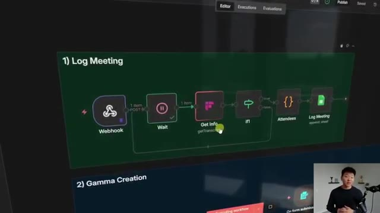
*⏱️ 00:00:09 — Une capture d'écran montrant l'interface de construction de workflow de n8n, illustrant l'automatisation d'une réunion avec des nœuds connectés (Webhook, Wait, Get Info, If, Attendees, Log Meeting).*

---

### ⏱️ `[00:00:34 - 00:01:09]` | Segment #02

**🔊 Audio (Transcription Intégrale Mot pour Mot en Français) :**
> attendees, the gist of the meeting, the ID, and then a status. And then the second part of the workflow is the actual slide deck creation. So after a new meeting gets logged in our Google Sheet, we'll go ahead and pull in those details. We will get human approval right here to see if we want to have a slide deck generated or not, because we don't always need that. And if we do, then we'll go ahead and pass it over to the proposal generator agent, which will shoot off an API call to Gamma and deliver us a ready to go slide deck that is super professional. So if that sounds like a use case, you might be interested in understanding, then let's go ahead and jump into it. And I'm going to start off up here with this first workflow. So the very first question you

**👁️ Analyse Visuelle d'Écran (gemini-3.5-flash-lite) :**
**Interface & Outils** : n8n (outil d'automatisation de workflows).

**Contenu textuel & Code** : Nœuds de workflow : Google Sheets Trigger, Limit, Get Meeting Info, Clean Up, Proposal Generation, branche conditionnelle (If/Else) et nœud de génération (Generation).

**Action / Démonstration** : Le workflow est affiché à l'écran, illustrant l'automatisation de la création de diapositives Gamma à partir de nouvelles lignes ajoutées dans un fichier Google Sheets.

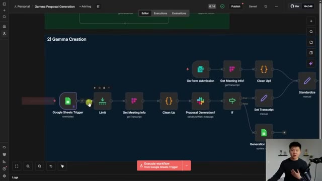
*⏱️ 00:00:43 — Interface d'un workflow d'automatisation montrant l'étape "2) Gamma Creation" avec des nœuds connectés commençant par un trigger Google Sheets.*

---

### ⏱️ `[00:01:09 - 00:01:41]` | Segment #03

**🔊 Audio (Transcription Intégrale Mot pour Mot en Français) :**
> might be asking yourself is why did I split this up into two workflows? And the reason I did this is just because I'm thinking about scalability. I'm thinking about how I can build off of this system. Because when a meeting ends, you might want to do different things based on who the meeting was with. And if I was to bake in this part of the flow into the gamma creation workflow, then it would just be a little tougher to separate out later or to route off to different paths. For example, if you look at something like this, you can see that in part one of the workflow, we have a few different paths up here. And then also in part two of the workflow, we have a couple extra paths down there. And this helps me think about, okay, later I might be able

**👁️ Analyse Visuelle d'Écran (gemini-3.5-flash-lite) :**
**Interface & Outils** : n8n (outil d'automatisation de workflows low-code).

**Contenu textuel & Code** : Le workflow montre des nœuds connectés incluant : Webhook, Google Sheets Trigger, Get Meeting Info, If, Clean Up, Proposal Generator Agent (OpenRouter), Gamma Deck, et Notification (Slack).

**Action / Démonstration** : Présentation visuelle de la séparation de l'architecture d'automatisation en deux systèmes modulaires pour faciliter la scalabilité.

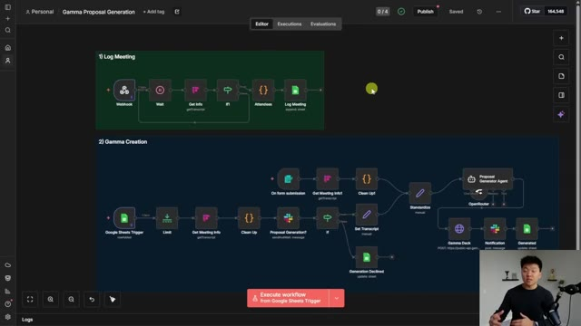
*⏱️ 00:01:17 — Une capture d'écran de l'interface n8n affichant deux workflows distincts : "1) Log Meeting" (flux de journalisation) et "2) Gamma Creation" (flux d'automatisation de génération de propositions).*

---

### ⏱️ `[00:01:41 - 00:02:16]` | Segment #04

**🔊 Audio (Transcription Intégrale Mot pour Mot en Français) :**
> to add different paths. And it's just a little easier, at least for me to keep track. So anyways, let's go ahead and run this first workflow. So what happens here is we have a webhook and this webhook is given to Fireflies. So basically whenever a Fireflies call is done, it's going to trigger this NNN webhook. So let me just go ahead and give this workflow a run so we can see how it works. So I just did a quick wait. Now it's going to grab the info from Fireflies as far as like the title, the transcript, things like that. Then we're going to do an if to see if all of that stuff exists. And I'll explain that in a sec. We clean up the JSON from Fireflies in order to get the attendees. And then we log the information in the Google Sheet. And then it pops up over here

**👁️ Analyse Visuelle d'Écran (gemini-3.5-flash-lite) :**
**Interface & Outils** : n8n (outil d'automatisation de workflows).

**Contenu textuel & Code** : Workflow n8n incluant : Webhook (déclenché par Fireflies), nœud Wait, nœud Get Info (getTranscript), nœud If (conditionnel), nœud Attendees, et nœud Log Meeting (Google Sheets).

**Action / Démonstration** : Le curseur survole le nœud "Webhook" et un bouton "Execute workflow" est visible, prêt à être déclenché pour lancer le processus d'automatisation.

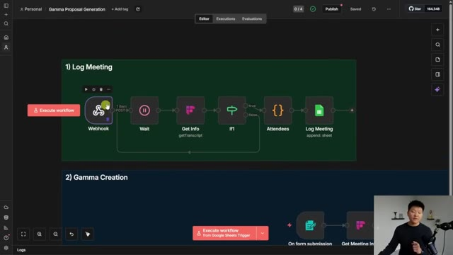
*⏱️ 00:01:50 — Une capture d'écran de l'interface n8n affichant un workflow nommé "Log Meeting" avec un nœud Webhook connecté à plusieurs étapes (Wait, Get Info, If, Attendees, Log Meeting).*

---

### ⏱️ `[00:02:16 - 00:02:50]` | Segment #05

**🔊 Audio (Transcription Intégrale Mot pour Mot en Français) :**
> like this, where we have our title, we have our attendees, we have the gist, we have a status, and then we have the ID of that meeting. So let's just break it down node by node. The webhook. How do we do this? Well, in here, we have a test URL and a production URL. So what I would do in practice is I would grab this production URL, I would head into Fireflies, and I would go to my settings, I would go to the developer settings. And then right here, I throw in my webhook address in this little box. And then I check this on which says transcription complete. So this basically means as soon as a meeting is finished and Fireflies was in there and it has processed the transcript,

**👁️ Analyse Visuelle d'Écran (gemini-3.5-flash-lite) :**
**Interface & Outils** : n8n (workflow automation), Fireflies.ai (dashboard paramètres).

**Contenu textuel & Code** : - Image 1 : Workflow complet avec les nœuds Webhook, Wait, Get Info, If1, Attendees et Log Meeting.
- Image 2 : Champ de saisie pour l'URL du Webhook Fireflies.ai pointant vers "nateherk.app.n8n.cloud/webhook/...".

**Action / Démonstration** : - Image 1 : Visualisation de l'architecture d'un flux automatisé pour traiter les données de réunions.
- Image 2 : Configuration de l'intégration entre Fireflies.ai et n8n pour déclencher le workflow dès la fin d'une transcription.

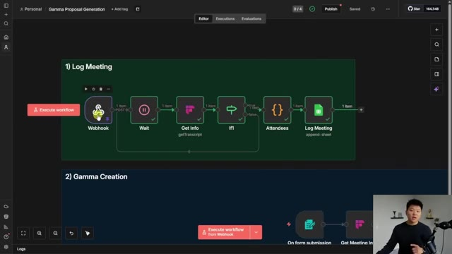
*⏱️ 00:02:24 — Interface de l'outil d'automatisation n8n montrant un workflow de traitement de réunions intitulé "Log Meeting".*

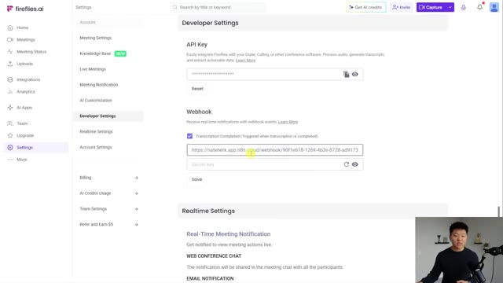
*⏱️ 00:02:41 — Page des paramètres développeur (Developer Settings) du service Fireflies.ai, affichant la configuration des Webhooks.*

---

### ⏱️ `[00:02:50 - 00:03:27]` | Segment #06

**🔊 Audio (Transcription Intégrale Mot pour Mot en Français) :**
> it will send the data to NNN right here. But it's actually pretty interesting because in this webhook, all we actually get in the body are a few things that aren't actually that helpful. We get the meeting ID, which is great. We get the event type, which says transcription complete, but we don't really get the transcript or the title or anything else that's useful. And so that's why we actually have to make this next request to the Fireflies node to get the transcript. And so here's something that's interesting that you would only really understand if you play around with Fireflies a little bit. And that's why I had to add the weight here. So basically when the transcript is done, and if we make that request right away to Fireflies, we don't have the AI summary stuff. So let me just

**👁️ Analyse Visuelle d'Écran (gemini-3.5-flash-lite) :**
**Interface & Outils** : n8n (plateforme d'automatisation de workflows).

**Contenu textuel & Code** : Image 1 : Structure JSON du body (meetingId: "01KCVNK...", eventType: "Transcription completed"). Image 2 : Séquence de nœuds "Log Meeting" et "Gamma Creation".

**Action / Démonstration** : Inspection des données reçues par le Webhook dans le panneau de sortie, suivie d'une présentation de l'architecture complète du workflow.

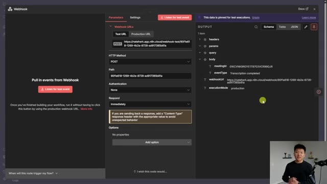
*⏱️ 00:02:59 — Interface du nœud "Webhook" dans n8n montrant les paramètres de configuration et, dans le panneau de droite, les données JSON reçues (meetingId, eventType, etc.).*

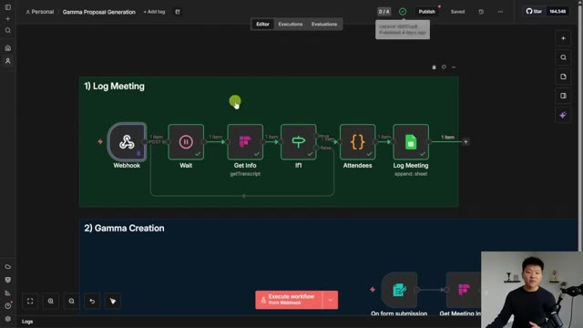
*⏱️ 00:03:09 — Vue d'ensemble de l'éditeur de workflow n8n montrant un flux de travail structuré nommé "Gamma Proposal Generation" avec plusieurs nœuds connectés (Webhook, Wait, Get Info, etc.).*

---

### ⏱️ `[00:03:27 - 00:04:02]` | Segment #07

**🔊 Audio (Transcription Intégrale Mot pour Mot en Français) :**
> show you what that looks like. We put in the meeting ID that we got from the webhook and we say, hey, Fireflies, get me all the info for this meeting ID. And that comes back with a lot of stuff. We get a sentences array, which has basically all of the different sentences set in the meeting. So that's essentially our transcript that we're going to have to clean up later. But that's how we get all of our transcripts. And if you scroll down now, you can see we have the title, we have the host email, we have, you know, all this other stuff, we have keywords. And here's where we have like AI generated summaries, because Fireflies uses AI to help, you know, make some action items and things like that. So all of these action items, bullet points, overviews, bullet gist, summary, all of

**👁️ Analyse Visuelle d'Écran (gemini-3.5-flash-lite) :**
**Interface & Outils** : n8n (outil d'automatisation de workflow).

**Contenu textuel & Code** : Configuration du nœud : Ressource "Transcript", Opération "Get", Transcript ID : `{{ $json.body.meetingId }}`. Structure de sortie JSON montrant un tableau "sentences" contenant les détails de la transcription (speaker_name: "Nate Herk", raw_text, start_time, end_time, etc.).

**Action / Démonstration** : Le présentateur démontre l'exécution réussie d'un nœud qui interroge l'API Fireflies pour extraire les données textuelles d'une réunion spécifique identifiée par un webhook.

*⏱️ 00:03:36 — Une capture d'écran de l'interface de travail n8n montrant un nœud "Get Info" configuré pour récupérer les transcriptions de réunions depuis l'API Fireflies. La fenêtre est divisée en trois colonnes : les headers d'entrée à gauche, les paramètres de configuration au centre (utilisant une expression JavaScript pour l'ID de la réunion) et les données JSON de sortie à droite.*

---

### ⏱️ `[00:04:02 - 00:04:34]` | Segment #08

**🔊 Audio (Transcription Intégrale Mot pour Mot en Français) :**
> these things right here are AI generated. And so that's why we had to have the wait here and the if here because if you search fireflies right away as soon as the transcript's done the AI generated stuff isn't always done yet so what we do is we have a wait we check in on fireflies we go to this if node which we're basically just doing a polling check where I'm saying does the AI summary does the AI gist exist if true we're good and we move down the rest of the path but if false we will go back we'll wait and then we'll check again so we basically have this infinite loop called polling

**👁️ Analyse Visuelle d'Écran (gemini-3.5-flash-lite) :**
**Interface & Outils** : n8n (outil d'automatisation de workflow low-code).

**Contenu textuel & Code** : Workflow visualisant la logique suivante : Webhook -> Wait -> Get Info (Fireflies) -> If (condition sur la présence du résumé) -> Attendees -> Log Meeting (Google Sheets). Le code JSON affiche des détails de transcription incluant les identifiants de locuteur et les filtres IA.

**Action / Démonstration** : Le présentateur explique le processus de contrôle de flux : l'utilisation d'un nœud "Wait" pour s'assurer que les données générées par l'IA (Fireflies) sont prêtes avant de passer par un nœud "If" pour valider leur existence.

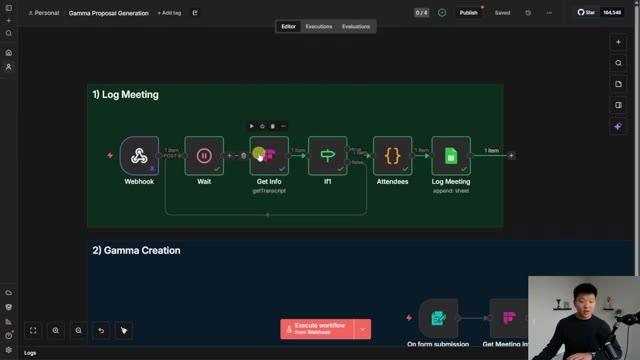
*⏱️ 00:04:10 — Vue d'ensemble de l'interface n8n montrant un workflow automatisé nommé "Log Meeting" avec des nœuds de type Webhook, Wait, Get Info, If, et Google Sheets.*

*⏱️ 00:04:18 — Gros plan sur la configuration détaillée d'un nœud "If" dans n8n, affichant les données d'entrée (JSON), les paramètres de condition (`data.summary.gist`) et les données de sortie.*

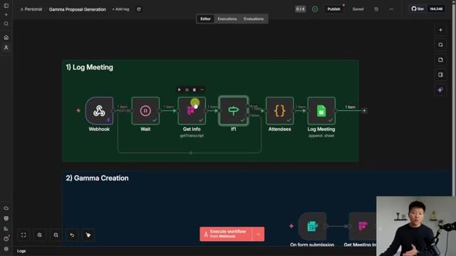
*⏱️ 00:04:26 — Vue identique à l'image #1, confirmant la structure du workflow automatisé utilisé pour le traitement des transcriptions de réunions.*

---

### ⏱️ `[00:04:34 - 00:04:59]` | Segment #09

**🔊 Audio (Transcription Intégrale Mot pour Mot en Français) :**
> where we basically keep checking in on Fireflies until we know for sure that the AI summary stuff is done. And then we can move on to the rest of the process. And then we have this code node where we're basically taking the incoming JSON and we just wanna output the array of speakers. So in this case, it was just a test Fireflies meeting I did and it was just me. But if you had multiple people in that meeting speaking, you would be able to log that information so that you could see right here who was on that call.

**👁️ Analyse Visuelle d'Écran (gemini-3.5-flash-lite) :**
**Interface & Outils** : n8n (outil d'automatisation de workflow).

**Contenu textuel & Code** : - Image 1 : Workflow complet incluant les nœuds de traitement de données Fireflies et d'enregistrement.
- Image 2 : Code JavaScript :
  `const response = items[0].json;`
  `const meetingData = response.data;`
  `const speakers = meetingData.speakers.map(speaker => speaker.name);`
  `return { json: { speakers: speakers } };`

**Action / Démonstration** : Le présentateur explique l'étape de transformation des données via un nœud de code pour isoler et extraire le tableau des participants ("speakers") à partir du JSON fourni par Fireflies.

*⏱️ 00:04:41 — Vue d'ensemble de l'interface n8n montrant un workflow automatisé intitulé "Log Meeting" avec plusieurs nœuds interconnectés (Webhook, Wait, Get Info, If, Code, Google Sheets).*

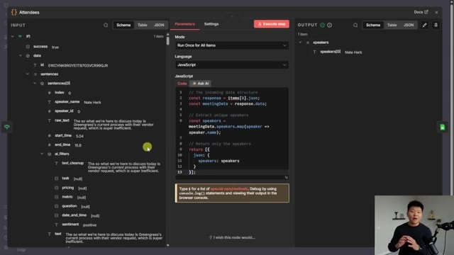
*⏱️ 00:04:47 — Gros plan sur le nœud "Code" (renommé "Attendees") dans n8n, affichant les données d'entrée (JSON Fireflies) et l'éditeur de script JavaScript pour extraire les noms des intervenants.*

---

### ⏱️ `[00:04:59 - 00:05:20]` | Segment #10

**🔊 Audio (Transcription Intégrale Mot pour Mot en Français) :**
> And so for those of you who are curious about the way that I actually write these code nodes, because you can see we have some more later where we have to do some data cleaning up, this is exactly what I do. And it's really simple. I will come into the code node and I will take the JSON of the incoming data. So I literally will copy this, the entire JSON. I will come to Claude and I'll paste it in there. And I'll just say, I need you to help me write an NNN code node.

**👁️ Analyse Visuelle d'Écran (gemini-3.5-flash-lite) :**
**Interface & Outils** : n8n (outil d'automatisation de workflows).

**Contenu textuel & Code** : Code JavaScript pour le traitement de données JSON : extraction de données de réunion, mapping des noms de participants et retour de la structure finale.

**Action / Démonstration** : Le présentateur explique et montre la manipulation directe du code dans un nœud spécifique pour effectuer un nettoyage de données.

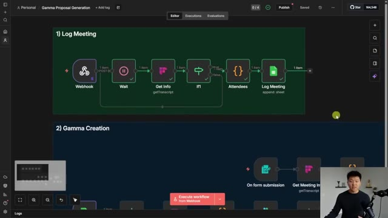
*⏱️ 00:05:04 — Vue d'ensemble de l'interface n8n montrant un workflow automatisé avec plusieurs nœuds (Webhook, Wait, If, etc.) organisés dans des conteneurs logiques.*

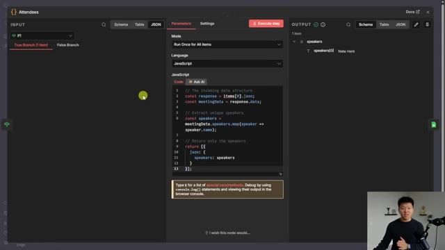
*⏱️ 00:05:10 — Gros plan sur l'interface d'édition d'un nœud "Code" dans n8n, affichant un éditeur JavaScript avec des entrées/sorties JSON et des paramètres de configuration.*

---

### ⏱️ `[00:05:21 - 00:05:43]` | Segment #11

**🔊 Audio (Transcription Intégrale Mot pour Mot en Français) :**
> I paste it in the incoming JSON. I need you to output every time the array of speakers and pretty much just shoot that off. And what it does is it can understand and now it can read the structure of the incoming code that it needs to work with. And it's not always perfect on the first try, but this is what I do. And then I copy it, I paste it into NNN, I paste it into here, I'd run it.

**👁️ Analyse Visuelle d'Écran (gemini-3.5-flash-lite) :**
**Interface & Outils** : Claude.ai (Interface Web)

**Contenu textuel & Code** : Un bloc JSON compressé portant la mention "PASTED" à l'intérieur du champ de saisie de texte, avec le sélecteur de modèle réglé sur "Sonnet 4.5".

**Action / Démonstration** : L'utilisateur a collé des données brutes (JSON) dans l'interface de l'IA pour qu'elle puisse analyser et comprendre la structure du code ou des informations contenues.

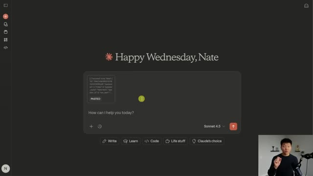
*⏱️ 00:05:26 — Interface de l'application Claude.ai avec un bloc de données JSON collé dans la zone de saisie.*

---

### ⏱️ `[00:05:44 - 00:06:05]` | Segment #12

**🔊 Audio (Transcription Intégrale Mot pour Mot en Français) :**
> And then if it worked, great, but if it doesn't, I would say, okay, here's what you gave me, here's what it did, here's why it's not correct. And I just have to go back and forth a few times. And that's how I always write my code notes. Anyways, then the last step is of course, to come into the Google Sheet, we're appending a new row, and I'm running over the current date and time, the title of the meeting, the attendees, the gist, which was the AI generated gist.

**👁️ Analyse Visuelle d'Écran (gemini-3.5-flash-lite) :**
**Interface & Outils** : n8n (outil d'automatisation de workflow low-code).

**Contenu textuel & Code** : Code JavaScript pour extraire les noms des intervenants (nœud "Attendees") et expressions de mappage de données pour Google Sheets (nœud "Log Meeting").

**Action / Démonstration** : Le présentateur illustre le processus de débogage et de mappage des données entre les différentes étapes d'un workflow d'automatisation.

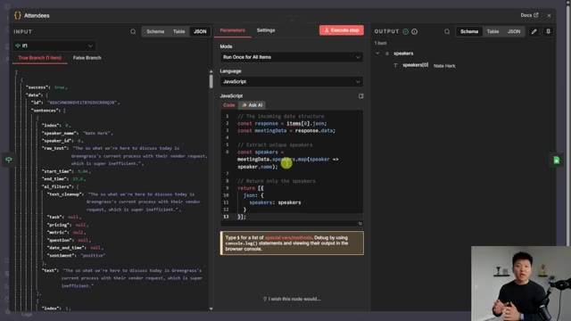
*⏱️ 00:05:49 — Interface du nœud "Attendees" dans n8n, affichant une structure de données JSON complexe avec des informations sur les intervenants (speakers) dans le panneau d'entrée.*

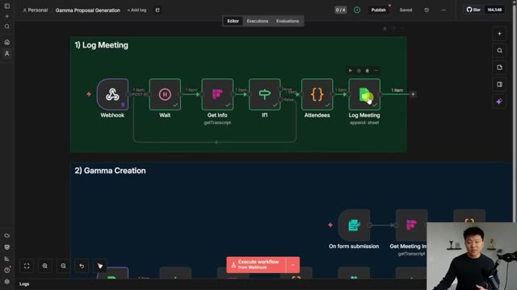
*⏱️ 00:05:54 — Vue d'ensemble du canevas de workflow n8n montrant l'enchaînement des étapes : Webhook, Wait, Get Info, If1, Attendees et Log Meeting.*

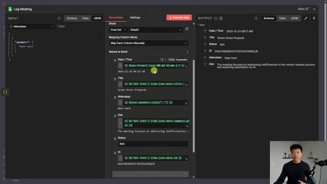
*⏱️ 00:06:00 — Interface de configuration du nœud "Log Meeting" dans n8n, où les données sont mappées vers des colonnes spécifiques (Date/Time, Title, Attendees, Gist) avec des expressions dynamiques.*

---

### ⏱️ `[00:06:06 - 00:06:40]` | Segment #13

**🔊 Audio (Transcription Intégrale Mot pour Mot en Français) :**
> And then we're setting the status to NA. And then we put the ID in here for tracking purposes, because later you might need to reference this meeting. And the only really unique identifier you have could be the meeting ID. All right. So our meeting has been logged in our Google sheet. Now what's next? Well, the second workflow gets triggered when there's a new row added to that Google Sheet. So this is why we pin this data here as if we just basically added this row and now we have to process it. So I'm just going to do the same thing. I'm going to go ahead and run this whole workflow and then we will break it down. So what we're doing here is we are sending off a

**👁️ Analyse Visuelle d'Écran (gemini-3.5-flash-lite) :**
**Interface & Outils** : Google Sheets, n8n (éditeur de workflow).

**Contenu textuel & Code** : Structure de données : Date/Time, Title, Attendees, Gist, Status (N/A), et un Meeting ID (chaîne alphanumérique).

**Action / Démonstration** : Démonstration de la saisie manuelle dans Google Sheets, suivie de la visualisation du workflow d'automatisation et de la configuration du déclencheur d'événement.

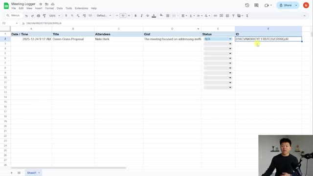
*⏱️ 00:06:14 — Une feuille Google Sheets montrant le journal des réunions, avec des colonnes pour la date, le titre, les participants, l'objet, le statut (N/A) et un identifiant unique pour le suivi.*

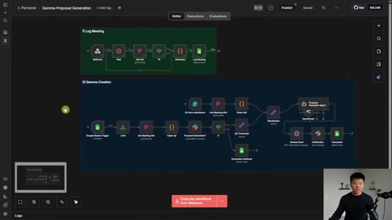
*⏱️ 00:06:23 — L'éditeur de workflow n8n affichant deux processus automatisés distincts : "Log Meeting" (en vert) et "Gamma Creation" (en bleu), avec divers nœuds connectés pour automatiser la gestion des réunions.*

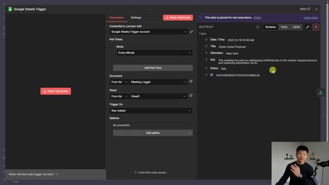
*⏱️ 00:06:32 — Configuration détaillée d'un nœud "Google Sheets Trigger" dans n8n, montrant les paramètres de déclenchement (Row Added) et les données de sortie (Output) correspondant à une ligne de réunion.*

---

### ⏱️ `[00:06:40 - 00:07:13]` | Segment #14

**🔊 Audio (Transcription Intégrale Mot pour Mot en Français) :**
> request once again to get the meeting info. But I just did a quick limit where I'm basically saying only keep the last item because on the off chance where maybe you have two meetings and at the same time or something weird like that, we only want to actually process one of them. So that's just a quick guardrail right there. Now, after we get the meeting info, as you guys remember, we get all this raw data about like the transcript and all this AI summary stuff like that. Then we go ahead and do a cleanup. So this is another time we're doing a code node, except for this time, we're not only getting the speakers, we're also getting the full transcript. And this was a little bit more tricky of a code node to work with. It's still not too difficult. But the reason why I

**👁️ Analyse Visuelle d'Écran (gemini-3.5-flash-lite) :**
**Interface & Outils** : n8n (plateforme d'automatisation de workflows).

**Contenu textuel & Code** : Workflow n8n incluant : Google Sheets Trigger, Limit, Get Meeting Info, Clean Up, et des nœuds conditionnels. Données JSON structurées de Fireflies.ai (ID de transcription, texte des phrases, sentiment).

**Action / Démonstration** : Présentation du flux de travail automatisé et explication de l'utilisation du nœud "Limit" pour restreindre le traitement à un seul élément lors de l'exécution du workflow.

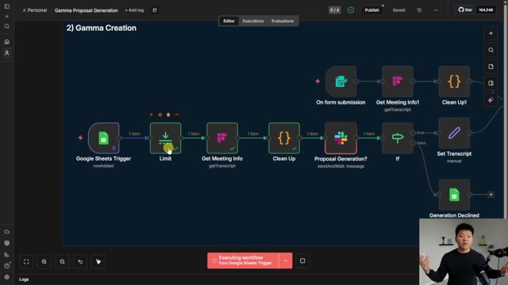
*⏱️ 00:06:49 — Interface n8n montrant un workflow automatisé complet avec des nœuds de déclenchement Google Sheets, de limitation de données et de traitement de transcriptions de réunions.*

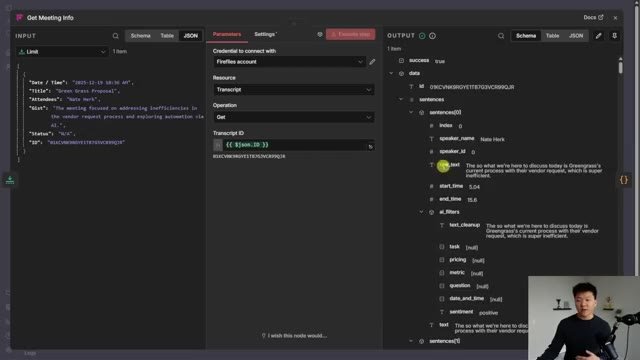
*⏱️ 00:06:57 — Vue détaillée du nœud "Get Meeting Info" dans n8n, affichant les données d'entrée (JSON), les paramètres de configuration Fireflies.ai et la structure de sortie JSON de la transcription.*

---

### ⏱️ `[00:07:13 - 00:07:46]` | Segment #15

**🔊 Audio (Transcription Intégrale Mot pour Mot en Français) :**
> say it's a little trickier is because what I wanted to do is I wanted to make sure it was like speaker, Nate Herc. And then it didn't say Nate Herc again until the next person spoke. Because otherwise you might have like the speaker for every single sentence that they said, and then it just looks not super clean. So now we cleaned up that code node. But after we clean up this data, we go to a Slack node, which is a send and wait message. So if I hop into Slack, you can see right here that we got a message from the Herc bot that says, your meeting Greengrass proposal has just concluded. Would you like to generate a proposal? And so this is where I can say

**👁️ Analyse Visuelle d'Écran (gemini-3.5-flash-lite) :**
**Interface & Outils** : n8n (no-code automation platform)

**Contenu textuel & Code** : Script JavaScript au sein d'un nœud n8n visant à nettoyer une transcription textuelle en ne conservant le nom du locuteur ("speaker_name") que lorsqu'il change, afin d'éviter la répétition inutile à chaque phrase.

**Action / Démonstration** : Édition et optimisation du code JavaScript pour le formatage logique des transcriptions de réunions dans un workflow d'automatisation.

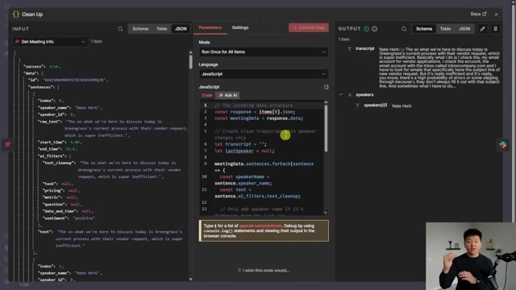
*⏱️ 00:07:22 — Interface d'édition de workflow dans n8n, montrant un nœud "Code" pour le traitement de données JSON issues d'une transcription de réunion.*

---

### ⏱️ `[00:07:46 - 00:08:21]` | Segment #16

**🔊 Audio (Transcription Intégrale Mot pour Mot en Français) :**
> yes or no. And so if I click yes, and then we go back into the workflow, you can see it goes up the true path. And now we send it over here to the proposal generator agent. And if I was to have said no, it just would have gone down here and it would have updated the status in here to generation declined. But because we approved it, it will basically make the slide deck and then it will later update that row and just say generated. Okay. So now the proposal agent is working its magic and I'm not going to read this entire system prompt. You guys will, of course, as always be able to download this exact workflow for free by grabbing it in my free school community. The link

**👁️ Analyse Visuelle d'Écran (gemini-3.5-flash-lite) :**
**Interface & Outils** : n8n (éditeur de workflow low-code).

**Contenu textuel & Code** : Le diagramme présente les étapes : "Sheets Trigger", "Get Meeting Info", "Proposal Generation?" (nœud de décision), "If" (condition), "Standardize", "Proposal Generator Agent" (connecté à OpenRouter) et "Generation Declined".

**Action / Démonstration** : Le workflow est en cours d'exécution (bandeau rouge "Executing workflow" en bas au centre), illustrant la logique de branchement conditionnel entre la génération d'une proposition et le refus de celle-ci.

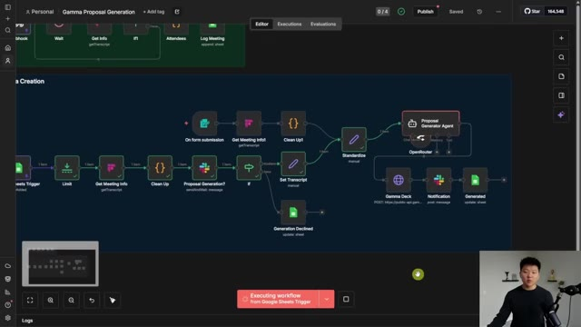
*⏱️ 00:07:55 — Une vue d'ensemble d'un éditeur de workflow automatisé montrant le flux logique « Gamma Proposal Generation », incluant des nœuds de décision, des agents IA et des intégrations de services (Google Sheets, Slack).*

---

### ⏱️ `[00:08:21 - 00:08:49]` | Segment #17

**🔊 Audio (Transcription Intégrale Mot pour Mot en Français) :**
> for that is down in the description. But let me just go over high level what this is doing. So we've got a role, which is that you are an expert senior AI solutions consultant and sales engineer for UpAtAI. Your role is to analyze a raw transcript from a discovery or sales call and transform it into a polished, high converting, client-ready business proposal. So we give it the objective, which is to use the call transcript. We give it some important constraints like this is fully client-facing. Do not include follow-up questions. Do not mention automation, AI generation, or that this was system produced.

**👁️ Analyse Visuelle d'Écran (gemini-3.5-flash-lite) :**
**Interface & Outils** : n8n (éditeur de workflow et de nœuds)

**Contenu textuel & Code** : Le prompt système pour un agent IA : "You are an expert Senior AI Solutions Consultant and Sales Engineer for UpAtAI. Your role is to analyze a raw transcript...". On voit également une liste de nœuds n8n sur la gauche (Standardize, Clean Up, Set Transcript, etc.).

**Action / Démonstration** : Configuration du prompt système dans un nœud de type "Expression" pour paramétrer le comportement de l'agent IA.

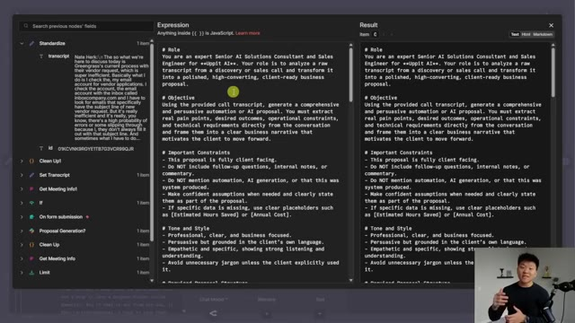
*⏱️ 00:08:28 — Une capture d'écran de l'interface de travail de n8n montrant un éditeur de texte en plein écran où est défini le "Role", l'"Objective" et les "Important Constraints" d'un agent IA spécialisé dans la rédaction de propositions commerciales.*

---

### ⏱️ `[00:08:49 - 00:09:12]` | Segment #18

**🔊 Audio (Transcription Intégrale Mot pour Mot en Français) :**
> Make confident assumptions. If specific data is missing, use clear placeholders, blah, blah, blah. And once again, the assumption is not that you would ever automatically send this to the client. The assumption is that you would just get 90% of the way there. You can make your tweaks and then you send it off as a human. We go over some tone and style and then I go over the proposal structure because AI is going to generate something random every time, but the more structure you can give it, the better.

**👁️ Analyse Visuelle d'Écran (gemini-3.5-flash-lite) :**
**Interface & Outils** : n8n (éditeur de workflow).

**Contenu textuel & Code** : Prompt système pour un agent IA : "You are an expert Senior AI Solutions Consultant and Sales Engineer... Make confident assumptions when needed... If specific data is missing, use clear placeholders such as [Estimated Hours Saved] or [Annual Cost]."

**Action / Démonstration** : Édition du prompt de l'assistant IA au sein d'un nœud de workflow pour définir les consignes de génération d'une proposition commerciale.

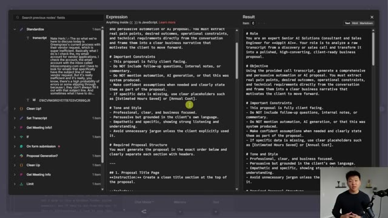
*⏱️ 00:08:55 — Interface du logiciel d'automatisation n8n montrant l'édition d'une expression contenant un prompt détaillé pour un assistant IA.*

---

### ⏱️ `[00:09:12 - 00:09:30]` | Segment #19

**🔊 Audio (Transcription Intégrale Mot pour Mot en Français) :**
> So I go over the title page, what that should look like. I go over the executive summary. I go over the problem and challenge, up at AI proposed solution, return on investment, soft and intangible benefits, implementation roadmap, and then success metrics. Finally, we have at the end a little bit of advocation for ourselves. Why choose up at AI?

**👁️ Analyse Visuelle d'Écran (gemini-3.5-flash-lite) :**
**Interface & Outils** : n8n (logiciel d'automatisation de workflows).

**Contenu textuel & Code** : Texte structuré de proposition commerciale : "## 2. Executive Summary", "## 3. Problem and Challenge", "## 4. Uppit AI Proposed Solution". À droite, un bloc de prompt système définissant le rôle d'un "Senior AI Solutions Consultant".

**Action / Démonstration** : Configuration d'un nœud d'automatisation pour générer dynamiquement une proposition client basée sur une transcription de réunion.

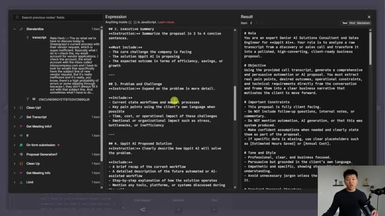
*⏱️ 00:09:17 — Interface du logiciel n8n affichant un éditeur de workflow avec, au centre, le bloc "Expression" contenant la structure d'une proposition commerciale (Executive Summary, Problem, Proposed Solution).*

---

### ⏱️ `[00:09:31 - 00:10:00]` | Segment #20

**🔊 Audio (Transcription Intégrale Mot pour Mot en Français) :**
> So what it does is you can see it outputs a full, basically block of text, which we want to transform into a pretty looking gamma slide deck with pictures and with headings and with icons and things like that. So that's exactly what we do next. we go to our gamma API call. So here we are in the HTTP request. I'm not going to walk through every single little filter here and show you guys exactly what everything's doing, but I'm going to walk over exactly how I set this up and how you can customize this to your liking.

**👁️ Analyse Visuelle d'Écran (gemini-3.5-flash-lite) :**
**Interface & Outils** : n8n (outil d'automatisation de workflow).

**Contenu textuel & Code** : JSON, paramètres de nœud HTTP, configuration de prompts système, variables d'expression ({{ $json.transcript }}).

**Action / Démonstration** : Le présentateur détaille le passage d'une sortie texte brute à une configuration d'appel API vers Gamma pour structurer ces données en une présentation visuelle (slide deck).

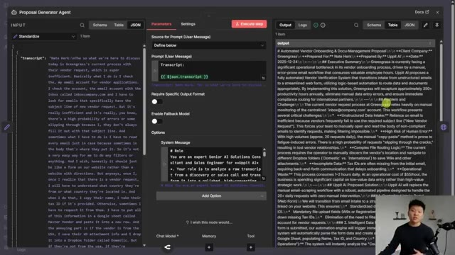
*⏱️ 00:09:38 — Interface de configuration du nœud "Proposal Generator Agent", montrant les entrées de prompt et la sortie textuelle générée basée sur une transcription.*

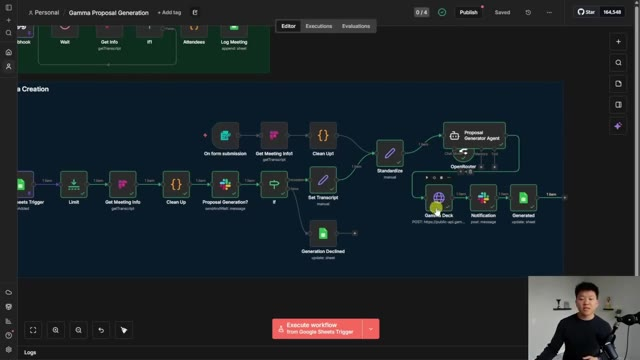
*⏱️ 00:09:45 — Vue d'ensemble du workflow d'automatisation dans n8n, illustrant le flux logique complet de la capture de données jusqu'à l'appel de l'API Gamma.*

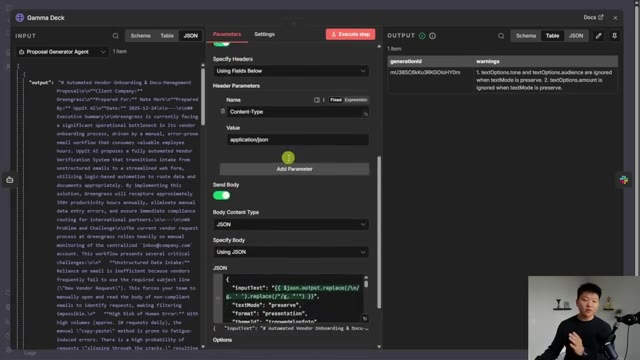
*⏱️ 00:09:53 — Configuration détaillée du nœud HTTP "Gamma Deck", montrant les paramètres de l'API, les headers et le corps de la requête JSON pour la création de la présentation.*

---

### ⏱️ `[00:10:00 - 00:10:20]` | Segment #21

**🔊 Audio (Transcription Intégrale Mot pour Mot en Français) :**
> So obviously step one is you need to go to gamma's API documentation, and you're going to go to the generate API parameters explained, because this is basically what lets you send over a block of text to gamma, and it will work its magic and make that slide deck for you. So what I actually did when I was building this workflow, I copied this curl request, which has a ton of stuff in the JSON body.

**👁️ Analyse Visuelle d'Écran (gemini-3.5-flash-lite) :**
**Interface & Outils** : Navigateur web affichant la documentation de l'API Gamma (ReadMe.io).

**Contenu textuel & Code** : Exemple de code cURL pour une requête POST vers l'endpoint `/generations` incluant des paramètres JSON comme `inputText`, `textMode`, `format`, `themeId`, et `additionalInstructions`.

**Action / Démonstration** : Navigation dans la documentation technique pour expliquer comment configurer les paramètres de génération automatique de présentations via l'API.

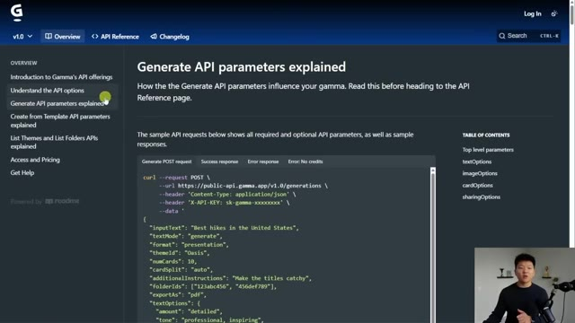
*⏱️ 00:10:05 — Capture d'écran de la documentation technique de l'API de Gamma montrant la page "Generate API parameters explained" avec un exemple de requête cURL.*

---

### ⏱️ `[00:10:20 - 00:10:39]` | Segment #22

**🔊 Audio (Transcription Intégrale Mot pour Mot en Français) :**
> And then I just started to fill in some things. So of course I had to fill in my API key, which I went ahead and did as a header auth right here. We have our method as post, we have the URL, we have the header of content type is application JSON. And now we have the monster of this JSON body, which looks super intimidating, but it's really, really simple. And let me explain why that is.

**👁️ Analyse Visuelle d'Écran (gemini-3.5-flash-lite) :**
**Interface & Outils** : Outil de workflow d'automatisation (type n8n ou similaire).

**Contenu textuel & Code** : Configuration HTTP (méthode POST, URL de l'API Gamma, Headers) et structure JSON complexe définissant les options de génération (Gemini 2.5 flash, style photoréaliste, etc.).

**Action / Démonstration** : Configuration technique d'un nœud d'appel d'API et définition de la charge utile (payload) JSON pour envoyer des données à un modèle IA.

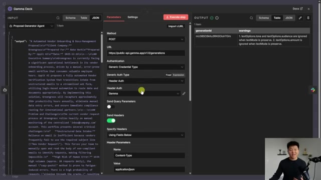
*⏱️ 00:10:25 — Interface de configuration d'une requête HTTP (POST) dans un outil d'automatisation, avec les champs URL, authentification et en-têtes (Content-Type: application/json) renseignés.*

*⏱️ 00:10:34 — Éditeur de corps de requête JSON structuré, affichant des paramètres détaillés comme `inputText`, `textMode`, `model` et `imageOptions` pour un agent de génération de propositions.*

---

### ⏱️ `[00:10:39 - 00:11:02]` | Segment #23

**🔊 Audio (Transcription Intégrale Mot pour Mot en Français) :**
> So once again, what I did is I copied in this body and then I decided, okay, I'm going to go line by line and I'm just going to understand, is each field required? Is it optional? What does it do? And do I need to change anything? And if you're having trouble understanding that, what I would do is I would just paste this link into ChatGBT or Claude or whatever and say, explain to me exactly how I would set up my request if I want these different types of things in my slide deck.

**👁️ Analyse Visuelle d'Écran (gemini-3.5-flash-lite) :**
**Interface & Outils** : n8n (éditeur de workflow low-code) et documentation API Readme.io (pour l'API Gamma).

**Contenu textuel & Code** : - Image 1 : Configuration JSON (`inputText`, `textMode`, `format`, `themeId`, `cardOptions`, etc.) et données textuelles de sortie.
- Image 2 : Exemple de requête `POST` via cURL vers `https://public-api.gamma.app/v1.0/generations` incluant des champs de configuration d'API.

**Action / Démonstration** : Le présentateur compare la structure JSON de son workflow n8n avec la documentation officielle de l'API pour valider et ajuster les champs requis par l'outil Gamma.

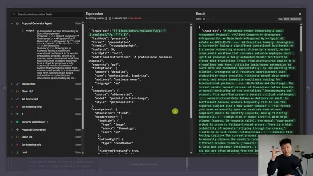
*⏱️ 00:10:45 — Interface d'édition de flux de travail dans n8n, affichant la configuration des paramètres d'un agent de génération de propositions sous forme d'objet JSON, avec les résultats de sortie affichés à droite.*

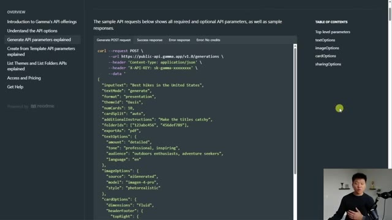
*⏱️ 00:10:56 — Documentation API de Gamma (plateforme de présentation) présentant un exemple de requête cURL illustrant les paramètres obligatoires et optionnels pour la génération de contenu.*

---

### ⏱️ `[00:11:02 - 00:11:35]` | Segment #24

**🔊 Audio (Transcription Intégrale Mot pour Mot en Français) :**
> All right, so let's break it down. The first parameter that we see is input text. And you can see this is where I put the output of the AI agent, which is our entire chunk of text that we want turned into a slide deck. I went to the documentation and I saw, okay, input text is required. What is it? This is the content you use to generate your gamma, including text and image URLs. So I was like, okay, I know what that does. Cool. The next thing we have is text mode. So then I would go into the documentation and I would scroll down and see text mode. Okay. This is required. It determines how your input text is modified. If at all, I can choose between generate, condense, or preserve. And these are the different options

**👁️ Analyse Visuelle d'Écran (gemini-3.5-flash-lite) :**
**Interface & Outils** : n8n (éditeur de workflow d'automatisation) et documentation technique d'API (ReadMe).

**Contenu textuel & Code** : Objet JSON de configuration dans n8n (input, textMode, format, etc.) et texte explicatif sur le paramètre "inputText" dans la documentation Gamma.

**Action / Démonstration** : Le présentateur explique la structuration des données d'entrée (input text) en s'appuyant sur la documentation de l'API pour configurer un agent de génération de slides.

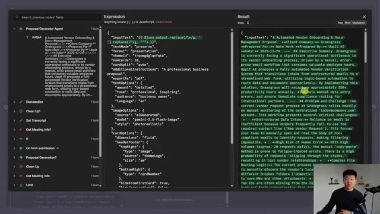
*⏱️ 00:11:10 — Interface de configuration n8n montrant un éditeur d'expression JavaScript à gauche et un panneau de résultat (JSON) à droite contenant un texte structuré pour une proposition commerciale.*

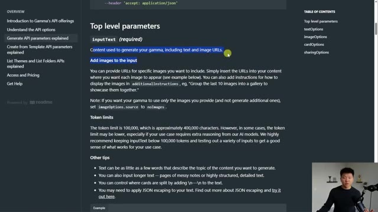
*⏱️ 00:11:19 — Documentation technique en ligne (ReadMe) détaillant les paramètres de l'API Gamma, avec une mise en évidence du paramètre "inputText" obligatoire.*

---

### ⏱️ `[00:11:35 - 00:12:10]` | Segment #25

**🔊 Audio (Transcription Intégrale Mot pour Mot en Français) :**
> and what they actually mean. So I was like, okay, cool. Well, I'm going to go ahead and choose preserve because I want all of this text that our AI agent just works so hard on to be preserved. And so that's really the flow. That's all I do is I go one by one and understand format. What are my options? What do I want? Theme ID. What are my options? What do I want? Theme ID is interesting because in Gamma, you can set up your own custom themes. So if I go to my themes here, and so like, let's say I wanted to use my AIS plus theme here, I would just click on the three dots and I would click on copy theme ID for API. And then that's what I pasted in right here. This is my theme ID. And you can see we have options for text. We can do amount detailed tone.

**👁️ Analyse Visuelle d'Écran (gemini-3.5-flash-lite) :**
**Interface & Outils** : n8n (workflow automation), Gamma (thèmes).

**Contenu textuel & Code** : Objet JSON configurant des options pour un agent (textMode, format, numCards, etc.) dans l'image 1 ; menu contextuel avec des options comme "Copy themeId for API" dans l'image 2.

**Action / Démonstration** : Le présentateur explique la configuration des paramètres de l'agent (choix du mode de préservation du texte) et la récupération d'identifiants de thèmes pour automatiser le design via API.

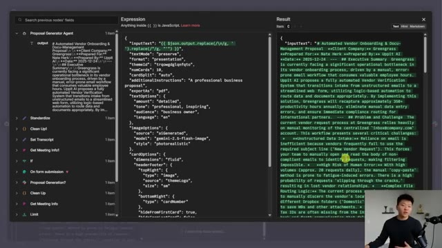
*⏱️ 00:11:44 — Interface de développement n8n affichant un nœud de workflow avec un éditeur JSON à gauche et le résultat textuel formaté à droite.*

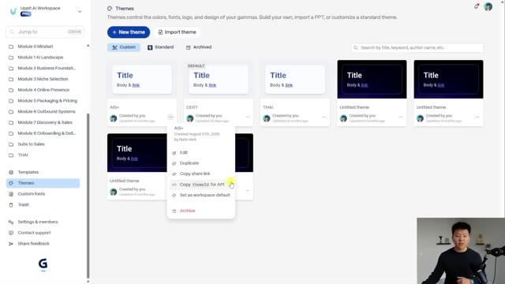
*⏱️ 00:12:01 — Interface de gestion de thèmes dans un logiciel (Gamma) avec un menu contextuel ouvert sur un thème spécifique "AIS+".*

---

### ⏱️ `[00:12:10 - 00:12:39]` | Segment #26

**🔊 Audio (Transcription Intégrale Mot pour Mot en Français) :**
> we can do audience, we have options for image, we can do the source, we can choose the model. And so now you can see that this is basically just like selecting different filters for like if you were online shopping and things like that. It's really simple, even though it might look a bit intimidating when you stare at it like this. Now there's two other things I wanted to point out. The first one is that I like to do a replace function whenever I send over an API call, because if the AI agent decides to put in some new lines or to put in some quotation marks, it would break this body.

**👁️ Analyse Visuelle d'Écran (gemini-3.5-flash-lite) :**
**Interface & Outils** : n8n (outil d'automatisation de workflow).

**Contenu textuel & Code** : Code JSON configurant des options de génération ("amount", "tone", "imageOptions" avec le modèle "gemini-2.5-flash-image", "cardOptions") et un texte de sortie structuré en Markdown détaillant une proposition de gestion documentaire pour un client.

**Action / Démonstration** : Le présentateur explique la configuration des paramètres d'un agent IA, en soulignant la simplicité du paramétrage via des options de sélection.

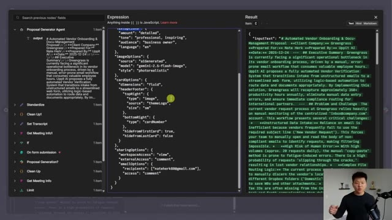
*⏱️ 00:12:17 — Une interface de workflow d'automatisation (n8n) affichant un éditeur d'expressions en format JSON au centre et une prévisualisation du résultat textuel à droite.*

---

### ⏱️ `[00:12:39 - 00:12:57]` | Segment #27

**🔊 Audio (Transcription Intégrale Mot pour Mot en Français) :**
> So this replace function just basically makes sure that that will never happen. And then the thing I wanted to do at the bottom as well is I wanted to share this automatically. So I'm sharing this as view or comment access, and I'm going to automatically send this to one of my emails, internal emails every time, just so I can get a quick link to it rather than having to go search through my gamma.

**👁️ Analyse Visuelle d'Écran (gemini-3.5-flash-lite) :**
**Interface & Outils** : n8n (automatisation de workflow)

**Contenu textuel & Code** : Code JSON configurant les `sharingOptions` : `"workspaceAccess": "view"`, `"externalAccess": "comment"`, ainsi que l'email du destinataire (`nateherk88@gmail.com`) et le niveau d'accès (`comment`).

**Action / Démonstration** : Configuration des paramètres de partage et d'accès pour l'envoi automatique du document généré.

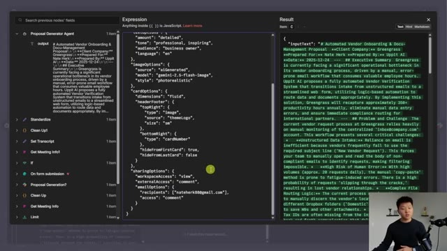
*⏱️ 00:12:44 — Interface n8n affichant un nœud de configuration avec un éditeur d'expression JavaScript contenant les options de partage du document généré.*

---

### ⏱️ `[00:12:57 - 00:13:16]` | Segment #28

**🔊 Audio (Transcription Intégrale Mot pour Mot en Français) :**
> So that is pretty much how we set up the gamma API call. And then what happens is two final things as far as notification and logging. The first one is that we just get a message in our Slack and if you see right here, Herkbot says your gamma deck is being generated. You should receive an email shortly. And then after that, we log it back into the Google Sheet where we basically just update that row.

**👁️ Analyse Visuelle d'Écran (gemini-3.5-flash-lite) :**
**Interface & Outils** : n8n (workflow automation), Slack.

**Contenu textuel & Code** : Nœuds n8n (Proposal Generator Agent, Gamma Deck, Notification, Generated) ; Historique de discussion Slack avec Herk Bot ("Your Gamma deck is being generated").

**Action / Démonstration** : Présentation du flux de travail complet et validation visuelle du retour d'information (notification) généré par l'automatisation.

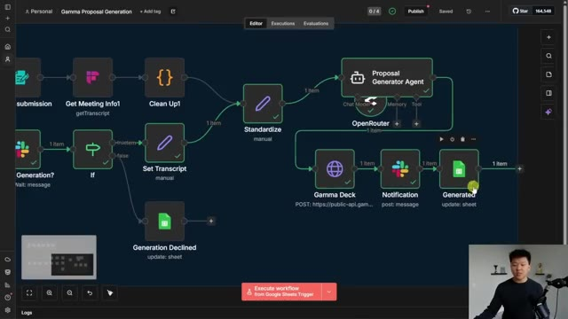
*⏱️ 00:13:02 — Vue d'ensemble du workflow automatisé sur n8n, illustrant la séquence entre l'agent de génération, l'appel API vers Gamma, la notification et la mise à jour finale dans Google Sheets.*

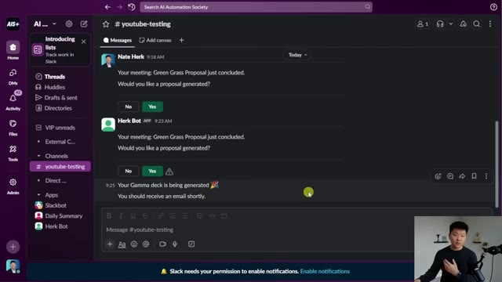
*⏱️ 00:13:12 — Interface Slack montrant le canal "#youtube-testing" où Herk Bot confirme la génération du deck Gamma et informe l'utilisateur de l'envoi imminent d'un e-mail.*

---

### ⏱️ `[00:13:17 - 00:13:35]` | Segment #29

**🔊 Audio (Transcription Intégrale Mot pour Mot en Français) :**
> As you can see, we're no longer doing an append function. We're doing an update function and we're just changing the status here to generated. And then after that, we're hitting that Google Sheet and we're updating a row. So you can see instead of appending a row, we're updating one and we're matching on the meeting ID once again, which is our unique identifier. And you can see that we're just changing the status to generated.

**👁️ Analyse Visuelle d'Écran (gemini-3.5-flash-lite) :**
**Interface & Outils** : n8n (outil d'automatisation de workflow)

**Contenu textuel & Code** : Configuration du nœud : "Column to match on" défini sur "ID". Section "Values to Update" avec le champ "Status" réglé sur "Generated". En entrée (Input), on voit un objet JSON Slack. En sortie (Output), le tableau affiche la colonne "Status" avec la valeur "Generated".

**Action / Démonstration** : Configuration d'une opération "Update" dans un nœud Google Sheets pour modifier le statut d'une ligne existante au lieu d'en créer une nouvelle (Append).

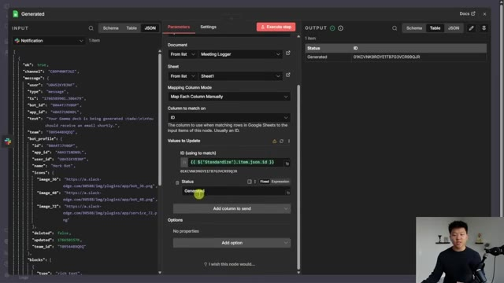
*⏱️ 00:13:21 — Interface n8n configurant un nœud Google Sheets pour mettre à jour une ligne spécifique en fonction d'un ID.*

---

### ⏱️ `[00:13:35 - 00:14:09]` | Segment #30

**🔊 Audio (Transcription Intégrale Mot pour Mot en Français) :**
> So back in our actual meeting logger, we should see that this first row that we were looking at, it now shows us that the status is generated. So here's that email that I just got, which says, Nate Herc has invited you to comment on automated vendor onboarding and document management on Gamma. So we're going to go ahead and open that up. And here it is. So I'm not going to read every single line, but let's just go through and make sure that we have a structure that we like. And once again, you would always be able to come back and tweak your system prompt. So we've got our automated vendor onboarding and document management for Greengrass prepared by Nate Herc prepared by Up at AI. So we start off with an executive summary, which shows the problem that Greengrass is currently facing,

**👁️ Analyse Visuelle d'Écran (gemini-3.5-flash-lite) :**
**Interface & Outils** : Gmail, plateforme de présentation et de documentation Gamma.

**Contenu textuel & Code** : Titres de documents, résumé exécutif ("Greengrass is currently facing a significant operational bottleneck..."), et indicateur de performance ("350+ Hours Saved").

**Action / Démonstration** : Réception d'une notification par e-mail suivie de l'ouverture et de la visualisation du document final généré automatiquement sur la plateforme Gamma.

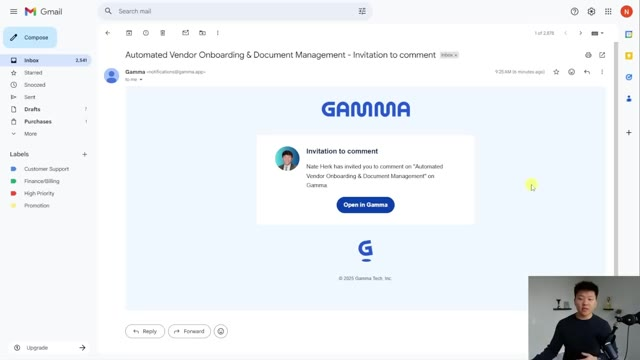
*⏱️ 00:13:44 — Une boîte de réception Gmail affichant un e-mail de notification provenant de Gamma invitant l'utilisateur à commenter un document intitulé « Automated Vendor Onboarding & Document Management ».*

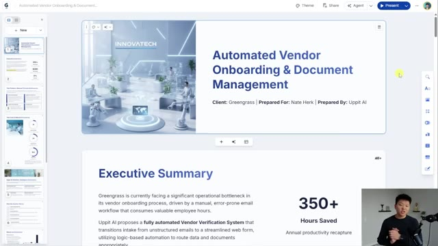
*⏱️ 00:13:52 — L'interface de création de documents Gamma montrant le contenu généré pour le projet « Automated Vendor Onboarding & Document Management », incluant un résumé exécutif et des métriques d'efficacité.*

---

### ⏱️ `[00:14:09 - 00:14:43]` | Segment #31

**🔊 Audio (Transcription Intégrale Mot pour Mot en Français) :**
> the proposal solution that Up at AI is proposing. And then by implementing the solution, Greengrass will recapture approximately 350 plus productivity hours annually. So we've got 350 plus hours saved, 28k cost savings, and hopefully a 0% error rate. We then move on to the problem. So this is basically just diving into a bit deeper, the manual process that was scoped out in the discovery phase and the sales phase, things like that, and just kind of highlighting that pain as well as highlighting it as far as hours per week, daily requests, hourly costs, and kind of turning that pain into something

**👁️ Analyse Visuelle d'Écran (gemini-3.5-flash-lite) :**
**Interface & Outils** : Application de présentation ou plateforme de gestion de projet type Pitch.com ou Canva.

**Contenu textuel & Code** : Texte explicatif sur le "Vendor Verification System", données chiffrées sur la productivité (350+ heures, 28k$, 0% erreur), et métriques sur le temps passé manuellement.

**Action / Démonstration** : Présentation par le narrateur des bénéfices attendus de la solution proposée par Uppit AI, suivie de l'exposition du problème lié au traitement manuel.

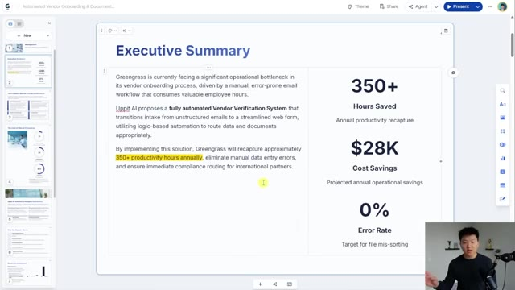
*⏱️ 00:14:18 — Diapositive "Executive Summary" détaillant les bénéfices de l'automatisation : 350+ heures économisées, 28k$ d'économies et 0% d'erreur.*

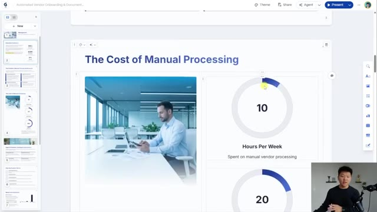
*⏱️ 00:14:35 — Diapositive "The Cost of Manual Processing" montrant l'impact du travail manuel avec des graphiques en anneau illustrant 10 heures passées par semaine.*

---

### ⏱️ `[00:14:43 - 00:15:11]` | Segment #32

**🔊 Audio (Transcription Intégrale Mot pour Mot en Français) :**
> a bit more tangible. Then we move into the UpIt AI solution of intelligent automation. So we have four different parts here. You can see centralized intake, intelligent data processing, smart document routing, compliance automation, and then we also have how the system actually works. So we dive into a little bit more the proposed solution. If we keep going down, now we can see the return on investment. So we can see the financial impact, which is a weekly time saved, a weekly cost savings, and then annual operational savings with green highlight, which I thought was pretty nice.

**👁️ Analyse Visuelle d'Écran (gemini-3.5-flash-lite) :**
**Interface & Outils** : Outil de présentation collaborative de type diaporama (interface type Gamma ou similaire).

**Contenu textuel & Code** : Textes explicatifs sur l'automatisation des workflows, chiffres chiffrés d'économies ($21,450 à $28,600) et graphiques à barres comparant l'état actuel et l'état après automatisation.

**Action / Démonstration** : Le présentateur parcourt les diapositives de sa proposition de valeur pour illustrer l'efficacité opérationnelle de son automatisation IA.

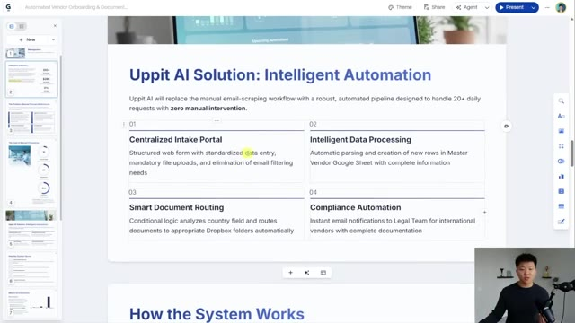
*⏱️ 00:14:50 — Présentation structurée détaillant les 4 piliers de la solution "Uppit AI" : portail d'admission, traitement des données, routage de documents et automatisation de la conformité.*

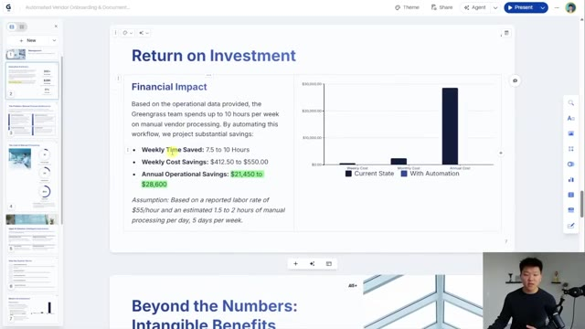
*⏱️ 00:15:04 — Analyse du retour sur investissement (ROI) avec des indicateurs de temps économisé, d'économies monétaires et un graphique comparatif des coûts (hebdomadaire, mensuel, annuel).*

---

### ⏱️ `[00:15:11 - 00:15:45]` | Segment #33

**🔊 Audio (Transcription Intégrale Mot pour Mot en Français) :**
> And then we've got a little bit of a graphic over here to show with automation and without automation. And here's one part where I want to point out, you probably would want to edit this graph a little bit because I'm not actually sure what this is showing and the colors aren't really matching up. So like I said, it gets you 90% of the way there, saves you a lot of time, but it's not perfect. So make sure you're not just sending it off to a client right away. Then if you remember from the system prompt, we want to move into some intangible benefits here, like some data accuracy, compliance, elimination of operator fatigue, enhanced vendor experience. We then move into an implementation roadmap. So right here, our AI proposal consultant agent decided that this was

**👁️ Analyse Visuelle d'Écran (gemini-3.5-flash-lite) :**
**Interface & Outils** : Gamma (plateforme de création de présentations IA).

**Contenu textuel & Code** : Graphique à barres comparant les coûts, texte explicatif sur les économies opérationnelles (10 heures par semaine, 21 450 $ à 28 600 $ d'économies annuelles), et liste à puces sur les bénéfices qualitatifs (Élimination de la fatigue, 100% de précision des données).

**Action / Démonstration** : Le présentateur critique la clarté et la cohérence visuelle du graphique de ROI présenté à l'écran.

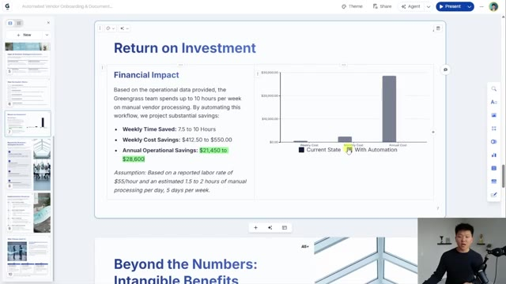
*⏱️ 00:15:20 — Une diapositive de présentation affichée dans Gamma montrant un graphique intitulé "Return on Investment" avec une analyse de l'impact financier de l'automatisation.*

---

### ⏱️ `[00:15:45 - 00:16:12]` | Segment #34

**🔊 Audio (Transcription Intégrale Mot pour Mot en Français) :**
> going to be a four week development cycle. Maybe that's true. Maybe that's not, but at least it's broken down here to show and to sort of visualize what this could look like. And then we end off with our wide shoes up at AI slide. So we put in some information here. This is where you would maybe put in some case studies from your business, or maybe what could be cool is you even give this agent access to a database of past projects, and it would search through to find one that's the most relevant. And then it could use those results and those case studies into this final slide.

**👁️ Analyse Visuelle d'Écran (gemini-3.5-flash-lite) :**
**Interface & Outils** : Gamma (présentation), n8n (automatisation de workflows).

**Contenu textuel & Code** : Textes sur la roadmap de déploiement, arguments de vente pour Uppit AI, blocs de workflow n8n (Get Meeting Info, Proposal Generator Agent, Gamma Deck, Slack Notification, Google Sheets).

**Action / Démonstration** : Visualisation d'une stratégie de projet et démonstration d'un schéma d'automatisation d'agent dans n8n.

*⏱️ 00:15:52 — Une diapositive de présentation dans Gamma détaillant une "Implementation Roadmap" sur 4 semaines.*

*⏱️ 00:15:59 — Une diapositive de présentation dans Gamma intitulée "Why Choose Uppit AI" vantant les mérites d'un partenariat stratégique.*

*⏱️ 00:16:06 — Une vue de l'éditeur de workflow n8n montrant un processus d'automatisation de génération de propositions avec un agent IA.*

---

### ⏱️ `[00:16:12 - 00:16:47]` | Segment #35

**🔊 Audio (Transcription Intégrale Mot pour Mot en Français) :**
> So the proposal feels a lot more tailored towards this specific client. All right. So now that we've seen an example output from the system, let's talk about what is going on right here in the second path and what's going on in these set nodes in the middle here, which you may have been wondering about. So the idea is that we can drop in a meeting ID at any time if we want a proposal generated. So in case you accidentally declined it up here or you didn't want it in the moment, but now you realize you want to go back and generate a slide deck, you can do so. So because everything's being logged in this Google Sheet, let's say that we actually declined this generation.

**👁️ Analyse Visuelle d'Écran (gemini-3.5-flash-lite) :**
**Interface & Outils** : n8n (outil d'automatisation de workflow low-code).

**Contenu textuel & Code** : Diagramme de flux de travail divisé en deux zones : une section supérieure de traitement initial et une section inférieure ("2) Gamma Creation") détaillant le processus de génération de propositions via des nœuds comme "Google Sheets Trigger", "Proposal Generator Agent", "Standardize", et "Gamma Deck".

**Action / Démonstration** : Le présentateur explique la structure logique du workflow, en se concentrant sur la deuxième branche du processus et le rôle spécifique des nœuds de configuration ("Set nodes") pour personnaliser la génération de documents.

*⏱️ 00:16:21 — Une vue d'ensemble de l'interface n8n affichant un workflow complexe d'automatisation nommé "Gamma Proposal Generation", composé de nœuds interconnectés pour le traitement de données, la gestion de propositions et l'intégration avec des outils comme Google Sheets et Slack.*

---

### ⏱️ `[00:16:47 - 00:17:20]` | Segment #36

**🔊 Audio (Transcription Intégrale Mot pour Mot en Français) :**
> And now if I actually do want one, I can go ahead and copy this meeting ID. I can go back into the workflow and we can run it on a form submission. So once again, this form submission could be embedded in your Slack or in some sort of website or something else. But right here, we're just doing it in NNN, where I basically paste in the meeting ID. Once I submit that, it's going to run the same workflow where it grabs the meeting info, it cleans everything up, And then we pass it to the exact same final stages, which is generating the proposal with the agent, hitting the gamma API, and then the notification with the update in status.

**👁️ Analyse Visuelle d'Écran (gemini-3.5-flash-lite) :**
**Interface & Outils** : n8n (outil d'automatisation de workflow low-code).

**Contenu textuel & Code** : Nœuds de workflow ("On form submission", "Get Meeting Info", "Proposal Generator Agent", "Gamma Deck"), champ de saisie "Meeting ID".

**Action / Démonstration** : Saisie d'un ID de réunion dans un formulaire web, déclenchement et exécution automatisée du workflow n8n associé.

*⏱️ 00:16:55 — Interface de l'outil d'automatisation n8n affichant un workflow complexe pour la création de propositions avec Gamma, en attente d'un déclencheur.*

*⏱️ 00:17:04 — Le présentateur interagit avec un formulaire n8n intégré sur la droite de l'écran, saisissant un ID de réunion avant de cliquer sur "Submit".*

*⏱️ 00:17:12 — Visualisation du workflow n8n en cours d'exécution suite à la soumission du formulaire, avec des animations indiquant le traitement par l'agent.*

---

### ⏱️ `[00:17:20 - 00:17:41]` | Segment #37

**🔊 Audio (Transcription Intégrale Mot pour Mot en Français) :**
> So what we're doing here is we're standardizing the inputs. And before I actually dive into these two nodes to show you how that works, let's real quick just hop into my trusty Excalibur here so I can help you guys understand what do I mean by standardizing these inputs. Okay, so we basically have two parts of the automation. We have part one and part two. Part one is basically like getting the meeting info.

**👁️ Analyse Visuelle d'Écran (gemini-3.5-flash-lite) :**
**Interface & Outils** : n8n (image 1), Excalidraw (image 2)

**Contenu textuel & Code** : Nœuds de workflow : Webhook, Google Sheets Trigger, Proposal Generator Agent, OpenRouter, etc. (image 1). Schéma logique avec boîtes colorées labellisées a, b, c (image 2).

**Action / Démonstration** : Explication du flux de travail automatisé (image 1) et démonstration visuelle du concept de "standardisation des inputs" avant de revenir à la configuration technique (image 2).

*⏱️ 00:17:25 — Interface de la plateforme d'automatisation n8n montrant un workflow complexe de génération de propositions commerciales (« Gamma Proposal Generation ») avec divers nœuds de traitement de données et agents IA.*

*⏱️ 00:17:31 — Diagramme conceptuel dessiné sur un tableau blanc virtuel (Excalidraw) illustrant la standardisation des données : deux flux d'entrées différents (« a » et « b ») fusionnés dans un bloc central (« c ») pour produire une sortie normalisée.*

---

### ⏱️ `[00:17:41 - 00:18:02]` | Segment #38

**🔊 Audio (Transcription Intégrale Mot pour Mot en Français) :**
> And part two is transforming that meeting info, doing something with it. So in part one, we have two paths. We could take route A, which is the form submission, or we could take route B, which is the natural trigger. And what happens is in part two of the automation, these nodes and all of these nodes to come need elements from path A or path B.

**👁️ Analyse Visuelle d'Écran (gemini-3.5-flash-lite) :**
**Interface & Outils** : Outil de tableau blanc numérique de type Excalidraw.

**Contenu textuel & Code** : Diagramme schématique composé de blocs colorés (bleus, verts, rose, jaune) portant des lettres et des flèches directionnelles, organisé sous une séparation pointillée.

**Action / Démonstration** : Le présentateur explique visuellement le flux logique de l'automatisation, en illustrant comment les différentes méthodes d'entrée (A et B) convergent vers un processus de transformation centralisé (C).

*⏱️ 00:17:46 — Un schéma conceptuel divisé en deux sections ("1" et "2") représentant un workflow d'automatisation. La section 1 montre deux chemins parallèles (bleus marqués "a" et verts marqués "b") menant à un nœud de fusion, tandis que la section 2 montre le traitement des données résultantes (nœuds rose et jaune "c").*

---

### ⏱️ `[00:18:02 - 00:18:37]` | Segment #39

**🔊 Audio (Transcription Intégrale Mot pour Mot en Français) :**
> but it's more difficult to have the AI agent over here say okay I'm going to go look in both of those nodes but one of them isn't always executed because there's no execution where both of these paths could run at the same time it would be two separate executions so essentially what we want to do is make sure that these nodes are dynamic enough to reference either if a ran or if b ran and that's where we feed it into a set node and we're just going to call this c which is basically a or b and now that we have everything standardized in this one set node the rest of our nodes in phase two of this workflow can actually just reference the variables from here, rather than

**👁️ Analyse Visuelle d'Écran (gemini-3.5-flash-lite) :**
**Interface & Outils** : Excalidraw (outil de dessin de diagrammes).

**Contenu textuel & Code** : Diagramme séparé en deux zones : zone 1 avec deux groupes de blocs (bleus 'a' et verts 'b') convergeant vers un bloc rose 'c', et zone 2 avec un bloc jaune 'c' final.

**Action / Démonstration** : Le présentateur utilise le tableau blanc pour expliquer visuellement la logique de branchement et d'exécution des agents IA, en illustrant comment différents chemins de données convergent vers une étape finale.

*⏱️ 00:18:11 — Schéma conceptuel réalisé sur un tableau blanc virtuel illustrant deux flux de processus (1 et 2) avec des blocs logiques étiquetés 'a', 'b', et 'c'.*

---

### ⏱️ `[00:18:37 - 00:19:10]` | Segment #40

**🔊 Audio (Transcription Intégrale Mot pour Mot en Français) :**
> trying to look into different nodes that may or may not exist. So in practicality here, what we're standardizing is the transcript and the meeting ID, because we need the transcript for the AI agent, and we need the meeting ID later to update that status again in our Google Sheet. So in the proposal agent, when we give it the transcript, we're able to say, hey, just go grab json.transcript, which is coming from right here. But what this node is grabbing is the actual transcript from either the cleaned up code node over here or the cleaned up code node over here. And so that's why this is able to be super dynamic and then feed in those variables to the rest of the flow. And so

**👁️ Analyse Visuelle d'Écran (gemini-3.5-flash-lite) :**
**Interface & Outils** : n8n (plateforme d'automatisation de workflow)

**Contenu textuel & Code** : - Image 1 : Mappage de données (`{{ $json.transcript }}`, `{{ $json.id }}`) et prévisualisation du JSON traité.
- Image 2 : Visualisation graphique des nœuds : "On form submission", "Get Meeting Info", "Clean Up", "Standardize", "Proposal Generator Agent" (via OpenRouter), "Gamma Deck", "Notification" (Slack), et "Generated" (Google Sheets).

**Action / Démonstration** : - Image 1 : Configuration et normalisation des variables de transcription et d'identifiant de réunion pour le traitement par l'agent IA.
- Image 2 : Présentation de l'architecture du workflow complet montrant la logique de flux entre la réception d'un formulaire et la mise à jour finale dans Google Sheets.

*⏱️ 00:18:45 — Interface de configuration du nœud "Standardize" dans n8n, montrant le mappage manuel des champs "transcript" et "id" à partir des données JSON en entrée.*

*⏱️ 00:19:01 — Vue d'ensemble du workflow automatisé intitulé "Gamma Proposal Generation" dans n8n, illustrant la séquence de nœuds incluant le déclencheur, le traitement des données et l'agent de génération.*

---

### ⏱️ `[00:19:10 - 00:19:46]` | Segment #41

**🔊 Audio (Transcription Intégrale Mot pour Mot en Français) :**
> hopefully that makes a little bit more sense now. If it still doesn't, then what I would recommend for you to do is download the workflow for free in my FreeSchool community, and then just get in here and run both paths and just look at the differences and understand if you didn't have this node, the workflow would break. Because if you configured a workflow to only account for path B, it would work fine. But then if you add path A, it would no longer be able to reference both variables dynamically. So anyway, same flow would happen from here on out. We get another Slack message that says that our gamma deck is being generated. We get another email that says that we can go look at our gamma deck. And then we get another gamma deck, which is similar in structure

**👁️ Analyse Visuelle d'Écran (gemini-3.5-flash-lite) :**
**Interface & Outils** : n8n (workflow automation), Excalidraw (outil de dessin), Slack (messagerie).

**Contenu textuel & Code** : Nœuds n8n (Webhook, Google Sheets, Agence, etc.), flux de données logiques, messages de bot de confirmation de génération.

**Action / Démonstration** : Explication de l'architecture d'un workflow, démonstration de la logique de fusion de chemins, et test en direct de l'automatisation via Slack.

*⏱️ 00:19:19 — Interface de n8n montrant un workflow complexe d'automatisation nommé "Gamma Proposal Generation".*

*⏱️ 00:19:28 — Diagramme conceptuel simple dans un outil de dessin (type Excalidraw) illustrant la fusion de deux flux (a et b) vers une étape commune.*

*⏱️ 00:19:37 — Interface de Slack dans le canal "#youtube-testing" montrant les interactions avec un chatbot ("Herk Bot") pour la génération de documents.*

---

### ⏱️ `[00:19:46 - 00:20:07]` | Segment #42

**🔊 Audio (Transcription Intégrale Mot pour Mot en Français) :**
> as far as title, executive summary, current challenges, operational impact, you know, all this kind of stuff. But of course, it's a bit different because at the end of the day, it's AI on both sides on the proposal generation side, but also on the gamma slide deck creation side. So it's always going to be a little bit random, like I said, which is why you want to continuously refine your system prompt until you really like the way that you're getting your outputs.

**👁️ Analyse Visuelle d'Écran (gemini-3.5-flash-lite) :**
**Interface & Outils** : Gamma (plateforme de création de présentations assistée par IA).

**Contenu textuel & Code** : Textes explicatifs sur l'automatisation, la conformité, le ROI financier (gains de temps, économies de coûts) et un schéma de roadmap de projet.

**Action / Démonstration** : Navigation/Défilement à travers le jeu de diapositives générées automatiquement par l'IA dans l'éditeur Gamma.

*⏱️ 00:19:51 — Interface Gamma présentant une diapositive intitulée "Intelligent Routing Logic", détaillant les scénarios de gestion de vendeurs USA vs Internationaux.*

*⏱️ 00:19:56 — Interface Gamma montrant une diapositive de calcul de ROI ("Return on Investment") avec des gains de temps et des économies financières chiffrées pour "Greengrass".*

*⏱️ 00:20:02 — Interface Gamma affichant une section "Implementation Roadmap" incluant un diagramme de flux illustrant les étapes de développement, de test et de déploiement.*

---

### ⏱️ `[00:20:07 - 00:20:28]` | Segment #43

**🔊 Audio (Transcription Intégrale Mot pour Mot en Français) :**
> But anyways, I don't want this video to go too long. But if you're interested in diving deeper into these types of automations and understanding how to build this kind of stuff step by step, then definitely check out my plus community. The link for that is down in the description. We've got a great community of over 3000 members who are building with NNN every day, building businesses with NNN every day. And we've got a full course with different types of material and live projects and things like that.

**👁️ Analyse Visuelle d'Écran (gemini-3.5-flash-lite) :**
**Interface & Outils** : n8n (workflow automation platform)

**Contenu textuel & Code** : Workflow complexe intégrant des déclencheurs (Webhook, Google Sheets), des agents IA ("Proposal Generator Agent"), des nœuds de logique (Wait, Clean Up, Standardize) et des intégrations de services (Slack, Gamma).

**Action / Démonstration** : Présentation visuelle de l'architecture d'un agent d'automatisation pour la création de propositions commerciales via Gamma.

*⏱️ 00:20:12 — Interface d'édition de flux de travail montrant deux workflows complexes : "Log Meeting" et "Gamma Creation", composés de divers nœuds d'automatisation.*

---

### ⏱️ `[00:20:28 - 00:20:45]` | Segment #44

**🔊 Audio (Transcription Intégrale Mot pour Mot en Français) :**
> So it's a great place to learn NNN and AI automation. We also run one live call per week. So I'd love to see you guys in those calls in the community, but that's going to do it for today. So if you enjoyed or you learned something new, please give it a like. It definitely helps me out a ton. And as always, I appreciate you guys making it to the end of the video. I'll see you on the next one. Thanks so much, everyone.

**👁️ Analyse Visuelle d'Écran (gemini-3.5-flash-lite) :**
**Interface & Outils** : n8n (outil d'automatisation de workflows).

**Contenu textuel & Code** : Le workflow présente des nœuds d'automatisation incluant Webhook, Google Sheets, des agents de génération de propositions (via OpenRouter), des notifications et des fonctions de traitement de données (Clean Up, Set Transcript).

**Action / Démonstration** : Visualisation et édition d'un workflow d'automatisation complet, avec une option visible en bas pour "Execute workflow from On form submission".

*⏱️ 00:20:37 — Interface de l'outil d'automatisation de workflow n8n affichant un diagramme complexe intitulé "Gamma Proposal Generation" avec deux sections principales : "Log Meeting" et "Gamma Creation".*

---

