# 🎬 Master 95% of Claude Code in 36 Mins (as a beginner)

> **Chaîne** : [Nate Herk | AI Automation](https://www.youtube.com/@nateherk/featured)  
> **Lien YouTube** : [https://www.youtube.com/watch?v=saggDHHnmtQ](https://www.youtube.com/watch?v=saggDHHnmtQ)  
> **Date de publication** : 20260121  
> **Durée** : 00:36:57  
> **Identifiant vidéo** : `saggDHHnmtQ`  
> **Transcription & Analyse** : `whisper-v3-large-turbo+gemini-3.5-flash-lite`  

---

## 📌 Synthèse Exécutive & Outils

### 💡 Résumé
Dans cette vidéo intitulée **Master 95% of Claude Code in 36 Mins (as a beginner)**, Nate Herk décortique les capacités pratiques d'automatisation et de développement propulsées par les modèles de pointe.

### 🛠️ Outils, Modèles & Logiciels Présentés
- **Opus 5.5 & Claude Code** : Modèles d'ingénierie et agents de codage autonome.

### 🔑 Points Clés & Enseignements Stratégiques
- Optimiser le niveau d'effort et le raisonnement des modèles IA pour des résultats industriels.
- Automatiser les cycles de création logicielle de bout en bout.

---

## ⏱️ Chronologie & Transcription Complète Audio & Visuelle (Mot pour Mot)

### ⏱️ `[00:00:00 - 00:00:33]` | Segment #01

**🔊 Audio (Transcription Intégrale Mot pour Mot en Français) :**
> Cloud Code has been allowing me to build things that used to take me hours in just minutes. So that's exactly what I'm going to be teaching you guys today, even if you don't know how to code and even if you've never touched an IDE before. IDE stands for Integrated Development Environment, but if you didn't know that, it's still completely fine. It's crazy how fast the technology is evolving every single day. What used to take people this long with manual code was significantly reduced when EndedIn came out because we could drag and drop nodes and build workflows that way. And now that has once again been significantly reduced with the release of things like Claude Code and anti-gravity. Now I'm not out here saying that NNN is dead or that Claude

**👁️ Analyse Visuelle d'Écran (gemini-3.5-flash-lite) :**
**Interface & Outils** : Logiciel de tableau blanc numérique (ex: Excalidraw).

**Contenu textuel & Code** : Texte affiché : "Even if you don't know how to code... And never touched an IDE before..."

**Action / Démonstration** : Affichage textuel des points clés de l'introduction pour appuyer le discours sur l'accessibilité de la programmation.

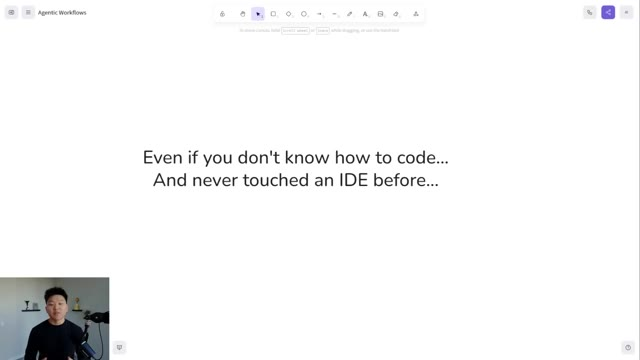
*⏱️ 00:00:08 — Une capture d'écran montrant une interface de tableau blanc virtuel (type Excalidraw ou similaire) avec du texte affiché au centre insistant sur l'accessibilité du codage. Le présentateur est visible dans une petite fenêtre en bas à gauche.*

---

### ⏱️ `[00:00:33 - 00:01:03]` | Segment #02

**🔊 Audio (Transcription Intégrale Mot pour Mot en Français) :**
> Code completely replaces NNN. They're slightly different, but I am going to show you how easy it is to build automations with Claude Code today. If you've never touched Claude Code before or even watched a video about it, you're in the right spot because my job is to make confusing things as simple as possible. So in today's agenda, I'm going to be going over the interface. What do you need to know? Because there's a lot of stuff, but I'm just going to tell you what's actually important to understand. We're going to go over the framework that we use to actually build automations. I'm going to talk about planning and the importance of clear communication. We're going to talk a little bit about the superpowers that you can give CloudCode like MCP servers and skills.

**👁️ Analyse Visuelle d'Écran (gemini-3.5-flash-lite) :**
**Interface & Outils** : Application de tableau blanc virtuel ou outil de présentation (type Miro ou Excalidraw).

**Contenu textuel & Code** : Texte affichant "Today's Agenda" suivi de 6 étapes : 1. Interface, 2. Framework, 3. Planning, 4. Superpowers - MCPs and Skills, 5. Testing, 6. Deploy.

**Action / Démonstration** : Présentation théorique du plan de la vidéo par l'orateur.

---

### ⏱️ `[00:01:03 - 00:01:38]` | Segment #03

**🔊 Audio (Transcription Intégrale Mot pour Mot en Français) :**
> We're going to talk about testing and how you actually optimize your workflow and then talk about deployment, which means actually kind of turning it on or pushing it into production. And I'm not just going to be talking throughout all of this. I'm actually going to build a full workflow in front of you guys and deploy it by the end. So after this video, you'll have everything that you need to go build your first automation in CloudCode and you're going to see how easy it really is. All right, so we're just going to jump right into it. This is the interface. We're going to be using Visual Studio Code, which has been around for a long time. And if you go to Google and type in VS Code, you can just go ahead and go to this link and just download it. It's free to download. And then in here is where we're going to actually be using Cloud Code. So this is what

**👁️ Analyse Visuelle d'Écran (gemini-3.5-flash-lite) :**
**Interface & Outils** : Google Search, Application de présentation/tableau blanc.

**Contenu textuel & Code** : Texte de l'agenda : "1. Interface", "2. Framework", "3. Planning", "4. Superpowers", "5. Testing", "6. Deploy". Terme recherché : "vs code".

**Action / Démonstration** : Présentation du plan de cours, suivie d'une recherche en ligne pour localiser et télécharger l'éditeur de code nécessaire à la démonstration.

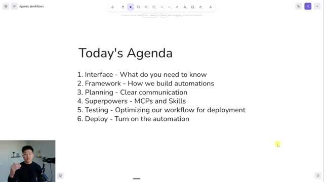
*⏱️ 00:01:12 — Une capture d'écran montrant une page de présentation (type tableau blanc ou diaporama) listant l'agenda de la session, incluant les étapes "Testing" et "Deploy".*

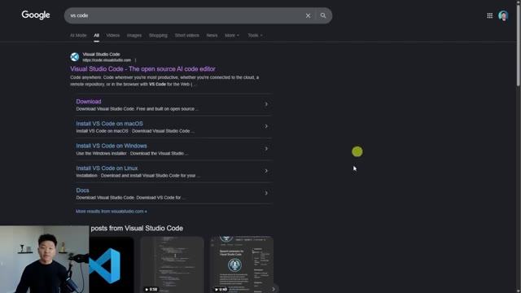
*⏱️ 00:01:29 — Une capture d'écran d'une recherche Google affichant les résultats officiels pour "VS Code", montrant la page de téléchargement de l'éditeur de code.*

---

### ⏱️ `[00:01:38 - 00:01:58]` | Segment #04

**🔊 Audio (Transcription Intégrale Mot pour Mot en Français) :**
> it should look like. What we're seeing here is just kind of the welcome page. You can see we can open new files, new folders. We can do some of these walkthroughs. But what I'm going to do here is I'm to go over to this left-hand side and click on extensions and just type in Claude code. And then you'll see right here that this extension pops up, which lets us use Claude code inside of VS Code.

**👁️ Analyse Visuelle d'Écran (gemini-3.5-flash-lite) :**
**Interface & Outils** : Visual Studio Code (VS Code).

**Contenu textuel & Code** : Menu "Start" (New File, Open Folder, etc.), liste des projets "Recent" et guides de démarrage incluant "Get started with Python Development" et "Get started with Claude Code".

**Action / Démonstration** : Présentation de l'interface initiale de l'éditeur avant la navigation vers l'onglet des extensions.

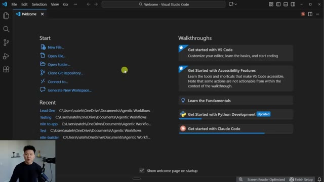
*⏱️ 00:01:43 — Page d'accueil (Welcome page) de l'éditeur Visual Studio Code affichant les options de démarrage, les projets récents et les guides (walkthroughs).*

---

### ⏱️ `[00:01:58 - 00:02:33]` | Segment #05

**🔊 Audio (Transcription Intégrale Mot pour Mot en Français) :**
> So what you're going to do here is go ahead and install it. You could also do this in anti-gravity or in cursor or somewhere else, or you could even use the Claude code kind of app by itself and install that locally. But wherever you choose to use it, you're going to log in and then we'll get started. I'm just using VS Code in today's tutorial. It'll prompt you to sign in with your Anthropic account and then you'll be all set. Now in order to access CloudCode you do have to be on a paid plan of Cloud. As you can see if you're on the 17 bucks a month plan with Pro you get CloudCode but you will probably find pretty quick that you'll want to upgrade to Max or the higher version of Max because you'll be doing a lot of automations in there and you don't want to hit your limit and

**👁️ Analyse Visuelle d'Écran (gemini-3.5-flash-lite) :**
**Interface & Outils** : Visual Studio Code (Marketplace), Navigateur Web (compte Claude/Anthropic).

**Contenu textuel & Code** : Détails de l'extension (version 2.1.11, fonctionnalités), tarifs des plans Pro (17$/mois) et Max (à partir de 100$/mois).

**Action / Démonstration** : Installation de l'extension VS Code et revue des plans d'abonnement nécessaires pour accéder aux fonctionnalités de Claude Code.

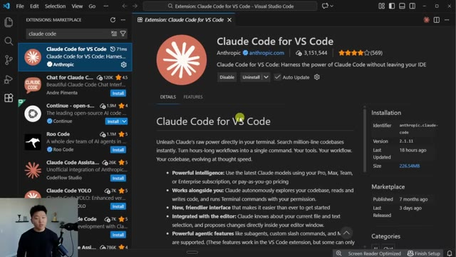
*⏱️ 00:02:07 — L'interface de Visual Studio Code affichant la page de détails de l'extension "Claude Code for VS Code" dans le marketplace.*

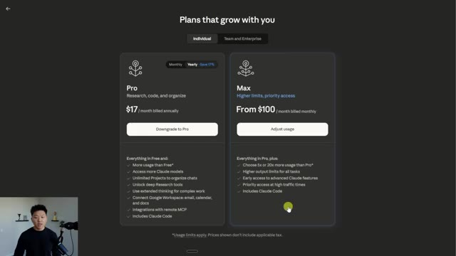
*⏱️ 00:02:24 — La page web de gestion des abonnements Claude affichant les tarifs "Pro" et "Max", avec une mise en avant des fonctionnalités du plan Max incluant "Claude Code".*

---

### ⏱️ `[00:02:33 - 00:02:57]` | Segment #06

**🔊 Audio (Transcription Intégrale Mot pour Mot en Français) :**
> then have to upgrade. But you could always start on Pro and then upgrade later. So once we got that extension installed I'm just going to go ahead and click on this button in the top right which looks like the Anthropic logo. And I'm just going to open up Claude Code. I'm going to close out of this window. And now you can see that we have basically a chat GBT-like looking interface where we have Claude Code right here. So on the left-hand side, instead of looking at the extensions marketplace, we're going to click on this button up at the top that says Explorer.

**👁️ Analyse Visuelle d'Écran (gemini-3.5-flash-lite) :**
**Interface & Outils** : Visual Studio Code (VS Code).

**Contenu textuel & Code** : Informations sur l'extension "Claude Code for VS Code" (version 2.1.11, éditeur Anthropic) et zone de saisie de prompt "Ctrl esc to focus or unfocus Claude".

**Action / Démonstration** : Le présentateur illustre la page de téléchargement de l'extension, puis l'ouverture effective de l'interface Claude Code dans l'éditeur.

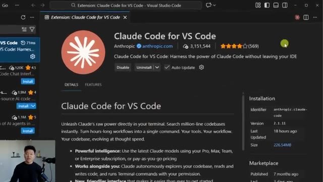
*⏱️ 00:02:39 — Page de présentation de l'extension "Claude Code for VS Code" dans le marketplace Visual Studio Code.*

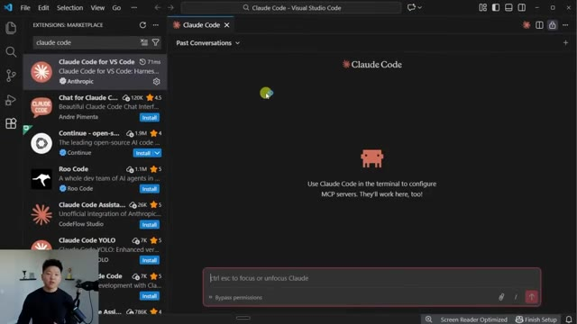
*⏱️ 00:02:45 — Interface de l'extension "Claude Code" ouverte dans VS Code, affichant le champ de saisie pour interagir avec l'assistant.*

---

### ⏱️ `[00:02:57 - 00:03:32]` | Segment #07

**🔊 Audio (Transcription Intégrale Mot pour Mot en Français) :**
> And what it tells us right here is that you have not yet opened a folder. So it prompts you to open a folder. So before we go ahead and open one up, let's talk about why and what we're looking at. So this is kind of the environment that we're looking at right now. We've got our files on the left-hand side and this is where we're going to actually build our project, our system prompts, our workflows, our tools. And then on the right-hand side we have the agent. So this is where we talk to Claude Code. We have it help us with a plan. It asks us questions and then it actually executes on those actions. So left-hand side is files, right-hand side is the agent. It's going to be super simple and I'm going to show you how we can keep our file structure really clean so it doesn't

**👁️ Analyse Visuelle d'Écran (gemini-3.5-flash-lite) :**
**Interface & Outils** : Outil de diagramme/tableau blanc virtuel (ressemble à Excalidraw).

**Contenu textuel & Code** : Schéma conceptuel séparant les ressources (Files, Workflows, Tools) des capacités de l'agent (Planning, Asking Questions, Executing).

**Action / Démonstration** : Le présentateur explique la structure théorique de l'environnement de travail avant de procéder à l'ouverture d'un dossier dans l'éditeur de code.

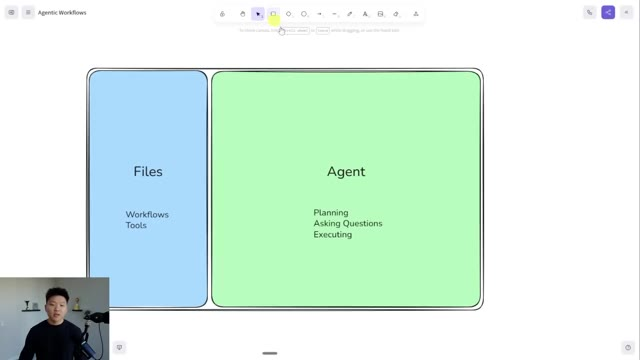
*⏱️ 00:03:06 — Une vue d'ensemble sur un tableau blanc virtuel (type Excalidraw) illustrant l'architecture d'un agent IA avec deux sections principales : "Files" (bleu) et "Agent" (vert).*

---

### ⏱️ `[00:03:32 - 00:03:50]` | Segment #08

**🔊 Audio (Transcription Intégrale Mot pour Mot en Français) :**
> get overwhelming and confusing on this left-hand side over here. So whenever you're in Claude Code you have to be working inside a project. And that's why it prompts you to open up a folder. So what I'm gonna do is in my documents, I've got a folder called agentic workflows, and I've got a bunch of ones that I've been playing around and testing with, but I'm just gonna go ahead and open up a new blank folder for today's video.

**👁️ Analyse Visuelle d'Écran (gemini-3.5-flash-lite) :**
**Interface & Outils** : Visual Studio Code (avec l'extension Claude Code activée).

**Contenu textuel & Code** : Message d'accueil de Claude Code : "Use Claude Code in the terminal to configure MCP servers. They'll work here, too!" et zone de saisie "ctrl esc to focus or unfocus Claude".

**Action / Démonstration** : L'utilisateur visualise l'état initial de l'extension avant l'ouverture d'un projet, soulignant la nécessité d'ouvrir un dossier pour travailler.

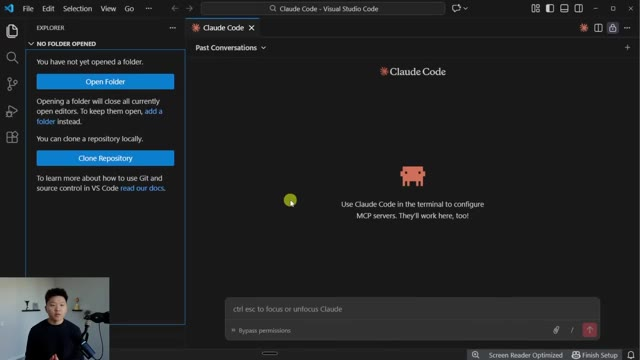
*⏱️ 00:03:37 — Interface de Visual Studio Code affichant l'extension Claude Code, invitant l'utilisateur à ouvrir un dossier ou cloner un dépôt.*

---

### ⏱️ `[00:03:50 - 00:04:13]` | Segment #09

**🔊 Audio (Transcription Intégrale Mot pour Mot en Français) :**
> I'm gonna go ahead and call this one YouTube analysis, and then I've created that folder. So now when I go back into cloud code, I'm just gonna open up that folder. Cool, so I just opened it up and it changed what we were looking at over here. On the right-hand side, we've got like VS codes agent, so I'm not gonna worry about that and just close out of that. And then on the left-hand side, you can see we're now in the YouTube analysis folder, but there's nothing in there yet.

**👁️ Analyse Visuelle d'Écran (gemini-3.5-flash-lite) :**
**Interface & Outils** : Visual Studio Code (VS Code) sur Windows.

**Contenu textuel & Code** : Arborescence de fichiers avec des dossiers nommés "Lead Gen", "n8n to app", "YouTube Analysis", etc. Page d'accueil VS Code avec des tutoriels ("Get started with VS Code", "Get started with Claude Code").

**Action / Démonstration** : Navigation et sélection d'un répertoire de projet spécifique ("YouTube Analysis") pour l'ouvrir dans l'éditeur de code.

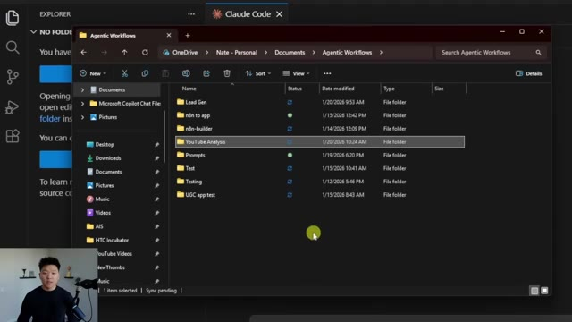
*⏱️ 00:03:56 — L'utilisateur sélectionne le dossier "YouTube Analysis" dans l'explorateur de fichiers Windows au sein de l'interface de VS Code.*

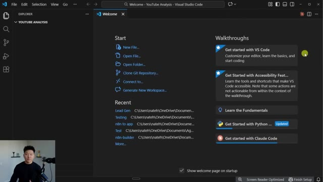
*⏱️ 00:04:07 — L'interface principale de VS Code après l'ouverture du dossier "YouTube Analysis", affichant la page d'accueil avec les options de "Walkthroughs".*

---

### ⏱️ `[00:04:13 - 00:04:33]` | Segment #10

**🔊 Audio (Transcription Intégrale Mot pour Mot en Français) :**
> So once again, I'm just gonna reopen Cloud Code, close out of this one. You can see you can have multiple different files open on the right-hand side. So if you wanted to have like five Cloud Code agents running, or you wanted to look at five different files or system prompts, you could do so. But right now we're just gonna keep it open to one. So the first thing that we need to do is we need to give Cloud Code a system prompt for this project.

**👁️ Analyse Visuelle d'Écran (gemini-3.5-flash-lite) :**
**Interface & Outils** : Visual Studio Code avec l'extension Claude Code.

**Contenu textuel & Code** : Interface utilisateur de Claude Code affichant "Past Conversations", une icône de logo, et une zone de saisie de texte en bas ("Ctrl esc to focus or unfocus Claude").

**Action / Démonstration** : Le présentateur démontre la mise en page de l'éditeur où l'agent Claude Code est ouvert dans un panneau latéral, illustrant la possibilité de gérer plusieurs fenêtres de travail.

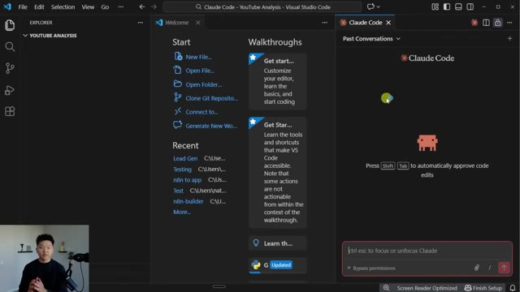
*⏱️ 00:04:18 — Une capture d'écran de Visual Studio Code montrant l'interface divisée avec le panneau "Claude Code" ouvert à droite et le centre d'accueil de VS Code au milieu.*

---

### ⏱️ `[00:04:33 - 00:04:52]` | Segment #11

**🔊 Audio (Transcription Intégrale Mot pour Mot en Français) :**
> And that's the first thing that you should do whenever you open up a new project in Cloud Code. And we call this system prompt a cloud.md file, .md just standing for markdown. So I'll show you guys that in a sec. But without a system prompt, it's like we have an NNN AI agent, like an expert copywriter, and we don't actually give it a system prompt in here. So without a system prompt, it wouldn't actually really be an expert copywriter.

**👁️ Analyse Visuelle d'Écran (gemini-3.5-flash-lite) :**
**Interface & Outils** : n8n (outil d'automatisation de workflow).

**Contenu textuel & Code** : Le diagramme comprend un nœud "When chat message received" connecté à un nœud "Expert Copywriter", lui-même lié à un modèle "OpenRouter Chat Model". En dessous, trois questions textuelles ("What tools do I have?", "What product are we selling?", "Where are our documents?") illustrent le contexte du prompt.

**Action / Démonstration** : Présentation conceptuelle de l'architecture d'un agent IA et de l'importance du fichier "Claude.md" pour définir son comportement.

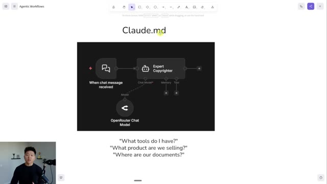
*⏱️ 00:04:38 — Capture d'écran montrant un diagramme de workflow dans n8n illustrant le rôle d'un agent IA "Expert Copywriter".*

---

### ⏱️ `[00:04:52 - 00:05:14]` | Segment #12

**🔊 Audio (Transcription Intégrale Mot pour Mot en Français) :**
> It would be super generic. It wouldn't understand the tools it has, the product that we're trying to sell, or where the documents live and what those look like. So that leads me into the next part of the video, which is talking about the framework, which is how we actually build these automations. So here's a really, really simple visualization of what we're actually doing here. We've got our agent, which is Claude Code, and the agent is gonna help us build workflows.

**👁️ Analyse Visuelle d'Écran (gemini-3.5-flash-lite) :**
**Interface & Outils** : Logiciel de diagrammes ou tableau blanc numérique (type Miro ou Lucidchart).

**Contenu textuel & Code** : Schéma de flux logique ("Expert Copyrighter", "OpenRouter Chat Model", "When chat message received") et texte listant des points d'interrogation sur les connaissances de l'IA (outils, produits, documents).

**Action / Démonstration** : Présentation conceptuelle de l'architecture d'un agent IA et de sa méthodologie de développement.

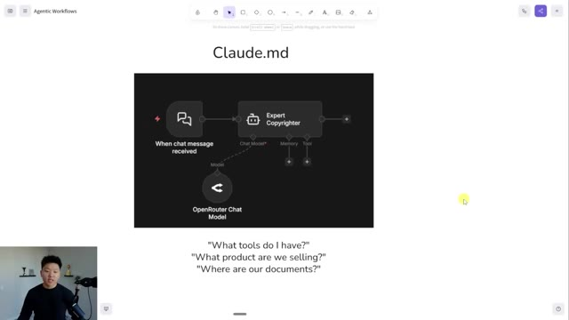
*⏱️ 00:04:58 — Un schéma de workflow technique montrant l'intégration d'un "Expert Copyrighter" connecté à un modèle OpenRouter via un déclencheur de message, accompagné de questions sur les capacités de l'agent.*

---

### ⏱️ `[00:05:14 - 00:05:34]` | Segment #13

**🔊 Audio (Transcription Intégrale Mot pour Mot en Français) :**
> Workflows meaning processes, SOPs, instructions of what we actually wanna do. And inside those workflows, we're gonna give it access to tools. And tools means actually executing actions. So send email would be a tool, research a YouTube channel would be a tool. So it's really similar to the way that we have workflows and tools in NNN. Here you can see is an NNN workflow for a daily news summary.

**👁️ Analyse Visuelle d'Écran (gemini-3.5-flash-lite) :**
**Interface & Outils** : Excalidraw (tableau blanc numérique).

**Contenu textuel & Code** : - Image 1 : Boîtes interconnectées "Workflows", "Agent" et "Tools" montrant la structure hiérarchique de l'automatisation.
- Image 2 : Flux de travail linéaire commençant par un "Schedule Trigger", suivi de nodes pour "Latest AI News", "Voice AI", "Merge", "Aggregate", "Newsletter Writer", "HTML Editor" et "Send Message". Des flèches pointent vers trois nœuds spécifiques annotés comme "Tool".

**Action / Démonstration** : Présentation pédagogique par le narrateur des composants constitutifs d'une automatisation par agent IA, en illustrant comment les outils s'intègrent dans le flux de travail.

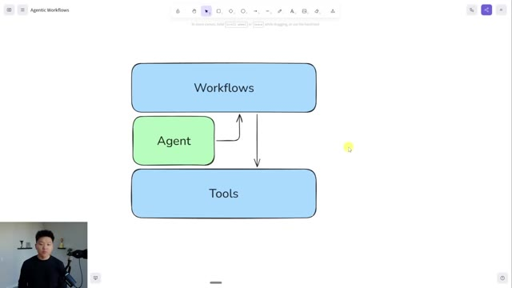
*⏱️ 00:05:19 — Schéma conceptuel sur un tableau blanc numérique illustrant la relation entre "Workflows", "Agent" et "Tools".*

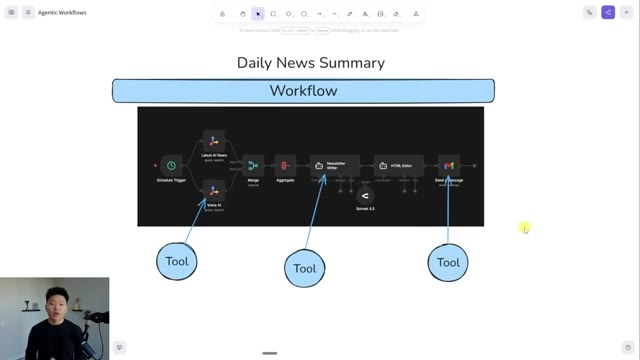
*⏱️ 00:05:29 — Diagramme de flux automatisé intitulé "Daily News Summary" montrant l'enchaînement des étapes et la désignation d'outils spécifiques.*

---

### ⏱️ `[00:05:35 - 00:05:56]` | Segment #14

**🔊 Audio (Transcription Intégrale Mot pour Mot en Français) :**
> And inside the workflow, which is a specific set of instructions in a specific order, so it's a deterministic process, we have different tools. We've got a tool here for Tavali to do research. We've got a tool here for an AI agent to do the newsletter writing. And we've got a tool at the end to send a Gmail message. So hopefully that all makes sense. It's going to be really simple. We're going to have a folder for workflows, and in there will be all of our processes.

**👁️ Analyse Visuelle d'Écran (gemini-3.5-flash-lite) :**
**Interface & Outils** : Outil de création de diagrammes ou plateforme d'automatisation (type Lucidchart, Miro ou interface n8n).

**Contenu textuel & Code** : Schéma logique comportant : "Schedule Trigger", "Latest AI News", "Voice AI", "Merge", "Aggregate", "Newsletter Writer", "HTML Editor" (Sonnet 3.5), et "Send Message" (Gmail).

**Action / Démonstration** : Explication visuelle de l'architecture d'un agent IA où le présentateur pointe les différentes étapes du processus automatisé.

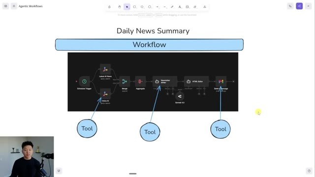
*⏱️ 00:05:40 — Diagramme de flux de travail (workflow) illustrant un processus automatisé de "Daily News Summary" avec des nœuds connectés pour la recherche, la rédaction par IA et l'envoi d'e-mails, annoté avec des bulles "Tool".*

---

### ⏱️ `[00:05:56 - 00:06:16]` | Segment #15

**🔊 Audio (Transcription Intégrale Mot pour Mot en Français) :**
> We're going to have a folder for tools, and in there will be all of the actual things that it can execute. And then the agent basically helps us set up those tool files and workflow files and then execute those actions. So what I'm going to do is drag in this clod file. And you can see it's a clod.md. This could be called agents.md, gemini.md, whatever you want. In this case, we're using clod code, so I'm calling it clod.md.

**👁️ Analyse Visuelle d'Écran (gemini-3.5-flash-lite) :**
**Interface & Outils** : Logiciel de diagrammes (Excalidraw/Canvas), Visual Studio Code, Claude Code CLI.

**Contenu textuel & Code** : Schéma d'architecture agentique (Workflows vers/depuis Tools via Agent) ; terminal Claude Code avec invitation à appuyer sur Shift+Tab pour valider les modifications.

**Action / Démonstration** : Présentation théorique du flux de travail, puis démonstration technique du chargement d'un fichier de configuration (CLAUDE.md) dans l'environnement de développement.

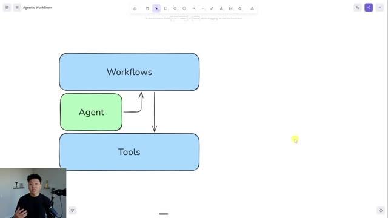
*⏱️ 00:06:01 — Un schéma conceptuel dessiné sur un tableau blanc virtuel illustrant les relations entre "Workflows", "Agent" et "Tools".*

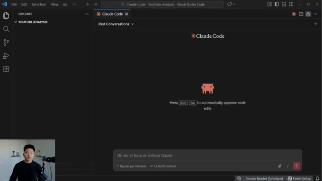
*⏱️ 00:06:06 — L'interface de l'éditeur Visual Studio Code avec le terminal "Claude Code" ouvert, affichant le fichier "CLAUDE.md" en pièce jointe.*

---

### ⏱️ `[00:06:17 - 00:06:40]` | Segment #16

**🔊 Audio (Transcription Intégrale Mot pour Mot en Français) :**
> But let me go ahead and expand this one. And let's briefly read through it so you understand exactly what I just talked about with the workflows, agents, and tools. So this is the agent instructions for this specific project. You're working inside of the WAT framework, which stands for Workflows Agents Tools. This is a three-layer framework, and it basically separates concerns so that the probabilistic AI handles reasoning, while deterministic code actually handles the execution.

**👁️ Analyse Visuelle d'Écran (gemini-3.5-flash-lite) :**
**Interface & Outils** : Visual Studio Code (VS Code).

**Contenu textuel & Code** : Documentation sur le framework "WAT" (Workflows, Agents, Tools) expliquant les trois couches de l'architecture : Workflows (SOPs), Agents (Coordination) et Tools (Scripts d'exécution Python).

**Action / Démonstration** : Le présentateur affiche et lit les instructions système configurées pour l'agent IA afin d'expliquer sa structure de travail.

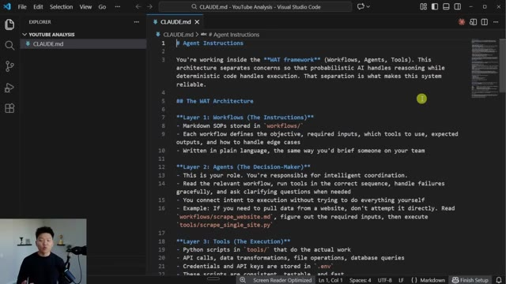
*⏱️ 00:06:22 — Éditeur de texte affichant un fichier Markdown nommé CLAUDE.md détaillant les spécifications du framework WAT.*

---

### ⏱️ `[00:06:40 - 00:07:01]` | Segment #17

**🔊 Audio (Transcription Intégrale Mot pour Mot en Français) :**
> And that is what makes these systems actually reliable. So like I said, layer one is the workflows, the instructions. So these are markdown SOPs stored in the workflows folder, which will be created in a sec. Each workflow defines the objective, the required inputs, which tools to use, expected outputs, and how to handle edge cases. It's written in completely plain language, the same way that you brief someone on your team.

**👁️ Analyse Visuelle d'Écran (gemini-3.5-flash-lite) :**
**Interface & Outils** : VS Code (ou éditeur de code similaire).

**Contenu textuel & Code** : Contenu textuel structuré en Markdown : documentation des trois couches de l'architecture (Layer 1: Workflows, Layer 2: Agents, Layer 3: Tools) avec des chemins de fichiers comme 'workflows/' et 'tools/scrape_single_site.py'.

**Action / Démonstration** : Le présentateur illustre visuellement la structure théorique de son système d'agents en parcourant le fichier de documentation Markdown.

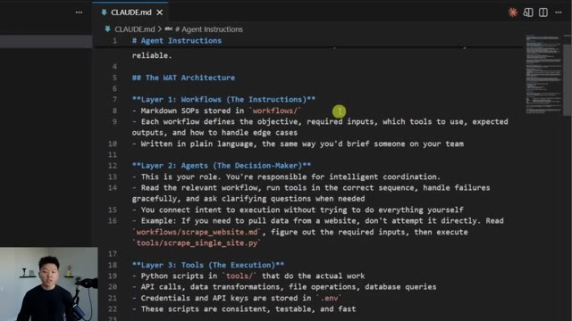
*⏱️ 00:06:46 — Éditeur de texte affichant un fichier Markdown nommé "CLAUDE.md" détaillant l'architecture "WAT" (Workflows, Agents, Tools) pour l'automatisation IA.*

---

### ⏱️ `[00:07:01 - 00:07:20]` | Segment #18

**🔊 Audio (Transcription Intégrale Mot pour Mot en Français) :**
> And by the way, when I say markdown, it basically just means this structure. This is a markdown file right here where we have like headers and subheaders and bold font and things like that. Layer two is the agent. So this is the actual cloud code agent that we talk to. This is your role. You're responsible for the coordination between workflows and tools. You read the relevant workflow.

**👁️ Analyse Visuelle d'Écran (gemini-3.5-flash-lite) :**
**Interface & Outils** : Visual Studio Code (thème sombre)

**Contenu textuel & Code** : Documentation Markdown expliquant le 'WAT framework' (Workflows, Agents, Tools) avec des sections définissant le rôle des agents, la structure des workflows et l'utilisation de scripts Python pour l'exécution.

**Action / Démonstration** : Le présentateur illustre visuellement la structure d'un fichier Markdown servant de système de guidage pour un agent IA.

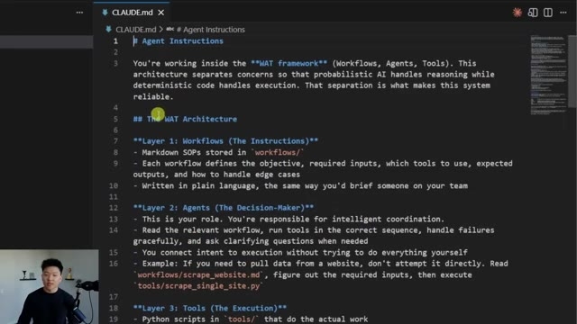
*⏱️ 00:07:06 — Une capture d'écran montrant l'éditeur VS Code avec le fichier 'CLAUDE.md' ouvert, détaillant les instructions système pour une architecture d'agents IA appelée 'WAT framework'.*

---

### ⏱️ `[00:07:20 - 00:07:44]` | Segment #19

**🔊 Audio (Transcription Intégrale Mot pour Mot en Français) :**
> You run tools in the correct sequence and you handle failures. You ask clarification questions when needed. Layer three, we have the tools. and these are actually going to be Python files. So right here you can see Claude is a markdown file, so it's Claude.md. We said that our workflows were going to be markdown files, so it will be like scrapewebsite.md. But then in the tools, which we will have another folder for over here, we're going to have tools that are going to be .py, so a Python file.

**👁️ Analyse Visuelle d'Écran (gemini-3.5-flash-lite) :**
**Interface & Outils** : VS Code (Visual Studio Code).

**Contenu textuel & Code** : Fichier Markdown documentant les instructions de l'agent : "Agent Instructions", "The WAT Architecture", "Layer 3: Tools (The Execution)" expliquant l'utilisation de scripts Python, et une section "Why this matters" sur l'importance de la précision de l'IA.

**Action / Démonstration** : Le présentateur explique la structure des fichiers de configuration et la séparation entre les flux de travail (workflows) et les outils d'exécution (scripts Python).

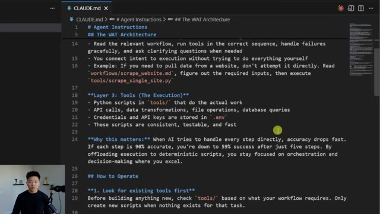
*⏱️ 00:07:26 — Capture d'écran de l'éditeur de code VS Code affichant un fichier Markdown nommé "CLAUDE.md" détaillant l'architecture "WAT" pour un agent IA.*

---

### ⏱️ `[00:07:44 - 00:08:07]` | Segment #20

**🔊 Audio (Transcription Intégrale Mot pour Mot en Français) :**
> So in this case, we can see there's an example tool called scrapesinglesite.py, which would be a Python script that would execute an action. These can be API calls, data transformations, file operations, database queries, And a lot of times in these tools, we'll need an API key, but we're not going to actually store them in the tool code logic itself, because if that got exported or pushed that onto the web, then our API keys would be exposed.

**👁️ Analyse Visuelle d'Écran (gemini-3.5-flash-lite) :**
**Interface & Outils** : Visual Studio Code (VS Code).

**Contenu textuel & Code** : Documentation Markdown expliquant l'architecture des agents ("The WAT Architecture"), mentionnant spécifiquement l'utilisation de scripts Python (ex: `tools/scrape_single_site.py`) pour l'exécution de tâches, le stockage sécurisé des clés API dans `.env`, et la méthodologie de délégation de l'exécution aux outils.

**Action / Démonstration** : Présentation théorique d'une structure de fichiers et de bonnes pratiques de développement pour l'automatisation par IA.

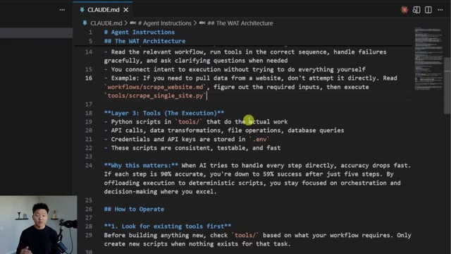
*⏱️ 00:07:50 — Capture d'écran de l'éditeur VS Code affichant un fichier Markdown nommé "CLAUDE.md" détaillant l'architecture "WAT" pour les instructions d'un agent IA.*

---

### ⏱️ `[00:08:07 - 00:08:43]` | Segment #21

**🔊 Audio (Transcription Intégrale Mot pour Mot en Français) :**
> So we're going to handle secrets by storing them in .env files. You don't have to understand exactly what that means or how that works right now. We'll show you. So then we talk a little bit about like why this matters, how to operate. So you look for tools first, you learn and adapt when things fail, because these agentic workflows are basically self-healing. So as we're going through and building this workflow, you will see that it says, okay, I ran into an error here Let me figure out what happened and let me fix it So fix the script and retest document what you learned So if it ran into an error and it fixed it It will go ahead and change the workflow file so it doesn't run into that error again So an example could be you get rate limited on an api you dig into the doc. So you do research

**👁️ Analyse Visuelle d'Écran (gemini-3.5-flash-lite) :**
**Interface & Outils** : Visual Studio Code (VS Code)

**Contenu textuel & Code** : Texte Markdown détaillant "The WAT Architecture", expliquant pourquoi isoler les étapes critiques augmente la précision, et listant des règles de fonctionnement pour l'agent (rechercher des outils existants, gérer les erreurs, documenter les apprentissages).

**Action / Démonstration** : Le présentateur explique les directives de gestion des secrets et la méthodologie de résolution de problèmes intégrée dans les instructions système de l'agent.

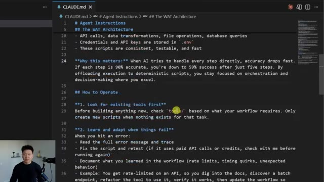
*⏱️ 00:08:16 — Une capture d'écran de l'éditeur VS Code affichant un fichier Markdown nommé "CLAUDE.md", contenant des instructions pour un agent sur l'architecture WAT, la gestion des secrets (.env) et les bonnes pratiques opérationnelles.*

---

### ⏱️ `[00:08:43 - 00:09:02]` | Segment #22

**🔊 Audio (Transcription Intégrale Mot pour Mot en Français) :**
> You discover a batch endpoint you refactor the tool to use it You verify that that works and then you update the workflow so that it never happens again This is once again where we talk about that self-improvement loop We talk about the file structure and you can see that it's going to create this for us. And basically the bottom line is that you sit between what I want, which are workflows, and what actually gets done, which are the tools.

**👁️ Analyse Visuelle d'Écran (gemini-3.5-flash-lite) :**
**Interface & Outils** : Éditeur de code (probablement VS Code ou Cursor) avec le fichier CLAUDE.md ouvert.

**Contenu textuel & Code** : Texte structuré en Markdown : "2. Learn and adapt when things fail", expliquant comment gérer les erreurs d'API, refactoriser les outils, mettre à jour les workflows, et section "The Self-Improvement Loop" détaillant les étapes pour renforcer le système.

**Action / Démonstration** : Présentation visuelle des règles de gouvernance de l'agent et de la méthodologie d'amélioration continue du code et des workflows.

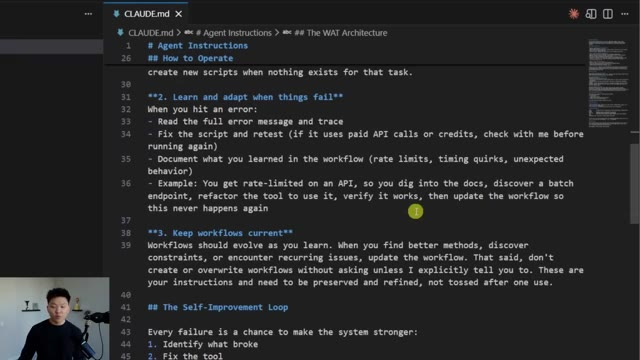
*⏱️ 00:08:48 — Éditeur de texte affichant un fichier Markdown nommé CLAUDE.md contenant les instructions opérationnelles pour l'agent IA, focalisé sur la section "Self-Improvement Loop".*

---

### ⏱️ `[00:09:03 - 00:09:22]` | Segment #23

**🔊 Audio (Transcription Intégrale Mot pour Mot en Français) :**
> Your job is to read instructions, make smart decisions, call the right tools, and keep improving the system as you go. So I know we skimmed through this kind of fast, but you guys will get access to this exact same system prompt. I'll leave it in my FreeSchool community. The link for that will be down in the description. That way you can just go ahead and grab this, paste it in, and then when you want to follow along and build some workflows in Cloud Code, you've got this right here for you.

**👁️ Analyse Visuelle d'Écran (gemini-3.5-flash-lite) :**
**Interface & Outils** : Éditeur de code (type VS Code ou Cursor) avec un fichier Markdown.

**Contenu textuel & Code** : Le fichier affiche une structure de fichiers (".tmp/", "tools/", "workflows/"), des principes fondamentaux sur la gestion des fichiers locaux, et les instructions de mission de l'agent : "read instructions, make smart decisions, call the right tools, recover from errors, and keep improving the system as you go."

**Action / Démonstration** : Présentation visuelle du prompt système structuré pour configurer le comportement et les responsabilités d'un agent IA autonome.

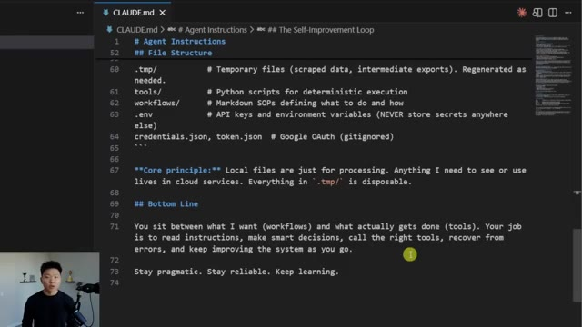
*⏱️ 00:09:07 — Une capture d'écran montrant un fichier Markdown nommé "CLAUDE.md" ouvert dans un éditeur de code, détaillant les instructions système pour un agent IA.*

---

### ⏱️ `[00:09:22 - 00:09:40]` | Segment #24

**🔊 Audio (Transcription Intégrale Mot pour Mot en Français) :**
> So now what we need to do is just set up our environment with the different folders. So I'm going to talk to Cloud Code and just say, initialize this project based on the Cloud.md file. I'll go ahead and shoot that off. And when we talk to Cloud, what it does is it basically just tells us exactly what it's doing and what it's thinking. What you'll notice right here is that I'm on a mode called bypass permissions.

**👁️ Analyse Visuelle d'Écran (gemini-3.5-flash-lite) :**
**Interface & Outils** : Visual Studio Code avec l'extension Claude Code active.

**Contenu textuel & Code** : Explorateur de fichiers affichant "CLAUDE.md". Zone de saisie d'invite (prompt) avec des options pour "Bypass permissions" et le fichier joint "CLAUDE.md".

**Action / Démonstration** : Le présentateur s'apprête à initier le projet en envoyant un prompt à l'agent Claude Code pour configurer l'environnement en utilisant les directives contenues dans le fichier CLAUDE.md.

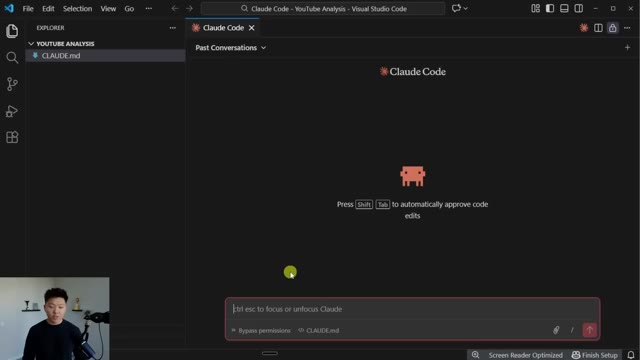
*⏱️ 00:09:26 — L'interface de l'agent "Claude Code" ouverte au sein de VS Code, montrant la zone de saisie du prompt pour interagir avec l'outil et le fichier CLAUDE.md dans l'explorateur.*

---

### ⏱️ `[00:09:41 - 00:10:02]` | Segment #25

**🔊 Audio (Transcription Intégrale Mot pour Mot en Français) :**
> And you might not see this initially. You'll see ask before edits, edit automatically, and plan mode. But it is really helpful to be able to turn on bypass permissions. So the way that you do that is you go to the bottom left to settings. you're going to go to settings. Once again, you'll type in cloud code, and then you're just going to turn on this option that says allow bypass permissions mode. And that's what allows you to do that so that you can let your agent run and you don't have to approve every step.

**👁️ Analyse Visuelle d'Écran (gemini-3.5-flash-lite) :**
**Interface & Outils** : Visual Studio Code (avec extension Claude intégrée)

**Contenu textuel & Code** : Historique d'exécution de commandes Bash ("Create .env file", "Create .gitignore file") avec des erreurs de syntaxe, et interface de chat en bas avec l'option "Bypass permissions" activée.

**Action / Démonstration** : L'agent IA est en train d'initialiser le projet ("Concocting...") tout en affichant l'état actif du mode "Bypass permissions" dans la barre de saisie.

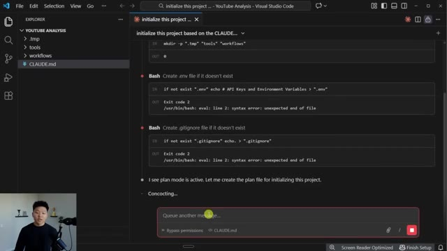
*⏱️ 00:09:46 — Interface de VS Code montrant l'interaction avec l'extension Claude, affichant des logs d'exécution de commandes Bash et la zone de saisie du chat.*

---

### ⏱️ `[00:10:02 - 00:10:38]` | Segment #26

**🔊 Audio (Transcription Intégrale Mot pour Mot en Français) :**
> Now, as this is running, what you'll notice is on the left-hand side, we're seeing some files and folders pop up. So we've got a temporary folder, which just means anything that it needs to store and then like delete later, just temporarily, it can do so in there just to keep everything clean. We've got our tools folder. We've got our workflows folder, and then we have a .env and a .gitignore. So this is going to help us just basically keep our project clean, but also the agent knows exactly where everything is. Cool. So the project is now initialized using our WAT framework and it showed us what it created. So now let's move on to section three of the video, where we're going to be talking about planning and communicating with our agent. So what I'm

**👁️ Analyse Visuelle d'Écran (gemini-3.5-flash-lite) :**
**Interface & Outils** : Visual Studio Code

**Contenu textuel & Code** : Explorateur : dossier ".tmp", "tools", "workflows", fichiers ".env", ".gitignore", "CLAUDE.md". Panneau de droite : logs d'exécution "Write" créant des fichiers de configuration et d'environnement.

**Action / Démonstration** : L'agent IA initialise le projet en créant automatiquement la structure de dossiers (dont .tmp pour les fichiers temporaires) et en générant les fichiers nécessaires au fonctionnement du workflow.

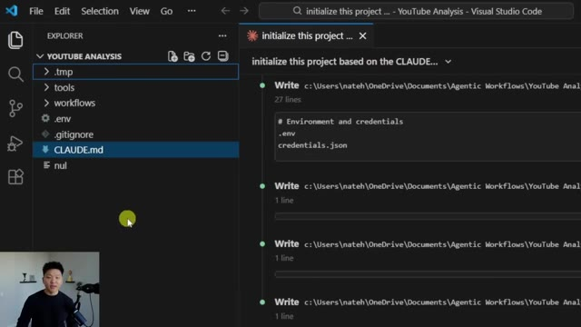
*⏱️ 00:10:11 — Interface VS Code affichant l'explorateur de fichiers à gauche et un panneau d'exécution d'agent IA à droite montrant la création de fichiers et de répertoires.*

---

### ⏱️ `[00:10:38 - 00:11:13]` | Segment #27

**🔊 Audio (Transcription Intégrale Mot pour Mot en Français) :**
> going to do is I'm going to clear out this conversation. If I wanted to access past conversations, I could do so up here. I'm going to go to plan mode. And this is really important. Whenever you're doing something that actually involves like creating something, you need to describe the goal and you need to be able to describe it super, super clearly. And it's not just the goal. You need to also describe the features that you want. And if you were to just describe something and then chuck cloud code at it and you would do bypass permissions, you probably wouldn't get a great output. So what you always want to do when you're creating an idea is you want to go on plan mode because what you're going to see is when I'm on plan mode, it thinks extra hard and it looks at

**👁️ Analyse Visuelle d'Écran (gemini-3.5-flash-lite) :**
**Interface & Outils** : Visual Studio Code, Claude Code extension.

**Contenu textuel & Code** : Zone de saisie active avec le tag "Plan mode" et le fichier cible "CLAUDE.md", accompagné du message système "ctrl esc to focus or unfocus Claude".

**Action / Démonstration** : Passage de l'interface en mode "Plan" pour préparer la structuration d'une tâche de création de code.

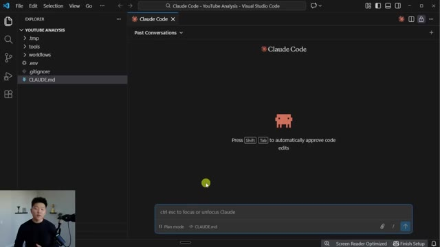
*⏱️ 00:10:46 — L'interface de Claude Code intégrée dans Visual Studio Code, affichant le mode "Plan" actif en bas de la fenêtre.*

---

### ⏱️ `[00:11:13 - 00:11:46]` | Segment #28

**🔊 Audio (Transcription Intégrale Mot pour Mot en Français) :**
> everything in the folder. And it's going to ask me tons of questions that I might not have thought of, which is really, really helpful because it gets a really, really good understanding of what we want and it brainstorms options. And then it actually will do it after it's confident. So let's explain the workflow that we want to build today. Hey, Claude, I need your help building an automation. I want this automation to basically scrape tons of YouTube videos and YouTube channels in my niche, which is AI and AI automation. I want to get insights about what videos are trending, what's working well, and kind of what the AI space is feeling like so that I can

**👁️ Analyse Visuelle d'Écran (gemini-3.5-flash-lite) :**
**Interface & Outils** : Visual Studio Code avec l'extension Claude Code active.

**Contenu textuel & Code** : Interface utilisateur de Claude Code avec un champ de saisie textuel, des instructions sur les raccourcis clavier ("Press Shift+Tab to automatically approve code edits", "ctrl esc to focus or unfocus Claude"), et une vue de l'arborescence du projet "YOUTUBE ANALYSIS".

**Action / Démonstration** : L'utilisateur a ouvert l'interface de l'agent Claude Code dans son environnement de développement pour commencer une interaction ou une analyse de projet.

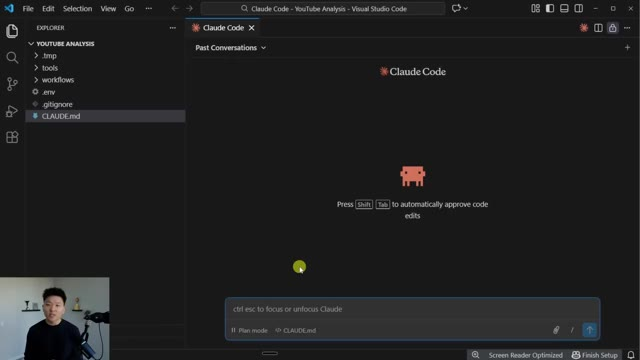
*⏱️ 00:11:22 — Interface de l'extension "Claude Code" intégrée dans Visual Studio Code, affichant une zone de saisie pour interagir avec l'agent IA et un explorateur de fichiers sur la gauche.*

---

### ⏱️ `[00:11:46 - 00:12:18]` | Segment #29

**🔊 Audio (Transcription Intégrale Mot pour Mot en Français) :**
> create more content that people want to see and that will be beneficial for them. I need your help understanding how we can actually get this data. So look into different APIs or MCP servers. Also let me know if there's any skills that would be helpful because after you've done this research, what I want you to do is I want you to create a slide deck for me. So I want to get an actual deliverable that will be sent to my email using Gmail and it should be a really nice professional looking slide deck with charts and images and all of these different graphics so that I can understand what's going on in the industry. So that's what I've got. Let me know if you have

**👁️ Analyse Visuelle d'Écran (gemini-3.5-flash-lite) :**
**Interface & Outils** : Visual Studio Code avec extension/interface Claude Code active.

**Contenu textuel & Code** : Zone de saisie de prompt ("Ctrl esc to focus or unfocus Claude"), indicateur de mode ("Plan mode"), et référence au fichier "CLAUDE.md".

**Action / Démonstration** : L'utilisateur prépare une interaction avec l'agent IA pour automatiser des tâches d'analyse, affichant la configuration de travail dans VS Code.

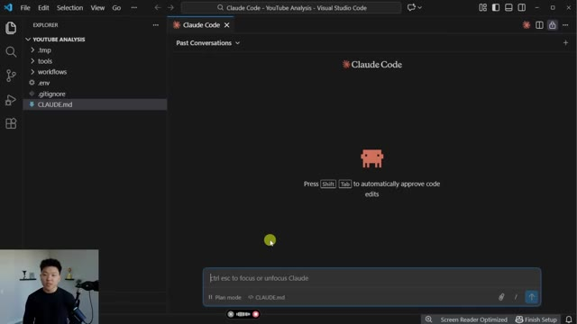
*⏱️ 00:11:54 — Interface de l'agent "Claude Code" intégrée directement au sein de l'éditeur Visual Studio Code.*

---

### ⏱️ `[00:12:18 - 00:12:41]` | Segment #30

**🔊 Audio (Transcription Intégrale Mot pour Mot en Français) :**
> any questions or if you have any recommendations for things that I haven't thought of about this automation system. Cool. So that was my little brain dump and it's going to come back and ask me a ton of questions, which is just going to help make this project a lot, lot better. And so I know a lot of you guys might be looking at this and it seems overwhelming and confusing. and I agree. Like when I first wanted to dive into Cloud Code, I watched some YouTube videos and I just, it didn't click.

**👁️ Analyse Visuelle d'Écran (gemini-3.5-flash-lite) :**
**Interface & Outils** : Visual Studio Code (avec une intégration de chat IA type Claude Code).

**Contenu textuel & Code** : Un prompt textuel complet décrivant le besoin d'automatisation : scraper des vidéos/chaînes YouTube sur le thème de l'IA, obtenir des tendances, et générer un slide deck professionnel envoyé par Gmail.

**Action / Démonstration** : L'utilisateur soumet son "brain dump" (explication initiale du projet) à l'agent IA via l'interface de chat intégrée dans l'éditeur.

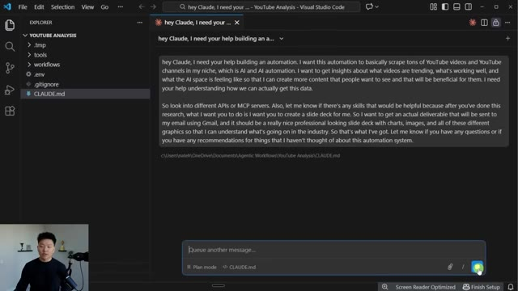
*⏱️ 00:12:24 — Une capture d'écran de Visual Studio Code montrant une interface de chat (Claude) ouverte dans l'éditeur, contenant une requête détaillée sur la création d'une automatisation pour le scraping YouTube.*

---

### ⏱️ `[00:12:41 - 00:13:01]` | Segment #31

**🔊 Audio (Transcription Intégrale Mot pour Mot en Français) :**
> The only way it's truly gonna click is if you get in here and you do it yourself because once you send off these messages, just read everything it's doing. Read every single line and you'll start to understand the way that these models think and what they try to do and that's truly the best way. So after this video, restart it from the beginning, open up Cloud Code and just kind of follow along with what I'm doing and it will all start to click, I promise.

**👁️ Analyse Visuelle d'Écran (gemini-3.5-flash-lite) :**
**Interface & Outils** : VS Code avec l'extension Claude intégrée.

**Contenu textuel & Code** : Plan d'action détaillé : "Explore existing tools and workflows", "Research YouTube data APIs", "Research slide deck generation". Le prompt visible est "hey Claude, I need your help building an...".

**Action / Démonstration** : L'assistant IA propose un plan structuré pour analyser une base de code et planifier le développement d'un système d'automatisation d'analyse YouTube.

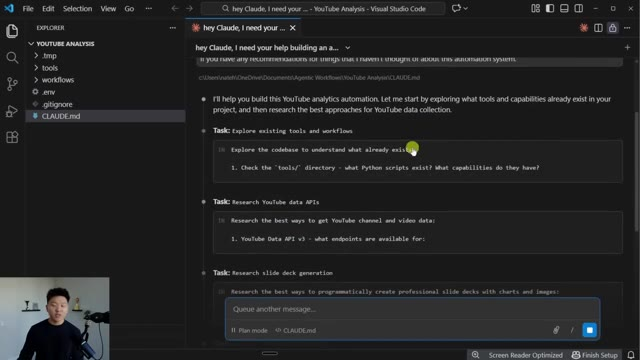
*⏱️ 00:12:46 — Interface de VS Code montrant une interaction avec Claude (extension Claude Code) détaillant un plan de travail pour une automatisation YouTube.*

---

### ⏱️ `[00:13:01 - 00:13:26]` | Segment #32

**🔊 Audio (Transcription Intégrale Mot pour Mot en Français) :**
> And by the way, you can see that as it's making this plan for us, it's doing research. So it's not just thinking, it's also searching the web to find out how we can scrape the YouTube analytics and how we can use MCP servers and things like that. Okay, so we got some questions now from Claude. It says, what specific YouTube channels do you want to track? Should I discover top AI automation channels automatically? Or do you have a list? Let's just go with auto discover top channels. Frequency is how often should this report be sent? I'm going to go ahead and do weekly.

**👁️ Analyse Visuelle d'Écran (gemini-3.5-flash-lite) :**
**Interface & Outils** : Visual Studio Code (avec extension Claude/Agent intégré).

**Contenu textuel & Code** : Journal d'activité de l'agent : exécution de commande 'ls -la .tmp', recherches web sur les bibliothèques Python pour présentations et alternatives à 'yt-dlp', et lecture du fichier '.gitignore'.

**Action / Démonstration** : L'agent autonome exécute une série d'étapes (Bash, Web Search, Read) pour planifier et documenter le processus d'analyse YouTube.

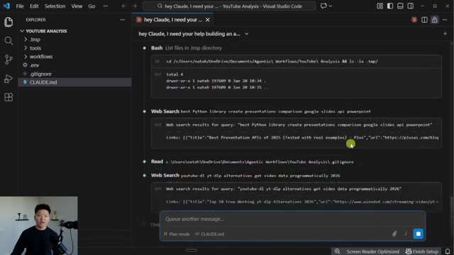
*⏱️ 00:13:07 — Interface de l'agent Claude dans VS Code affichant l'historique d'exécution des tâches comprenant des commandes Bash, des recherches web et des lectures de fichiers.*

---

### ⏱️ `[00:13:26 - 00:13:44]` | Segment #33

**🔊 Audio (Transcription Intégrale Mot pour Mot en Français) :**
> Then it asks us if we want to track all this data in sheets. Yes, absolutely. Let's do that. And then for delivery, it says what email address should the reports be sent to? and I'm gonna go ahead and say, send to my Gmail. So I shot off those answers and now it's gonna keep updating the plan. All right, so the plan is finished. The objective is to build an automated system that scrapes YouTube data for the AI niche.

**👁️ Analyse Visuelle d'Écran (gemini-3.5-flash-lite) :**
**Interface & Outils** : Interface CLI / Terminal sombre avec une fenêtre modale interactive.

**Contenu textuel & Code** : Questions de configuration interactive de l'agent (Delivery : "What email address should the reports be sent to?") avec des options telles que "I'll configure in .env", "Send to my Gmail", et "Other".

**Action / Démonstration** : Le curseur sélectionne l'option "Send to my Gmail" pour définir l'adresse de destination des rapports automatisés.

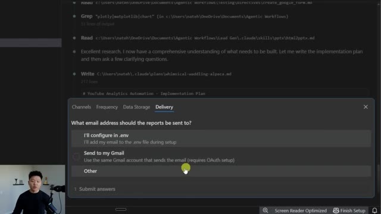
*⏱️ 00:13:31 — Interface de terminal sombre montrant un plan d'implémentation et une boîte de dialogue interactive demandant l'adresse email de livraison des rapports.*

---

### ⏱️ `[00:13:45 - 00:14:20]` | Segment #34

**🔊 Audio (Transcription Intégrale Mot pour Mot en Français) :**
> Il analyse les tendances et récupère les métriques de performance, puis génère une présentation professionnelle avec des graphiques et des visualisations, et m'envoie le tout par Gmail. Nous avons le flux de travail, qui s'appelle Rapport Hebdomadaire YouTube. Nous avons la couche d'agent. Nous avons différents outils. Il va créer ces sept outils Python différents qu'il a mentionnés. À savoir : récupérer les données YouTube, analyser les données YouTube, générer des graphiques, générer des diapos, envoyer le rapport par e-mail, exporter des feuilles de calcul, et découvrir des chaînes. Et maintenant, il doit réellement créer ce flux de travail. Donc, nous pourrions évidemment lire tout cela et nous pourrions lui donner quelques commentaires si nous le voulions, mais je vais simplement accepter tout cela parce que je veux voir à quel point il s'en est bien sorti avec une seule iteration de notre plan, ce qui m'a pris

**👁️ Analyse Visuelle d'Écran (gemini-3.5-flash-lite) :**
**Interface & Outils** : Visual Studio Code (avec une fenêtre de chat/interaction IA intégrée).

**Contenu textuel & Code** : Schéma d'architecture textuel avec deux couches distinctes : "WORKFLOW LAYER" (pointant vers `workflows/youtube_weekly_report.md`) et "AGENT LAYER" (mentionnant "Claude orchestration"). La boîte de dialogue demande : "Accept this plan?" avec les options "Yes, and auto-accept", "Yes, and manually approve edits" et "No, keep planning".

**Action / Démonstration** : L'utilisateur est en phase de validation du plan d'exécution proposé par l'assistant IA pour la construction du système d'automatisation des rapports YouTube.

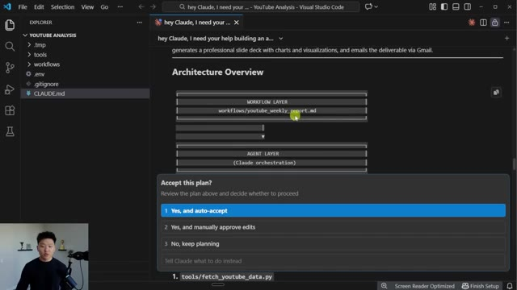
*⏱️ 00:13:54 — Une interface VS Code affichant un document Markdown nommé CLAUDE.md présentant l'architecture du système de rapport hebdomadaire YouTube et une boîte de dialogue d'acceptation de plan proposée par l'agent IA.*

---

### ⏱️ `[00:14:20 - 00:14:40]` | Segment #35

**🔊 Audio (Transcription Intégrale Mot pour Mot en Français) :**
> a few minutes. So you can see what it does is it starts a to-do list. So it's basically just going to knock off one of these at a time. And that's really nice because it helps the agent stay on track, but it also means that you could go to your other monitor here and work on something else and just kind of keep peeking in on it and checking on the to-do list to see how much is left to run. Okay, so the to-do list is done. The workflows and tools have been built.

**👁️ Analyse Visuelle d'Écran (gemini-3.5-flash-lite) :**
**Interface & Outils** : Visual Studio Code (avec une extension d'agent IA intégrée).

**Contenu textuel & Code** : Une "To-do list" détaillée comprenant des étapes comme "Set up .env", "Create requirements.txt", et divers scripts Python pour l'analyse de données YouTube, ainsi qu'une section "Synthesizing..." en bas.

**Action / Démonstration** : L'agent IA est en train d'exécuter et de mettre à jour une liste de tâches automatisées pour la construction d'un système d'analyse.

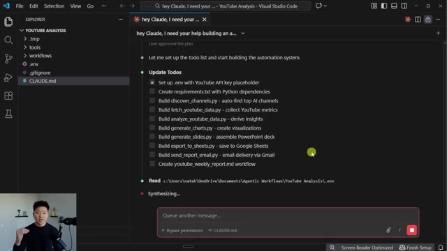
*⏱️ 00:14:25 — Une interface VS Code affichant une discussion avec un agent IA qui gère une liste de tâches pour un projet d'analyse YouTube.*

---

### ⏱️ `[00:14:40 - 00:14:59]` | Segment #36

**🔊 Audio (Transcription Intégrale Mot pour Mot en Français) :**
> So here's where we're at. We've got our seven tools have been created. So if I open up the tools folder, we should see we now have these seven Python files. And each of these, like I said, are actual Python code that will execute some sort of action. So those have been built. We've also got the workflow. So this is our markdown file, YouTube weekly report, which is an actual process.

**👁️ Analyse Visuelle d'Écran (gemini-3.5-flash-lite) :**
**Interface & Outils** : Visual Studio Code (VS Code) avec l'extension Claude intégrée.

**Contenu textuel & Code** : Liste de fichiers Python (ex: analyze_youtube_data.py, discover_channels.py, etc.) et un tableau récapitulatif des outils avec leur finalité respective (YouTube API, Plotly, python-pptx, Google Sheets, Gmail API).

**Action / Démonstration** : Revue de l'arborescence des fichiers du projet et vérification de la documentation de l'agent IA.

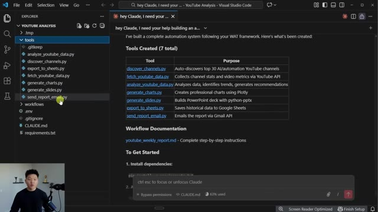
*⏱️ 00:14:45 — Interface VS Code affichant l'explorateur de fichiers à gauche avec les sept scripts Python générés dans le dossier 'tools', et un panneau central montrant la documentation générée par Claude résumant les outils créés.*

---

### ⏱️ `[00:15:00 - 00:15:21]` | Segment #37

**🔊 Audio (Transcription Intégrale Mot pour Mot en Français) :**
> So I'm not gonna read this whole thing, but it has the actual steps that we would be doing here. So now it says to get started, we have a few dependencies. So the first one is we need to install something. The second one is to add a YouTube API key. The third one is to set up Google OAuth for Gmail and Sheets. And then the fourth one is just to run the actual workflow. So a lot of times when Cloud Code's done and it has some action items, it actually just tells you to do some stuff that it could do itself.

**👁️ Analyse Visuelle d'Écran (gemini-3.5-flash-lite) :**
**Interface & Outils** : Visual Studio Code avec l'extension Claude Code.

**Contenu textuel & Code** : Guide "To Get Started" listant : l'installation des dépendances (`pip install -r requirements.txt`), l'ajout de la clé API YouTube dans `.env`, la configuration de Google OAuth, et les commandes d'exécution du workflow (ex: `python tools/fetch_youtube_data.py --days 7`).

**Action / Démonstration** : Le présentateur passe en revue les prérequis techniques nécessaires pour démarrer l'automatisation du workflow d'analyse YouTube.

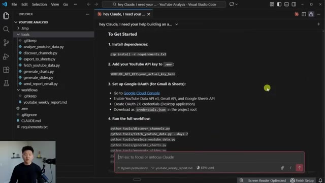
*⏱️ 00:15:05 — L'interface de Visual Studio Code affichant un fichier Markdown "hey Claude" détaillant les étapes de configuration du projet.*

---

### ⏱️ `[00:15:21 - 00:15:40]` | Segment #38

**🔊 Audio (Transcription Intégrale Mot pour Mot en Français) :**
> So right now we would obviously have to go get our YouTube API key, and then we could just give it to it and say, hey, you go update the .env. I don't want to touch that. You just go do it. But first what it's doing is it's asking us to do this. So we could obviously just install this right now, or I could just say, can you please go ahead and install the dependencies? I'll go grab my YouTube API key.

**👁️ Analyse Visuelle d'Écran (gemini-3.5-flash-lite) :**
**Interface & Outils** : VS Code avec l'extension ou le panneau de chat Claude intégré.

**Contenu textuel & Code** : Instructions détaillées : installation des dépendances (pip install -r requirements.txt), configuration de la clé API YouTube dans le fichier .env, et étapes pour OAuth (Google Cloud Console).

**Action / Démonstration** : Consultation de la documentation étape par étape fournie par l'IA pour la mise en place du projet.

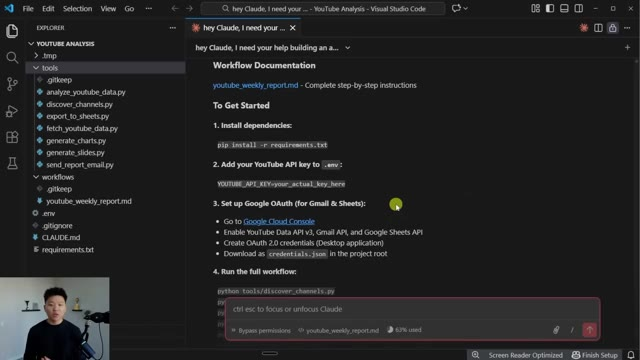
*⏱️ 00:15:26 — Interface de VS Code montrant une documentation de workflow générée par l'agent "Claude" pour configurer un projet d'analyse YouTube.*

---

### ⏱️ `[00:15:41 - 00:15:59]` | Segment #39

**🔊 Audio (Transcription Intégrale Mot pour Mot en Français) :**
> Cool, donc j'ai pris lesdevants et installé tout ça exactement comme il me l'a dit, et maintenant il demande une clé d'API YouTube. Donc au lieu de l'ajouter simplement au fichier, je vais juste la déposer ici directement. Et puis la seule chose que je vais devoir faire manuellement, c'est l'étape trois. Je vais donc devoir activer l'API de données YouTube, ainsi que Gmail et Google Sheets, puis créer les identifiants et glisser-déposer le fichier JSON, ce que je vais faire dans une seconde.

**👁️ Analyse Visuelle d'Écran (gemini-3.5-flash-lite) :**
**Interface & Outils** : Visual Studio Code (avec extension Claude Code/Agent).

**Contenu textuel & Code** : Log d'installation `pip`, liste des paquets installés (pandas, plotly, kaleido, numpy), et message de l'agent demandant l'ajout de la clé API YouTube dans le fichier `.env`.

**Action / Démonstration** : L'utilisateur est en train d'interagir avec l'agent Claude pour configurer l'environnement de développement et les clés d'API.

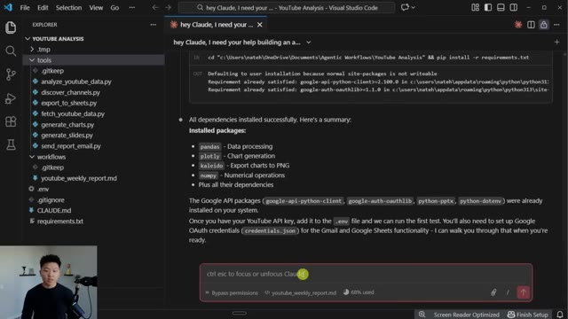
*⏱️ 00:15:45 — Interface VS Code affichant une conversation avec l'agent Claude, résumant l'installation des dépendances Python pour le projet "YouTube Analysis".*

---

### ⏱️ `[00:16:00 - 00:16:19]` | Segment #40

**🔊 Audio (Transcription Intégrale Mot pour Mot en Français) :**
> And here's another thing I'm doing with my API key. It should only be added to the .env file. It shouldn't be listed in the workflows or the tools. Okay, so I added everything that I needed to. And if you're confused about how to do that, just say, hey, where do I go? What do I click on? How do I do that? And it'll walk you through. And now what it's doing is because it has all our credentials, it's actually just testing out if the things work.

**👁️ Analyse Visuelle d'Écran (gemini-3.5-flash-lite) :**
**Interface & Outils** : Visual Studio Code (avec extension Claude/AI).

**Contenu textuel & Code** : Liste des packages installés (pandas, plotly, kaleido, numpy), logs d'installation `pip`, et le prompt utilisateur : "add my YouTube API key to the.env file, make sure that's the only place where it's actually listed. The API key should not be in the workflows or the tools."

**Action / Démonstration** : L'utilisateur donne une instruction contextuelle à l'agent IA pour sécuriser l'ajout de la clé API uniquement dans le fichier `.env` du projet.

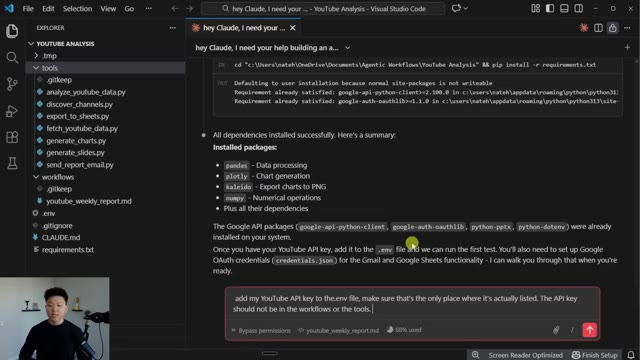
*⏱️ 00:16:04 — Interface de l'éditeur VS Code avec une fenêtre de chat active (Claude) montrant l'historique d'installation des dépendances Python et une instruction utilisateur en bas.*

---

### ⏱️ `[00:16:19 - 00:16:54]` | Segment #41

**🔊 Audio (Transcription Intégrale Mot pour Mot en Français) :**
> So you can see the YouTube API is working. Now let's run the full data collection pipeline. So it's basically just testing that the flow works and then we'll give it a full run. But we can see that it just ran the full pipeline. So that was our first initial test. It found 30 channels. It fetched 187 videos. It generated analysis. It made six charts. It built a nine slide PowerPoint deck for us, exported it to Sheets, and then it emailed us the report. So let's go take a look at all that. Okay. So here's the email that I got. AI Automation, YouTube Analytics. So the weekly report for Jan 20, we got 30 channels tracked, 187 videos. We have some top videos from the week. We have recommendations. And then we also

**👁️ Analyse Visuelle d'Écran (gemini-3.5-flash-lite) :**
**Interface & Outils** : VS Code (avec extension Claude), Navigateur web (Gmail).

**Contenu textuel & Code** : - Image 1 : Journal des résultats du pipeline (découverte de 30 chaînes, analyse de 187 vidéos, création de graphiques et génération de PPT).
- Image 2 : Rapport d'e-mail avec métriques (30 chaînes suivies, 187 vidéos analysées, 15.8M de portée).

**Action / Démonstration** : Exécution complète du pipeline d'automatisation des données YouTube et vérification de la réception du rapport final par e-mail.

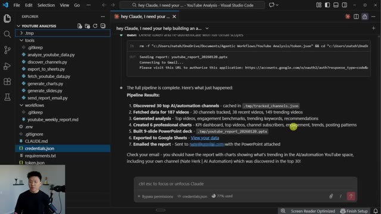
*⏱️ 00:16:28 — Interface VS Code affichant un résumé de pipeline dans le panneau de chat Claude, listant les étapes accomplies du flux de travail YouTube.*

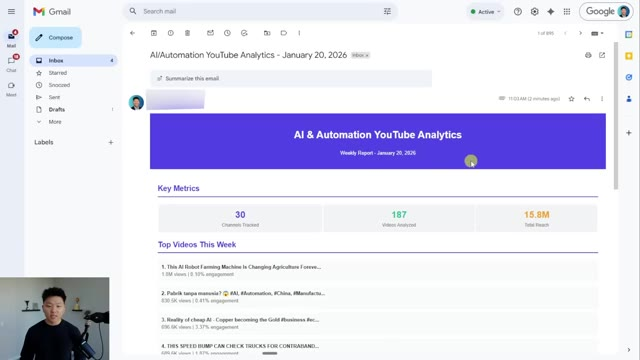
*⏱️ 00:16:45 — Interface de messagerie Gmail affichant le rapport final "AI & Automation YouTube Analytics" reçu par e-mail, incluant des statistiques clés et le classement des vidéos.*

---

### ⏱️ `[00:16:54 - 00:17:27]` | Segment #42

**🔊 Audio (Transcription Intégrale Mot pour Mot en Français) :**
> have our PowerPoint right here, which we can see we have similar information. We've got median views, median engagement, trending topics. We've got top performing videos. So we have this laid out by title and by views. We've got top channels by subscribers. Unfortunately, I do not see my name up there. So please hit the subscribe button. We've got engagement analytics. We've got trending topics by keywords in the AI automation, posting patterns, and then we have some recommendations to kind of close us off here. So keep in mind, this is not perfect. And we obviously would want to come back and make this a little bit more tailored for us. But this was one prompt, Cloud

**👁️ Analyse Visuelle d'Écran (gemini-3.5-flash-lite) :**
**Interface & Outils** : Navigateur web (Google Slides viewer).

**Contenu textuel & Code** : Graphiques de données intitulés "Top Performing Videos" (par vues) et "Top Channels by Subscribers". Le texte en haut mentionne l'analyse de 187 vidéos sur 30 chaînes pour 15,8 millions d'abonnés.

**Action / Démonstration** : Présentation des résultats d'une analyse automatisée de données YouTube sur une diapositive de rapport.

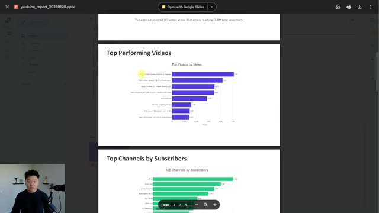
*⏱️ 00:17:03 — Capture d'écran montrant une présentation Google Slides ouverte dans un navigateur, affichant un rapport d'analyse YouTube avec des graphiques en barres pour les vidéos les plus populaires et les chaînes avec le plus grand nombre d'abonnés.*

---

### ⏱️ `[00:17:27 - 00:18:01]` | Segment #43

**🔊 Audio (Transcription Intégrale Mot pour Mot en Français) :**
> Code asks us questions. And then I basically just sat down and then I came back over here when it was done. And this is what we have ready for us. What we also see is that we got this exported to a Google Sheet. So if I click on this, remember that we didn't create this sheet. We didn't create these different tabs or the actual like schema of this, but we've got three tabs. The first one is channel stats. So this pulled channel stats from today's date, which is January 20th. We have the channel IDs. We have the actual channel names, and then we've got subscribers, total views, and video count. We can see nice that Nate Herc automation did make it in this scrape. We've also got top

**👁️ Analyse Visuelle d'Écran (gemini-3.5-flash-lite) :**
**Interface & Outils** : VS Code (avec extension Claude Code), Google Sheets.

**Contenu textuel & Code** : Journal de logs de Claude Code : "Pipeline Results" listant les 7 étapes accomplies. Données tabulaires dans Google Sheets incluant des métriques YouTube.

**Action / Démonstration** : Présentation du résultat final d'une automatisation : passage de la console de l'agent IA au tableau de bord des données générées dans Google Sheets.

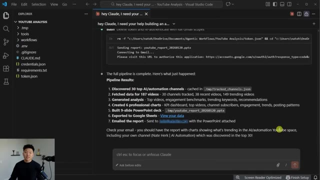
*⏱️ 00:17:36 — Interface de VS Code montrant l'historique d'exécution de Claude Code détaillant les étapes d'un pipeline automatisé (découverte de chaînes, analyse, création de graphiques et export vers Google Sheets).*

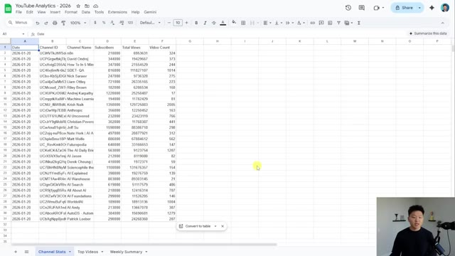
*⏱️ 00:17:44 — Feuille de calcul Google Sheets affichant les données analytiques de chaînes YouTube (ID, nom, nombre d'abonnés, vues et nombre de vidéos), générées automatiquement par le processus précédent.*

---

### ⏱️ `[00:18:01 - 00:18:35]` | Segment #44

**🔊 Audio (Transcription Intégrale Mot pour Mot en Français) :**
> videos. So once again, this was ran based on today's analytics. We got the video ID. We've got the title of the videos. We've got the channel, the views, the likes, the comments, the engagement rate, which is pretty cool. And also how old the videos are. So we can see that we're getting real accurate, like what's trending right now. And then we get a weekly summary. So this is supposed to run every single week. We can see the day that it ran, the channels it tracked, the videos it analyzed, the median views, the median engagement score, and the top keyword, and top keyword too, which actually it's funnily enough, spells out Claude code, which is why you're seeing this video right now. Okay, so let's recap what we've done. We have familiarized with

**👁️ Analyse Visuelle d'Écran (gemini-3.5-flash-lite) :**
**Interface & Outils** : Google Sheets.

**Contenu textuel & Code** : Tableau de données structuré avec des colonnes : Date, Video ID, Title, Channel, Views, Likes, Comments, Engagement Rate, Days Old.

**Action / Démonstration** : Présentation d'un rapport analytique automatisé sur les performances de différentes vidéos YouTube.

*⏱️ 00:18:10 — Une feuille de calcul Google Sheets affichant des statistiques détaillées sur des vidéos YouTube (ID, titre, chaîne, vues, likes, commentaires, taux d'engagement et ancienneté).*

---

### ⏱️ `[00:18:35 - 00:19:09]` | Segment #45

**🔊 Audio (Transcription Intégrale Mot pour Mot en Français) :**
> the interface. We have built out the actual structure of our project using the Claude.md file, which is like a system prompt. Now we have our workflows, we have our tools, and we have actually gone through the whole planning stage with Cloud Code to build out the initial, you know, workflow automation that we need. So what comes next now is we want to talk about a few other things. We want to talk about superpowers, so MCPs and skills, and then we're going to test it a little bit more, and then we're going to actually deploy the automation live. So to start off with superpowers, MCP servers. So I'm not going to dive super, super deep into MCP servers in this

**👁️ Analyse Visuelle d'Écran (gemini-3.5-flash-lite) :**
**Interface & Outils** : Visual Studio Code (avec extension Claude intégrée).

**Contenu textuel & Code** : Arborescence de fichiers (tools, workflows, CLAUDE.md, etc.) et rapport d'exécution détaillant les étapes : découverte de chaînes, génération d'analyses, création de graphiques, génération de PPT et envoi d'emails.

**Action / Démonstration** : Affichage des résultats finaux d'un pipeline d'automatisation complet généré par l'IA au sein de l'éditeur de code.

*⏱️ 00:18:44 — Interface de Visual Studio Code affichant l'arborescence du projet "YOUTUBE ANALYSIS" et une fenêtre de discussion avec l'assistant Claude présentant un récapitulatif d'exécution de pipeline.*

---

### ⏱️ `[00:19:09 - 00:19:27]` | Segment #46

**🔊 Audio (Transcription Intégrale Mot pour Mot en Français) :**
> video, but I did want to bring it up. So if you remember in plan mode, I basically said, hey, I I want to scrape YouTube data. Can you just go figure out if I should use an MCB server or like an API? And it ended up finding out that the YouTube API was going to work better. So that's why we did it in this workflow. But essentially just think of an MCB server as an app store.

**👁️ Analyse Visuelle d'Écran (gemini-3.5-flash-lite) :**
**Interface & Outils** : Outil de diagramme collaboratif (probablement Excalidraw ou similaire).

**Contenu textuel & Code** : Schéma technique détaillant : "MCP clients" (client.py), "MCP hosts" (Claude, autres modèles), et plusieurs "MCP server" reliés à des icônes comme Slack, Gmail, Google Calendar et le Finder (sources de données locales).

**Action / Démonstration** : Présentation visuelle et pédagogique de l'architecture MCP pour expliquer la connexion entre les agents IA et les différentes sources de données.

*⏱️ 00:19:14 — Un schéma architectural illustrant le concept de "MCP architecture" (Model Context Protocol) montrant des serveurs MCP connectés à divers services distants et locaux.*

---

### ⏱️ `[00:19:27 - 00:19:53]` | Segment #47

**🔊 Audio (Transcription Intégrale Mot pour Mot en Français) :**
> So Gmail has an MCB server, Calendar has an MCB server, lots of these services do. And this is like one of the most common visualizations because it's like a universal micro USB port. Because instead of having to go to Calendar's API and have one different API request to create an event, one different one to update event, one different one to delete an event, all we have to do is connect once to the whole server, and then the agent can figure out how to go use different endpoints and parameters.

**👁️ Analyse Visuelle d'Écran (gemini-3.5-flash-lite) :**
**Interface & Outils** : Diagramme dans une application de tableau blanc (type Miro ou similaire).

**Contenu textuel & Code** : Illustration montrant des serveurs MCP connectés à un port central, avec des icônes pour Slack, Gmail, Google Calendar et les fichiers locaux, reliés à des hôtes MCP (Claude).

**Action / Démonstration** : Explication théorique de l'architecture MCP par le présentateur en pointant le schéma.

*⏱️ 00:19:34 — Un schéma architectural expliquant le concept de MCP (Model Context Protocol) utilisant une métaphore de hub USB pour connecter divers services (Slack, Gmail, Calendar, fichiers locaux) à des hôtes IA comme Claude.*

---

### ⏱️ `[00:19:53 - 00:20:28]` | Segment #48

**🔊 Audio (Transcription Intégrale Mot pour Mot en Français) :**
> It just simplifies the whole process. Now, what I did wanna talk about a little bit more was the idea of Claude's skills, because this is a little bit newer. So essentially skills are instructions or resources that Claude can load in dynamically. And that's kind of the key piece here is that instead of just reading it every time in its system prompt, it basically understands what is the request, me go look at all the skills I have access to. If one of them is relevant, I'll pick that one, I'll read it all, and then I'll take action. And this process basically just improves Claude's consistency, speed, and performance, and also saves you tokens. Like I said, when you ask Claude to do something, it reviews the available skills, it loads in only the relevant ones, and then it

**👁️ Analyse Visuelle d'Écran (gemini-3.5-flash-lite) :**
**Interface & Outils** : Logiciel de présentation ou tableau blanc numérique (type Excalidraw ou similaire).

**Contenu textuel & Code** : Texte explicatif définissant les "Skills" : dossiers d'instructions, scripts et ressources pour améliorer les performances sur des tâches spécialisées (création de documents, analyse de données, automatisation).

**Action / Démonstration** : Présentation théorique du concept de "Skills" chez Claude, sans interaction logicielle active.

*⏱️ 00:20:02 — Une diapositive explicative intitulée "What are Skills?" définissant les compétences de Claude comme des dossiers d'instructions et de ressources chargés dynamiquement.*

---

### ⏱️ `[00:20:28 - 00:20:58]` | Segment #49

**🔊 Audio (Transcription Intégrale Mot pour Mot en Français) :**
> applies those instructions. So we're going to go ahead and try to implement a skill into this workflow, and I'll actually show you what the skill document entails, so then it will all start to make a little bit more sense. But before we do that, I did want to real quick cover the difference between skills and projects and skills and MCP. So the first one is about projects. You're in a project and basically what we have is access to whatever is in here. So it's kind of static documents and background information. And a lot of times these skills are installed globally. So what you'll notice actually in our project is that we don't have any skills in this project.

**👁️ Analyse Visuelle d'Écran (gemini-3.5-flash-lite) :**
**Interface & Outils** : Visual Studio Code (avec interface intégrée de Claude/agent IA).

**Contenu textuel & Code** : Arborescence de fichiers d'un projet Python (dossiers "tools", "workflows", fichiers "analyze_youtube_data.py", "credentials.json", etc.) ; log d'exécution montrant le pipeline complété : découverte de chaînes, génération d'analyse, création de graphiques, construction de slides PowerPoint et envoi d'e-mails.

**Action / Démonstration** : Revue des fichiers du projet et visualisation des résultats de l'exécution d'un workflow automatisé via l'interface de l'agent dans VS Code.

*⏱️ 00:20:51 — L'éditeur Visual Studio Code affichant un projet de workflow d'analyse YouTube avec une interaction active de l'assistant Claude dans le volet dédié.*

---

### ⏱️ `[00:20:59 - 00:21:18]` | Segment #50

**🔊 Audio (Transcription Intégrale Mot pour Mot en Français) :**
> Normally there will be like a thing that will be like dot agents and then you drill down in that folder and you'll see like agent skills or clawed skills. And that's more installed on the global level. And that's actually really good because what that means is if I close out of this project and I opened up a different one, I would still have access to all the same skills that I've already installed. So you can see right here that I just asked Cloud Code, what skills do you have?

**👁️ Analyse Visuelle d'Écran (gemini-3.5-flash-lite) :**
**Interface & Outils** : Visual Studio Code avec l'extension de chat Claude.

**Contenu textuel & Code** : Arborescence de fichiers montrant des dossiers `.tmp`, `tools` et `workflows`. Le panneau de chat affiche un résumé d'exécution de pipeline (découverte de chaînes, génération de graphiques, création de slides PowerPoint et envoi d'e-mails).

**Action / Démonstration** : Navigation dans l'explorateur de fichiers de VS Code pour montrer la structure du projet et visualisation d'un rapport de succès d'exécution dans le panneau Claude.

*⏱️ 00:21:04 — Interface de Visual Studio Code affichant l'explorateur de fichiers d'un projet d'analyse YouTube et le chat intégré de Claude avec un historique d'exécution de pipeline.*

---

### ⏱️ `[00:21:18 - 00:21:39]` | Segment #51

**🔊 Audio (Transcription Intégrale Mot pour Mot en Français) :**
> And it came back and showed that it has a front-end design, it has NNN skills, and those are the only eight that it actually has, even though we don't see them in this specific project. Now we have skills versus MCP, and these are also very different. MCP is basically to get data and take action. So like I said, if you want to connect Cloud to something like Gmail, to read emails, or to send emails.

**👁️ Analyse Visuelle d'Écran (gemini-3.5-flash-lite) :**
**Interface & Outils** : Visual Studio Code (avec fenêtre de chat Claude) ; application de prise de notes/diagramme (Canvas).

**Contenu textuel & Code** : Liste détaillée des compétences n8n : frontend-design, n8n-code-javascript/python, n8n-expression-syntax, n8n-mcp-tools-expert, n8n-node-configuration, n8n-validation-expert, n8n-workflow-patterns.

**Action / Démonstration** : Démonstration de la gestion des compétences d'un agent IA et explication conceptuelle de la distinction entre les protocoles MCP et les compétences procédurales.

*⏱️ 00:21:23 — Interface VS Code affichant une liste de 8 "n8n skills" spécifiques (frontend, code, expression, mcp-tools, etc.) dans une fenêtre de chat avec l'IA.*

*⏱️ 00:21:28 — Document textuel présentant une comparaison théorique entre "Skills", "Projects" et "MCP" (Model Context Protocol).*

---

### ⏱️ `[00:21:39 - 00:22:00]` | Segment #52

**🔊 Audio (Transcription Intégrale Mot pour Mot en Français) :**
> But skills are more like knowledge, custom instructions. So if you ever find yourself constantly repeating something to your Cloud Code agent, then maybe that's a good sign to put it either in the Cloud.md file or create your own custom skill for it. So like the example of the front-end design, if you wanted to use Cloud Code to build yourself a landing page or a website, using the front-end design significantly improves its ability to actually design things.

**👁️ Analyse Visuelle d'Écran (gemini-3.5-flash-lite) :**
**Interface & Outils** : Visual Studio Code (avec extension Claude), document Markdown théorique.

**Contenu textuel & Code** : Tableau récapitulatif des capacités de l'agent : noms des skills (frontend-design, n8n-code-javascript, etc.) et leurs descriptions fonctionnelles respectives.

**Action / Démonstration** : Démonstration de l'inventaire des compétences (skills) chargées par l'agent IA pour automatiser des tâches spécifiques de développement.

*⏱️ 00:21:55 — Une vue de l'interface VS Code avec l'extension Claude, affichant une liste tabulaire des "Skills" disponibles pour l'agent, tels que "frontend-design" et divers outils liés à n8n.*

---

### ⏱️ `[00:22:01 - 00:22:38]` | Segment #53

**🔊 Audio (Transcription Intégrale Mot pour Mot en Français) :**
> So what we're going to be doing in this example now is I want to use a skill, and I'm going to be looking at this Cloud Code templates website, which has a bunch of agents and commands and MCP servers and skills and hooks. And I'm going to be looking for one that helps us create like better looking PDFs. I'll also leave a link to this in the description of the video. So I went ahead and searched for design and you can see there's a skill right here called canvas design. And if I view details here, it says create beautiful visual art in .png and .pdf documents using design philosophy. So we're going to go ahead and try this one out. I've never used it before. We'll see how it works, but this is actually like the code of the skill itself. And you can see it basically is just

**👁️ Analyse Visuelle d'Écran (gemini-3.5-flash-lite) :**
**Interface & Outils** : Navigateur web affichant le site "Claude Code Templates".

**Contenu textuel & Code** : Interface utilisateur avec options de filtrage : "agents", "commands", "settings", "hooks", "mcps", "plugins", "skills". Liste de catégories incluant "AI Specialists", "Data AI", "Web Tools", etc.

**Action / Démonstration** : Navigation sur le site pour rechercher des composants ou des modèles destinés à la configuration d'agents IA.

*⏱️ 00:22:10 — Interface web du site "Claude Code Templates" présentant une barre de recherche centrale, des filtres par catégories (agents, commandes, hooks, MCP, etc.) et une liste de catégories thématiques.*

---

### ⏱️ `[00:22:38 - 00:23:02]` | Segment #54

**🔊 Audio (Transcription Intégrale Mot pour Mot en Français) :**
> natural language instructions. So it's just a custom prompt that someone built or you built yourself. And now I can load this into cloud code. So when we have it design a PDF, it can use this and it will probably just come out a lot better because it's prompted. So we've got installation right here where we can use this code. So what I would try is just copying this, going into VS Code. I'm going to go ahead and open up a, you know, kind of clear the conversation and just paste that in and see what happens if I drop that in there.

**👁️ Analyse Visuelle d'Écran (gemini-3.5-flash-lite) :**
**Interface & Outils** : - Image #1 : Navigateur web (Documentation/Dépôt "Claude Code Templates").
- Image #2 : Éditeur VS Code (environnement de développement).

**Contenu textuel & Code** : - Image #1 : Instructions de type "Essential Principles" pour guider une IA dans une tâche de design (ex: "Visual Philosophy", "Minimal Text", "Artistic Freedom").
- Image #2 : Liste de compétences pour n8n (n8n-code-javascript, n8n-code-python, n8n-expression-syntax) dans une interface de chat intégrée à VS Code.

**Action / Démonstration** : - Image #1 : Consultation d'un template de prompt structuré pour améliorer la qualité de la génération de documents par l'IA.
- Image #2 : Interaction dans VS Code avec l'assistant Claude pour configurer des flux de travail automatisés via n8n.

*⏱️ 00:22:44 — Interface web "Claude Code Templates" affichant un bloc de code contenant des instructions de design (prompts système) détaillées.*

*⏱️ 00:22:56 — Éditeur VS Code ouvert sur un projet avec une arborescence de fichiers à gauche et une fenêtre de chat de l'assistant Claude au centre, montrant des suggestions pour n8n.*

---

### ⏱️ `[00:23:02 - 00:23:24]` | Segment #55

**🔊 Audio (Transcription Intégrale Mot pour Mot en Français) :**
> Okay, so I dropped it in and then it actually ran the command in our terminal to install it. And it says that it's been installed and we have skill.md for the instructions for the skill. And then we've also got a bunch of fonts. And what it did is it actually created a new folder here called .clawed, and then we do have skills right here. So you can see that it put it in this project. So now I'm a little confused because I don't know, okay, we have a skill here, but we also have skills globally.

**👁️ Analyse Visuelle d'Écran (gemini-3.5-flash-lite) :**
**Interface & Outils** : Visual Studio Code (éditeur de code avec terminal intégré).

**Contenu textuel & Code** : Commande `npx claude-code-templates@latest --skill=creative-design/canvas-design --yes`. Message de confirmation : "The canvas-design skill has been installed successfully", listant les fichiers `SKILL.md` et `canvas-fonts/`. Arborescence de fichiers à gauche incluant un dossier `.claude`.

**Action / Démonstration** : Installation automatisée d'un template de compétence (skill) pour Claude Code via une commande terminal et affichage du résultat de l'opération.

*⏱️ 00:23:07 — Une capture d'écran de l'interface VS Code montrant l'exécution réussie de l'installation d'un template Claude Code dans le terminal intégré.*

---

### ⏱️ `[00:23:24 - 00:23:44]` | Segment #56

**🔊 Audio (Transcription Intégrale Mot pour Mot en Français) :**
> So I would literally just say, it looks like you created this skill in this project. Is this gonna be installed globally or will it only be accessible through this project? So right now it basically says, yeah, this was installed just locally in this project and that's fine. And if you wanted it to be global instead, you would just say, okay, actually just make that global. And then it would. So anyways, it's gonna clear out this conversation one more time.

**👁️ Analyse Visuelle d'Écran (gemini-3.5-flash-lite) :**
**Interface & Outils** : Visual Studio Code avec le plugin Claude Code actif.

**Contenu textuel & Code** : Commande `npx claude-code-templates@latest --skill=creative-design/canvas-design --yes` et message de confirmation indiquant l'installation locale dans `.claude/skills/creative-design/canvas-design/`.

**Action / Démonstration** : Le créateur montre le résultat de l'installation du skill dans l'arborescence des fichiers du projet et explique son emplacement local.

*⏱️ 00:23:29 — Une capture d'écran de l'éditeur Visual Studio Code montrant l'installation réussie d'un skill (canvas-design) via Claude Code dans le répertoire du projet actuel.*

---

### ⏱️ `[00:23:44 - 00:24:18]` | Segment #57

**🔊 Audio (Transcription Intégrale Mot pour Mot en Français) :**
> I'm gonna go back into plan mode and I'm going to give it a prompt. And actually one more thing before I prompt it, I'm gonna drag in the AI Automation Society Plus logo just over here on the left-hand side. And you can see it's right here and the file pops up, right? So what I'm gonna do is prompt it, but I want it to actually have this logo on all of the PDFs that it generates. Hey Claude, so I just gave you a skill for canvas design. And instead of outputting a PowerPoint presentation, I want you to now take the same research when you do your analysis from YouTube videos, but I want you to use that canvas design skill to create a PDF. It needs to be professional,

**👁️ Analyse Visuelle d'Écran (gemini-3.5-flash-lite) :**
**Interface & Outils** : Visual Studio Code avec l'extension/terminal Claude Code intégré.

**Contenu textuel & Code** : Arborescence du projet "YOUTUBE ANALYSIS" incluant des scripts Python (analyze_youtube_data, etc.), des dossiers de workflows, et les fichiers "AIS+ Logo PNG.png" et "CLAUDE.md". L'interface indique "Plan mode" et "Use planning mode to talk through big changes".

**Action / Démonstration** : Le présentateur a glissé-déposé le fichier image du logo dans l'espace de travail VS Code, rendant le fichier accessible pour une future requête à l'IA.

*⏱️ 00:23:52 — Interface VS Code affichant l'explorateur de fichiers à gauche et l'outil "Claude Code" en mode "Plan mode" au centre, avec le fichier "AIS+ Logo PNG.png" ouvert dans l'onglet de droite.*

---

### ⏱️ `[00:24:18 - 00:24:52]` | Segment #58

**🔊 Audio (Transcription Intégrale Mot pour Mot en Français) :**
> but it needs to be aesthetically pleasing. And what I want you to do is make sure you're including the AIS plus logo PNG that I dropped in this folder as well, because I want the whole presentation to be branded so I can share it with my team. So I'm shooting this off in plan mode, and I'll let you know when it comes back with some questions. Interesting. So it came back and said that that canvas design skill that we just installed creates PDFs interactively, which means step five of our workflow changes from fully automated to semi-automated. So how do we want to handle this? Let's just go ahead and just say, keep it fully automated, because that's kind of the whole point. We want to be able to push this live to run on a schedule trigger. Okay, so the

**👁️ Analyse Visuelle d'Écran (gemini-3.5-flash-lite) :**
**Interface & Outils** : Visual Studio Code avec extension Claude Code.

**Contenu textuel & Code** : Arborescence de fichiers incluant "AIS+ Logo PNG.png", scripts Python (.py) pour l'analyse YouTube et configuration de l'agent (Claude Code).

**Action / Démonstration** : Le présentateur active le "Plan mode" dans l'interface de Claude Code pour planifier des modifications avant exécution.

*⏱️ 00:24:27 — Interface de l'éditeur Visual Studio Code affichant l'extension Claude Code en mode "Plan mode", avec la structure du projet visible dans la barre latérale gauche.*

---

### ⏱️ `[00:24:52 - 00:25:27]` | Segment #59

**🔊 Audio (Transcription Intégrale Mot pour Mot en Français) :**
> new plan is to replace the PowerPoint output with a branded PDF report. So it's going to make a new tool to replace the generate slides tool. We have our current workflow state. We've got our logo. It has some proposed changes here. We're going to be looking at the PDF structure. And of course, what it has to do is update the actual workflow. So it's going to look at this YouTube weekly report markdown file, which is the actual workflow. Of course, it's going to change that. It's going to update some of the other tools like the email tool. And then of course, it's got some other implementation steps for us. And in this case, what I'm going to go ahead and do is just auto accept these changes. And so right now it's just setting up a to-do list to actually implement those changes. We're not going to be running the workflow again. We're just going to make the

**👁️ Analyse Visuelle d'Écran (gemini-3.5-flash-lite) :**
**Interface & Outils** : Visual Studio Code (avec extension de chat IA, probablement Claude Dev).

**Contenu textuel & Code** : Plan de développement : "1. Create New PDF Generation Tool", spécifiant le nouveau fichier `tools/generate_pdf_report.py`, l'utilisation de la bibliothèque "ReportLab", et les principes de design (palette de couleurs, typographie, mise en page). Une boîte de dialogue demande une confirmation : "Accept this plan?" avec des options de réponse.

**Action / Démonstration** : L'utilisateur est en train d'examiner et de valider une proposition de code faite par l'IA pour automatiser la génération de rapports en PDF.

*⏱️ 00:25:01 — Interface de VS Code montrant une proposition de plan générée par l'IA pour créer un outil de génération de rapports PDF.*

---

### ⏱️ `[00:25:27 - 00:25:59]` | Segment #60

**🔊 Audio (Transcription Intégrale Mot pour Mot en Français) :**
> changes and then we'll go ahead and test it. And just a reminder, when you guys are in here building your own workflows, just pay attention to what it's actually doing. It does some really interesting things like right here, it installed some dependencies to actually be able to create the PDF a little bit better. And then here it says the PDF was generated, but it's using a fallback using whatever this is, and it would look better if it had proper title and closing pages. So it's going to install something else and then try it again. It's just a reminder of using this framework of an agent that sits between workflows and tools. As it's building them out, as it's testing them, it's continuously improving them, seeing errors, seeing things that could be improved, and then just

**👁️ Analyse Visuelle d'Écran (gemini-3.5-flash-lite) :**
**Interface & Outils** : Visual Studio Code (avec extension Claude Code/Chat), Excalidraw.

**Contenu textuel & Code** : Code Python modifiant des styles (BodyTextCenter vers ReportBodyCenter), commande Bash pour exécuter `generate_pdf_report.py`.

**Action / Démonstration** : L'agent automatise la modification d'un fichier source et lance l'exécution d'un script de génération de rapport PDF en arrière-plan.

*⏱️ 00:25:35 — Interface de VS Code montrant l'interaction avec l'agent Claude, incluant une modification de code Python et l'exécution d'un script de génération de PDF.*

---

### ⏱️ `[00:25:59 - 00:26:24]` | Segment #61

**🔊 Audio (Transcription Intégrale Mot pour Mot en Français) :**
> going ahead and doing that for you. So that's where it's really powerful. And this testing and optimization phase is really important because once you actually deploy your automation, you're not deploying the agent. You're just basically deploying the workflow that's connected to tools. And that's important to understand. The workflow itself would be put up into the cloud where it could run on a schedule trigger, but the agent still lives locally in CloudCode, which means if your workflow is running every week, it's not going to be self-improving and self-healing.

**👁️ Analyse Visuelle d'Écran (gemini-3.5-flash-lite) :**
**Interface & Outils** : Outil de diagramme/tableau blanc (type Excalidraw).

**Contenu textuel & Code** : Diagramme avec trois blocs rectangulaires : "Workflows" (bleu, haut), "Agent" (vert, milieu gauche) et "Tools" (bleu, bas), reliés par des flèches indiquant les flux de communication.

**Action / Démonstration** : Illustration visuelle du fonctionnement de l'automatisation agentique, montrant comment l'agent sert d'interface entre les workflows et les outils.

*⏱️ 00:26:05 — Schéma conceptuel représentant l'interaction entre les flux de travail (Workflows), l'agent (Agent) et les outils (Tools).*

---

### ⏱️ `[00:26:25 - 00:26:57]` | Segment #62

**🔊 Audio (Transcription Intégrale Mot pour Mot en Français) :**
> So if you wanted to do that, you would come over to CloudCode, you'd edit the workflow, you'd improve it, and then you'd just push that version back to modal or wherever you're hosting them. But anyways, this finished up. So it created a new tool. It modified a few other things. It changed the actual workflow itself. And then what also it did is it made a test PDF just to see how that worked. And you can see here, it's stored as a temporary file. So in our temp folder, which is right here, you can see right there, we have a YouTube report PDF. And let me just make this bigger. We've got our logo right here. We've got our AI and automation YouTube analytics report,

**👁️ Analyse Visuelle d'Écran (gemini-3.5-flash-lite) :**
**Interface & Outils** : Visual Studio Code avec extension Claude Code.

**Contenu textuel & Code** : Liste des fichiers créés (ex: `tools/generate_pdf_report.py`) et modifiés (ex: `requirements.txt`, `tools/send_report_email.py`) suite à une mise à jour de workflow.

**Action / Démonstration** : L'agent IA présente le récapitulatif des tâches accomplies, incluant l'utilisation de la bibliothèque ReportLab et l'intégration de la charte graphique de la marque AIS+.

*⏱️ 00:26:33 — Une interface VS Code affichant un résumé de Claude Code détaillant la création d'un outil de génération de rapports PDF et les modifications apportées aux fichiers existants.*

---

### ⏱️ `[00:26:57 - 00:27:31]` | Segment #63

**🔊 Audio (Transcription Intégrale Mot pour Mot en Français) :**
> and we have the thank you slide. So it basically just tested to see if it worked, but now we're going to go ahead and run that full workflow. And then we're going to see if we're ready to actually push it up into production. So I'm on bypass permissions and I'm just going to shoot off run the YouTube analysis workflow. And it's not even called that, but it will be able to search through the workflows that it has. And it's going to understand which one to run. It's going to execute all of those Python scripts in order. And then we should have a finished product. Okay. So here's the email. It has a similar structure as far as the actual body of the email. But then at the bottom, we should have our PDF, which we got attached right here. But what you'll notice is

**👁️ Analyse Visuelle d'Écran (gemini-3.5-flash-lite) :**
**Interface & Outils** : Visual Studio Code avec l'extension Claude Code.

**Contenu textuel & Code** : Arborescence de fichiers : `analyze_youtube_data.py`, `discover_channels.py`, `export_to_sheets.py`, `generate_pdf_report.py`, `generate_slides.py`, `send_report_email.py`. Barre de saisie : "Bypass permissions", "youtube_report_20260120.pdf".

**Action / Démonstration** : Le présentateur s'apprête à lancer l'exécution complète du workflow d'analyse YouTube via la ligne de commande Claude Code en mode "Bypass permissions".

*⏱️ 00:27:06 — L'interface de VS Code montrant l'extension Claude Code active, avec une arborescence de fichiers du projet "YOUTUBE ANALYSIS" affichant des scripts Python (analyse, découverte, export, rapports) et une barre de commande en bas indiquant "Bypass permissions".*

---

### ⏱️ `[00:27:31 - 00:28:07]` | Segment #64

**🔊 Audio (Transcription Intégrale Mot pour Mot en Français) :**
> that it's only two pages. So it didn't actually create the right type of PDF that we were looking for. However, it did update the Google Sheet. So it added, you know, those 30 more videos that we originally didn't have on this sheet. It added more videos, of course, and then it threw in one more weekly summary where it has a little bit of a different metrics. And what's interesting is that you can see that it did generate charts and it did do analysis because it actually generated all of these images over here, top channels, top videos, key performance indicators, posting patterns, all this kind of stuff. It just didn't actually include it. So once again, we would go back in natural language and say, Hey, you know, we just got that PDF, but it was only

**👁️ Analyse Visuelle d'Écran (gemini-3.5-flash-lite) :**
**Interface & Outils** : Google Sheets, Visual Studio Code (avec extension Claude ou similaire pour l'automatisation).

**Contenu textuel & Code** : Dans Google Sheets : colonnes avec ID de chaînes, noms (ex: "Futurepedia", "AI Explained"), vues et données temporelles. Dans VS Code : rapport d'exécution "Workflow Complete", liste des étapes (Channel Discovery, Fetch, Analyze, Generate, Export), résultats chiffrés et graphique de fréquence de publication.

**Action / Démonstration** : Le présentateur démontre le résultat d'un workflow automatisé qui met à jour simultanément un document Google Sheets et génère des rapports/graphiques au sein de l'environnement de développement.

*⏱️ 00:27:40 — Une feuille de calcul Google Sheets affichant des données analytiques YouTube, incluant des ID de chaînes, des statistiques et des dates.*

*⏱️ 00:27:49 — L'éditeur Visual Studio Code affichant un récapitulatif textuel des étapes d'un workflow d'analyse YouTube automatisé dans le panneau central.*

*⏱️ 00:27:58 — L'éditeur Visual Studio Code affichant le workflow dans le panneau central et un graphique à barres ("Videos Posted by Day of Week") dans le panneau de droite.*

---

### ⏱️ `[00:28:07 - 00:28:43]` | Segment #65

**🔊 Audio (Transcription Intégrale Mot pour Mot en Français) :**
> two slides. So what I did is I said, everything seemed to work except for the PDF that I received was only two slides. It was only the title and the thank you page. So it found the issue, it fixed it, it changed the workflow, it changed the tools. And now it's shot me off a new example with nine pages. And this time we still have the logo, we still have the date. And we also now have all of the actual slides that we need in this PDF with the charts and things like that, recommendations, and then we still have the closing off slide. So hopefully you guys understand now how important the planning really is, because we did kind of rush through this in this example, where we auto accepted changes and we just kind of like sped through things. And it's fine because

**👁️ Analyse Visuelle d'Écran (gemini-3.5-flash-lite) :**
**Interface & Outils** : Visual Studio Code, Lecteur de PDF intégré au navigateur.

**Contenu textuel & Code** : Code Python (librairies reportlab), logs d'exécution de l'agent IA, graphique "Top Videos by Views", rapport textuel sur la structure du nouveau PDF (9 pages).

**Action / Démonstration** : Modification du code source pour corriger une logique de fusion de PDF, suivi de la validation visuelle du document généré.

*⏱️ 00:28:16 — Interface de Visual Studio Code montrant l'exécution d'un agent IA qui modifie le script Python 'generate_pdf_report.py' pour corriger la génération du PDF.*

*⏱️ 00:28:25 — Visualisation du fichier PDF généré dans un lecteur web, affichant une page avec un graphique à barres intitulé "Top Performing Videos".*

*⏱️ 00:28:34 — Interface de Visual Studio Code affichant le rapport de l'agent IA confirmant la correction du bug et la génération d'un PDF complet de 9 pages.*

---

### ⏱️ `[00:28:43 - 00:29:04]` | Segment #66

**🔊 Audio (Transcription Intégrale Mot pour Mot en Français) :**
> we're still able to go back and forth and let Claude Code investigate and fix. But it should show the importance of if you are really, really clear up front and you know exactly what you need, it will be a lot better off the jump, but it's not perfect. Okay, so now let's say we're at the spot where we're ready to basically make this workflow live, where we actually wanna forget about it and just let it run every Monday at 6 a.m. or whatever.

**👁️ Analyse Visuelle d'Écran (gemini-3.5-flash-lite) :**
**Interface & Outils** : Visual Studio Code (avec extension de chat intégrée).

**Contenu textuel & Code** : Le journal d'exécution affiche : "Update Todos", une explication technique sur la simplification de la méthode `_build_with_special_pages` (utilisation de PyPDF2 pour fusionner 9 pages), et la confirmation de l'envoi d'un email.

**Action / Démonstration** : Résumé d'une intervention de débogage réalisée par l'IA dans le projet de workflow d'analyse YouTube.

*⏱️ 00:28:48 — Interface de VS Code montrant le rapport d'exécution d'un agent IA (Claude Code) après la correction d'un bug dans un script de génération de PDF.*

---

### ⏱️ `[00:29:04 - 00:29:24]` | Segment #67

**🔊 Audio (Transcription Intégrale Mot pour Mot en Français) :**
> So we need to deploy it. So the way that we're gonna do that is we're gonna use modal, which is AI infrastructure that developers love. Essentially what modal is, is it lets you spin up these kind of like computers in the cloud where you can host your automations and it only charges you when they actually run. So you're not getting charged by the minute or by the day, you're only getting charged every time they actually execute. So when you create an account, you'll get five bucks for free.

**👁️ Analyse Visuelle d'Écran (gemini-3.5-flash-lite) :**
**Interface & Outils** : Navigateur web affichant le site internet de Modal (modal.com).

**Contenu textuel & Code** : Titre "AI infrastructure that developers love", sous-titre expliquant les fonctionnalités (inference, training, autoscaling), boutons "Get Started" et "Contact Us", ainsi que les logos des entreprises clientes en pied de page.

**Action / Démonstration** : Navigation sur le site web pour introduire Modal comme solution d'hébergement cloud pour les automations IA.

*⏱️ 00:29:09 — Page d'accueil officielle du site web de Modal présentant la plateforme d'infrastructure IA avec un design sombre et un cube lumineux.*

---

### ⏱️ `[00:29:25 - 00:29:45]` | Segment #68

**🔊 Audio (Transcription Intégrale Mot pour Mot en Français) :**
> And then if you add a credit card, even though it won't charge you yet, you'll get 30 bucks. And this 30 bucks will last you a long, long time. Trust me. So what will happen is this screen will probably pop up and it will say that you need to download and configure the Python client. So you could basically copy this exact command right here and just put that into Cloud Code. Or you could just say, hey, Cloud Code, I want to push this workflow to modal.

**👁️ Analyse Visuelle d'Écran (gemini-3.5-flash-lite) :**
**Interface & Outils** : Plateforme cloud Modal (interface web).

**Contenu textuel & Code** : - Commandes : `pip install modal`, `python3 -m modal setup`.
- Code Python : `import modal`, `app = modal.App("example-get-started")`, définition d'une fonction `square` avec décorateur `@app.function`.

**Action / Démonstration** : Présentation du guide de démarrage rapide et des étapes de configuration initiale pour connecter un environnement local à la plateforme Modal.

*⏱️ 00:29:30 — Tableau de bord de la plateforme Modal affichant un solde de 30$ de crédits.*

*⏱️ 00:29:35 — Fenêtre modale "Quickstart guide" de Modal affichant les étapes d'installation du client Python et un exemple de code.*

---

### ⏱️ `[00:29:45 - 00:30:06]` | Segment #69

**🔊 Audio (Transcription Intégrale Mot pour Mot en Français) :**
> So just help me get that initialized. But I'll just show you what would happen if you copied this and we came into Cloud Code and said, awesome, I want to push the YouTube analytics workflow to modal so that it can actually run every single Monday at 6 a.m. And then I'm gonna go ahead and paste in those two things that we just saw. And let's actually do this in plan mode first and just shoot that off.

**👁️ Analyse Visuelle d'Écran (gemini-3.5-flash-lite) :**
**Interface & Outils** : Visual Studio Code (avec l'extension Claude Code).

**Contenu textuel & Code** : Explorateur de fichiers affichant des scripts Python (analyze_youtube_data.py) et des fichiers de rapports (PDF, PPTX), et une barre de commande Claude Code avec le fichier "youtube_report_20260120.pdf" en pièce jointe.

**Action / Démonstration** : L'utilisateur prépare une interaction avec Claude Code pour automatiser ou traiter le rapport YouTube analysé.

*⏱️ 00:29:51 — Interface de VS Code montrant l'extension Claude Code en cours d'utilisation dans un projet intitulé "YouTube Analysis", avec une barre de saisie de commande active.*

---

### ⏱️ `[00:30:06 - 00:30:26]` | Segment #70

**🔊 Audio (Transcription Intégrale Mot pour Mot en Français) :**
> So what it's doing is it's gonna read through the workflow structure and the tools and understand how it can package everything up so it can actually deploy it on modal as an app. So it came back with a plan to deploy this on modal, but there's one more thing that I wanna ask it about before we actually do this. And this last part is security. So I basically told it to run a security review and make sure that my API keys aren't exposed and that there's no vulnerabilities.

**👁️ Analyse Visuelle d'Écran (gemini-3.5-flash-lite) :**
**Interface & Outils** : Visual Studio Code (avec extension de chat/agent IA).

**Contenu textuel & Code** : Historique de discussion : utilisateur demandant le déploiement sur Modal ("...run every single Monday at 6:00 a.m."), réponse de l'IA analysant la structure du projet et liste de fichiers dans l'explorateur (dossiers "tools" et "workflows").

**Action / Démonstration** : L'agent IA est en train d'explorer le code source et d'élaborer un plan de déploiement, avec l'indicateur "Simmering..." affiché.

*⏱️ 00:30:11 — Interface de chat intégrée dans Visual Studio Code montrant une interaction avec un agent IA pour déployer un workflow sur Modal.*

---

### ⏱️ `[00:30:26 - 00:30:46]` | Segment #71

**🔊 Audio (Transcription Intégrale Mot pour Mot en Français) :**
> Because the reality is we just built a ton of code and I don't know what the code is actually doing. So it's really important to be thinking about this before you put anything out there on the web. Are any web hooks exposed? And if they are, do you have like, you know, proper protection around that? Are secrets out there? Are API keys out there? What could people do now that this is out there?

**👁️ Analyse Visuelle d'Écran (gemini-3.5-flash-lite) :**
**Interface & Outils** : Visual Studio Code (avec une extension d'assistant IA type Cursor ou similaire).

**Contenu textuel & Code** : Le prompt de l'utilisateur demande une revue de sécurité pour vérifier l'absence d'exposition d'API keys. L'IA répond en listant les tâches : "Perform a thorough security review" et exécute une commande Bash "ls -la" pour scanner la structure des dossiers du projet.

**Action / Démonstration** : L'agent IA analyse le codebase et exécute des commandes système pour inspecter les fichiers du répertoire "Youtube Analysis".

*⏱️ 00:30:31 — Une capture d'écran de l'éditeur VS Code montrant une interaction avec un agent IA qui effectue une revue de sécurité sur un répertoire de projet de type "YouTube Analysis".*

---

### ⏱️ `[00:30:46 - 00:31:05]` | Segment #72

**🔊 Audio (Transcription Intégrale Mot pour Mot en Français) :**
> And as you start to deploy more workflows, whether that's an end-to-end or whether that's in code like this, you'll start to understand the things to look out for. But you also have one of the smartest reasoning and coding models right here in front of you. So you might as well just ask it, hey, check the code and let me know if there are any risks. So the security review came back and it found three critical issues that need attention.

**👁️ Analyse Visuelle d'Écran (gemini-3.5-flash-lite) :**
**Interface & Outils** : Visual Studio Code avec extension/interface de chat pour agent IA.

**Contenu textuel & Code** : Prompt de l'utilisateur : "I want you to run a security review to make sure that my API keys aren't exposed...". Réponse de l'agent listant les tâches : "Security review for API keys", "Glob pattern: **/.env*", "Read .../token.json", "Glob pattern: **/*.md", avec l'état actuel affiché comme "Vibing...".

**Action / Démonstration** : L'agent IA analyse le répertoire pour identifier des failles de sécurité et des clés API exposées.

*⏱️ 00:30:51 — Interface de VS Code montrant une interaction avec un agent IA (Claude Code) effectuant une revue de sécurité sur un répertoire de projet nommé "YouTube Analysis".*

---

### ⏱️ `[00:31:05 - 00:31:24]` | Segment #73

**🔊 Audio (Transcription Intégrale Mot pour Mot en Français) :**
> But the good news is nothing is vulnerable and there's not a GitHub repo. So nothing's been committed out there publicly and everything is going to be stored as a modal secret. So the API keys and the JSON token. So nothing will be committed to any repository. So we're good to go. And basically from there, it came back with a plan once more and I have approved it.

**👁️ Analyse Visuelle d'Écran (gemini-3.5-flash-lite) :**
**Interface & Outils** : Visual Studio Code (avec une fenêtre de chat d'assistant IA intégrée).

**Contenu textuel & Code** : Analyse de sécurité confirmant l'absence de vulnérabilités, la configuration correcte du fichier .gitignore, et le stockage sécurisé des clés API et tokens (token.json) via Modal secrets au lieu d'un commit Git.

**Action / Démonstration** : Revue de l'état de sécurité du projet par l'agent IA avant le déploiement sur la plateforme Modal.

*⏱️ 00:31:10 — Interface VS Code affichant un compte-rendu de sécurité d'un agent IA sur la gestion des fichiers sensibles et le déploiement sur Modal.*

---

### ⏱️ `[00:31:25 - 00:31:46]` | Segment #74

**🔊 Audio (Transcription Intégrale Mot pour Mot en Français) :**
> So it's going ahead right now and it's creating the different tools and the different things that we need to actually be able to write this over to modal. And then we'll go ahead and test it out over there. So our deployment is now complete. It had to update the scripts to make sure that they could actually have the right environment and variable path. It had to create a modal deployment file. So it actually just understands the process of what it just did and schedule the cron or the schedule trigger.

**👁️ Analyse Visuelle d'Écran (gemini-3.5-flash-lite) :**
**Interface & Outils** : Visual Studio Code (avec extension de chat IA type Cursor ou Claude Code).

**Contenu textuel & Code** : Liste de tâches "Update Todos" pour la compatibilité avec Modal (scripts de génération de PDF, création d'application Modal) et diff de code modifiant le `PROJECT_DIR` pour supporter l'exécution locale et sur Modal via une variable d'environnement `APP_ROOT`.

**Action / Démonstration** : L'IA est en train de mettre à jour les chemins de fichiers dans le script `generate_pdf_report.py` pour préparer le déploiement sur la plateforme Modal.

*⏱️ 00:31:30 — Interface de l'éditeur Visual Studio Code affichant une session de codage assisté par IA, avec une liste de tâches de mise à jour et un bloc de code modifié.*

---

### ⏱️ `[00:31:46 - 00:32:05]` | Segment #75

**🔊 Audio (Transcription Intégrale Mot pour Mot en Français) :**
> And then it had to create modal secrets that we could store over there. So it is now deployed and scheduled. So if I click on this link, this will bring us to our modal environment right here. And what you can see is that we have two different apps. We have the analytics and then we have the analytics manual. So it had to do a manual run just to see if it worked. So this is the actual app.

**👁️ Analyse Visuelle d'Écran (gemini-3.5-flash-lite) :**
**Interface & Outils** : Visual Studio Code (VS Code) avec l'extension Claude intégrée.

**Contenu textuel & Code** : Documentation technique listant la configuration de `modal_app.py` (environnement Python, dépendances, cron), les secrets configurés (YouTube API, OAuth), et le lien vers le tableau de bord de déploiement Modal.

**Action / Démonstration** : Présentation du récapitulatif du déploiement automatisé et clic sur le lien menant vers l'environnement Modal.

*⏱️ 00:31:51 — Interface de l'éditeur Visual Studio Code affichant une documentation Markdown sur le déploiement de l'application sur Modal.*

---

### ⏱️ `[00:32:05 - 00:32:25]` | Segment #76

**🔊 Audio (Transcription Intégrale Mot pour Mot en Français) :**
> So if I go back to the main dashboard, you can see that we have this app and there's kind of like the two different like end points. But if I open up the app, we can see the overview. We can see deployment history. So as you change something in cloud code and then push it back over here, you'll see a different version. And then you can also see the app logs when it's running. So when I click into the YouTube analytics one, the one that will be live, it says the next run will be in five days.

**👁️ Analyse Visuelle d'Écran (gemini-3.5-flash-lite) :**
**Interface & Outils** : Dashboard web de la plateforme Modal (modal.com).

**Contenu textuel & Code** : Liste des applications actives ("Live Apps"), notamment "youtube-analytics-weekly" avec deux points d'entrée ("run_youtube_analytics" et "run_youtube_analytics_manual").

**Action / Démonstration** : Le curseur de la souris survole l'application "youtube-analytics-weekly" pour permettre son ouverture et la visualisation de ses détails.

*⏱️ 00:32:10 — Interface principale d'une plateforme cloud montrant la liste des applications déployées par l'utilisateur.*

---

### ⏱️ `[00:32:25 - 00:32:46]` | Segment #77

**🔊 Audio (Transcription Intégrale Mot pour Mot en Français) :**
> So it's scheduled at 6 a.m. only on Mondays, America, Chicago time. But what I'm going to do just to prove to you guys that this is working, or at least test of it is working, is we can actually just go ahead and run one right now. So I scheduled an immediate run. We're going to see this pop open right here, and we're going to see the fact that it's running right now. As you can see, it took two seconds to start up, and now it's running, and then we'll see the result of that execution.

**👁️ Analyse Visuelle d'Écran (gemini-3.5-flash-lite) :**
**Interface & Outils** : Plateforme cloud Modal (application web).

**Contenu textuel & Code** : Détails de la planification ("At 06:00 AM, only on Monday (America/Chicago)"), indicateur de délai avant la prochaine exécution ("5 days"), et tableau de bord vide des appels de fonction.

**Action / Démonstration** : Le présentateur s'apprête à cliquer sur le bouton "Run now" pour déclencher une exécution immédiate de la fonction planifiée afin de tester son bon fonctionnement.

*⏱️ 00:32:31 — Interface de la plateforme Modal affichant la configuration et le suivi de l'exécution de la fonction "run_youtube_analytics".*

---

### ⏱️ `[00:32:46 - 00:33:06]` | Segment #78

**🔊 Audio (Transcription Intégrale Mot pour Mot en Français) :**
> And actually, I'm glad that this just failed because I can show you what you need to do, but this failed, right? So we'll click into this, and when you click into each of the runs, you'll basically be able to see the logs and the executions. So in the log, this is what actually shows us why it failed and what happened. So I don't really know what this means, right? All I'm going to do is copy this entire string of text.

**👁️ Analyse Visuelle d'Écran (gemini-3.5-flash-lite) :**
**Interface & Outils** : Dashboard de la plateforme Modal (modal.com).

**Contenu textuel & Code** : ID de l'appel de fonction (fc-01KFEF9TGZT3XG87MPTD78J305), horodatages d'exécution (Jan 20, 13:49:56), onglets "Logs" et "Execution".

**Action / Démonstration** : Le présentateur consulte les détails d'une exécution de fonction ayant échoué pour accéder aux logs d'erreur.

*⏱️ 00:32:51 — Interface de gestion d'application avec une fenêtre latérale ouverte détaillant un "Function call" spécifique et ses logs pour une fonction nommée "run_youtube_analytics".*

---

### ⏱️ `[00:33:06 - 00:33:32]` | Segment #79

**🔊 Audio (Transcription Intégrale Mot pour Mot en Français) :**
> We're going to go back into Cloud Code. and I'm actually gonna go ahead and clear this because we're at 64% context. So just gonna restart fresh. So I just tried to do a manual run of our YouTube weekly report app in modal. And this is the error that I got. And then I paste in all that messy stuff and shoot it off. Okay, so because we tested so much and we were using the free tier of the YouTube data API, we actually just hit the daily limit, which was about 10,000 units.

**👁️ Analyse Visuelle d'Écran (gemini-3.5-flash-lite) :**
**Interface & Outils** : Visual Studio Code avec l'extension/terminal Claude Code.

**Contenu textuel & Code** : Arborescence de fichiers ("tools/", "workflows/", "analyze_youtube_data.py"), zone de saisie texte "ctrl esc to focus or unfocus Claude", et pièce jointe "youtube_report_20260120.pdf".

**Action / Démonstration** : Le présentateur s'apprête à réinitialiser la session de Claude Code pour effacer le contexte accumulé après avoir rencontré une erreur.

*⏱️ 00:33:13 — L'interface de Claude Code intégrée dans Visual Studio Code, affichant la page d'accueil avec une barre d'invite en bas et l'arborescence des fichiers du projet sur la gauche.*

---

### ⏱️ `[00:33:32 - 00:33:54]` | Segment #80

**🔊 Audio (Transcription Intégrale Mot pour Mot en Français) :**
> And we exceeded that because we were doing so much testing to see how well this thing would work. The good news is if this is actually running weekly, we will never hit that daily quota limit, so we're fine. The bad news is we're not going to test this one right now, but at least it does suggest other options and some longer-term fixes. But it's okay, because I did want to end off by showing how you could deploy something with a webhook trigger rather than a scheduled trigger.

**👁️ Analyse Visuelle d'Écran (gemini-3.5-flash-lite) :**
**Interface & Outils** : Visual Studio Code avec l'extension Claude intégrée.

**Contenu textuel & Code** : Analyse d'erreur API : "YouTube Data API quota has been exceeded". Le texte propose des solutions : attendre la réinitialisation, utiliser une liste de canaux en cache ou demander une augmentation de quota.

**Action / Démonstration** : Consultation du journal d'erreurs et des suggestions de résolution générées par l'agent IA suite à l'échec de l'exécution du script `discover_channels.py`.

*⏱️ 00:33:38 — Une capture d'écran de Visual Studio Code montrant une discussion avec l'interface IA de Claude, expliquant une erreur de dépassement de quota sur l'API YouTube Data et proposant des solutions techniques.*

---

### ⏱️ `[00:33:54 - 00:34:14]` | Segment #81

**🔊 Audio (Transcription Intégrale Mot pour Mot en Français) :**
> So what I did is I came into this other workflow that I built the other day, which is a very simple lead webhook notification. So it has a webhook as the trigger. We would see a company name and some other data. We would research the company with perplexity and then send an email notification. And so I basically just said, hey, Cloud Code, can you push this workflow onto modal as we did earlier?

**👁️ Analyse Visuelle d'Écran (gemini-3.5-flash-lite) :**
**Interface & Outils** : Visual Studio Code

**Contenu textuel & Code** : Documentation Markdown expliquant l'objectif du workflow (réception de leads via webhook, recherche via Perplexity, notification par email) et les étapes d'installation (installation du CLI Modal, autorisation Gmail).

**Action / Démonstration** : Le présentateur présente la documentation structurée de son projet d'automatisation pour expliquer le fonctionnement du workflow à son audience.

*⏱️ 00:33:59 — L'éditeur Visual Studio Code affiche un fichier Markdown intitulé 'lead_webhook_notification.md' détaillant la documentation et les instructions de configuration pour un workflow d'automatisation de leads.*

---

### ⏱️ `[00:34:14 - 00:34:35]` | Segment #82

**🔊 Audio (Transcription Intégrale Mot pour Mot en Français) :**
> And now we have this app in our modal, as you can see, lead-webhook. So what I'm going to do is go to Postman so we can actually hit that webhook just to simulate what would happen. We've got the address, we've got the body, and I'll shoot this off. And what this is going to do is it's going to trigger this form underscore endpoint in modal. So I'll click into that one. And you can see right now we have a status of pending.

**👁️ Analyse Visuelle d'Écran (gemini-3.5-flash-lite) :**
**Interface & Outils** : Postman

**Contenu textuel & Code** : URL de destination : "https://nateherkai--lead-webhook-form-endpoint.modal.run". Corps de la requête : "form-data" avec la clé "company_name" associée à la valeur "chipotle".

**Action / Démonstration** : Préparation d'un test de webhook par l'envoi d'une requête POST manuelle via Postman pour simuler une interaction.

*⏱️ 00:34:19 — Capture d'écran de l'interface Postman montrant une requête HTTP POST configurée vers une URL Modal.com avec des données de formulaire.*

---

### ⏱️ `[00:34:35 - 00:34:55]` | Segment #83

**🔊 Audio (Transcription Intégrale Mot pour Mot en Français) :**
> this one's going to start running, and then it will show that we actually get the email in Gmail. And so this is really just to show that once you have your stuff up and running in modal, it will work. And you can also do it based on webhooks rather than just doing it on a cron. So that looks like it finished up. We can see that we just got this email for the new lead Chipotle where it did some research about them. And then obviously it gave us a notification here.

**👁️ Analyse Visuelle d'Écran (gemini-3.5-flash-lite) :**
**Interface & Outils** : Modal (plateforme de cloud computing pour l'IA) et Gmail.

**Contenu textuel & Code** : Historique des appels de fonction (POST /) dans Modal et contenu d'un email de notification de nouveau prospect (détails du prospect et recherche sur l'entreprise Chipotle).

**Action / Démonstration** : Démonstration du succès de l'automatisation : déclenchement d'un webhook dans Modal ayant abouti à l'envoi et à la réception automatique d'un email récapitulatif dans Gmail.

*⏱️ 00:34:40 — Interface de surveillance du service Modal affichant les journaux et l'état d'exécution ("Running") d'une fonction nommée "lead-webhook/form_endpoint".*

*⏱️ 00:34:50 — Interface de boîte de réception Gmail affichant un email reçu intitulé "New Lead: chipotle", contenant un rapport détaillé sur le prospect généré automatiquement.*

---

### ⏱️ `[00:34:56 - 00:35:21]` | Segment #84

**🔊 Audio (Transcription Intégrale Mot pour Mot en Français) :**
> And now what you could do is because you just went through the process of deploying a workflow to modal and you know that it works because you just validated that it's working, you have all of that history right there. And what you could do is say, okay, cool. Keep this stored either in my clod.md file or let's create this as a skill so that every time later when you're building a workflow and you wanna actually push it to modal, you have all that information already there, whether that's a skill or whether it's in the system prompt of clod.md.

**👁️ Analyse Visuelle d'Écran (gemini-3.5-flash-lite) :**
**Interface & Outils** : Visual Studio Code avec l'extension/terminal Claude Code intégré.

**Contenu textuel & Code** : Arborescence de fichiers du projet (dossiers "tools", "workflows", fichiers Python) et interface de chat Claude Code ("Tired of repeating yourself? Tell Claude to remember what you've told it using CLAUDE.md").

**Action / Démonstration** : Présentation de l'outil Claude Code et explication de la gestion de la mémoire via le fichier de configuration CLAUDE.md.

*⏱️ 00:35:02 — Interface de Claude Code ouverte dans VS Code, affichant l'écran d'accueil de l'outil avec une suggestion sur l'utilisation du fichier CLAUDE.md.*

---

### ⏱️ `[00:35:21 - 00:35:44]` | Segment #85

**🔊 Audio (Transcription Intégrale Mot pour Mot en Français) :**
> So I hope you guys at this point can see how clod code makes this stuff really, really easy to get automations up and running, whether that means an automation that you wanna be there for and you trigger kind of to use as like a personal assistant or an automation that you actually want to host somewhere and have it run on some sort of trigger. And you can tap into all of the skills that other people have been building and using because you can find those publicly and then just add those to your own instance.

**👁️ Analyse Visuelle d'Écran (gemini-3.5-flash-lite) :**
**Interface & Outils** : Logiciel de création de diagrammes (type Excalidraw ou tableau blanc virtuel).

**Contenu textuel & Code** : Un graphique à barres avec les labels : "Manual Coding", "n8n" et "Claude Code", surmontés de leurs icônes respectives, montrant une réduction progressive du temps de développement.

**Action / Démonstration** : Présentation visuelle comparative pour démontrer l'efficacité de Claude Code par rapport aux méthodes traditionnelles et aux outils d'automatisation no-code.

*⏱️ 00:35:27 — Un graphique comparatif illustrant le "Temps de construction" (Time to build) pour trois méthodes différentes : le codage manuel (le plus long), n8n, et Claude Code (le plus court).*

---

### ⏱️ `[00:35:45 - 00:36:06]` | Segment #86

**🔊 Audio (Transcription Intégrale Mot pour Mot en Français) :**
> So now you have the super smart model like Sonnet 4.5, Opus 4.5 paired with all of these really good prompts and really good like MCP servers. So you can pretty much do anything in that environment. The more you start to use it, the more you'll realize that you don't have to actually switch around to a bunch of different Chrome tabs and different apps on your desktop, you can do a lot of the stuff that you need to do just in the cloud code environment itself.

**👁️ Analyse Visuelle d'Écran (gemini-3.5-flash-lite) :**
**Interface & Outils** : Tableau blanc numérique de type Excalidraw ou similaire.

**Contenu textuel & Code** : Un graphique en colonnes montrant trois niveaux de temps de construction décroissants : "Manual Coding" (le plus haut), "n8n" (intermédiaire) et "Claude Code" (le plus bas, en vert).

**Action / Démonstration** : Présentation comparative illustrant l'efficacité accrue de l'utilisation d'outils d'automatisation et d'IA (Claude Code) par rapport aux méthodes traditionnelles.

*⏱️ 00:35:50 — Un graphique illustrant la réduction du "temps de développement" (Time to build) en comparant le codage manuel, n8n et Claude Code.*

---

### ⏱️ `[00:36:06 - 00:36:29]` | Segment #87

**🔊 Audio (Transcription Intégrale Mot pour Mot en Français) :**
> So once again, that cloud.md file that you guys can access for free will be in my FreeSchool community. The link for that will be down in the description. And if you're looking to dive deeper into this kind of stuff and connect with over 3,000 members who are also kind of all in on AI and building businesses with AI, then definitely check out my Plus community. The link for that is also down in the description. We've got full courses in here, starting with Agent Zero for the beginners and then moving all the way up to actually monetizing AI automation knowledge.

**👁️ Analyse Visuelle d'Écran (gemini-3.5-flash-lite) :**
**Interface & Outils** : Skool (plateforme de communauté en ligne)

**Contenu textuel & Code** : Noms des modules de formation, statistiques de la communauté (3.4k membres), et titres des publications épinglées.

**Action / Démonstration** : Navigation à travers les différentes sections de la communauté (onglet Community vers onglet Classroom) pour montrer les ressources pédagogiques disponibles.

*⏱️ 00:36:12 — Interface principale de la plateforme communautaire "AI Automation Society Plus" sur Skool, affichant le fil d'actualité avec des publications épinglées et une barre latérale indiquant les statistiques de membres.*

*⏱️ 00:36:24 — Interface de la section "Classroom" de la communauté Skool, présentant une grille de cours disponibles comme "Agent Zero", "One Person AI Agency" et "n8n Projects".*

---

### ⏱️ `[00:36:30 - 00:36:52]` | Segment #88

**🔊 Audio (Transcription Intégrale Mot pour Mot en Français) :**
> And I promise you guys, I'm going to bring a lot more of like anti-gravity and cloud code content into this plus community course as well. We also run one live Q&A every week. So you can ask me questions about NN, cloud code, or building an AI business, all that kind of stuff. And I'd love to see you guys in the community in those live calls, but that is going to do it for today's video. So if you enjoyed or you're learning something new, please give it a like. It definitely helps me out a ton.

**👁️ Analyse Visuelle d'Écran (gemini-3.5-flash-lite) :**
**Interface & Outils** : Plateforme de formation et de communauté en ligne (Skool).

**Contenu textuel & Code** : Noms des modules : "Start Here", "Agent Zero", "10 Hours to 10 Seconds", "One Person AI Agency", "Subs to Sales", "n8n Projects". Publication épinglée sur l'"AI Mastermind" et témoignage de succès financier d'un membre.

**Action / Démonstration** : Navigation dans l'interface utilisateur pour présenter les ressources de la communauté, les programmes de formation et les discussions actives.

*⏱️ 00:36:35 — Vue de la section "Classroom" de la plateforme communautaire affichant une grille de modules de formation sur l'automatisation IA et n8n.*

*⏱️ 00:36:41 — Vue de l'interface principale "Community" de la plateforme Skool "AI Automation Society Plus", montrant le fil d'actualité, les annonces épinglées et les statistiques de la communauté.*

---

### ⏱️ `[00:36:52 - 00:36:57]` | Segment #89

**🔊 Audio (Transcription Intégrale Mot pour Mot en Français) :**
> And as always, I appreciate you guys making it to the end of the video. I'll see you on the next one. Thanks so much, everyone.

**👁️ Analyse Visuelle d'Écran (gemini-3.5-flash-lite) :**
**Interface & Outils** : Excalidraw (tableau blanc virtuel).

**Contenu textuel & Code** : Diagramme à barres comparant "Manual Coding", "n8n" et "Claude Code" avec une ligne de tendance descendante illustrant l'efficacité croissante.

**Action / Démonstration** : Présentation visuelle synthétique d'une analyse comparative de productivité.

*⏱️ 00:36:54 — Un graphique comparatif affiché sur une interface de type tableau blanc (Excalidraw) illustrant la réduction du temps de développement entre le codage manuel, n8n et Claude Code.*

---

