# 🎬 I Will Never Fix Another n8n Workflow (Claude Code)

> **Chaîne** : [Nate Herk | AI Automation](https://www.youtube.com/@nateherk/featured)  
> **Lien YouTube** : [https://www.youtube.com/watch?v=uUEa6K-FLB8](https://www.youtube.com/watch?v=uUEa6K-FLB8)  
> **Date de publication** : 20260122  
> **Durée** : 00:13:20  
> **Identifiant vidéo** : `uUEa6K-FLB8`  
> **Transcription & Analyse** : `whisper-v3-large-turbo+gemini-3.5-flash-lite`  

---

## 📌 Synthèse Exécutive & Outils

### 💡 Résumé
Dans cette vidéo intitulée **I Will Never Fix Another n8n Workflow (Claude Code)**, Nate Herk décortique les capacités pratiques d'automatisation et de développement propulsées par les modèles de pointe.

### 🛠️ Outils, Modèles & Logiciels Présentés
- **Opus 5.5 & Claude Code** : Modèles d'ingénierie et agents de codage autonome.

### 🔑 Points Clés & Enseignements Stratégiques
- Optimiser le niveau d'effort et le raisonnement des modèles IA pour des résultats industriels.
- Automatiser les cycles de création logicielle de bout en bout.

---

## ⏱️ Chronologie & Transcription Complète Audio & Visuelle (Mot pour Mot)

### ⏱️ `[00:00:00 - 00:00:30]` | Segment #01

**🔊 Audio (Transcription Intégrale Mot pour Mot en Français) :**
> So last week I dropped this YouTube video where I showed you guys how you can use CloudCode to build and in workflows instantly. And after I posted that, I was thinking to myself, wouldn't it be really cool if you could have CloudCode fix and optimize your workflows? So I tried it and it worked, but I wanted to take it one step further and think about when my workflows error, could I have CloudCode automatically go fix those? So that's what I'm going to show you guys today. So right here, I've got this workflow. It basically captures orders and it can either go this way or it can go this way. And I've put in here something that's going to break the workflow. So I'm going to go ahead and call it and show you guys what happens.

**👁️ Analyse Visuelle d'Écran (gemini-3.5-flash-lite) :**
**Interface & Outils** : Plateforme de workflow automatisé (Type n8n ou similaire).

**Contenu textuel & Code** : Nœuds de workflow : Webhook, Enrich Order Data, Validate Each Order, Flag High Priority, Send to Fulfillment API, Message a model, Send a message.

**Action / Démonstration** : Visualisation et démonstration de la structure logique d'un workflow automatisé piloté par des agents IA.

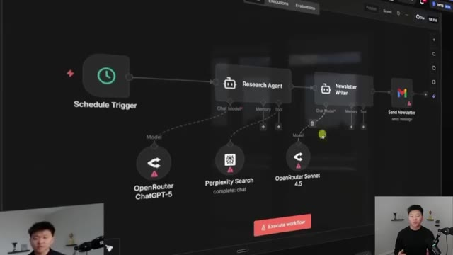
*⏱️ 00:00:07 — Interface de conception de workflow montrant un "Research Agent" et un "Newsletter Writer" connectés, avec des modèles IA (ChatGPT-5, Perplexity, Sonnet 4.5) liés.*

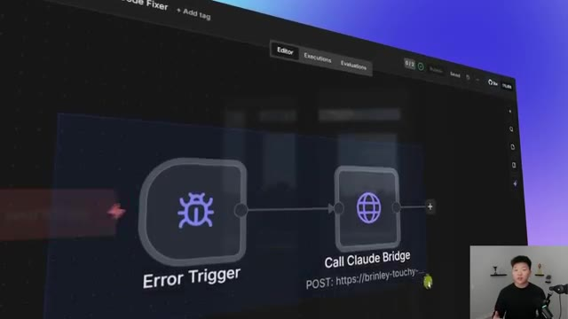
*⏱️ 00:00:15 — Interface de workflow montrant un "Error Trigger" lié à un nœud "Call Claude Bridge" avec une requête POST spécifique, illustrant la gestion d'erreurs.*

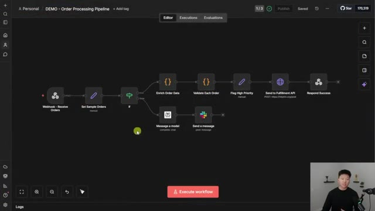
*⏱️ 00:00:22 — Vue globale d'un "Order Processing Pipeline" complexe avec des nœuds de logique conditionnelle (If), d'enrichissement de données et d'envoi de messages Slack.*

---

### ⏱️ `[00:00:30 - 00:00:49]` | Segment #02

**🔊 Audio (Transcription Intégrale Mot pour Mot en Français) :**
> So I just got a message in my ClickUp that says, this workflow, demo order processing pipeline, had an error. The failed node was the validate each order node. So it was this one right here. And the error message was expected individual order items, but received an array. Data must be split into individual items using a split out node before validation can process each line.

**👁️ Analyse Visuelle d'Écran (gemini-3.5-flash-lite) :**
**Interface & Outils** : Application de gestion de workflow et d'automatisation appelée "Uppit AI".

**Contenu textuel & Code** : Détails du log d'erreur : "Failed Node: Validate Each Order", "Original Error: Expected individual order items but received array", et explication de la correction effectuée par Claude.

**Action / Démonstration** : Affichage d'un rapport de diagnostic et de résolution automatique de bug au sein d'un pipeline d'automatisation.

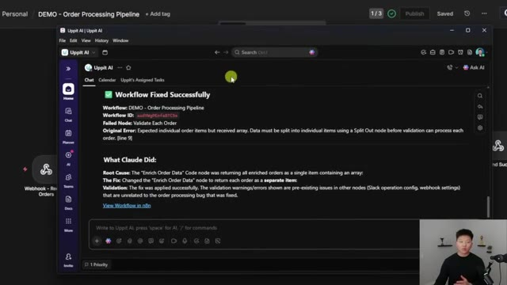
*⏱️ 00:00:35 — Interface de l'application "Uppit AI" affichant un rapport de correction automatique d'un workflow nommé "DEMO - Order Processing Pipeline".*

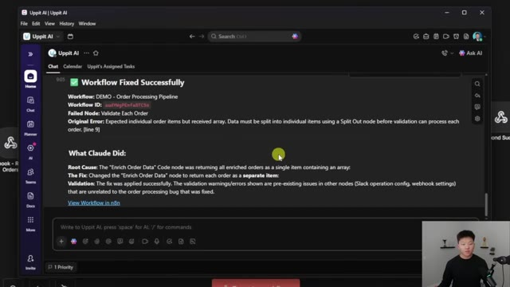
*⏱️ 00:00:45 — Même interface montrant le détail technique de la correction : la cause racine (un nœud de code renvoyant un tableau au lieu d'éléments séparés) et la solution apportée par l'IA.*

---

### ⏱️ `[00:00:50 - 00:01:10]` | Segment #03

**🔊 Audio (Transcription Intégrale Mot pour Mot en Français) :**
> So then what Claude did was it found the root cause, which was the enrich order data code node. So the one right before it returned all orders as a single item, which was an array. So the fix was it changed the code node to return each order as a separate item. So that's kind of cool because NNN itself suggested using a split out node, but Cloud Code realized that it's easier to actually just fix it by changing the code in this node itself.

**👁️ Analyse Visuelle d'Écran (gemini-3.5-flash-lite) :**
**Interface & Outils** : Interface web de l'application Uppit AI (environnement de gestion de workflows).

**Contenu textuel & Code** : Texte récapitulatif du diagnostic de l'IA : "Workflow Fixed Successfully", explication de l'erreur initiale ("Expected individual order items but received array") et description de la correction ("Enrich Order Data node to return each order as a separate item").

**Action / Démonstration** : Présentation du rapport final détaillant la résolution de l'erreur de formatage des données dans le workflow n8n "DEMO - Order Processing Pipeline".

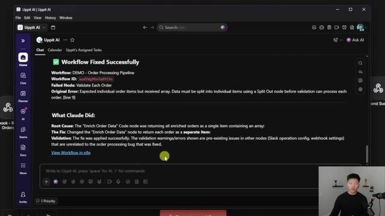
*⏱️ 00:00:55 — Interface d'une application nommée "Uppit AI" affichant un rapport de correction automatique d'un workflow n8n.*

---

### ⏱️ `[00:01:10 - 00:01:29]` | Segment #04

**🔊 Audio (Transcription Intégrale Mot pour Mot en Français) :**
> So then it basically says the fix was applied and the workflow should now be all set. So I'm gonna give this workflow a refresh. It probably didn't actually change anything physically that we could see, but this is the more updated version. So now what I'm gonna do is go to the executions. You can see that this one was the most recent one we just ran and it failed right there on the validate each order node.

**👁️ Analyse Visuelle d'Écran (gemini-3.5-flash-lite) :**
**Interface & Outils** : n8n (outil d'automatisation de workflows low-code).

**Contenu textuel & Code** : Nœuds visibles : "Webhook", "Set Sample Orders", "If", "Enrich Order Data", "Validate Each Order", "Flag High Priority", "Send to Fulfillment API", "Respond Success", "Message a model", "Send a message".

**Action / Démonstration** : Le présentateur explique la mise à jour du workflow et s'apprête à naviguer vers l'onglet des exécutions pour vérifier le fonctionnement du pipeline.

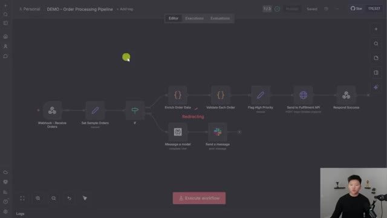
*⏱️ 00:01:15 — Interface de l'éditeur de workflow n8n montrant un pipeline de traitement de commandes ("DEMO - Order Processing Pipeline") avec plusieurs nœuds connectés.*

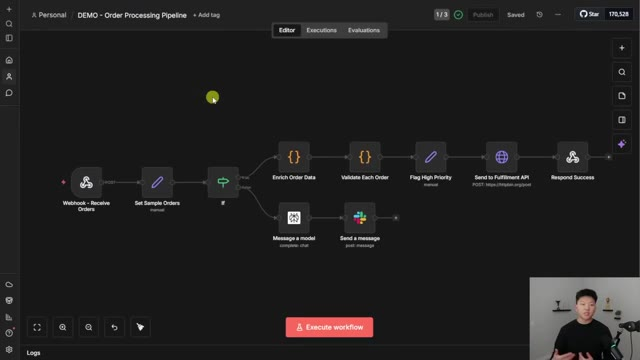
*⏱️ 00:01:19 — Même interface de l'éditeur n8n, affichant la structure complète du flux de travail incluant les nœuds d'enrichissement, de validation et d'API.*

---

### ⏱️ `[00:01:29 - 00:02:06]` | Segment #05

**🔊 Audio (Transcription Intégrale Mot pour Mot en Français) :**
> And what I did is I just triggered this workflow once again. So we should see a new execution pop up live And now you can see this time it actually succeeded Because what cloud code did was it went ahead and it fixed the workflow and now everything flows all the way through All right So that was a little demo to show you guys that this workflow just failed I didn't touch it at all and then cloud code fixed it and then sent me a message and said hey it failed But I got you. So I'm sure you guys are wondering how this actually works behind the scenes So let me show you The way that we're doing this is we are using an error workflow So as soon as that previous workflow fails at all, it triggers off this new one, which basically sends an HTTP request essentially to CloudCode.

**👁️ Analyse Visuelle d'Écran (gemini-3.5-flash-lite) :**
**Interface & Outils** : n8n (outil d'automatisation de workflows).

**Contenu textuel & Code** : Workflow "DEMO - Order Processing Pipeline" comprenant des nœuds comme "Webhook", "If", "Enrich Order Data", "Validate Each Order", "Flag High Priority" et "Send to Fulfillment API".

**Action / Démonstration** : Le présentateur observe le succès de l'exécution du workflow après que l'IA a corrigé les erreurs précédemment identifiées dans le pipeline.

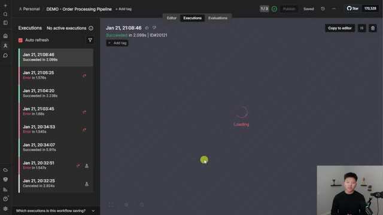
*⏱️ 00:01:38 — Interface d'historique des exécutions dans n8n affichant une liste de succès et d'erreurs, avec une exécution récente en cours de chargement.*

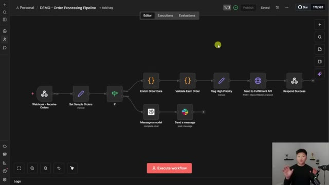
*⏱️ 00:01:47 — Éditeur de workflow visuel dans n8n montrant la structure complète d'un pipeline de traitement de commandes (nœuds, connexions et flux de données).*

---

### ⏱️ `[00:02:06 - 00:02:27]` | Segment #06

**🔊 Audio (Transcription Intégrale Mot pour Mot en Français) :**
> So when you have a workflow in NNN in production, what you can do is in the settings, you can have an error workflow. So this basically means if this core workflow ever fails, you can trigger a different one. So you can log the error, send yourself a message, or in our case, use CloudCode to fix it. So you can actually see right here in the nasty looking terminal. What happened was it said error received this workflow.

**👁️ Analyse Visuelle d'Écran (gemini-3.5-flash-lite) :**
**Interface & Outils** : Interface de configuration du workflow n8n (n8n workflow editor).

**Contenu textuel & Code** : Paramètres visibles : "Error Workflow" configuré sur "Error Handler - Claude Code Fixer", fuseau horaire "America/Chicago", et options de sauvegarde des exécutions.

**Action / Démonstration** : L'utilisateur a ouvert les paramètres du workflow pour configurer le déclenchement d'un workflow de gestion d'erreurs.

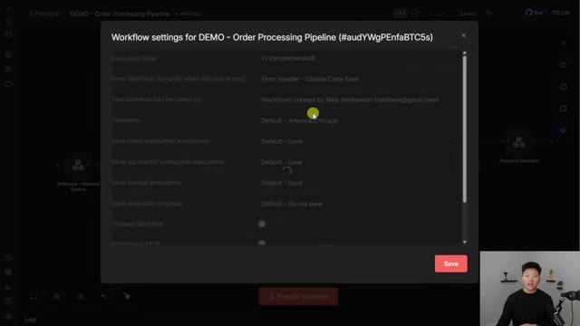
*⏱️ 00:02:11 — Fenêtre modale des paramètres d'un workflow n8n intitulée "Workflow settings for DEMO - Order Processing Pipeline".*

---

### ⏱️ `[00:02:27 - 00:02:48]` | Segment #07

**🔊 Audio (Transcription Intégrale Mot pour Mot en Français) :**
> It sends over the workflow ID. We got the failed node. We got the error. And then it says starting Claude code. Prompt saved, starting Claude code. And the Claude code is running locally. And it basically goes through its system prompt to understand here's the workflow. Let me look it up. Let me get the data. Let me understand what went wrong. Let me understand all the nodes, all the workflow patterns, and all of the JSON expressions that I can use.

**👁️ Analyse Visuelle d'Écran (gemini-3.5-flash-lite) :**
**Interface & Outils** : Windows PowerShell, n8n (éditeur de workflow en arrière-plan).

**Contenu textuel & Code** : Le terminal affiche : "ERROR RECEIVED", le nom du workflow ("DEMO - Order Processing Pipeline"), le nœud défaillant ("Validate Each Order"), la description de l'erreur, le message "Starting Claude Code...", ainsi qu'une analyse de la cause racine ("Root Cause") et le correctif apporté au code JavaScript.

**Action / Démonstration** : Le terminal exécute le processus de diagnostic et de correction automatique par Claude Code, analysant l'erreur de formatage des données entre les nœuds "Enrich Order Data" et "Validate Each Order".

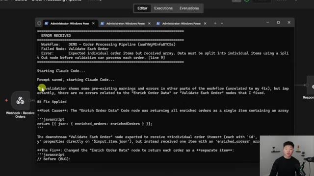
*⏱️ 00:02:32 — Capture d'écran montrant une fenêtre de terminal Windows PowerShell superposée à une interface de workflow n8n, affichant un journal d'erreurs et les détails de résolution par l'agent Claude Code.*

---

### ⏱️ `[00:02:48 - 00:03:09]` | Segment #08

**🔊 Audio (Transcription Intégrale Mot pour Mot en Français) :**
> And then I'm going to go ahead and fix it. So I've now fixed the workflow. And I'm going to notify Nate in ClickUp, as you can see right there. So you guys know that when I'm using CloudCode, I'm going to try my best to stay out of the terminal. But to the best of my knowledge, this is the way to do it right now because of the fact that we had to set up some tunnels and stuff. Okay, so I know this is cool, but I'm going to talk about how this could actually be practical, and we're going to show off a few more examples.

**👁️ Analyse Visuelle d'Écran (gemini-3.5-flash-lite) :**
**Interface & Outils** : Terminal Windows PowerShell (intégré dans l'environnement de développement) et interface partielle de l'outil d'automatisation n8n en arrière-plan.

**Contenu textuel & Code** : Code JavaScript montrant le "Before/After" du correctif, explications textuelles sur la résolution du bug de traitement des commandes, et logs de confirmation "CLAUDE CODE FINISHED SUCCESSFULLY" suivis de l'envoi de l'API ClickUp.

**Action / Démonstration** : L'agent Claude Code a corrigé une erreur de mapping dans le workflow et a automatiquement notifié l'utilisateur via ClickUp suite à la correction.

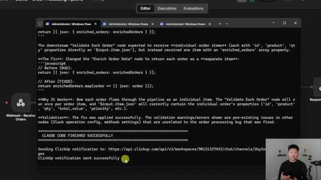
*⏱️ 00:02:53 — Une capture d'écran montrant l'exécution réussie de Claude Code dans un terminal Windows PowerShell, affichant le correctif appliqué au workflow (logique JavaScript) et la confirmation de l'envoi d'une notification ClickUp.*

---

### ⏱️ `[00:03:09 - 00:03:31]` | Segment #09

**🔊 Audio (Transcription Intégrale Mot pour Mot en Français) :**
> But first, I wanted to talk about how this actually works because I know it's a little confusing. And before I actually built this, I was kind of confused about it too. So the first thing that's confusing is the fact that CloudCode can talk to NNN using the MCP server. and it can look at your workflows, fix them, change them, whatever you want. But NNN can't talk to Cloud Code, at least the way I'm doing it here where I have my NNN hosted on the cloud.

**👁️ Analyse Visuelle d'Écran (gemini-3.5-flash-lite) :**
**Interface & Outils** : Outil de tableau blanc collaboratif (type Excalidraw ou similaire).

**Contenu textuel & Code** : Icônes illustratives (marché, bâtiment) et logos de plateformes d'automatisation (n8n).

**Action / Démonstration** : Présentation visuelle pour expliquer le flux de connexion entre deux systèmes via le serveur MCP.

*⏱️ 00:03:15 — Un schéma conceptuel sur une toile blanche représentant une épicerie et un immeuble, associés respectivement aux logos de n8n et d'un autre service, illustrant l'interconnexion via MCP.*

---

### ⏱️ `[00:03:31 - 00:04:06]` | Segment #10

**🔊 Audio (Transcription Intégrale Mot pour Mot en Français) :**
> So this is the best way to think about it. NNN is like a grocery store. Anyone can go to it because everyone knows where it is. It's public. It's on the cloud. So Cloud Code could easily walk over here to the grocery store and interact with NNN. But NNNN can't just go out and go visit Cloud Code because Cloud Code lives in an apartment building in a specific unit and the door is locked. So the only way that NNN could visit Cloud Code is if we give it permission to, if we give it the address, if we give it a key to the door. So that's kind of what we're doing and that's what we set up. So how do we actually do it? Well let me just run you guys through a little story. So this

**👁️ Analyse Visuelle d'Écran (gemini-3.5-flash-lite) :**
**Interface & Outils** : Outil de tableau blanc collaboratif (type Excalidraw ou similaire).

**Contenu textuel & Code** : Illustrations vectorielles : une épicerie, un immeuble, le logo n8n et une icône représentant un agent ou un service de code.

**Action / Démonstration** : Le présentateur utilise une représentation visuelle pour expliquer la connectivité réseau et les interactions entre n8n (le marché public) et un environnement de code cloud sécurisé.

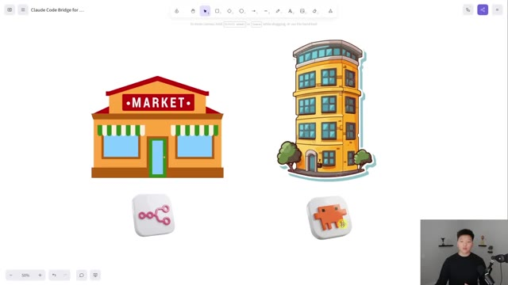
*⏱️ 00:03:40 — Un schéma illustratif sur un tableau blanc virtuel montrant une épicerie ("Market") associée à une icône n8n à gauche, et un immeuble associé à une icône d'agent (Cloud Code) à droite.*

---

### ⏱️ `[00:04:06 - 00:04:41]` | Segment #11

**🔊 Audio (Transcription Intégrale Mot pour Mot en Français) :**
> is the workflow we just saw in NNN. And what happens is something fails. And actually I put an X over the wrong node. It was this one that failed. So this node fails. And so when that happens, that triggers our error workflow. As you guys saw, it triggers the error trigger, which calls this HTTP request. And this HTTP request is calling ngrok, which basically just helps you set up tunnels. So if you've never heard of a tunnel before, or it's really confusing to you, I have made a video where I talk about how you can expose your local instance with a tunnel so that you can do more things. I'll tag that video right up here. But anyways, ngrok sets

**👁️ Analyse Visuelle d'Écran (gemini-3.5-flash-lite) :**
**Interface & Outils** : n8n (éditeur de workflow), ngrok.

**Contenu textuel & Code** : Nœuds de workflow : "Webhook", "Enrich Order Data", "Validate Each Order", "Error Trigger", "Call Claude Bridge" (URL POST).

**Action / Démonstration** : Démonstration du mécanisme de gestion d'erreur dans n8n déclenchant un pont HTTP via ngrok.

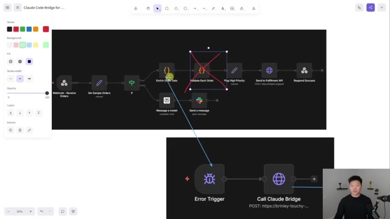
*⏱️ 00:04:15 — Diagramme de workflow n8n montrant un flux principal avec un nœud d'erreur marqué d'un X rouge, relié à un sous-processus "Error Trigger".*

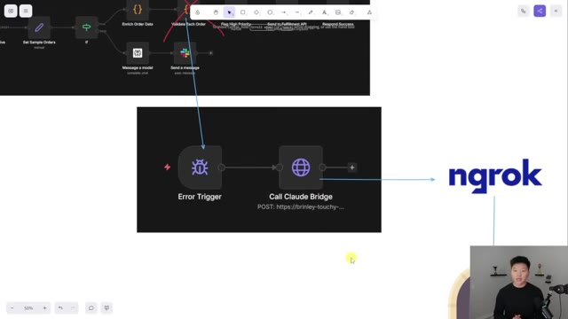
*⏱️ 00:04:23 — Gros plan sur le workflow de gestion d'erreur n8n montrant le nœud "Call Claude Bridge" relié au service ngrok.*

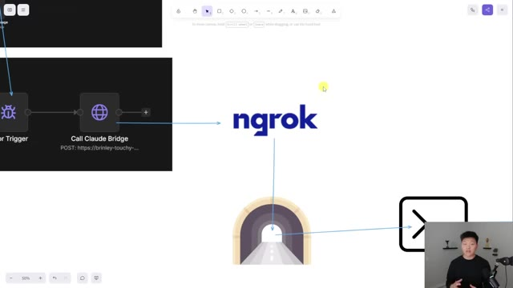
*⏱️ 00:04:32 — Schéma illustrant la connexion entre le workflow n8n, le service ngrok, et un terminal de commande via une icône de tunnel.*

---

### ⏱️ `[00:04:41 - 00:05:03]` | Segment #12

**🔊 Audio (Transcription Intégrale Mot pour Mot en Français) :**
> up a tunnel and then feeds data through it. And that ends up going to essentially a terminal which is where Cloud Code lives locally on my computer, and it starts up Cloud Code. Once it starts up Cloud Code, Cloud's able to see all of the error messages and the workflow that we need to fix, and then it gets to work actually fixing the workflow, and not just coming up with a plan to fix it, but actually implementing those changes in the workflow itself.

**👁️ Analyse Visuelle d'Écran (gemini-3.5-flash-lite) :**
**Interface & Outils** : Logiciel de tableau blanc collaboratif (type FigJam ou Miro).

**Contenu textuel & Code** : Symboles graphiques : logos Ngrok, icônes de terminal, logos de Claude, icônes d'outils (tournevis) et un workflow d'automatisation incluant des nœuds "Webhook", "Code", "Slack" et des traitements de données.

**Action / Démonstration** : Illustration visuelle du processus technique : le tunnel de données Ngrok est établi vers un terminal local pour permettre à l'agent Claude d'accéder, d'analyser et de corriger les erreurs dans un workflow opérationnel.

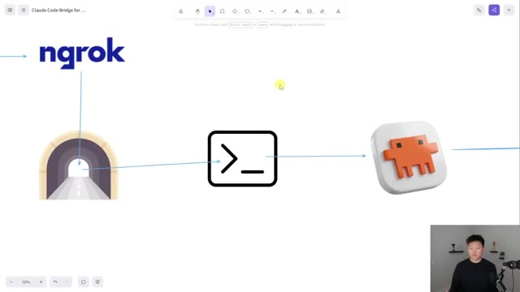
*⏱️ 00:04:46 — Un schéma conceptuel sur tableau blanc montrant le flux de données : Ngrok se connecte à un tunnel, qui transmet les données à un terminal de commande, lequel communique ensuite avec l'icône de l'agent Claude.*

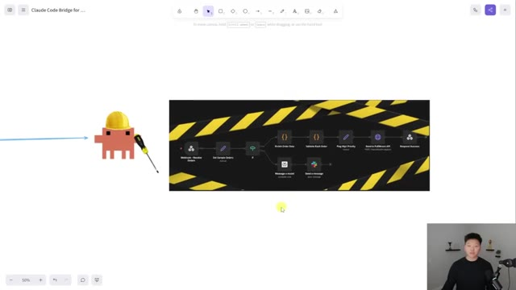
*⏱️ 00:04:58 — Un schéma illustrant l'agent Claude (avec un casque de chantier) travaillant sur un workflow d'automatisation complexe, représenté par une série de nœuds logiques dans un environnement de type éditeur d'automatisation (n8n ou similaire).*

---

### ⏱️ `[00:05:04 - 00:05:36]` | Segment #13

**🔊 Audio (Transcription Intégrale Mot pour Mot en Français) :**
> And then the last piece is that it sends me a notification on ClickUp. That you could change. You could also have it do a log on Google Sheets, an email, whatever you want. And the reason why it's able to so successfully do this is because we give Cloud Code access to the NNN MCP server and the NNN skills. So I'm not going to dive super deep into this. Basically, the MCP server gives Cloud Code access to tons of different documentation on how NNN nodes work, different workflow templates, different patterns, and access to your own NNN environment. And then the NNN skills are a set of Cloud skills that give Cloud

**👁️ Analyse Visuelle d'Écran (gemini-3.5-flash-lite) :**
**Interface & Outils** : Logiciel de diagramme (type Excalidraw) pour l'image 1 et site web de documentation/présentation produit pour l'image 2.

**Contenu textuel & Code** : - Image 1 : Texte des boîtes : "Us", "Claude Code", "n8n", "n8n-mcp", "n8n-skills".
- Image 2 : Liste de fonctionnalités : "Complete Node Coverage", "2,700+ Workflow Templates", "Diff-Based Updates", "Real-Time Monitoring", "Full n8n API Access", "Always Current".

**Action / Démonstration** : Illustration visuelle du flux de travail automatisé dans l'image 1, et mise en avant des capacités techniques de l'intégration dans l'image 2.

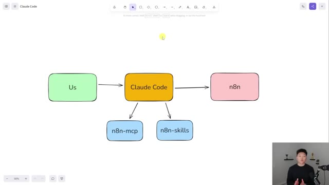
*⏱️ 00:05:12 — Un schéma architectural simplifié montrant les interactions entre l'utilisateur, Claude Code et n8n via des composants "n8n-mcp" et "n8n-skills".*

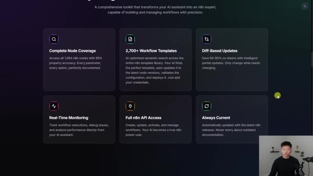
*⏱️ 00:05:28 — Une page de présentation web décrivant les fonctionnalités clés d'un outil d'IA pour n8n (couverture de nœuds, modèles de workflow, mises à jour différées, surveillance, accès API).*

---

### ⏱️ `[00:05:36 - 00:06:10]` | Segment #14

**🔊 Audio (Transcription Intégrale Mot pour Mot en Français) :**
> access to information that it would need. So really good prompts about how to use expressions, how to validate things, node configuration, coding, workflow patterns. So we're basically supercharging Cloud Code with information about NNN. So I made, like I said, a full video diving into this and setting it all up. If you want to check that out, I will tag that one right up here. So that brings me on to my next point, which is basically about workflows failing after they've been running successfully for a week or two. There's lots of different reasons that a workflow can fail. Unfortunately, Cloud Code cannot fix all of those reasons. So what Cloud Code can fix are issues with maybe the logic, the code, the data.

**👁️ Analyse Visuelle d'Écran (gemini-3.5-flash-lite) :**
**Interface & Outils** : Navigateur web (Google Docs) et site web de formation/documentation.

**Contenu textuel & Code** : Texte structuré sur les compétences n8n et un tableau technique de débogage pour les échecs de workflows d'automatisation.

**Action / Démonstration** : Présentation théorique et didactique des capacités de l'agent IA à diagnostiquer et réparer des workflows n8n complexes.

*⏱️ 00:05:45 — Une page web affichant une section intitulée "7 Expert Skills", listant des compétences techniques pour construire des workflows n8n, notamment la syntaxe d'expression, les outils MCP, les patterns de workflow, la validation, la configuration de nœuds et le code JavaScript.*

*⏱️ 00:05:53 — Un document Google Docs intitulé "Why Workflows Fail After Running Successfully" préparé par "AIS+ (AI Automation Society)", présentant un tableau comparatif des problèmes que l'IA Claude peut réparer (données manquantes, valeurs nulles, types de données erronés, erreurs de frappe, bugs de nœuds de code).*

---

### ⏱️ `[00:06:11 - 00:06:33]` | Segment #15

**🔊 Audio (Transcription Intégrale Mot pour Mot en Français) :**
> So missing data, null values, wrong data types, empty arrays, typos and expressions, code node bugs, things like that. What Cloud Code cannot fix are things like expired credentials, an API is down, your rate limited. I actually think that Cloud Code could figure that out because maybe it would be able to say, hey, this was a rate limit, let me go ahead and add a loop and a wait node and like use my logic to actually get there.

**👁️ Analyse Visuelle d'Écran (gemini-3.5-flash-lite) :**
**Interface & Outils** : Google Docs

**Contenu textuel & Code** : Tableau classant les erreurs de workflow (Missing data, Null values, Wrong data type, etc.) entre celles que Claude peut réparer et celles qui nécessitent une intervention humaine.

**Action / Démonstration** : Présentation visuelle et explicative des diagnostics de pannes dans les workflows d'automatisation.

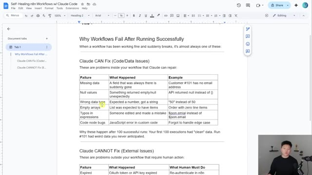
*⏱️ 00:06:16 — Une capture d'écran d'un document Google Docs présentant un tableau comparatif sur les problèmes de workflow n8n et les capacités de résolution de Claude Code.*

---

### ⏱️ `[00:06:33 - 00:06:54]` | Segment #16

**🔊 Audio (Transcription Intégrale Mot pour Mot en Français) :**
> At least if it can't do it right now, it will be able to do that eventually because what it will do is it will reason, it will search through the API documentation, figure out what the rate limit actually is, and then build a fix for it. So this stuff definitely isn't perfect, but it's cool to see where we're going, and it's cool to experiment to see how we can Frankenstein our own solutions so that when the models get smarter and smarter, we're already there.

**👁️ Analyse Visuelle d'Écran (gemini-3.5-flash-lite) :**
**Interface & Outils** : Google Docs.

**Contenu textuel & Code** : Tableau comparatif détaillant les types de pannes (Expired credentials, API is down, Rate limited, etc.), les causes ("Too many requests", "Billing issue") et les actions humaines nécessaires pour résoudre chaque problème.

**Action / Démonstration** : Présentation théorique illustrant les limites d'intervention d'un agent IA dans la résolution de bugs externes.

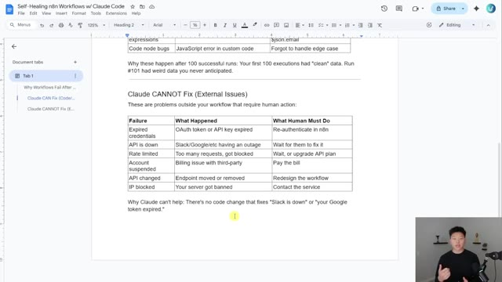
*⏱️ 00:06:39 — Une capture d'écran d'un document Google Docs présentant un tableau intitulé "Claude CANNOT Fix (External Issues)", listant les erreurs système hors contrôle de l'IA.*

---

### ⏱️ `[00:06:55 - 00:07:29]` | Segment #17

**🔊 Audio (Transcription Intégrale Mot pour Mot en Français) :**
> But anyways, of course, there are certain things that Cloud Code cannot fix, but there are lots of things that Cloud Code can fix. So that's why getting a notification is cool because either way, if it runs into something like an expired API key, it will still let you know. So here's another example. We have an email agent. It's very, very simple. And what happens is it wants to respond to emails, but we know that when we send an email with a Gmail node, we have a subject and a message. So what we do is we use a structured output parser to put those out into two different fields so that we can send it properly. And so we just did a run of this. You can see that it failed right here because the structured output parser

**👁️ Analyse Visuelle d'Écran (gemini-3.5-flash-lite) :**
**Interface & Outils** : Google Docs, n8n (éditeur de workflow).

**Contenu textuel & Code** : Tableau explicatif des erreurs (Expired credentials, API is down, Rate limited) et schéma technique de workflow d'agent.

**Action / Démonstration** : Présentation théorique des limites de correction automatique suivies d'une démonstration pratique dans l'éditeur de flux de travail.

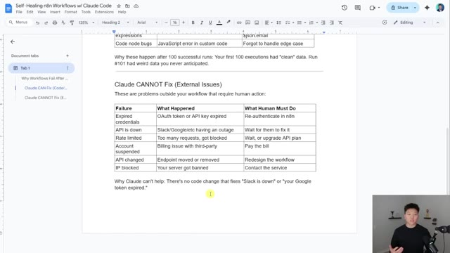
*⏱️ 00:07:03 — Une page Google Docs intitulée "Self-Healing n8n Workflows w/ Claude Code" présentant un tableau récapitulant les problèmes externes que Claude ne peut pas résoudre (ex: API expirée, panne de service).*

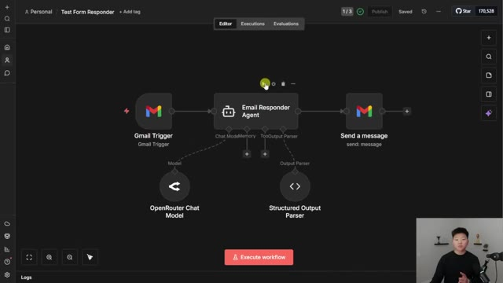
*⏱️ 00:07:12 — L'interface de l'éditeur n8n affichant un workflow nommé "Test Form Responder" composé d'un déclencheur Gmail, d'un agent "Email Responder" et d'une action d'envoi de message.*

---

### ⏱️ `[00:07:29 - 00:08:01]` | Segment #18

**🔊 Audio (Transcription Intégrale Mot pour Mot en Français) :**
> was invalid. This of course triggered my error workflow, which looks like this. And then I get a message in ClickUp that says, hey, the workflow has been fixed. The test form responder email responder agent had an error in the structured output parser. It had invalid JSON in the actual schema. So I fixed it and now it should work. So like I said, this is the most recent run. You can see in here, this wasn't correct because we were missing commas. But now if I go to the current version that cloud code actually fixed, and we just go ahead and run this workflow, we should see that it's able to use the structured output parser correctly now that cloud code has fixed it.

**👁️ Analyse Visuelle d'Écran (gemini-3.5-flash-lite) :**
**Interface & Outils** : Interface utilisateur de la plateforme Uppit AI (environnement de gestion d'agents IA).

**Contenu textuel & Code** : Le message "Workflow Fixed Successfully" indique l'erreur initiale ("Error in sub-node Structured Output Parser") et l'explication technique : "Root Cause: The Structured Output Parser node had invalid JSON... The fix: Added the missing commas".

**Action / Démonstration** : Le système présente le journal de résolution automatique généré par l'agent IA après avoir corrigé une erreur de syntaxe JSON dans un workflow n8n.

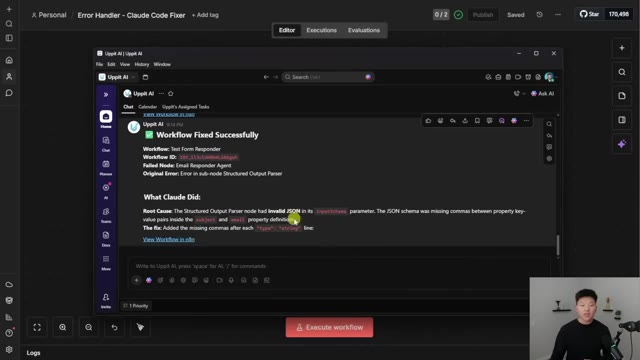
*⏱️ 00:07:37 — Une capture d'écran montrant l'interface d'Uppit AI affichant un rapport de correction automatique d'un workflow nommé "Test Form Responder".*

---

### ⏱️ `[00:08:01 - 00:08:33]` | Segment #19

**🔊 Audio (Transcription Intégrale Mot pour Mot en Français) :**
> Okay, let me show you guys another cool example. We've got a super simple workflow here that takes a form submission And then we're gonna go ahead and do research on tably So we're gonna put in a topic and this time I'm gonna let you guys see what actually happens in the terminal once this errors All right, so we've got the terminal up on the left and we've got the research form here Now what I'm gonna do is I'm gonna send over, you know, I want you to research bananas What I'm gonna do is I'm gonna accidentally put a double quotes right there Which if you guys know that's gonna break the JSON body, so I'm gonna go ahead and hit submit We'll close out of this and we can see instantly we already received an error

**👁️ Analyse Visuelle d'Écran (gemini-3.5-flash-lite) :**
**Interface & Outils** : n8n (éditeur de workflow)

**Contenu textuel & Code** : Workflow composé de deux nœuds principaux : "On form submission" (déclencheur) et "Tavily" (requête POST vers api.tavily.com). Le formulaire affiche un champ "Topic" et un bouton "Submit".

**Action / Démonstration** : Le présentateur présente la structure d'automatisation avant l'exécution du workflow.

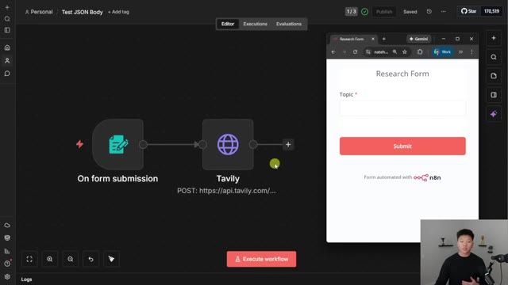
*⏱️ 00:08:09 — Une interface de workflow n8n montrant un flux simple avec un déclencheur "On form submission" relié à un nœud "Tavily" pour la recherche, à côté d'une fenêtre de prévisualisation affichant un formulaire de recherche.*

---

### ⏱️ `[00:08:34 - 00:09:08]` | Segment #20

**🔊 Audio (Transcription Intégrale Mot pour Mot en Français) :**
> Error received workflow test JSON body, which is this one right here We aired in Tavoli because the JSON parameter is not valid JSON. So what happened here is Okay, take two we're gonna do it again So the terminals up over here you can see that it's waiting for any of an errors I'm gonna shoot over Apple this time because it didn't really like banana. So submit this We're gonna see that pretty much instantly we have some cloud code getting started up over here here. So prompt has been saved. We're starting cloud code. And now you can see in the error handling workflow, it's running right now. So it's running for 38 seconds. You can see that based on

**👁️ Analyse Visuelle d'Écran (gemini-3.5-flash-lite) :**
**Interface & Outils** : n8n (éditeur de workflow), Terminal Windows (CLI), Navigateur Web (interface de formulaire n8n).

**Contenu textuel & Code** : Logs d'erreur n8n (Workflow: Test JSON Body, Failed Node: Tavily), commandes de configuration du pont (ngrok http 3456), logs système "Claude Code exited with code 1".

**Action / Démonstration** : Débogage et test du workflow "Test JSON Body", observation de la capture d'erreur par le bridge, soumission d'un formulaire pour déclencher l'automatisation.

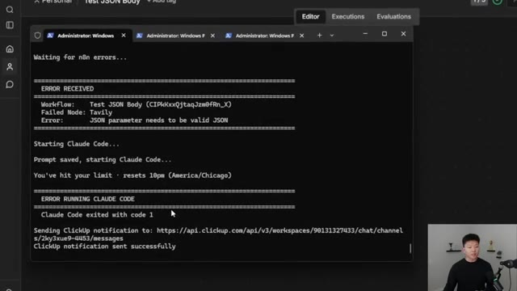
*⏱️ 00:08:42 — Terminal affichant une erreur de workflow n8n ("JSON parameter needs to be valid JSON") et la tentative infructueuse de lancement de Claude Code.*

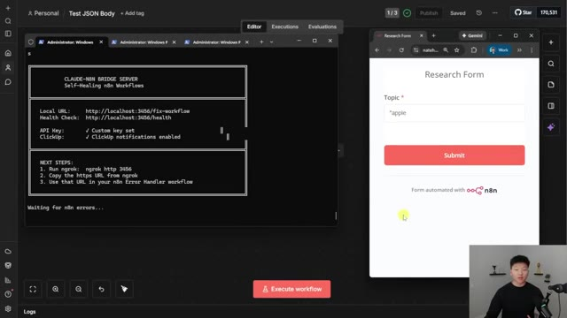
*⏱️ 00:08:51 — Interface divisée avec le terminal "CLAUDE-NBN BRIDGE SERVER" à gauche et un formulaire de recherche "Research Form" sur n8n à droite.*

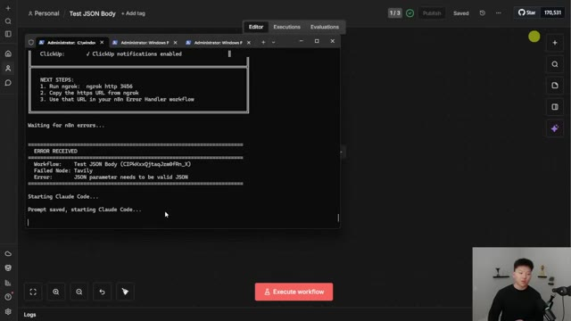
*⏱️ 00:08:59 — Terminal affichant la réception d'une nouvelle erreur de workflow et le début du processus de relance automatique de Claude Code.*

---

### ⏱️ `[00:09:08 - 00:09:29]` | Segment #21

**🔊 Audio (Transcription Intégrale Mot pour Mot en Français) :**
> the error and based on what it needs to do, it can run for longer, but we're getting some content back right here. It looks like it's finished up. So the fix has been applied. The root cause was that the JSON body parameter in the Tavly request node had an expression syntax, which didn't work. So what it did is it went ahead and fixed that syntax so that that double quote in there wouldn't actually break requests in the future.

**👁️ Analyse Visuelle d'Écran (gemini-3.5-flash-lite) :**
**Interface & Outils** : n8n (interface de workflow d'automatisation) et un terminal de commande Windows (ou fenêtre de code).

**Contenu textuel & Code** : Explications textuelles sur le remplacement d'une syntaxe d'expression invalide `{{ $json.Topic }}` par une fonction `JSON.stringify()` pour corriger une erreur dans le nœud de requête Tavily.

**Action / Démonstration** : Analyse et documentation du correctif technique (root cause analysis) affiché dans une fenêtre de terminal superposée à l'historique des exécutions du workflow.

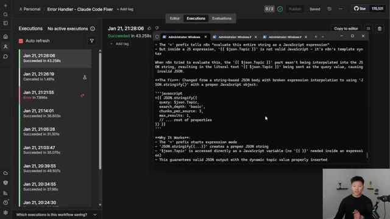
*⏱️ 00:09:13 — Une interface de workflow n8n montrant l'historique des exécutions à gauche et une fenêtre de terminal ou éditeur de texte au centre expliquant techniquement la résolution d'un bug lié à la syntaxe JSON dans une requête.*

---

### ⏱️ `[00:09:29 - 00:09:51]` | Segment #22

**🔊 Audio (Transcription Intégrale Mot pour Mot en Français) :**
> So it's a really good guardrail that it baked in there. You can see in my ClickUp, I have a notification. Once again, I have a link to view the workflow in NNN if I choose to. And now back in this workflow, even if I put in Apple with a double quote in the front, what we're gonna see is that we should get a successful run if I go to the executions, and we can see right here that we get no errors, even though in the actual form, I submitted Apple with a double quote right there.

**👁️ Analyse Visuelle d'Écran (gemini-3.5-flash-lite) :**
**Interface & Outils** : n8n (éditeur de workflow et historique des exécutions), Uppit AI (interface de chat).

**Contenu textuel & Code** : Workflow n8n avec nœuds "On form submission" et "Tavily", logs d'erreurs et de succès, formulaire de recherche HTML.

**Action / Démonstration** : Correction automatique d'un workflow, saisie de données utilisateur dans un formulaire, exécution et test de validation d'un workflow après correction.

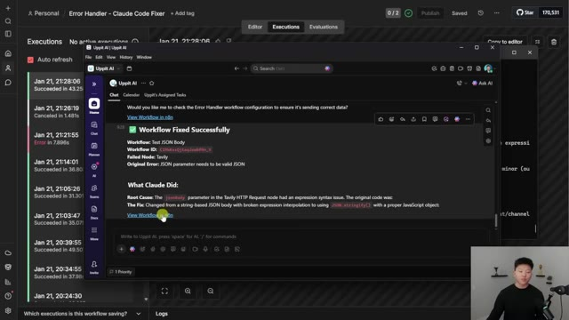
*⏱️ 00:09:34 — Interface de notification Uppit AI affichant un message de confirmation "Workflow Fixed Successfully" concernant une erreur Tavily, avec un lien pour visualiser le workflow dans n8n.*

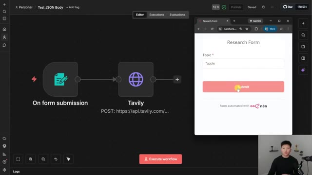
*⏱️ 00:09:40 — Interface n8n montrant un workflow de recherche ("Research Form") où l'utilisateur saisit '"apple' (avec un guillemet) dans le champ de texte avant de cliquer sur "Submit".*

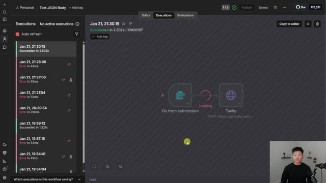
*⏱️ 00:09:45 — Vue de l'historique des exécutions dans n8n montrant le succès d'une exécution récente (ID#20137) après la soumission du formulaire, avec une icône de chargement sur le nœud Tavily.*

---

### ⏱️ `[00:09:51 - 00:10:27]` | Segment #23

**🔊 Audio (Transcription Intégrale Mot pour Mot en Français) :**
> Because what it did is it actually changed the JSON body. So instead of it looking, you know, the way that I had it structured it basically wrapped all of this up And now it made sure that when it comes through it can actually be read by Tably So I wanted to end off with one example of what happens if Claude can't actually fix the workflow So there are certain times when it can't in this case What I did is I switched the API key to be a vappy API key, which is obviously not going to work for Tably So I'm going to show you the way that I've configured the Claude agent to notify me in a different way So once again, we have the server right here and you can see that it's waiting for any errors I'm going to go ahead and submit this form and we are going to get an error. Pretty much instantly

**👁️ Analyse Visuelle d'Écran (gemini-3.5-flash-lite) :**
**Interface & Outils** : n8n (outil d'automatisation de workflow).

**Contenu textuel & Code** : - Image 1 : Expression JavaScript `{{ JSON.stringify({ query: $json.Topic, ... }) }}` et son résultat JSON formaté à droite.
- Image 2 : Flux de travail composé d'un déclencheur "On form submission" relié à une API "Tavily".

**Action / Démonstration** : Modification du corps de la requête JSON dans l'éditeur d'expression pour assurer la compatibilité avec l'API Tavily avant l'exécution du workflow.

*⏱️ 00:10:00 — Vue détaillée de l'éditeur d'expression dans n8n, montrant une fonction `JSON.stringify` transformant des données de requête en format JSON.*

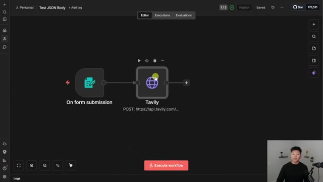
*⏱️ 00:10:09 — Interface principale de l'éditeur de workflow n8n montrant deux nœuds connectés : "On form submission" et le nœud "Tavily".*

---

### ⏱️ `[00:10:27 - 00:11:03]` | Segment #24

**🔊 Audio (Transcription Intégrale Mot pour Mot en Français) :**
> we get this notification in our terminal that Cloud Code is now working on it. So Cloud Code is finished. You can see that it says user action required and we got a message in ClickUp. So I'll open that up and now you can see it's a different type of message compared to when it would say that it was fixed. And this time it says user action required in this workflow. Tavoli had an authorization failed. Why Cloud Code couldn't fix it? Because it's authentication and that requires the human to take action. So it also says here's what you need to do now. You need to select an existing Tavoli credential and verify it's correct, or you can go ahead and create a new one and then paste in your API key. Save it, test the workflow. Once you've configured that valid Tavoli credentials,

**👁️ Analyse Visuelle d'Écran (gemini-3.5-flash-lite) :**
**Interface & Outils** : ClickUp (interface web/application de bureau).

**Contenu textuel & Code** : Message d'erreur détaillé expliquant un échec d'authentification avec l'API Tavily, incluant des étapes de résolution ("What You Need To Do") et un lien vers "View Workflow in n8n".

**Action / Démonstration** : Affichage d'un rapport d'état envoyé par l'agent IA à l'utilisateur, signalant une action requise pour corriger une configuration d'API.

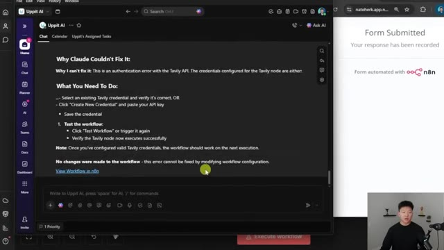
*⏱️ 00:10:36 — Une fenêtre de messagerie dans l'application ClickUp affichant une notification "Why Claude Couldn't Fix It" concernant une erreur d'authentification Tavily API.*

---

### ⏱️ `[00:11:03 - 00:11:26]` | Segment #25

**🔊 Audio (Transcription Intégrale Mot pour Mot en Français) :**
> the workflow should work on the next execution. And then it says no changes were made to this workflow because it really couldn't do anything to fix it. So hopefully you guys can see by combining an N8N error workflow with Cloud Code, with N8N MCP, and N8N Skills, we were able to build this system where when your workflows fail they automatically get fixed, they notify you, or if Cloud Code can't fix it it tells you how you should go about fixing it.

**👁️ Analyse Visuelle d'Écran (gemini-3.5-flash-lite) :**
**Interface & Outils** : n8n (éditeur de workflow), interface de chat Uppit AI.

**Contenu textuel & Code** : Texte expliquant les étapes de résolution manuelle (clés API, credentials), diagramme de workflow avec les nœuds "Error Trigger" et "Call Claude Bridge".

**Action / Démonstration** : Diagnostic d'erreur système et affichage du workflow de gestion d'erreurs par l'agent IA.

*⏱️ 00:11:09 — Une interface de chat IA (Uppit AI) affichant un rapport d'analyse détaillé expliquant pourquoi une erreur d'authentification Tavily API ne peut être corrigée automatiquement par le code.*

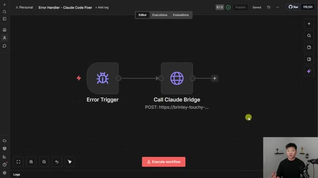
*⏱️ 00:11:15 — L'éditeur de workflow n8n montrant un flux de gestion d'erreurs intitulé "Error Handler - Claude Code Fixer", composé d'un déclencheur d'erreur et d'un nœud d'appel HTTP vers "Claude Bridge".*

---

### ⏱️ `[00:11:26 - 00:12:00]` | Segment #26

**🔊 Audio (Transcription Intégrale Mot pour Mot en Français) :**
> I think this is super cool because you could have obviously that bridge and the tunnel running all the time so that even if I'm not standing here watching it, if you're sleeping, if you're on vacation, every time a workflow fails it can still do that for you. And because it's in Cloud Code, in a Cloud project, think about all the different contexts you could give it in there about your business, about other documentation, about the workflows themselves, so you can really make these things better and better over time. So I know I didn't really show you guys exactly how I built this. Let me just tell you, I did it all using Cloud Code, using natural language, using plan mode, asking it questions, telling it what I wanted to do. I literally started off my prompts to Cloud

**👁️ Analyse Visuelle d'Écran (gemini-3.5-flash-lite) :**
**Interface & Outils** : Interface web n8n et lecteur PDF.

**Contenu textuel & Code** : Nœuds de workflow n8n (Error Trigger, Call Claude Bridge) et table des matières du guide de configuration.

**Action / Démonstration** : Présentation du workflow d'automatisation et du guide de configuration associé.

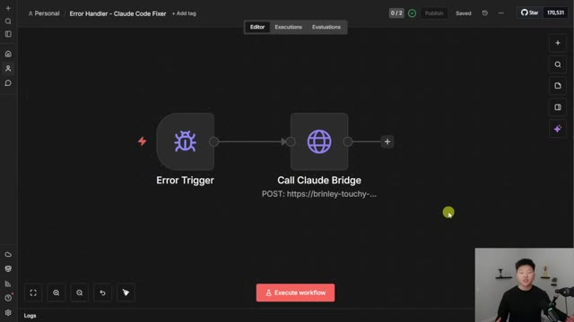
*⏱️ 00:11:35 — Capture d'écran montrant l'interface d'un workflow d'automatisation n8n avec les nœuds 'Error Trigger' et 'Call Claude Bridge'.*

---

### ⏱️ `[00:12:00 - 00:12:18]` | Segment #27

**🔊 Audio (Transcription Intégrale Mot pour Mot en Français) :**
> Code with, hey, I've got this crazy idea. Yeah, here it is. I'll actually show you guys. I said, I need your help with the crazy idea I have. And then I explained what I wanted to do. But anyways, I did compile an 18 page PDF guide on exactly how I did this. So I go over the the prereqs, the architecture, installing cloud code, setting up the MCP server, all of this kind of stuff, talking about Ngrok.

**👁️ Analyse Visuelle d'Écran (gemini-3.5-flash-lite) :**
**Interface & Outils** : VS Code (avec extension Claude), Visualiseur de documents PDF (navigateur ou lecteur système).

**Contenu textuel & Code** : Prompt utilisateur : "I want to build a system where n8n is able to talk to Claude code... trigger when an n8n workflow fails... Claude code will go ahead and fix the n8n workflow." Sommaire du guide : Overview, Prerequisites, Architecture, Install Claude Code, Set Up n8n MCP Server, Create Bridge Server, Expose with ngrok.

**Action / Démonstration** : Le présentateur explique la conception théorique de son automatisation puis présente le guide technique complet (PDF) qu'il a compilé pour documenter la solution.

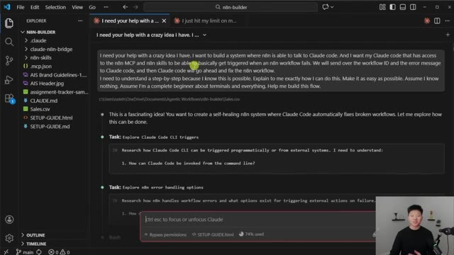
*⏱️ 00:12:04 — Interface VS Code affichant une conversation avec l'agent Claude, où le présentateur soumet sa requête pour créer un système de "self-healing" (auto-réparation) pour les workflows n8n.*

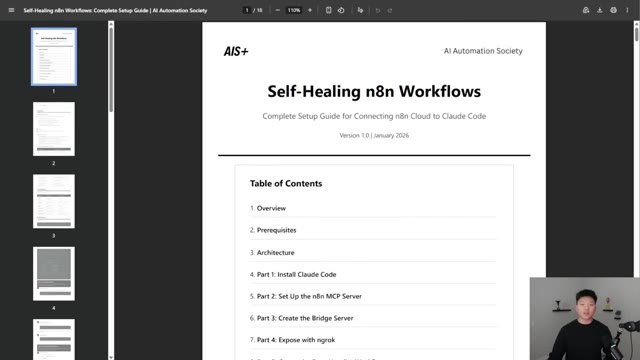
*⏱️ 00:12:09 — Visionneuse PDF affichant la première page du guide "Self-Healing n8n Workflows" (18 pages), montrant le sommaire détaillé incluant l'installation de Claude Code, du serveur MCP n8n et l'utilisation de ngrok.*

---

### ⏱️ `[00:12:19 - 00:12:40]` | Segment #28

**🔊 Audio (Transcription Intégrale Mot pour Mot en Français) :**
> The other good news is if you're running NNN locally, this is even easier because you don't have to configure that tunnel. But this should pretty much walk you through all of it. But like I said, you could give this to cloud code or you could just brainstorm with your own cloud code and you should be able to get this set up in 30 minutes to an hour. Then obviously it's all about testing it and going back and forth and refining it a little bit. So I'll drop this in my FreeSchool community, which you guys can access for completely free.

**👁️ Analyse Visuelle d'Écran (gemini-3.5-flash-lite) :**
**Interface & Outils** : Visionneuse de document PDF (tutoriel technique "Self-Healing n8n Workflows").

**Contenu textuel & Code** : - Image 1 : Processus en 5 étapes pour le traitement des erreurs via ngrok, Claude Code et n8n.
- Image 2 : Contenu du fichier `CLAUDE.md` définissant les outils `n8n_get_workflow`, `n8n_update_partial_workflow` et `n8n_validate_workflow`.
- Image 3 : Commandes terminal `ngrok config add-authtoken` et `ngrok http 3456`.

**Action / Démonstration** : Présentation théorique et guide de configuration étape par étape pour automatiser la résolution d'erreurs dans des workflows n8n.

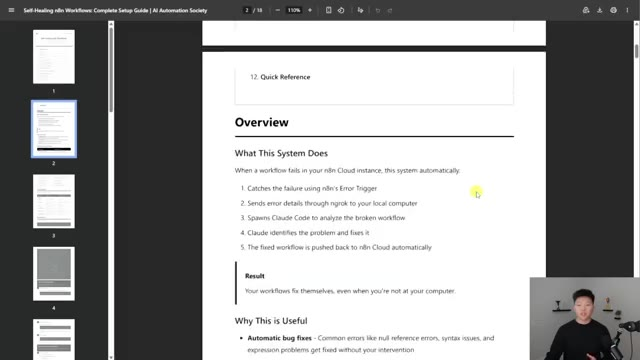
*⏱️ 00:12:24 — Page de documentation présentant une vue d'ensemble du système de réparation automatique de workflows n8n.*

*⏱️ 00:12:29 — Page de documentation détaillant la configuration système via `CLAUDE.md`, incluant la mission de l'agent et les outils MCP.*

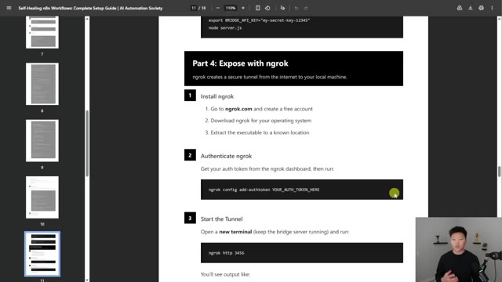
*⏱️ 00:12:35 — Page de documentation illustrant les étapes d'installation et de configuration du tunnel ngrok pour l'accès local.*

---

### ⏱️ `[00:12:40 - 00:12:58]` | Segment #29

**🔊 Audio (Transcription Intégrale Mot pour Mot en Français) :**
> As always, the link for this will be down in the description. And if you're interested in diving deeper with NNN, Cloud Code, pretty much anything that's going to be in the AI automation space, then definitely check out my plus group. We've got a great community of over 3,000 members who are building automations every day and building businesses with automations. So it's a really cool spot to be if that's kind of what you're looking to do.

**👁️ Analyse Visuelle d'Écran (gemini-3.5-flash-lite) :**
**Interface & Outils** : Plateforme de communauté en ligne Skool (AI Automation Society Plus).

**Contenu textuel & Code** : Publications sur le recrutement de spécialistes en automatisation n8n, témoignages de contrats clients signés (385 000 $), récapitulatifs des succès de la communauté et sidebar affichant les statistiques de membres.

**Action / Démonstration** : Navigation au sein du flux d'actualités et du tableau de bord de la communauté pour présenter les ressources et le réseau aux abonnés.

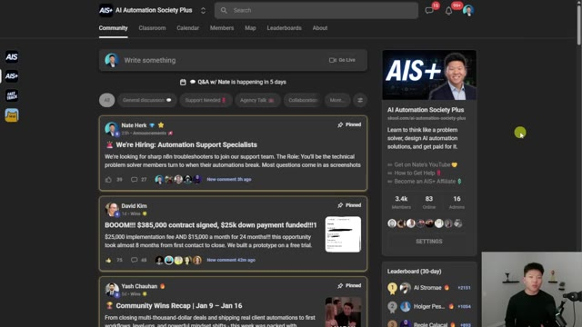
*⏱️ 00:12:45 — Interface de la plateforme communautaire Skool "AI Automation Society Plus" montrant un flux de publications, des annonces épinglées et un classement des membres.*

---

### ⏱️ `[00:12:59 - 00:13:17]` | Segment #30

**🔊 Audio (Transcription Intégrale Mot pour Mot en Français) :**
> We've got a full classroom section that's always being worked on and we're planning to bring a lot of new stuff with all of these changes in the space. We've got one live Q&A every single week. So I'd love to see you guys in these communities in the live calls, but that's going to do it for today. So if you enjoyed the video or you learned something new, please give it a like. It definitely helps me out a ton. And as always, I appreciate you guys making it to the end of the video.

**👁️ Analyse Visuelle d'Écran (gemini-3.5-flash-lite) :**
**Interface & Outils** : Skool, Excalidraw (tableau blanc virtuel)

**Contenu textuel & Code** : Noms des modules de formation (Agent Zero, One Person AI Agency), titres de posts communautaires ("We're Hiring: Automation Support Specialists"), icônes de n8n et d'agents.

**Action / Démonstration** : Navigation dans les sections pédagogiques, consultation du flux social et présentation visuelle d'un concept d'architecture via un schéma.

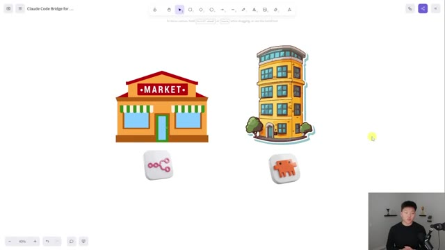
*⏱️ 00:13:12 — Diagramme schématique sur un tableau blanc virtuel illustrant une comparaison entre une boutique (Market) et un immeuble, associée à l'icône de n8n et une icône d'agent.*

---

### ⏱️ `[00:13:17 - 00:13:19]` | Segment #31

**🔊 Audio (Transcription Intégrale Mot pour Mot en Français) :**
> I'll see you on the next one. Thanks so much, everyone.

**👁️ Analyse Visuelle d'Écran (gemini-3.5-flash-lite) :**
**Interface & Outils** : Tableau blanc numérique (type Excalidraw ou similaire).

**Contenu textuel & Code** : Deux illustrations : à gauche une épicerie ("MARKET") associée à une icône Make, à droite un immeuble associé à une icône de créature pixelisée (souvent associée à des outils d'IA).

**Action / Démonstration** : Présentation visuelle de fin de tutoriel, illustrant la structure du système ou du projet développé.

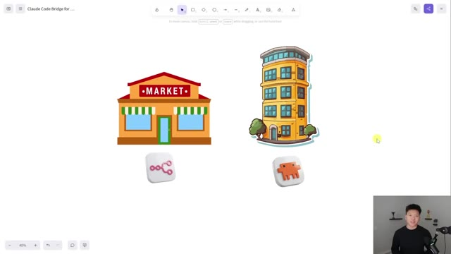
*⏱️ 00:13:18 — Un schéma visuel sur un tableau blanc numérique illustrant une comparaison entre deux entités, avec des icônes représentant possiblement des services d'automatisation (Make et une plateforme d'IA).*

---

