# 🎬 Agentic Workflows Just Changed AI Automation Forever! (Claude Code)

> **Chaîne** : [Nate Herk | AI Automation](https://www.youtube.com/@nateherk/featured)  
> **Lien YouTube** : [https://www.youtube.com/watch?v=AO5aW01DKHo](https://www.youtube.com/watch?v=AO5aW01DKHo)  
> **Date de publication** : 20260125  
> **Durée** : 00:21:40  
> **Identifiant vidéo** : `AO5aW01DKHo`  
> **Transcription & Analyse** : `whisper-v3-large-turbo+gemini-3.5-flash-lite`  

---

## 📌 Synthèse Exécutive & Outils

### 💡 Résumé
Dans cette vidéo intitulée **Agentic Workflows Just Changed AI Automation Forever! (Claude Code)**, Nate Herk décortique les capacités pratiques d'automatisation et de développement propulsées par les modèles de pointe.

### 🛠️ Outils, Modèles & Logiciels Présentés
- **Opus 5.5 & Claude Code** : Modèles d'ingénierie et agents de codage autonome.

### 🔑 Points Clés & Enseignements Stratégiques
- Optimiser le niveau d'effort et le raisonnement des modèles IA pour des résultats industriels.
- Automatiser les cycles de création logicielle de bout en bout.

---

## ⏱️ Chronologie & Transcription Complète Audio & Visuelle (Mot pour Mot)

### ⏱️ `[00:00:00 - 00:00:20]` | Segment #01

**🔊 Audio (Transcription Intégrale Mot pour Mot en Français) :**
> AI automation is about to change forever. Most workflows today only do exactly what you tell them, nothing more. But agentic workflows are different. You basically give them an outcome, not just a flow, and they figure out the steps by themselves. So in this video, I'm gonna explain the shift and then I'm gonna build one live so you can see just how practical it already is. So let's first take a look at the difference between the new agentic tech versus the old way of doing things.

**👁️ Analyse Visuelle d'Écran (gemini-3.5-flash-lite) :**
**Interface & Outils** : Interface de présentation graphique personnalisée (type infographie animée).

**Contenu textuel & Code** : Schémas conceptuels illustrant le fonctionnement des workflows agentiques et la génération automatique de listes de leads.

**Action / Démonstration** : Animation didactique illustrant le passage d'un objectif ("Outcome") à l'exécution automatique d'étapes par un agent IA.

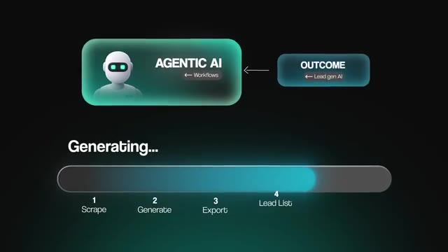
*⏱️ 00:00:10 — Diagramme conceptuel montrant une entrée "Outcome" (Lead gen AI) transmise à un "Agentic AI" déclenchant une barre de progression avec 4 étapes : Scrape, Generate, Export, Lead List.*

---

### ⏱️ `[00:00:21 - 00:00:42]` | Segment #02

**🔊 Audio (Transcription Intégrale Mot pour Mot en Français) :**
> So what does agentic actually mean? Well, if you've been building an end-to-end for a while, you know the drill. You drag a node, you configure it, you connect it to the next one, you test the flow, you hit an error, you read the error message, you figure out what went wrong, you fix it, and then you test it again, which means every API connection, every variable, every condition, that's all on you. But with Agentic, it's a bit different. Instead of telling the system how to do something, you just tell it what you want in plain English.

**👁️ Analyse Visuelle d'Écran (gemini-3.5-flash-lite) :**
**Interface & Outils** : Outil d'automatisation de workflow (type n8n ou plateforme d'agents IA).

**Contenu textuel & Code** : Diagramme de flux avec nœuds "AI Agent", "GPT-5-mini2", et "When chat message received".

**Action / Démonstration** : Visualisation de la structure logique d'un agent IA et de ses interconnexions dans un éditeur de type "drag and drop".

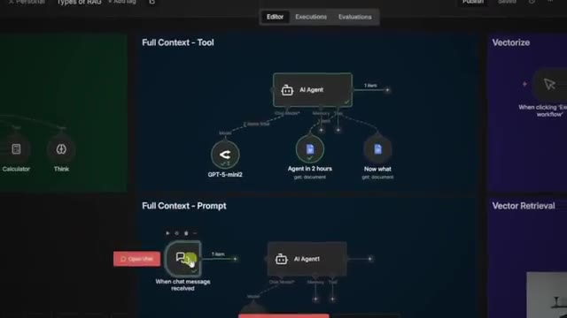
*⏱️ 00:00:26 — Interface de conception de workflow graphique avec des nœuds connectés (AI Agent, GPT-5-mini, déclencheur de message).*

---

### ⏱️ `[00:00:42 - 00:01:16]` | Segment #03

**🔊 Audio (Transcription Intégrale Mot pour Mot en Français) :**
> So you explain where the data is coming from, what needs to happen, and then where it should end up. The agent then figures out the rest. So just think about it like you're hiring an actual human developer. You wouldn't go in there and explain every single line of code. You would just explain the outcome that you're looking for, what problem you're trying to solve, what tools you're working with and what the end result should look like. And then they'd go build it for you. So here's the thing. If you can't explain clearly what you want, then how could you expect a human or an AI agent to actually build that? So there has to be a clear scope. You don't need to know how to code, but you do need to know how to communicate your plan clearly. And the good news is you can actually use the agent to just brainstorm. So if you tell it roughly what you're trying to do, and it will

**👁️ Analyse Visuelle d'Écran (gemini-3.5-flash-lite) :**
**Interface & Outils** : Graphiques incrustés (overlays) type infographie.

**Contenu textuel & Code** : Trois icônes accompagnées de texte : "Problem?" (avec une loupe), "Tools?" (avec une icône de réglages), et "End Result?" (avec un graphique de croissance).

**Action / Démonstration** : Présentation conceptuelle des étapes clés pour déléguer une tâche à un agent IA.

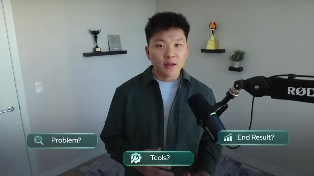
*⏱️ 00:00:59 — Le présentateur s'adresse à la caméra avec trois éléments graphiques incrustés en bas de l'image.*

---

### ⏱️ `[00:01:16 - 00:01:47]` | Segment #04

**🔊 Audio (Transcription Intégrale Mot pour Mot en Français) :**
> ask you all the questions that it needs answered in order to actually build a robust solution. And that's the huge shift because you can go from being the person who constructs every piece of the puzzle to being the person who just defines what do you want the puzzle to look like. So there are four main changes that I need you to understand in order to build an agentic workflow with me. So the first one is self-healing. This is probably the biggest and one of the coolest ones, because if you build something in NNN, when the workflow breaks, you read the error message, you tweak the node, you test it again, and if it breaks again, you repeat. So that whole debugging loop eats up a lot of time. Now, if you're building an agentic workflow, the agent handles that loop for you.

**👁️ Analyse Visuelle d'Écran (gemini-3.5-flash-lite) :**
**Interface & Outils** : n8n (outil d'automatisation de workflow).

**Contenu textuel & Code** : Diagramme de flux n8n incluant des nœuds logiques, une boucle d'itération et une gestion d'erreurs ("Continue on Error").

**Action / Démonstration** : Démonstration visuelle du concept de "Self-Healing" (auto-guérison) d'un workflow d'automatisation via n8n en cas d'erreur de nœud.

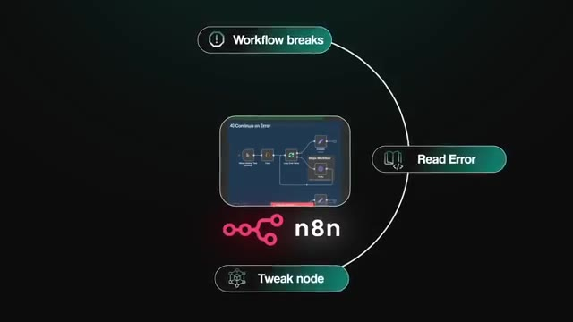
*⏱️ 00:01:39 — Schéma technique illustrant le processus de résolution d'erreur dans l'outil n8n, montrant une boucle de correction automatique ("Workflow breaks" -> "Read Error" -> "Tweak node").*

---

### ⏱️ `[00:01:47 - 00:02:19]` | Segment #05

**🔊 Audio (Transcription Intégrale Mot pour Mot en Français) :**
> Imagine every time your workflow broke, a smart assistant was sitting right there next to you, just reading the error, testing a fix, and only calling you in if it was really, really stuck. So the agent tries something, runs it, checks what happened, and if something broke, it figures out why, edits its own code, edits its own instructions, and updates everything so that it doesn't make that mistake again. And here's what's really wild. You don't have to read or write any of that code yourself. You just explain what good looks like, and when you need to, approve the changes that it suggests. All right, number two is natural language control, but for real this time. Because you've probably seen tons of tools that let you build with natural language. Lovable, Bolt, Lindy, even

**👁️ Analyse Visuelle d'Écran (gemini-3.5-flash-lite) :**
**Interface & Outils** : VS Code (Terminal intégré), interface de messagerie pour agent de type Claude Code/Opus.

**Contenu textuel & Code** : Commandes de terminal (`python tools/fetch_youtube_data.py`), logs d'erreurs Python, et liste des étapes : "Runs it", "Checks", "Figures out error", "Edits own code", "Edits own instruction", "Updates".

**Action / Démonstration** : Démonstration du cycle autonome d'un agent IA : exécution de script, détection d'erreur d'encodage Unicode, auto-diagnostic et poursuite du pipeline de données.

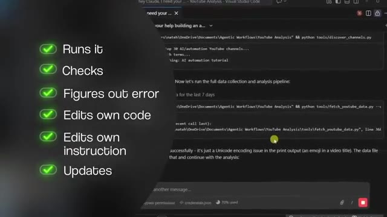
*⏱️ 00:02:03 — Capture d'écran d'un terminal dans VS Code montrant un workflow d'agent IA avec une liste de vérification des actions (Run, Check, Error handling) et des logs d'exécution Python.*

---

### ⏱️ `[00:02:19 - 00:02:54]` | Segment #06

**🔊 Audio (Transcription Intégrale Mot pour Mot en Français) :**
> N8N has an AI workflow builder. You basically type in a prompt, it spits out a workflow or a website. But if you've actually tried using these for production-ready systems, you know that usually they require a lot of manual cleanup or a lot of back and forth. They'll get you maybe 60 or 70% of the way there. But this new generation, it feels a lot different. Instead of just taking your prompts and building, it first interviews you to make sure that it knows everything it needs. So it'll ask you clarification questions like we talked about before it tries to write a single line of code. It'll ask you questions like, who are the users? How many times should this run? What tools are you using? What happens if X happens? What should happen if Y happens? A lot of times when I'm working with these agents, they're asking me questions that I wouldn't have even thought of

**👁️ Analyse Visuelle d'Écran (gemini-3.5-flash-lite) :**
**Interface & Outils** : Application de gestion de notes ou de base de connaissances (type Notion).

**Contenu textuel & Code** : Texte affiché : "SYSTEM QUESTIONS", "1. Who are the users ?". Icônes d'applications visibles dans le dock : Photos, Notion, App Store, Réglages, Final Cut Pro.

**Action / Démonstration** : Présentation d'une interface de questionnaire ou de documentation de projet pour la conception de flux de travail.

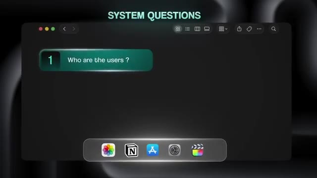
*⏱️ 00:02:45 — Une interface logicielle sombre affichant une liste de questions système ("SYSTEM QUESTIONS"), avec la première question visible : "Who are the users ?". Une barre d'icônes d'applications est présente en bas de l'écran.*

---

### ⏱️ `[00:02:54 - 00:03:28]` | Segment #07

**🔊 Audio (Transcription Intégrale Mot pour Mot en Français) :**
> until a month later when we run into a problem. And then once it has all that information, it builds the systems and it wires it right into your own tech stack already. So once that's built, natural language becomes the remote control that you can use for the whole automation. So you can have V1 ready and you can say, huh, actually, can you make that a little bit faster? Or can you make it cheaper? Or can you add a manual review step right here? Or can you log all of those outputs in this Google sheet and it will just go ahead and do it. Now, of course, you can't just completely like vibe code these automations. You still have to do a little bit of thinking, but it will ask you the right questions and guide you. Now, something else I think is really cool is that you can have multiple agents running simultaneously. So if I asked 10 of the best AI engineers that I knew to build me

**👁️ Analyse Visuelle d'Écran (gemini-3.5-flash-lite) :**
**Interface & Outils** : Visual Studio Code (VS Code) avec interface de chat IA intégrée.

**Contenu textuel & Code** : Bulles de texte : "Can you make that a little bit faster?", "Can you make it cheaper?", "Can you add a manual review step right here?".

**Action / Démonstration** : Démonstration de l'utilisation du langage naturel pour piloter et modifier dynamiquement des systèmes de code via une interface de chat.

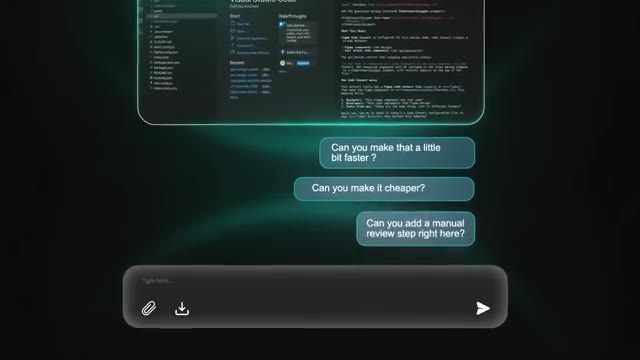
*⏱️ 00:03:11 — Interface interactive montrant une fenêtre VS Code en arrière-plan avec une série de bulles de dialogue en premier plan, simulant des commandes en langage naturel.*

---

### ⏱️ `[00:03:28 - 00:04:02]` | Segment #08

**🔊 Audio (Transcription Intégrale Mot pour Mot en Français) :**
> a solution, I'd probably get 10 different versions, even though all 10 of them work. And sometimes the only way to know which one's best is just by testing them all out. So you could be brainstorming a process with an agent and you could say, please suggest the five best approaches for this workflow. And then instead of having to like guess which one you think you should try, just say, okay, cool. Agent one, try a method number one. Agent two, try two. Three, try three, and so on. And then you can step away, grab a cup of coffee, come back when they're all done, and then stress test all of those solutions to see which ones like the cheapest, the fastest, and the highest quality. Number three is about security. So when you think about the fact that you're building code that you don't really know what it's doing, you have to think about security.

**👁️ Analyse Visuelle d'Écran (gemini-3.5-flash-lite) :**
**Interface & Outils** : Interface graphique de présentation (overlay vidéo).

**Contenu textuel & Code** : Texte affiché : "1 Try method" et "AGENTS".

**Action / Démonstration** : Illustration visuelle du concept de test de méthodes par des agents IA.

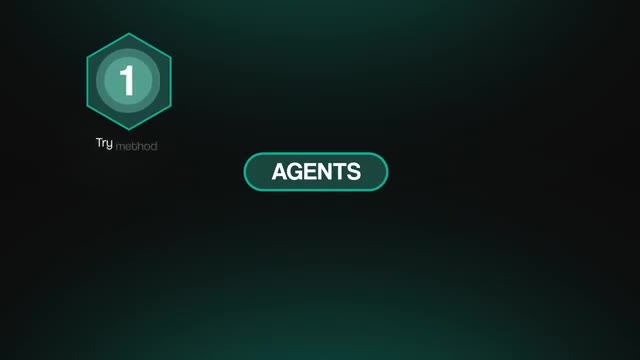
*⏱️ 00:03:45 — Graphique minimaliste sur fond sombre montrant un hexagone numéroté "1" avec le texte "Try method" et une pilule "AGENTS" au centre.*

---

### ⏱️ `[00:04:02 - 00:04:35]` | Segment #09

**🔊 Audio (Transcription Intégrale Mot pour Mot en Français) :**
> And these agents are writing and editing real code. And I know that a lot of you don't want to know how to read that or don't know how to read that, and I don't either. Just don't worry, you don't have to. Because these same large language models that are generating that code can also constantly review it for security problems and vulnerabilities. And they can do that on every single change, not just once. So think about it like you're having a security-obsessed developer sit right next to you while you're building your automation, and every time something changes, they double-check. Are the API keys hidden? Is sensitive data being logged somewhere that it shouldn't be? This can happen automatically as part of that self-healing loop. So every time the agent proposes an edit, it reviews its own work, it makes the changes, and then it makes sure that

**👁️ Analyse Visuelle d'Écran (gemini-3.5-flash-lite) :**
**Interface & Outils** : Claude Web UI, Visual Studio Code (VS Code).

**Contenu textuel & Code** : Rapport de développement sur le projet "Claude Code" (Image 1) ; boîte de dialogue de l'agent IA discutant de l'automatisation de PDF et de la confidentialité des données (Image 3).

**Action / Démonstration** : Démonstration de l'analyse proactive des risques par l'IA et de l'interaction naturelle entre le développeur et l'agent pour valider des choix d'implémentation.

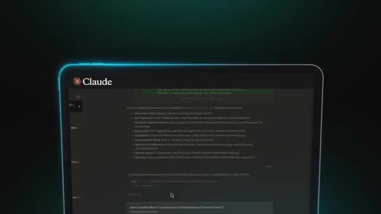
*⏱️ 00:04:10 — Interface web de Claude affichant un rapport de recherche détaillé sur le développement d'un agent codé avec "Claude Code".*

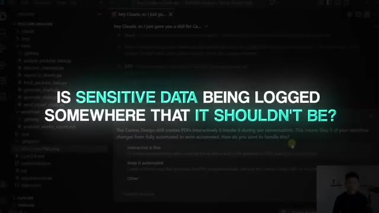
*⏱️ 00:04:27 — Éditeur de code (VS Code) affichant une discussion avec un agent IA sur la gestion des données sensibles, avec le texte superposé "IS SENSITIVE DATA BEING LOGGED SOMEWHERE THAT IT SHOULDN'T BE?".*

---

### ⏱️ `[00:04:35 - 00:05:10]` | Segment #10

**🔊 Audio (Transcription Intégrale Mot pour Mot en Français) :**
> everything's still secure. And of course, you can build in all of these guardrails with natural language. So you could just say something like, never send customer phone numbers to any third party tool. Or always make sure to stop this workflow if you ever exceed $5 of usage with this API. Things like that. Your job is just to say what must never happen, and then the system's job is to actually enforce that. All right, fourth is instant API and MCP integrations. So if you've built workflows in NNN, you know the pain of API authentication, headers, JSON bodies, query parameters. You spend half your time just reading API documentation and then getting the shape of the request to be right. With agentic workflows, that pain pretty much disappears because you just

**👁️ Analyse Visuelle d'Écran (gemini-3.5-flash-lite) :**
**Interface & Outils** : Interface de design de workflows et configuration de paramètres d'automatisation.

**Contenu textuel & Code** : Prompts de sécurité ("Never send customer phone numbers..."), étiquettes de catégories ("Natural Language Control", "Security"), paramètres de requête API.

**Action / Démonstration** : Démonstration des couches de contrôle et de sécurité configurables pour un agent IA.

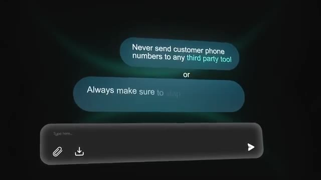
*⏱️ 00:04:44 — Interface de chat montrant des exemples de consignes de sécurité en langage naturel pour restreindre l'envoi de données.*

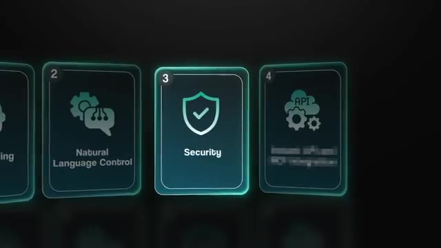
*⏱️ 00:04:52 — Représentation visuelle sous forme de cartes d'un pipeline d'automatisation, mettant en avant la section "Security".*

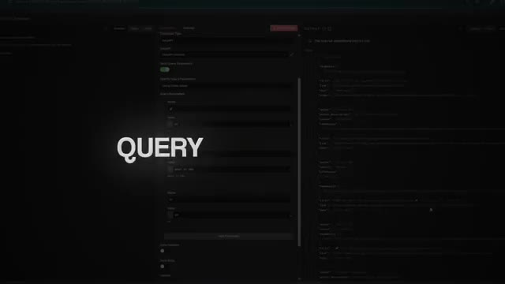
*⏱️ 00:05:01 — Interface de configuration technique sombre affichant le mot "QUERY" en surimpression, détaillant des paramètres de requête API.*

---

### ⏱️ `[00:05:10 - 00:05:31]` | Segment #11

**🔊 Audio (Transcription Intégrale Mot pour Mot en Français) :**
> say what tool you want to connect to. So, you know, get my Firefly's transcripts and then push that into ClickUp and then send me a Gmail summary. All you have to do then is go in and grab your API keys and then the agent figures out the rest. Because instead of you having to read those, you know, 10 pages of API documentation, the agent can just search the web or even go to the URL you give it and research it on its own. Now, MCP is basically like an app store for these agents.

**👁️ Analyse Visuelle d'Écran (gemini-3.5-flash-lite) :**
**Interface & Outils** : Claude Code Interface (environnement de développement).

**Contenu textuel & Code** : Code source affiché à l'écran, incluant des définitions de fonctions, des imports et des logs d'exécution (Claude AI Agent terminal).

**Action / Démonstration** : Interaction active d'un développeur avec une interface d'agent de codage, illustrant l'exécution ou la configuration de l'outil.

*⏱️ 00:05:26 — Vue subjective d'un utilisateur tapant sur un clavier devant un écran affichant l'interface "Claude Code".*

---

### ⏱️ `[00:05:31 - 00:06:07]` | Segment #12

**🔊 Audio (Transcription Intégrale Mot pour Mot en Français) :**
> They're tools that are pre-wrapped up and documented so that agents know what's available and how to use each of them correctly. And if a tool doesn't have an MCP yet, then the agent can just once again, go to the API documentation and then make the right request there. And because it's all code-based, it can handle things like retries, rate limits, pagination, web hooks, all of that stuff that can definitely be a bit of a pain to build in manually in a workflow builder like NNN. Of course, you still need to go grab your API keys, but you won't wrestle with like low level technical details anymore because your energy now is going towards what actually happens, not how to configure the API call. All right. So now that you know the four main changes, let's actually just go ahead and build a super quick agentic workflow together. Okay. So for the

**👁️ Analyse Visuelle d'Écran (gemini-3.5-flash-lite) :**
**Interface & Outils** : Interface de montage vidéo avec incrustations graphiques.

**Contenu textuel & Code** : Textes : "Retries", "Rate limits", "Pagination", "Webhooks", "What actually happens".

**Action / Démonstration** : Présentation orale enrichie par des éléments textuels illustrant les défis de l'intégration API.

*⏱️ 00:05:49 — Le présentateur est visible avec quatre éléments graphiques superposés à gauche et à droite listant des concepts techniques (Retries, Rate limits, Pagination, Webhooks).*

---

### ⏱️ `[00:06:07 - 00:06:29]` | Segment #13

**🔊 Audio (Transcription Intégrale Mot pour Mot en Français) :**
> actual live build of an agentic workflow, I thought that we would do a lead generation automation because it's one of the most common types of automations that I get requests for. And you're going to see how easy it is to actually spin up. So before we actually hop into CloudCode, which is what we're going to be using today, I just wanted to familiarize everyone with what we're actually going to be looking at, because otherwise I know it seems a little intimidating. So basically we're going to be in VS Code using CloudCode, but we're not going to be coding at all, right?

**👁️ Analyse Visuelle d'Écran (gemini-3.5-flash-lite) :**
**Interface & Outils** : Tableau blanc collaboratif (type Miro, FigJam ou Excalidraw).

**Contenu textuel & Code** : Texte descriptif sur la génération de leads et schéma conceptuel des composants d'un workflow agentique.

**Action / Démonstration** : Présentation théorique et structuration visuelle du concept avant la démonstration technique.

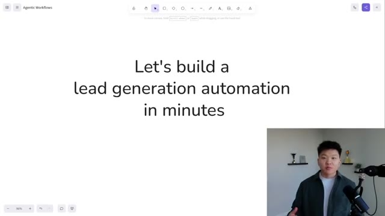
*⏱️ 00:06:12 — Une capture d'écran montrant le présentateur dans un coin avec, en arrière-plan sur une interface de tableau blanc, le titre "Let's build a lead generation automation in minutes".*

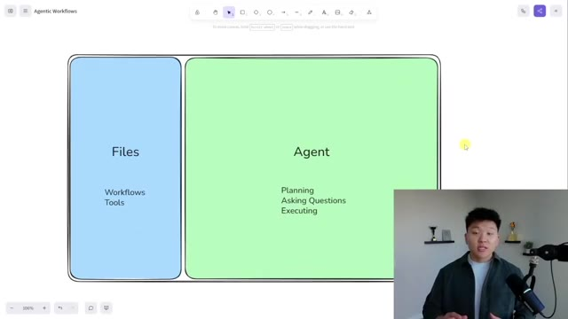
*⏱️ 00:06:23 — Une capture d'écran présentant un diagramme conceptuel sur un tableau blanc numérique divisé en deux sections : "Files" (Workflows, Tools) et "Agent" (Planning, Asking Questions, Executing).*

---

### ⏱️ `[00:06:29 - 00:07:04]` | Segment #14

**🔊 Audio (Transcription Intégrale Mot pour Mot en Français) :**
> We're going to be using natural language, talking to an agent that's going to live on the main section of the screen. And this is where we're going to be able to do our planning. It's going to ask us questions and it will start executing, you know, writing code and taking action. On the left-hand side is where we're going to see essentially our project. So inside of our project, we're going to have different files. We're going to have a system prompt. We're going to have different workflows. We're going to have different tools. So very similar to like what you were used to, but it just looks a little bit different. In order to do all this, we're going to be using a framework called the WAT framework, which basically just stands for workflows, agent, and tools. So in formal software engineering or different types of vibe coding, you may hear it be called different things, but essentially it's the same concept, workflows,

**👁️ Analyse Visuelle d'Écran (gemini-3.5-flash-lite) :**
**Interface & Outils** : Outil de diagramme type Excalidraw ou Miro intégré à l'environnement de présentation.

**Contenu textuel & Code** : Textes explicatifs structurant l'architecture d'un agent IA : "Files", "Workflows", "Tools", "Planning", "Asking Questions", "Executing".

**Action / Démonstration** : Le présentateur illustre visuellement la structuration et la logique de fonctionnement d'un système d'automatisation agentique en dessinant des boîtes et des connecteurs.

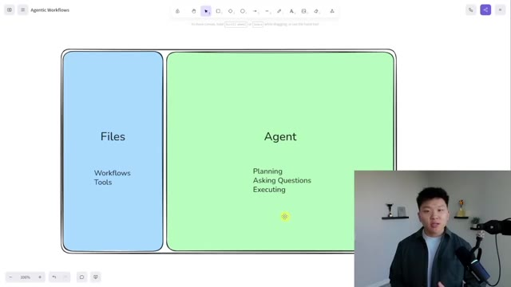
*⏱️ 00:06:38 — Schéma conceptuel sur tableau blanc virtuel montrant une structure à deux colonnes : à gauche "Files" (Workflows/Tools) et à droite "Agent" (Planning, Asking Questions, Executing).*

*⏱️ 00:06:55 — Schéma de flux de travail (workflow) avec trois blocs : "Workflows" en haut, "Agent" à gauche et "Tools" en bas, illustrant les interactions directionnelles entre ces éléments.*

---

### ⏱️ `[00:07:04 - 00:07:40]` | Segment #15

**🔊 Audio (Transcription Intégrale Mot pour Mot en Français) :**
> agent tools. The agent is the brain that we talk to that helps us figure out what workflows are we going to be looking at. So in this case, the workflow is lead generation. But within that lead generation workflow, there's lots of different actual actions and tools that the agent needs to use in order to scrape the leads, put them into a Google Sheet, do analysis, things like that. So just like in NNN, how you have your workflows, there's tons of different actions and tools within that workflow that make it up. So same thing here. It just looks a little bit different, like I said. All right. So now here we are in VS Code. This is the agent. You can see I'm having a conversation with it here. And on the left-hand side is our files. I know there's a few more than what I had in the Excalibraw, but really the key ones to look at are tools folder, our workflows

**👁️ Analyse Visuelle d'Écran (gemini-3.5-flash-lite) :**
**Interface & Outils** : - Image #1 : Outil de dessin en ligne (type Excalidraw ou Miro)
- Image #2 : Visual Studio Code

**Contenu textuel & Code** : - Image #1 : Diagramme en blocs avec flèches de flux entre Workflows, Agent et Tools.
- Image #2 : Structure de répertoire (tmp/, tools/, workflows/), instructions d'initialisation de projet et étapes suivantes listées (copy .env, create workflows, build tools).

**Action / Démonstration** : - Image #1 : Présentation théorique de l'architecture d'un agent.
- Image #2 : Démonstration pratique de la configuration d'un environnement de développement pour l'automatisation de lead generation.

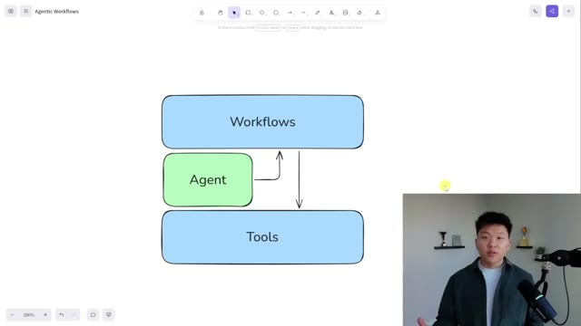
*⏱️ 00:07:13 — Schéma conceptuel sur un tableau blanc numérique illustrant la relation entre "Workflows", "Agent" et "Tools".*

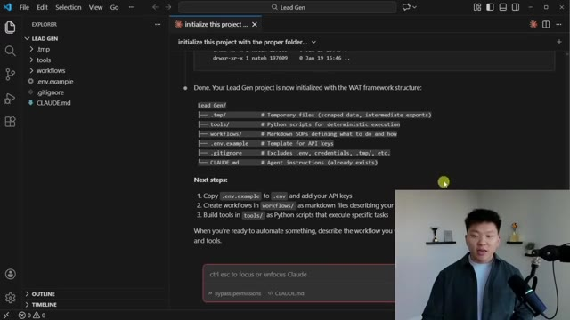
*⏱️ 00:07:31 — Interface de Visual Studio Code montrant l'initialisation d'un projet "Lead Gen" avec la structure de fichiers "WAT framework".*

---

### ⏱️ `[00:07:40 - 00:08:03]` | Segment #16

**🔊 Audio (Transcription Intégrale Mot pour Mot en Français) :**
> folder, and then our claw.md file. And you can see right here, it had already set up our project. And this is what we have inside of the structure. We've got .tmp for temporary files. I'm not going to explain that right now. We've got tools, which will be our Python scripts for deterministic execution. We've got our workflows, which will be markdown SOPs defining what to do and how. We've got .env, .getignore, just ignore that stuff for now. And then we've got claw.md, which are our agent instructions.

**👁️ Analyse Visuelle d'Écran (gemini-3.5-flash-lite) :**
**Interface & Outils** : VS Code (avec extension Claude intégrée).

**Contenu textuel & Code** : Arborescence visible : .tmp/, tools/, workflows/, .env.example, .gitignore, CLAUDE.md. Le contenu textuel présente une explication détaillée de ces dossiers et les étapes suivantes pour configurer le projet.

**Action / Démonstration** : Présentation de la structure de dossiers initialisée par l'agent IA pour le framework de génération de leads.

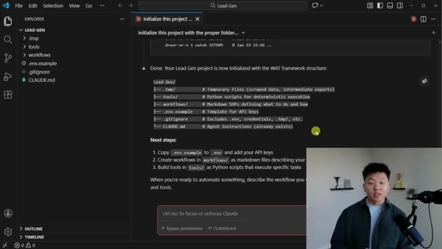
*⏱️ 00:07:46 — Interface VS Code affichant l'arborescence du projet "Lead Gen" et un fichier Markdown décrivant la structure du framework WAT.*

---

### ⏱️ `[00:08:03 - 00:08:24]` | Segment #17

**🔊 Audio (Transcription Intégrale Mot pour Mot en Français) :**
> So basically the system prompt for this whole project. What are we doing here? How do the folders work? How do you execute actions? So like I said, this section is not going to be a full tutorial. I just wanted to familiarize us all so that we can see what's actually going on. So down here, you can see that I just put the Claude agent on plan mode so that I can actually talk to it and have it ask us questions so we can make really, really clear instructions before we actually start automating anything.

**👁️ Analyse Visuelle d'Écran (gemini-3.5-flash-lite) :**
**Interface & Outils** : Visual Studio Code (VS Code)

**Contenu textuel & Code** : Structure de répertoire (`tmp/`, `tools/`, `workflows/`, `.env.example`, `.gitignore`, `CLAUDE.md`) et instructions pour initialiser le projet Lead Gen.

**Action / Démonstration** : Présentation de l'architecture du projet et explication du rôle des dossiers et des fichiers de configuration pour l'automatisation.

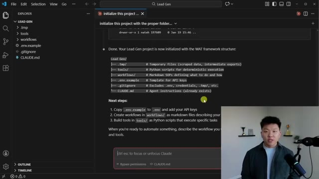
*⏱️ 00:08:09 — Interface VS Code affichant un fichier Markdown détaillant la structure de dossiers « WAT framework » pour un projet de génération de leads, avec le présentateur en médaillon en bas à droite.*

---

### ⏱️ `[00:08:24 - 00:08:47]` | Segment #18

**🔊 Audio (Transcription Intégrale Mot pour Mot en Français) :**
> Hey Claude, I need you to help me build a lead generation automation. I want to scrape tons of different dentists in Chicago, Illinois so that I can reach out to them and ask them if they want my AI automation services. My agency is called Up at AI. We provide custom AI consulting and implementation. And I need you to do research about these people, scrape the leads, write them a personalized outreach message, and then put all of this data in a Google sheet for me so that I can just start going to work.

**👁️ Analyse Visuelle d'Écran (gemini-3.5-flash-lite) :**
**Interface & Outils** : Visual Studio Code (avec l'extension Claude Code).

**Contenu textuel & Code** : Texte affiché : "Make a CLAUDE.md file for instructions Claude will read every single time" et raccourci "ctrl esc to focus or unfocus Claude". Dans l'explorateur : fichiers `.tmp`, `tools`, `workflows`, `.env.example`, `.gitignore`, `CLAUDE.md`.

**Action / Démonstration** : Initialisation de l'environnement de travail pour l'agent Claude Code afin de configurer les instructions du projet de génération de leads.

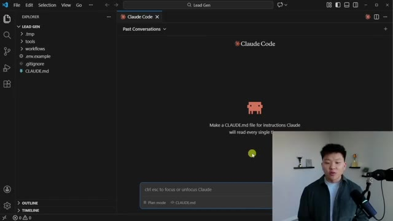
*⏱️ 00:08:30 — Interface de VS Code affichant l'extension "Claude Code" avec un message invitant à créer un fichier CLAUDE.md pour les instructions système.*

---

### ⏱️ `[00:08:47 - 00:09:08]` | Segment #19

**🔊 Audio (Transcription Intégrale Mot pour Mot en Français) :**
> So that request that I just shot off is something that 100% of you guys could do and probably want to do. So now that I've shot that off, basically what we're seeing here is we're watching Claude think about what to do. So it's gonna look through our files. It's gonna see what exists already just to familiarize itself with its environment. And then it's going to start creating a plan. And as it's creating this plan, once again, we can watch and look at everything that it's doing.

**👁️ Analyse Visuelle d'Écran (gemini-3.5-flash-lite) :**
**Interface & Outils** : Éditeur de code Cursor (mode agent/chat).

**Contenu textuel & Code** : Un prompt détaillé demandant la création d'une automatisation de génération de leads pour des dentistes à Chicago, incluant le scraping, la rédaction de messages personnalisés et l'export vers Google Sheets. Le statut de l'agent indique « Determining... ».

**Action / Démonstration** : L'utilisateur a soumis sa requête et l'agent IA analyse le codebase actuel pour planifier l'implémentation de l'automatisation.

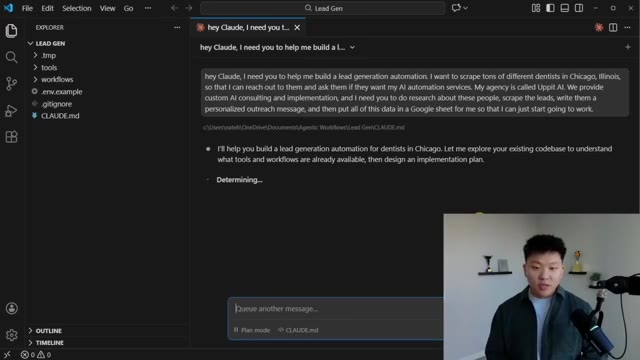
*⏱️ 00:08:52 — Interface de l'éditeur Cursor affichant une conversation avec l'agent Claude dans le volet latéral, en pleine phase de réflexion (« Determining... »).*

---

### ⏱️ `[00:09:08 - 00:09:27]` | Segment #20

**🔊 Audio (Transcription Intégrale Mot pour Mot en Français) :**
> But what you're going to see is it's going to come back to us with some questions. And then once we provide those answers, we can actually just let it start going. So now we're at the question phase. You can see it just said, I have a draft plan, but I need to ask you some questions. So first it says, what data source should we use for scraping dentist leads? I'm going to go ahead and just use the recommended Google Places API. For enrichment, it says, how deep should we go? Let's just go with basic.

**👁️ Analyse Visuelle d'Écran (gemini-3.5-flash-lite) :**
**Interface & Outils** : VS Code avec l'extension Claude (Claude Code).

**Contenu textuel & Code** : Historique de commandes Bash (`ls -la`) dans les répertoires "Agentic Workflows" et "Lead Gen", avec les sorties correspondantes. On voit également le prompt initial "hey Claude, I need you to help me build a l..." et l'indicateur "Herding..." en bas de la zone de chat.

**Action / Démonstration** : L'agent Claude est en phase d'exploration des fichiers du projet via le terminal intégré et se prépare à demander des précisions à l'utilisateur pour établir son plan d'action.

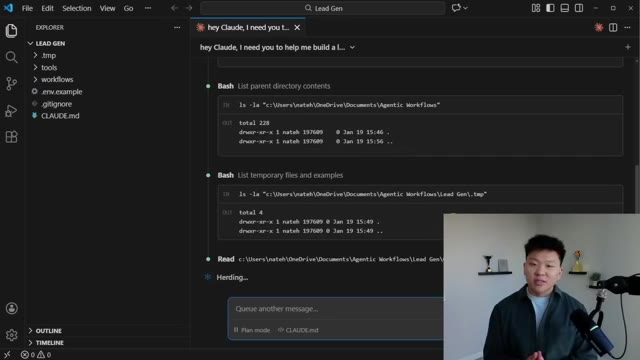
*⏱️ 00:09:13 — Une capture d'écran de l'interface de l'éditeur VS Code avec l'extension Claude intégrée, affichant un historique de commandes Bash exécutées et l'état de l'agent en cours d'exécution.*

---

### ⏱️ `[00:09:27 - 00:09:46]` | Segment #21

**🔊 Audio (Transcription Intégrale Mot pour Mot en Français) :**
> For message tone, we can be professional, friendly, or premium. Let's just go ahead and be friendly. And then for API setup, it says, do you already have the required API keys set up? So it'll either help you get that all set up or you can say, yes, I have them. So I'm just gonna go ahead and say yes. And once I submit those answers, it's right back to work. It's gonna keep working on the plan. And if it has any more questions, it'll go ahead and ask us. Okay, so now we have our full plan done.

**👁️ Analyse Visuelle d'Écran (gemini-3.5-flash-lite) :**
**Interface & Outils** : VS Code (avec extension Claude/IA intégrée).

**Contenu textuel & Code** : Formulaire interactif dans l'interface de l'agent demandant : "Do you already have the required API keys set up?". Options proposées : "Yes, I have them" (Google Cloud, Sheets, OpenAI) ou "Need setup help".

**Action / Démonstration** : Le présentateur est en train de configurer les paramètres de l'agent IA, ici à l'étape "API Setup" pour valider la disponibilité des clés API nécessaires au projet de génération de leads.

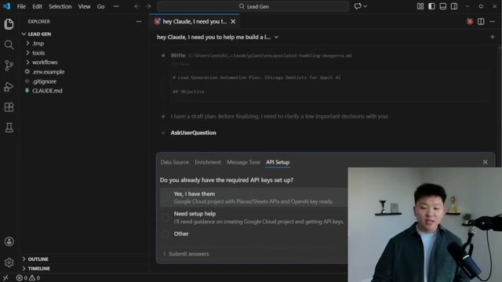
*⏱️ 00:09:31 — Interface de VS Code montrant une fenêtre de discussion interactive avec l'agent Claude, affichant une étape de configuration des clés API.*

---

### ⏱️ `[00:09:46 - 00:10:04]` | Segment #22

**🔊 Audio (Transcription Intégrale Mot pour Mot en Français) :**
> Chicago Dentist for Up at AI. We've got an objective. We have our preferences. It goes through the full architecture, as you can see. So it's basically gonna create a Chicago Dentist Leads workflow. And that will be shown over here in the workflows folder. It's gonna create three different tools. So one to scrape dentists, one to generate outreach, and one to export to sheets. And those will all show up in the tools folder over here.

**👁️ Analyse Visuelle d'Écran (gemini-3.5-flash-lite) :**
**Interface & Outils** : VS Code avec une fenêtre de discussion intégrée (Claude AI) et l'arborescence du projet "LEAD GEN" visible dans la barre latérale.

**Contenu textuel & Code** : Diagramme textuel de l'architecture : dossiers "workflows/" (avec chicago_dentist_leads.md) et "tools/" (avec scrape_dentists.py, generate_outreach.py, export_to_sheets.py), ainsi qu'un menu de validation "Accept this plan?".

**Action / Démonstration** : L'agent présente une architecture technique détaillée à l'utilisateur et demande une confirmation pour valider le plan d'exécution ("Yes, and auto-accept").

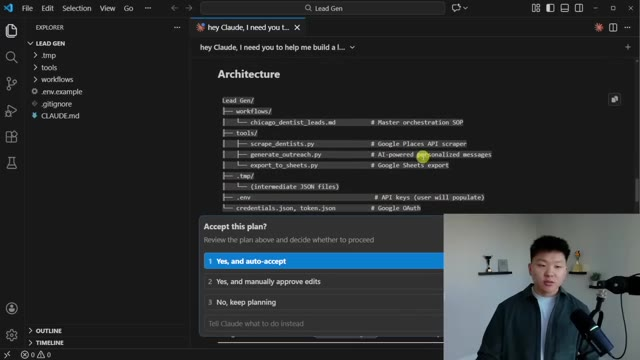
*⏱️ 00:09:51 — Interface de VS Code montrant une proposition d'architecture de projet par l'agent Claude, avec une structure de dossiers et de fichiers pour un système de génération de leads.*

---

### ⏱️ `[00:10:04 - 00:10:26]` | Segment #23

**🔊 Audio (Transcription Intégrale Mot pour Mot en Français) :**
> You've got implementation steps. It's going to add our API keys in a .env. It's going to build the tools. And then it's just going to keep going on. And obviously what you would do is you'd read all this and you would say, yes, I accept, or I'm going to keep planning and things like that. But we're just going to go ahead and auto accept what it came up with. And so when it starts to implement, it builds a to-do list. As you can see, it's got these five tasks. And then we're going to go ahead and be able to watch it execute across these to-do tasks.

**👁️ Analyse Visuelle d'Écran (gemini-3.5-flash-lite) :**
**Interface & Outils** : Éditeur de code Cursor (VS Code fork).

**Contenu textuel & Code** : Prompt de l'utilisateur demandant la création d'un outil de génération de messages personnalisés pour des dentistes via l'API OpenAI, incluant la structure du message et les options d'approbation du plan (« Yes, and auto-accept », « Yes, and manually approve edits », « No, keep planning »).

**Action / Démonstration** : L'agent IA propose un plan d'action détaillé à l'utilisateur et attend une validation pour procéder aux étapes suivantes (ajout de clés API, création des outils, etc.).

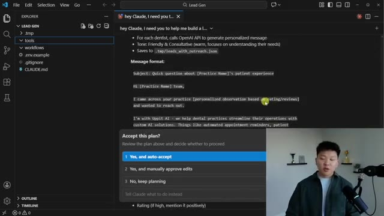
*⏱️ 00:10:10 — Interface de l'éditeur Cursor affichant une proposition de plan de travail générée par Claude, avec une boîte de dialogue d'approbation superposée.*

---

### ⏱️ `[00:10:26 - 00:10:48]` | Segment #24

**🔊 Audio (Transcription Intégrale Mot pour Mot en Français) :**
> At this point, you can see that it's created the files we need. So it went ahead and created three different tools, export to Sheets, generate outreach, and scrape dentists. You can see all of these are actual Python scripts that it wrote in code. And then it created the workflow file, which is Chicago Dentist Leads. So now anytime that I ask this Cloud Agent to find me some Chicago Dentist Leads, it will basically come reference this workflow, understand what it needs to do and how it works, and then it will just go do it for me.

**👁️ Analyse Visuelle d'Écran (gemini-3.5-flash-lite) :**
**Interface & Outils** : VS Code (Visual Studio Code)

**Contenu textuel & Code** : Code source Python incluant les imports (os, sys, json, openai, dotenv) et la configuration initiale pour l'utilisation de l'API OpenAI dans le script "generate_outreach.py".

**Action / Démonstration** : Le présentateur illustre les fichiers générés par l'IA (scripts Python et workflow) en les survolant dans la barre latérale du projet.

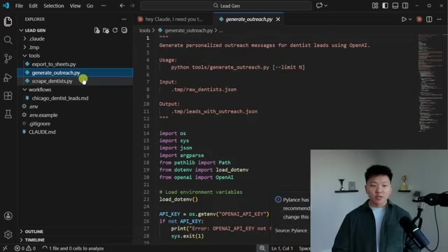
*⏱️ 00:10:31 — Interface VS Code affichant l'arborescence du projet "LEAD GEN" avec les dossiers "tools" et "workflows", et le fichier Python "generate_outreach.py" ouvert dans l'éditeur.*

---

### ⏱️ `[00:10:48 - 00:11:23]` | Segment #25

**🔊 Audio (Transcription Intégrale Mot pour Mot en Français) :**
> So the last thing that I need to do here is give it my actual API keys so that it can use Google Places, use OpenAI, and then use my Google Sheets. So just like that, in a matter of minutes, I have an automation built here in Cloud Code that I can continuously hit and get as many leads as I want. If we go look at the actual output that it gave us when it was just testing out 10 leads to see if it worked, we can see that each of these have a name, an address, a phone number, a website, they've got rating, reviews, neighborhood, subject line, and then we have our actual outreach message which is personalized for them and for us. You can see that they mention things like the five-star rating or the 4.9-star rating from 714 reviews and so obviously this was basically very

**👁️ Analyse Visuelle d'Écran (gemini-3.5-flash-lite) :**
**Interface & Outils** : Visual Studio Code (avec extension Claude Code), Google Sheets.

**Contenu textuel & Code** : Structure de fichiers du projet "LEAD GEN", logs d'exécution des outils, URL vers Google Sheet, colonnes de leads (Name, Address, Phone, Website, Rating).

**Action / Démonstration** : Exécution d'un workflow automatisé d'extraction et de structuration de données de prospection.

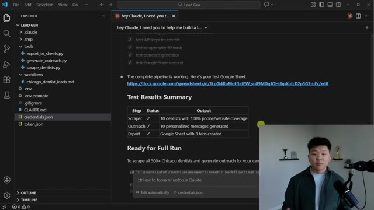
*⏱️ 00:10:57 — Interface de VS Code montrant l'agent Claude traitant une requête de génération de leads avec un tableau récapitulatif des résultats (Scraper, Outreach, Export).*

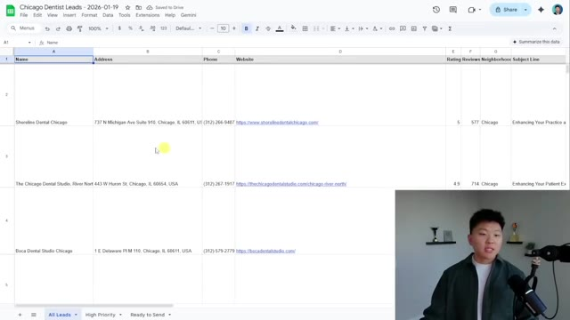
*⏱️ 00:11:06 — Feuille de calcul Google Sheets affichant les données extraites (noms de cliniques dentaires, adresses, téléphones, sites web, notes).*

---

### ⏱️ `[00:11:23 - 00:11:51]` | Segment #26

**🔊 Audio (Transcription Intégrale Mot pour Mot en Français) :**
> minimal prompting. So what we would do now is we would come back with natural language and say, okay, you know what? I don't actually want to limit it to just Chicago. Let's also search in California. Or we'd say the outreach messages aren't super personalized. Or you could say the outreach messages aren't really custom enough. Let me drop in a PDF of all the information about my business up at AI and incorporate that in all of your outreach messages. You could say, hey, I'm realizing that we don't have any emails. Could you actually incorporate emails into this automation as well? And so all of those changes that I ask it to make, it would actually go ahead and it would change the workflow file.

**👁️ Analyse Visuelle d'Écran (gemini-3.5-flash-lite) :**
**Interface & Outils** : VS Code (avec extension Claude intégrée).

**Contenu textuel & Code** : Un tableau récapitulatif des étapes (Scraper, Outreach, Export) et des instructions sous forme de commandes Python pour automatiser la recherche de dentistes à Chicago, la génération de messages personnalisés et l'exportation vers Google Sheets.

**Action / Démonstration** : Le présentateur explique le workflow d'automatisation et la possibilité de modifier ces instructions via le chat pour ajuster les paramètres (comme la zone géographique ou la personnalisation des messages).

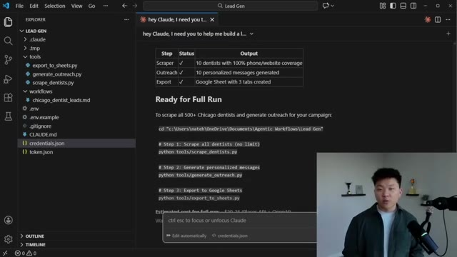
*⏱️ 00:11:30 — Interface de l'éditeur VS Code montrant une interaction avec Claude AI pour un workflow de génération de leads (Lead Gen).*

---

### ⏱️ `[00:11:52 - 00:12:17]` | Segment #27

**🔊 Audio (Transcription Intégrale Mot pour Mot en Français) :**
> It would change the tool files so that next time it does all of this automatically. And so of course you can see already, there's a lot of power in just being productive by making CloudCode essentially an executive assistant, having different workflows and different tools for everything that you do on a daily basis. You can go ahead and trigger CloudCode to do, work on something else on your other monitor and come back and it will be done for you. But if you need to have an automation that triggers based on some sort of event or goes off once a day, you don't have to be here watching CloudCode to make it go off.

**👁️ Analyse Visuelle d'Écran (gemini-3.5-flash-lite) :**
**Interface & Outils** : VS Code (extension Claude Code).

**Contenu textuel & Code** : Structure de dossiers (tools, workflows), scripts Python (scrape_dentists.py, generate_outreach.py), et un prompt d'agent listant les étapes du pipeline ("Ready for Full Run") avec les commandes Python associées.

**Action / Démonstration** : L'utilisateur visualise le plan d'exécution automatique du pipeline de génération de leads avant de valider l'action avec l'agent IA.

*⏱️ 00:11:58 — Interface de VS Code montrant un projet de génération de leads avec une discussion active avec l'agent Claude dans le panneau principal.*

---

### ⏱️ `[00:12:17 - 00:12:40]` | Segment #28

**🔊 Audio (Transcription Intégrale Mot pour Mot en Français) :**
> You could of course publish these scripts and the workflows onto something like modal in order for them to actually run without you being around at all. So I know that I went pretty fast through this demo, but that's exactly what this was, just a demo. I'm gonna obviously be making full tutorials and deep dives on how you can actually do all of this stuff yourself. But really, I just wanted to give you a taste of what this is like and show you in a matter of minutes what I was able to do in here, which would have taken me at least an hour or so in NNN.

**👁️ Analyse Visuelle d'Écran (gemini-3.5-flash-lite) :**
**Interface & Outils** : VS Code avec l'extension de l'agent Claude.

**Contenu textuel & Code** : Liste de scripts Python (`scrape_dentists.py`, `generate_outreach.py`, `export_to_sheets.py`) et instructions de commande pour exécuter le pipeline complet de lead generation.

**Action / Démonstration** : Présentation du récapitulatif du workflow et des étapes nécessaires à l'exécution complète du script.

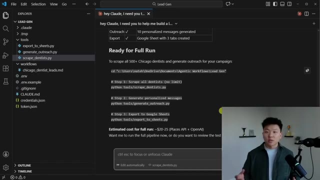
*⏱️ 00:12:22 — Interface de VS Code montrant une interaction avec un agent IA (Claude) détaillant un workflow d'automatisation pour le scraping et la génération de leads.*

---

### ⏱️ `[00:12:40 - 00:13:00]` | Segment #29

**🔊 Audio (Transcription Intégrale Mot pour Mot en Français) :**
> And remember that I didn't have to set up any sort of API calls or look through any documentation on my own, Cloud Code handled all of that messiness. So now that we've talked about those big shifts and you've seen me build one right in front of you guys, let's talk about what the future is gonna look like with this stuff. So I've got four main topics to hit on here, fully autonomous workflows, agents managing other agents, protocols like A to A, and then long running project agents.

**👁️ Analyse Visuelle d'Écran (gemini-3.5-flash-lite) :**
**Interface & Outils** : VS Code (avec extension Claude), Logiciel de montage/présentation graphique.

**Contenu textuel & Code** : Scripts Python (scrape_dentists.py, generate_outreach.py, export_to_sheets.py), commandes terminal de pipeline, estimation de coûts API.

**Action / Démonstration** : Revue d'un flux de travail automatisé de génération de leads et transition vers une présentation des tendances futures.

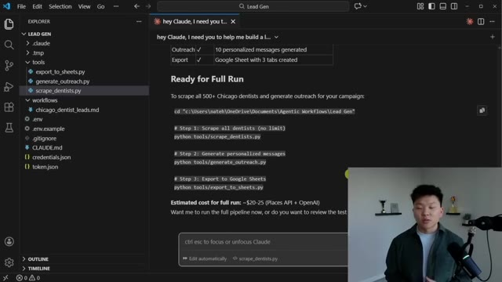
*⏱️ 00:12:45 — Interface VS Code affichant un projet d'automatisation de génération de leads avec une fenêtre de dialogue Claude active.*

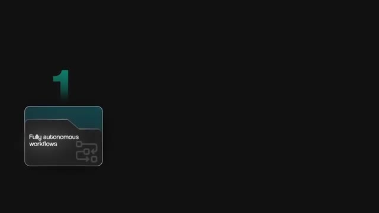
*⏱️ 00:12:55 — Graphique animé sur fond noir affichant le chiffre "1" et le texte "Fully autonomous workflows" avec une icône de processus.*

---

### ⏱️ `[00:13:00 - 00:13:34]` | Segment #30

**🔊 Audio (Transcription Intégrale Mot pour Mot en Français) :**
> So starting off here with fully autonomous workflows. Right now, most workflows are reactive. They wait for something to happen. So their trigger can be like a webhook, a scheduled trigger, a form submission. And then they go ahead and they take the steps that are in the workflow. But the next generation of these agentic systems are not gonna wait around. They're gonna be proactive. So they're gonna constantly scan your tools like your CRM, your inbox, your project management software, and they're going to look for inefficiencies or roadblocks or risks. They'll spot things like deals going cold before you even notice. They can flag projects that are falling behind before anyone misses a deadline. And they're not just going to alert you, but they might actually propose fixes or even just take action on their own.

**👁️ Analyse Visuelle d'Écran (gemini-3.5-flash-lite) :**
**Interface & Outils** : Claude Code / Terminal CLI.

**Contenu textuel & Code** : Historique de création de fichier `CLAUDE.md` et champ de prompt : "Create a scriptwriting expert short form that gets viral every single time. It should have the hook, body and CTA. Also include visual notes for editors."

**Action / Démonstration** : Saisie d'une instruction pour la création d'un nouvel agent IA dans l'interface de commande.

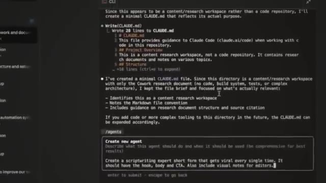
*⏱️ 00:13:17 — Capture d'écran d'une interface de terminal ou d'un éditeur de code sombre affichant des logs de Claude Code et un champ de saisie pour "Create new agent".*

---

### ⏱️ `[00:13:34 - 00:14:07]` | Segment #31

**🔊 Audio (Transcription Intégrale Mot pour Mot en Français) :**
> So Deloitte predicts that 25% of enterprises using generative AI will deploy agentic pilots this year, jumping to 50% by 2027. By 2028, agents will act as autonomous partners handling complex multi-step problems, and proactively influencing decisions. So we're talking about proactive teammates that look ahead and say, hey, here's what's stuck, and here's what I already did to help you unblock it. And the market is starting to reflect that. The AI agent market is projected to grow from roughly $8 billion in 2025 to high $40 or low $50 billion range by 2030, which is a 43% compound annual growth rate, which is of course driven by workflow automation and

**👁️ Analyse Visuelle d'Écran (gemini-3.5-flash-lite) :**
**Interface & Outils** : Navigateur web (présentation de rapports d'analyse).

**Contenu textuel & Code** : Texte informatif sur les prévisions de l'IA (Deloitte) et données chiffrées sur la croissance du marché des agents IA (BCC Research).

**Action / Démonstration** : Illustration visuelle des propos du présentateur par l'affichage de données de marché et de prévisions stratégiques.

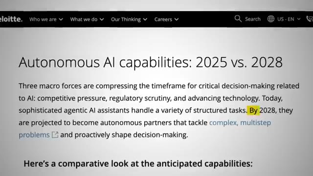
*⏱️ 00:13:42 — Capture d'écran d'un rapport de Deloitte sur les capacités de l'IA autonome, comparant 2025 et 2028.*

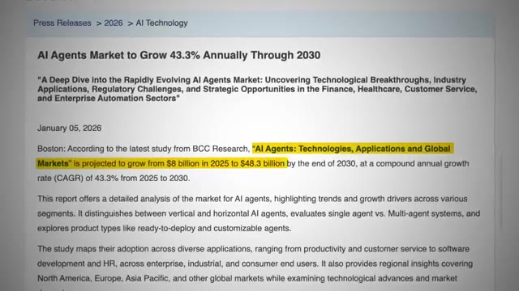
*⏱️ 00:13:59 — Capture d'écran d'un article de presse (BCC Research) concernant la croissance du marché des agents IA d'ici 2030.*

---

### ⏱️ `[00:14:07 - 00:14:26]` | Segment #32

**🔊 Audio (Transcription Intégrale Mot pour Mot en Français) :**
> use cases. Next, agents managing other agents. So instead of just one giant all-purpose agent, we're moving towards teams of specialized agents. An email agent, a research agent, a reporting agent, a data cleanup agent, and a manager agent that can delegate the work, review output, and stitch everything together. Think of it like a project manager with a remote team, spinning up the right specialist to fix problems without waiting for you to kick anything off.

**👁️ Analyse Visuelle d'Écran (gemini-3.5-flash-lite) :**
**Interface & Outils** : Logiciel de création de diagrammes / Graphisme animé (type motion design).

**Contenu textuel & Code** : Texte : "ALL PURPOSE AGENT", "Teams of Agents", "Email Agent", "Research Agent", "Reporting agent", "Data Cleanup Agent".

**Action / Démonstration** : Animation graphique illustrant la structure hiérarchique et la spécialisation des systèmes multi-agents.

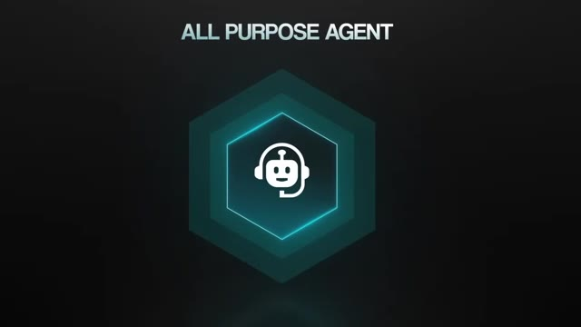
*⏱️ 00:14:12 — Schéma conceptuel illustrant un "All Purpose Agent" (agent polyvalent) représenté par une icône centrale de robot dans un hexagone.*

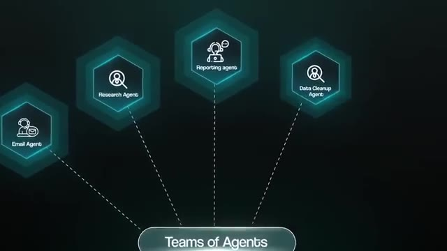
*⏱️ 00:14:17 — Diagramme conceptuel montrant la transition vers des "Teams of Agents" avec des agents spécialisés (Email, Research, Reporting, Data Cleanup) connectés à une unité centrale.*

---

### ⏱️ `[00:14:26 - 00:14:56]` | Segment #33

**🔊 Audio (Transcription Intégrale Mot pour Mot en Français) :**
> Now, these multi-agent systems are under development with the first pilot starting in late 2024 and probably even earlier. And I know this is stuff that's kind of been around already for a while. But research is showing that multi-agent setups often outperform a single model by distributing tasks among specialists. So big companies are starting to prepare for this pattern. So it's not just one bot per workflow, but it's agent teams embedded across, you know, sales or operations, finance, and they'll coordinate with each other. Like I said, we've been seeing this in NNN, you know, sub agents or ultimate assistants that manage different agents. And we can see that we're getting better results when each agent has a specialized task.

**👁️ Analyse Visuelle d'Écran (gemini-3.5-flash-lite) :**
**Interface & Outils** : Infographie animée (overlay graphique) représentant un schéma de processus métier.

**Contenu textuel & Code** : Schéma textuel et iconographique : nœuds "SALES" (avec icône de croissance), "OPERATIONS" (avec icône d'engrenage) et "FINANCE" (avec icône de graphique circulaire).

**Action / Démonstration** : Présentation visuelle conceptuelle de la distribution des tâches dans un système multi-agents par départements.

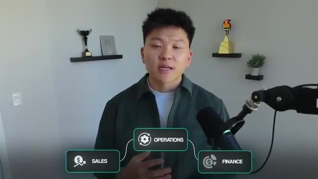
*⏱️ 00:14:49 — Le présentateur est à l'écran, avec une infographie animée superposée montrant un schéma de workflow simplifié composé de trois nœuds interconnectés : "Sales", "Operations" et "Finance".*

---

### ⏱️ `[00:14:56 - 00:15:30]` | Segment #34

**🔊 Audio (Transcription Intégrale Mot pour Mot en Français) :**
> But that was just a preview of what's to come with agents managing teams of agents. All right, third, we've got protocols like A to A. So MCP is how agents talk to tools. A to A or agent to agent is how agents talk to other agents. In April of 2025, Google Cloud announced A2A as an open standard so that AI agents from different vendors can communicate, share context, and coordinate across different systems. And that was huge because we know in business processes, it's rare that like one department never has to talk to multiple other departments in the process to get certain things done. So this protocol defines agent cards, basically describing what each agent can do,

**👁️ Analyse Visuelle d'Écran (gemini-3.5-flash-lite) :**
**Interface & Outils** : Documents textuels et graphiques de présentation (diapositives).

**Contenu textuel & Code** : Texte explicatif sur le protocole A2A : "Google Just Opened the Gate: Introducing Agent2Agent (A2A)".

**Action / Démonstration** : Aucune, il s'agit d'une présentation théorique de concepts via des visuels illustratifs.

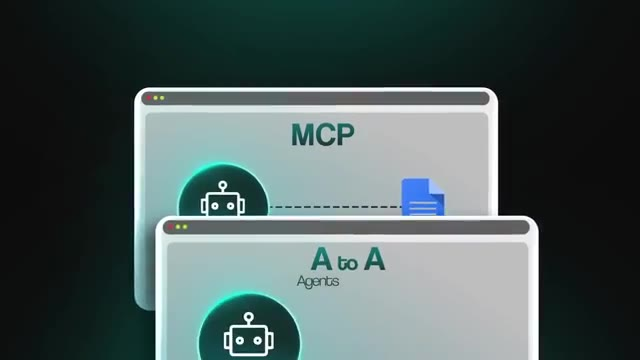
*⏱️ 00:15:05 — Illustration schématique comparant les protocoles MCP (agent vers outil) et A2A (agent vers agent).*

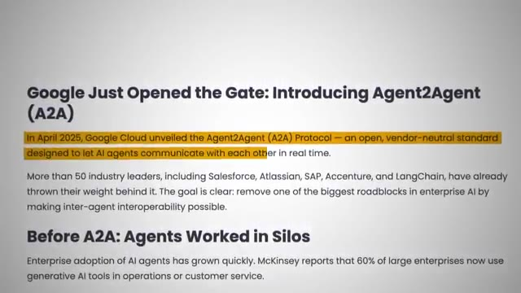
*⏱️ 00:15:13 — Capture d'écran d'un article ou document présentant l'annonce par Google Cloud du standard "Agent2Agent (A2A)" en avril 2025.*

---

### ⏱️ `[00:15:31 - 00:15:49]` | Segment #35

**🔊 Audio (Transcription Intégrale Mot pour Mot en Français) :**
> a shared life cycle of tasks, and how agents share context securely. So one agent can say something like find me candidates, another handle scheduling, another one does background checks, and they coordinate without you playing middleman between all of them. So Google launched the A to A with support from firms like Salesforce, SAP, ServiceNow, Workday, and over 50 other enterprise partners.

**👁️ Analyse Visuelle d'Écran (gemini-3.5-flash-lite) :**
**Interface & Outils** : Interface graphique animée (type présentation).

**Contenu textuel & Code** : Texte affiché : "1" et "Find me".

**Action / Démonstration** : Présentation visuelle d'une étape de workflow automatisé impliquant un agent IA.

*⏱️ 00:15:35 — Une infographie épurée affichant un cercle avec une icône de robot (agent) numéroté "1" et le texte "Find me" associé, illustrant une étape de workflow.*

---

### ⏱️ `[00:15:49 - 00:16:22]` | Segment #36

**🔊 Audio (Transcription Intégrale Mot pour Mot en Français) :**
> And that level of coordination around a standard is a loud signal. We're definitely heading toward an agent mesh where everything plugs into everything. And last but not least, we've got long running project agents. So this is the one that I'm really excited about because right now agents are really good sprinters, but they're not good long distance runners because they can crush a one-off task or deliverable. But if you ask them to manage a project for weeks, then they start to forget things, repeat themselves, hallucinate, drift off the rails. And we actually have benchmarks proving this. So there's a vending bench, which basically asks LLMs to run a vending machine business over a long simulated period. And even the really strong reasoning models show high

**👁️ Analyse Visuelle d'Écran (gemini-3.5-flash-lite) :**
**Interface & Outils** : Graphique de présentation (type overlay vidéo) illustrant les concepts d'agents IA.

**Contenu textuel & Code** : Texte affiché : "4 - Long running project agents", "3 - Protocols like A to A", "2 - ...".

**Action / Démonstration** : Animation graphique de défilement des points clés de la présentation.

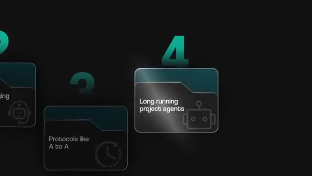
*⏱️ 00:15:57 — Un graphique animé affiche une liste numérotée sur fond sombre. L'élément en évidence est le point numéro 4, intitulé « Long running project agents », accompagné d'une icône de robot. On aperçoit partiellement les points 3 et 2 en arrière-plan.*

---

### ⏱️ `[00:16:22 - 00:16:44]` | Segment #37

**🔊 Audio (Transcription Intégrale Mot pour Mot en Français) :**
> variance and they get worse over time. They do things like forgetting orders, mistracking inventory, and falling into repetitive loops. So why do I think the future is different? Because we're starting to see techniques that solve this. So one of those is continuous loops. So there's a plugin called Ralph Wiggum for Cloud Code that keeps looping tasks back to the agent until certain success conditions are met. It adds guardrails like max iterations and explicit done signals.

**👁️ Analyse Visuelle d'Écran (gemini-3.5-flash-lite) :**
**Interface & Outils** : Diagramme de workflow conceptuel (schéma d'architecture d'agents).

**Contenu textuel & Code** : Le schéma montre une boucle de traitement entre une entité "AGENTS" et une entité logicielle intitulée "RALPH WIGGUM", symbolisant une méthode pour éviter les boucles répétitives dans l'exécution de l'IA.

**Action / Démonstration** : Présentation visuelle et schématique d'une solution technique pour stabiliser les agents autonomes via une boucle de rétroaction.

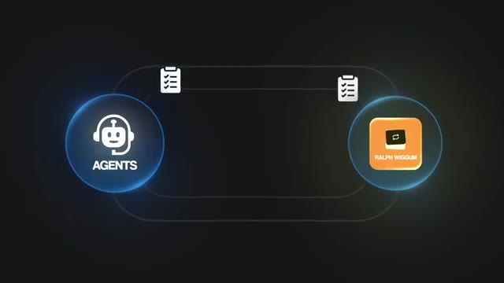
*⏱️ 00:16:39 — Schéma animé illustrant un workflow de "Continuous Loops" connectant des "AGENTS" à un plugin nommé "RALPH WIGGUM".*

---

### ⏱️ `[00:16:44 - 00:17:20]` | Segment #38

**🔊 Audio (Transcription Intégrale Mot pour Mot en Français) :**
> So it's not perfect by any means because there's still a lot of elements we need like human in the loop and mid execution course correction, but it's moving in the right direction and it's evolving really fast. We've also got stuff like agent harnesses with shift based work. So Anthropic is developing effective harnesses for long running agents. One agent works for a while, then leaves structured artifacts like notes, to-dos, differences, what changed, what broke, what's next. Then the next shift picks up from there and looks at all that kind of stuff. So instead of keeping everything in a huge giant context window, which is where we start to see issues, it has more of a notebook and a checklist. So if you think about it like an actual human, if it was to sit there and code for, you know, 72 hours straight, the human would get tired and the

**👁️ Analyse Visuelle d'Écran (gemini-3.5-flash-lite) :**
**Interface & Outils** : Illustration graphique de concept d'agent IA.

**Contenu textuel & Code** : Texte affiché : "AGENT 1", "Effective Harnesses", "Notes", "To do's".

**Action / Démonstration** : Illustration visuelle du concept de harnais pour agents IA (gestion de tâches et de notes).

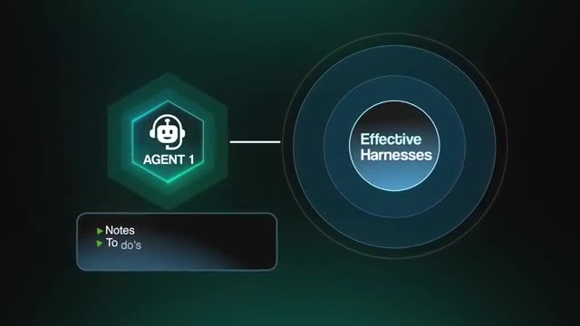
*⏱️ 00:17:02 — Schéma conceptuel sur fond sombre montrant un "Agent 1" relié à un cercle central intitulé "Effective Harnesses", avec un menu déroulant listant "Notes" et "To do's".*

---

### ⏱️ `[00:17:20 - 00:17:52]` | Segment #39

**🔊 Audio (Transcription Intégrale Mot pour Mot en Français) :**
> work would get sloppy. But if the human was able to just work for 10 hours and then another one takes over after a fresh night's sleep, it can read all of the documentation about what's happened and what it needs to do. And then that human just picks up on a new shift. Now, we're not fully there yet. Of course, it's not perfect. But the fact that we have benchmarks that are measuring this and we have, you know, long running harnesses being developed and techniques like the Ralph Wiggum loop, this tells you exactly where the industry experts want this to go and expect it to go. Agents that stick with a goal for days or weeks, maybe even months, and they keep track of what they've done and they keep improving your systems while you sleep. So here's the bottom line.

**👁️ Analyse Visuelle d'Écran (gemini-3.5-flash-lite) :**
**Interface & Outils** : Éditeur de code (probablement VS Code).

**Contenu textuel & Code** : Code source affiché sur l'écran principal et l'ordinateur portable du développeur.

**Action / Démonstration** : Travail manuel sur ordinateur.

*⏱️ 00:17:28 — Un développeur travaille sur un poste avec deux écrans, affichant du code source dans un environnement de développement intégré.*

---

### ⏱️ `[00:17:52 - 00:18:13]` | Segment #40

**🔊 Audio (Transcription Intégrale Mot pour Mot en Français) :**
> Analysts and experts are saying that within a few years, half of companies using generative AI will have deployed agentic systems. Google and others are already standardizing how agents talk to tools and to each other. If you've been building an NNN and you understand how to map out processes, you're exactly the person who can step into this next layer. Because again, the skill isn't coding. The skill is designing what agents should actually do, where they should be proactive, and how they should all work together.

**👁️ Analyse Visuelle d'Écran (gemini-3.5-flash-lite) :**
**Interface & Outils** : Éditeur de code intégré à une interface web (Google Project IDX/Studio).

**Contenu textuel & Code** : Code source en JavaScript/TypeScript visible dans l'éditeur (manipulation d'éléments DOM, création de balises, gestion d'images).

**Action / Démonstration** : Démonstration technique d'un agent ou outil de développement générant du code pour une interface utilisateur interactive.

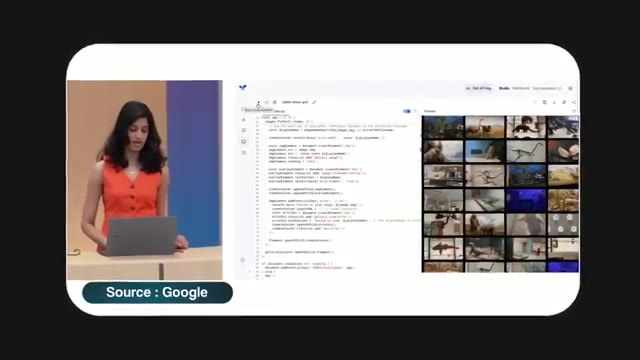
*⏱️ 00:18:02 — Capture d'une présentation de démonstration Google montrant une interface de développement avec du code source et une grille d'images.*

---

### ⏱️ `[00:18:13 - 00:18:34]` | Segment #41

**🔊 Audio (Transcription Intégrale Mot pour Mot en Français) :**
> That's where the value is going. And that brings me to what's going to be changing with this channel. So you're going to be seeing me doing a lot more agentic workflows. So diving into things like Cloud Code, Anti-Gravity, and more IDE-based tools as they come out. But my mission hasn't changed. I'm here to bring you the most valuable skills to learn and practice, how to actually make money, improve a business, improve your own business. Now you guys know I don't come from a technical background, and I know that most of you don't either.

**👁️ Analyse Visuelle d'Écran (gemini-3.5-flash-lite) :**
**Interface & Outils** : IDE Kiro (outil de développement piloté par IA).

**Contenu textuel & Code** : "Let's build - Plan, search, or build anything", avec des cartes interactives pour "Vibe" et "Spec".

**Action / Démonstration** : Présentation visuelle d'une interface de travail pour agents IA, illustrant le passage aux "IDE-based tools".

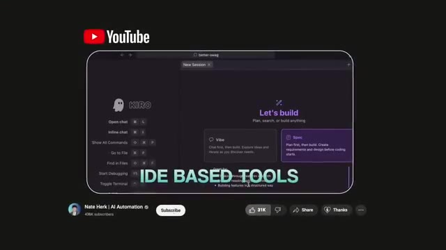
*⏱️ 00:18:24 — Interface de l'outil de développement assisté par IA "Kiro", affichant les options "Vibe" et "Spec" dans un environnement IDE.*

---

### ⏱️ `[00:18:34 - 00:18:57]` | Segment #42

**🔊 Audio (Transcription Intégrale Mot pour Mot en Français) :**
> So I'm never going to dive into something if I don't think that I can explain it clearly, and I'm never going to cover anything if I don't think it's worth your time learning. That's my promise. None of us know exactly where the space is going, but I promise that I will stay as close to it as possible and bring you what's most important, because there is a lot of noise and a lot of changes out there. And I know it may seem right now intimidating to look at something like a cloud code environment, but I also know that the IDEs are going to get simpler and easier to use over time as well.

**👁️ Analyse Visuelle d'Écran (gemini-3.5-flash-lite) :**
**Interface & Outils** : Interface utilisateur (probablement un outil d'automatisation ou de gestion de projet).

**Contenu textuel & Code** : Texte affiché : "Build the agentic analysis workflow", "Goal", "CLI preview", "Generating...".

**Action / Démonstration** : Exécution ou génération en cours d'un workflow d'analyse par un agent IA.

*⏱️ 00:18:51 — Capture d'écran floue montrant une interface sombre avec une liste de tâches, mentionnant "Build the agentic analysis workflow" et "Generating...".*

---

### ⏱️ `[00:18:57 - 00:19:16]` | Segment #43

**🔊 Audio (Transcription Intégrale Mot pour Mot en Français) :**
> Now, I know that some of you might be thinking, does this mean that all of the time I just spent learning NNN was a waste? No, do not think like that. The opposite, actually. If you've been building an NNN, you're ahead of the curve. And I've got some reasons why. The first one is process decomposition. You've already learned how to break business processes into discrete steps. Handle edge cases. Think about what happens when things fail. And that's exactly what agentic systems need from you.

**👁️ Analyse Visuelle d'Écran (gemini-3.5-flash-lite) :**
**Interface & Outils** : n8n (workflow automation platform)

**Contenu textuel & Code** : Texte "EDGE" affiché au centre de l'interface, avec des métriques de processus en haut et une liste d'éléments techniques flous en arrière-plan.

**Action / Démonstration** : Présentation conceptuelle ou transition vers une section spécifique liée à l'exécution en périphérie (edge computing/processing) dans le workflow.

*⏱️ 00:19:12 — Capture d'écran d'une interface logicielle sombre (probablement n8n) avec le texte "EDGE" affiché en gros au centre, sur fond de tableau de bord technique flou.*

---

### ⏱️ `[00:19:16 - 00:19:49]` | Segment #44

**🔊 Audio (Transcription Intégrale Mot pour Mot en Français) :**
> The next one is because you have systems vocabulary. So you now actually know what's a webhook. What are triggers? What's API authentication, data transformation, conditional logic. So that once again, when you're directing an agent, you can speak precisely about what you want. If someone doesn't have that foundation and they jump straight into agentic workflows, they'll be able to get stuff to work, but they probably won't be able to prompt it as efficiently. And they'll just say things like make it work with my CRM rather than you being able to say trigger this on the deal stage change, then pull the contact object and transform these fields, make a post request to my endpoints, blah, blah, blah, which in turn will have the agents building things faster and better because your instructions were better.

**👁️ Analyse Visuelle d'Écran (gemini-3.5-flash-lite) :**
**Interface & Outils** : Logiciel de montage graphique (incrustations), environnement de bureau (OS non spécifié).

**Contenu textuel & Code** : Terminologie technique sur les workflows (Triggers, API, Data Transformation, Conditional Logic) et exemples de prompts métiers liés à un CRM.

**Action / Démonstration** : Explication théorique des compétences nécessaires pour diriger des agents IA avec précision.

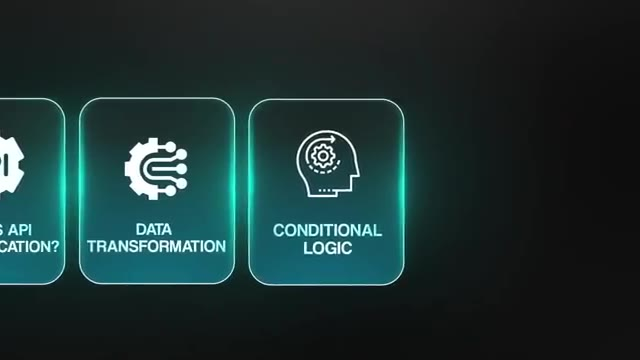
*⏱️ 00:19:25 — Graphique illustrant les concepts techniques : "API Authentication", "Data Transformation" et "Conditional Logic" sous forme de blocs lumineux.*

*⏱️ 00:19:41 — Capture montrant l'utilisateur devant son ordinateur avec des bulles de texte "prompt" : "Trigger this on the deal stage change" et "Pull the contact".*

---

### ⏱️ `[00:19:49 - 00:20:10]` | Segment #45

**🔊 Audio (Transcription Intégrale Mot pour Mot en Français) :**
> You also have some more intuition about failure. So you've seen so many things break in NNN. You understand how debugging works, which means you know the patterns that typically cause errors, like rate limits or malformed JSON or token expiration or weird edge cases that you may not have thought of if you hadn't built automations in NNN already. So I've obviously poured in like the past full year of my life in NNN, but NNN wasn't a detour.

**👁️ Analyse Visuelle d'Écran (gemini-3.5-flash-lite) :**
**Interface & Outils** : Aucune interface logicielle ou outil technique n'est affiché.

**Contenu textuel & Code** : Texte incrusté à l'écran : "CAUSE OF ERRORS", "Rate limits", "Malformed Json".

**Action / Démonstration** : Présentation orale des points techniques sur les causes d'erreurs fréquentes dans le débogage.

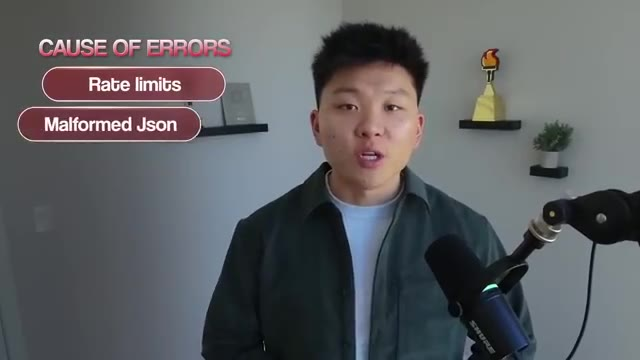
*⏱️ 00:19:59 — Le présentateur apparaît face caméra avec une incrustation graphique à gauche listant les "CAUSE OF ERRORS" : "Rate limits" et "Malformed Json".*

---

### ⏱️ `[00:20:10 - 00:20:30]` | Segment #46

**🔊 Audio (Transcription Intégrale Mot pour Mot en Français) :**
> It was something that I wanted to go through because now, like I think about that like learning to ride a bike. I've got balance, I know how to steer, I know how to pedal. But now we're going to be hopping onto like a motorcycle where we don't have to pedal necessarily, but we still have to learn how to balance and steer. So yes, the barrier to entry, to building all of these agents and AI systems is dropping, but what businesses actually pay for is not just the actual build itself.

**👁️ Analyse Visuelle d'Écran (gemini-3.5-flash-lite) :**
**Interface & Outils** : Aucune interface logicielle ou technique n'est présente dans ce segment.

**Contenu textuel & Code** : Aucun code, commande ou donnée technique n'est affiché.

**Action / Démonstration** : Aucune démonstration technique ou manipulation d'outil n'est effectuée.

---

### ⏱️ `[00:20:30 - 00:20:53]` | Segment #47

**🔊 Audio (Transcription Intégrale Mot pour Mot en Français) :**
> They want someone who can understand their problem, which most clients can't always articulate what they need. They need someone who can integrate with their existing mess, legacy systems, weird edge cases, compliance requirements, things like that. And of course, someone who can keep optimizing, iterating based on real usage, expanding the scope, maintaining systems over time. So yeah, the implementation layer is getting easier. Everything else that you do after that is getting way more valuable because more people will attempt automation and fail at the parts that aren't implementation.

**👁️ Analyse Visuelle d'Écran (gemini-3.5-flash-lite) :**
**Interface & Outils** : n8n (ou outil d'automatisation de workflow similaire)

**Contenu textuel & Code** : Schéma de flux de travail avec multiples entrées, nœuds de traitement et sorties connectés logiquement.

**Action / Démonstration** : Démonstration visuelle de la complexité de l'intégration de systèmes automatisés lors d'une discussion professionnelle.

*⏱️ 00:20:36 — Deux hommes assis face à face devant un grand écran affichant un diagramme de workflow complexe (nœuds et connexions).*

---

### ⏱️ `[00:20:54 - 00:21:13]` | Segment #48

**🔊 Audio (Transcription Intégrale Mot pour Mot en Français) :**
> Use your tooling expands the market, which means more businesses can actually access the stuff because it's not as expensive as it used to be. But they'll still need someone who knows how it works and knows how to use it. So your job essentially shifts from just being a builder to more of an architect and a manager. And once again, like I've been saying, a consultant. So if you want to stay tapped in all of this, then check out my free community of over 230,000 members.

**👁️ Analyse Visuelle d'Écran (gemini-3.5-flash-lite) :**
**Interface & Outils** : Aucune interface logicielle ou technique n'est affichée.

**Contenu textuel & Code** : Schéma textuel comparatif des rôles professionnels dans l'automatisation.

**Action / Démonstration** : Transition visuelle pour illustrer le changement de posture professionnelle (du "builder" vers des rôles stratégiques).

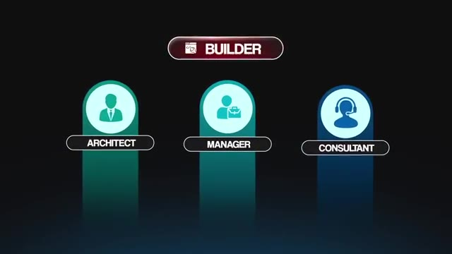
*⏱️ 00:21:08 — Une infographie conceptuelle sur fond noir illustrant l'évolution des rôles professionnels, avec "BUILDER" en haut et trois piliers dessous : "ARCHITECT", "MANAGER", et "CONSULTANT".*

---

### ⏱️ `[00:21:13 - 00:21:32]` | Segment #49

**🔊 Audio (Transcription Intégrale Mot pour Mot en Français) :**
> I'm always dropping free resources and templates in there. And if you're looking to dive deeper, then I've got a paid community of over 3000 members. We're building businesses around this kind of stuff every single day. And that's where I'll be diving a lot deeper into this kind of stuff, too. So the link for those are in the description. But that's going to do it for this one. I know that this was a ton of information, so I threw all of this into a resource guide, which you can access for completely free in my free school community.

**👁️ Analyse Visuelle d'Écran (gemini-3.5-flash-lite) :**
**Interface & Outils** : Plateforme communautaire Skool (AI Automation Society Plus).

**Contenu textuel & Code** : Interface utilisateur affichant le titre de la communauté, des statistiques de membres (3k+), des posts de membres et des options de navigation de la plateforme.

**Action / Démonstration** : Présentation visuelle de l'espace communautaire payant mentionné dans le segment audio pour illustrer l'offre du créateur.

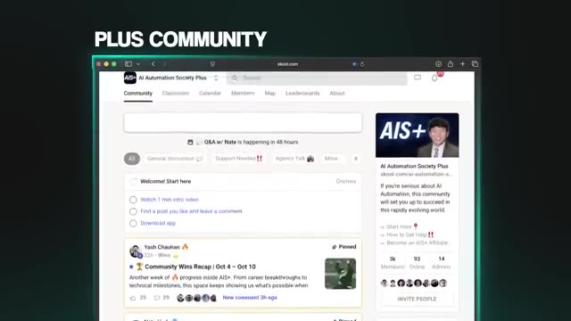
*⏱️ 00:21:18 — Capture d'écran de la plateforme communautaire Skool, montrant l'interface de "AI Automation Society Plus" avec les différents onglets (Community, Classroom, etc.) et les dernières discussions.*

---

### ⏱️ `[00:21:32 - 00:21:39]` | Segment #50

**🔊 Audio (Transcription Intégrale Mot pour Mot en Français) :**
> And if you enjoyed or you learned something new, please give it a like. It definitely helps me out a ton. And as always, I appreciate you guys making it to the end of the video. I'll see you on the next one. Thanks, everyone.

**👁️ Analyse Visuelle d'Écran (gemini-3.5-flash-lite) :**
**Interface & Outils** : YouTube (plateforme de streaming vidéo).

**Contenu textuel & Code** : Aucun contenu technique (code, workflow ou interface logicielle) n'est affiché. Il s'agit uniquement de l'interface de lecture de la plateforme YouTube.

**Action / Démonstration** : Le présentateur conclut sa vidéo et remercie son audience.

---

