# 🎬 Set Up Clawdbot on a VPS in Minutes (no mac mini)

> **Chaîne** : [Nate Herk | AI Automation](https://www.youtube.com/@nateherk/featured)  
> **Lien YouTube** : [https://www.youtube.com/watch?v=BhjK2Gr0Ryc](https://www.youtube.com/watch?v=BhjK2Gr0Ryc)  
> **Date de publication** : 20260127  
> **Durée** : 00:13:12  
> **Identifiant vidéo** : `BhjK2Gr0Ryc`  
> **Transcription & Analyse** : `whisper-v3-large-turbo+gemini-3.5-flash-lite`  

---

## 📌 Synthèse Exécutive & Outils

### 💡 Résumé
Dans cette vidéo intitulée **Set Up Clawdbot on a VPS in Minutes (no mac mini)**, Nate Herk décortique les capacités pratiques d'automatisation et de développement propulsées par les modèles de pointe.

### 🛠️ Outils, Modèles & Logiciels Présentés
- **Opus 5.5 & Claude Code** : Modèles d'ingénierie et agents de codage autonome.

### 🔑 Points Clés & Enseignements Stratégiques
- Optimiser le niveau d'effort et le raisonnement des modèles IA pour des résultats industriels.
- Automatiser les cycles de création logicielle de bout en bout.

---

## ⏱️ Chronologie & Transcription Complète Audio & Visuelle (Mot pour Mot)

### ⏱️ `[00:00:00 - 00:00:35]` | Segment #01

**🔊 Audio (Transcription Intégrale Mot pour Mot en Français) :**
> So CloudBot has been taking the internet by storm, and you don't have to actually go buy a $600 Mac Mini in order to test it out. So before I bring you guys any content about how I'm using it and different use cases, I wanted to make sure that you guys could form your own opinions. So I'm going to be showing you guys step by step how you can actually deploy CloudBot onto a VPS, a virtual private server, and we're going to be doing this with Hostinger. So the reason why people are buying Mac Minis is because CloudBot is an open source project. So when you deploy it, it basically has access to everything in its environment. So you don't want to just push that onto your own main device because then it has access to like everything. And it essentially can do anything

**👁️ Analyse Visuelle d'Écran (gemini-3.5-flash-lite) :**
**Interface & Outils** : Navigateur web (sites Hostinger et Clawdbot).

**Contenu textuel & Code** : Texte marketing, offres promotionnelles (VPS à partir de 4,99$/mois), et slogans publicitaires pour des agents d'automatisation IA.

**Action / Démonstration** : Navigation sur les sites web respectifs présentant les outils d'automatisation et de gestion d'agents IA.

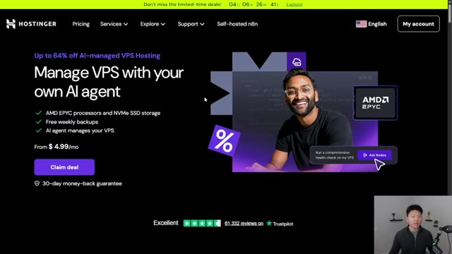
*⏱️ 00:00:18 — Page d'accueil du service Hostinger présentant une offre de gestion de VPS par agent IA ("Manage VPS with your own AI agent").*

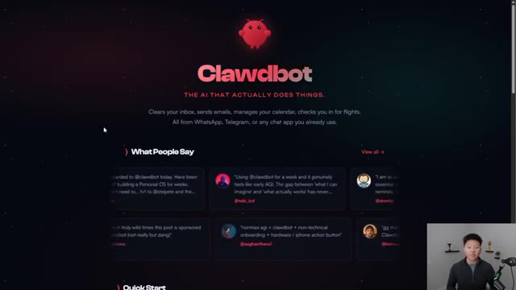
*⏱️ 00:00:27 — Page d'accueil du site Clawdbot, présentant le slogan "The AI that actually does things" et des témoignages utilisateurs.*

---

### ⏱️ `[00:00:35 - 00:01:08]` | Segment #02

**🔊 Audio (Transcription Intégrale Mot pour Mot en Français) :**
> that you could do on a computer. So people are buying Mac minis and they're putting the CloudBot just on that little machine and they know that it lives in there and basically contains it. So it's mitigating the risk a little bit. And we can essentially do that exact same thing with a virtual private server. So go to hosting your VPS. You can use a link in the description to get there. And let's go ahead and get set up. Now there are some terminal commands that we are going to have to run, unfortunately, but I'm going to give you a document where you can just copy and paste the commands that will also be linked in the description. And you just follow what I'm doing step-by-step and we should be all set. So I'm going to go ahead and scroll down. You

**👁️ Analyse Visuelle d'Écran (gemini-3.5-flash-lite) :**
**Interface & Outils** : Navigateur web (Clawdbot.ai et Hostinger.com).

**Contenu textuel & Code** : Texte promotionnel : "Clawdbot: THE AI THAT ACTUALLY DOES THINGS" et "Manage VPS with your own AI agent".

**Action / Démonstration** : Navigation et présentation des outils d'automatisation et d'hébergement supportant l'intégration d'agents IA.

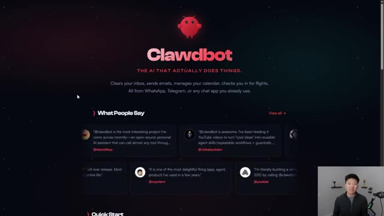
*⏱️ 00:00:43 — Page d'accueil du site web "Clawdbot", présentant l'outil comme une IA capable d'automatiser des tâches quotidiennes via des applications de messagerie.*

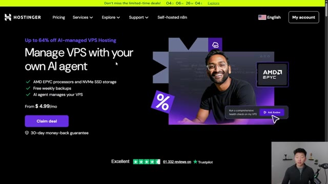
*⏱️ 00:00:51 — Page d'accueil du service d'hébergement Hostinger, mettant en avant une offre de VPS managé par une IA ("Manage VPS with your own AI agent").*

---

### ⏱️ `[00:01:08 - 00:01:29]` | Segment #03

**🔊 Audio (Transcription Intégrale Mot pour Mot en Français) :**
> can see that the options here to set up a virtual private machine, it's going to be a lot cheaper than buying actual hardware. So for the sake of the video, I'm going to be using KVM2, which is going to give us two VCPU cores, eight gigabytes of RAM, a hundred gigabytes of disk space, and eight terabytes of bandwidth, which is going to be more than enough for us to set up CloudBot and do tons of testing. And if you need to scale up or down, you can. So I'm going to go ahead and choose plan.

**👁️ Analyse Visuelle d'Écran (gemini-3.5-flash-lite) :**
**Interface & Outils** : Site web Hostinger (page de tarification des serveurs VPS).

**Contenu textuel & Code** : Tableau comparatif des plans KVM 1, KVM 2 (sélectionné), KVM 4 et KVM 8, détaillant les ressources : CPU, RAM, stockage NVMe et bande passante.

**Action / Démonstration** : Le présentateur survole et met en avant le plan "KVM 2" pour expliquer son choix technique.

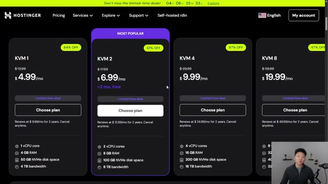
*⏱️ 00:01:13 — Interface web du site Hostinger présentant les différentes options d'abonnement pour des serveurs VPS (KVM).*

---

### ⏱️ `[00:01:30 - 00:02:05]` | Segment #04

**🔊 Audio (Transcription Intégrale Mot pour Mot en Français) :**
> Now, when you get here, it's going to prompt you to choose either one month, 12 months, or 24 months. And obviously 24 months is going to be the cheapest, the best deal. But what you can do is if you use an annual plan, so 12 or 24 months, you can use code NATEHERC, and that will get you 10% off in addition. So you can really save a huge chunk of change by using hosting your VPS. But from there, you're going to want to choose a server location. You're going to choose some sort of operating system. So in this case, I'm going to use Ubuntu and I'm going to go ahead and do 24.04 LTS and go ahead and confirm that. So you could obviously choose a different one. You could choose a different VPS provider, but if you want to just follow what I'm doing step-by-step, then here's what I am

**👁️ Analyse Visuelle d'Écran (gemini-3.5-flash-lite) :**
**Interface & Outils** : Interface web d'hébergement Hostinger (panier d'achat et sélection OS).

**Contenu textuel & Code** : Détails de facturation : plan 24 mois, sous-total $150.98, code promo "NATEHERK" (-$16.78). Fenêtre modale : Ubuntu 24.04 LTS.

**Action / Démonstration** : Application d'un code de réduction et sélection d'une distribution Linux pour le serveur.

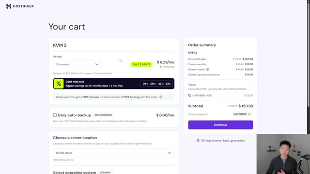
*⏱️ 00:01:39 — Interface de panier Hostinger montrant le récapitulatif de commande pour un plan KVM 2, avec l'application du code promo "NATEHERK".*

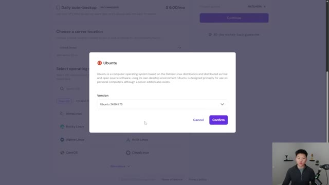
*⏱️ 00:01:56 — Fenêtre contextuelle de sélection du système d'exploitation sur Hostinger, affichant les détails pour Ubuntu 24.04 LTS.*

---

### ⏱️ `[00:02:05 - 00:02:40]` | Segment #05

**🔊 Audio (Transcription Intégrale Mot pour Mot en Français) :**
> running. Now, after you pay, you're going to have to set up a root password. So I'm going to go ahead and type this in right here. Now, obviously you want to remember what this is because you're going to have to use this quite a bit in the setup. You could also add an SSH key right now, if you want to, I'm not going to do that right now to keep it simple, but you could always add this later. It allows you to choose some other features like malware scanner or Docker manager, and then it's going to go ahead and actually initialize and set up. So I'll check in with you guys once this is actually all spun up. Okay, now that that is all set up, I'm going to go ahead and click on manage VPS. And that's just going to take us to our dashboard. I'm going to go ahead and just skip through this questionnaire. And this is what it will look like. This is where

**👁️ Analyse Visuelle d'Écran (gemini-3.5-flash-lite) :**
**Interface & Outils** : Plateforme de gestion d'hébergement web Hostinger.

**Contenu textuel & Code** : Champs de saisie pour "Root password" avec des critères de validation (longueur, chiffres, lettres, symboles) et option "Add key" pour une clé SSH.

**Action / Démonstration** : Saisie du mot de passe root par l'utilisateur pour sécuriser l'accès au VPS avant de cliquer sur "Next".

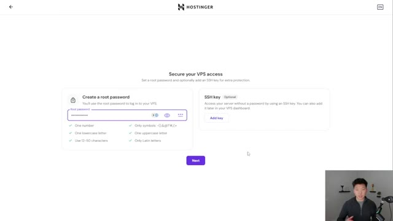
*⏱️ 00:02:14 — Interface web de Hostinger pour la configuration de la sécurité d'un serveur VPS, invitant l'utilisateur à définir un mot de passe root et optionnellement une clé SSH.*

---

### ⏱️ `[00:02:40 - 00:03:04]` | Segment #06

**🔊 Audio (Transcription Intégrale Mot pour Mot en Français) :**
> you'll be able to see information about your VPS and some metrics and things like that. So now is where we have to actually get into the terminal, unfortunately, but I've got this doc, which I will link right down below in the description. And it'll have pretty much all the commands that you need in order to follow along with this video and paste them right in. Okay, so depending on your operating system, you're gonna have to open up your command prompt, your terminal, your PowerShell, whatever it's called, get in here and then we'll get started.

**👁️ Analyse Visuelle d'Écran (gemini-3.5-flash-lite) :**
**Interface & Outils** : Hostinger Dashboard, Google Docs, Windows PowerShell.

**Contenu textuel & Code** : Commandes Linux : `ssh root@YOUR_SERVER_IP` et `adduser clawd`.

**Action / Démonstration** : Navigation dans le tableau de bord, consultation du guide d'installation, ouverture du terminal système.

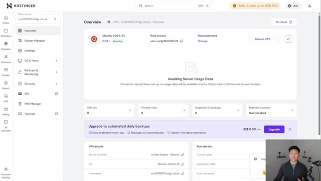
*⏱️ 00:02:46 — Interface d'administration Hostinger affichant la vue d'ensemble (Overview) d'un serveur VPS Ubuntu 24.04 LTS.*

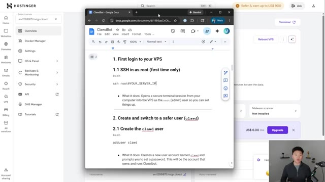
*⏱️ 00:02:52 — Document Google Docs ouvert en surimpression, contenant des instructions techniques et des commandes pour configurer un serveur VPS (SSH, ajout d'utilisateur).*

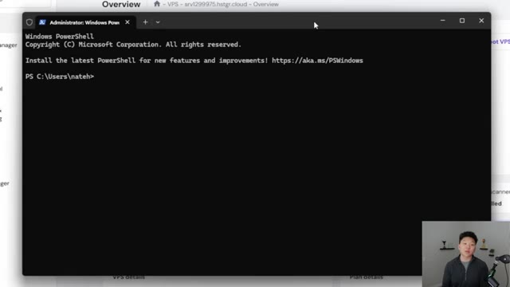
*⏱️ 00:02:58 — Fenêtre Windows PowerShell ouverte en mode administrateur, prête à recevoir des commandes de l'utilisateur.*

---

### ⏱️ `[00:03:04 - 00:03:36]` | Segment #07

**🔊 Audio (Transcription Intégrale Mot pour Mot en Français) :**
> So the first thing that we have to do is we have our local machine and then we have our VPS. We need to actually get into the VPS so we can install CloudBot there, not on our local machine. So that's kind of called like SSHing into that environment. So in Hostinger, you can see that there's a root access command right here, which is sshroot at, and then this is like our IP address, essentially. So I'm going to click copy. I'm going to go into the terminal and then paste that in there. And basically it says that this is established. Are you sure you want to continue? So I'm going to say yes. And now it asks for the password that we

**👁️ Analyse Visuelle d'Écran (gemini-3.5-flash-lite) :**
**Interface & Outils** : Windows PowerShell, Tableau de bord Hostinger (VPS Overview).

**Contenu textuel & Code** : Commande SSH visible : `ssh root@76.13.103.26`.

**Action / Démonstration** : Préparation de la connexion SSH depuis la machine locale vers le serveur VPS distant.

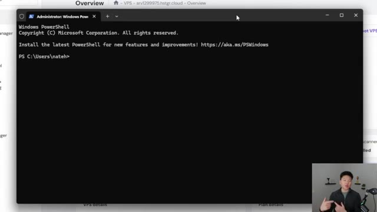
*⏱️ 00:03:12 — Une fenêtre Windows PowerShell ouverte sur le poste local de l'utilisateur.*

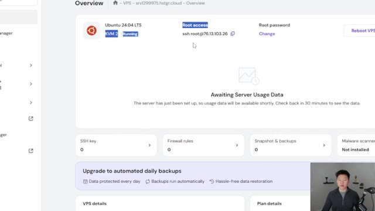
*⏱️ 00:03:20 — Le tableau de bord Hostinger affichant les informations d'accès SSH pour un VPS Ubuntu 24.04.*

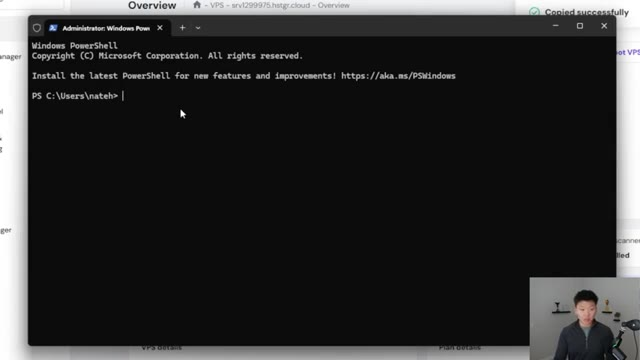
*⏱️ 00:03:28 — La fenêtre Windows PowerShell prête à recevoir la commande SSH pour se connecter au VPS.*

---

### ⏱️ `[00:03:36 - 00:03:59]` | Segment #08

**🔊 Audio (Transcription Intégrale Mot pour Mot en Français) :**
> set up earlier when we were kind of configuring this VPS in Hostinger. So what you're going to do is type in your password, but as you're typing it in, just like actually look at the keyboard because it won't show up as if you're typing. But you can see I'm going to go ahead and enter. And now I am able to get in there and my password was correct. Now, if you're typing it in wrong and you keep getting permission denied and you have to reset it, you would basically just come into here and then change your password right there.

**👁️ Analyse Visuelle d'Écran (gemini-3.5-flash-lite) :**
**Interface & Outils** : Windows PowerShell

**Contenu textuel & Code** : Commande `ssh root@76.13.103.26`, suivi de la validation de l'empreinte de la clé SSH et de l'invite de saisie du mot de passe (`root@76.13.103.26's password:`).

**Action / Démonstration** : Connexion sécurisée au serveur VPS distant via SSH, en attente de la saisie du mot de passe par l'utilisateur.

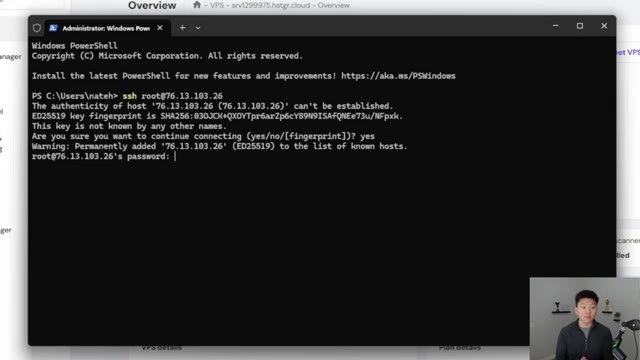
*⏱️ 00:03:42 — Une fenêtre Windows PowerShell affichant la tentative de connexion SSH à un serveur distant via une adresse IP.*

---

### ⏱️ `[00:03:59 - 00:04:19]` | Segment #09

**🔊 Audio (Transcription Intégrale Mot pour Mot en Français) :**
> Okay, so now that we are in that environment, you can see it's no longer the directory of users, Nate H. We are now in our server. We're going to do this next command, which is add user Claude. And now that we're adding this user inside of this VPS, we have to give it a password. So it's gonna do the same thing. It's not gonna let you see it. So make sure you're looking at your keyboard when you're typing.

**👁️ Analyse Visuelle d'Écran (gemini-3.5-flash-lite) :**
**Interface & Outils** : Terminal Windows PowerShell.

**Contenu textuel & Code** : Historique de connexion SSH (`ssh root@76.13.103.26`) et affichage des informations système d'Ubuntu 24.04.3 LTS.

**Action / Démonstration** : Connexion réussie à un VPS distant via SSH par l'utilisateur.

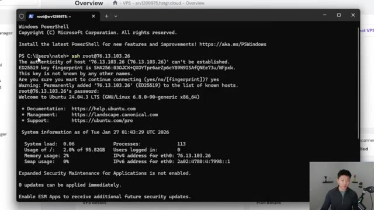
*⏱️ 00:04:04 — Capture d'écran montrant un terminal Windows PowerShell dans lequel une connexion SSH a été établie vers un serveur distant sous Ubuntu.*

---

### ⏱️ `[00:04:19 - 00:04:38]` | Segment #10

**🔊 Audio (Transcription Intégrale Mot pour Mot en Français) :**
> All right, so I just set up the password. Now I have to give this user a name. So I'm just gonna go with Claude. I'm not gonna give it a room number, work phone, home phone, any of that. And we're gonna say that the information is correct. Okay, so the next command we're doing here is basically just giving this user permission. So the ability to essentially be an admin and install things, stuff like that.

**👁️ Analyse Visuelle d'Écran (gemini-3.5-flash-lite) :**
**Interface & Outils** : Terminal de commande (ligne de commande Ubuntu via interface web/VPS).

**Contenu textuel & Code** : Commande `adduser clawd` suivie des logs de création (UID, GID, dossier personnel) et de l'invite de saisie des informations utilisateur (Full Name, Room Number, Work Phone).

**Action / Démonstration** : Exécution d'une commande système pour ajouter un nouvel utilisateur et saisie interactive des métadonnées associées au compte.

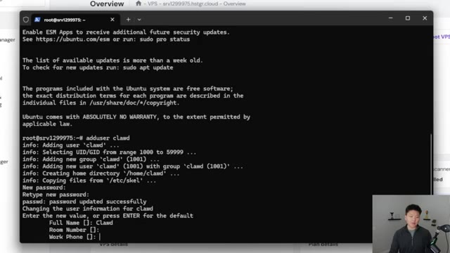
*⏱️ 00:04:24 — Un terminal Linux affichant le processus de création d'un nouvel utilisateur système nommé "clawd" et la configuration interactive de ses informations personnelles.*

---

### ⏱️ `[00:04:38 - 00:05:00]` | Segment #11

**🔊 Audio (Transcription Intégrale Mot pour Mot en Français) :**
> And then what we wanna do is actually become that user. So we're gonna do su-claud, which is going to let us in there. And now you can see we have this green Claude, you know, VPS thing, which means that we're now making commands as this user. And now what I'm gonna do is I'm basically going to use the one line installation from Claudebot itself in order to install Claudebot and all the dependencies that we need.

**👁️ Analyse Visuelle d'Écran (gemini-3.5-flash-lite) :**
**Interface & Outils** : Terminal SSH (interface web de gestion VPS).

**Contenu textuel & Code** : Commandes terminal : `adduser clawd`, `usermod -aG sudo clawd`, `su - clawd`.

**Action / Démonstration** : Création de l'utilisateur 'clawd', ajout au groupe sudo et changement de session utilisateur (switch user) vers 'clawd' pour préparer l'environnement de l'agent.

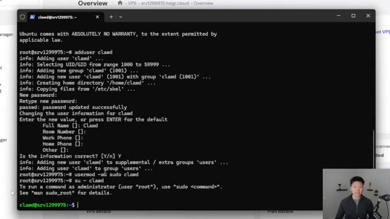
*⏱️ 00:04:44 — Un terminal Linux en ligne de commande affichant la création et la configuration d'un nouvel utilisateur nommé 'clawd' sur un VPS.*

---

### ⏱️ `[00:05:00 - 00:05:20]` | Segment #12

**🔊 Audio (Transcription Intégrale Mot pour Mot en Français) :**
> So I'm gonna go ahead and paste that in there. This is also in the document that I've attached. We're gonna go ahead and enter that. And now what it's gonna do is it's detecting our operating system. It's going to make sure we have everything we need. So it looks like right now it's installing node.js. And now it's asking for our password. So I'm going to go ahead and enter that in. And then we should be good to go with the installation. So you'll get to this point where it says that it's installing it.

**👁️ Analyse Visuelle d'Écran (gemini-3.5-flash-lite) :**
**Interface & Outils** : Terminal de ligne de commande (CLI).

**Contenu textuel & Code** : Commande `curl -fsSL https://clawd.bot/install.sh | bash` suivie des logs de sortie indiquant la détection du système (Linux) et le début de l'installation de Node.js via NodeSource.

**Action / Démonstration** : Exécution d'un script d'installation automatisé qui détecte les dépendances manquantes (Node.js) et demande le mot de passe sudo pour procéder à l'installation.

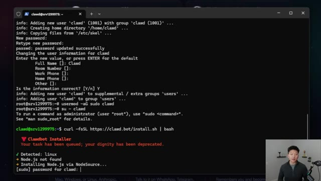
*⏱️ 00:05:05 — Capture d'écran montrant un terminal Linux où le script d'installation de Clawdbot est en cours d'exécution.*

---

### ⏱️ `[00:05:20 - 00:05:39]` | Segment #13

**🔊 Audio (Transcription Intégrale Mot pour Mot en Français) :**
> And this could take, I don't know, anywhere from like two to 10 minutes. So if you're sitting here for a while and you think it's stuck, just be patient. It'll finish up. All right. So now that it has been installed, it goes ahead and puts us into this onboarding flow. So we can see that there's some security stuff to read. We understand that this is powerful and inherently risky.

**👁️ Analyse Visuelle d'Écran (gemini-3.5-flash-lite) :**
**Interface & Outils** : Terminal de ligne de commande (CLI) sur un système type Debian/Ubuntu.

**Contenu textuel & Code** : Journal d'installation de paquets (Node.js, configuration npm) et lignes d'état indiquant "Installing Clawdbot 2026.1.24-3...".

**Action / Démonstration** : Installation automatisée de l'application Clawdbot et de ses prérequis (Node.js/npm) dans l'environnement système.

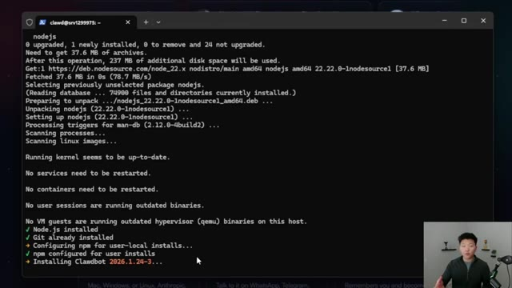
*⏱️ 00:05:25 — Un terminal Linux en cours d'exécution affiche les étapes de mise à jour et d'installation de dépendances, terminant par l'installation de "Clawdbot".*

---

### ⏱️ `[00:05:39 - 00:05:57]` | Segment #14

**🔊 Audio (Transcription Intégrale Mot pour Mot en Français) :**
> So we're going to go ahead and continue. We're going to go ahead and do the quick start. And now we're going to choose model provider. So I'm going to go ahead and do Anthropic. And I'm not going to do the actual token because that is actually against their terms of service to be using your plan in here, at least the best of my understanding. So I'm just going to go ahead and put in my Anthropic API key.

**👁️ Analyse Visuelle d'Écran (gemini-3.5-flash-lite) :**
**Interface & Outils** : Terminal de ligne de commande (CLI).

**Contenu textuel & Code** : Menu de sélection "Model/auth provider" listant divers services comme Anthropic, OpenAI, MiniMax, Qwen, Google, etc.

**Action / Démonstration** : Sélection du fournisseur de modèle (choix d'Anthropic).

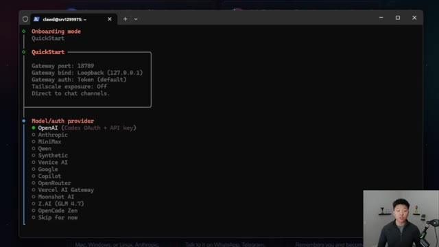
*⏱️ 00:05:43 — Un terminal en ligne de commande affichant le menu de configuration "QuickStart" pour choisir un fournisseur de modèle d'IA.*

---

### ⏱️ `[00:05:58 - 00:06:16]` | Segment #15

**🔊 Audio (Transcription Intégrale Mot pour Mot en Français) :**
> And it asks you to choose a default model. So in here, I'm just going to go with Opus 4.5. The next thing is it asks what channel we want to be able to talk to it. So it could be Telegram, WhatsApp, Discord. There's so many different options. In this case, I'm just going to go ahead and choose Telegram bot API. So while this is loading up for us, let me just show you what you actually have to do in Telegram.

**👁️ Analyse Visuelle d'Écran (gemini-3.5-flash-lite) :**
**Interface & Outils** : Terminal de ligne de commande (CLI).

**Contenu textuel & Code** : Liste d'options de messagerie incluant Telegram (sélectionné), WhatsApp, Discord, Google Chat, Slack, Signal, iMessage, etc.

**Action / Démonstration** : Sélection du canal de communication pour l'intégration de l'agent.

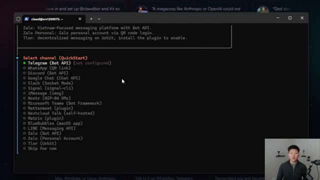
*⏱️ 00:06:02 — Une interface de terminal affichant un menu interactif de sélection de canal de messagerie pour la configuration d'un agent IA.*

---

### ⏱️ `[00:06:16 - 00:06:36]` | Segment #16

**🔊 Audio (Transcription Intégrale Mot pour Mot en Français) :**
> So you're going to go to your bot father and you're going to do this command slash new bot. And that lets you actually create a bot. So then I'm going to go ahead and call it YouTube test. And then it asks for a username for the bot. And I went with Nate YouTube test bot. And then this gives you an actual token. And that's what we're going to enter into the terminal. So you can see I configured Telegram and now it's asking about skills.

**👁️ Analyse Visuelle d'Écran (gemini-3.5-flash-lite) :**
**Interface & Outils** : Application Telegram (BotFather).

**Contenu textuel & Code** : Commande saisie : "/newbot". Réponse du système : "Alright, a new bot. How are we going to call it? Please choose a name for your bot."

**Action / Démonstration** : Initialisation de la création d'un nouveau bot via l'interface de BotFather sur Telegram.

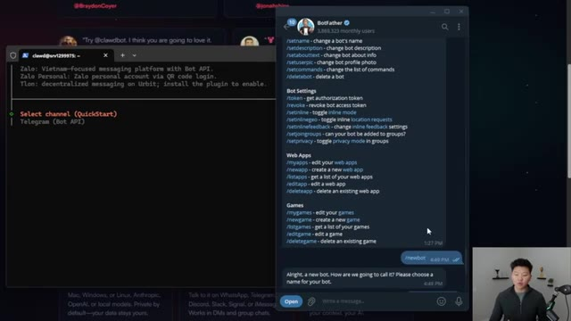
*⏱️ 00:06:21 — Interface de l'application Telegram montrant la discussion avec le bot officiel "BotFather" où la commande /newbot a été exécutée.*

---

### ⏱️ `[00:06:36 - 00:06:55]` | Segment #17

**🔊 Audio (Transcription Intégrale Mot pour Mot en Français) :**
> So let's just for now go ahead and click yes so I can show you guys what's in here. We can install the homebrew. We can choose NPM. And then there's other dependencies that we can install. So you have to click space to select and enter to continue. In this case, you can see that we could do, you know, bird, clodhub. So I'll choose that one. I'll choose GOG, which is for Google stuff.

**👁️ Analyse Visuelle d'Écran (gemini-3.5-flash-lite) :**
**Interface & Outils** : Terminal de commande (CLI).

**Contenu textuel & Code** : Menu interactif incluant des options pour "Configure skills now?", "Homebrew recommended", "Show Homebrew install command?" et le choix du "Preferred node manager" (npm, pnpm, bun).

**Action / Démonstration** : Configuration des dépendances système et sélection du gestionnaire de paquets via une interface interactive dans le terminal.

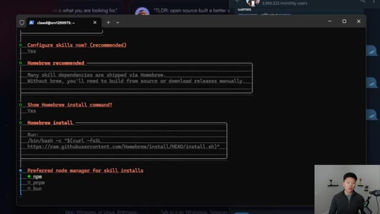
*⏱️ 00:06:41 — Interface interactive en ligne de commande affichant une procédure de configuration logicielle avec des choix à sélectionner (Homebrew, gestionnaire de paquets Node).*

---

### ⏱️ `[00:06:56 - 00:07:14]` | Segment #18

**🔊 Audio (Transcription Intégrale Mot pour Mot en Français) :**
> You could choose all of these other ones, Nano Banana, Nano PDF. And you can obviously add these later as well. So I'm going to go ahead and just enter and choose those two for now. And you can see it actually failed installing GOG. so we can obviously go ahead and fix that later. For now, we're gonna keep going on. So I'm not gonna add a Google Places API key for those. And then it asks if I want a Gemini API key for Nano Banana Pro.

**👁️ Analyse Visuelle d'Écran (gemini-3.5-flash-lite) :**
**Interface & Outils** : Terminal Linux/Unix (interface CLI "Clawd").

**Contenu textuel & Code** : Liste de dépendances (ex: lpassword, apple-notes, clamdhub, gog, nano-banana-pro, nano-pdf, obsidian) et le titre "Install missing skill dependencies".

**Action / Démonstration** : Navigation et sélection des outils (skills) à installer dans le terminal via l'interface interactive de l'agent.

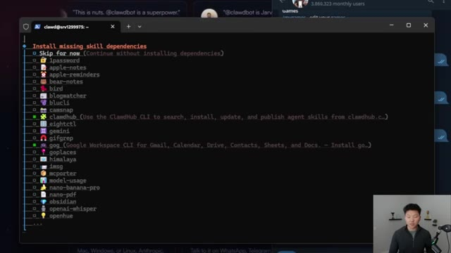
*⏱️ 00:07:00 — Interface en ligne de commande (CLI) affichant une liste interactive de dépendances de compétences ("skills") à installer pour l'agent IA, avec une sélection active sur plusieurs éléments.*

---

### ⏱️ `[00:07:14 - 00:07:34]` | Segment #19

**🔊 Audio (Transcription Intégrale Mot pour Mot en Français) :**
> So actually, yeah, I am gonna go ahead and put that in there. Then it asks about OpenAI. I'm just gonna say no. I'm gonna say no, no to 11 labs. And then for hooks, we're just gonna go ahead and choose skip for now. And now we should be pretty much getting finished up here with the initial onboarding and installation. Okay, so now what it tells us is that we're pretty much set up and the dashboard is ready for us.

**👁️ Analyse Visuelle d'Écran (gemini-3.5-flash-lite) :**
**Interface & Outils** : Terminal (Interface en ligne de commande).

**Contenu textuel & Code** : Configuration des clés API : Google Places (No), Gemini (Yes + saisie de clé), OpenAI (No), et ElevenLabs (en attente de sélection Yes/No).

**Action / Démonstration** : L'utilisateur configure les services tiers en répondant par 'No' ou 'Yes' aux différentes étapes d'initialisation du bot.

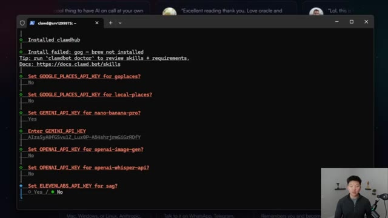
*⏱️ 00:07:19 — Interface en ligne de commande affichant le processus d'installation et de configuration de 'clawdhub' avec plusieurs requêtes de clés API.*

---

### ⏱️ `[00:07:34 - 00:08:02]` | Segment #20

**🔊 Audio (Transcription Intégrale Mot pour Mot en Français) :**
> So we can actually view CloudBot in the web on kind of like a web UI and interact with it and see how it works there. We could also add a brave search API key if we wanted to enable web search, we could add later of course, as well. But what happens is it tells us to go to this URL. So if I basically copy this and I go to my browser and paste that in, it's gonna come back and just say, this site can't be reached because it's trying to access a local post that we apparently can't hit.

**👁️ Analyse Visuelle d'Écran (gemini-3.5-flash-lite) :**
**Interface & Outils** : Terminal Linux (SSH/CLI).

**Contenu textuel & Code** : Instructions de connexion via URL locale/tunnel SSH, et commandes de configuration : `clawdbot configure --section web` pour intégrer la clé API Brave Search.

**Action / Démonstration** : Affichage des étapes de post-installation et configuration des outils optionnels pour l'agent Clawdbot.

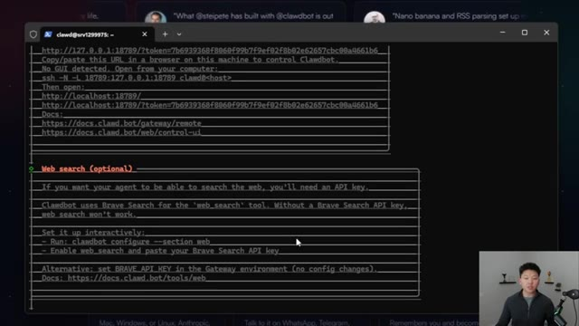
*⏱️ 00:07:41 — Interface en ligne de commande (CLI) affichant les instructions de configuration pour accéder à l'interface web de Clawdbot et configurer la recherche web via une clé API Brave Search.*

---

### ⏱️ `[00:08:02 - 00:08:21]` | Segment #21

**🔊 Audio (Transcription Intégrale Mot pour Mot en Français) :**
> All right, so I'm gonna open up a new tab. We're gonna get back into that same kind of like working environment. So first we have to get into VPS, I'm gonna put in my password, and then we need to su-clawed, and then it will turn green. And then we're gonna actually start the gateway. So I'm gonna paste in this next one right here. And now it says that the command clawed bot is not found.

**👁️ Analyse Visuelle d'Écran (gemini-3.5-flash-lite) :**
**Interface & Outils** : Navigateur web (Hostinger dashboard) et émulateur de terminal SSH.

**Contenu textuel & Code** : Informations système Ubuntu, statistiques de ressources (load, usage mémoire, IP), et ligne de commande : `root@srv1299975:~# su`.

**Action / Démonstration** : Connexion au serveur distant via SSH et préparation de l'élévation de privilèges ou changement d'utilisateur via la commande 'su'.

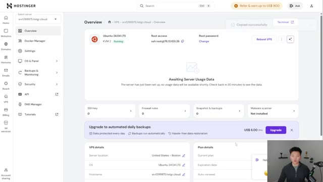
*⏱️ 00:08:07 — Interface de gestion de serveur VPS sur la plateforme Hostinger montrant les détails techniques du serveur (Ubuntu 24.04, adresse IP, accès root).*

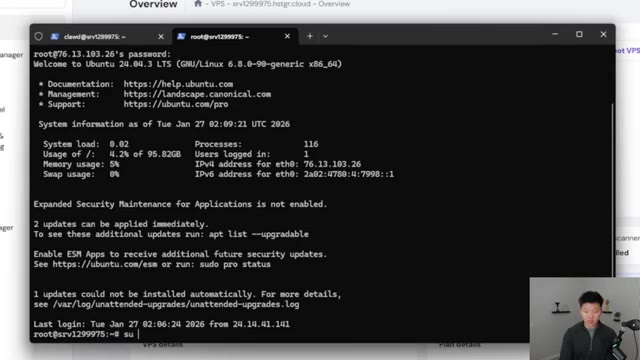
*⏱️ 00:08:12 — Fenêtre de terminal SSH ouverte, montrant une session active sous Ubuntu 24.04 avec l'utilisateur root et une invite de commande en attente de saisie.*

---

### ⏱️ `[00:08:21 - 00:08:40]` | Segment #22

**🔊 Audio (Transcription Intégrale Mot pour Mot en Français) :**
> So first of all, let me make sure that I am clawed. So I'm gonna say, who am I? And it does say clawed, so we're in the right spot. And then I wanna make sure we're on the right path. So I'm gonna do this command, which says version. and it looks like we're all set there. So now we're gonna try to go ahead and start the gateway back up. So there we go. We can see that we have the gateway listening on this port right here.

**👁️ Analyse Visuelle d'Écran (gemini-3.5-flash-lite) :**
**Interface & Outils** : Terminal de ligne de commande (SSH) intégré dans une interface web de gestion de serveur VPS.

**Contenu textuel & Code** : Historique de commandes incluant 'su - clawd', une tentative échouée de lancement de 'clawdbot', et la commande 'whoami' renvoyant 'clawd'.

**Action / Démonstration** : Vérification de l'identité de l'utilisateur actuel dans le terminal via la commande 'whoami' pour confirmer la connexion au bon compte avant de poursuivre les opérations.

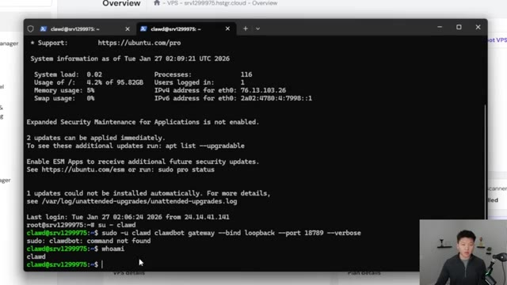
*⏱️ 00:08:26 — Capture d'écran montrant un terminal Linux affichant les informations système et la commande 'whoami' exécutée avec succès pour vérifier l'utilisateur courant 'clawd'.*

---

### ⏱️ `[00:08:40 - 00:09:00]` | Segment #23

**🔊 Audio (Transcription Intégrale Mot pour Mot en Français) :**
> So now that this is up and running, I'm gonna open a new tab. I'm gonna paste in this command to basically create a tunnel for us. And then at the end, instead of doing host, you're gonna actually go grab your IP. So in here, your dashboard for this VPS, you're just gonna scroll down and you can choose the IPv4 right there, copy that, and then paste that in.

**👁️ Analyse Visuelle d'Écran (gemini-3.5-flash-lite) :**
**Interface & Outils** : Windows PowerShell et interface web de gestion VPS (Hostinger).

**Contenu textuel & Code** : Commande SSH : `ssh -N -L 18789:127.0.0.1:18789 clawd@76.13.103.26` ; Détails du VPS : Server location (Boston), OS (Ubuntu 24.04 LTS), IPv4 (76.13.103.26).

**Action / Démonstration** : Saisie d'une commande SSH pour créer un tunnel sécurisé vers le VPS en utilisant l'adresse IP affichée dans le tableau de bord.

*⏱️ 00:08:45 — Fenêtre Windows PowerShell ouverte par-dessus un tableau de bord, affichant une commande SSH de création de tunnel.*

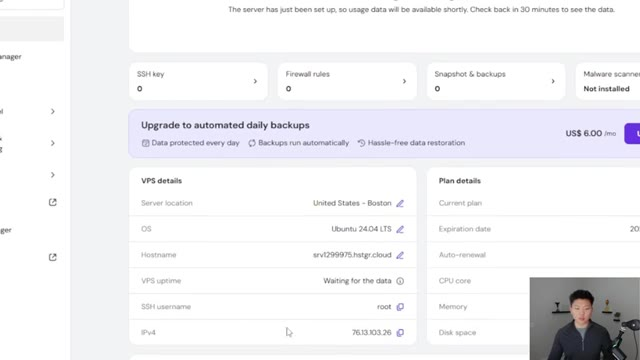
*⏱️ 00:08:55 — Vue du tableau de bord de gestion du VPS (Hostinger) détaillant les informations de connexion, notamment l'adresse IPv4.*

---

### ⏱️ `[00:09:00 - 00:09:22]` | Segment #24

**🔊 Audio (Transcription Intégrale Mot pour Mot en Français) :**
> And once we shoot that off, Got to put in the password for Claude. And this should actually be able to let us go to that URL and it should now work. So now back in that original tab, if I go ahead and copy this link, there you go. We can now see that we have an actual web app with Claudebot. You can see that the health up here is okay. And if I go ahead and say hello, it should be able to actually talk back to us.

**👁️ Analyse Visuelle d'Écran (gemini-3.5-flash-lite) :**
**Interface & Outils** : Windows PowerShell, Navigateur web (Tableau de bord CLAWDBOT).

**Contenu textuel & Code** : Commande : `ssh -N -L 18789:127.0.0.1:18789 clawd@76.13.103.26` suivie de l'invite `password:`.

**Action / Démonstration** : Exécution d'une commande SSH pour établir une redirection de port (tunneling) afin d'accéder localement à l'interface web sécurisée de l'agent Claudebot.

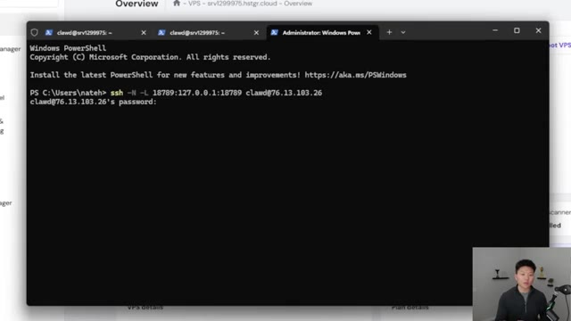
*⏱️ 00:09:05 — Interface Windows PowerShell affichant une commande SSH pour créer un tunnel, avec une invite de saisie pour le mot de passe.*

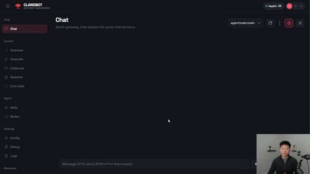
*⏱️ 00:09:16 — Interface web du tableau de bord "CLAWDBOT Gateway" montrant l'onglet "Chat" actif pour la gestion des interactions de l'agent.*

---

### ⏱️ `[00:09:22 - 00:09:58]` | Segment #25

**🔊 Audio (Transcription Intégrale Mot pour Mot en Français) :**
> And we can go ahead and start talking to Claudebot and setting him up. So the next step is to actually be able to talk to Claudebot through something like Telegram, which is what we configured earlier. So I'm going to ask it, are you able to chat with me through Telegram? So it said, yes, I can absolutely connect to you through Telegram. Let me check the setup. So it read the config. There's all this stuff. And then it says, good news, it's already set up. What we have to do is just give it some sort of pairing code. So if you guys remember in the Botfather, I called this bot Nate YouTube Test Bot. So if I search for that, you can see right here, YouTube Test. I'm going to click on that and I'm going to go ahead and click start. And what it's going to do is give us a pairing code. And so this is what we need to give to ClaudeBot in order

**👁️ Analyse Visuelle d'Écran (gemini-3.5-flash-lite) :**
**Interface & Outils** : Dashboard web propriétaire "Clawdbot Gateway".

**Contenu textuel & Code** : Historique de discussion : l'utilisateur a envoyé "hello" et l'assistant répond : "Hey, I just came online — fresh workspace, no memories yet, completely blank slate. So... who am I? Who are you? Let's figure this out together."

**Action / Démonstration** : Le présentateur est en train d'interagir avec l'interface du tableau de bord pour initialiser ou configurer la session de discussion avec l'agent IA.

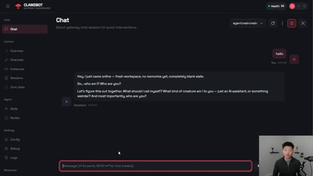
*⏱️ 00:09:31 — Interface du tableau de bord "Clawdbot Gateway" montrant une fenêtre de chat active où l'assistant IA demande une identité et présente ses capacités initiales.*

---

### ⏱️ `[00:09:58 - 00:10:25]` | Segment #26

**🔊 Audio (Transcription Intégrale Mot pour Mot en Français) :**
> for it to actually work. So I'm going to go ahead and show CloudBot. Here's the pairing code that I got, and it should be able to make sure that we're actually good to go. And then we'll be able to talk to it through Telegram. Cool. So it looks like we're all paired up. I'm going to go ahead and open Telegram and just say, Hey, testing. And hopefully we should be able to see right up here that CloudBot is now typing and it's going to come back right here. And it says, Hey, Nate, I can see you loud and clear in Telegram. And then also shows up right here in Telegram as well.

**👁️ Analyse Visuelle d'Écran (gemini-3.5-flash-lite) :**
**Interface & Outils** : Dashboard web Clawdbot (Gateway Dashboard).

**Contenu textuel & Code** : Message système confirmant que Telegram est configuré et prêt à l'emploi. Instructions étape par étape : 1. Ouvrir Telegram, 2. Chercher le bot (créé via BotFather), 3. Envoyer "/start" ou dire "hi". Message utilisateur : "here is the pairing code I got from Telegram: ZHBAF2TC".

**Action / Démonstration** : Le système confirme que le couplage est actif, permettant la communication bidirectionnelle entre le tableau de bord et l'application Telegram.

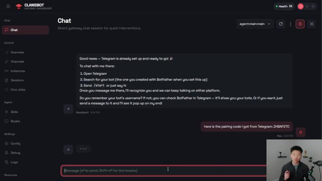
*⏱️ 00:10:04 — Interface du tableau de bord "Clawdbot" montrant la confirmation de couplage avec Telegram et les instructions de démarrage.*

---

### ⏱️ `[00:10:25 - 00:10:44]` | Segment #27

**🔊 Audio (Transcription Intégrale Mot pour Mot en Français) :**
> Now, what's important to think about is the fact that the gateway has to be running on the VPS so that we can actually access it through Telegram all the time. So I just went ahead and cleared that out. And now I'm going to put in this command so that it lets us actually create the file. And so I'm pasting this in here. And the important things to see are basically that we have the exec start and we have the always option on.

**👁️ Analyse Visuelle d'Écran (gemini-3.5-flash-lite) :**
**Interface & Outils** : Dashboard web propriétaire "Clawdbot" (interface de gestion d'agents).

**Contenu textuel & Code** : Historique de chat montrant un message de confirmation "Done! You're paired" et une réponse de l'agent IA interagissant avec l'utilisateur ("Hey Nate! 👋").

**Action / Démonstration** : Validation de la connexion réussie entre le système et Telegram, illustrant le fonctionnement de la "gateway" évoquée dans l'audio.

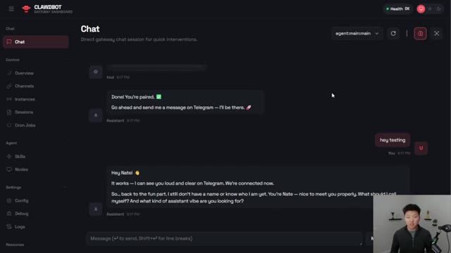
*⏱️ 00:10:30 — Interface du tableau de bord "Clawdbot" montrant une session de chat active entre l'utilisateur et un agent IA, confirmant la connexion via Telegram.*

---

### ⏱️ `[00:10:45 - 00:11:11]` | Segment #28

**🔊 Audio (Transcription Intégrale Mot pour Mot en Français) :**
> So now I'm going to go ahead and restart it. And I'm going to check on the status. And we can see right here we have active, active, and it's been running. And just to show you guys that that works, I actually went ahead and closed out of the terminal. So I shut down the local tunnel. You can see in our web app, it says that the health is offline, but we're gonna go ahead and check in on Telegram. And you can see, I said, how about now? And it is still typing and it is still able to communicate with us, meaning I'm on the go, I'm on vacation, I've got my phone, I've got Telegram, and I can still use CloudBot.

**👁️ Analyse Visuelle d'Écran (gemini-3.5-flash-lite) :**
**Interface & Outils** : Dashboard web Clawdbot et client de messagerie Telegram (desktop).

**Contenu textuel & Code** : Historique de chat Telegram ("Hey testing", "It works - I can see you loud and clear", "are you still working?"), état de connexion "Health Offline" dans le dashboard.

**Action / Démonstration** : Démonstration de la connexion active entre le bot et l'utilisateur via l'interface de messagerie.

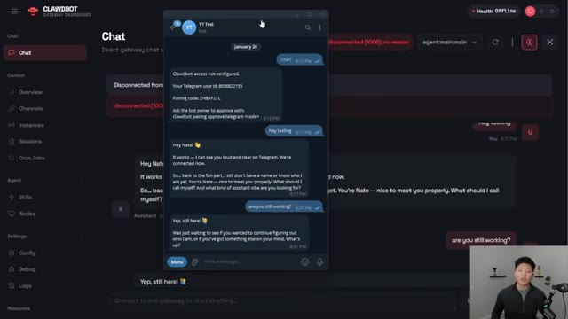
*⏱️ 00:10:52 — Interface du tableau de bord "Clawdbot" avec une fenêtre Telegram superposée montrant des échanges de messages avec un bot.*

---

### ⏱️ `[00:11:12 - 00:11:37]` | Segment #29

**🔊 Audio (Transcription Intégrale Mot pour Mot en Français) :**
> So I know it's a little bit intimidating, but I'm gonna have the doc down below, which you can go ahead and copy all the commands, follow the video step-by-step, and you should be all set. Now, before we go, I did have to talk about security real quick and I had to sit down for this. So back at the beginning when I talked about why people are throwing this on a Mac Mini, it's because of the security aspect. Think of this less like an AI agent, but more like a VA that has access to your email and your files and anything else that you give it passwords or access to.

**👁️ Analyse Visuelle d'Écran (gemini-3.5-flash-lite) :**
**Interface & Outils** : Navigateur web (Google Chrome) affichant le site web Clawdbot et Google Docs.

**Contenu textuel & Code** : Texte explicatif sur la sécurité : "Clawdbot is more like giving an AI 'remote control' over a computer", liste des risques (Full control of the machine, Exposed 'remote control' door, Secrets on disk, Tricked by bad content, Long-term hijack) et erreurs de débutants.

**Action / Démonstration** : Le présentateur illustre les risques de sécurité liés à l'implémentation de l'agent Clawdbot en présentant une documentation détaillée.

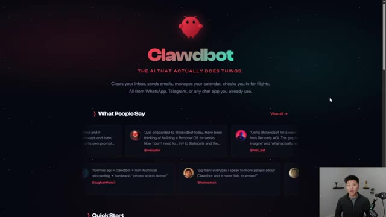
*⏱️ 00:11:18 — Page d'accueil du site web "Clawdbot" présentant le slogan "The AI that actually does things" et des témoignages d'utilisateurs.*

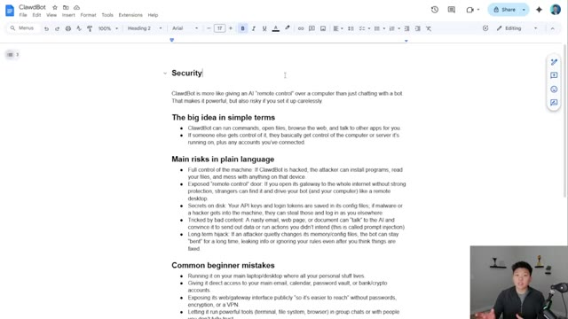
*⏱️ 00:11:24 — Document Google Docs intitulé "Clawdbot" détaillant des considérations de sécurité liées à l'utilisation de l'agent IA, incluant les risques principaux et les erreurs courantes.*

---

### ⏱️ `[00:11:37 - 00:12:05]` | Segment #30

**🔊 Audio (Transcription Intégrale Mot pour Mot en Français) :**
> It's autonomous and it's an AI and it's not deterministic. So you have to be really careful. It can run commands, it can open files, it can browse the web, it can talk to other apps. And if someone else gets control of your CloudBot, they can basically have control of everything that the CloudBot has access to. So if it's hacked, the attacker could install programs, read files, and mess things up. Your secrets could get leaked because if all of those are in there and someone grabs them, or if for some reason CloudBot just kind of has all of its data leaked or anything like that, your information's at risk.

**👁️ Analyse Visuelle d'Écran (gemini-3.5-flash-lite) :**
**Interface & Outils** : Google Docs.

**Contenu textuel & Code** : Le document liste les capacités du "ClawdBot" (exécuter des commandes, ouvrir des fichiers, naviguer sur le web), les risques majeurs de sécurité (contrôle total de la machine, injection de prompts, vol de jetons API) et les erreurs courantes des débutants.

**Action / Démonstration** : Présentation textuelle des points de vigilance concernant l'automatisation par IA et la gestion des accès distants.

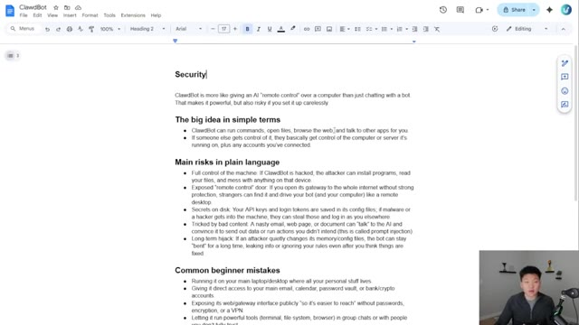
*⏱️ 00:11:44 — Une capture d'écran d'un document Google Docs intitulé "ClawdBot" détaillant les risques de sécurité liés à l'utilisation d'agents IA autonomes.*

---

### ⏱️ `[00:12:05 - 00:12:28]` | Segment #31

**🔊 Audio (Transcription Intégrale Mot pour Mot en Français) :**
> You also want to be aware of prompt injections. So if it's reading emails and stuff, it may confuse if you're giving it commands or if someone random with malicious intent is asking for prompts or asking for certain access or passwords, things like that. So thinking about common beginner mistakes, that's why we wanted to set it up on a VPS. That's why I probably am not gonna give this access to my main email or my main calendar and all my password vaults.

**👁️ Analyse Visuelle d'Écran (gemini-3.5-flash-lite) :**
**Interface & Outils** : Google Docs

**Contenu textuel & Code** : Texte structuré avec des listes à puces détaillant "The big idea", "Main risks in plain language" (incluant le risque d'injection de prompt et d'accès aux fichiers) et "Common beginner mistakes".

**Action / Démonstration** : Présentation théorique et éducative des dangers liés à l'automatisation par IA et aux erreurs courantes lors de l'implémentation.

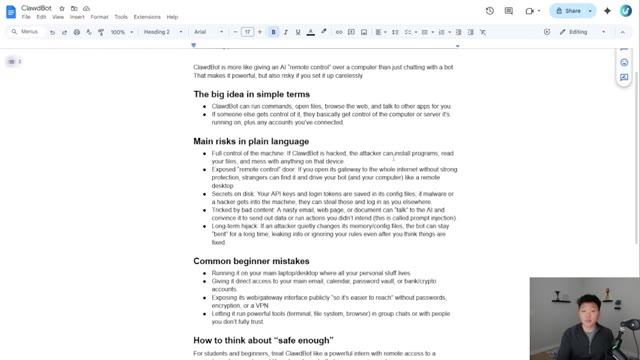
*⏱️ 00:12:11 — Un document Google Docs présentant les risques de sécurité associés à "ClawdBot", un agent IA avec accès au contrôle à distance d'un ordinateur.*

---

### ⏱️ `[00:12:28 - 00:13:01]` | Segment #32

**🔊 Audio (Transcription Intégrale Mot pour Mot en Français) :**
> I'm gonna give it its own email, its own environments, and I'm gonna give it a bunch of read-only access permissions. So really, there's all this information and you can do more research if you want to. But the moral of the story here is, I think right now, this tool is a great experiment. It's super cool. And it should be for power users who actually understand the risks of how these AI systems work and security and privacy and things like that. If you're just kind of getting your feet wet and you want to play around with it, go for it. But just be careful what you actually give it access to. And don't forget that I'm doing this on Hostinger VPS, which you

**👁️ Analyse Visuelle d'Écran (gemini-3.5-flash-lite) :**
**Interface & Outils** : Google Docs

**Contenu textuel & Code** : Texte explicatif sur les risques de sécurité (ex: "Full control of the machine", "Exposed remote control door", "Secrets on disk") et une liste des "Common beginner mistakes" lors de la configuration d'un agent IA.

**Action / Démonstration** : Le document sert de support visuel pour illustrer les précautions et les dangers potentiels liés à l'automatisation par IA évoqués par le présentateur.

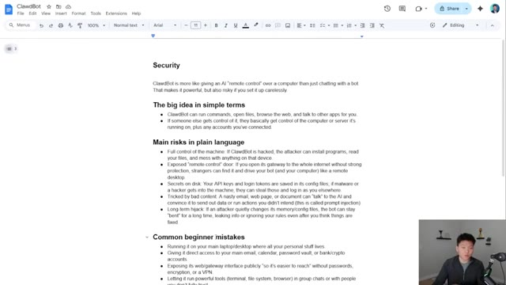
*⏱️ 00:12:36 — Une page Google Docs intitulée "ClawdBot" détaillant les risques de sécurité associés à l'utilisation d'agents IA ayant un accès de type "télécommande" à un ordinateur.*

---

### ⏱️ `[00:13:01 - 00:13:11]` | Segment #33

**🔊 Audio (Transcription Intégrale Mot pour Mot en Français) :**
> guys can once again, go ahead and use the link in the description and get 10% off when you use code NateHerc. Anyways, that's going to do it for today. Hope you guys enjoyed. If you learned something new, please give it a like. It helps me out a ton. And I'll see you guys in the next one.

**👁️ Analyse Visuelle d'Écran (gemini-3.5-flash-lite) :**
**Interface & Outils** : Navigateur web (Hostinger checkout, Site web Clawdbot).

**Contenu textuel & Code** : Code de réduction "NATEHERK", description des fonctionnalités de Clawdbot (gestion d'emails, calendrier, vols).

**Action / Démonstration** : Promotion d'un service d'hébergement via un lien d'affiliation et présentation visuelle d'un projet d'agent IA.

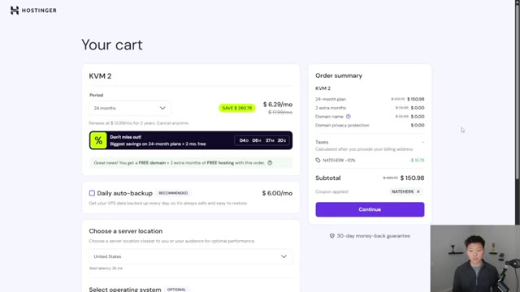
*⏱️ 00:13:03 — Page de paiement Hostinger montrant le récapitulatif d'une commande "KVM 2" avec l'application du code promotionnel "NATEHERK".*

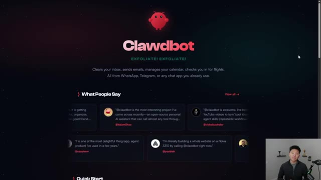
*⏱️ 00:13:06 — Page d'accueil du site web "Clawdbot", présentant un assistant IA personnel, des témoignages d'utilisateurs et une section "Quick Start".*

---

