# 🎬 100 Hours Testing Clawdbot vs Claude Code (honest results)

> **Chaîne** : [Nate Herk | AI Automation](https://www.youtube.com/@nateherk/featured)  
> **Lien YouTube** : [https://www.youtube.com/watch?v=CBNbcbMs_Lc](https://www.youtube.com/watch?v=CBNbcbMs_Lc)  
> **Date de publication** : 20260128  
> **Durée** : 00:22:47  
> **Identifiant vidéo** : `CBNbcbMs_Lc`  
> **Transcription & Analyse** : `whisper-v3-large-turbo+gemini-3.5-flash-lite`  

---

## 📌 Synthèse Exécutive & Outils

### 💡 Résumé
Dans cette vidéo intitulée **100 Hours Testing Clawdbot vs Claude Code (honest results)**, Nate Herk décortique les capacités pratiques d'automatisation et de développement propulsées par les modèles de pointe.

### 🛠️ Outils, Modèles & Logiciels Présentés
- **Opus 5.5 & Claude Code** : Modèles d'ingénierie et agents de codage autonome.

### 🔑 Points Clés & Enseignements Stratégiques
- Optimiser le niveau d'effort et le raisonnement des modèles IA pour des résultats industriels.
- Automatiser les cycles de création logicielle de bout en bout.

---

## ⏱️ Chronologie & Transcription Complète Audio & Visuelle (Mot pour Mot)

### ⏱️ `[00:00:00 - 00:00:34]` | Segment #01

**🔊 Audio (Transcription Intégrale Mot pour Mot en Français) :**
> So in about five hours and 80 million tokens later, I've built myself a full executive assistant. His name is Klaus. He has his own email account, his own ClickUp account, and I treat him like I would treat a regular employee. He remembers everything about me, about the business, about our Q1 initiatives, and he actually built himself this dashboard so that I can manage things that he's doing. I can see all of the deliverables. I can see the action log and I can drop him some notes in here. And I can also see him up in the top left. So when he's working or when he's thinking or when he's idle, or if he's spinning up sub agents, I can see everything that he's actually doing live. And so this is awesome. I've had so much fun playing around with Claudebot.

**👁️ Analyse Visuelle d'Écran (gemini-3.5-flash-lite) :**
**Interface & Outils** : Application web personnalisée de gestion de tâches ("Klaus Dashboard").

**Contenu textuel & Code** : Tâches visibles : "Fix PDF page breaks", "Add charts/graphs to reports", "Get X API access", "Build weekly business report template", "Metrics tracking system", "Daily AI Pulse system", "YouTube audit PDF".

**Action / Démonstration** : Présentation visuelle de l'interface de contrôle et de suivi des activités de l'assistant IA nommé "Klaus".

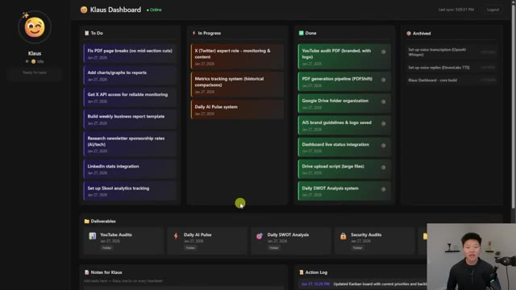
*⏱️ 00:00:08 — Vue d'ensemble du tableau de bord "Klaus" organisée en colonnes Kanban (To Do, In Progress, Done, Archived) avec une section inférieure dédiée aux livrables et aux logs.*

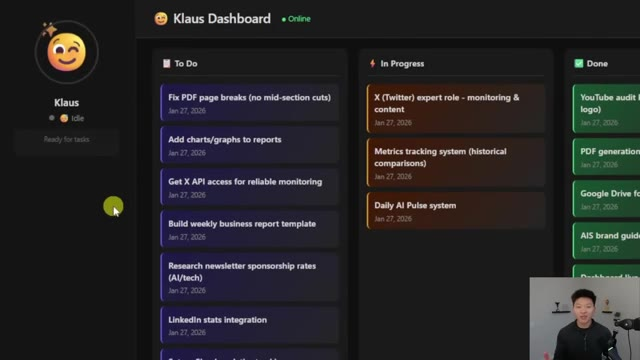
*⏱️ 00:00:25 — Gros plan sur l'interface du tableau de bord "Klaus" mettant en évidence la colonne "To Do" avec une liste de tâches techniques liées à l'IA.*

---

### ⏱️ `[00:00:34 - 00:01:08]` | Segment #02

**🔊 Audio (Transcription Intégrale Mot pour Mot en Français) :**
> It's been all over my feed, which is why I wanted to play around with it, obviously. And we've seen some really, really cool use cases. So you've got some basic things like email cleanup, sending reminders, creating issues, helping with ideas, helping create reports. I saw this one from Alex Finn, which I thought was pretty cool. He texted his bot, Henry, to make a reservation. And once the bot realized that it wasn't on OpenTable or, you know, it couldn't actually book through OpenTable, it ended up just using 11 labs and called them and then booked a reservation that way. So we're seeing these CloudBots be super proactive and great problem solvers. And of course, a lot of that is thanks to the underlying model, a lot of times, which is Opus 4.5. So let me just real quick

**👁️ Analyse Visuelle d'Écran (gemini-3.5-flash-lite) :**
**Interface & Outils** : Plateforme de réseau social (X/Twitter).

**Contenu textuel & Code** : Dans l'image 1, une liste exhaustive d'automatisations (tri d'e-mails, rappels Tana, création d'issues GitHub, gestion de budget, accès 1Password). Dans l'image 2, une conversation textuelle entre un bot et un humain concernant la disponibilité et la réservation d'une table dans un restaurant.

**Action / Démonstration** : Présentation de cas d'usage réels d'agents IA autonomes capables d'interagir avec des services tiers et des outils de productivité pour automatiser des tâches complexes.

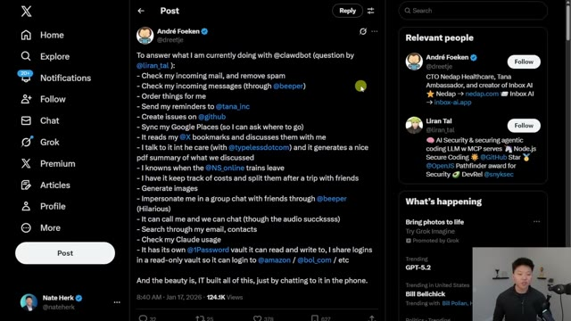
*⏱️ 00:00:43 — Une capture d'écran montrant un post X détaillant une liste de tâches quotidiennes automatisées par un agent IA appelé @clawdbot.*

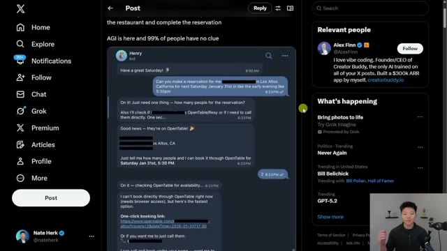
*⏱️ 00:00:51 — Une capture d'écran montrant un fil de discussion d'un agent IA interagissant avec un utilisateur pour effectuer une réservation de restaurant via OpenTable.*

---

### ⏱️ `[00:01:08 - 00:01:42]` | Segment #03

**🔊 Audio (Transcription Intégrale Mot pour Mot en Français) :**
> introduce you guys to my CloudBot, Klaus. Hey Klaus, just wanted to say hi. Could you give my YouTube audience a quick five to 10 second intro of what you do for me? So I just shot that off. You can see on the top left now, we see that Klaus is working. And so I love being able to see, you know, just glance over and see if it's green, he's working. But if he's gray and it's idle, then I know, okay, well, let me just fire off something else for Claude to do. And now Klaus is thinking because he's writing back a response. I'm Klaus, Nate's AI executive assistant. I run 24 seven on a server, checking his emails, monitoring social media, doing research, and basically handling all the busy work so he can focus on making content for you guys.

**👁️ Analyse Visuelle d'Écran (gemini-3.5-flash-lite) :**
**Interface & Outils** : Tableau de bord personnalisé (Klaus Dashboard) intégrant une interface de messagerie type Telegram/Slack.

**Contenu textuel & Code** : Liste de tâches incluant "Fix PDF page breaks", "Add charts/graphs", "Get X API access", et une analyse textuelle de l'agent sur une opportunité de vidéo concernant "Clawdbot" avec une vignette vidéo YouTube intégrée.

**Action / Démonstration** : L'agent Klaus fournit une analyse stratégique et des suggestions de contenu à Nate Herk via l'interface de chat intégrée au tableau de bord.

*⏱️ 00:01:16 — Une interface de tableau de bord nommée "Klaus Dashboard" affichant des colonnes de gestion de tâches (To Do, Deliverables, Action Log) avec une fenêtre de messagerie superposée au centre contenant une réponse détaillée de l'agent Klaus sur une opportunité de vidéo YouTube.*

---

### ⏱️ `[00:01:42 - 00:02:03]` | Segment #04

**🔊 Audio (Transcription Intégrale Mot pour Mot en Français) :**
> I mean, that's the dream, right? But I realized that a lot of the stuff that I'm actually building with CloudBot, I could actually do inside CloudCode and it's not even anything too new. It's one of those things that just all of a sudden takes the internet by storm, like out of nowhere. You can see the blue line here is Claude Code over the past three months, and the red line is Claude Bot over the past three months. And all of a sudden, within the past week, Claude Bot has just absolutely exploded.

**👁️ Analyse Visuelle d'Écran (gemini-3.5-flash-lite) :**
**Interface & Outils** : Tableau de bord d'agent IA (Klaus Dashboard) et Google Trends.

**Contenu textuel & Code** : Liste de tâches (To Do) liées à l'automatisation, logs d'activités, et courbe de tendance exponentielle pour "clawdbot".

**Action / Démonstration** : Présentation du workflow de l'agent et démonstration visuelle de la montée en popularité soudaine d'un outil (clawdbot).

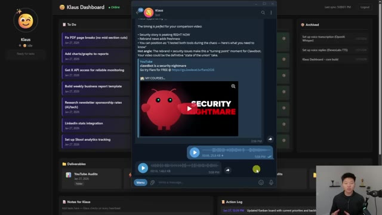
*⏱️ 00:01:47 — Interface "Klaus Dashboard" montrant un chat interactif avec un bot, listant des tâches et des logs d'actions.*

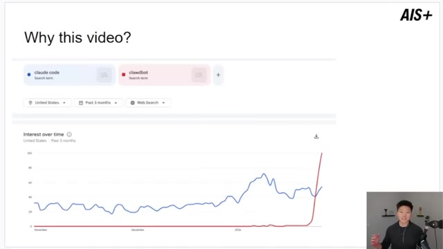
*⏱️ 00:01:53 — Graphique Google Trends comparant l'intérêt de recherche entre "claude code" (bleu) et "clawdbot" (rouge).*

---

### ⏱️ `[00:02:03 - 00:02:22]` | Segment #05

**🔊 Audio (Transcription Intégrale Mot pour Mot en Français) :**
> So what I wanted to do is put these two tools side by side, actually compare them across metrics that matter to you guys, and share what I've found. So today we're doing an analysis of Claude Bot versus Claude Code. So why am I making this video? Because Claude Code is a coding sidekick, and it lives inside your developer tools, and it helps you read, write, and fix code faster on your local machine.

**👁️ Analyse Visuelle d'Écran (gemini-3.5-flash-lite) :**
**Interface & Outils** : Graphique de données (Google Trends), présentation de diapositives (type PowerPoint).

**Contenu textuel & Code** : Texte descriptif des outils, données de recherche.

**Action / Démonstration** : Présentation informative pour introduire le sujet de la vidéo.

---

### ⏱️ `[00:02:22 - 00:02:41]` | Segment #06

**🔊 Audio (Transcription Intégrale Mot pour Mot en Français) :**
> Now, CloudBot is more of a 24-7 AI system that runs on your own hardware or server. And this was released much more recently, pretty much like the beginning of 2026. And as of today, it is now known as MoldBot. Because Cloud, you know, Anthropic basically said, hey, this sounds too much like Cloud. So you got to change that.

**👁️ Analyse Visuelle d'Écran (gemini-3.5-flash-lite) :**
**Interface & Outils** : Présentation de type diaporama (Slide deck).

**Contenu textuel & Code** : Texte descriptif expliquant que Claude Code est un assistant de codage local et que Clawdbot est un assistant IA tournant sur serveur personnel pour automatiser des tâches (avec mention du changement de nom en Moltbot au 27 janvier 2026).

**Action / Démonstration** : Présentation informative des outils d'IA discutés par le narrateur.

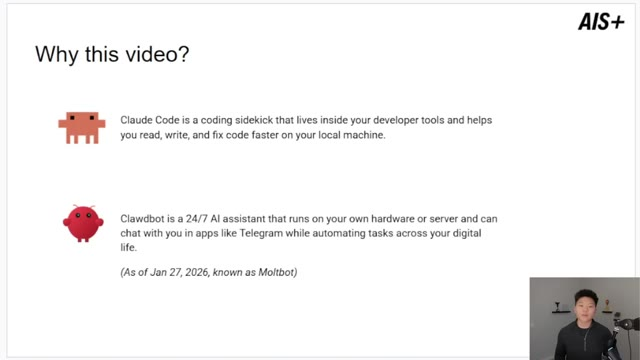
*⏱️ 00:02:27 — Une diapositive de présentation titrée "Why this video?" présentant les définitions de "Claude Code" et "Clawdbot" (rebaptisé Moltbot).*

---

### ⏱️ `[00:02:41 - 00:03:08]` | Segment #07

**🔊 Audio (Transcription Intégrale Mot pour Mot en Français) :**
> As you can see right here, a tweet from MoldBot. Big news, we've molted. CloudBot is now MoldBot. But anyways, what I'm going to be doing here is looking at eight different metrics that you guys should actually care about, the metrics that I care about. and I'm gonna be giving them different scores out of 10. And by the end, we'll see which of these two tools is truly the winner. So the categories that we're gonna be looking at today are out of the box ability, set up friction and risk, cost, power and access, security, everyday usability, actual ROI, and the ICP.

**👁️ Analyse Visuelle d'Écran (gemini-3.5-flash-lite) :**
**Interface & Outils** : Présentation graphique sous forme de diapositives (type logiciel de présentation comme PowerPoint ou Google Slides).

**Contenu textuel & Code** : Noms des métriques d'évaluation : Speed, Accuracy, Usability, Cost, Support, Features, Scalability, Integration, Out of the Box Ability, Setup Friction & Risk, Security, Everyday Usability, Actual ROI, The ICP.

**Action / Démonstration** : Présentation théorique et méthodologique des critères d'évaluation des outils d'automatisation avant leur démonstration.

*⏱️ 00:02:48 — Un graphique en barres comparatif intitulé "TOOL COMPARISON" illustrant huit métriques de performance (vitesse, précision, utilisabilité, coût, support, fonctionnalités, évolutivité, intégration) pour deux types d'outils, représentés par des icônes de robots distinctes.*

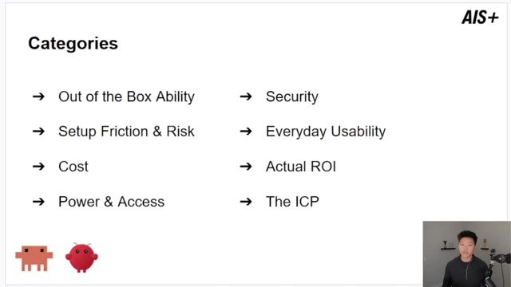
*⏱️ 00:03:01 — Une liste à puces présentant les huit catégories de métriques utilisées pour l'évaluation, telles que "Out of the Box Ability", "Security", "Actual ROI" et "The ICP".*

---

### ⏱️ `[00:03:09 - 00:03:27]` | Segment #08

**🔊 Audio (Transcription Intégrale Mot pour Mot en Français) :**
> So I think that this gives a pretty holistic understanding of like the differences between the two tools, especially when we isolate these different factors and look at just that element. But if I've missed anything, please feel free to let me know in the comments and let me know what you guys think about these two tools. Okay, so first of all, we have out-of-the-box ability. So for this one, I gave Cloud Code a seven because it's excellent at helping you code right away.

**👁️ Analyse Visuelle d'Écran (gemini-3.5-flash-lite) :**
**Interface & Outils** : Présentation (diapositives)

**Contenu textuel & Code** : Liste des catégories : "Out of the Box Ability", "Security", "Setup Friction & Risk", "Everyday Usability", "Cost", "Actual ROI", "Power & Access", "The ICP".

**Action / Démonstration** : Le présentateur résume les critères utilisés pour comparer les outils.

*⏱️ 00:03:13 — Une diapositive de présentation listant les catégories de comparaison entre deux outils, avec le présentateur en médaillon en bas à droite.*

---

### ⏱️ `[00:03:28 - 00:03:47]` | Segment #09

**🔊 Audio (Transcription Intégrale Mot pour Mot en Français) :**
> But out of the box, it takes a little bit of understanding to actually be able to make it useful. A lot of people that are non-technical and don't come from a formal software engineering background, it feels pretty inaccessible. And it's very intimidating. I remember when I was switching over from using NNN basically only to wanting to learn Cloud Code, I was intimidated as well. But now that I have a good understanding for it, I see all the power.

**👁️ Analyse Visuelle d'Écran (gemini-3.5-flash-lite) :**
**Interface & Outils** : Diapositive de présentation (format texte).

**Contenu textuel & Code** : Texte comparatif sur les capacités d'outils d'automatisation IA : Claude Code est décrit comme inaccessible pour les non-techniques (destiné aux développeurs en IDE), tandis que Clawdbot est présenté comme plus polyvalent et intuitif dès l'installation.

**Action / Démonstration** : Analyse comparative et évaluation de la courbe d'apprentissage de différents outils d'agents IA.

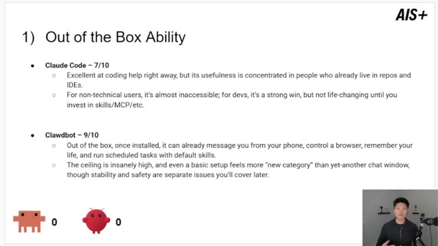
*⏱️ 00:03:32 — Une diapositive de présentation comparant "Claude Code" et "Clawdbot" sous le critère de la facilité d'utilisation "Out of the Box", avec des notes respectives de 7/10 et 9/10.*

---

### ⏱️ `[00:03:47 - 00:04:06]` | Segment #10

**🔊 Audio (Transcription Intégrale Mot pour Mot en Français) :**
> For Cloud Bot, I decided to go with a nine out of 10 because once you actually get it configured, and you just start talking to it, it's so powerful. It asks you questions, it learns about your business, it has persistent memory, and it can create automations and apps right away. And you don't even really have to think about deploying or hosting or anything like that. It feels way more powerful than a coding assistant when you first set it up.

**👁️ Analyse Visuelle d'Écran (gemini-3.5-flash-lite) :**
**Interface & Outils** : Présentation PowerPoint ou Keynote.

**Contenu textuel & Code** : Texte comparatif évaluant les capacités d'agents IA, détaillant l'accessibilité pour les développeurs versus les utilisateurs non techniques, ainsi que les fonctionnalités autonomes de Clawdbot (navigation web, mémoire, tâches planifiées).

**Action / Démonstration** : Analyse comparative et évaluation de performance des outils d'automatisation par IA.

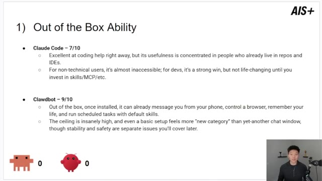
*⏱️ 00:03:52 — Une diapositive de présentation illustrant une comparaison entre "Claude Code" et "Clawdbot" concernant leur facilité d'utilisation "Out of the Box", avec des notes respectives de 7/10 et 9/10.*

---

### ⏱️ `[00:04:06 - 00:04:39]` | Segment #11

**🔊 Audio (Transcription Intégrale Mot pour Mot en Français) :**
> It feels like someone that you could treat like an employee, which is why I gave mine, you know, its own login credentials for different things. And I can just forward it emails or CC it on emails and have it just do things for me and come back and let me know when it's done. So let me show you guys a quick example of two different outputs. one with CloudCode and one with CloudBot. So I'm in a CloudCode project right here, and I'm just going to say, hey, Cloud, I need you to run a YouTube analysis of my channel and then send it to me. So I'm shooting this off. And then while this is running, let's go ahead and do the same thing to CloudBot. Hey, Klaus, go ahead and run another YouTube

**👁️ Analyse Visuelle d'Écran (gemini-3.5-flash-lite) :**
**Interface & Outils** : Visual Studio Code, Diaporama de présentation (PowerPoint/Keynote).

**Contenu textuel & Code** : Texte comparatif sur les performances des agents IA (Claude Code vs Clawdbot), arborescence de fichiers dans VS Code (notamment `credentials.json`, `token.json`, `modal_app.py`), message de bienvenue de Claude Code.

**Action / Démonstration** : Présentation comparative des outils par l'orateur suivie d'une démonstration de l'interface de travail dans l'éditeur de code.

*⏱️ 00:04:15 — Une diapositive présentant une comparaison intitulée « Out of the Box Ability », évaluant Claude Code (7/10) et Clawdbot (9/10) avec des descriptions de leurs capacités respectives.*

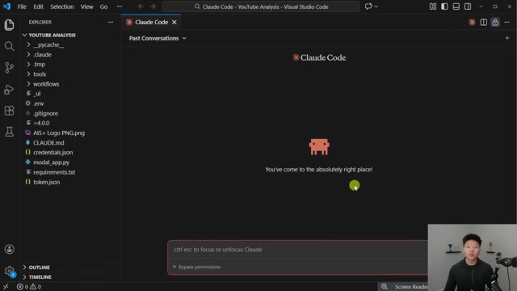
*⏱️ 00:04:23 — L'interface de l'éditeur Visual Studio Code affichant l'extension ou l'environnement de travail de "Claude Code", avec un message d'accueil et un champ de saisie pour les commandes.*

---

### ⏱️ `[00:04:39 - 00:04:58]` | Segment #12

**🔊 Audio (Transcription Intégrale Mot pour Mot en Français) :**
> audit of my channel. Okay. So I shot that off. We can see right here that Klaus is working. We can see over here that CloudCode is working, although I need to give it some more information. And then I'm going to come back when all this is done and I'll show you guys. And also one other thing to mention is both CloudCode right now and CloudBot are using Opus 4.5. So they're using the same exact chat model.

**👁️ Analyse Visuelle d'Écran (gemini-3.5-flash-lite) :**
**Interface & Outils** : - Image #1 : Dashboard web personnalisé "Klaus" (outil de gestion de tâches/IA).
- Image #2 : Visual Studio Code (éditeur de code) avec l'extension/agent Claude Code.

**Contenu textuel & Code** : - Image #1 : Liste de tâches (To-Do), historique d'audit, fichiers audios et conversation avec l'agent sur "clawdbot security nightmare".
- Image #2 : Prompt "hey Claude, I need you to run a YouTube a..." et choix entre "My specific channel" (analyse de performance) ou "Industry trends".

**Action / Démonstration** : - Image #1 : L'agent Klaus est en train de traiter une demande d'audit de chaîne YouTube.
- Image #2 : L'agent Claude demande une clarification à l'utilisateur pour orienter son analyse de données YouTube.

*⏱️ 00:04:44 — Tableau de bord "Klaus" affichant une interface de gestion de tâches (Kanban) avec une fenêtre de chat centrale traitant un audit de chaîne YouTube.*

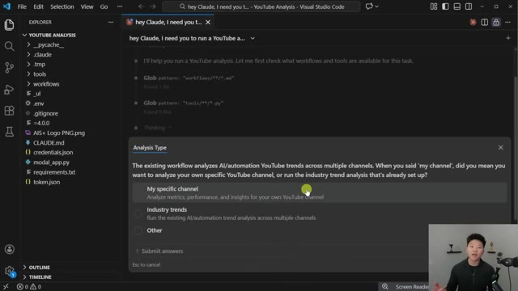
*⏱️ 00:04:48 — Interface de Visual Studio Code avec le plugin Claude Code actif, présentant un menu de sélection interactif pour définir le type d'analyse YouTube à effectuer.*

---

### ⏱️ `[00:04:58 - 00:05:16]` | Segment #13

**🔊 Audio (Transcription Intégrale Mot pour Mot en Français) :**
> All right. First, we have the deliverable from CloudCode. So this got sent to my email. We can see we've got AI automation, YouTube analytics, 30 channels tracked, 191 videos analyzed. It comes up with the top videos this week. But then here's the actual PDF report that it created for me. So I've got YouTube channel analytics, Nate Herc, generated on January 27th. So here are my channel statistics at the moment.

**👁️ Analyse Visuelle d'Écran (gemini-3.5-flash-lite) :**
**Interface & Outils** : Gmail, Visualiseur de PDF (Google Drive/Chrome).

**Contenu textuel & Code** : Métriques analytiques (abonnés, vues, taux d'engagement), liste des vidéos performantes, recommandations stratégiques (sujets, planning).

**Action / Démonstration** : Présentation des livrables générés par CloudCode et consultation du rapport PDF détaillé dans le navigateur.

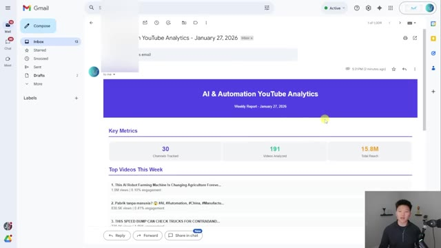
*⏱️ 00:05:03 — Interface Gmail affichant un rapport hebdomadaire "AI & Automation YouTube Analytics" incluant des indicateurs clés (30 chaînes, 191 vidéos, 15.8M de portée).*

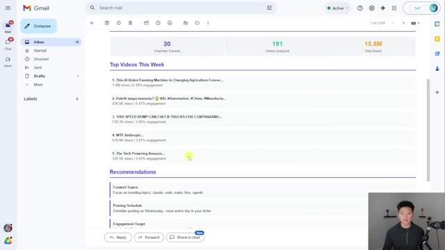
*⏱️ 00:05:07 — Suite du rapport email dans Gmail montrant le classement des "Top Videos This Week" et une section "Recommendations" pour le contenu et le planning.*

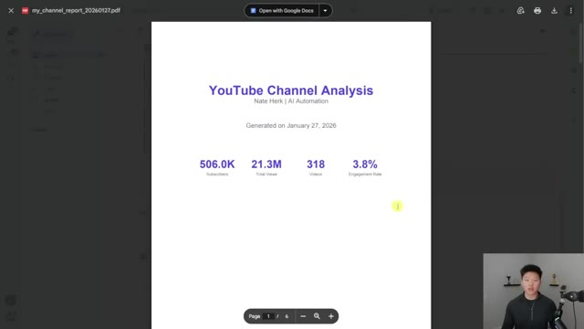
*⏱️ 00:05:12 — Visualiseur de PDF intégré affichant la page de garde d'un rapport intitulé "YouTube Channel Analysis" pour "Nate Herk | AI Automation".*

---

### ⏱️ `[00:05:17 - 00:05:51]` | Segment #14

**🔊 Audio (Transcription Intégrale Mot pour Mot en Français) :**
> Then it goes over and looks at my most recent 100 videos with average views for video, average likes, comments, median views, and views per subscriber. We've got an analysis on video duration that comes with some charts. We've got engagement rate distribution, which is pretty cool. We've also got views versus engagement analysis. We have most used tags. And actually there was one more page, fastest growing videos. So it looks at some of the stuff that I've been doing with Cloud Code, which has been a big trend, obviously. Now let's see what Klaus got up to. In my dashboard, I can go to the YouTube audits, which opens up a Google Drive. And in this folder, you can see that I've have, you know, different audits that I've been using for testing. So this is the most recent

**👁️ Analyse Visuelle d'Écran (gemini-3.5-flash-lite) :**
**Interface & Outils** : Navigateur web affichant un rapport PDF (Image 1) et interface de gestion de projet / agent IA nommée "Klaus" (Image 2).

**Contenu textuel & Code** : Image 1 : Graphiques "Video Duration Performance" et "Engagement Rate Distribution" avec un "Key Insight" sur la performance des vidéos de plus de 10 minutes. Image 2 : Liste de tâches techniques (PDF generation, OpenAI Whisper, ElevenLabs, Google Drive integration).

**Action / Démonstration** : Présentation des résultats d'analyse automatisés générés par l'agent IA, suivis d'un aperçu des tâches de développement du système "Klaus".

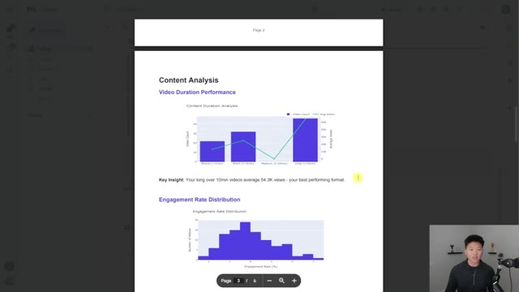
*⏱️ 00:05:25 — Rapport d'analyse de contenu affichant des graphiques sur la performance selon la durée des vidéos et la distribution du taux d'engagement.*

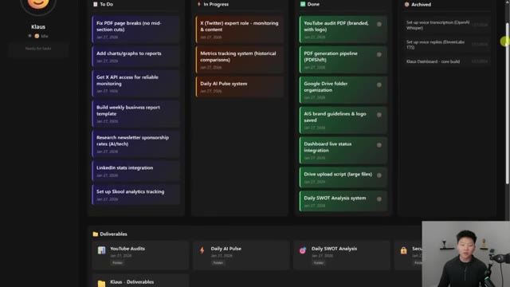
*⏱️ 00:05:43 — Tableau de bord de gestion de projet type Kanban sous l'interface de "Klaus", avec des colonnes "To Do", "In Progress", "Done" et "Archived".*

---

### ⏱️ `[00:05:51 - 00:06:17]` | Segment #15

**🔊 Audio (Transcription Intégrale Mot pour Mot en Français) :**
> one that I just created for us as a PDF. And this one looks a lot more branded because I gave both of them my brand guidelines and a logo. And so what I'd have to do is go back into CloudCode and have it work a little bit better to actually implement all the brand guidelines, because this one looks a lot more like what I gave it. So same thing, 506,000 subscribers, 21.3 total million views, blah, blah, blah. It's giving us some other metrics here, as well as strengths, weaknesses, opportunities, and threats.

**👁️ Analyse Visuelle d'Écran (gemini-3.5-flash-lite) :**
**Interface & Outils** : Lecteur de PDF intégré dans un navigateur web (Google Docs Viewer).

**Contenu textuel & Code** : Audit de performance de la chaîne YouTube : statistiques clés (506K abonnés, 21.3M vues, 317 vidéos), mesures dérivées et analyse SWOT détaillée (forces et faiblesses) avec le logo "AIS".

**Action / Démonstration** : Le présentateur affiche et commente le document généré automatiquement pour démontrer le respect de sa charte graphique par l'outil.

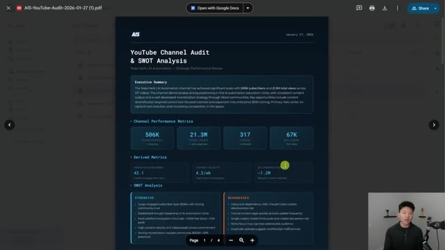
*⏱️ 00:05:58 — Un document PDF intitulé "YouTube Channel Audit & SWOT Analysis" affiché dans un lecteur de document en ligne, présentant des graphiques de données et des analyses stratégiques sous un design sombre.*

---

### ⏱️ `[00:06:17 - 00:06:36]` | Segment #16

**🔊 Audio (Transcription Intégrale Mot pour Mot en Français) :**
> Something's a little bit off with the spacing here, but not a huge deal. I'm sure we could fix that. We've got some recent content analysis. So CloudBot, agentic workflows. The trend that it's seeing is heavy focus on CloudCode plus internet integration. And then we've got some strategic recommendations like diversity of tool coverage, launch Evergreen series, build team capacity, YouTube short strategy.

**👁️ Analyse Visuelle d'Écran (gemini-3.5-flash-lite) :**
**Interface & Outils** : Lecteur de fichiers PDF intégré au navigateur (Google Drive/Docs).

**Contenu textuel & Code** : Analyse des contenus récents (CloudBot, Claude Code, n8n) et recommandations stratégiques pour une chaîne YouTube (diversification, séries evergreen, capacité d'équipe, stratégie Shorts, expansion B2B, offres communautaires).

**Action / Démonstration** : Présentation visuelle d'un rapport d'audit de chaîne pour illustrer les points abordés oralement.

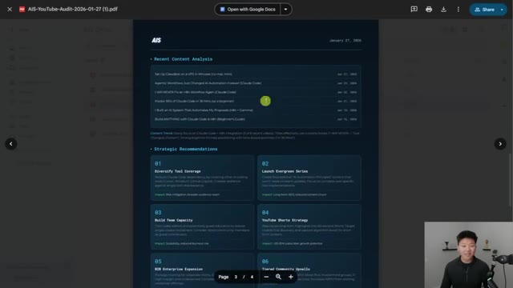
*⏱️ 00:06:22 — Un document PDF intitulé "AIS-YouTube-Audit" affiché dans un lecteur web, présentant une section "Recent Content Analysis" avec une liste de vidéos et une section "Strategic Recommendations" numérotée de 01 à 06.*

---

### ⏱️ `[00:06:36 - 00:06:56]` | Segment #17

**🔊 Audio (Transcription Intégrale Mot pour Mot en Français) :**
> And then it even gives us some priority action items as well. I don't think these automatically get put into our dashboard up here. That'd be pretty cool. And then maybe we could like cross them off if we didn't actually want to do them. So I'll let you guys form your own opinions based on that demo and based on your own use cases. But that's why right here, I decided to give Cloud Code a seven and Cloud Bot a nine. Number two, set up friction and risk.

**👁️ Analyse Visuelle d'Écran (gemini-3.5-flash-lite) :**
**Interface & Outils** : Dashboard de gestion de projet type Kanban (Klaus Dashboard).

**Contenu textuel & Code** : Liste de tâches : "Fix PDF page breaks", "Add charts/graphs to reports", "Get X API access", "Build weekly business report template", etc.

**Action / Démonstration** : Présentation visuelle de l'organisation des flux de travail automatisés de l'agent IA "Klaus".

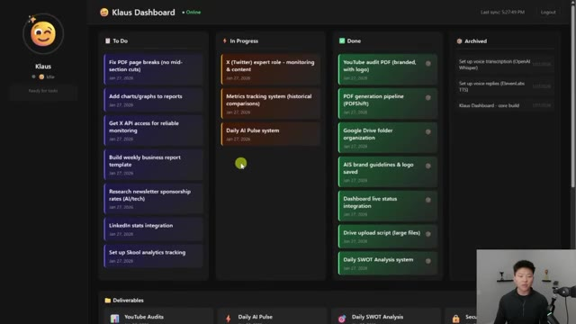
*⏱️ 00:06:41 — Interface "Klaus Dashboard" organisée en colonnes type Kanban (To Do, In Progress, Done, Archived) avec des cartes listant des tâches liées à l'automatisation IA.*

---

### ⏱️ `[00:06:56 - 00:07:31]` | Segment #18

**🔊 Audio (Transcription Intégrale Mot pour Mot en Français) :**
> So for this one, I gave Cloud Code an eight out of 10. It's a lot lower friction to install and start actually using. You basically just install VS Code and then you add the Cloud Code extension. At least that's the way that I do it. And it's super, super easy. And then with Cloud Bot, it's a lot more technical. You have to be a lot more in the terminal and you have to be a lot more aware of like what you're actually doing, what environments you're in. And, you know, that's why people are buying the Mac minis or on a VPS. And I'm actually using a VPS for this. I'm hosting my CloudBot on Hostinger, which you can get started for a lot cheaper. You can go ahead and sign up here for, you know, six bucks a month, nine bucks a month. And I use the KVM too. And this is going to be more than

**👁️ Analyse Visuelle d'Écran (gemini-3.5-flash-lite) :**
**Interface & Outils** : Présentation PowerPoint (diapo 2) ; Site web Hostinger.

**Contenu textuel & Code** : Texte comparatif sur la friction d'installation, les risques de sécurité et les capacités d'orchestration ; interface marketing Hostinger avec mentions d'AMD EPYC, stockage NVMe et outils IA.

**Action / Démonstration** : Analyse comparative théorique dans l'image 1 ; navigation/démonstration marketing dans l'image 2.

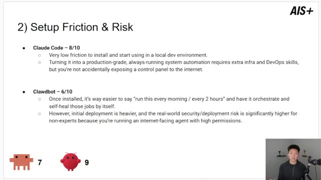
*⏱️ 00:07:05 — Une diapositive de présentation listant les facteurs de "Setup Friction & Risk" comparant Claude Code et Clawdbot avec des scores et des analyses textuelles.*

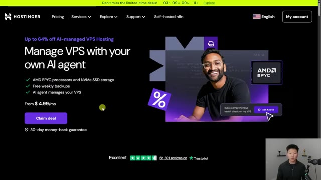
*⏱️ 00:07:22 — Une capture d'écran du site web de Hostinger faisant la promotion de services d'hébergement VPS managés par une IA, incluant un bouton "Ask Kodee".*

---

### ⏱️ `[00:07:31 - 00:08:08]` | Segment #19

**🔊 Audio (Transcription Intégrale Mot pour Mot en Français) :**
> enough to just get started with a CloudBot and test it out. And when you're in here, if you're doing an annual plan, you can get 10% off in addition if you use code NateHerc. So like I said, when it comes to the setup, CloudBot is a little bit more technical and confusing. I just did a full setup guide tutorial, so I will tag that right up here if you're interested in watching that. And also, if you do decide to use Hostinger and you've set up your VPS right here, if you go to the Docker Manager catalog, they've actually added the ability to just basically one-click install or one-click deploy CloudBot. So it should make it a lot easier. Anyways, we decided to give CloudCode an 8 and give CloudBot a 6 because it is more technical and also there's a lot more risk involved

**👁️ Analyse Visuelle d'Écran (gemini-3.5-flash-lite) :**
**Interface & Outils** : - Présentation (diapositive style PowerPoint)
- Interface de gestion cloud (Hostinger - Docker Manager)

**Contenu textuel & Code** : - Analyse comparative des risques (friction d'installation, déploiement en production, sécurité des agents).
- Catalogue d'applications "one-click" incluant 2FAuth, Ackee, Actual Budget, Adminer, etc.

**Action / Démonstration** : - Comparaison théorique des outils d'automatisation.
- Navigation dans le catalogue de templates Docker d'une plateforme d'hébergement cloud pour préparer le déploiement d'un bot.

*⏱️ 00:07:40 — Diapositive de présentation listant les facteurs de friction et de risque pour « Claude Code » et « Clawdbot », avec une notation comparative (score).*

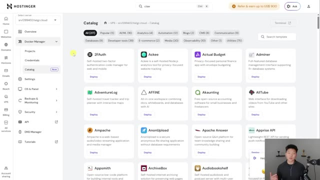
*⏱️ 00:07:49 — Capture d'écran de l'interface web de gestion de serveurs Hostinger, affichant le catalogue d'applications (Docker Manager) disponibles au déploiement.*

---

### ⏱️ `[00:08:08 - 00:08:27]` | Segment #20

**🔊 Audio (Transcription Intégrale Mot pour Mot en Français) :**
> with actually setting this up. If you're doing that on your main hardware, which I would not recommend, if you're doing it on a Mac mini, or if you're doing it on some sort of VPS, there's still a lot of risk that goes into what people could actually access or where your keys are gonna go. Which brings us to a tie at 15 points. Now this next one is super interesting. It's about costs, which I know that everyone cares a lot about.

**👁️ Analyse Visuelle d'Écran (gemini-3.5-flash-lite) :**
**Interface & Outils** : Diapositive de présentation (type PowerPoint/Keynote).

**Contenu textuel & Code** : Texte comparatif : Claude Code (8/10) décrit comme simple en local mais nécessitant du DevOps pour la production, et Clawdbot (6/10) décrit comme idéal pour l'orchestration automatisée mais présentant des risques de sécurité accrus pour les non-experts.

**Action / Démonstration** : Présentation théorique illustrant les enjeux de sécurité lors de la mise en place d'agents d'automatisation.

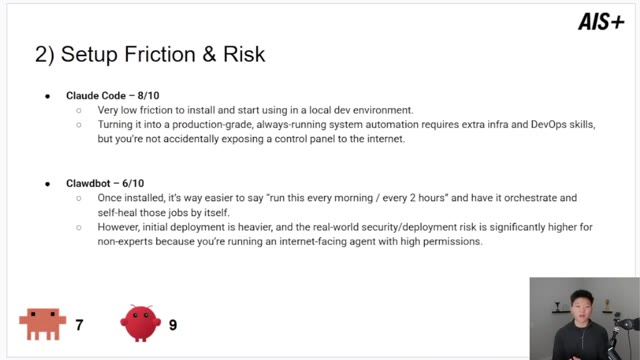
*⏱️ 00:08:13 — Une diapositive de présentation titrée "2) Setup Friction & Risk" comparant les niveaux de difficulté et les risques de sécurité entre "Claude Code" et "Clawdbot".*

---

### ⏱️ `[00:08:28 - 00:08:47]` | Segment #21

**🔊 Audio (Transcription Intégrale Mot pour Mot en Français) :**
> And we have Cloud Code at an eight and Cloud Bot at a six. And let me explain why. So starting off with Cloud, you would basically pay for a plan to be able to actually use Cloud Code. So you would have to be on at least the pro version, which is about 20 bucks a month, or you could go up to max 5x or max 20x for 100 or 200 bucks a month. Now, I know what you guys are thinking.

**👁️ Analyse Visuelle d'Écran (gemini-3.5-flash-lite) :**
**Interface & Outils** : Navigateur web (site support Anthropic).

**Contenu textuel & Code** : Tableau des plans tarifaires : Free ($0), Pro ($20/mois), Max 5x ($100/mois), Max 20x ($200/mois) avec détails sur la capacité d'utilisation.

**Action / Démonstration** : Présentation visuelle des options d'abonnement nécessaires pour accéder aux fonctionnalités avancées comme Claude Code.

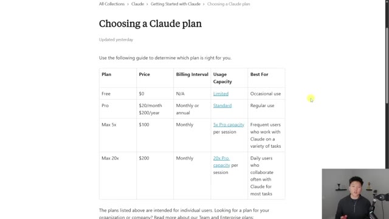
*⏱️ 00:08:32 — Page web officielle d'Anthropic intitulée "Choosing a Claude plan" présentant un tableau comparatif des tarifs et capacités des différents abonnements Claude.*

---

### ⏱️ `[00:08:47 - 00:09:12]` | Segment #22

**🔊 Audio (Transcription Intégrale Mot pour Mot en Français) :**
> That's insanely expensive if you think about other things that you might buy a monthly subscription for. But if you actually think about how much usage and output you can get out of a coding assistant like Cloud Code in a month, and then you think about that compared to what you would normally pay an actual AI engineer or software engineer to do in a month, it's an absolute steal. So for 200 bucks a month, if I can basically unlimitedly code using Opus 4.5, I'm gonna do so and I'm gonna be really happy about it.

**👁️ Analyse Visuelle d'Écran (gemini-3.5-flash-lite) :**
**Interface & Outils** : Diapositive de présentation (type Slide/Keynote).

**Contenu textuel & Code** : Comparaison textuelle des coûts : Claude Code (8/10, modèle abonnement "Netflix-style") vs ClawdBot (6/10, coûts variables VPS + API Anthropic).

**Action / Démonstration** : Présentation informative comparative sur les structures de coûts des outils d'IA.

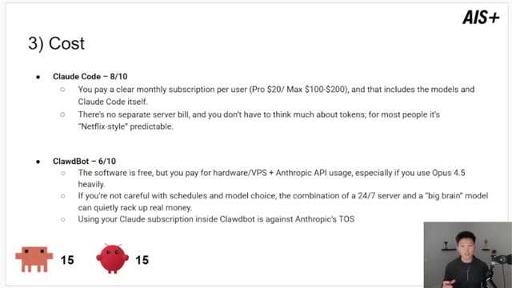
*⏱️ 00:08:53 — Une diapositive de présentation comparant les coûts entre 'Claude Code' et 'ClawdBot', détaillant les modèles de tarification (abonnement mensuel vs infrastructure + API).*

---

### ⏱️ `[00:09:12 - 00:09:31]` | Segment #23

**🔊 Audio (Transcription Intégrale Mot pour Mot en Français) :**
> So that's why I'm giving Cloud Code an eight out of 10. Now with CloudBot, which is actually now called MoldBot, as we just saw, this is different because it's an open source program. So you don't actually pay anything to use it or to install it. What you then are paying for instead is hardware or like where you actually host it. And then also the AI model that is going to power the whole system.

**👁️ Analyse Visuelle d'Écran (gemini-3.5-flash-lite) :**
**Interface & Outils** : Navigateur web (site web de Moltbot).

**Contenu textuel & Code** : Texte promotionnel : "Moltbot", slogan "EXFOLIATE! EXFOLIATE!", et liste des capacités : "Clears your inbox, sends emails, manages your calendar, checks you in for flights."

**Action / Démonstration** : Présentation visuelle de l'identité de marque et des fonctionnalités principales de l'outil Moltbot.

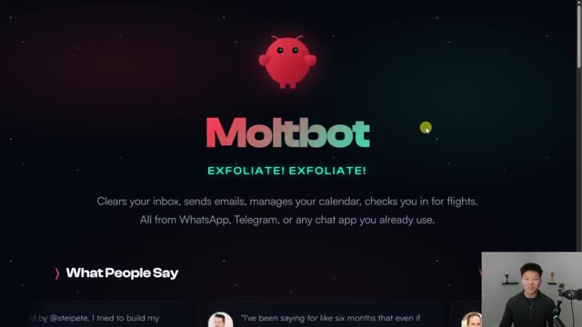
*⏱️ 00:09:17 — Page d'accueil du site web de "Moltbot" présentant le logo, le slogan et une brève description des fonctionnalités de l'outil d'automatisation.*

---

### ⏱️ `[00:09:31 - 00:10:04]` | Segment #24

**🔊 Audio (Transcription Intégrale Mot pour Mot en Français) :**
> Unless of course you're using a local AI model, but still in that case, you're paying for the hardware. And so it's interesting because the majority of demos that I've been seeing, people are using Claude models in their Claudebot to actually power everything. But what you have to be careful about and why you guys saw me earlier show off that I had used about 80 million tokens today just with my testing and building is that you're not actually supposed to use a max plan. So you're not supposed to use one of your actual Claude subscriptions when you're using something like Claudebot, which is essentially a Telegram wrapper around Claude code. That is actually against Anthropix terms of service. At least that's my understanding. So that means you have to use an

**👁️ Analyse Visuelle d'Écran (gemini-3.5-flash-lite) :**
**Interface & Outils** : Diapositive de présentation (format slide).

**Contenu textuel & Code** : Texte comparatif sur les coûts : Claude Code (abonnement mensuel fixe, prévisible) vs ClawdBot (logiciel gratuit mais coûts variables liés au matériel/VPS et à l'usage de l'API Anthropic Opus 4.5), avec un avertissement sur les conditions d'utilisation (TOS) d'Anthropic.

**Action / Démonstration** : Présentation théorique et comparative des structures de coûts pour les outils d'IA.

*⏱️ 00:09:39 — Une diapositive de présentation titrée "3) Cost" comparant les modèles économiques de "Claude Code" et "ClawdBot".*

---

### ⏱️ `[00:10:04 - 00:10:28]` | Segment #25

**🔊 Audio (Transcription Intégrale Mot pour Mot en Français) :**
> actual API key for Anthropic or Open Router or whatever models you want to use. And if you're not careful and you're just talking to your CloudBot on Telegram all the time, you can quickly, quickly run up a pretty big bill. So my bill today with that 8 million tokens was about 80 bucks. And in one session, I could have done that in CloudCode and it would not have used up almost half of my monthly membership. So I think in the grand scheme of things, it is more expensive.

**👁️ Analyse Visuelle d'Écran (gemini-3.5-flash-lite) :**
**Interface & Outils** : Présentation PowerPoint ou Keynote.

**Contenu textuel & Code** : Texte comparatif sur les coûts : Claude Code (abonnement mensuel fixe, prédictible) vs ClawdBot (gratuit mais avec frais variables d'API Anthropic et VPS, risques de factures élevées).

**Action / Démonstration** : Le présentateur explique les différences de structure de coûts entre les deux outils pour aider à la décision budgétaire.

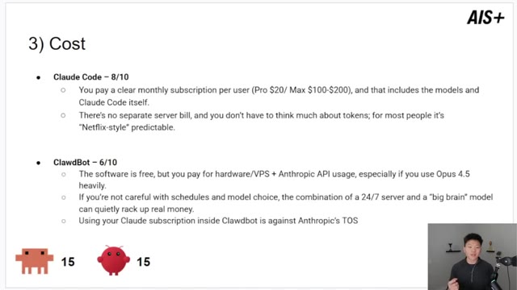
*⏱️ 00:10:10 — Une diapositive de présentation titrée "3) Cost" comparant les modèles de tarification entre "Claude Code" et "ClawdBot".*

---

### ⏱️ `[00:10:28 - 00:10:53]` | Segment #26

**🔊 Audio (Transcription Intégrale Mot pour Mot en Français) :**
> So that's why we gave CloudBot a six out of 10. So now we're at CloudCode 23, CloudBot 21. Moving on to number four, we have power and access. And I went ahead and gave Cloud Code a seven and Cloud Bot a 10. So there's a lot of similarities here, but there are some things that I just think that Cloud Bot is actually more powerful at and just has more access. So Cloud Code can edit files and folders that you pointed to, it can run terminal commands, it can operate wherever you wire it to operate.

**👁️ Analyse Visuelle d'Écran (gemini-3.5-flash-lite) :**
**Interface & Outils** : Diapositive de présentation (format texte avec liste à puces).

**Contenu textuel & Code** : Tableau comparatif : Claude Code (7/10) vs ClawdBot (10/10). Détails sur l'accès aux fichiers, l'exécution de commandes, le stockage de credentials et les risques liés à une compromission système. Score global cumulé (23 pour Claude Code, 21 pour ClawdBot) en bas à gauche.

**Action / Démonstration** : Analyse comparative et évaluation des risques de sécurité des deux agents IA.

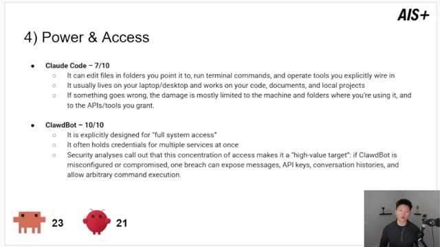
*⏱️ 00:10:34 — Une diapositive de présentation comparant "Claude Code" et "ClawdBot" selon le critère "Power & Access", incluant des notes détaillées sur leurs capacités et risques de sécurité.*

---

### ⏱️ `[00:10:53 - 00:11:19]` | Segment #27

**🔊 Audio (Transcription Intégrale Mot pour Mot en Français) :**
> It usually lives on your local hardware and it works on your code, your documents, your local projects. And if something goes wrong, the damage is mostly limited to that machine and the folders that you were actually using it with. and maybe any APIs or tools that you gave it access to. CloudBot is explicitly designed for full system access. So I could get technical and we could talk about all this stuff, but basically like if you had a VA that you gave passwords to, credit card information to, bank account information to, that's a risk.

**👁️ Analyse Visuelle d'Écran (gemini-3.5-flash-lite) :**
**Interface & Outils** : Présentation de type diaporama (type PowerPoint ou Google Slides).

**Contenu textuel & Code** : Liste à puces comparant Claude Code (7/10, accès local, risque limité) et ClawdBot (10/10, accès système complet, risque élevé de cible à haute valeur). Le logo "AIS+" est visible en haut à droite.

**Action / Démonstration** : Aucune, il s'agit d'une illustration théorique statique utilisée pour le support pédagogique du discours.

*⏱️ 00:10:59 — Une diapositive de présentation titrée "4) Power & Access" comparant les niveaux de risque et les capacités d'accès entre "Claude Code" et "ClawdBot".*

---

### ⏱️ `[00:11:19 - 00:11:40]` | Segment #28

**🔊 Audio (Transcription Intégrale Mot pour Mot en Français) :**
> This stuff at the end of the day is AI. It's non-deterministic. And so everything that you give it, it could actually go use. And it's probably going to make mistakes. So I just went ahead and asked Klaus, Can you please explain to my audience how you work? What do you actually have access to and why I limited you to keep things safe? And it said, I'm Claude Opus 4.5, running through ClaudeBot and always on Daemon on a server.

**👁️ Analyse Visuelle d'Écran (gemini-3.5-flash-lite) :**
**Interface & Outils** : Telegram (interface de messagerie).

**Contenu textuel & Code** : Le prompt de Nate Herk : "Can you explain to my audience how you work? What do you actually have access to...?" et la réponse détaillée de Klaus listant ses intégrations (YouTube API, Google Workspace, X/Twitter, accès shell, système de fichiers).

**Action / Démonstration** : Démonstration de la transparence de l'agent IA en réponse à une demande directe de l'utilisateur sur ses capacités et ses accès système.

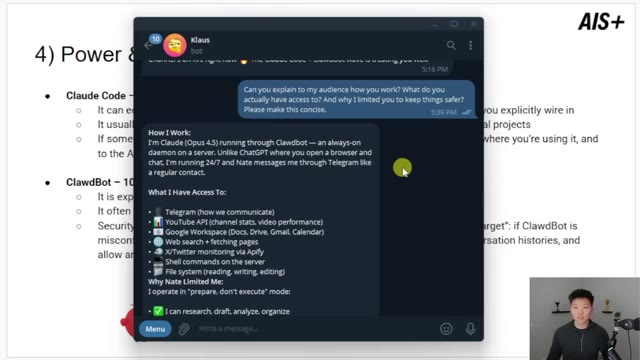
*⏱️ 00:11:30 — Capture d'écran d'une conversation Telegram avec l'agent IA "Klaus", détaillant son mode de fonctionnement et ses accès.*

---

### ⏱️ `[00:11:40 - 00:11:59]` | Segment #29

**🔊 Audio (Transcription Intégrale Mot pour Mot en Français) :**
> I have access to Telegram, YouTube, Google Workspace, Web Search, X, all these other things. And what it's supposed to do is research, draft, analyze and organize, and then wait on any external actions because an AI with shell access and API keys could do real damage if it misunderstands something. And so for the Google Workspace, I gave it its own documents.

**👁️ Analyse Visuelle d'Écran (gemini-3.5-flash-lite) :**
**Interface & Outils** : Application de messagerie Telegram (version bureau).

**Contenu textuel & Code** : Texte explicatif du bot listant ses accès (Telegram, YouTube API, Google Workspace, Web search, X/Twitter, accès shell et système de fichiers) et précisant ses limitations de sécurité ("human checkpoint").

**Action / Démonstration** : Affichage d'un récapitulatif technique des permissions et des protocoles de sécurité de l'agent IA "ClawdBot".

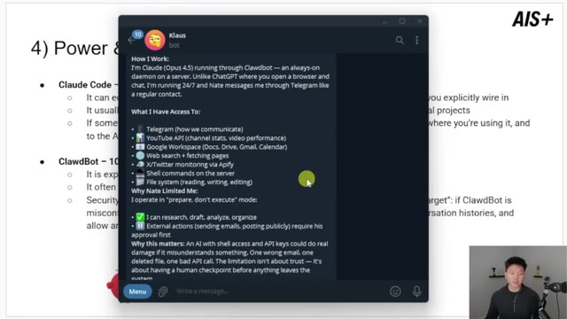
*⏱️ 00:11:45 — Interface de discussion Telegram montrant un message détaillé envoyé par le bot "Klaus" (Claude Opus 4.5), expliquant ses capacités, ses accès aux API et son mode de fonctionnement "préparer sans exécuter".*

---

### ⏱️ `[00:12:00 - 00:12:22]` | Segment #30

**🔊 Audio (Transcription Intégrale Mot pour Mot en Français) :**
> And so for Google workspace, I gave it its own email. So it creates its own docs, its own drive. It sends emails on, you know, from its own account and that kind of stuff. I gave it access to view my calendar, my main, you know, Nate Herc calendar, but it has its own. So it can't actually delete any of my stuff. Now that's a really good practice. And I would do similar things with Cloud Code and still give them, you know, like certain read only access permissions and stuff like that too.

**👁️ Analyse Visuelle d'Écran (gemini-3.5-flash-lite) :**
**Interface & Outils** : Application de messagerie Telegram (Desktop).

**Contenu textuel & Code** : Liste détaillée des permissions système de l'agent IA "Klaus" et justification de la stratégie "human-in-the-loop" pour éviter des actions irréversibles.

**Action / Démonstration** : Présentation des capacités et du cadre de sécurité opérationnel de l'agent IA utilisé par Nate Herk.

*⏱️ 00:12:05 — Une capture d'écran montrant une interface de chat Telegram avec un bot nommé "Klaus". Le message affiché liste les accès de l'agent (Telegram, YouTube API, Google Workspace, Web search, X/Twitter, Shell, File system) et explique ses limitations de sécurité ("prepare, don't execute" mode).*

---

### ⏱️ `[00:12:22 - 00:12:57]` | Segment #31

**🔊 Audio (Transcription Intégrale Mot pour Mot en Français) :**
> But a good one liner would be if something went really wrong with Cloud Code and something went really wrong with Cloud Bot, it would be worse in the Claudebot scenario, which brings us to Claudecode 30, Claudebot 31. So let's move on to number five, which is right along with this one, which is security. And so this is the type of stuff where you may not be seeing as much online just because of so much hype and how cool it really is to be seeing this kind of stuff. And I really couldn't agree more. Super, super cool. I've been seeing awesome demos. I've had so much fun today and yesterday just playing around with Claudebot all day long, but we have to talk about security. So for Claudecode, I'm going

**👁️ Analyse Visuelle d'Écran (gemini-3.5-flash-lite) :**
**Interface & Outils** : Présentation de type diaporamas (slides) avec intégration de contenu textuel et d'une capture de tweet.

**Contenu textuel & Code** : Texte comparatif sur la sécurité des agents (Claude Code vs ClawdBot) détaillant les risques, et citation d'un tweet de Peter Steinberger sur les pressions liées au développement de projets gratuits/hobby.

**Action / Démonstration** : Présentation comparative des scores de sécurité et contexte des risques opérationnels des deux outils.

*⏱️ 00:12:40 — Une diapositive présentant une analyse comparative sur la "Sécurité" entre "Claude Code" (7/10) et "ClawdBot" (3/10), accompagnée d'une capture d'écran d'un tweet illustrant les risques liés aux projets open source.*

---

### ⏱️ `[00:12:57 - 00:13:31]` | Segment #32

**🔊 Audio (Transcription Intégrale Mot pour Mot en Français) :**
> to give it a 7 out of 10. And for Claudebot, we're giving it a 3 out of 10. I wanted to share this quick tweet real quick, which comes from Peter Steinberger, the actual creator of Claudebot. And he put this out last night. The amount of crap I get for putting out a hobby project for free is quite something. People treat this like a multi-million dollar business. Security researchers demanding a bounty. Heck, I can barely buy a Mac mini from the sponsors. It's supposed to inspire people and I'm glad it does. And yes, most non-techies should not install this. It's not finished. I know about the sharp edges. It's only three months old. So hopefully that really puts it into perspective, if you are not a power user, if you don't understand security and all the risks of

**👁️ Analyse Visuelle d'Écran (gemini-3.5-flash-lite) :**
**Interface & Outils** : Plateforme de réseau social X (anciennement Twitter).

**Contenu textuel & Code** : Le texte du tweet de Peter Steinberger évoquant les pressions reçues pour son projet "hobby" gratuit, ainsi qu'une réponse d'Anthony Figueroa et les panneaux latéraux de navigation et de tendances de X.

**Action / Démonstration** : Affichage et lecture à l'écran du contenu d'un tweet pour illustrer les difficultés rencontrées par le créateur de Claudebot.

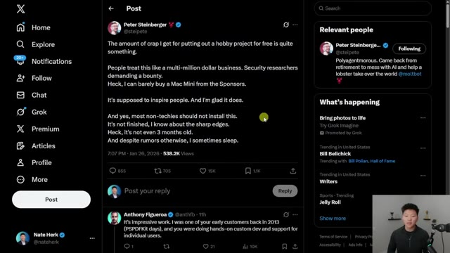
*⏱️ 00:13:06 — Capture d'écran de l'interface du réseau social X montrant un tweet publié par Peter Steinberger concernant les retours sur son projet "Claudebot".*

---

### ⏱️ `[00:13:31 - 00:13:56]` | Segment #33

**🔊 Audio (Transcription Intégrale Mot pour Mot en Français) :**
> giving AI different access to things, then maybe you shouldn't be doing this. Or if you are, it should be purely experimental and you're not embedding it into your actual work processes. Cloud code, it's still very powerful and it can still be very dangerous if you abuse it or if you don't know what you're doing. But once again, worst case scenario in both of these tools, the worst case would be worse with CloudBot. So CloudBot centralizes keys and control over many services.

**👁️ Analyse Visuelle d'Écran (gemini-3.5-flash-lite) :**
**Interface & Outils** : Présentation (diapositive illustrée)

**Contenu textuel & Code** : Texte comparatif : Claude Code noté 7/10 pour sa sécurité locale, ClawdBot noté 3/10 (risque élevé) pour sa centralisation sur des serveurs publics. Tweet intégré soulignant les critiques reçues par un développeur sur un projet "hobby".

**Action / Démonstration** : Analyse comparative et sensibilisation aux risques de sécurité liés à l'utilisation d'outils d'automatisation IA.

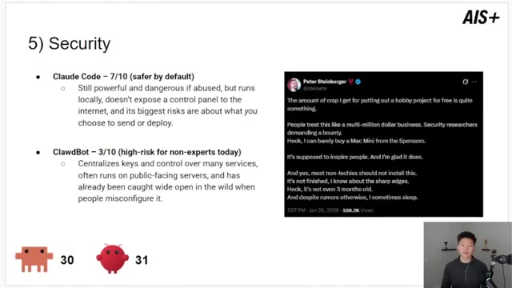
*⏱️ 00:13:38 — Une diapositive de présentation titrée "5) Security" comparant les risques entre "Claude Code" et "ClawdBot", accompagnée d'une capture d'écran d'un tweet de Peter Steinberger discutant des risques liés aux projets open source.*

---

### ⏱️ `[00:13:56 - 00:14:18]` | Segment #34

**🔊 Audio (Transcription Intégrale Mot pour Mot en Français) :**
> It often runs on public-facing servers and has already been caught wide open in the wild when people misconfigure it. So here's another tweet, and I'm actually just going to switch over to the actual X interface where we can read this. But there were over 900 servers that have been exposed with no password protection, leaking API keys, and months of private chat history. CloudBot is an open-source AI system that connects to WhatsApp, Telegram, Slack, what have you.

**👁️ Analyse Visuelle d'Écran (gemini-3.5-flash-lite) :**
**Interface & Outils** : Présentation (PowerPoint/Slide) et interface web du réseau social X.

**Contenu textuel & Code** : Analyse comparative des risques (Claude Code jugé plus sûr car local vs ClawdBot jugé à haut risque) et texte du post X alertant sur 900 serveurs "ClawdBot" exposés sans mot de passe, compromettant des clés API et des historiques de chat.

**Action / Démonstration** : Le présentateur illustre les risques de sécurité réels liés au déploiement rapide et non sécurisé d'outils d'IA ("deploy fast, secure later") en utilisant des preuves documentées sur les réseaux sociaux.

*⏱️ 00:14:02 — Une diapositive de présentation titrée "5) Security" comparant les risques de sécurité entre "Claude Code" et "ClawdBot", accompagnée d'une capture d'écran d'un tweet de Peter Steinberger.*

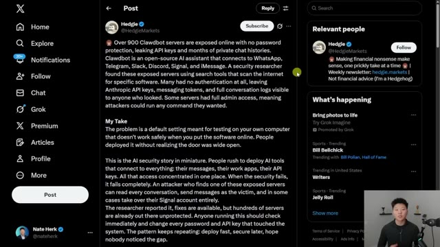
*⏱️ 00:14:07 — Une capture d'écran de l'interface du réseau social X (anciennement Twitter) affichant un post détaillé de l'utilisateur @HedgieMarkets concernant des serveurs "ClawdBot" exposés.*

---

### ⏱️ `[00:14:18 - 00:14:38]` | Segment #35

**🔊 Audio (Transcription Intégrale Mot pour Mot en Français) :**
> And a security researcher found that there are tons of exposed servers using search tools that can scan the internet for specific software. And a lot of these had no authentication. so anyone could basically get in there. And if someone hacked into your CloudBot interface where you talk to it, then they could get all of your information, all of your API keys, all of your access. So here's the actual image that came alongside this tweet, as you can see.

**👁️ Analyse Visuelle d'Écran (gemini-3.5-flash-lite) :**
**Interface & Outils** : Plateforme de réseau social X (Twitter) affichée dans un navigateur web.

**Contenu textuel & Code** : Texte détaillé expliquant que plus de 900 serveurs Clawdbot sont exposés sans mot de passe, entraînant des fuites de clés API Anthropic et d'historiques de messageries privées (WhatsApp, Telegram, Slack, Discord, etc.).

**Action / Démonstration** : Présentation informative du risque de sécurité lié à des déploiements d'outils IA mal configurés, illustrée par le partage d'une analyse d'expert sur les réseaux sociaux.

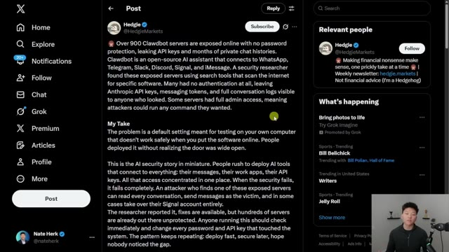
*⏱️ 00:14:23 — Capture d'écran du réseau social X (Twitter) montrant une publication virale de l'utilisateur @HedgieMarkets détaillant une faille de sécurité majeure sur les serveurs "Clawdbot".*

---

### ⏱️ `[00:14:38 - 00:15:02]` | Segment #36

**🔊 Audio (Transcription Intégrale Mot pour Mot en Français) :**
> The problem is a default setting meant for testing on your own computer that doesn't work safely when you put the software online. People deployed it without realizing that the door was wide open. So besides the fact that when you were giving CloudCode or CloudBot your API keys, you shouldn't actually do it in chat because then it saves it in conversation history. you should be doing that in the .env files, whether that is through your terminal or if you're configuring those files locally and then just putting them into that project.

**👁️ Analyse Visuelle d'Écran (gemini-3.5-flash-lite) :**
**Interface & Outils** : Plateforme X (anciennement Twitter) et présentation PowerPoint/Google Slides.

**Contenu textuel & Code** : Texte analysant les risques de sécurité liés au déploiement en ligne d'outils d'IA avec des configurations par défaut (Clawdbot, accès aux API, journaux de conversation exposés).

**Action / Démonstration** : Le présentateur utilise ces éléments visuels comme preuves de cas réels de vulnérabilités pour illustrer ses propos sur les dangers des déploiements précipités d'outils d'IA.

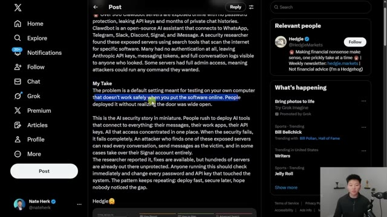
*⏱️ 00:14:44 — Une capture d'écran d'un post sur la plateforme X détaillant les failles de sécurité de "Clawdbot", avec une mise en évidence textuelle sur les problèmes de configuration par défaut.*

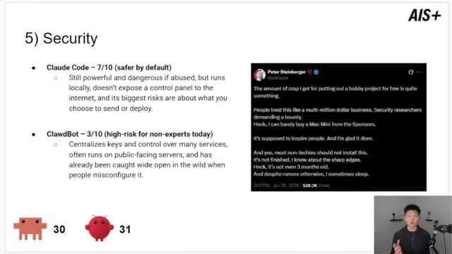
*⏱️ 00:14:50 — Une diapositive de présentation titrée "5) Security" comparant les scores de sécurité de Claude Code (7/10) et Clawdbot (3/10), illustrée par un tweet d'un développeur.*

---

### ⏱️ `[00:15:03 - 00:15:22]` | Segment #37

**🔊 Audio (Transcription Intégrale Mot pour Mot en Français) :**
> But on top of that, you have access stuff. So if you're putting stuff online, making sure that you're not pushing any secrets to GitHub or putting them online anywhere. Or when you're setting up these different dashboards and windows, you're actually making sure that you're running security checks on those. And so I'm no expert on security. I think that that much is very clear. What you can do is you can use these models to help you because they're pretty smart.

**👁️ Analyse Visuelle d'Écran (gemini-3.5-flash-lite) :**
**Interface & Outils** : Diapositive de présentation type PowerPoint/Google Slides.

**Contenu textuel & Code** : Analyse comparative : Claude Code (7/10, exécution locale, plus sûr) vs ClawdBot (3/10, haut risque, centralisation des clés, serveurs publics). Le tweet affiche les réflexions d'un développeur sur les critiques de sécurité liées à ses projets open source.

**Action / Démonstration** : Présentation théorique et comparative des risques de sécurité liés à l'utilisation d'outils d'automatisation et d'IA.

*⏱️ 00:15:07 — Une diapositive de présentation titrée "5) Security" comparant les risques de sécurité entre Claude Code et ClawdBot, illustrée par une capture d'écran d'un tweet de Peter Steinberger.*

---

### ⏱️ `[00:15:22 - 00:15:58]` | Segment #38

**🔊 Audio (Transcription Intégrale Mot pour Mot en Français) :**
> Obviously that doesn't work 100% of the time, but it's way better than you at least like just completely ignoring it. So another thing that I would have my CloudBot do or CloudCode do is constantly check the code. If I ever commit something to GitHub, check the code, make sure we didn't expose anything. When I built this dashboard, I had to do a security audit. As you can see, I have this scheduling so that every single week it's running security audits across everything that we've been doing. And so I didn't yet make the security audits a really pretty PDF with branding yet, but basically we have issues that it found. So first of all, like the dashboard was publicly accessible. We had API keys in the environment. We had different things with the ports being opened. And then we have some other

**👁️ Analyse Visuelle d'Écran (gemini-3.5-flash-lite) :**
**Interface & Outils** : Klaus Dashboard (interface web propriétaire), Google Docs.

**Contenu textuel & Code** : Liste de tâches techniques (PDF generation, API access, etc.) ; Rapport d'audit de sécurité mentionnant "DASHBOARD PUBLICLY ACCESSIBLE (PORT 3000)" avec une recommandation de sécurisation via SSH tunnel/Tailscale.

**Action / Démonstration** : Navigation dans l'interface de gestion de l'agent IA, puis ouverture du rapport de sécurité généré pour illustrer la vérification automatique des vulnérabilités.

*⏱️ 00:15:31 — Interface du "Klaus Dashboard" organisée en colonnes (To Do, In Progress, Done, Archived) listant les tâches d'automatisation.*

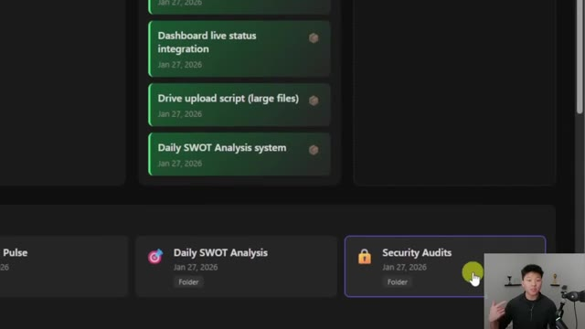
*⏱️ 00:15:40 — Gros plan sur la partie inférieure du tableau de bord "Klaus" mettant en évidence un dossier nommé "Security Audits".*

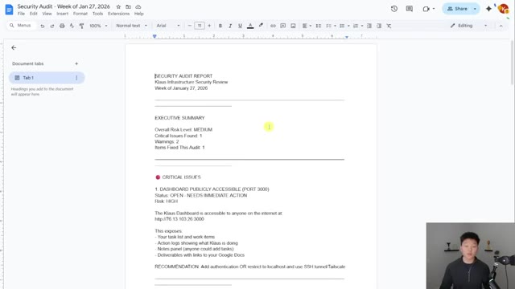
*⏱️ 00:15:49 — Document Google Docs affichant un "Security Audit Report" détaillant des vulnérabilités critiques, notamment une exposition publique du tableau de bord sur le port 3000.*

---

### ⏱️ `[00:15:58 - 00:16:34]` | Segment #39

**🔊 Audio (Transcription Intégrale Mot pour Mot en Français) :**
> best practices here. But then based on that security audit, I basically said, okay, well, let's actually do some of that stuff. And let me just clear some of these out of here and archive them to make the screen smaller. But what it did now is I have to actually log into this dashboard. So people couldn't log in here and see what I'm doing, see what's going on in the audit log and actually submit notes to talk to my Klaus. And so that's not like super, super secure, but I'm just trying to paint the picture that you can have your assistants help you out when it comes to security and build in some good best practices there. But of course, I still did give CloudCode a 7 and CloudBot a 3. So now our new total is CloudCode 37, CloudBot 34. Okay, so moving on to everyday

**👁️ Analyse Visuelle d'Écran (gemini-3.5-flash-lite) :**
**Interface & Outils** : Application web propriétaire ("Klaus Dashboard") de gestion de tâches et d'automatisation.

**Contenu textuel & Code** : Liste de tâches : "Fix PDF page breaks", "Add charts/graphs to reports", "Get X API access", "PDF generation pipeline (PDFShift)", "Daily SWOT Analysis system".

**Action / Démonstration** : Navigation et démonstration du tableau de bord ; le présentateur explique avoir mis en place des mesures de sécurité nécessitant une authentification (login).

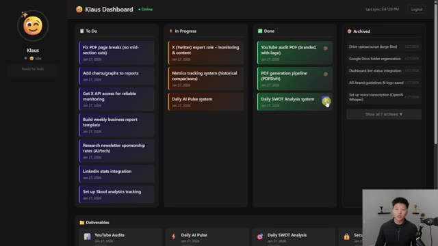
*⏱️ 00:16:07 — Interface du "Klaus Dashboard" organisée en colonnes Kanban (To Do, In Progress, Done, Archived) avec des tâches liées à l'automatisation IA.*

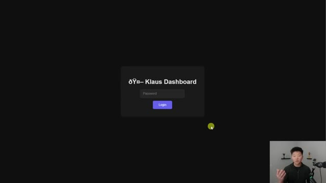
*⏱️ 00:16:16 — Écran de connexion sécurisé demandant un mot de passe pour accéder au "Klaus Dashboard".*

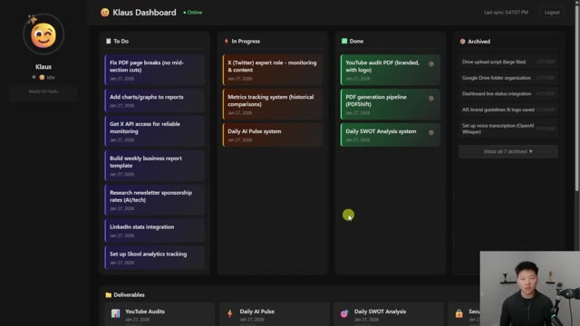
*⏱️ 00:16:25 — Vue identique à l'image #1, affichant le tableau de bord de gestion des tâches de l'agent IA Klaus.*

---

### ⏱️ `[00:16:34 - 00:17:06]` | Segment #40

**🔊 Audio (Transcription Intégrale Mot pour Mot en Français) :**
> usability. In this case, I gave CloudCode a 6 and CloudBot a 9. So CloudCode lives mainly in your terminal or VS Code or whatever you choose to use it from. And that's really comfortable for developers, but it could be intimidating for non-technical people. The UX is optimized for looking in files and looking in projects and coding workflows using slash commands, stuff like that, rather than being able to just pull up your phone or pull up Slack and say something while you're at a restaurant or while you're laying in bed or while you're on vacation. Now, of course, to be fair, you can build this functionality using Cloud Code. It's just not as easy out of the box. And on

**👁️ Analyse Visuelle d'Écran (gemini-3.5-flash-lite) :**
**Interface & Outils** : Diapositive de présentation (format texte).

**Contenu textuel & Code** : Texte comparatif détaillant les scores (Claude Code 6/10, ClawdBot 9/10) et les arguments sur l'accessibilité technique versus l'utilisation via messageries instantanées.

**Action / Démonstration** : Comparaison textuelle des outils pour illustrer les différences d'utilisabilité entre les outils orientés développeurs (terminal/VS Code) et les bots grand public (WhatsApp, Telegram, etc.).

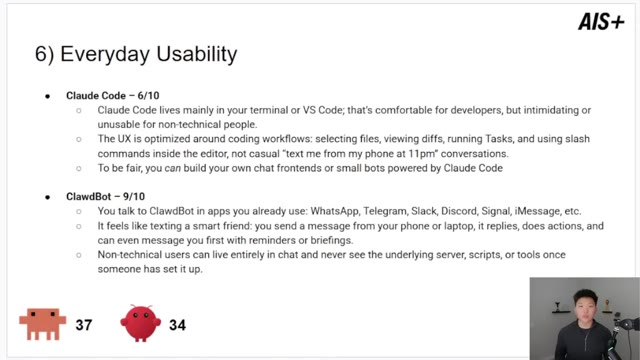
*⏱️ 00:16:42 — Une diapositive de présentation titrée "6) Everyday Usability" comparant les notes et l'expérience utilisateur de Claude Code et ClawdBot.*

---

### ⏱️ `[00:17:06 - 00:17:30]` | Segment #41

**🔊 Audio (Transcription Intégrale Mot pour Mot en Français) :**
> the other hand, Cloud Bot, nine out of 10, you can talk to it pretty much anywhere and you can have it really easily set up in a way where it's always living on that VPS and you can always communicate with it, which means it's really good at doing things proactively and reminding you of things, looking at your project management and taking action before you even know something's a problem. And I just think it's cool that in about five hours, I built an assistant where right before I go to bed, I can talk to it on Telegram and it can just do things all night while I'm sleeping.

**👁️ Analyse Visuelle d'Écran (gemini-3.5-flash-lite) :**
**Interface & Outils** : Diapositive de présentation (type PowerPoint/Keynote).

**Contenu textuel & Code** : Comparaison textuelle : points forts et limites de Claude Code (terminal/VS Code) versus ClawdBot (intégration WhatsApp, Telegram, Slack, etc.).

**Action / Démonstration** : Présentation comparative des outils soulignant l'accessibilité pour les utilisateurs non techniques.

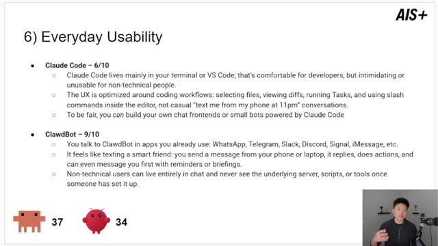
*⏱️ 00:17:12 — Une diapositive de présentation titrée "6) Everyday Usability" comparant l'utilisabilité de Claude Code (6/10) et ClawdBot (9/10), illustrant les avantages d'une interface de messagerie pour les agents IA.*

---

### ⏱️ `[00:17:30 - 00:18:00]` | Segment #42

**🔊 Audio (Transcription Intégrale Mot pour Mot en Français) :**
> And then I can wake up and have things ready for me and more action items. Now, of course, there is some scariness there because that means I'm doing all of this stuff through Telegram and I'm never actually looking at the files that are being created or the structure of the project or anything else like that. But when we're just getting tunnel vision on actual usability, I am going to give it a 9 out of 10 here. And I promise you guys I'm not doing this on purpose, but we are back at another tie at 43 points. So to come break up this tie, we've got actual ROI, which I think is super, super important. And in my mind, I weight this a little bit higher.

**👁️ Analyse Visuelle d'Écran (gemini-3.5-flash-lite) :**
**Interface & Outils** : Présentation de diapositives (format texte structuré).

**Contenu textuel & Code** : Texte comparatif sur l'expérience utilisateur (UX) : Claude Code est décrit comme orienté développeur (terminal/VS Code), tandis que ClawdBot est présenté comme une interface conversationnelle (WhatsApp, Telegram, etc.) pour utilisateurs non-techniques.

**Action / Démonstration** : Analyse comparative des paradigmes d'interaction avec des agents IA : interface de développement vs interface de messagerie conversationnelle.

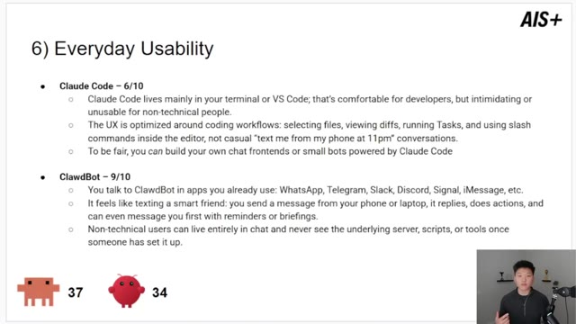
*⏱️ 00:17:37 — Une diapositive de présentation intitulée "6) Everyday Usability" comparant l'utilisabilité de "Claude Code" (noté 6/10) et de "ClawdBot" (noté 9/10), mettant en avant l'accessibilité pour les non-techniciens via des applications de messagerie.*

---

### ⏱️ `[00:18:00 - 00:18:35]` | Segment #43

**🔊 Audio (Transcription Intégrale Mot pour Mot en Français) :**
> So Cloud Code comes in an 8.5 out of 10 with CloudBot coming in at a 6. The reason is Cloud Code has been around for about a year now and CloudBot is like three weeks old. So Cloud Code has actual receipts. Teams are shipping real features faster with less manual work. There are so many data and projects to back that up. Internal and third-party analysis talk about 10 to 30% faster delivery on comparable tasks, plus roughly a quarter of work being extra features and fixes that wouldn't have been built without the assistance of Claude Code. And really like the poster child is Claude Cowork, which was built completely with Claude Code by a few engineers

**👁️ Analyse Visuelle d'Écran (gemini-3.5-flash-lite) :**
**Interface & Outils** : Diapositive de présentation (type PowerPoint/Google Slides)

**Contenu textuel & Code** : Texte comparatif listant les avantages de Claude Code (rapidité de livraison, données réelles) et les limites de Clawdbot (statut de prototype, nouveauté, aspect conceptuel).

**Action / Démonstration** : Comparaison analytique et évaluation du retour sur investissement des deux outils.

*⏱️ 00:18:09 — Une diapositive de présentation titrée "7) Actual ROI" comparant les notes et les performances de "Claude Code" (8.5/10) et "Clawdbot" (6/10) avec des points de détail justifiant ces scores.*

---

### ⏱️ `[00:18:35 - 00:19:09]` | Segment #44

**🔊 Audio (Transcription Intégrale Mot pour Mot en Français) :**
> in about 10 days. And I don't know a ton about software engineering and, you know, feature and product design, but I know for a fact that this would have taken at least a few months, if not a year with manual coding and probably more than just a few engineers. CloudBot, on the other hand, has been doing some really impressive stuff. And that's why it's doing well on X and YouTube and LinkedIn. But it's just a lot of cool use cases right now. And I haven't seen people really ship like amazing apps or generate tons of revenue and money from this type of stuff yet or save hours and hours of work yet. It's super, super cultural and it's conceptual and it's really

**👁️ Analyse Visuelle d'Écran (gemini-3.5-flash-lite) :**
**Interface & Outils** : Diapositive de présentation (type PowerPoint/Keynote).

**Contenu textuel & Code** : Texte comparatif structuré : Claude Code (score 8.5/10) est présenté comme un outil capable d'accélérer la livraison de 10 à 30% avec des preuves concrètes (ex: Claude CoWork construit en 10 jours). Clawdbot (score 6/10) est décrit comme un prototype robotique expérimental, moins mature et orienté "conceptuel" que "économiquement prouvé".

**Action / Démonstration** : Présentation théorique et analyse comparative du retour sur investissement des technologies mentionnées par l'orateur.

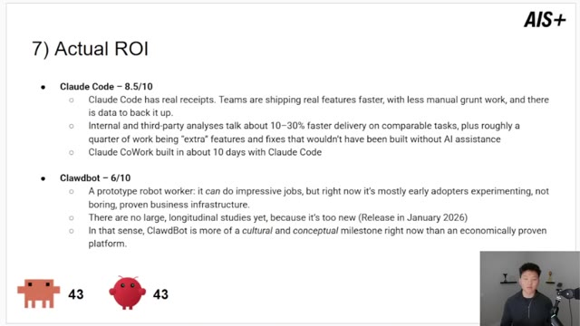
*⏱️ 00:18:44 — Une diapositive de présentation titrée "7) Actual ROI" comparant les performances et la maturité de "Claude Code" et "Clawdbot".*

---

### ⏱️ `[00:19:09 - 00:19:41]` | Segment #45

**🔊 Audio (Transcription Intégrale Mot pour Mot en Français) :**
> cool. And I'm not trying to take anything away from the team that has built CloudBot because it is very, very impressive. It's just that right now it's super new and it's just hard to actually see where the ROI is. We can conceptualize and we understand this whole like idea of AGI and the ability to have an executive assistant. And I of course have, you know, have spun mine up and I think that it's pretty valuable, but just because stuff gets done quicker doesn't actually mean that it's getting done better. And I know that it is using Opus 4.5 a lot of the time. So we do have some good faith there, but still I'm giving it a six rather than giving it anywhere up near Cloud

**👁️ Analyse Visuelle d'Écran (gemini-3.5-flash-lite) :**
**Interface & Outils** : Diapositive de présentation (type PowerPoint/Keynote) intégrée à une vidéo.

**Contenu textuel & Code** : Texte comparatif : Claude Code est présenté comme éprouvé avec 10-30% de gain de vitesse, tandis que Clawdbot est décrit comme un prototype expérimental ("cultural and conceptual milestone") manquant de données de ROI à long terme.

**Action / Démonstration** : Présentation comparative des outils illustrant le retour sur investissement (ROI) pour justifier l'adoption technologique.

*⏱️ 00:19:17 — Une diapositive de présentation titrée "7) Actual ROI" comparant les performances et la maturité de "Claude Code" et de "Clawdbot", avec une note respective de 8.5/10 et 6/10.*

---

### ⏱️ `[00:19:41 - 00:20:05]` | Segment #46

**🔊 Audio (Transcription Intégrale Mot pour Mot en Français) :**
> Code at an 8.5. So that brings our total right now to 51.5 for Cloud Code and 49 for CloudBot. And unfortunately, that is going to be the final score because the last metric I wasn't able to really give a numeric value to, but I wanted to talk about the ICP here because I do also believe that these are kind of built for different people, at least right now. And, you know, CloudBot is super, super new, so it's going to evolve a lot, but it's just kind of different use cases right now.

**👁️ Analyse Visuelle d'Écran (gemini-3.5-flash-lite) :**
**Interface & Outils** : Présentation visuelle de type diaporama (type Google Slides/PowerPoint).

**Contenu textuel & Code** : Texte comparatif sur les cibles utilisateurs : développeurs et fondateurs techniques pour Claude Code ; fondateurs techniques, "indie hackers" et profils orientés automatisation/sécurité pour Clawdbot.

**Action / Démonstration** : Synthèse des résultats et transition vers l'analyse qualitative du public cible (ICP).

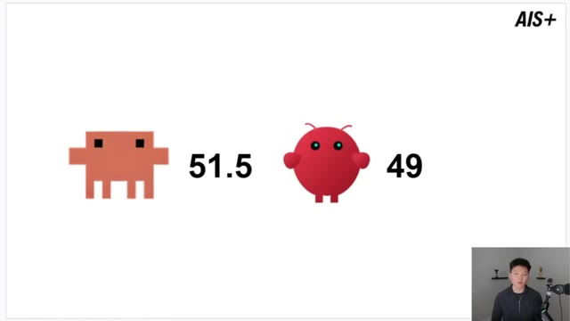
*⏱️ 00:19:47 — Tableau récapitulatif présentant les scores finaux : 51.5 pour Cloud Code (représenté par un pixel art en forme d'alien) et 49 pour CloudBot (représenté par un avatar rond rouge).*

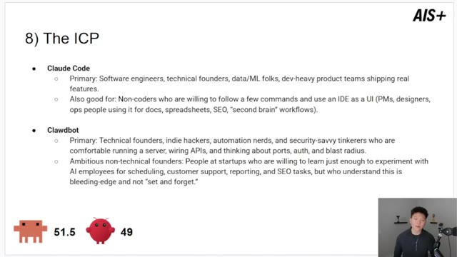
*⏱️ 00:19:59 — Diapositive intitulée "8) The ICP" détaillant le profil client idéal (ICP) pour Claude Code et Clawdbot, avec leurs scores respectifs en bas de page.*

---

### ⏱️ `[00:20:05 - 00:20:28]` | Segment #47

**🔊 Audio (Transcription Intégrale Mot pour Mot en Français) :**
> So Cloud Code, primarily built for software engineers, technical founders, data and machine learning folks. It's dev heavy, and it's for teams that are ready to ship real features and products. It's also good for non-coders who are willing to, you know, get out of the comfort zone a little bit. Like me, I would kind of consider myself, you know, a non-coder. And I'm able to build these things like workflows for myself, other automations, front ends, and it's been really, really good.

**👁️ Analyse Visuelle d'Écran (gemini-3.5-flash-lite) :**
**Interface & Outils** : Présentation type diaporama (Slides).

**Contenu textuel & Code** : Texte comparatif définissant les publics cibles : "Claude Code" (ingénieurs, fondateurs techniques, non-codeurs) et "Clawdbot" (fondateurs techniques, indie hackers, automation nerds).

**Action / Démonstration** : Aucune, il s'agit d'un support visuel statique présentant des définitions textuelles.

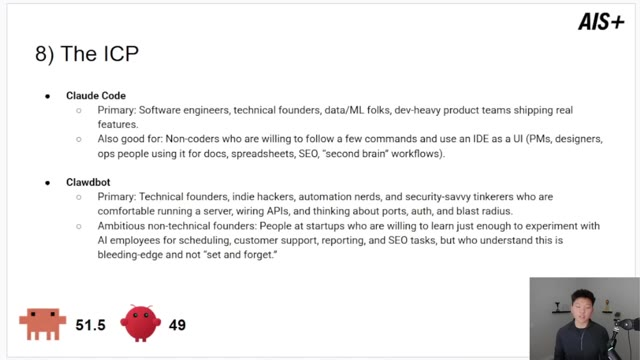
*⏱️ 00:20:11 — Une diapositive de présentation titrée "8) The ICP" listant le profil client idéal pour Claude Code et Clawdbot.*

---

### ⏱️ `[00:20:28 - 00:20:48]` | Segment #48

**🔊 Audio (Transcription Intégrale Mot pour Mot en Français) :**
> And it's helped me become more productive. Now for CloudBot, a little bit similar, yes, but in the early stages, it's for technical founders, indie hackers, automation nerds, and security-savvy tinkerers who are comfortable running a server, wiring APIs, thinking about ports, privacy, blast radius, all that kind of stuff. You remember the tweet from the creator himself, and yes, most non-techies should not install this.

**👁️ Analyse Visuelle d'Écran (gemini-3.5-flash-lite) :**
**Interface & Outils** : Présentation de type diaporama (Slides).

**Contenu textuel & Code** : Texte structuré listant les publics cibles : "Software engineers, technical founders" pour Claude Code, et "Technical founders, indie hackers, automation nerds, security-savvy tinkerers" pour Clawdbot.

**Action / Démonstration** : Aucune, support visuel pédagogique listant les segments d'utilisateurs.

*⏱️ 00:20:33 — Une diapositive de présentation titrée "8) The ICP" détaillant les profils cibles (Ideal Customer Profile) pour "Claude Code" et "Clawdbot".*

---

### ⏱️ `[00:20:48 - 00:21:09]` | Segment #49

**🔊 Audio (Transcription Intégrale Mot pour Mot en Français) :**
> And I also said in my last video about how to set up CloudBot on a VPS that this is definitely for power users. You should be experimenting. You shouldn't be putting this into real business environments if you don't know how it works and what it's going to do. So ultimately, how do I feel about who wins? Well, the numbers here show CloudCode. Cloud code wins on security, proven results, and lower risk for non-experts.

**👁️ Analyse Visuelle d'Écran (gemini-3.5-flash-lite) :**
**Interface & Outils** : Présentation de type diaporama (type PowerPoint ou Google Slides).

**Contenu textuel & Code** : Texte comparatif définissant les utilisateurs types (ingénieurs, fondateurs techniques vs profils non-techniques prêts à expérimenter) pour Claude Code et Clawdbot.

**Action / Démonstration** : Analyse conceptuelle et catégorisation de l'audience cible pour ces outils d'automatisation IA.

*⏱️ 00:20:54 — Une diapositive de présentation titrée "8) The ICP" (Ideal Customer Profile) détaillant les profils utilisateurs cibles pour "Claude Code" et "Clawdbot".*

---

### ⏱️ `[00:21:09 - 00:21:29]` | Segment #50

**🔊 Audio (Transcription Intégrale Mot pour Mot en Français) :**
> Cloud bot wins on accessibility, ambient presence, and it feels like the future. And it really does. And it's super cool. Like I said, I just think that it's really important to think about when something's blowing up online, why is it blowing up? What is the motive for all these creators? And obviously I can't lie because I made a video because I knew it was going to do well, because I knew a lot of people are looking to set this up on a VPS because I don't want to set it up on a Mac mini.

**👁️ Analyse Visuelle d'Écran (gemini-3.5-flash-lite) :**
**Interface & Outils** : Présentation de type diapositive (slide deck).

**Contenu textuel & Code** : Tableau comparatif : Claude Code (score 51.5, points forts : sécurité, résultats prouvés, faible risque) vs Clawdbot (score 49, points forts : accessibilité, présence ambiante, aspect futuriste).

**Action / Démonstration** : Comparaison analytique des deux outils d'IA.

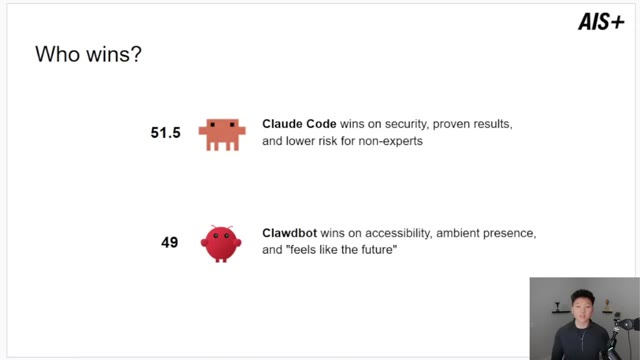
*⏱️ 00:21:14 — Une diapositive de présentation comparant "Claude Code" et "Clawdbot" avec des scores chiffrés et leurs points forts respectifs.*

---

### ⏱️ `[00:21:30 - 00:22:02]` | Segment #51

**🔊 Audio (Transcription Intégrale Mot pour Mot en Français) :**
> So there is an element of, you know, taking advantage of the hype, but that's why I really wanted to make this comparison video because when I started to use it more and more, I realized everything that I'm doing here, I could be doing on Cloud Code, but on Cloud Code, I actually understand it a bit more. So I really hope that you guys enjoyed this breakdown. So if you did, and you appreciate this style of teaching and thinking, then definitely check out my plus community. The link for that is down in the description. We've got a great community of over 3000 members who are building with AI every single day, building businesses around AI. So it's a great place to be if you have similar goals. We've got full courses in here and we're planning

**👁️ Analyse Visuelle d'Écran (gemini-3.5-flash-lite) :**
**Interface & Outils** : Logiciel de présentation (diapositive) pour l'image 1 ; Plateforme communautaire Skool pour l'image 2.

**Contenu textuel & Code** : Image 1 : Comparaison point par point : Claude Code (51.5) mis en avant pour la sécurité et la fiabilité vs Clawdbot (49) pour l'accessibilité et l'expérience utilisateur.

**Action / Démonstration** : Image 1 : Présentation d'un argumentaire de conclusion/synthèse sur les outils comparés. Image 2 : Navigation dans une communauté en ligne pour illustrer le contexte du projet.

*⏱️ 00:21:38 — Tableau comparatif synthétique intitulé "Who wins?" évaluant "Claude Code" et "Clawdbot" avec des scores chiffrés et des arguments qualitatifs.*

---

### ⏱️ `[00:22:02 - 00:22:26]` | Segment #52

**🔊 Audio (Transcription Intégrale Mot pour Mot en Français) :**
> to launch completely new series and workshops around the idea of vibe coding and cloud code and stuff like that. So if you're interested, I'd love to see you guys in this community. But anyways, that's going to do it for this one. So if you guys enjoyed or if you learned something new, then please give it a like. It definitely helps me out a ton. And before I sign off, I just wanted to have Klaus give you guys a word of advice. You don't need to be a developer to use these tools. Six months ago, most of what you just saw wasn't possible.

**👁️ Analyse Visuelle d'Écran (gemini-3.5-flash-lite) :**
**Interface & Outils** : Dashboard personnalisé type "Agent Hub" intégrant une interface de messagerie (fenêtre de chat Claude).

**Contenu textuel & Code** : Le chat expose le fonctionnement technique de "Clawdbot" : accès aux API (YouTube, Google Workspace, X/Twitter, Shell), exécution en mode "prepare, don't execute" avec validation humaine, et une invite demandant à l'IA de rédiger un message de motivation pour l'audience sur l'apprentissage des outils d'IA.

**Action / Démonstration** : Démonstration de l'interaction entre un humain et un agent IA autonome ("Klaus") gérant des tâches automatisées et communiquant via une interface de type chat.

*⏱️ 00:22:14 — Une interface de tableau de bord personnalisée nommée "Klaus Dashboard" affichant un agent IA interactif (Clawdbot/Claude Opus 3.5) au centre, avec une liste de tâches (To Do, Done, Archived) en arrière-plan.*

---

### ⏱️ `[00:22:27 - 00:22:46]` | Segment #53

**🔊 Audio (Transcription Intégrale Mot pour Mot en Français) :**
> A year from now, it'll be even crazier. The people who win aren't the ones who wait for it to be easy. They're the ones experimenting right now, making mistakes, figuring it out. So pick a tool, break something, learn from it. That's how you stay ahead. See you in the next one. All right. Well, thanks, Klaus. Thanks, everyone. I'll see you guys in the next one.

**👁️ Analyse Visuelle d'Écran (gemini-3.5-flash-lite) :**
**Interface & Outils** : Klaus Dashboard (application personnalisée) et client Telegram (messagerie).

**Contenu textuel & Code** : Liste des accès de l'agent (Telegram, YouTube API, Google Workspace, Web search, X/Twitter, accès Shell et système de fichiers) et explication du mode "prepare, don't execute" pour la sécurité. Un message utilisateur demande à l'agent de rédiger un message de motivation pour une vidéo YouTube.

**Action / Démonstration** : Affichage des capacités d'un agent IA autonome et interaction de l'utilisateur avec celui-ci via une interface de chat.

*⏱️ 00:22:32 — Interface d'un tableau de bord nommé "Klaus Dashboard" superposée à une fenêtre de messagerie Telegram où l'agent IA "Klaus" détaille ses accès et ses limites opérationnelles.*

---

