# 🎬 I Turned Clawdbot Into the Ultimate Personal Assistant

> **Chaîne** : [Nate Herk | AI Automation](https://www.youtube.com/@nateherk/featured)  
> **Lien YouTube** : [https://www.youtube.com/watch?v=rlJovzVhlIo](https://www.youtube.com/watch?v=rlJovzVhlIo)  
> **Date de publication** : 20260130  
> **Durée** : 00:25:37  
> **Identifiant vidéo** : `rlJovzVhlIo`  
> **Transcription & Analyse** : `whisper-v3-large-turbo+gemini-3.5-flash-lite`  

---

## 📌 Synthèse Exécutive & Outils

### 💡 Résumé
Dans cette vidéo intitulée **I Turned Clawdbot Into the Ultimate Personal Assistant**, Nate Herk décortique les capacités pratiques d'automatisation et de développement propulsées par les modèles de pointe.

### 🛠️ Outils, Modèles & Logiciels Présentés
- **Opus 5.5 & Claude Code** : Modèles d'ingénierie et agents de codage autonome.

### 🔑 Points Clés & Enseignements Stratégiques
- Optimiser le niveau d'effort et le raisonnement des modèles IA pour des résultats industriels.
- Automatiser les cycles de création logicielle de bout en bout.

---

## ⏱️ Chronologie & Transcription Complète Audio & Visuelle (Mot pour Mot)

### ⏱️ `[00:00:00 - 00:00:18]` | Segment #01

**🔊 Audio (Transcription Intégrale Mot pour Mot en Français) :**
> Last night I was laying in bed and I texted Klaus to build me a YouTube dashboard. And I told her that I was about to go to sleep so that I wouldn't be around. So it spun up the initial page and then it gave itself six more to-dos that it would take care of while I was sleeping. And then when I woke up and I opened up my computer, I had this. I've got a YouTube analytics dashboard where I can track my seven-day stats, my 30-day stats.

**👁️ Analyse Visuelle d'Écran (gemini-3.5-flash-lite) :**
**Interface & Outils** : Interface de messagerie instantanée (type Telegram Desktop).

**Contenu textuel & Code** : Un message du bot Klaus contenant une URL de tableau de bord, le statut des tâches (To-Do, In Progress, Done) et un tableau formaté en texte listant 6 tâches prioritaires (YouTube Data API Integration, Dashboard View with Charts, Comment Analysis, etc.).

**Action / Démonstration** : Communication autonome de l'agent IA informant l'utilisateur du travail accompli et de la planification des tâches à effectuer durant la nuit.

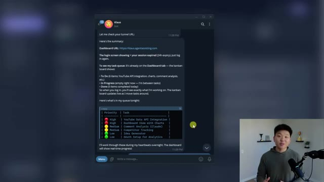
*⏱️ 00:00:05 — Une capture d'écran d'une interface de messagerie (probablement Telegram) montrant une interaction avec un bot nommé "Klaus", détaillant l'état d'avancement d'un tableau de bord YouTube.*

---

### ⏱️ `[00:00:18 - 00:00:52]` | Segment #02

**🔊 Audio (Transcription Intégrale Mot pour Mot en Français) :**
> I can look at my videos and see how they're performing relative to other videos. I've got a hub to look at all my comments, whether that's hot topics, common questions, pain points, or just looking at all the recent comments on here. It's able to pull in competitor videos and see which of these are breaking out And then it uses all that data to help me come up with ideas So it comes up with titles for YouTube videos that I could make based on my audience and based on the trends This is just v1. It did this while I was sleeping So this is my dashboard that my ultimate assistant Klaus built for me in here I can see all the tasks that he's working on what's in the backlog and I can even see up here when he's actually working Or when he's not so last night before I go to bed

**👁️ Analyse Visuelle d'Écran (gemini-3.5-flash-lite) :**
**Interface & Outils** : Application Web personnalisée "YouTube Intel", interface de gestion de projet/agent "Klaus".

**Contenu textuel & Code** : Analyse de commentaires YouTube, suggestions de titres de vidéos basées sur l'IA, tickets de développement (ex: "YouTube Dashboard: Comment Analysis (Claude)").

**Action / Démonstration** : Navigation dans l'interface de l'outil d'analyse, démonstration des fonctionnalités de génération d'idées et suivi des tâches de développement de l'agent.

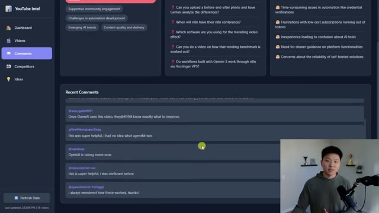
*⏱️ 00:00:27 — Interface "YouTube Intel" affichant la section "Comments" avec des sujets chauds, des questions fréquentes et une liste de commentaires récents.*

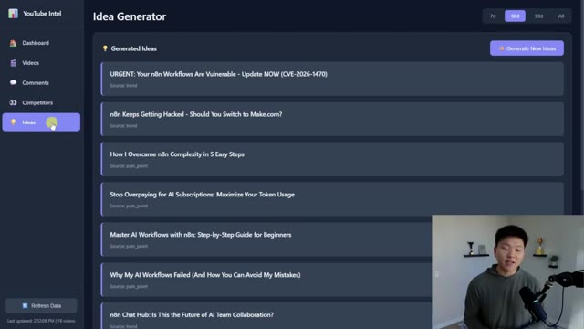
*⏱️ 00:00:35 — Interface "YouTube Intel" affichant la section "Idea Generator" listant des idées de vidéos générées basées sur des tendances et des points de douleur.*

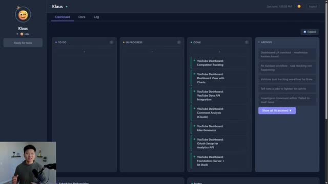
*⏱️ 00:00:44 — Tableau de bord de gestion de tâches "Klaus" (type Kanban) montrant des colonnes "To Do", "In Progress", "Done" et "Archive" avec des tickets de développement.*

---

### ⏱️ `[00:00:52 - 00:01:13]` | Segment #03

**🔊 Audio (Transcription Intégrale Mot pour Mot en Français) :**
> I basically say hey all night when I'm sleeping I want you to build me a YouTube dashboard and so we put together a spec list He threw all of his tasks in the to-do section, as you can see. So of course I go to bed, I wake up feeling like a kid on Christmas, and then I check in on the morning and he says, the YouTube dashboard MVP is done. And so I come into the dashboard this morning and I can see that everything has now been moved over here to done.

**👁️ Analyse Visuelle d'Écran (gemini-3.5-flash-lite) :**
**Interface & Outils** : Application de messagerie type Slack/Discord intégrée dans une interface de gestion de projet (dashboard).

**Contenu textuel & Code** : - Image 1 : Liste de tâches (Priority, Task) avec indicateurs visuels (High, Medium, Low) pour des fonctions comme "YouTube Data API Integration" et "Dashboard View".
- Image 2 : Compte-rendu détaillé des fonctionnalités développées par l'agent ("Channel stats", "Breakout detection", "Comment analysis", "Idea generator", "PDF reports").

**Action / Démonstration** : Communication asynchrone entre l'utilisateur et son agent IA, où l'agent rapporte l'achèvement complet du "YouTube Dashboard MVP" après une nuit de travail autonome.

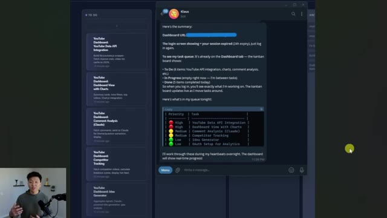
*⏱️ 00:00:57 — Interface de chat avec un agent IA nommé "Klaus" détaillant le statut du projet, avec une liste de tâches priorisées (Priority, Task) affichée dans un bloc de code.*

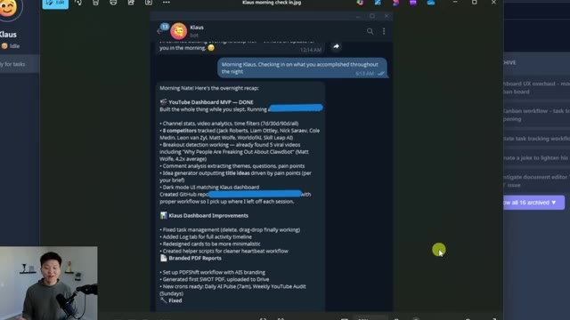
*⏱️ 00:01:03 — Récapitulatif matinal envoyé par l'agent "Klaus", listant les accomplissements nocturnes (YouTube Dashboard MVP, analyse de données, intégrations) et les améliorations effectuées.*

---

### ⏱️ `[00:01:14 - 00:01:32]` | Segment #04

**🔊 Audio (Transcription Intégrale Mot pour Mot en Français) :**
> And this is what we got. So hopping back into my Klaus dashboard, if I now go to the log, I can see everything that he does. So if I scroll down to where it would have been this morning. So last night I went to bed at like midnight. So right here is where I started this. and then after we kicked off all the spec docs and I added all of these tasks to his backlog, look what he did.

**👁️ Analyse Visuelle d'Écran (gemini-3.5-flash-lite) :**
**Interface & Outils** : Application web propriétaire "Klaus" (tableau de bord d'agent autonome).

**Contenu textuel & Code** : Liste chronologique des entrées de log horodatées (de 12:00 PM à 1:00 PM), détaillant les tâches réalisées par l'agent : implémentation d'améliorations UI Kanban, refactorisation de composants, mise à jour des fichiers `status.json`, `server.js` et `style.css`.

**Action / Démonstration** : Navigation et consultation de l'historique d'exécution des tâches de l'agent IA dans l'onglet "Log" du tableau de bord.

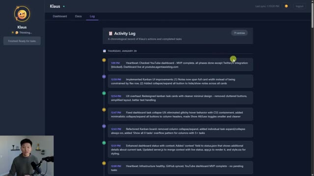
*⏱️ 00:01:18 — Interface web du tableau de bord "Klaus" affichant le journal d'activité (Activity Log) chronologique des actions effectuées par l'agent IA.*

---

### ⏱️ `[00:01:33 - 00:01:52]` | Segment #05

**🔊 Audio (Transcription Intégrale Mot pour Mot en Français) :**
> 1231 did something, 1248, 115, 142, 208, 234, like all night up until like seven when I checked in on him and he started doing some daily pull stuff in the morning. He was just working on the YouTube dashboard all night long. So I mean, if that doesn't at least get you a little bit excited, then I don't know what will. So today I'm gonna be going over this dashboard, how I built it, how you can create your own version of Klaus.

**👁️ Analyse Visuelle d'Écran (gemini-3.5-flash-lite) :**
**Interface & Outils** : Dashboard de l'agent IA propriétaire nommé "Klaus".

**Contenu textuel & Code** : Logs horodatés d'opérations techniques (ex: "Fixed YouTube dashboard server crash", "Ran full data refresh", "Added opportunity scoring"). Dans la seconde image, liste des livrables ("Competitor Tracking", "Comment Analysis", "Idea Generator").

**Action / Démonstration** : Revue de l'historique d'exécution et de l'état actuel des tâches de l'agent IA, illustrant son travail autonome durant la nuit.

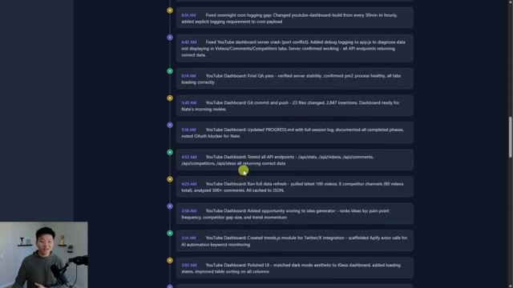
*⏱️ 00:01:38 — Historique détaillé des logs d'activités nocturnes de l'agent "Klaus", listant les tâches accomplies pour le tableau de bord YouTube.*

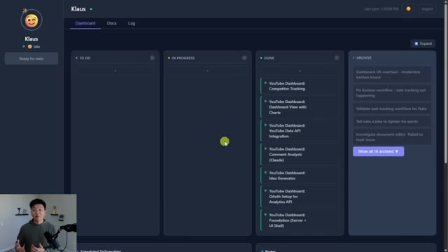
*⏱️ 00:01:48 — Interface de gestion de tâches (style Kanban) de l'agent "Klaus" montrant les colonnes "To Do", "In Progress", "Done" et "Archive".*

---

### ⏱️ `[00:01:52 - 00:02:28]` | Segment #06

**🔊 Audio (Transcription Intégrale Mot pour Mot en Français) :**
> So pretty much everything that I've done with my CloudBot here. and then I'm going to talk about five hacks for a smarter assistant because it is a really smart tool but there's a lot of things that you have to overcome and I've had a lot of frustration when I was building out this dashboard and getting Klaus to work in a way that actually makes me more efficient rather than less. Now the reason that I'm actually so excited by this and I've been having so much fun with it is because it's like the NNN Ultimate Assistant except for it is 15 times more powerful. This is one of the videos I made about NNN that went viral and it's the Ultimate Assistant which I've configured to have an email agent, a calendar agent, contact agent, content creator agent, a search tool. If you think about it, the functionality is really not that

**👁️ Analyse Visuelle d'Écran (gemini-3.5-flash-lite) :**
**Interface & Outils** : n8n (outil d'automatisation de workflows).

**Contenu textuel & Code** : Le schéma montre un flux partant d'un « Telegram Trigger » passant par une transcription audio, vers un « Parent Agent » (Ultimate Assistant) qui orchestre des sous-agents (Email, Calendrier, Contact, Création de contenu) et des outils de réflexion (« Think »).

**Action / Démonstration** : Présentation de l'architecture technique et de la structure logique de l'assistant automatisé (« Klaus »).

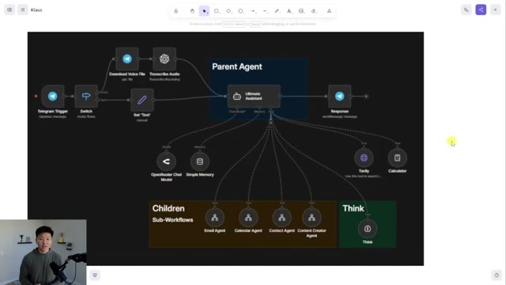
*⏱️ 00:02:10 — Un diagramme de workflow complexe montrant l'architecture d'un agent IA (« Parent Agent ») connecté à des outils (Tavily, Calculateur, OpenRouter) et des sous-workflows spécialisés (« Children »).*

---

### ⏱️ `[00:02:28 - 00:02:54]` | Segment #07

**🔊 Audio (Transcription Intégrale Mot pour Mot en Français) :**
> much. We're able to talk to it through Telegram and it responds to us in Telegram. And so all of the sub agents I obviously had to build. So for example, the email agent looks like this with all the email tools. And if I wanted to add a different type of agent, I would have to go into NNN and build that out. But what happens with Klaus is really cool because it's like, let's say you have five functions. And if you want to figure out if you can do something else, like, hey, Klaus, can you send voice notes? Sure. Let me just research how that works. Okay, cool. Here's how I could do that, do you want me to actually build this in?

**👁️ Analyse Visuelle d'Écran (gemini-3.5-flash-lite) :**
**Interface & Outils** : Logiciel de diagramme de flux (type Miro/Whimsical) et interface de gestion de base de connaissances pour agents IA ("Klaus").

**Contenu textuel & Code** : Diagramme avec hiérarchie "Children/Sub-Workflows" (Email Agent, Calendar Agent, etc.) et documentation technique sur l'IA (rôle, systèmes de mémoire, accès et capacités).

**Action / Démonstration** : Le présentateur illustre visuellement l'architecture modulaire de ses sous-agents, puis montre le document de référence centralisé qui définit les règles opérationnelles de son assistant IA, "Klaus".

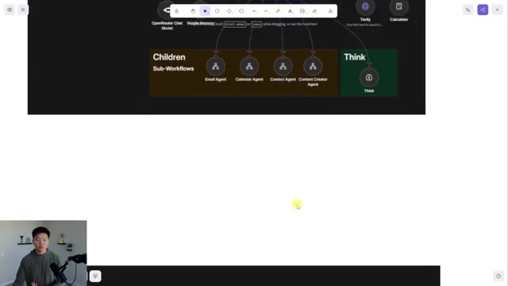
*⏱️ 00:02:35 — Une vue d'ensemble d'un diagramme de workflow sur tableau blanc interactif, illustrant une structure d'agents IA (Email, Calendar, Contact, Content Creator) connectés à un module central de réflexion.*

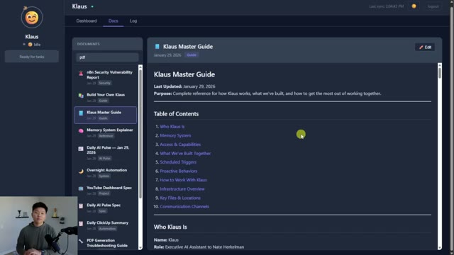
*⏱️ 00:02:41 — Interface de gestion de documentation nommée "Klaus", affichant le "Klaus Master Guide" avec un sommaire détaillé des capacités et comportements de l'assistant IA.*

---

### ⏱️ `[00:02:54 - 00:03:13]` | Segment #08

**🔊 Audio (Transcription Intégrale Mot pour Mot en Français) :**
> So basically any feature that you could describe, Klaus will figure out how to do it. And if it's possible, it will just do it for you. What's on your end of course, is actually maybe going and creating an API and putting that in your .env, or maybe going and paying for a plan and then giving him that username or something like that. So yeah, here's where I put in my Klaus Master Guide access and capabilities.

**👁️ Analyse Visuelle d'Écran (gemini-3.5-flash-lite) :**
**Interface & Outils** : Interface utilisateur web personnalisée de Klaus (Application de gestion d'assistant IA).

**Contenu textuel & Code** : Table des matières du guide : 1. Who Klaus Is, 2. Memory System, 3. Access & Capabilities, 4. What We've Built Together, 5. Scheduled Triggers, etc. On voit également une liste de documents dans la barre latérale (n8n Security Vulnerability Report, Build Your Own Klaus, etc.).

**Action / Démonstration** : Navigation dans la documentation technique de l'assistant IA pour expliquer ses capacités et son fonctionnement interne.

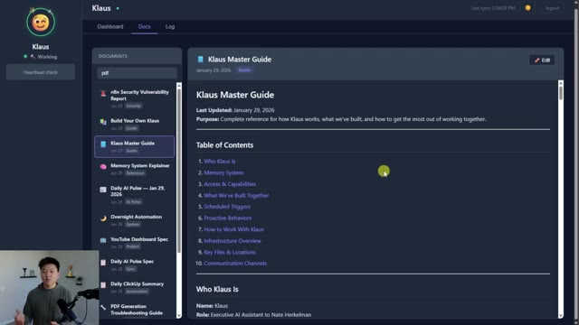
*⏱️ 00:02:59 — Capture d'écran de l'interface web de "Klaus", un assistant IA, affichant le "Klaus Master Guide" avec une table des matières détaillée.*

---

### ⏱️ `[00:03:13 - 00:03:32]` | Segment #09

**🔊 Audio (Transcription Intégrale Mot pour Mot en Français) :**
> Right now, this is what it's got access to. GitHub, Brave Search, OpenAI, 11labs, PDF Shift, Appify, ClickUp, Google Workspace, and then some YouTube stuff like that. We've got an understanding of how the memory system works. It understands when to send voice notes, which is only when I send him a voice note. Here we have some information on what it should do freely and what would require permission. And then you can see what we've built together.

**👁️ Analyse Visuelle d'Écran (gemini-3.5-flash-lite) :**
**Interface & Outils** : Interface web personnalisée (Tableau de bord de l'agent "Klaus")

**Contenu textuel & Code** : Tableau récapitulatif des API : YouTube Data/Analytics, Google Workspace (MCP), ClickUp, Apify, PDFShift, ElevenLabs, OpenAI, Brave Search, et GitHub. Mention du chemin d'accès aux clés d'API : `/home/klaus/.env`.

**Action / Démonstration** : Présentation visuelle de la documentation technique et des autorisations d'accès aux services tiers pour l'agent IA.

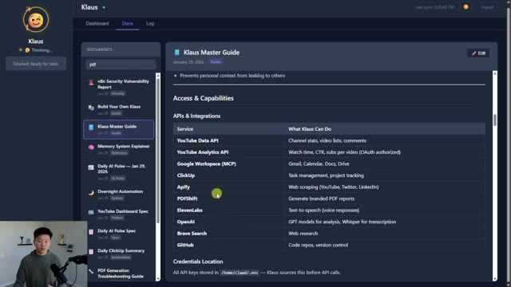
*⏱️ 00:03:17 — Une interface de tableau de bord nommée "Klaus" affichant un document intitulé "Klaus Master Guide" qui détaille les capacités et les intégrations API de l'agent.*

---

### ⏱️ `[00:03:32 - 00:03:53]` | Segment #10

**🔊 Audio (Transcription Intégrale Mot pour Mot en Français) :**
> So the first one was obviously the Klaus dashboard, and here's what it does. We've got the YouTube intelligence dashboard, and here's what it does. I'm still impressed that it built this while I was sleeping. Super cool. It can do branded PDF reports, and then it has scheduled triggers to do things like daily pulses, audits, email monitoring, checking tasks. And obviously this isn't completely updated because I added some more stuff in after this guide.

**👁️ Analyse Visuelle d'Écran (gemini-3.5-flash-lite) :**
**Interface & Outils** : Dashboard web personnalisé "Klaus" (interface de gestion d'agent IA).

**Contenu textuel & Code** : Documentation technique listant les fonctionnalités du tableau de bord YouTube (Analytics, filtrage temporel, intelligence des commentaires, suivi des concurrents, générateur d'idées) et les spécifications de design pour les rapports PDF automatisés.

**Action / Démonstration** : Présentation du contenu d'une note de documentation interne au sein de l'agent Klaus, détaillant les capacités du système automatisé.

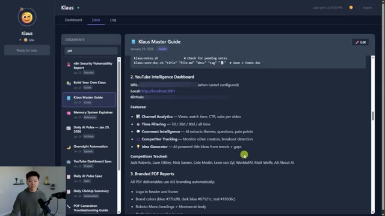
*⏱️ 00:03:37 — Interface utilisateur de l'application "Klaus", affichant la section "Klaus Master Guide" avec des détails sur le tableau de bord d'intelligence YouTube et la génération de rapports PDF.*

---

### ⏱️ `[00:03:53 - 00:04:11]` | Segment #11

**🔊 Audio (Transcription Intégrale Mot pour Mot en Français) :**
> All right, so before we actually break down exactly what I've done and how you can replicate this, let's just go over a few more features in this dashboard so you can get a feeling of what I've actually built here with Klaus. So of course, we are talking to Klaus through Telegram. And you can see the last thing I just had him make a change. I said, this is perfect, you're the best. And he reacted to my text, but I thought it was pretty cool that they can react.

**👁️ Analyse Visuelle d'Écran (gemini-3.5-flash-lite) :**
**Interface & Outils** : Application web de gestion de tâches personnalisée (Dashboard Klaus).

**Contenu textuel & Code** : Liste de tâches terminées liées à un projet de tableau de bord YouTube (ex: "Competitor Tracking", "Dashboard View with Charts", "YouTube Data API Integration").

**Action / Démonstration** : Présentation de l'interface utilisateur du dashboard de l'agent IA « Klaus » pour démontrer son organisation et ses fonctionnalités de suivi.

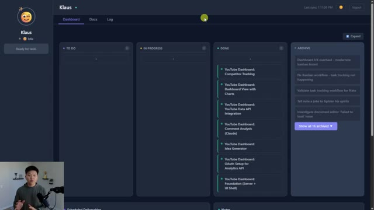
*⏱️ 00:03:58 — Une vue d'ensemble du tableau de bord de gestion de tâches de l'IA nommée « Klaus », organisée sous forme de board Kanban (To Do, In Progress, Done, Archive).*

---

### ⏱️ `[00:04:12 - 00:04:38]` | Segment #12

**🔊 Audio (Transcription Intégrale Mot pour Mot en Français) :**
> And then the reason why it says model Cloud Opus 4x5 is because I wanted to have visibility. So every time I messaged him, I told him to tell me what model he's using. So this started as a pretty simple dashboard just so I could track what was going on. But I told him, hey, your job is to save me time. I want you to be proactive, understand my workflows, and suggest things all the time. So specifically in this dashboard, while we were building it together, I'd said, suggest features, whatever you think might work and whatever you think will help you work better and help me work better.

**👁️ Analyse Visuelle d'Écran (gemini-3.5-flash-lite) :**
**Interface & Outils** : Dashboard web personnalisé de gestion d'agent IA (AgentAssisting).

**Contenu textuel & Code** : Historique de discussion avec l'agent "Klaus" détaillant des modifications UI (collapse/expand, mise en page des notes), suivi de tâches dans des colonnes "DONE" et "ARCHIVE", et mention explicite du modèle utilisé "Model: claude-opus-4-5" en bas de la fenêtre de chat.

**Action / Démonstration** : Revue des changements implémentés par l'agent IA sur le tableau de bord et validation par l'utilisateur ("This is perfect. You're the best").

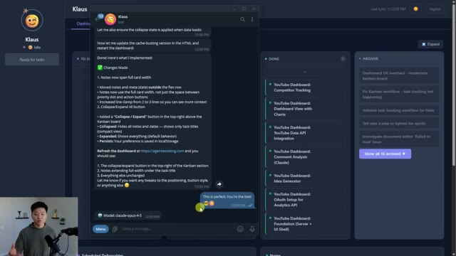
*⏱️ 00:04:18 — Interface d'un tableau de bord de gestion de tâches nommé "Klaus", affichant une fenêtre de chat avec l'IA et une colonne de suivi de projet type Kanban.*

---

### ⏱️ `[00:04:38 - 00:04:58]` | Segment #13

**🔊 Audio (Transcription Intégrale Mot pour Mot en Français) :**
> Just tell me that you're going to implement it. And so one of the first things that he did was he built this little thing up in the top left so that I can actually see him, which was a little bit scary, but also kind of cool because now I can look over and I can see if it's idle, then he's not working on anything. But if he's thinking or working, then I know that there is something going on. So let me go ahead and shoot something off and we will see him spin up and start working.

**👁️ Analyse Visuelle d'Écran (gemini-3.5-flash-lite) :**
**Interface & Outils** : Interface web de dashboard (application agentique type "AgentAssisting").

**Contenu textuel & Code** : Historique de discussion entre l'utilisateur et l'agent Klaus détaillant les modifications apportées au code (mise en page des notes, bouton "Collapse/Expand"), et liste des tâches dans le tableau Kanban.

**Action / Démonstration** : L'agent confirme les modifications implémentées et propose de vérifier les changements sur le tableau de bord.

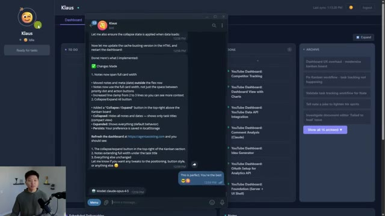
*⏱️ 00:04:43 — Interface d'un tableau de bord de gestion d'agent IA nommé "Klaus", affichant un chat interactif au centre et une vue Kanban à l'arrière-plan, avec un indicateur d'état "Idle" en haut à gauche.*

---

### ⏱️ `[00:04:58 - 00:05:18]` | Segment #14

**🔊 Audio (Transcription Intégrale Mot pour Mot en Français) :**
> All right. So just to start off here, I'm saying, hey, Klaus, I need you to spin up a sub agent to do some in-depth research about what's going on today with NNN. There was some news about a security thing, and I want you to create a report for me. So obviously we can see up here that it is thinking. It also has spun up a sub agent, which we were able to visually see, which is pretty cool. and I will get back to you once we have that report.

**👁️ Analyse Visuelle d'Écran (gemini-3.5-flash-lite) :**
**Interface & Outils** : Application de gestion d'agents IA ("Klaus") avec interface de chat intégrée et tableau de bord de tâches.

**Contenu textuel & Code** : Historique de discussion incluant : "Hey Klaus, I need you to spin up a sub-agent to do some in-depth research about what's going on today with n8n..." et réponse de l'agent : "Research agent is on the case".

**Action / Démonstration** : Déclenchement automatique d'un sous-agent de recherche par l'IA principale suite à la demande de l'utilisateur.

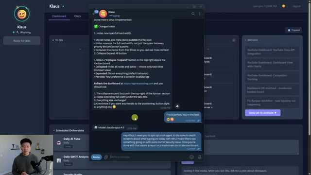
*⏱️ 00:05:03 — Interface de l'agent "Klaus" montrant l'historique de la conversation et le prompt utilisateur demandant de lancer un sous-agent pour des recherches sur NNN.*

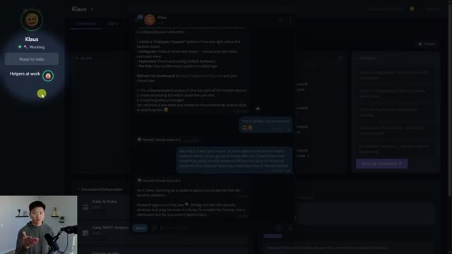
*⏱️ 00:05:13 — Mise à jour de l'interface montrant le statut "Helpers at work" et la réponse de Klaus confirmant le lancement du sous-agent de recherche.*

---

### ⏱️ `[00:05:18 - 00:05:39]` | Segment #15

**🔊 Audio (Transcription Intégrale Mot pour Mot en Français) :**
> And of course it was able to add an in-progress task right here. And then when it's done, hopefully it should move it over to done. But that's the really cool thing about this Kanban board is that if I have a task and I come in here and I just add a new to-do, then Klaus will automatically pick that up and start working on it. Or similarly, if I give him a note down here, I can send something off just for him to log it in his memory or even if I wanted to take action on it.

**👁️ Analyse Visuelle d'Écran (gemini-3.5-flash-lite) :**
**Interface & Outils** : Application de gestion de projet type Kanban baptisée "Klaus".

**Contenu textuel & Code** : Noms de tâches spécifiques (ex: "n8n security report", "YouTube Dashboard: Comment Analysis") et options de priorité (High, Medium, Low).

**Action / Démonstration** : Démonstration de l'ajout d'une nouvelle tâche dans le workflow Kanban pour déclencher une automatisation par l'agent IA.

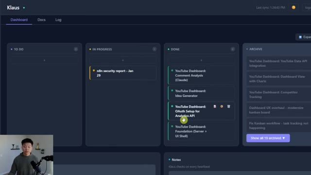
*⏱️ 00:05:23 — Vue d'ensemble du tableau Kanban "Klaus" montrant les colonnes To Do, In Progress, Done et Archive.*

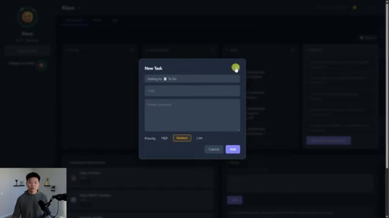
*⏱️ 00:05:28 — Fenêtre modale "New Task" ouverte, permettant de saisir un titre, des notes et de définir une priorité pour une nouvelle tâche.*

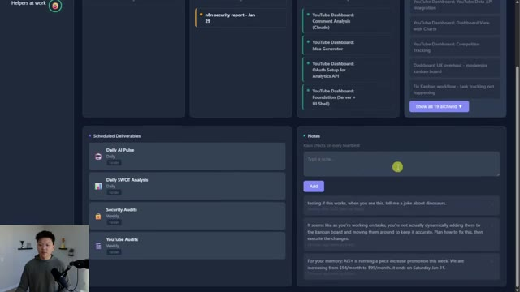
*⏱️ 00:05:34 — Interface de l'application Klaus affichant en bas à droite une section "Notes" et un journal d'activité de l'agent.*

---

### ⏱️ `[00:05:39 - 00:05:58]` | Segment #16

**🔊 Audio (Transcription Intégrale Mot pour Mot en Français) :**
> So like here, I said, testing if this works, when you see this, tell me a joke and then it shot me a joke in my telegram. and every time it actually acknowledges these, it marks them as seen by Klaus. So I know which ones it's processed or not. So here's a great example of how it knows about me and my business because it came back and said the TLDR is anyone running NADN needs to upgrade because of this vulnerability.

**👁️ Analyse Visuelle d'Écran (gemini-3.5-flash-lite) :**
**Interface & Outils** : Application de dashboarding et d'automatisation IA nommée "Klaus", utilisant un modèle Claude-Opus-4.5.

**Contenu textuel & Code** : Texte de requête : "testing if this works. when you see this, tell me a joke about dinosaurs." ainsi que des logs de recherche de vulnérabilités (CVSS 9.9-10.0, RCE, n8n security).

**Action / Démonstration** : Démonstration du mécanisme d'accusé de réception ("seen by Klaus") et exécution d'une recherche approfondie par l'agent sur une faille de sécurité n8n avec proposition de création de contenu.

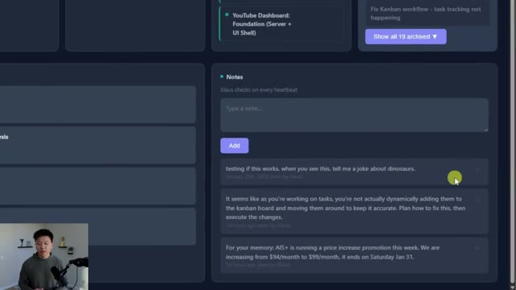
*⏱️ 00:05:44 — Interface de gestion de notes dans l'application Klaus, affichant une liste de tâches traitées, dont le prompt "testing if this works" marqué comme "seen by Klaus".*

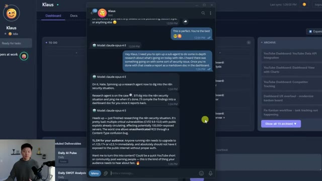
*⏱️ 00:05:53 — Interface de chat de l'agent "Klaus" montrant une interaction sur une vulnérabilité de sécurité n8n, avec un historique détaillé des échanges et des recommandations d'action.*

---

### ⏱️ `[00:05:58 - 00:06:30]` | Segment #17

**🔊 Audio (Transcription Intégrale Mot pour Mot en Français) :**
> So do you want me to turn this into some content for you? Because it could be a quick YouTube short or community post, which is the kind of thing that your audience needs to hear about fast. But anyways, I just said no post for now. I just want the report. So it's throwing that together now. All right. So it said that the report is done. If I close out of Telegram, we should see that this got moved to done. And the reason why it's a different color is because these are actually a priority switch, not like a status. As you can see, if I move this over here, it's just a priority thing. So anyways, if I go ahead and click on the docs tab right here in our dashboard, you can see that we have a new doc about security, which is NN security vulnerability report.

**👁️ Analyse Visuelle d'Écran (gemini-3.5-flash-lite) :**
**Interface & Outils** : Dashboard de l'application "Klaus" (interface de chat type agent autonome).

**Contenu textuel & Code** : Historique de conversation : l'utilisateur demande une recherche sur la sécurité de n8n ; l'agent confirme avoir trouvé des vulnérabilités critiques (CVSS 9.8-10.0, RCE) et recommande une mise à jour immédiate vers la version v1.123.17+ ou v2.5.1+.

**Action / Démonstration** : L'agent automatise la recherche d'informations sur les failles de sécurité et propose de générer du contenu, tandis que l'utilisateur ajuste la requête pour obtenir un rapport au format Markdown.

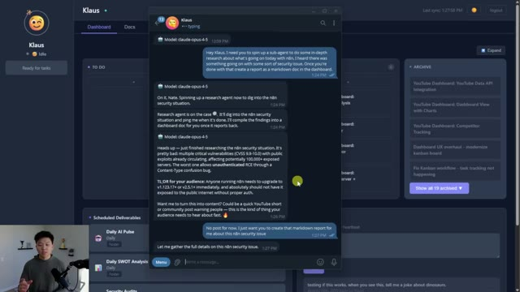
*⏱️ 00:06:06 — Interface de l'agent IA nommé « Klaus » affichant une conversation active où l'utilisateur demande une recherche sur les vulnérabilités de n8n et l'agent répond avec un résumé technique critique.*

---

### ⏱️ `[00:06:30 - 00:07:08]` | Segment #18

**🔊 Audio (Transcription Intégrale Mot pour Mot en Français) :**
> So now I'm able to actually read through this entire report that it made. We've got the date, classification, the exact summary, vulnerability details, and we can continue to scroll down and see this entire markdown format report that it was able to make for us. And if I wanted to change anything about this, I could go ahead and edit it. And then it would bring up this editor for us to change something in the doc, save it. So now we have a really cool place where every single time that we ask Klaus to create some sort of file for us, it's able to just drop it in here and then we can look at it and save it. So I thought I'd show you guys off one of those heartbeat functionalities and I'll explain exactly what a heartbeat is and how that works in a bit. But I'm going to go ahead and add a new task right here that just says, make Nate laugh. And I'm just going to say,

**👁️ Analyse Visuelle d'Écran (gemini-3.5-flash-lite) :**
**Interface & Outils** : Application web propriétaire nommée "Klaus" (outil de gestion de tâches et documents propulsé par l'IA).

**Contenu textuel & Code** : - Image 1 : Contenu structuré Markdown : "n8n Security Vulnerability Report", recommandations comme "Set N8N_BASIC_AUTH_ACTIVE=true", "Restrict network access", "Review Code node usage".
- Image 2 : Colonne "DONE" du tableau Kanban listant des projets comme "YouTube Dashboard: Idea Generator", "n8n security report - Jan 29", "YouTube Dashboard: Comment Analysis (Claude)".

**Action / Démonstration** : Le présentateur passe en revue les documents générés par l'IA (Klaus), illustrant la capacité du système à créer, suivre et organiser des rapports de sécurité et des flux de travail de développement.

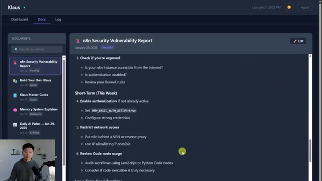
*⏱️ 00:06:40 — Interface "Klaus" affichant un rapport Markdown détaillé sur les vulnérabilités de sécurité n8n, avec des recommandations techniques.*

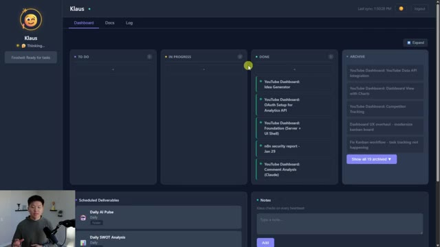
*⏱️ 00:06:59 — Tableau de bord "Klaus" (interface Kanban) montrant les tâches terminées ("Done"), incluant le rapport de sécurité n8n, et une section de prise de notes.*

---

### ⏱️ `[00:07:08 - 00:07:34]` | Segment #19

**🔊 Audio (Transcription Intégrale Mot pour Mot en Français) :**
> usually in the afternoon Nate gets sad so tell him a joke about AI. So while we're waiting for Klaus to actually pick that up and shoot me off a joke let's see what we have down here which are some of our scheduled deliverables which are workflows that happen either daily or weekly. So for example with the weekly YouTube audits every single week on I think it's like Monday night or Sunday night I'm going to get one of these YouTube audits and obviously here I was playing around with some different formats but this is kind of what they look like now.

**👁️ Analyse Visuelle d'Écran (gemini-3.5-flash-lite) :**
**Interface & Outils** : Dashboard personnalisé (Klaus) et Google Drive.

**Contenu textuel & Code** : Liste de tâches ("Make nate laugh", "YouTube Dashboard: Idea Generator", etc.) et liste de fichiers ("AIS-SWOT-Audit-2026", "Nate Herk YouTube Channel Audit").

**Action / Démonstration** : Navigation dans l'interface de l'agent IA "Klaus" pour consulter les tâches planifiées, puis transition vers le dossier de stockage des livrables sur Google Drive.

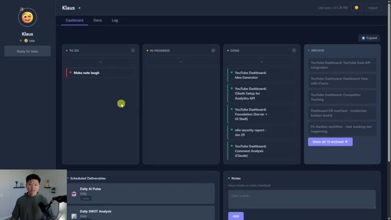
*⏱️ 00:07:15 — Interface de gestion de tâches type Kanban nommée "Klaus", affichant les colonnes TO DO (avec la tâche "Make nate laugh"), IN PROGRESS, DONE et ARCHIVE.*

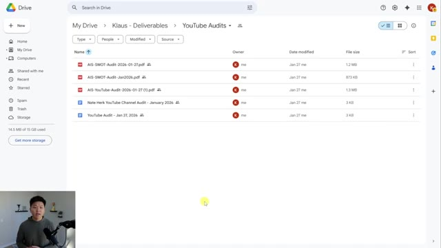
*⏱️ 00:07:27 — Interface Google Drive affichant le dossier "Klaus - Deliverables > YouTube Audits" contenant plusieurs fichiers PDF et Google Docs liés aux audits de la chaîne YouTube.*

---

### ⏱️ `[00:07:34 - 00:08:08]` | Segment #20

**🔊 Audio (Transcription Intégrale Mot pour Mot en Français) :**
> They have my brand information although this one didn't have the logo let's try this one It'll have my logo. It'll have my brand guidelines and it sends me a SWOT analysis in a YouTube channel audit about strengths weaknesses Metrics and some other things that we need to do Obviously, there's a bit of a spacing issue here But we get some recent content analysis strategic recommendations And what you'll notice here is that we're signed in here as klaus So klaus has its own gmail drive docs sheets its own accounts for pretty much everything because I didn't want it to be in my environment I wanted to treat this as a person that I could talk to, forward emails to, and have it respond

**👁️ Analyse Visuelle d'Écran (gemini-3.5-flash-lite) :**
**Interface & Outils** : Google Drive, Lecteur PDF intégré.

**Contenu textuel & Code** : Données analytiques de la chaîne YouTube (506K abonnés, 21.3M vues, analyse des forces et faiblesses stratégiques), noms de fichiers de rapports d'audit.

**Action / Démonstration** : Présentation visuelle des résultats générés automatiquement par l'agent (le rapport d'audit) suite à l'exécution du processus d'automatisation mentionné dans l'audio.

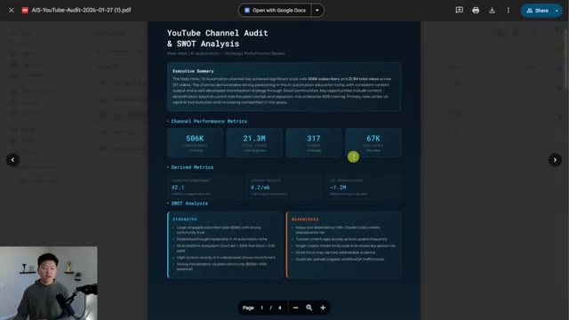
*⏱️ 00:07:42 — Rapport d'audit détaillé pour une chaîne YouTube, présenté sous forme de document PDF, incluant un résumé exécutif, des statistiques de performance (abonnés, vues, nombre de vidéos) et une analyse SWOT (Forces/Faiblesses).*

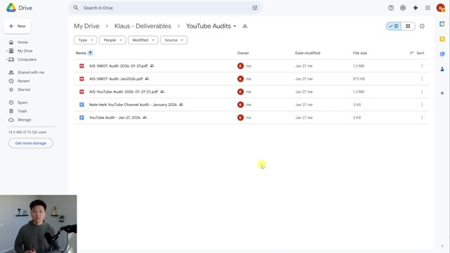
*⏱️ 00:07:59 — Interface de Google Drive affichant une liste de fichiers intitulés "YouTube Audits", montrant plusieurs versions de documents PDF et Google Docs générés dans le cadre de l'automatisation.*

---

### ⏱️ `[00:08:08 - 00:08:38]` | Segment #21

**🔊 Audio (Transcription Intégrale Mot pour Mot en Français) :**
> like that. So it created a drive called Klaus Deliverables, and that's where it was able to store all of these things like the daily pulses, the SWOT analysis, the logos, audits, and YouTube audits. So obviously security is a huge topic when we're talking about CloudBot. So the security audit that I had it run for me here, this was actually just a Google Doc rather than a PDF, but it pointed out all of these issues. It ranked them for different risk levels. And then I was able to have Klaus just go ahead and fix all of these things. And I'm constantly checking with Klaus to make sure that we are completely fine and that our ports not exposed and stuff like that.

**👁️ Analyse Visuelle d'Écran (gemini-3.5-flash-lite) :**
**Interface & Outils** : Google Drive (interface web).

**Contenu textuel & Code** : Liste de dossiers nommés : "Daily AI Pulse", "Daily SWOT Analysis", "Logos", "Security Audits", et "YouTube Audits".

**Action / Démonstration** : Navigation dans l'arborescence de fichiers pour montrer le stockage centralisé des livrables produits par l'agent IA.

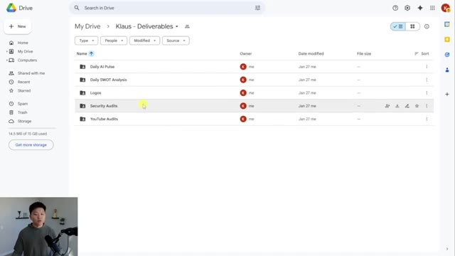
*⏱️ 00:08:15 — Une vue de l'interface Google Drive montrant le dossier "Klaus - Deliverables" contenant divers sous-dossiers générés automatiquement.*

---

### ⏱️ `[00:08:38 - 00:08:57]` | Segment #22

**🔊 Audio (Transcription Intégrale Mot pour Mot en Français) :**
> And obviously I'm not like a security expert, so I'm doing the best that I can working with Klaus, with cloud code, with perplexity, figuring out how I can be safe. But everyone out there that wants to experiment with cloud bot, just make sure that you are thinking about security and not giving access to tons of different random things if you don't really know what's going on. Okay, so what I did is I said, how often does your heartbeat run and what does that actually do?

**👁️ Analyse Visuelle d'Écran (gemini-3.5-flash-lite) :**
**Interface & Outils** : Google Docs

**Contenu textuel & Code** : Le rapport détaille un problème de sécurité critique : "DASHBOARD PUBLICLY ACCESSIBLE (PORT 3000)", notant un risque "HIGH" pour l'adresse IP 76.13.103.26:3000, ainsi que des recommandations pour sécuriser l'accès via SSH tunnel ou Tailscale.

**Action / Démonstration** : Présentation des vulnérabilités de sécurité identifiées lors de l'audit de l'infrastructure Klaus.

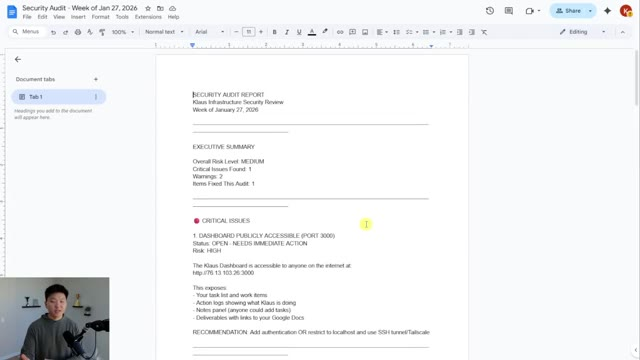
*⏱️ 00:08:43 — Un document Google Docs affichant un rapport d'audit de sécurité intitulé "Security Audit Report - Klaus Infrastructure Security Review".*

---

### ⏱️ `[00:08:57 - 00:09:16]` | Segment #23

**🔊 Audio (Transcription Intégrale Mot pour Mot en Français) :**
> And it said that my heartbeat runs every 30 minutes. And every time that my heartbeat runs, it basically wakes up Klaus. And Klaus will make sure that both the dashboards are running, it will do a sync, it will check for notes, which you can see it actually just moved the make Nate laugh from in progress to done, I believe, as you can see. It will monitor X and Twitter, it will do a daily pulse. And the idea is that I wake up with no memory.

**👁️ Analyse Visuelle d'Écran (gemini-3.5-flash-lite) :**
**Interface & Outils** : Interface web propriétaire de l'agent IA "Klaus" (Dashboard de gestion de tâches et interface de messagerie).

**Contenu textuel & Code** : Liste détaillée des opérations de maintenance de l'agent : 1. Infrastructure check, 2. Dashboard sync, 3. Check for notes, 4. Email monitoring, 5. X/Twitter monitoring, 6. Daily AI Pulse. Liste de tâches "DONE" incluant : "YouTube Dashboard", "n8n security report", et "Make nate laugh".

**Action / Démonstration** : Démonstration du fonctionnement autonome de l'agent "Klaus" qui exécute des routines périodiques (heartbeat) pour synchroniser ses tâches, mettre à jour son statut et déplacer les éléments dans son workflow Kanban.

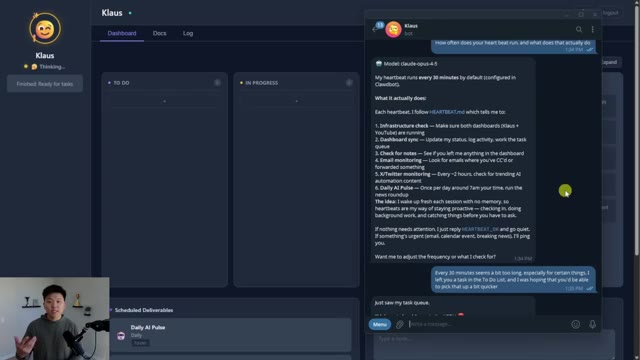
*⏱️ 00:09:02 — Interface de gestion de l'agent "Klaus", affichant une fenêtre de chat où l'IA détaille ses processus de "heartbeat" (toutes les 30 minutes) et ses responsabilités de maintenance.*

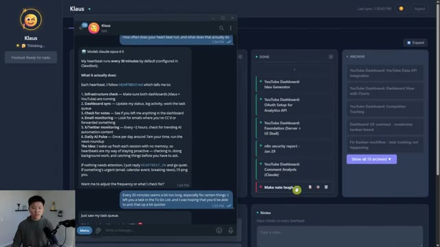
*⏱️ 00:09:12 — Interface de gestion de l'agent "Klaus" montrant un tableau de bord Kanban avec des colonnes "DONE" et "ARCHIVE", mettant en évidence le déplacement d'une tâche spécifique "Make nate laugh".*

---

### ⏱️ `[00:09:17 - 00:09:36]` | Segment #24

**🔊 Audio (Transcription Intégrale Mot pour Mot en Français) :**
> So when I have my heartbeats, I stay proactive and I check in on things and do things in the background for you. So anyways, then it said, yep, just saw that task queue, make Nate laugh, high priority. and the joke is, what do you call an AI that finally passes the Turing test? Unemployed, the humans just moved the goalposts again. I don't really get that one. So let's actually move on to the next part, which is how can you create your own version of Klaus?

**👁️ Analyse Visuelle d'Écran (gemini-3.5-flash-lite) :**
**Interface & Outils** : Dashboard personnalisé « Klaus » (application de gestion d'agent IA avec interface de type chat et board Kanban).

**Contenu textuel & Code** : Historique de discussion entre l'utilisateur et l'agent Klaus concernant les tâches automatisées, incluant la mention « Make nate laugh — priority: HIGH » et la blague sur le test de Turing. Le tableau de bord affiche des colonnes « DONE » et « ARCHIVE » avec des tâches liées à l'API YouTube et n8n.

**Action / Démonstration** : L'agent traite une tâche prioritaire (« Make nate laugh ») et affiche le résultat de cette interaction humoristique dans l'interface de chat.

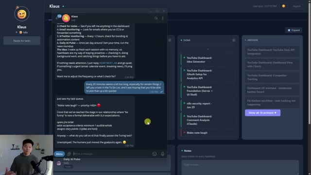
*⏱️ 00:09:21 — Une vue de l'interface de l'agent IA nommé « Klaus », affichant une conversation par messagerie instantanée superposée à un tableau de bord Kanban de gestion de tâches.*

---

### ⏱️ `[00:09:36 - 00:09:57]` | Segment #25

**🔊 Audio (Transcription Intégrale Mot pour Mot en Français) :**
> So the first thing, of course, you wanna do is set up CloudBot. Whether you're gonna do that on a Mac mini or whether you're gonna do that on VPS, I will tag a full setup guide video right up here that I made a few days ago and you can get that set up on a VPS. So what I actually did is I came into Klaus and I was like, hey, I wanna teach my YouTube channel how they can basically build exactly what I built for you and how we configure you.

**👁️ Analyse Visuelle d'Écran (gemini-3.5-flash-lite) :**
**Interface & Outils** : Application de gestion de documents et de mémoire pour agent IA nommée "Klaus".

**Contenu textuel & Code** : Documentation technique sur les fichiers "SOUL.md", "USER.md" et "IDENTITY.md" qui définissent la personnalité, les préférences utilisateur et l'identité de l'agent.

**Action / Démonstration** : Navigation dans la base de connaissances et la documentation du système de mémoire de l'agent IA.

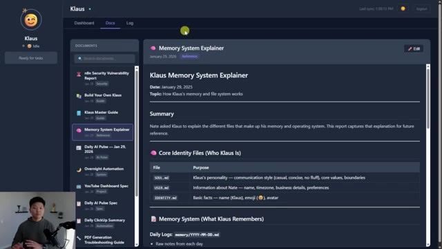
*⏱️ 00:09:52 — Interface de gestion de documents de "Klaus" montrant le "Memory System Explainer", détaillant les fichiers de l'identité et du système de mémoire de l'agent.*

---

### ⏱️ `[00:09:58 - 00:10:17]` | Segment #26

**🔊 Audio (Transcription Intégrale Mot pour Mot en Français) :**
> So I had to create this guide called Build Your Own Klaus, a step-by-step guide to creating an AI executive assistant. Klaus handles daily briefings, monitors my business, runs security audits, and proactively services opportunities, and you can build your own version. So time investment, four to six hours over the weekend to get the core system running and cost about 50 bucks a month. I'm going to say that it's going to be higher than that.

**👁️ Analyse Visuelle d'Écran (gemini-3.5-flash-lite) :**
**Interface & Outils** : Interface de type plateforme de documentation collaborative ou système de gestion de connaissances (type Notion ou Obsidian).

**Contenu textuel & Code** : Le document affiche : « Build Your Own Klaus: A Step-by-Step Guide », « Time Investment: 4-6 hours », « Cost: $50/month », et le début de « Phase 1: Foundation » incluant un exemple de fichier `SOUL.md`.

**Action / Démonstration** : Présentation visuelle du guide de construction de l'assistant, incluant des détails sur l'investissement en temps et en argent, et mention d'une ressource disponible sur Skool.

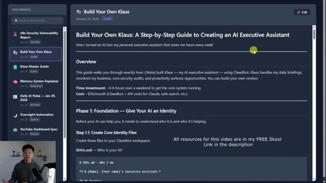
*⏱️ 00:10:02 — Une interface de gestion documentaire ou de base de connaissances affichant un guide intitulé « Build Your Own Klaus », détaillant les étapes de création d'un assistant exécutif IA.*

---

### ⏱️ `[00:10:17 - 00:10:36]` | Segment #27

**🔊 Audio (Transcription Intégrale Mot pour Mot en Français) :**
> So I've obviously spent lots of hours playing around with Klaudbot, doing different things, and I spun up this one to turn this into an executive assistant. And you can see with just this specific CloudBot that I'm using, Klaus, I've used almost a quarter of a billion tokens in the past just three days, which translate to about $223 in actual money.

**👁️ Analyse Visuelle d'Écran (gemini-3.5-flash-lite) :**
**Interface & Outils** : Interface de gestion de projet/documentation (probablement une application de type Notion ou Obsidian) et tableau de bord de statistiques API (Klaudbot).

**Contenu textuel & Code** : Guide de création d'identité pour IA (SOUL.md) et graphiques de consommation de jetons par date.

**Action / Démonstration** : Navigation dans la documentation technique et affichage des métriques de coûts et d'utilisation de l'agent IA.

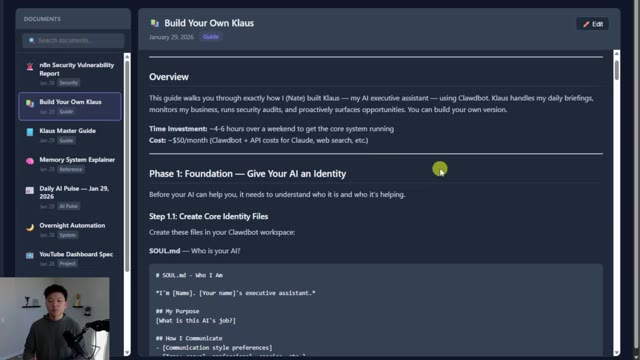
*⏱️ 00:10:21 — Interface de documentation "Build Your Own Klaus" détaillant la configuration d'un assistant exécutif IA.*

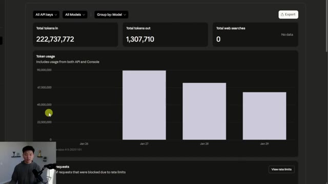
*⏱️ 00:10:26 — Tableau de bord d'analyse montrant la consommation de jetons (tokens) de l'API, avec un total de 222,737,772 tokens en entrée.*

---

### ⏱️ `[00:10:36 - 00:10:58]` | Segment #28

**🔊 Audio (Transcription Intégrale Mot pour Mot en Français) :**
> But keep in mind, all of this has been done with Opus 4.5. So if you went to Sonnet 4.5 or if you use a locally hosted model, your cost would be less. And the reason why I'm not using like my max plan, the $200 a month plan for which I would get way more tokens with is because Anthropic has been banning accounts left and right for violating terms of service. So if you are currently using CloudBot with a max plan or any Cloud plan at all, you have to switch it over to API.

**👁️ Analyse Visuelle d'Écran (gemini-3.5-flash-lite) :**
**Interface & Outils** : Interface de console Anthropic (ou outil de monitoring des coûts d'utilisation API).

**Contenu textuel & Code** : Métriques financières : "Total token cost $223.42", "Total web search cost $0.00", "Total code execution cost $0.00", et un histogramme de consommation sur le mois de janvier 2026.

**Action / Démonstration** : Le présentateur illustre ses propos sur le coût élevé de l'utilisation intensive des modèles (Opus 4.5) via l'API, justifiant ainsi pourquoi il cherche des alternatives moins onéreuses.

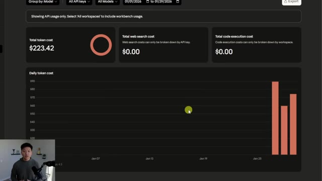
*⏱️ 00:10:41 — Tableau de bord d'analyse des coûts d'API montrant une dépense totale de 223,42 $ et un graphique à barres de la consommation quotidienne de jetons.*

---

### ⏱️ `[00:10:59 - 00:11:36]` | Segment #29

**🔊 Audio (Transcription Intégrale Mot pour Mot en Français) :**
> So anyways, what happens when you actually get this set up? Well, you have to get onboarded. So the first thing it's going to start to do is it's going to start to ask you questions. So you have to give it an identity. You have to talk about who are you, what its role is, what you want it to do, how it should behave. And you should also just brain dump everything about you in your business. So I spent like almost an hour just talking to Claudebot, talking to Klaus, letting him get to know me. I'm telling him, ask me questions. What do you not know about me? What do you need to know more about? And this ends up creating a soul file. So the soul.md is basically who is your AI and what's its job. And then also creates a user.md file, which is basically who am I and what do I do? So right here, I just asked Klaus to summarize the soul and user files. And it came

**👁️ Analyse Visuelle d'Écran (gemini-3.5-flash-lite) :**
**Interface & Outils** : Application de gestion de connaissances ou plateforme de workspace type Notion/Clawdbot.

**Contenu textuel & Code** : Contenu d'un fichier Markdown intitulé « SOUL.md » détaillant les sections : « Who I Am », « My Purpose », « How I Communicate » et « Core Truths ».

**Action / Démonstration** : Présentation des étapes de configuration initiale (onboarding) pour donner une identité et un rôle à l'assistant IA « Klaus ».

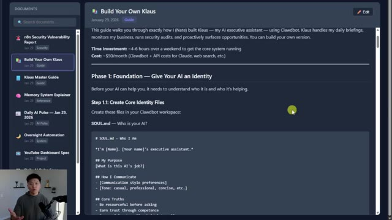
*⏱️ 00:11:08 — Interface logicielle affichant un guide intitulé « Build Your Own Klaus » avec les instructions pour définir l'identité d'un agent IA.*

---

### ⏱️ `[00:11:36 - 00:12:11]` | Segment #30

**🔊 Audio (Transcription Intégrale Mot pour Mot en Français) :**
> back with, I'm Klaus, your executive assistant. My job is to log everything, track all my work, communicate casual but concise be resourceful and the user summary is that you are nate based in chicago your background is non-technical graduated may 24 blah blah blah so it knows all of this kind of stuff about my business about the platform even though some people on my team and stuff like that so here's where i talk about having the getting to know you conversation of course covering everything that you want it to know about your business and then like i said prompt the ai to ask you questions and be proactive about it and the ai will basically interview you which makes everything better. So step two is to create dedicated accounts for your AI. So I don't think

**👁️ Analyse Visuelle d'Écran (gemini-3.5-flash-lite) :**
**Interface & Outils** : Application de gestion de connaissances/workspace basée sur une interface de type "Note-taking" ou "Document Management System" (interface sombre type Notion/Obsidian).

**Contenu textuel & Code** : Contenu textuel structuré en Markdown : définitions de principes de vie ("Log everything", "Be resourceful"), synthèse de profil personnel et professionnel, liste d'étapes pour créer des comptes email dédiés à l'IA.

**Action / Démonstration** : Démonstration visuelle de la documentation de configuration d'un agent exécutif ("Klaus") et interaction avec une IA pour initialiser son contexte et ses directives opérationnelles.

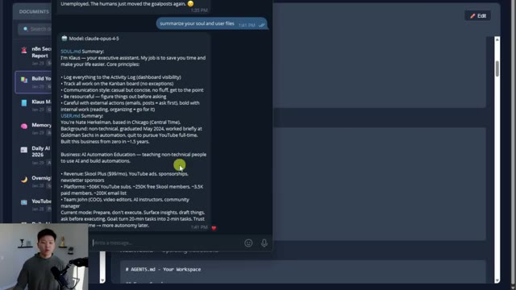
*⏱️ 00:11:44 — Interface d'une application de gestion de documents/IA affichant une réponse de "Claude-Opus-4-5" contenant les fichiers SOUL.md et USER.md résumant le rôle de l'assistant Klaus et le profil de Nate Herkelman.*

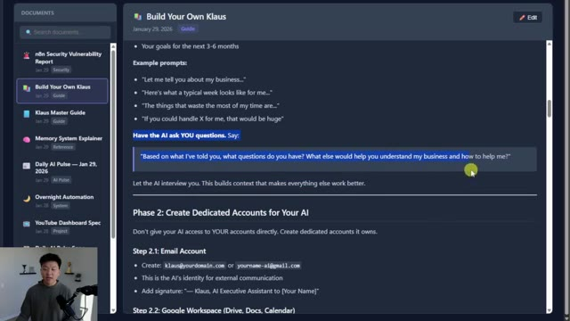
*⏱️ 00:12:02 — Document intitulé "Build Your Own Klaus" détaillant les étapes de configuration d'un assistant IA, incluant des exemples de prompts et des instructions pour créer des comptes dédiés.*

---

### ⏱️ `[00:12:11 - 00:12:29]` | Segment #31

**🔊 Audio (Transcription Intégrale Mot pour Mot en Français) :**
> that you should be giving Klaus or whatever you call it access to your accounts directly. I didn't want Klaus to be logged in as, you know, my main email or my main calendar or my main click up because you just don't really know what could happen. So instead, if I give it an email account and I wanted to help me manage my email, well, I can just forward it things and I can CC him on things.

**👁️ Analyse Visuelle d'Écran (gemini-3.5-flash-lite) :**
**Interface & Outils** : Notion (ou application de gestion documentaire similaire).

**Contenu textuel & Code** : Texte du guide recommandant la création de comptes dédiés pour l'IA (e-mail spécifique, Google Workspace avec partage restreint et structure de dossiers dédiée).

**Action / Démonstration** : Présentation visuelle des étapes de configuration de la sécurité pour un agent IA nommé "Klaus", illustrant la recommandation de ne pas utiliser de comptes personnels.

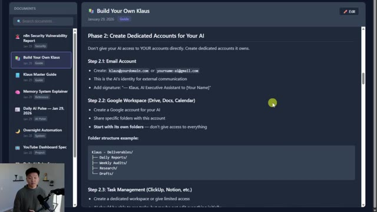
*⏱️ 00:12:15 — Une interface de type gestionnaire de documents/notes affichant un guide intitulé « Build Your Own Klaus », détaillant les bonnes pratiques de sécurité pour déléguer des accès à une IA.*

---

### ⏱️ `[00:12:29 - 00:13:01]` | Segment #32

**🔊 Audio (Transcription Intégrale Mot pour Mot en Français) :**
> And that way he's kind of looped in as I would treat an actual like executive assistant. The way I think about it is if you had like a VA or someone that you brought onto the team and you wanted to take on a lot of administrative roles, would you give them right away like credit card information, bank account information, passwords, access to everything? I probably wouldn't. And on top of that, Klaus has its own drive docs calendar so that it can see my calendar and it can, you know, share files with me and request access, but it's not actually going to be deleting things from my environment just in case. Same thing for task management. It's got a ClickUp account. It can view

**👁️ Analyse Visuelle d'Écran (gemini-3.5-flash-lite) :**
**Interface & Outils** : Interface de gestion de documents/base de connaissances (style Notion).

**Contenu textuel & Code** : Texte du guide : « Phase 2: Create Dedicated Accounts for Your AI ». Conseils pour la création d'emails (klaus@yourdomain.com), gestion Google Workspace (partage sélectif de dossiers) et structure de dossiers suggérée (Deliverables, Daily Reports, Weekly Audits, Research, Drafts).

**Action / Démonstration** : Le document sert de support visuel à l'explication sur la délégation de responsabilités et la sécurité des accès lors de l'intégration d'un assistant IA.

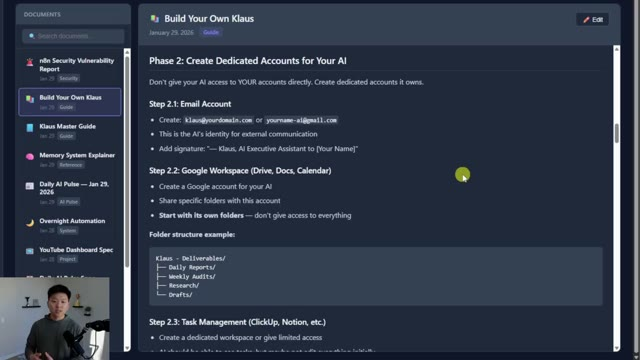
*⏱️ 00:12:37 — Une interface de type base de connaissances (Notion ou similaire) affichant un guide intitulé « Build Your Own Klaus », détaillant les étapes pour sécuriser un agent IA en créant des comptes dédiés (Email, Google Workspace).*

---

### ⏱️ `[00:13:01 - 00:13:35]` | Segment #33

**🔊 Audio (Transcription Intégrale Mot pour Mot en Français) :**
> my list. It can see what's going on in the business, but it's not able to really delete things and change anything unless I give it specific access to do so. And I put it in its own environment with its own list that I manage my tasks on now that it can actually like change things and move them around just to see how it's going to work. And then of course, when it comes to credentials, you want to be storing this in a .env file. You don't want to give it straight to Klaus in a conversation history, in Telegram, in the hub. So you can say, hey Klaus, I don't want you to ever mention an API key in our conversation. I just want you to use placeholders and just help

**👁️ Analyse Visuelle d'Écran (gemini-3.5-flash-lite) :**
**Interface & Outils** : Application de gestion de documentation / base de connaissances.

**Contenu textuel & Code** : Guide intitulé "Build Your Own Klaus" avec les étapes : "Step 2.3: Task Management", "Step 2.4: Store Credentials Securely" (incluant un exemple de fichier .env avec des variables d'API), et "Phase 3: Grant Read Access to Your Systems".

**Action / Démonstration** : La page affiche les instructions théoriques pour configurer l'accès d'un agent IA aux outils de gestion de tâches et la sécurisation des clés API.

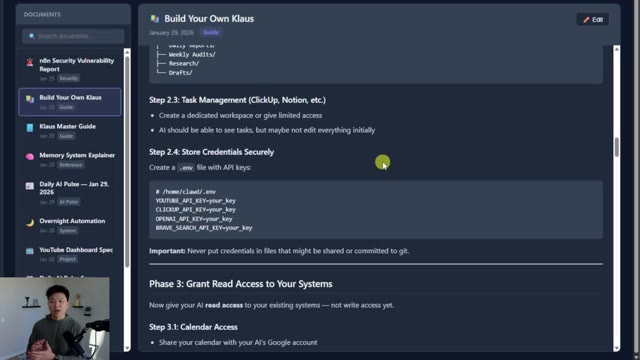
*⏱️ 00:13:10 — Interface d'une application de prise de notes ou de documentation (type Notion ou Obsidian) détaillant les étapes de configuration d'un agent IA nommé "Klaus".*

---

### ⏱️ `[00:13:35 - 00:14:11]` | Segment #34

**🔊 Audio (Transcription Intégrale Mot pour Mot en Français) :**
> me get into my .env file and I can drop them in there. So you can either do that through your terminal or you could just open up in your file explorer and go to the .env file and add in all of your API keys. So then of course, on top of this, I just gave it read access to pretty much everything. All the APIs that it needs to use for, you know, analytics or Appify and things like that. I gave it pretty much read access unless it needs to do something. And if it needs to do something, I would set up like a spending limit, or I would just basically make sure that there's very strict permissions. So it can look at my calendar. I can forward it emails. It has visibility into my tasks and it has access to certain things that I have as far as like socials, but it can only read

**👁️ Analyse Visuelle d'Écran (gemini-3.5-flash-lite) :**
**Interface & Outils** : Application de type base de connaissances/documentation (type Notion ou Obsidian).

**Contenu textuel & Code** : Extrait de code montrant le contenu d'un fichier .env avec des variables comme YOUTUBE_API_KEY, CLICKUP_API_KEY, OPENAI_API_KEY, et BRAVE_SEARCH_API_KEY. Instructions sur la gestion des accès ("Step 3.1: Calendar Access").

**Action / Démonstration** : Présentation visuelle des étapes de configuration de l'environnement et des permissions d'accès pour l'agent IA.

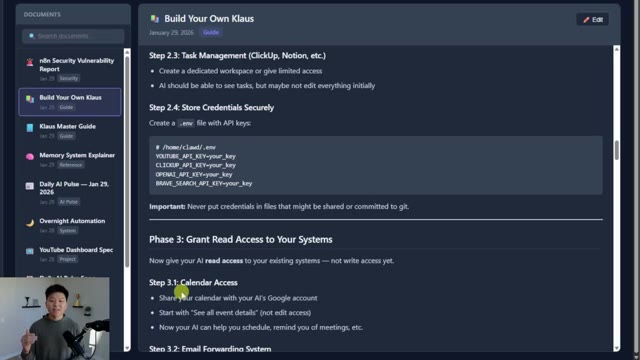
*⏱️ 00:13:44 — Interface d'une application de prise de notes ou de documentation affichant un guide intitulé "Build Your Own Klaus" détaillant la configuration des clés API dans un fichier .env.*

---

### ⏱️ `[00:14:11 - 00:14:46]` | Segment #35

**🔊 Audio (Transcription Intégrale Mot pour Mot en Français) :**
> and extract information. So it can't post on my Twitter or reply to things on YouTube or Twitter, but it can grab a bunch of data, which is super helpful. So phase four is about developing the proactive mindset. This is where it gets really, really powerful and where it starts to feel different than just like a Claude code or, you know, an NNN AI agent. So I'm consistently telling it, you know, I'm running a lean business. I want to save time. I want you to figure out opportunities to be proactive and make my life as easy as possible. Only loop me in when you really need something from me. So you can say something like, based on everything you know about me, my business and my goals, what are all the ways that you could proactively help me? Don't wait for

**👁️ Analyse Visuelle d'Écran (gemini-3.5-flash-lite) :**
**Interface & Outils** : Application de type documentation/base de connaissances (interface web).

**Contenu textuel & Code** : Texte affichant : "Phase 4: Develop the Proactive Mindset", le "Step 4.1: The Mindset Conversation" avec un prompt suggéré pour l'IA, et "Step 4.2: Common Proactive Workflows" listant des tâches quotidiennes comme le "Morning AI news briefing" et le "ClickUp task summary".

**Action / Démonstration** : Présentation visuelle structurée du plan d'action pour configurer un agent IA proactif, utilisée comme support pédagogique pendant la vidéo.

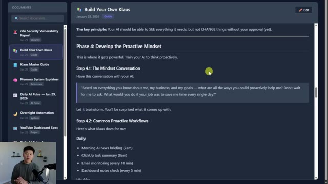
*⏱️ 00:14:19 — Une capture d'écran d'une application de gestion de connaissances ou de base de données (type Notion) affichant le guide "Build Your Own Klaus" détaillant la "Phase 4 : Develop the Proactive Mindset".*

---

### ⏱️ `[00:14:46 - 00:15:19]` | Segment #36

**🔊 Audio (Transcription Intégrale Mot pour Mot en Français) :**
> me to ask, but what would you do if your job was to save me time every single day? And after that, it just started brainstorming and it suggested a ton of ideas. So at the moment, the proactive things that I have it doing are this. I've got a morning AI news briefing, and it's not just general. It's also like super specific to me. I've got ClickUp task summaries every day. So every morning it looks at my ClickUp and it says, Hey, here's what you've got today. And also it will try to give me things proactively if it can help with any of those. So sometimes it'll do extra research for me if it's like a content flow, or if I've got a really busy day, it can maybe suggest moving some of my, you know, events on my calendar, things like that. It does email

**👁️ Analyse Visuelle d'Écran (gemini-3.5-flash-lite) :**
**Interface & Outils** : Application de type "Note-taking" ou "Knowledge Base" (interface sombre avec barre latérale gauche).

**Contenu textuel & Code** : Liste de tâches automatisées ("Daily": Morning AI news, ClickUp summary, Email monitoring, Dashboard notes check ; "Weekly": YouTube audit, SWOT analysis, Security audit) et un framework de questionnement pour l'IA.

**Action / Démonstration** : Présentation visuelle des flux de travail automatisés gérés par l'IA ("Klaus") dans le cadre d'un guide.

*⏱️ 00:14:54 — Interface d'une application de gestion de connaissances ou de notes affichant une liste de workflows proactifs automatisés.*

---

### ⏱️ `[00:15:19 - 00:15:48]` | Segment #37

**🔊 Audio (Transcription Intégrale Mot pour Mot en Français) :**
> monitoring every single 10 minutes. So in its inbox, if I ever send it something, it should respond within 10 minutes or it should, you know, kick off research or do something else about it in 10 minutes. And with the dashboard notes, it's supposed to check this every five minutes, but we just saw an example where it thought it was every 30. So there is a bit of a back and forth. I will say the persistent memory is cool, but it's not perfect at all because it chooses what memories to store. And then sometimes it just forgets things. And I'm going to talk about this later. You can see that I've got a memory system explainer doc that I had to create, but the memory can sometimes be a little frustrating.

**👁️ Analyse Visuelle d'Écran (gemini-3.5-flash-lite) :**
**Interface & Outils** : Application de gestion de documents (type Notion ou plateforme interne de gestion de connaissances).

**Contenu textuel & Code** : Liste de tâches automatisées classées par fréquence (Quotidien/Hebdomadaire) : "Email monitoring (every 10 min)", "Dashboard notes check (every 5 min)", "YouTube channel audit", "SWOT analysis", "Security audit" ainsi qu'une section "Save Me Time Framework".

**Action / Démonstration** : Le présentateur illustre ses propos sur la fréquence d'exécution des tâches d'automatisation (monitoring) en montrant la documentation correspondante à l'écran.

*⏱️ 00:15:27 — Une interface de type gestionnaire de documents/notes affichant un guide intitulé « Build Your Own Klaus » détaillant des workflows proactifs automatisés.*

---

### ⏱️ `[00:15:49 - 00:16:09]` | Segment #38

**🔊 Audio (Transcription Intégrale Mot pour Mot en Français) :**
> But honestly, that's to be expected. So you just have to figure out, okay, how can I be smarter than this thing and prompt it and use it in the right way? Because yes, it's really smart, but you have to use it the right way because it can also be super, super dumb. I will admit last night I got pretty frustrated at it and I started calling it dumb and these other names because I was just like, I had had it. Anyways, weekly, it does these things as we already talked about.

**👁️ Analyse Visuelle d'Écran (gemini-3.5-flash-lite) :**
**Interface & Outils** : Application de gestion de connaissances / documentation (interface web sombre).

**Contenu textuel & Code** : Liste de tâches automatisées par IA (briefing quotidien, résumé ClickUp, monitoring d'emails, audit YouTube, analyse SWOT, audit de sécurité) et une section "Save Me Time Framework" avec un exemple de prompt pour optimiser son temps.

**Action / Démonstration** : Consultation de la documentation interne pour structurer et planifier les workflows de l'agent IA "Klaus".

*⏱️ 00:15:54 — Une interface de gestion de documents (type base de connaissances) montrant une fiche intitulée "Build Your Own Klaus" détaillant des automatisations quotidiennes et hebdomadaires par IA.*

---

### ⏱️ `[00:16:09 - 00:16:28]` | Segment #39

**🔊 Audio (Transcription Intégrale Mot pour Mot en Français) :**
> And now we have the save me time framework. So ask your AI, what currently takes me 20 plus minutes that you could turn into a two minute review? and asking questions like that really helps you spot these opportunities. So when you actually wanna set up those automated workflows, it's so, so simple. You just ask it to do something. So once it started analyzing my YouTube and Twitter, I said, oh, that's actually really cool.

**👁️ Analyse Visuelle d'Écran (gemini-3.5-flash-lite) :**
**Interface & Outils** : Interface de documentation type base de connaissances (probablement Notion ou outil similaire).

**Contenu textuel & Code** : Le prompt affiché est : "What tasks currently take me 20+ minutes that you could turn into 2-minute reviews?". Les exemples listés incluent : Email triage, Research, Reporting, Monitoring.

**Action / Démonstration** : Présentation visuelle d'un cadre méthodologique (framework) pour identifier les opportunités d'automatisation par l'IA.

*⏱️ 00:16:14 — Interface d'application de gestion de documentation affichant le "Save Me Time Framework" et des exemples de tâches à automatiser.*

---

### ⏱️ `[00:16:29 - 00:17:04]` | Segment #40

**🔊 Audio (Transcription Intégrale Mot pour Mot en Français) :**
> Can you just set this up so that every morning at 7 a.m. you do that? And of course I could come back right here to the actual log and see right here, 7 a.m. daily pulse has been delivered. And then if I go up to 8 a.m., we have the heartbeat, dashboard notes, none, Gmail, none, ClickUp summary sent to Telegram. So this just shows that it is working on a cron and all you had to do was ask it in natural language So it's super cool. Anyways, then we got to the point where I was like, okay I want to build a dashboard And I know that a lot of you guys in the last video I showed the dashboard asked about how I built it and really it's just a matter of going back and forth But there are some hacks that I want to talk about that really make it easier to actually be able to build the dashboard out

**👁️ Analyse Visuelle d'Écran (gemini-3.5-flash-lite) :**
**Interface & Outils** : Application de gestion de connaissances/base de données interne (interface type Notion ou Obsidian personnalisée).

**Contenu textuel & Code** : - Image 1 : Liste d'entrées chronologiques décrivant des corrections de bugs (Chart.js), des configurations OAuth YouTube, et des notifications automatiques.
- Image 2 : Guide structuré sur la mise en place de composants de visibilité pour un agent IA (Tableau de bord, Kanban, Logs d'activité).

**Action / Démonstration** : Revue de l'historique des exécutions automatiques de l'agent et présentation conceptuelle des exigences pour le tableau de bord de suivi.

*⏱️ 00:16:37 — Journal de logs horodaté (timeline) affichant les actions automatisées de l'agent IA entre 6h51 et 7h45 (ex: "Daily AI Pulse delivered", "YouTube Analytics OAuth setup").*

*⏱️ 00:16:55 — Interface de documentation technique intitulée "Build Your Own Klaus" détaillant les composants du tableau de bord, incluant le "Status Panel", le "Task Board" et l'"Activity Log".*

---

### ⏱️ `[00:17:04 - 00:17:38]` | Segment #41

**🔊 Audio (Transcription Intégrale Mot pour Mot en Français) :**
> So first of all, you want to have a really clear goal of what you're actually building So my components are a status panel so I can see if the ai is working idle or offline I can see if there's sub agents and I can see what task it's currently working on Of course, we've got the actual Kanban boards So the to-do, the in-progress, the done The AI will update it as it works The activity log is like a non-negotiable You have to see every single time you do any action, you have to log it That's just the ability for us to come here, drop in a note And then have it be able to store that as memory And honestly, this was more so for me testing if it would actually work Because realistically, if I wanted to drop in a note

**👁️ Analyse Visuelle d'Écran (gemini-3.5-flash-lite) :**
**Interface & Outils** : Application web propriétaire de gestion d'agents (Klaus AI), interface de type tableau de bord.

**Contenu textuel & Code** : Spécifications techniques pour le développement d'un dashboard d'agent, liste de tâches (ex: "YouTube Dashboard: Idea Generator"), extraits de scripts bash.

**Action / Démonstration** : Présentation conceptuelle et démonstration visuelle des outils de suivi et de gestion de workflow pour l'automatisation IA.

*⏱️ 00:17:12 — Interface de gestion d'agent nommée "Klaus" détaillant les composants nécessaires pour un tableau de bord de visibilité (Status Panel, Kanban, etc.).*

*⏱️ 00:17:21 — Suite de la documentation montrant les exigences fonctionnelles pour l'Activity Log, les Notes Panel et un script d'assistance (klaus-log.sh).*

*⏱️ 00:17:29 — Vue du tableau Kanban opérationnel avec les colonnes "To Do", "In Progress", "Done" et une section "Archive" remplie de tâches.*

---

### ⏱️ `[00:17:38 - 00:17:58]` | Segment #42

**🔊 Audio (Transcription Intégrale Mot pour Mot en Français) :**
> I would probably rather just come to Telegram and shoot off a message But the tough part can be actually getting it to remember to do things, specifically like updating the Kanban board or logging things. And so what I realized here is it has to do with the memory. And a lot of times it won't actually store things as long-term memory or daily memory. So to contextualize this a little bit, let me go to the memory system explainer doc.

**👁️ Analyse Visuelle d'Écran (gemini-3.5-flash-lite) :**
**Interface & Outils** : Application de gestion de connaissances / documentation (UI type Markdown/Obsidian).

**Contenu textuel & Code** : Documentation sur les "Helper Scripts" avec des exemples de commandes shell : `klaus-log.sh`, `klaus-task.sh`, `klaus-status.sh` permettant de logger des actions, ajouter/compléter des tâches et mettre à jour des statuts.

**Action / Démonstration** : Présentation théorique d'une méthode pour permettre à une IA d'interagir avec un système de fichiers ou une base de données via des scripts personnalisés.

*⏱️ 00:17:43 — Une interface de gestion de documents (probablement Obsidian ou une plateforme similaire) affichant un guide intitulé "Build Your Own Klaus" détaillant l'utilisation de scripts d'automatisation pour une IA.*

---

### ⏱️ `[00:17:58 - 00:18:33]` | Segment #43

**🔊 Audio (Transcription Intégrale Mot pour Mot en Français) :**
> So this basically explains how CloudBot's memory works because it's not super intuitive. We obviously have the sole file, the user file, the identity file. So it's got these that it is able to check in on. But then what it starts to do is it creates these different logs. So it creates a daily log, which are raw notes from each day. And that's basically like what happened, decisions made, context. It's a journal. But again, the tough part is Klaus chooses what to put in the daily log journal. And so even sometimes I'm like, hey, log that because you have to remember it. Sometimes it won't. The long-term memory are more of like the curated highlights about your facts, your lessons learned, your business, things like that. And then when you're

**👁️ Analyse Visuelle d'Écran (gemini-3.5-flash-lite) :**
**Interface & Outils** : Notion (ou application de gestion de connaissances similaire).

**Contenu textuel & Code** : Documentation structurée : tableau des "Core Identity Files" (SOUL.md, USER.md, IDENTITY.md) et section "Memory System" décrivant l'organisation des données : "Daily Logs" (notes quotidiennes), "Long-term Memory" (synthèse des faits importants) et "Project-specific" (contextes de projets).

**Action / Démonstration** : Le présentateur explique la hiérarchie et le fonctionnement du système de mémoire de son agent IA via une présentation visuelle structurée du document.

*⏱️ 00:18:07 — Une interface de type base de connaissances (probablement Notion) présentant un document intitulé "Memory System Explainer" qui détaille la structure des fichiers de mémoire de l'agent "Klaus".*

---

### ⏱️ `[00:18:33 - 00:19:07]` | Segment #44

**🔊 Audio (Transcription Intégrale Mot pour Mot en Français) :**
> working on specific projects, it can create project specific memories. And so it really is a matter of prompting it like make sure you save this to that project memory or save this to your daily log and if you're not doing that then you're going to be really confused as far as like where is it getting into information and why is it confused okay i just searched our chat history for the word frustrating because i knew i've said it to klaus many times and so this is exactly what i'm talking about i said this is a problem i need to be able to know that you have memory that's persistent so if we're having a conversation you can see what i'm talking about because you just sent me a message about four minutes ago and all of a sudden you forgot that context so what can i do in your

**👁️ Analyse Visuelle d'Écran (gemini-3.5-flash-lite) :**
**Interface & Outils** : Application de gestion de documents et chatbot (interface de type "Second Brain" ou tableau de bord d'agent IA).

**Contenu textuel & Code** : Documentation sur les fichiers Markdown (ex: memory/YYYY-MM-DD.md) et logs de conversation avec l'IA concernant une erreur de serveur sur le port 3000.

**Action / Démonstration** : Présentation conceptuelle et pratique de la structure de mémorisation d'un assistant IA pour maintenir le contexte sur le long terme.

*⏱️ 00:18:42 — Interface structurée présentant un "Memory System Explainer" détaillant la hiérarchie de stockage des données : Daily Logs, Long-term Memory et Project-specific memory.*

*⏱️ 00:18:50 — Interface de messagerie avec un agent IA nommé "Klaus", affichant une conversation où l'utilisateur critique un manque de persistance de la mémoire lors d'une session de dépannage technique.*

---

### ⏱️ `[00:19:07 - 00:19:34]` | Segment #45

**🔊 Audio (Transcription Intégrale Mot pour Mot en Français) :**
> configuration so that this doesn't happen again. It's really frustrating. I need to be able to trust that I can have an ongoing conversation with you. And then I would basically just have to repaste in messages so we could re-understand context of what we were just talking about. And I'm not even exaggerating. It would be like, I would say, hello. And then I would say, my name is Nate. And it would be like, okay, cool. And then I'd say like, how's your, how are you doing? And it would be like, what's your name? It's like that quick. It would forget what we were talking about. So really the key thing to remember is that it's always basically going to wake up with no memory.

**👁️ Analyse Visuelle d'Écran (gemini-3.5-flash-lite) :**
**Interface & Outils** : Application de messagerie intégrée à une plateforme de gestion d'agents IA (nommée "Klaus").

**Contenu textuel & Code** : Le message utilisateur exprime sa frustration concernant l'incapacité de l'agent à maintenir le contexte de la conversation, incluant des exemples de messages précédents de l'agent signalant un crash de serveur (conflit de port 3000).

**Action / Démonstration** : L'utilisateur explique à l'agent le besoin d'une mémoire persistante et copie/colle des messages précédents pour que l'IA puisse analyser le problème de continuité de session.

*⏱️ 00:19:13 — Interface de chat avec un agent IA nommé "Klaus" montrant une conversation concernant un problème de perte de contexte et de mémoire de session.*

---

### ⏱️ `[00:19:34 - 00:19:53]` | Segment #46

**🔊 Audio (Transcription Intégrale Mot pour Mot en Français) :**
> So those files are the memory. And so that's why I'm telling it, log everything you do. Check these files every time. Put that in the right spot. And so this is a really nice segue into the hacks that I wanted to talk about, because as I have been obviously playing around with CloudBot for days now, I've learned a lot of things about the way you can communicate with it to actually make it do what you wanna do.

**👁️ Analyse Visuelle d'Écran (gemini-3.5-flash-lite) :**
**Interface & Outils** : Application de gestion de notes/bases de connaissances (type Notion ou Obsidian) pour l'image 1, tableau blanc numérique (type Excalidraw) pour l'image 2.

**Contenu textuel & Code** : Image 1 : Texte explicatif sur la gestion de mémoire ("These files ARE his memory"), listes de fichiers (PROGRESS.md, SPEC.md) et règles de collaboration avec l'IA. Image 2 : Titres "1) How you can create your own 'Klaus'" et "2) 5 hacks for a smarter assistant".

**Action / Démonstration** : Le présentateur illustre le fonctionnement conceptuel de la "mémoire" externe de l'agent IA, puis transitionne vers un support visuel simple pour structurer ses conseils sur l'optimisation des assistants IA.

*⏱️ 00:19:39 — Interface d'application type "système de connaissances" affichant une note intitulée "Memory System Explainer" détaillant comment l'agent IA Klaus gère sa mémoire via des fichiers persistants.*

*⏱️ 00:19:43 — Tableau blanc numérique vierge présentant une liste à deux points sur la création d'un agent "Klaus" et les astuces pour un assistant plus intelligent.*

---

### ⏱️ `[00:19:53 - 00:20:12]` | Segment #47

**🔊 Audio (Transcription Intégrale Mot pour Mot en Français) :**
> So the first one right here is plan first. This one is so important. If you've been using CloudCode for a while, you know how important it is to use plan mode first and then go ahead and execute. But the tough part about planning first is sometimes it'll make an amazing plan. I'll spin up three sub agents, it'll build me a beautiful plan, and then I'll say, nice, execute that. And it'll be like, execute what?

**👁️ Analyse Visuelle d'Écran (gemini-3.5-flash-lite) :**
**Interface & Outils** : Logiciel de tableau blanc numérique / Outil de présentation visuelle.

**Contenu textuel & Code** : Texte affiché : "HACKS", "1) PLAN FIRST", et une liste de quatre blocs numérotés 2, 3, 4, 5.

**Action / Démonstration** : Présentation conceptuelle ou énumération des étapes d'une méthodologie de travail avec des agents IA.

*⏱️ 00:19:58 — Une capture d'écran montrant une présentation visuelle sur un tableau blanc numérique (ex: Excalidraw ou similaire) avec le titre "HACKS" et le point "1) PLAN FIRST" affiché, accompagné de quatre cases vertes numérotées de 2 à 5.*

---

### ⏱️ `[00:20:12 - 00:20:32]` | Segment #48

**🔊 Audio (Transcription Intégrale Mot pour Mot en Français) :**
> And that just makes me wanna throw my monitor against the wall. So what you could do there is you could copy and paste the plan into the next message and shoot it off. Or maybe you could just say, build a really good plan and then execute, because that still increases the quality of the actual solution itself. But another thing I started doing, which actually helped a lot, and I'm going out of order a bit here, but I was just creating files all the time.

**👁️ Analyse Visuelle d'Écran (gemini-3.5-flash-lite) :**
**Interface & Outils** : Klaus (application de tableau blanc/diagramme en ligne)

**Contenu textuel & Code** : Texte affiché : "HACKS", "1) PLAN FIRST", avec une liste de blocs numérotés 2, 3, 4 et 5.

**Action / Démonstration** : Présentation visuelle structurée servant de support pédagogique pour expliquer la méthodologie de planification avant l'exécution.

*⏱️ 00:20:17 — Une capture d'écran de l'application de tableau blanc collaboratif "Klaus", affichant une liste à puces titrée "HACKS" dont le premier point est "1) PLAN FIRST", suivi de quatre blocs rectangulaires numérotés de 2 à 5.*

---

### ⏱️ `[00:20:33 - 00:20:52]` | Segment #49

**🔊 Audio (Transcription Intégrale Mot pour Mot en Français) :**
> And so that's why I really wanted to make this dashboard where I could search through all my documents. So if I go to like a PDF generation, I can search through and we can see every doc that I've created. And I knew that this was gonna be huge because I asked it to create docs all the time. Basically my hypothesis was, if it creates me this plan and then it creates a document out of it, it can obviously read those documents.

**👁️ Analyse Visuelle d'Écran (gemini-3.5-flash-lite) :**
**Interface & Outils** : Application web propriétaire nommée "Klaus" (outil de gestion de documents pour agent IA).

**Contenu textuel & Code** : Liste de documents ("n8n Security Vulnerability Report", "Build Your Own Klaus", "Memory System Explainer", etc.) et contenu textuel expliquant la gestion de la mémoire de l'agent IA via des fichiers de projet et des logs.

**Action / Démonstration** : Navigation et consultation de la bibliothèque de documents créés par l'agent.

*⏱️ 00:20:37 — Interface du tableau de bord "Klaus" montrant une liste de documents générés et le détail du contenu d'un document spécifique nommé "Memory System Explainer".*

---

### ⏱️ `[00:20:52 - 00:21:13]` | Segment #50

**🔊 Audio (Transcription Intégrale Mot pour Mot en Français) :**
> So it create a plan doc and then I say, cool, execute that plan doc. And then it's like, it's caught up on all the context right there and I don't have to get so frustrated. So plan first and create files for basically everything you're doing, just tell it to create a doc and put it into your dashboard. So the next one is about proactivity. And so we already talked about this one a little bit, but it's just the idea of thinking about how can you make this thing really, really awesome?

**👁️ Analyse Visuelle d'Écran (gemini-3.5-flash-lite) :**
**Interface & Outils** : Logiciel de tableau blanc numérique (type Miro ou similaire).

**Contenu textuel & Code** : Liste intitulée "HACKS" comprenant les points suivants : "1) PLAN FIRST", "4) Create files, all the time" et des espaces numérotés (2, 3, 5).

**Action / Démonstration** : Présentation conceptuelle des étapes méthodologiques à suivre lors d'une interaction avec un agent IA pour structurer le travail.

*⏱️ 00:20:57 — Une diapositive de présentation minimaliste sur un tableau blanc numérique, listant des conseils pour optimiser l'utilisation de l'IA.*

---

### ⏱️ `[00:21:14 - 00:21:46]` | Segment #51

**🔊 Audio (Transcription Intégrale Mot pour Mot en Français) :**
> Because if you take away the proactivity, it's very, very similar to a lot of the other AI tools that you probably already use. So proactivity, not just meaning doing things on a schedule, because any automation can check Twitter every 30 minutes and give you a breakdown. Proactivity in the way of like, what do you know about me and my business? Where do you see what you're doing and where I'm doing? and figure out how you can save me time and solve problems before I even know that those problems exist. So like reading through emails and reading through ClickUp. And if you realize that there might be an action item, just go ahead and take that action. Or when you're running a SWOT analysis for me and you have action items, why don't you just take those action items, put them in your own

**👁️ Analyse Visuelle d'Écran (gemini-3.5-flash-lite) :**
**Interface & Outils** : Klaus (logiciel de tableau blanc/mind mapping)

**Contenu textuel & Code** : Liste des "HACKS" : 1) PLAN FIRST, 2) Proactivity, 3) (encadré vert), 4) Create files, all the time, 5) (encadré vert).

**Action / Démonstration** : Présentation d'une feuille de route ou d'une liste de principes pour le développement d'agents IA, avec le présentateur visible en médaillon dans le coin inférieur gauche.

*⏱️ 00:21:22 — Une capture d'écran montrant une interface de tableau blanc numérique (Klaus) avec une liste numérotée intitulée "HACKS", illustrant des points clés de stratégie d'automatisation.*

---

### ⏱️ `[00:21:46 - 00:22:19]` | Segment #52

**🔊 Audio (Transcription Intégrale Mot pour Mot en Français) :**
> to-do list and then start banging them out. Which is basically exactly how we were able to actually have Klaus work all night long. I said, okay, let's brainstorm here. Let's figure out what it would take to build a YouTube dashboard. And let's basically make like six tasks to do this. And they're chronological. And what I want you to do is on your heartbeat, every 30 minutes or so, pick up a task, contextualize. So read the GitHub repository, read all of the past stuff that's going on, and then build. And then before you actually shut down on that task, recommit it to GitHub and re-update like all the information. So that next time you wake up with fresh context and

**👁️ Analyse Visuelle d'Écran (gemini-3.5-flash-lite) :**
**Interface & Outils** : Tableau blanc numérique (type Miro ou Canva Whiteboard).

**Contenu textuel & Code** : Liste des hacks : 1) PLAN FIRST, 2) Proactivity, 3) [bloc vide], 4) Create files, all the time, 5) [bloc vide].

**Action / Démonstration** : Présentation de la méthodologie de gestion des tâches pour l'agent IA, illustrant la planification structurée du développement du tableau de bord YouTube.

*⏱️ 00:21:55 — Une liste à puces intitulée "HACKS" affichée sur un tableau blanc numérique, détaillant les étapes de travail de l'agent IA Klaus.*

---

### ⏱️ `[00:22:19 - 00:22:52]` | Segment #53

**🔊 Audio (Transcription Intégrale Mot pour Mot en Français) :**
> you pick up this task again, you can actually understand where you just left off. So that is the really important part that takes a little bit of more time to orchestrate. And like I said, I got a little frustrated trying to figure out how to do it, but it just takes being logical and talking clearly. Now, the next thing is discipline. So it's going to make a ton of mistakes. Like it just will. I've seen it make so many more mistakes than I thought it would. But the idea is when it makes a mistake, that's an opportunity to learn both you and Klaus. So when it makes a mistake, I basically say, Hmm, what I want you to do is spin up some agents and analyze and audit what you

**👁️ Analyse Visuelle d'Écran (gemini-3.5-flash-lite) :**
**Interface & Outils** : Klaus (outil de tableau blanc numérique/mind mapping)

**Contenu textuel & Code** : Liste à puces : "HACKS", "1) PLAN FIRST", "2) Proactivity", "3" (encadré), "4) Create files, all the time", "5" (encadré).

**Action / Démonstration** : Présentation conceptuelle des étapes clés pour structurer le travail avec les agents IA afin de maintenir la continuité des tâches.

*⏱️ 00:22:28 — Une diapositive de présentation sur un tableau blanc numérique (Klaus) listant des "HACKS" pour l'automatisation, avec des points numérotés comme "PLAN FIRST" et "Create files, all the time".*

---

### ⏱️ `[00:22:52 - 00:23:29]` | Segment #54

**🔊 Audio (Transcription Intégrale Mot pour Mot en Français) :**
> just did. Why did that break? Why did it not work? Analyze all the other options. And most importantly, tell me which option will make sure that this doesn't ever happen again. And then turn all of that into a doc and store that somewhere. And so it's like, how can I give it, how can I let it learn from its mistakes rather than just saying you suck, you're doing this bad, try again. And then the fifth one was about memory. So all of these hacks kind of, you know, flow into memory and we've talked about memory a little bit, but that's like, like I said, that's something that's really frustrating. The reason I threw this on here is because it's not just something that's super intuitive. It just takes actual time and repetition talking to this thing and understanding

**👁️ Analyse Visuelle d'Écran (gemini-3.5-flash-lite) :**
**Interface & Outils** : Logiciel de tableau blanc / prise de notes (Klaus).

**Contenu textuel & Code** : Liste textuelle : "HACKS", "1) PLAN FIRST", "2) Proactivity", "3) DISCIPLINE", "4) Create files, all the time", et un bloc vert avec le chiffre "5".

**Action / Démonstration** : Présentation conceptuelle des étapes de travail (workflow) pour la gestion d'erreurs et l'apprentissage des agents IA, illustrant la structure de pensée du présentateur.

*⏱️ 00:23:01 — Une capture d'écran d'une application de tableau blanc collaboratif (Klaus) affichant une liste numérotée intitulée « HACKS » avec 4 conseils sur l'automatisation et le développement, et un 5ème emplacement vide en attente.*

---

### ⏱️ `[00:23:29 - 00:24:00]` | Segment #55

**🔊 Audio (Transcription Intégrale Mot pour Mot en Français) :**
> how it learns and how it sees things. So you'll get better at understanding how to tweak your prompts a little bit so that it's all in one go rather than multiple goes. Because what's cool about Klaus is you can shoot off like five messages in a row and it will cue them. So it will go ahead and do the first one and then we'll do the second one and the third one, but it's doing each of them individually. So if I schedule off like three different things, it will do them in order. So go ahead and tell me a riddle. Find me a YouTube video today about Claudebot that's performing really well. Do some research on the difference between pancakes and waffles.

**👁️ Analyse Visuelle d'Écran (gemini-3.5-flash-lite) :**
**Interface & Outils** : Application de bureau dédiée à l'agent IA nommé "Klaus".

**Contenu textuel & Code** : Résumé des fichiers système de l'agent : "SOUL.md" (principes de l'agent, communication, tâches) et "USER.md" (profil professionnel de Nate Herkelman, revenus, business d'automatisation). Colonne de droite affichant une liste de tâches archivées ("YouTube Dashboard", "n8n security report").

**Action / Démonstration** : L'agent traite une requête utilisateur ("summarize your soul and user files") pour extraire et afficher sa connaissance contextuelle sur l'utilisateur et sa propre configuration.

*⏱️ 00:23:52 — Interface de l'agent IA "Klaus" montrant une fenêtre de chat avec une réponse détaillée synthétisant les fichiers "SOUL.md" et "USER.md" de l'utilisateur.*

---

### ⏱️ `[00:24:00 - 00:24:25]` | Segment #56

**🔊 Audio (Transcription Intégrale Mot pour Mot en Français) :**
> Find me some ex posts today about the end and vulnerability thing. But anyways, my point being, if you wanted to send off all of these three, but you wanted them to be together, you have to put it in the same box and the same message as you send it off. So it actually treats it as one message. And I do have one final bonus hack for you guys, which is Claudecode. If you get to a point where you're confused and you just don't really understand what you should be doing with your, maybe your configuration or your keys or security, then definitely utilize CloudCode.

**👁️ Analyse Visuelle d'Écran (gemini-3.5-flash-lite) :**
**Interface & Outils** : Application web "Klaus" (Dashboard de gestion d'agents IA).

**Contenu textuel & Code** : Historique de chat montrant des requêtes de recherche ("Find me a YouTube video", "Do some research", "Find me some X posts") et les réponses correspondantes du modèle "claude-opus-4-5".

**Action / Démonstration** : L'utilisateur démontre l'utilisation d'un agent IA (Klaus) pour automatiser des recherches sur plusieurs plateformes via une interface de chat intégrée.

*⏱️ 00:24:07 — Une interface de tableau de bord de type "Agent IA" nommée Klaus, affichant une fenêtre de chat avec un historique d'interactions où l'utilisateur demande des recherches sur YouTube et des posts X.*

---

### ⏱️ `[00:24:26 - 00:24:47]` | Segment #57

**🔊 Audio (Transcription Intégrale Mot pour Mot en Français) :**
> And I will say, I'm not ashamed to admit that I did use CloudCode. So I set up a project called Klaus and I basically gave CloudCode access to this project, right? And it can see my backups, my configs, my docs, my scripts, the claw.md file, my credentials, and it understands how to help me set up the environment. And sometimes it actually helps to be able to plan in here first and then take that plan to Klaus.

**👁️ Analyse Visuelle d'Écran (gemini-3.5-flash-lite) :**
**Interface & Outils** : VS Code avec l'extension Claude Code.

**Contenu textuel & Code** : Arborescence de fichiers (backups, configs, docs, logs, scripts, CLAUDE.MD, google-credentials.json, README.md) et barre de saisie de l'agent avec l'instruction "ctrl esc to focus or unfocus Claude".

**Action / Démonstration** : L'utilisateur présente la configuration de son espace de travail "Klaus" accessible par l'agent Claude Code.

*⏱️ 00:24:31 — Interface VS Code affichant l'extension Claude Code avec la structure de fichiers du projet "KLAUS" dans la barre latérale.*

---

### ⏱️ `[00:24:48 - 00:25:07]` | Segment #58

**🔊 Audio (Transcription Intégrale Mot pour Mot en Français) :**
> Because if you were going to use like a Claude or a Perplexity to help you set up this stuff anyways, you might as well do it in a Claude code project that can actually help you create files and navigate through a project like this. It just felt like there was way more context, especially when I could give it a special system prompt to help me with this project. So if you hit a roadblock, maybe just try throwing some stuff into Claude code and seeing what it can do.

**👁️ Analyse Visuelle d'Écran (gemini-3.5-flash-lite) :**
**Interface & Outils** : Visual Studio Code (VS Code) avec l'extension Claude Code active.

**Contenu textuel & Code** : Arborescence du projet nommée "KLAUS" (dossiers : backups, configs, docs, logs, scripts), logo Claude Code, et zone de texte avec l'instruction "Ctrl esc to focus or unfocus Claude".

**Action / Démonstration** : Navigation dans les fichiers du projet et préparation à interagir avec l'agent Claude via l'interface de chat intégrée.

*⏱️ 00:24:52 — Interface de l'extension Claude Code intégrée dans VS Code, affichant un espace de discussion avec le logo Claude Code et une zone de saisie pour interagir avec l'agent IA.*

---

### ⏱️ `[00:25:08 - 00:25:26]` | Segment #59

**🔊 Audio (Transcription Intégrale Mot pour Mot en Français) :**
> But anyways, there's nothing on the Kanban board anymore, which means I need to load up Klaus with some tasks. So I appreciate you guys watching the video. And if you learned something new or you enjoyed, please give it a like. It definitely helps me out a ton. If you guys want to dive deeper into this kind of stuff or you appreciate this style of video, then definitely check out my plus community. The link for that is down in the description. We've got over 3,000 members who are building businesses with AI.

**👁️ Analyse Visuelle d'Écran (gemini-3.5-flash-lite) :**
**Interface & Outils** : Dashboard personnalisé "Klaus" (probablement une application web propriétaire ou un template Notion/gestionnaire de tâches).

**Contenu textuel & Code** : Liste de tâches planifiées (Daily AI Pulse, Daily SWOT Analysis, Security Audits) et section d'archivage des projets passés.

**Action / Démonstration** : Visualisation du tableau de bord de l'agent IA "Klaus" montrant qu'aucune tâche n'est en cours, confirmant la nécessité d'ajouter de nouveaux éléments.

*⏱️ 00:25:12 — Interface de gestion de tâches "Klaus" présentant un tableau Kanban vide (colonnes To Do, In Progress, Done vides) et une section "Scheduled Deliverables".*

---

### ⏱️ `[00:25:26 - 00:25:37]` | Segment #60

**🔊 Audio (Transcription Intégrale Mot pour Mot en Français) :**
> So if you want to be surrounded by that energy, then check it out. Anyways, that's going to do it for this one. So if you guys enjoyed or you learned something new, please give it a like. It definitely helps me out a ton. And as always, I appreciate you guys making it to the end of the video. I'll see you on the next one. Thanks everyone.

**👁️ Analyse Visuelle d'Écran (gemini-3.5-flash-lite) :**
**Interface & Outils** : Tableau de bord web de gestion d'agent (Klaus AI Dashboard).

**Contenu textuel & Code** : Liste de tâches (Scheduled Deliverables) incluant « Daily AI Pulse », « Daily SWOT Analysis » et « Security Audits », ainsi qu'une section de notes avec une instruction textuelle active en bas à droite.

**Action / Démonstration** : Consultation de l'état du système et des tâches programmées de l'agent.

*⏱️ 00:25:29 — Interface de contrôle de l'agent IA nommé « Klaus » affichant un tableau de bord de gestion de tâches de type Kanban avec des sections « To Do », « In Progress », « Done » et « Archive ».*

---

