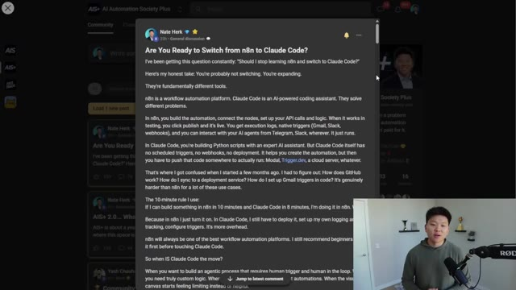
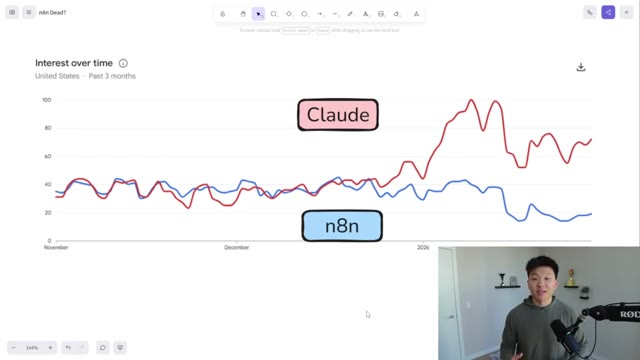
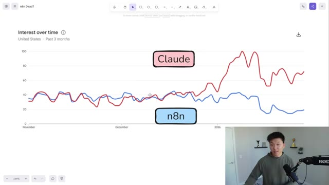
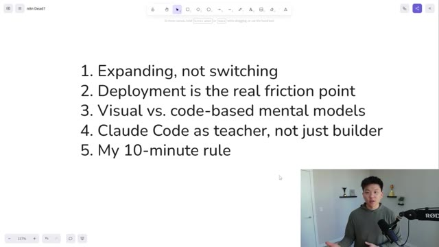
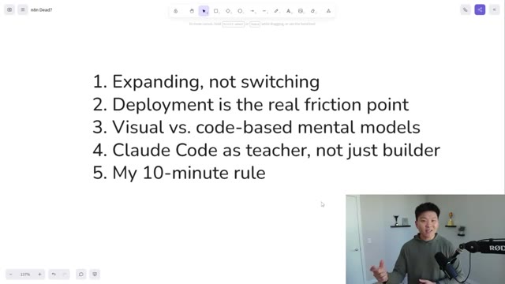
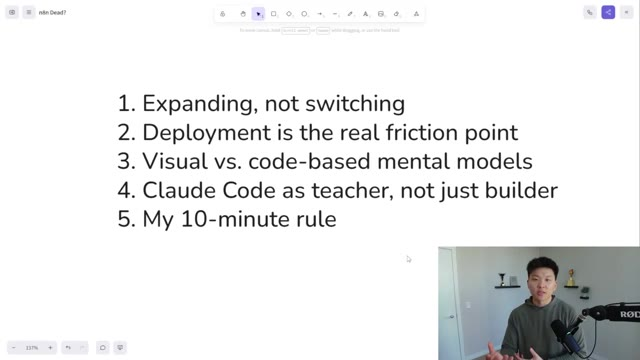
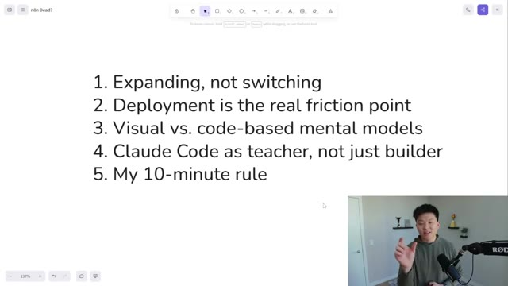
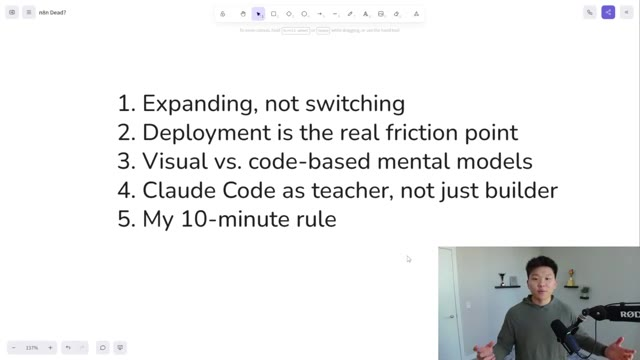
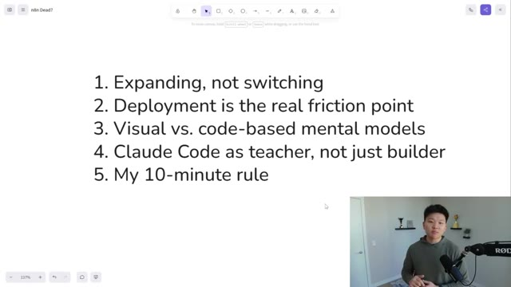

# 🎬 Is n8n Dead?

> **Chaîne** : [Nate Herk | AI Automation](https://www.youtube.com/@nateherk/featured)  
> **Lien YouTube** : [https://www.youtube.com/watch?v=wb4uDdsFh6o](https://www.youtube.com/watch?v=wb4uDdsFh6o)  
> **Date de publication** : 20260201  
> **Durée** : 00:04:45  
> **Identifiant vidéo** : `wb4uDdsFh6o`  
> **Transcription & Analyse** : `whisper-v3-large-turbo+gemini-3.5-flash-lite`  

---

## 📌 Synthèse Exécutive & Outils

### 💡 Résumé
Dans cette vidéo intitulée **n8n est-il mort ?**, Nate Herk décortique les capacités pratiques d'automatisation et de développement propulsées par les modèles de pointe.

### 🛠️ Outils, Modèles & Logiciels Présentés
- **Opus 5.5 & Claude Code** : Modèles d'ingénierie et agents de codage autonome.

### 🔑 Points Clés & Enseignements Stratégiques
- Optimiser le niveau d'effort et le raisonnement des modèles IA pour des résultats industriels.
- Automatiser les cycles de création logicielle de bout en bout.

---

## ⏱️ Chronologie & Transcription Complète Audio & Visuelle (Mot pour Mot)

### ⏱️ `[00:00:00 - 00:00:23]` | Segment #01

**🔊 Audio (Transcription Intégrale Mot pour Mot en Français) :**
> Est-ce que NNN est mort ? C'est la plus grande question qu'on m'a posée ces deux dernières semaines. Il y a près de 24 heures, j'ai fait cette publication dans ma communauté Plus, en gros pour dire : êtes-vous prêts à passer de NNN à Cloud Code ? Et je développe ma façon de voir ces deux outils différents. Et vraiment, je pense qu'ils sont fondamentalement différents. Cette publication a suscité un très bon engagement. J'ai donc pris le temps de lire ce que tout le monde disait. Et je voulais aborder le sujet sur YouTube et faire une vidéo très rapide là-dessus.

**👁️ Analyse Visuelle d'Écran (gemini-3.5-flash-lite) :**
**Interface & Outils** : Interface web de communauté en ligne (AIS+ AI Automation Society Plus) affichant un post textuel détaillé.

**Contenu textuel & Code** : Texte de la publication comparant n8n (plateforme d'automatisation) et Claude Code (assistant de code IA), abordant les différences de workflows et de logique d'exécution.

**Action / Démonstration** : Affichage et lecture du message de la communauté par le présentateur.

*⏱️ 00:00:06 — Capture d'écran montrant une publication de communauté intitulée 'Are You Ready to Switch from n8n to Claude Code?' avec le présentateur incrusté en bas à droite.*

---

### ⏱️ `[00:00:23 - 00:00:51]` | Segment #02

**🔊 Audio (Transcription Intégrale Mot pour Mot en Français) :**
> Donc, il y a un peu plus d'un an, quand j'ai commencé à faire des vidéos YouTube sur n8n, c'était en mode hypercroissance, ça explosait de partout et les vidéos devenaient virales à droite à gauche à propos des agents IA n8n. Et au cours des deux derniers mois, moi-même et des tonnes d'autres créateurs n8n avons remarqué que le nombre de vues des vidéos n8n baissait. Et il y a cette étrange association en ligne entre les vues et la valeur, alors qu'elles ne sont pas, vous savez, directement équivalentes. Et ce que vous pouvez voir juste ici, c'est qu'au cours des trois derniers mois, quand vous comparez Claude et n8n sur Google Trends, ils étaient relativement au même niveau.

**👁️ Analyse Visuelle d'Écran (gemini-3.5-flash-lite) :**
**Interface & Outils** : Google Trends (interface d'analyse de données de recherche).

**Contenu textuel & Code** : Courbes de tendance comparatives montrant une divergence entre Claude et n8n au cours des 3 derniers mois.

**Action / Démonstration** : Visualisation comparative pour illustrer le changement de popularité des outils IA.

*⏱️ 00:00:30 — Un graphique "Intérêt au fil du temps" comparant les recherches Google pour "Claude" (courbe rouge en forte hausse) et "n8n" (courbe bleue en baisse).*

---

### ⏱️ `[00:00:51 - 00:01:12]` | Segment #03

**🔊 Audio (Transcription Intégrale Mot pour Mot en Français) :**
> Et Claude Code est sorti il y a environ un an. NNN est sorti évidemment il y a très longtemps, mais c'est vraiment au cours de la dernière année qu'il a explosé, et ils ont pour ainsi dire évolué main dans la main. Et tout à coup, ces derniers temps, Claude Code a en quelque sorte dépassé NNN en ce qui concerne l'intérêt pour la recherche, les vues sur YouTube et ce genre de choses. Mais est-ce que NNN est mort ? Non, je ne pense pas que NNN sera jamais fondamentalement mort.

**👁️ Analyse Visuelle d'Écran (gemini-3.5-flash-lite) :**
**Interface & Outils** : Google Trends (intégré dans un outil de tableau blanc type Excalidraw).

**Contenu textuel & Code** : Courbes de données montrant une montée en flèche de l'intérêt pour "Claude" dépassant "n8n".

**Action / Démonstration** : Visualisation comparative de données de tendances pour illustrer la domination croissante de Claude Code sur n8n.

*⏱️ 00:00:56 — Un graphique comparatif "Google Trends" affiché sur un tableau blanc virtuel, montrant l'évolution de l'intérêt pour "Claude" (ligne rouge) par rapport à "n8n" (ligne bleue) sur les 3 derniers mois.*

---

### ⏱️ `[00:01:12 - 00:01:34]` | Segment #04

**🔊 Audio (Transcription Intégrale Mot pour Mot en Français) :**
> Ils se sont taillé une très belle place sur le marché de l'automatisation par l'IA. Et je pense qu'ils ont bâti une très bonne communauté et que leur outil est vraiment solide. L'autre question qu'on me pose, c'est : je suis débutant, je me lance dans l'IA, vers lequel je dois me tourner ? Je pense toujours que, en tant que débutant, vous voulez commencer avec NNN. C'est beaucoup plus clair. C'est beaucoup plus simple. C'est beaucoup plus visuel. Et moi-même, il y a quelques mois, quand j'ai commencé à utiliser Cloud Code, j'étais plutôt confus.

**👁️ Analyse Visuelle d'Écran (gemini-3.5-flash-lite) :**
**Interface & Outils** : Aucune interface logicielle visible.

**Contenu textuel & Code** : Aucun code, terminal ou donnée affiché.

**Action / Démonstration** : Le présentateur parle à l'audience.

---

### ⏱️ `[00:01:35 - 00:01:59]` | Segment #05

**🔊 Audio (Transcription Intégrale Mot pour Mot en Français) :**
> Mais je me considérerais comme quelqu'un qui s'y connaît plutôt bien en NNN et qui est assez calé techniquement. Mais j'étais assez confus en me plongeant dans Cloud Code et en essayant de comprendre, d'accord, j'ai ces scripts Python. Maintenant, comment est-ce qu'ils fonctionnent réellement selon un calendrier ou sur un webhook ? Donc ma conclusion est que NNN sera toujours un outil pertinent. Il sera toujours un leader en matière d'automatisation des flux de travail, et il va être largement adopté en raison de la faiblesse de la barrière à l'entrée pour aller construire son premier flux de travail ou son premier agent IA.

**👁️ Analyse Visuelle d'Écran (gemini-3.5-flash-lite) :**
**Interface & Outils** : Aucune.

**Contenu textuel & Code** : Aucun.

**Action / Démonstration** : Le présentateur parle à la caméra (plan statique).

---

### ⏱️ `[00:01:59 - 00:02:21]` | Segment #06

**🔊 Audio (Transcription Intégrale Mot pour Mot en Français) :**
> Mais l'époque des vidéos NNN sur YouTube ou sur X qui deviennent virales, cette époque est révolue, je pense. Et alors que j'ai publié plus de contenu, en élargissant un peu mon ensemble d'outils, cela a causé un peu de panique dans mes communautés, d'après ce que j'ai pu voir, du genre : « Est-ce que je ne devrais plus apprendre NNN ? Genre, qu'est-ce que je devrais faire ? » Et donc, en gros, ma promesse envers vous les gars, c'est que je ne sais pas où va le domaine de l'IA.

**👁️ Analyse Visuelle d'Écran (gemini-3.5-flash-lite) :**
**Interface & Outils** : Aucune

**Contenu textuel & Code** : Aucun

**Action / Démonstration** : Aucune

---

### ⏱️ `[00:02:21 - 00:02:42]` | Segment #07

**🔊 Audio (Transcription Intégrale Mot pour Mot en Français) :**
> Personne ne le fait. Même les experts ont peur. Ils ne savent pas comment suivre. Il se passe tellement de choses. Mais ma promesse est que je vais essayer de rester le plus près possible de tout cela et de vous apporter ce qui me semble pertinent. Ne voyez donc pas cela comme si je passais de NNN à Cloud Code. Ils sont différents. Voyez cela comme l'élargissement de ma boîte à outils et, espérons-le, l'élargissement de vos compétences et de vos connaissances à d'autres outils également. Le véritable point de friction pour moi, et que je constate chez beaucoup de gens, c'est le déploiement.

**👁️ Analyse Visuelle d'Écran (gemini-3.5-flash-lite) :**
**Interface & Outils** : Tableau blanc numérique / outil de prise de notes (type Excalidraw ou Miro).

**Contenu textuel & Code** : Liste des points : 1. Expanding, not switching ; 2. Deployment is the real friction point ; 3. Visual vs. code-based mental models ; 4. Claude Code as teacher, not just builder ; 5. My 10-minute rule.

**Action / Démonstration** : Présentation synthétique des axes de réflexion de la vidéo.

*⏱️ 00:02:32 — Une capture d'écran d'un espace de travail de type tableau blanc numérique affichant une liste numérotée de 5 points clés sur l'évolution des outils d'automatisation.*

---

### ⏱️ `[00:02:42 - 00:03:15]` | Segment #08

**🔊 Audio (Transcription Intégrale Mot pour Mot en Français) :**
> It's super easy to get into Cloud Code, brainstorm with it, have it do things for you, have it spin up Python scripts. but then when you actually go to deploy it and maintain it over time, that's where it gets a little bit more ambiguous. It's a little bit harder to look at the execution data and figure out exactly what's going wrong. It's a little bit harder to maintain all this kind of stuff, at least where I'm at right now with my understanding compared to NADEN, where it's so easy to, you know, instantly just hit publish on a workflow when you're done. And you have all these native web hooks coming in and you have all these native triggers and you can see the execution logs and you can store everything in a Google sheet super, super easily. It's way more visual

**👁️ Analyse Visuelle d'Écran (gemini-3.5-flash-lite) :**
**Interface & Outils** : FigJam ou un outil similaire de tableau blanc collaboratif.

**Contenu textuel & Code** : Liste de 5 points : "1. Expanding, not switching", "2. Deployment is the real friction point", "3. Visual vs. code-based mental models", "4. Claude Code as teacher, not just builder", "5. My 10-minute rule".

**Action / Démonstration** : Présentation visuelle des concepts abordés par le locuteur.

*⏱️ 00:02:51 — Une capture d'écran montrant une présentation sous forme de liste numérotée dans une interface de tableau blanc numérique, résumant les points clés de la discussion sur l'automatisation.*

---

### ⏱️ `[00:03:15 - 00:03:33]` | Segment #09

**🔊 Audio (Transcription Intégrale Mot pour Mot en Français) :**
> par rapport aux modèles mentaux basés sur le code, où parfois, pour moi, c'est plus difficile de contextualiser ce qui s'y passe réellement. Et ce que j'ai fait, c'est utiliser CloudCode comme un professeur. Donc, ce n'est pas à chaque fois que je suis dans CloudCode que je construis des choses. Parfois, je configure simplement ces projets où j'ai des fichiers, et il me comprend, moi et mon entreprise, et je l'utilise juste pour m'aider à comprendre des concepts à un niveau plus approfondi.

**👁️ Analyse Visuelle d'Écran (gemini-3.5-flash-lite) :**
**Interface & Outils** : Tableau blanc numérique (type Excalidraw ou similaire).

**Contenu textuel & Code** : Liste des sujets abordés : 1. Expanding, not switching ; 2. Deployment is the real friction point ; 3. Visual vs. code-based mental models ; 4. Claude Code as teacher, not just builder ; 5. My 10-minute rule.

**Action / Démonstration** : Présentation statique de la structure de la discussion pour appuyer les propos du présentateur.

*⏱️ 00:03:20 — Une liste de 5 points clés affichée sur un tableau blanc numérique, avec le présentateur visible en médaillon dans le coin inférieur droit.*

---

### ⏱️ `[00:03:34 - 00:03:53]` | Segment #10

**🔊 Audio (Transcription Intégrale Mot pour Mot en Français) :**
> J'adore ça parce que je peux voir ce qu'il fait, je peux voir à quoi il pense et je peux lire sa trace. Et s'il y a quelque chose qu'il fait qui me confonds, je lui demande simplement, qu'est-ce que tu viens de faire là ? Qu'est-ce qui se passe si tu ne faisais pas ça ? Mais en ce moment, j'ai encore beaucoup d'automations qui tournent là-dedans dans NNN. Et je ne vais probablement pas les basculer parce que je peux payer, tu sais, 10 balles par mois ou peu importe ce que c'est pour mon VPS et juste avoir ces automations qui tournent.

**👁️ Analyse Visuelle d'Écran (gemini-3.5-flash-lite) :**
**Interface & Outils** : Outil de présentation ou tableau blanc numérique (type Excalidraw ou similaire).

**Contenu textuel & Code** : Liste numérotée : 1. Expanding, not switching ; 2. Deployment is the real friction point ; 3. Visual vs. code-based mental models ; 4. Claude Code as teacher, not just builder ; 5. My 10-minute rule.

**Action / Démonstration** : Le présentateur explique les concepts théoriques de sa méthode de travail avec des outils d'IA.

*⏱️ 00:03:39 — Une diapositive de présentation affichant une liste de 5 points clés concernant l'utilisation de l'IA, avec le présentateur en médaillon dans le coin inférieur droit.*

---

### ⏱️ `[00:03:53 - 00:04:19]` | Segment #11

**🔊 Audio (Transcription Intégrale Mot pour Mot en Français) :**
> Et je sais qu'ils fonctionnent et je sais exactement comment ils fonctionnent. Tout comme beaucoup de gens qui utilisent Zapier depuis des années, quand n8n est sorti, ils ont, vous savez, continué d'utiliser n8n, mais ils ont toujours des tonnes de Zaps et ils les ont toujours et ils vont juste les laisser là. Maintenant, je ne dis pas vraiment que c'est bien ou que c'est mal, mais je dis que n8n n'est pas en train de mourir. Donc ma règle des 10 minutes, c'est en gros : si j'ai un cas d'usage et que je peux le créer en 10 minutes ou moins sur n8n, je vais juste le faire là-bas parce que je peux le faire super rapidement.

**👁️ Analyse Visuelle d'Écran (gemini-3.5-flash-lite) :**
**Interface & Outils** : Tableau blanc numérique (type Miro ou Excalidraw).

**Contenu textuel & Code** : Une liste de 5 points : "1. Expanding, not switching", "2. Deployment is the real friction point", "3. Visual vs. code-based mental models", "4. Claude Code as teacher, not just builder", "5. My 10-minute rule".

**Action / Démonstration** : Présentation théorique des points clés de la vidéo par l'orateur.

*⏱️ 00:04:00 — Une capture d'écran montrant une présentation sous forme de liste numérotée sur un tableau blanc numérique, avec le présentateur visible en médaillon dans le coin inférieur droit.*

---

### ⏱️ `[00:04:20 - 00:04:39]` | Segment #12

**🔊 Audio (Transcription Intégrale Mot pour Mot en Français) :**
> I don't have to think as much because at this point it's like muscle memory. And then when I'm done, I just publish it and I'm good. I've already got my error workflow set up. I've already got tracking set up. I'm good. So anyways, I didn't wanna make this one too long. I just felt like I had to get this off my chest because I know that a lot of you guys are thinking about this kind of stuff. So anyways, if you enjoyed the video or you learned something new, please give it a like.

**👁️ Analyse Visuelle d'Écran (gemini-3.5-flash-lite) :**
**Interface & Outils** : Logiciel de tableau blanc numérique / prise de notes (type Miro ou FigJam).

**Contenu textuel & Code** : Liste des sujets abordés : 1. Expanding, not switching; 2. Deployment is the real friction point; 3. Visual vs. code-based mental models; 4. Claude Code as teacher, not just builder; 5. My 10-minute rule.

**Action / Démonstration** : Présentation visuelle des axes de réflexion stratégiques pour l'automatisation par l'orateur.

*⏱️ 00:04:24 — Une liste à puces numérotée présentant 5 points clés sur les méthodes d'automatisation, affichée sur un canevas numérique.*

---

### ⏱️ `[00:04:39 - 00:04:44]` | Segment #13

**🔊 Audio (Transcription Intégrale Mot pour Mot en Français) :**
> Ça m'aide vraiment énormément. Et comme toujours, j'apprécie que vous soyez allés jusqu'à la fin de la vidéo. On se voit dans la prochaine. Merci les gars.

**👁️ Analyse Visuelle d'Écran (gemini-3.5-flash-lite) :**
**Interface & Outils** : Aucune.

**Contenu textuel & Code** : Aucun.

**Action / Démonstration** : Conclusion de la vidéo par le présentateur.

---

