# 🎬 How to Sign Your First AI Automation Client in 7 days (With Proof)

> **Chaîne** : [Nate Herk | AI Automation](https://www.youtube.com/@nateherk/featured)  
> **Lien YouTube** : [https://www.youtube.com/watch?v=c2C_SbZk6iI](https://www.youtube.com/watch?v=c2C_SbZk6iI)  
> **Date de publication** : 20260204  
> **Durée** : 00:20:54  
> **Identifiant vidéo** : `c2C_SbZk6iI`  
> **Transcription & Analyse** : `whisper-v3-large-turbo+gemini-3.5-flash-lite`  

---

## 📌 Synthèse Exécutive & Outils

### 💡 Résumé
Dans cette vidéo intitulée **How to Sign Your First AI Automation Client in 7 days (With Proof)**, Nate Herk décortique les capacités pratiques d'automatisation et de développement propulsées par les modèles de pointe.

### 🛠️ Outils, Modèles & Logiciels Présentés
- **Opus 5.5 & Claude Code** : Modèles d'ingénierie et agents de codage autonome.

### 🔑 Points Clés & Enseignements Stratégiques
- Optimiser le niveau d'effort et le raisonnement des modèles IA pour des résultats industriels.
- Automatiser les cycles de création logicielle de bout en bout.

---

## ⏱️ Chronologie & Transcription Complète Audio & Visuelle (Mot pour Mot)

### ⏱️ `[00:00:00 - 00:00:23]` | Segment #01

**🔊 Audio (Transcription Intégrale Mot pour Mot en Français) :**
> If you can build AI workflows, but you still can't sign a client, then this video is for you, because I'm going to show you how to land your first AI workflow client in just seven days. And this is in theory. Christian used this exact process and signed his first client in just five days. So in this video, he'll break down what he did, and then I'll show you the exact same method step by step so that you can copy it. So let's get into it. All right, guys, today I'm here with Christian. He's a member of the community, and he's had some huge wins inside the community.

**👁️ Analyse Visuelle d'Écran (gemini-3.5-flash-lite) :**
**Interface & Outils** : Plateforme YouTube.

**Contenu textuel & Code** : Aucun code, terminal ou diagramme de workflow technique n'est affiché.

**Action / Démonstration** : Présentation orale du sujet de la vidéo.

---

### ⏱️ `[00:00:23 - 00:00:56]` | Segment #02

**🔊 Audio (Transcription Intégrale Mot pour Mot en Français) :**
> He actually got a client in the first five days of joining and going through the program. So I wanted to bring him in today and just kind of highlight his story a little bit and talk about you know some of his big breakthroughs and how he was able to achieve these wins so christian if you want to give everyone a real quick intro a little bit of your background and you know how technical were you before hopping into this ai space yeah so uh my name is uh christian i'm uh 21 years old out here in arizona and for me as a background i've always been kind of tech savvy always liked doing like using the tools but as far as ai itself i was barely introduced this year Like it was back in March when I was introduced.

**👁️ Analyse Visuelle d'Écran (gemini-3.5-flash-lite) :**
**Interface & Outils** : AUCUNE

**Contenu textuel & Code** : AUCUN

**Action / Démonstration** : Conversation en face à face entre le présentateur et son invité sans partage d'écran.

---

### ⏱️ `[00:00:56 - 00:01:16]` | Segment #03

**🔊 Audio (Transcription Intégrale Mot pour Mot en Français) :**
> So still fairly new. Once I got introduced, I just got obsessed and just started rolling with it. But started this about a couple months ago, loving the community, loving all the supports and all the guidance with it. And it's just it's just been great ever since I joined. Awesome, man. Well, yeah, I'm super excited to have you here today and just get to talk about, you know, what got you into the space and how you were able to achieve, you know, these client wins.

**👁️ Analyse Visuelle d'Écran (gemini-3.5-flash-lite) :**
**Interface & Outils** : Aucune.

**Contenu textuel & Code** : Aucun.

**Action / Démonstration** : Conversation vidéo en cours (simple échange verbal).

---

### ⏱️ `[00:01:16 - 00:01:39]` | Segment #04

**🔊 Audio (Transcription Intégrale Mot pour Mot en Français) :**
> So I guess that's the first one to start off with. Like, what actually was it to you that made you realize, like, I want to take advantage of this AI opportunity? Once I started getting introduced to it and getting more acquainted with it, I just I love the possibilities and all the different things that you can do with AI. And for me, it was about three months ago I had that light bulb moment. It was like, what if I can somehow use this in businesses and help them do that and I can charge them a whatever price.

**👁️ Analyse Visuelle d'Écran (gemini-3.5-flash-lite) :**
**Interface & Outils** : Aucune interface logicielle ou outil technique n'est présenté dans ce segment.

**Contenu textuel & Code** : Aucun code source, commande, workflow ou donnée n'est affiché.

**Action / Démonstration** : Aucune action technique, exécution de script ou démonstration n'est effectuée.

---

### ⏱️ `[00:01:39 - 00:02:03]` | Segment #05

**🔊 Audio (Transcription Intégrale Mot pour Mot en Français) :**
> But ultimately, it'd be solving a rich person problem. It was a really cool moment really when I found it. 100%. Yeah. So once you kind of found out you wanted to go down the automation space and I think N8N was was your big tool as well. What were you doing and like how are you trying to find clients before joining the community? Funny enough, I actually didn't start using N8N about a couple of weeks ago.

**👁️ Analyse Visuelle d'Écran (gemini-3.5-flash-lite) :**
**Interface & Outils** : AUCUNE

**Contenu textuel & Code** : AUCUN

**Action / Démonstration** : AUCUNE

---

### ⏱️ `[00:02:03 - 00:02:28]` | Segment #06

**🔊 Audio (Transcription Intégrale Mot pour Mot en Français) :**
> But before that, my other community taught me a way to where we can scrape leads off of LinkedIn, find their emails, generate email bodies for them using AI and then loading it into a website called Instantly AI, where you can just mention emails, like cold emails. It was a great thought to begin with, right? It was a great idea. I was doing a bunch of emails, like 450 a day, but it was like a crazy open rate, but nobody was buying.

**👁️ Analyse Visuelle d'Écran (gemini-3.5-flash-lite) :**
**Interface & Outils** : Navigateur web (site Instantly.ai).

**Contenu textuel & Code** : Texte marketing de la page d'accueil : "Cold email for more replies & more revenue".

**Action / Démonstration** : Présentation visuelle de la plateforme utilisée pour la gestion des campagnes d'emailing à froid.

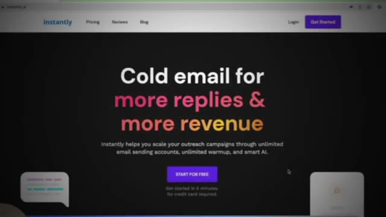
*⏱️ 00:02:15 — Page d'accueil du site web "Instantly AI", mettant en avant des services de "cold email" pour augmenter les réponses et les revenus.*

---

### ⏱️ `[00:02:28 - 00:02:53]` | Segment #07

**🔊 Audio (Transcription Intégrale Mot pour Mot en Français) :**
> Just a lot of shots in the dark. Didn't really know how to structure the emails. I didn't know how to write copy or anything. So I was basically just trying anything and everything I could. Joining Facebook group, talking to my contacts that I have, other business owners, see if I can do it for them or if I can just, if they have anybody that I can do it for, just really no proper guidance or no set direction, just kind of shooting off different lanes, hoping that one of them was going to hit.

**👁️ Analyse Visuelle d'Écran (gemini-3.5-flash-lite) :**
**Interface & Outils** : Aucune interface logicielle ou outil technique n'est présent dans ces captures.

**Contenu textuel & Code** : Aucun code, commande ou donnée textuelle n'apparaît à l'écran.

**Action / Démonstration** : Aucune action technique ou manipulation logicielle n'est effectuée, il s'agit uniquement d'une discussion orale.

---

### ⏱️ `[00:02:53 - 00:03:30]` | Segment #08

**🔊 Audio (Transcription Intégrale Mot pour Mot en Français) :**
> I think the reason why like cold email is really successful and cold outreach in general, I think once you're ready to scale, but like to get your first client, it's really tough to do that because people are just like, I don't know who this guy is. And it's like, he has nothing really to show me yet. Why would I kind of give him or her my business? So how did then your approach kind of change once you were in the community and started to, you know, interact with the people in there and the course material? The biggest one by far was how to position myself, right? We're not selling workflows. It's the brain behind it. Scale or get your time back, whatever the goal is for your business. Positioning myself as a proper guide, not a template salesman. That was

**👁️ Analyse Visuelle d'Écran (gemini-3.5-flash-lite) :**
**Interface & Outils** : Aucune interface logicielle ou technique n'est présente dans ce segment.

**Contenu textuel & Code** : Aucun contenu technique, code ou donnée n'est affiché.

**Action / Démonstration** : Aucune action technique n'est réalisée ; il s'agit d'une discussion conversationnelle entre deux personnes.

---

### ⏱️ `[00:03:30 - 00:04:05]` | Segment #09

**🔊 Audio (Transcription Intégrale Mot pour Mot en Français) :**
> a really key thing for me in my process. And it's just, it was black and white difference and it helped me out a ton within days of me doing that i closed my first client which was insane yeah no i was just looking at our our dm on school right before we hopped on and i remember you know you joined the community we we had a quick chat got you access to the course and then five days later you messaged me it's like i just closed my client for like what was it was it 1500 or something like that uh yeah 1500 and we actually we upped it actually recently so we're doing uh 2000 now And then I think it's going to over time build and build and build from there as I get better too.

**👁️ Analyse Visuelle d'Écran (gemini-3.5-flash-lite) :**
**Interface & Outils** : Aucune interface logicielle ou outil technique n'est visible. Il s'agit uniquement d'une conversation en visioconférence.

**Contenu textuel & Code** : Aucun contenu technique, code ou diagramme n'est affiché.

**Action / Démonstration** : Aucune manipulation logicielle ou démonstration d'agent IA n'est effectuée dans ce segment ; il s'agit d'une séquence de discussion narrative.

---

### ⏱️ `[00:04:05 - 00:04:24]` | Segment #10

**🔊 Audio (Transcription Intégrale Mot pour Mot en Français) :**
> Yeah, it was 1500 starting out. So it was pretty cool. So you made a post about that win, right? And then I pinned it in the community. And then did you say someone reached out to you from that post and you got another client off that? So off that first one, I was getting a lot of praise or a lot of traction. I was like, oh, this is cool. And then, you know, the gem as well. So that was even better.

**👁️ Analyse Visuelle d'Écran (gemini-3.5-flash-lite) :**
**Interface & Outils** : AUCUNE

**Contenu textuel & Code** : AUCUN

**Action / Démonstration** : AUCUNE

---

### ⏱️ `[00:04:24 - 00:04:58]` | Segment #11

**🔊 Audio (Transcription Intégrale Mot pour Mot en Français) :**
> Literally three days later on, that was that Friday I posted it. That Sunday, another member in the community reached out. he was a newer member and said, Hey, I'm looking forward to hire, uh, he called it an AI automator. Um, and then it went from getting, you know, got the first client engaged with the community, got the second client. And now I'm able to actually do this full time and not even have to worry about work. So, which is great. Um, and it sounds like your kind of biggest light bulb moment so far from the community has been just the idea of the way you position yourself and, um, probably how you conduct yourself on those initial discovery and sales calls. So is there anything

**👁️ Analyse Visuelle d'Écran (gemini-3.5-flash-lite) :**
**Interface & Outils** : Aucune interface logicielle ou technique n'est visible dans ce segment.

**Contenu textuel & Code** : Aucun contenu textuel, code ou donnée n'est affiché.

**Action / Démonstration** : Aucune action technique ou démonstration de workflow n'est effectuée.

---

### ⏱️ `[00:04:58 - 00:05:36]` | Segment #12

**🔊 Audio (Transcription Intégrale Mot pour Mot en Français) :**
> specifically you can think about where, you know, hopping on discovery calls or trying to talk to business owners before having that kind of like light bulb moment, the way that you would like speak about AI or speak about automations has shifted. Yeah, definitely. Before I was, I didn't really, I didn't have a process. I would walk in there and say, Hey, this is what I do. I can build template for you if you need, and it can solve this. Do you want it? And that was kind of it, but going through the lessons and actually showing, all right, this is how you should ask the questions. This is how you find the pain and find ways that we can actually leverage AI to actually help their business. And again, I'm an actual guide in the process in the journey of AI

**👁️ Analyse Visuelle d'Écran (gemini-3.5-flash-lite) :**
**Interface & Outils** : Aucune interface logicielle ou outil technique n'est affiché dans ce segment.

**Contenu textuel & Code** : Aucun code, prompt ou donnée n'est visible.

**Action / Démonstration** : Conversation en visioconférence entre le présentateur et son invité.

---

### ⏱️ `[00:05:36 - 00:05:58]` | Segment #13

**🔊 Audio (Transcription Intégrale Mot pour Mot en Français) :**
> because it can be very overwhelming. So once I started positioning myself there, it was a complete 180. Yeah, it was just, it was, yeah, complete night and day difference. I'm going to do that with all my processes moving forward. But that one specifically really helped me out a lot. So besides the way that you shifted your perspective as far as like, you know, let's think about your business and let me help you diagnose problems rather than just here's a template.

**👁️ Analyse Visuelle d'Écran (gemini-3.5-flash-lite) :**
**Interface & Outils** : Aucune interface logicielle montrée.

**Contenu textuel & Code** : Aucun code, commande ou donnée visible.

**Action / Démonstration** : Conversation et discussion verbale entre les participants.

---

### ⏱️ `[00:05:58 - 00:06:34]` | Segment #14

**🔊 Audio (Transcription Intégrale Mot pour Mot en Français) :**
> What else do you think it made them say yes? Because at this point, there's this mental battle of like, how much should I charge or should I do it for free? Or like, what proof do I actually have? How do I get someone to say yes? So what else do you think it was about you and about the way that you spoke to this person that got them to ultimately give you their business? for the second client i mean he kind of knew my situation a little bit because he saw the post he read it and then that's when he reached out i was just very very honest with him and up front about like listen this is um obviously you know the value of the product so i went in there i was very very open i was very honest and transparent about me where i'm at my journey and my goals for him and

**👁️ Analyse Visuelle d'Écran (gemini-3.5-flash-lite) :**
**Interface & Outils** : Aucune interface logicielle, éditeur de code ou outil d'automatisation n'est présent dans ces segments.

**Contenu textuel & Code** : Aucun code, commande ou donnée n'est affiché.

**Action / Démonstration** : Aucune action technique n'est réalisée ; il s'agit uniquement d'une discussion orale entre deux personnes.

---

### ⏱️ `[00:06:34 - 00:06:53]` | Segment #15

**🔊 Audio (Transcription Intégrale Mot pour Mot en Français) :**
> was mainly just trying to focus on building that relationship yeah and now i mean the rest is history so yeah it's awesome because now that your foot's in the door there's so much opportunity for more growth and for bigger projects. And I've always said, you'd rather have one, let's just say 10K a month client rather than having five 2K a month clients. You just have an opportunity to go away deeper.

**👁️ Analyse Visuelle d'Écran (gemini-3.5-flash-lite) :**
**Interface & Outils** : Aucune interface logicielle ou outil technique n'est présent sur ces captures.

**Contenu textuel & Code** : Aucun contenu technique, code ou diagramme n'est affiché.

**Action / Démonstration** : Les deux participants sont simplement en train de converser lors d'un entretien en visioconférence.

---

### ⏱️ `[00:06:53 - 00:07:17]` | Segment #16

**🔊 Audio (Transcription Intégrale Mot pour Mot en Français) :**
> And that just leads into better referrals, better case studies, more opportunities to win more business, things like that. Do you want to walk us through the actual solution that you've provided to this first business or that you're working on? And also how you got to that price point and what sort of like that conversation looks like. The one that I built, So I was trying to build a system for updating clients, a huge pain point that we were having simply just communication.

**👁️ Analyse Visuelle d'Écran (gemini-3.5-flash-lite) :**
**Interface & Outils** : Aucune interface logicielle montrée.

**Contenu textuel & Code** : Aucun code, commande ou donnée affichée.

**Action / Démonstration** : Discussion orale entre les deux interlocuteurs.

---

### ⏱️ `[00:07:17 - 00:07:50]` | Segment #17

**🔊 Audio (Transcription Intégrale Mot pour Mot en Français) :**
> Like a lot of clients would call up like, hey, what's this? I don't know what they mean by this. When is this going to get scheduled? Or nobody's talked to me. Nobody's reached out. I don't know what's going on with my project. Or sometimes they're just simple FAQs. They just want to know, hey, what is Shotcrete? And they can simply Google it, but they're going to call us first. I focus on building a workflow for that. And actually, I got inspiration for it from one of your YouTube videos, actually. It was your AI assistant. So I took that kind of blueprint and used it to build out a, I called it like a PM assistant. So when the project manager's out on

**👁️ Analyse Visuelle d'Écran (gemini-3.5-flash-lite) :**
**Interface & Outils** : Aucune interface logicielle visible.

**Contenu textuel & Code** : Aucun contenu technique ou code affiché.

**Action / Démonstration** : Les personnes à l'écran sont en train de discuter ; aucune action de démonstration n'est effectuée.

---

### ⏱️ `[00:07:50 - 00:08:23]` | Segment #18

**🔊 Audio (Transcription Intégrale Mot pour Mot en Français) :**
> site, he can just simply talk to the bots. It'll engage with him, do it and execute whatever tasks are needed, whether it's sending clients an update email, logging an update into the CRM, little things like that he loved it he completely bought in i'm still improving it to this day it's not perfect yet but it's um it's a constant reminder meeting every week to get it better and better and better but that's the one i started with i want to ask you now compared to let's just say three weeks ago how much more confident do you feel and just your ability to talk to people show them the value deliver on solutions price your work all that kind of stuff a lot more

**👁️ Analyse Visuelle d'Écran (gemini-3.5-flash-lite) :**
**Interface & Outils** : Aucune interface logicielle montrée.

**Contenu textuel & Code** : Aucun contenu technique, code ou workflow affiché.

**Action / Démonstration** : Aucune action technique n'est démontrée, il s'agit d'une séquence de discussion.

---

### ⏱️ `[00:08:23 - 00:08:50]` | Segment #19

**🔊 Audio (Transcription Intégrale Mot pour Mot en Français) :**
> confident before i had no idea i had to do any of that i was just kind of got to go kind of go in and just give like a set base price point for whatever workflow that I build. And again, before I was just trying to sell templates, basically. Now I feel a ton more confident knowing what my offer is, having a clear offer for them that they can understand and being able to properly communicate what it is that I do and how it can benefit their business.

**👁️ Analyse Visuelle d'Écran (gemini-3.5-flash-lite) :**
**Interface & Outils** : Aucune interface logicielle ou outil technique n'est affiché dans ce segment.

**Contenu textuel & Code** : Aucun contenu technique, code ou donnée n'est visible.

**Action / Démonstration** : Aucune action technique ou démonstration de workflow n'est effectuée.

---

### ⏱️ `[00:08:50 - 00:09:16]` | Segment #20

**🔊 Audio (Transcription Intégrale Mot pour Mot en Français) :**
> That's awesome to hear, man. I mean, it's a cliche, but it's so true. Just the idea of like surrounding yourself with like-minded people, like what that really does to you. Because I know like right before we started recording, we were just talking about how there's just so much noise and there's so much great education everywhere. But when you get stuck in that world where you're just watching, watching, watching, and you're getting like a scattered bit of information and you don't have like a structured path, it just makes it very overwhelming, of course, but also confusing.

**👁️ Analyse Visuelle d'Écran (gemini-3.5-flash-lite) :**
**Interface & Outils** : Aucune interface logicielle ou technique affichée.

**Contenu textuel & Code** : Aucun code, commande ou prompt visible.

**Action / Démonstration** : Conversation informelle entre deux intervenants sans support visuel de démonstration.

---

### ⏱️ `[00:09:16 - 00:09:35]` | Segment #21

**🔊 Audio (Transcription Intégrale Mot pour Mot en Français) :**
> Yeah, man, I wanted to kind of close off here. If you've got any any final thoughts or where could people find you if they want to get in touch with you? Yeah, yeah. I mean, it would just be my LinkedIn mainly because I don't really have a website right now. or through the community. I think that's the best way possible. I'm in most of the communities, regular one and then the plus community as well. I'm mainly in there more than anything.

**👁️ Analyse Visuelle d'Écran (gemini-3.5-flash-lite) :**
**Interface & Outils** : Aucune interface logicielle ou technique n'est visible.

**Contenu textuel & Code** : Aucun code, commande ou donnée affichée.

**Action / Démonstration** : Conversation informelle de clôture d'entretien ; aucun processus technique ou démonstration logicielle n'est en cours.

---

### ⏱️ `[00:09:36 - 00:09:55]` | Segment #22

**🔊 Audio (Transcription Intégrale Mot pour Mot en Français) :**
> I would say just doing the same thing, just connecting with people, trying to provide value and then seeing what else that I can learn. It's really inspiring to hear your story, man. 21 years old, started less than a year ago in this space. And you guys also just heard him say, basically doesn't have a website yet. He's new and he told clients, hey, I'm new, I'm learning, but I want to help you. And he's been able to secure some pretty crazy wins.

**👁️ Analyse Visuelle d'Écran (gemini-3.5-flash-lite) :**
**Interface & Outils** : Aucune interface logicielle ou technique n'est affichée.

**Contenu textuel & Code** : Aucun code, aucune donnée ou interface d'automatisation n'est présent.

**Action / Démonstration** : Les participants sont simplement en train de discuter en visioconférence.

---

### ⏱️ `[00:09:55 - 00:10:15]` | Segment #23

**🔊 Audio (Transcription Intégrale Mot pour Mot en Français) :**
> And so hopefully that's all very motivating to all of you guys that are watching this, that are trying to get to a spot where Christian now is. So thanks so much for coming on today, Christian. I really enjoyed getting to know you and getting to hear a little bit about your journey. Yeah, just keep crushing it. Best of luck, man. Thank you, man. I appreciate it. I'm trying my best. So now let's look at the exact method that I gave Christian that landed him his first client in just five days.

**👁️ Analyse Visuelle d'Écran (gemini-3.5-flash-lite) :**
**Interface & Outils** : Aucune interface logicielle n'est affichée.

**Contenu textuel & Code** : Aucun code, terminal ou donnée visible.

**Action / Démonstration** : Conversation informelle de clôture de segment.

---

### ⏱️ `[00:10:15 - 00:10:49]` | Segment #24

**🔊 Audio (Transcription Intégrale Mot pour Mot en Français) :**
> By the end, you'll have everything that you need to go sign your first AI client. All right. So before I walk through that actual seven-day plan, I just want to slow this down and ground in what actually happened with Christian, because this is where most beginners go wrong. If you think back to what Christian was doing before he joined the community, it's exactly what I see almost everyone doing when they get started, which is high volume, tons of cold outreach with no soul and no positioning. Using tools or automations to scrape LinkedIn, pulling emails, using AI to write generic copy, loading it all into instantly, and then blasting out like four or five hundred emails a day. Now on paper, this feels really productive because you're sending out so many messages, but in reality, you're just another random

**👁️ Analyse Visuelle d'Écran (gemini-3.5-flash-lite) :**
**Interface & Outils** : Navigateur web (site Instantly.ai).

**Contenu textuel & Code** : Texte marketing : "Cold email for more replies & more revenue" avec un bouton d'appel à l'action.

**Action / Démonstration** : Présentation d'un outil d'automatisation de prospection par email pour les clients IA.

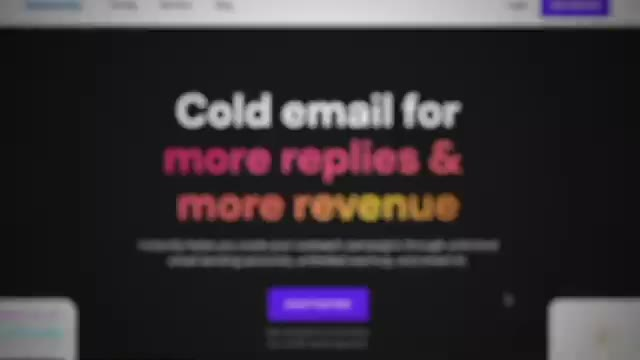
*⏱️ 00:10:41 — Capture d'écran de la page d'accueil du site Instantly.ai affichant le slogan "Cold email for more replies & more revenue".*

---

### ⏱️ `[00:10:49 - 00:11:12]` | Segment #25

**🔊 Audio (Transcription Intégrale Mot pour Mot en Français) :**
> person who's selling AI templates with no proof, no trust, and no real connection. And at that point, you're a commodity. And when you're a commodity, it turns into a race to the bottom on price, and you'll almost always lose. Because there's always going to be someone out there who will offer your service for a cheaper price. So what changed everything for Christian was not better tools or more automation, it was the mindset shift. He stopped thinking like someone who was trying to sell workflows and started thinking like someone who was leading with outcomes.

**👁️ Analyse Visuelle d'Écran (gemini-3.5-flash-lite) :**
**Interface & Outils** : Aucune (il s'agit d'illustrations graphiques de présentation, pas d'interfaces logicielles ou de démonstrations techniques).

**Contenu textuel & Code** : Texte affiché : "Better tools", "More automation", "Mindset".

**Action / Démonstration** : Aucune action technique ou manipulation d'outil montrée à l'écran.

---

### ⏱️ `[00:11:12 - 00:11:32]` | Segment #26

**🔊 Audio (Transcription Intégrale Mot pour Mot en Français) :**
> He positioned himself as a partner, not a template salesman. So instead of saying things like, here's what I built, here's this automation, here's this template I can customize for you. He was saying, here's how I can help your business do X. And he was targeting a specific pain point. So that one shift is the entire reason that this worked in five days instead of never working at all. Now, before we get into the seven day plan, I wanna talk about three psychological hurdles that everyone goes through.

**👁️ Analyse Visuelle d'Écran (gemini-3.5-flash-lite) :**
**Interface & Outils** : Application de messagerie mobile simulée (iOS).

**Contenu textuel & Code** : "Here's how I can help your business do [ X ]." avec le tag "PAIN" en surbrillance.

**Action / Démonstration** : Illustration visuelle du changement de posture commerciale : passer d'une offre centrée sur le produit à une offre centrée sur le point de douleur ("pain point") du client.

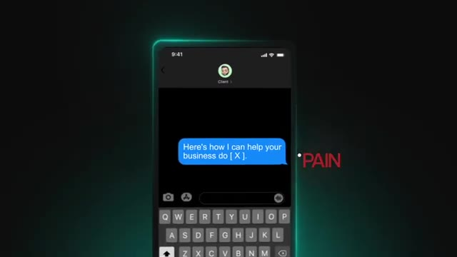
*⏱️ 00:11:22 — Animation graphique d'une interface de messagerie mobile affichant un message centré sur la résolution d'un problème métier, avec le mot "PAIN" en rouge sur le côté.*

---

### ⏱️ `[00:11:33 - 00:11:52]` | Segment #27

**🔊 Audio (Transcription Intégrale Mot pour Mot en Français) :**
> I went through them, Christian went through them, you're probably going through them right now. And the first one is imposter syndrome. Everyone will feel this at the beginning. And honestly, I still feel this sometimes right now. Thoughts like, do I even have the right to charge for this? Or I don't wanna feel scammy. Or what if I'm not ready yet? And that feeling will never fully go away, but you do learn how to work through it. So the key is just to not over promise because that's when you run into trouble.

**👁️ Analyse Visuelle d'Écran (gemini-3.5-flash-lite) :**
**Interface & Outils** : Aucune interface logicielle, éditeur de code ou terminal n'est affiché.

**Contenu textuel & Code** : Aucun code, aucune donnée technique ou prompt n'est visible à l'écran.

**Action / Démonstration** : Aucune manipulation logicielle ou démonstration technique n'est effectuée, il s'agit d'une séquence de type "talking head" entrecoupée d'images d'illustration cinématographiques.

---

### ⏱️ `[00:11:53 - 00:12:13]` | Segment #28

**🔊 Audio (Transcription Intégrale Mot pour Mot en Français) :**
> Both Christian and I did the same thing early on when we were getting started, literally saying, hey, I'm new to this. I'm obsessed with it. I've been learning a lot. I've been building a lot. And I want to help you with this problem. And that type of honesty makes you sound like a real human. Like I said, especially early on when you're doing your first one or two clients for free or very cheap. That's not a weakness. It's low risk for them. And it gets you experience, which is the only thing that should actually matter to you right now.

**👁️ Analyse Visuelle d'Écran (gemini-3.5-flash-lite) :**
**Interface & Outils** : Interface graphique personnalisée simulant une application de visioconférence.

**Contenu textuel & Code** : Texte affiché dans les bulles de discussion : "Hey, I'm new to this. I'm obsessed with it." suivi d'une seconde bulle en cours de rédaction "I've...".

**Action / Démonstration** : Illustration visuelle du script de communication recommandé pour instaurer une relation honnête avec un client potentiel.

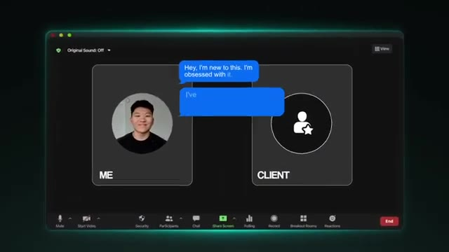
*⏱️ 00:11:58 — Une représentation visuelle stylisée d'une interface de visioconférence (type Zoom) illustrant un échange entre le présentateur ("ME") et un "CLIENT", affichant les bulles de texte mentionnées dans l'audio.*

---

### ⏱️ `[00:12:13 - 00:12:35]` | Segment #29

**🔊 Audio (Transcription Intégrale Mot pour Mot en Français) :**
> Your goal should be to over-deliver, prove to yourself, and also prove to the client that you can actually do this. And then imposter syndrome starts to fade because now you have actual experience to talk about and you have actual results that you've driven. Now, the second hurdle is about pricing. People get stuck here way too early. They obsess over retainers and monthly pricing and they want to hit that $10K per month figure that everyone's going for. But if you're trying to maximize revenue before you've even ever delivered value or got experience, then you're going to fail.

**👁️ Analyse Visuelle d'Écran (gemini-3.5-flash-lite) :**
**Interface & Outils** : Interface graphique de présentation (motion design).

**Contenu textuel & Code** : Texte "Pricing", "3", "$10,000 / month".

**Action / Démonstration** : Animation graphique illustrant les étapes de montée en compétence et de tarification.

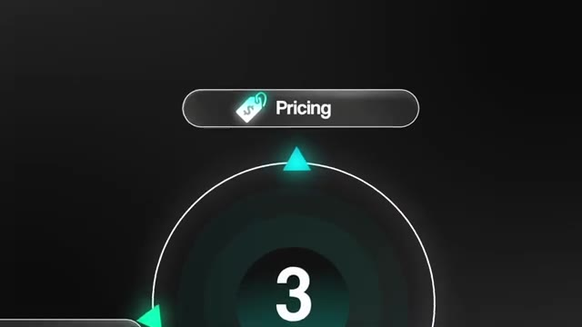
*⏱️ 00:12:24 — Graphique animé affichant le mot "Pricing" dans un encadré avec le chiffre "3" au centre d'un cercle dynamique.*

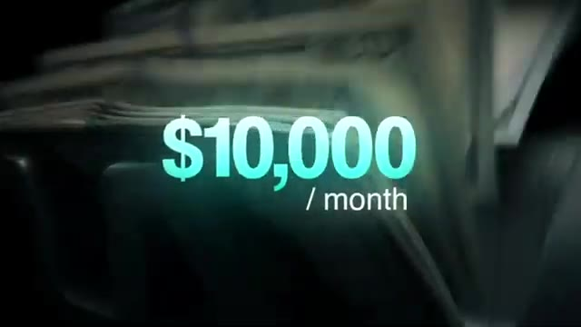
*⏱️ 00:12:30 — Texte animé affichant "$10,000 / month" sur fond de machine à compter les billets.*

---

### ⏱️ `[00:12:35 - 00:12:55]` | Segment #30

**🔊 Audio (Transcription Intégrale Mot pour Mot en Français) :**
> So the thing that I want you guys to lock into your brain is that trust comes before retainers. Asking someone for a retainer right away would be like asking someone for a referral right away before you even have any sort of partnership. It's very hard to get someone on a monthly agreement if they've never worked with you before. So what should matter to you first is just delivering value and earning trust, and then you can win a retainer later. That's why I always talk about value-based pricing.

**👁️ Analyse Visuelle d'Écran (gemini-3.5-flash-lite) :**
**Interface & Outils** : Aucune.

**Contenu textuel & Code** : Texte affiché à l'écran : "TRUST", "RETAINER", "DELIVERING VALUE".

**Action / Démonstration** : Aucune, il s'agit d'une séquence de présentation face caméra sans support technique ou démonstration logicielle.

---

### ⏱️ `[00:12:55 - 00:13:16]` | Segment #31

**🔊 Audio (Transcription Intégrale Mot pour Mot en Français) :**
> And I made a full video on this, and I'll link it up there if you wanna check it out. But anyways, you wanna get your foot in the door, solve a real problem, and clearly show the value that you delivered. And once that trust is built, then talking about a retainer becomes super easy and much more natural. Like I said earlier, the same rule applies for testimonials and referrals. You can't ask for those until you've actually done something. So don't think about a retainer as step one. Think of it like something that you've earned once you've built a relationship.

**👁️ Analyse Visuelle d'Écran (gemini-3.5-flash-lite) :**
**Interface & Outils** : AUCUNE

**Contenu textuel & Code** : AUCUN

**Action / Démonstration** : AUCUNE

---

### ⏱️ `[00:13:16 - 00:13:37]` | Segment #32

**🔊 Audio (Transcription Intégrale Mot pour Mot en Français) :**
> And the third hurdle is just rejection. This one scares people more than it should. When you're new, you are going to get ignored. People will say no. Some won't respond at all. That's completely normal. The important part is what you actually do with that rejection. Every rejection is feedback. It's more data for you to learn from and win from. Because the reality is everyone gets rejected. So the difference between winners and losers is that the winners pay attention to why they were rejected and they actually fix something.

**👁️ Analyse Visuelle d'Écran (gemini-3.5-flash-lite) :**
**Interface & Outils** : Aucune.

**Contenu textuel & Code** : Aucun code, commande ou prompt visible.

**Action / Démonstration** : Aucune manipulation technique ou démonstration logicielle présente dans ce segment.

---

### ⏱️ `[00:13:37 - 00:13:58]` | Segment #33

**🔊 Audio (Transcription Intégrale Mot pour Mot en Français) :**
> They change something about it. And losers just get rejected over and over, and they don't change anything. So if someone ignores you, ask, why? Was my message unclear? Was it too long? Was it vague? Did they even have a reason to want to care to respond to me? And then you fix that, and then your next attempt gets better. Okay, so those are the three hurdles. Now let's talk about actually breaking down the seven-day framework and connecting it back to what Christian did, because this is where people tend to overcomplicate things.

**👁️ Analyse Visuelle d'Écran (gemini-3.5-flash-lite) :**
**Interface & Outils** : Interface graphique animée (motion design) représentant un outil de gestion de temps ou de workflow.

**Contenu textuel & Code** : Texte "7 DAYS" avec une grille de planning hebdomadaire et des marqueurs temporels ("1 DAY", "2-3").

**Action / Démonstration** : Illustration visuelle du concept de gestion du temps et de délai de réponse abordé dans le discours.

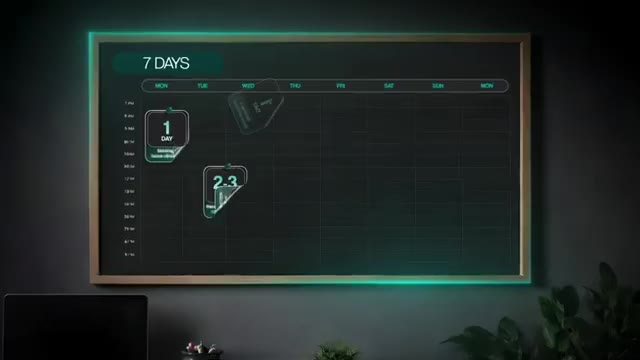
*⏱️ 00:13:53 — Une animation graphique représentant un tableau de planification hebdomadaire sur 7 jours avec des cartes de tâches ou de délais temporels (marquées "1 DAY" et "2-3").*

---

### ⏱️ `[00:13:58 - 00:14:16]` | Segment #34

**🔊 Audio (Transcription Intégrale Mot pour Mot en Français) :**
> So the first thing I want to make very clear is this. Christian did not start by picking some super ultra-specific niche and having every problem figured out and then blasting out cold emails. He started warm, and that matters way more than people think. Warm outreach, referrals, and known contacts are just statistically shown to convert way better than cold outreach because there's already trust there, even if you're borrowing trust from a friend of a friend.

**👁️ Analyse Visuelle d'Écran (gemini-3.5-flash-lite) :**
**Interface & Outils** : Aucune.

**Contenu textuel & Code** : Aucun.

**Action / Démonstration** : Aucune action logicielle ou technique démontrée ; le segment consiste uniquement en du discours face caméra.

---

### ⏱️ `[00:14:16 - 00:14:39]` | Segment #35

**🔊 Audio (Transcription Intégrale Mot pour Mot en Français) :**
> That's why it works so much faster and it feels way less awkward, especially as a beginner. So big picture, the flow looks like this. You start warm, you stay fairly broad, you talk to people, you notice patterns, and then you niche down later. Cold outreach comes last when you're ready to scale, not first when you want to get your first client. So day one is all about setting a loose direction, not locking yourself into one super hyper-specific niche, but just think of it as like a working hypothesis, not a lifelong decision.

**👁️ Analyse Visuelle d'Écran (gemini-3.5-flash-lite) :**
**Interface & Outils** : Logiciel de création de diagramme (type Notion/Canvas) et interface de calendrier personnalisé.

**Contenu textuel & Code** : Textes décrivant le workflow de croissance ("Talk to people", "Cold outreach") et le planning de 7 jours.

**Action / Démonstration** : Présentation visuelle et animée d'une stratégie de progression chronologique pour débutants.

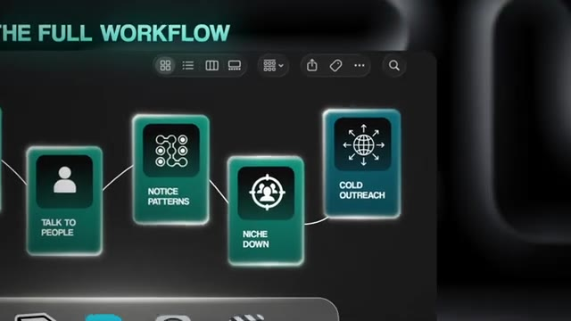
*⏱️ 00:14:28 — Diagramme de flux intitulé "THE FULL WORKFLOW" illustrant les étapes : Talk to people, Notice patterns, Niche down, et Cold outreach.*

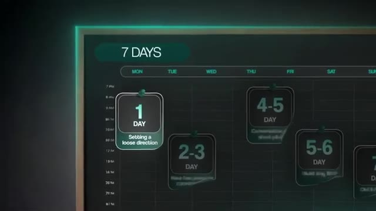
*⏱️ 00:14:34 — Planificateur hebdomadaire "7 DAYS" montrant une progression par étapes, commençant par "1 DAY: Setting a loose direction".*

---

### ⏱️ `[00:14:40 - 00:14:58]` | Segment #36

**🔊 Audio (Transcription Intégrale Mot pour Mot en Français) :**
> So instead of saying, I'm the AI automation guy for dental clinics in Georgia losing time with onboarding, you're just going to say something much simpler like, I help small businesses automate boring repetitive tasks with AI. That's enough to get conversations started. At this stage, you should also have a short menu of example problems in your head, example use cases in your head, so that you're not just speaking in theory.

**👁️ Analyse Visuelle d'Écran (gemini-3.5-flash-lite) :**
**Interface & Outils** : Application de messagerie mobile (type iMessage).

**Contenu textuel & Code** : Texte affiché : "I'm the AI automation guy for dental clinics in Georgia, losing time with onboarding."

**Action / Démonstration** : Illustration visuelle du concept de "mauvaise approche" marketing par une démonstration de messagerie.

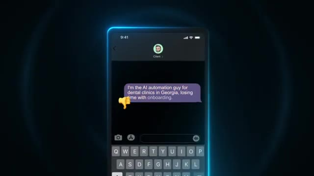
*⏱️ 00:14:44 — Une capture d'écran d'une interface de messagerie mobile montrant une bulle de texte avec une description de service jugée trop complexe et longue, accompagnée d'un émoji "pouce vers le bas".*

---

### ⏱️ `[00:14:58 - 00:15:16]` | Segment #37

**🔊 Audio (Transcription Intégrale Mot pour Mot en Français) :**
> So things like, you know, I know how to automate lead follow-up or intake forms or data syncing between CRMs. And like I said, you're not committing to any of these yet, but you're just testing to see what resonates. On day one, you also want to build what I would call a trust map. So open up a simple Google sheet and list out people where trust already exists. Your goal for day one would be to write down 20 people that you can reach out to.

**👁️ Analyse Visuelle d'Écran (gemini-3.5-flash-lite) :**
**Interface & Outils** : Interface de workflow (probablement n8n), Google Sheets.

**Contenu textuel & Code** : Noms et adresses email fictives dans un tableur, fenêtre d'installation de plugin communautaire.

**Action / Démonstration** : Manipulation de données dans un tableur et démonstration technique de l'installation de composants pour automatisation.

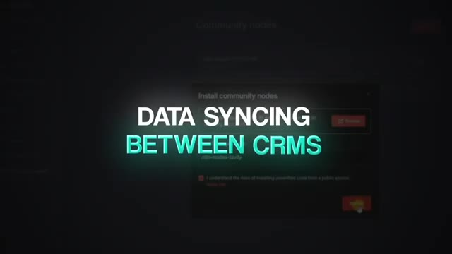
*⏱️ 00:15:02 — Interface logicielle sombre montrant une fenêtre contextuelle pour l'installation de nœuds communautaires, avec une superposition de texte indiquant "DATA SYNCING BETWEEN CRMS".*

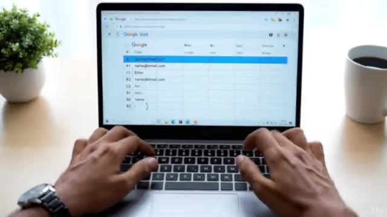
*⏱️ 00:15:11 — Vue subjective d'un utilisateur tapant sur un ordinateur portable affichant une feuille de calcul Google Sheets remplie de données de contacts.*

---

### ⏱️ `[00:15:16 - 00:15:35]` | Segment #38

**🔊 Audio (Transcription Intégrale Mot pour Mot en Français) :**
> Friends or family who run businesses, past co-workers, managers, clients, people who you know from communities, Slack groups, discords, or online spaces, and a second-degree connection. So friends of friends. For each of these people, just note what kind of business they're in or what kind of industry they're in, how well you know them, whether they could be a potential client or an intro to one or just someone who can give you some insight.

**👁️ Analyse Visuelle d'Écran (gemini-3.5-flash-lite) :**
**Interface & Outils** : Graphique vectoriel dynamique (schéma de réseau relationnel).

**Contenu textuel & Code** : Noms des catégories de relations professionnelles et personnelles (Managers, Clients, Community, Coworkers, Friends and Family).

**Action / Démonstration** : Illustration visuelle des sources de contacts potentiels pour le networking.

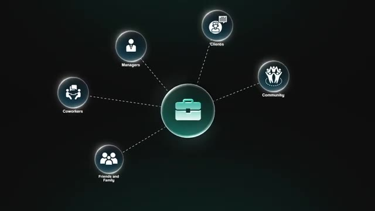
*⏱️ 00:15:21 — Un graphique en réseau montrant une icône centrale de mallette professionnelle reliée à cinq catégories de contacts : Managers, Clients, Community, Coworkers, et Friends and Family.*

---

### ⏱️ `[00:15:35 - 00:15:53]` | Segment #39

**🔊 Audio (Transcription Intégrale Mot pour Mot en Français) :**
> And when you actually start to write this stuff down and think through, you know, your list of contacts, it makes everything feel a lot less random and a lot less overwhelming. Now, days two and three are about having five to 10 warm, low pressure conversations. These are not sales calls. You're not pitching. You genuinely just need to understand where repetitive work eats time in their business or in their daily workflow.

**👁️ Analyse Visuelle d'Écran (gemini-3.5-flash-lite) :**
**Interface & Outils** : Infographie de présentation (planning hebdomadaire).

**Contenu textuel & Code** : Planning "7 DAYS" divisé par blocs : "1 DAY: Setting a loose direction", "2-3 DAY: Have low pressure conversation", "4-5 DAY", "5-6 DAY", "7 DAY".

**Action / Démonstration** : Présentation visuelle de la stratégie de planification pour structurer les actions sur une semaine.

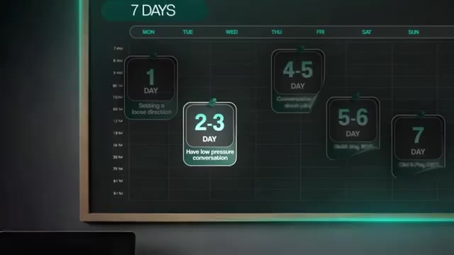
*⏱️ 00:15:44 — Une infographie représentant un planning sur 7 jours, mettant en évidence les étapes de progression du projet (Days 1 à 7).*

---

### ⏱️ `[00:15:53 - 00:16:13]` | Segment #40

**🔊 Audio (Transcription Intégrale Mot pour Mot en Français) :**
> So when you're reaching out to them, you should just sound like a curious entrepreneur, not a salesperson. So something as simple as saying, hey, I'm trying to start a business where I help other businesses automate repetitive work with AI. I'm not trying to sell you anything. Could I just ask you a few questions about where things feel manual or annoying in your day to day? And once you start having these conversations, write down all the key insights from that call because you're going to need to look at these later.

**👁️ Analyse Visuelle d'Écran (gemini-3.5-flash-lite) :**
**Interface & Outils** : Interface de messagerie mobile/tablette (style iOS).

**Contenu textuel & Code** : "Hey, I'm trying to start a business where I help other businesses automate repetitive work with AI. I'm not trying to sell you anything. Can I just ask you a few questions about where things feel manual or annoying in your day to day?"

**Action / Démonstration** : Démonstration visuelle de la stratégie de communication recommandée pour approcher des clients potentiels sans paraître insistant.

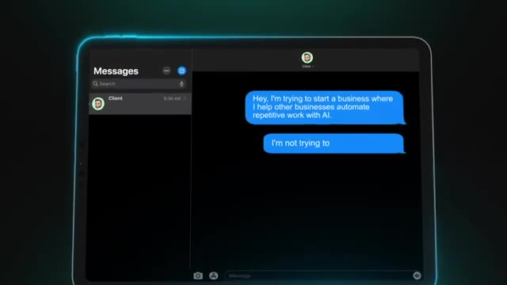
*⏱️ 00:16:03 — Capture d'écran d'une application de messagerie (type iMessage) sur tablette, montrant le début d'un message de démarchage bienveillant.*

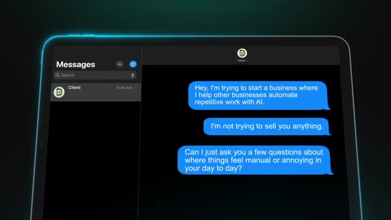
*⏱️ 00:16:08 — Capture d'écran de l'application de messagerie sur tablette, affichant le message complet, incluant la question finale pour engager la conversation.*

---

### ⏱️ `[00:16:13 - 00:16:32]` | Segment #41

**🔊 Audio (Transcription Intégrale Mot pour Mot en Français) :**
> And if you truly cannot think of anyone in your network who might own a business or be an executive at a business or in a position to buy or anything like that, then you still don't have to jump straight to cold outreach. You just reach out and ask something like, is there anyone you know who this might be helpful for? Or is there anyone you know who this might benefit? And so that little like wording shift is huge because no one really wants to sell to their friends and you're not selling to your friends.

**👁️ Analyse Visuelle d'Écran (gemini-3.5-flash-lite) :**
**Interface & Outils** : AUCUNE

**Contenu textuel & Code** : AUCUN

**Action / Démonstration** : AUCUNE

---

### ⏱️ `[00:16:32 - 00:16:54]` | Segment #42

**🔊 Audio (Transcription Intégrale Mot pour Mot en Français) :**
> You're just asking if they know anyone who might benefit from, you know, the kind of stuff that you're talking about. It feels way more natural, less uncomfortable, and it still lets you kind of borrow some trust. You also could jump on a site like Upwork, but once again, that's pretty much going to be similar to cold outreach because you haven't yet built trust with those leads and you're just a name and a profile picture. So after you've had those conversations, day four and five are where you turn those conversations into a tiny pilot.

**👁️ Analyse Visuelle d'Écran (gemini-3.5-flash-lite) :**
**Interface & Outils** : Upwork (site web), outil de visualisation de workflow (type graphique personnalisé).

**Contenu textuel & Code** : Détails de job Upwork "Creative Youtube Video Editor Needed", planning hebdomadaire avec étapes numérotées et descriptifs textuels.

**Action / Démonstration** : Présentation d'une plateforme de freelance puis illustration visuelle d'un processus de suivi commercial sur une semaine.

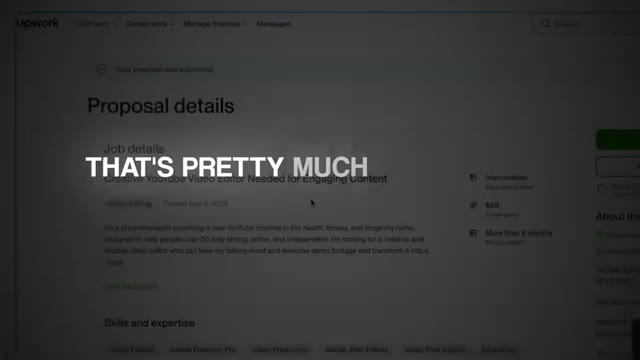
*⏱️ 00:16:43 — Capture d'écran de l'interface web Upwork montrant les détails d'une proposition d'emploi pour un éditeur vidéo.*

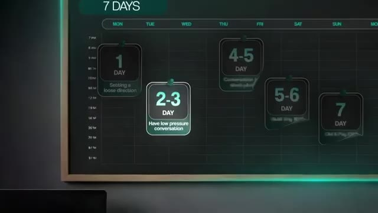
*⏱️ 00:16:49 — Diagramme de planning sur 7 jours illustrant des étapes de workflow (conversation à basse pression, suivi, etc.).*

---

### ⏱️ `[00:16:54 - 00:17:16]` | Segment #43

**🔊 Audio (Transcription Intégrale Mot pour Mot en Français) :**
> So look back at your notes, pick the person with the clearest, most painful, repetitive task. You're looking for the clearest pain point here. And then you propose something very small and very low risk for that prospect, which is typically a free workflow. You build it, you measure one simple outcome, and then you decide together if it's worth expanding. So you can reach back out to them after that initial conversation and say something like, hey, I'd love to build you a small automation that tackles X pain point as a free pilot.

**👁️ Analyse Visuelle d'Écran (gemini-3.5-flash-lite) :**
**Interface & Outils** : Traitement de texte standard (logiciel de rédaction).

**Contenu textuel & Code** : Texte non lisible en détail, semblant être un document de travail ou de prise de notes.

**Action / Démonstration** : Saisie manuelle au clavier par un utilisateur.

*⏱️ 00:17:05 — Gros plan sur des mains tapant au clavier devant un écran d'ordinateur affichant un document textuel, illustrant le travail sur une tâche répétitive.*

---

### ⏱️ `[00:17:16 - 00:17:36]` | Segment #44

**🔊 Audio (Transcription Intégrale Mot pour Mot en Français) :**
> My goal here is just to prove that these workflows actually can save you time. And in return, I just ask for some honest feedback because that's going to help me learn and grow. Now, days five and six are about actually building that tiny MVP. So this doesn't have to be complex. In fact, the simpler, the better. Your goal isn't to impress them with all of these API calls and all this advanced tech. Your goal is just to show them I saved you time. I saved you, you know, confusion here.

**👁️ Analyse Visuelle d'Écran (gemini-3.5-flash-lite) :**
**Interface & Outils** : Interface de messagerie, tableau de gestion de projet (Type Kanban/Calendrier), éditeur de code.

**Contenu textuel & Code** : Texte de la conversation (proposition d'automatisation, demande de feedback), jalons de planning de projet, syntaxe de code non spécifique.

**Action / Démonstration** : Illustration visuelle du processus : communication, planification du projet et phase de développement technique (codage).

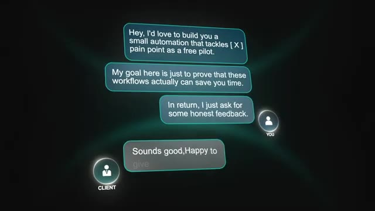
*⏱️ 00:17:21 — Interface de messagerie simulée illustrant une conversation entre "You" et "Client" concernant une proposition d'automatisation.*

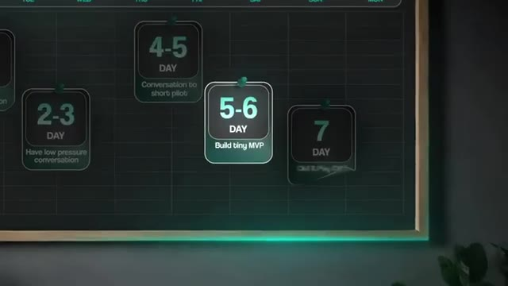
*⏱️ 00:17:26 — Calendrier de projet sous forme de tableau interactif mettant en avant l'étape "5-6 DAY: Build tiny MVP".*

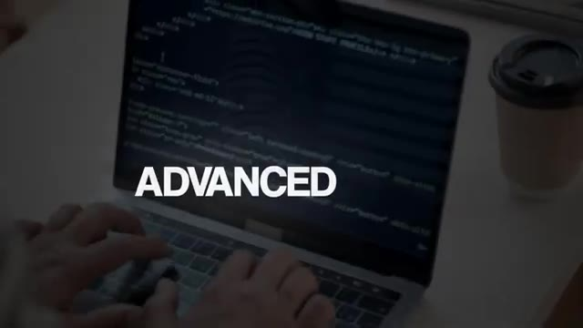
*⏱️ 00:17:31 — Gros plan sur un ordinateur portable affichant du code informatique (éditeur sombre) avec le mot "ADVANCED" superposé.*

---

### ⏱️ `[00:17:36 - 00:18:00]` | Segment #45

**🔊 Audio (Transcription Intégrale Mot pour Mot en Français) :**
> And while you do this, just pay attention to the language they use, how they describe the problem, how they describe that win. The language is gold later. OK, now day seven is where you see if your hard work paid off. The goal of this day is super simple. You're not trying to hard close anyone. You're just trying to figure out with the potential client what the next logical step is based on how the pilot went. So the first priority would be to see if you can keep helping that same client, either by maintaining what you've built or by expanding on it functionality-wise.

**👁️ Analyse Visuelle d'Écran (gemini-3.5-flash-lite) :**
**Interface & Outils** : Graphiques animés (infographies de workflow / tableaux de bord).

**Contenu textuel & Code** : Texte affichant les étapes : "2-3 DAY: Have low pressure conversation", "4-5 DAY: Conversation to short pilot", "5-6 DAY: Build tiny MVP", "7 DAY", et "PRIORITY 1".

**Action / Démonstration** : Présentation visuelle et structurée des étapes clés du processus d'automatisation IA, du premier contact au MVP.

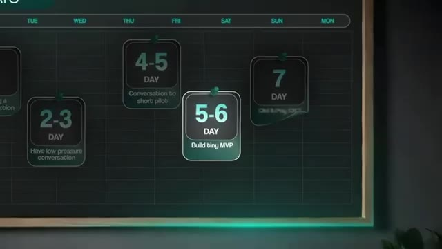
*⏱️ 00:17:42 — Une infographie représentant une frise chronologique de 7 jours, détaillant les étapes de développement (MVP, conversation, etc.).*

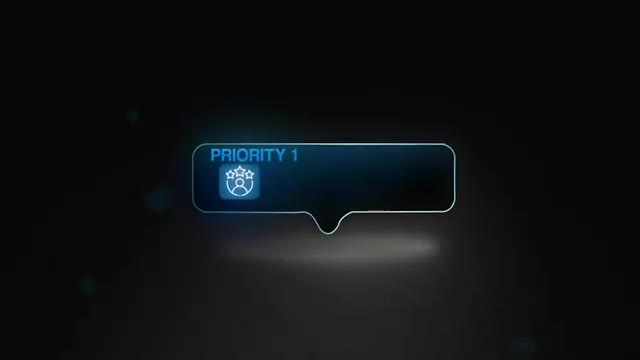
*⏱️ 00:17:54 — Une interface graphique minimaliste affichant une bulle de notification intitulée "PRIORITY 1" avec une icône de profil utilisateur.*

---

### ⏱️ `[00:18:00 - 00:18:34]` | Segment #46

**🔊 Audio (Transcription Intégrale Mot pour Mot en Français) :**
> So you can lay out clear, low-pressure options. You explain that there are a couple ways that you could keep helping. The first option is maintenance. This is you sticking around to make sure that the automation keeps working, handling fixes if something breaks, and making small tweaks as their tools or processes change. And the other option is expansion. So this is where you build on top of what's already working, usually by adding one or two concrete features that you noticed during the build that would make the outcome even stronger. The key here, though, is just to communicate these two actual offers very, very simply. So a maintenance offer could be like, hey, I'll maintain this for the next few months. So if anything breaks or if you want small changes, I can handle it. And an expansion offer might be, hey, we could turn this into a slightly bigger system by adding

**👁️ Analyse Visuelle d'Écran (gemini-3.5-flash-lite) :**
**Interface & Outils** : Éditeur de code (type VS Code), interface de messagerie stylisée (mockup).

**Contenu textuel & Code** : Code source : `.count().each(function... duration: 4000, easing: 'swing')` et texte descriptif "MAINTENANCE OFFER".

**Action / Démonstration** : Présentation visuelle des services d'automatisation (maintenance et expansion) via des supports graphiques pour structurer l'explication du consultant.

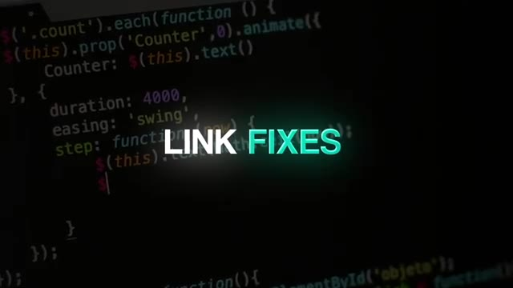
*⏱️ 00:18:08 — Arrière-plan sombre affichant du code informatique (JavaScript/jQuery) avec une surimpression de texte "LINK FIXES".*

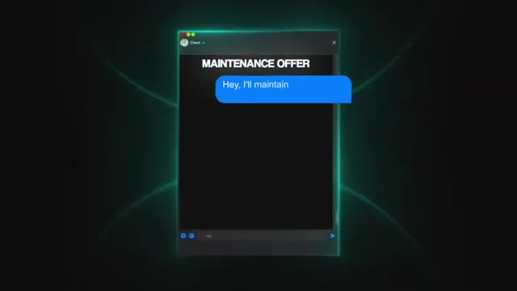
*⏱️ 00:18:25 — Illustration sous forme de fenêtre de messagerie stylisée affichant le titre "MAINTENANCE OFFER" et une bulle de texte bleue "Hey, I'll maintain".*

---

### ⏱️ `[00:18:34 - 00:18:56]` | Segment #47

**🔊 Audio (Transcription Intégrale Mot pour Mot en Français) :**
> this and this so that the result is X more reliable. And then you can ask if they want to scope out that and then you can send over a basic proposal. Nothing fancy. During this conversation, you can also naturally surface more work by asking thoughtful questions. For example, you could say something like, hey, while I was building out this workflow, I noticed this other process that's related. Would it help if that was automated too? Or now that you've seen what this workflow can do, what's the next thing that you would like to get off your plate?

**👁️ Analyse Visuelle d'Écran (gemini-3.5-flash-lite) :**
**Interface & Outils** : Instagram (version Web/Desktop)

**Contenu textuel & Code** : Texte du message : "Hey, while I was building out this workflow, I noticed this other process that's related. Would it help if that"

**Action / Démonstration** : Simulation d'une interaction client pour proposer une extension de service (upselling) lors du développement d'un workflow.

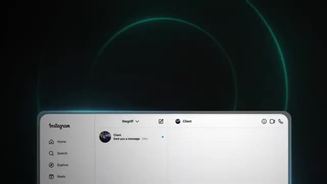
*⏱️ 00:18:45 — Interface de messagerie Instagram montrant une conversation avec un "Client" avant l'envoi d'un message.*

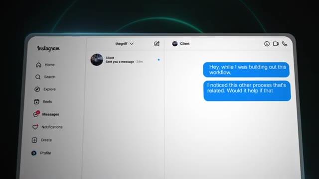
*⏱️ 00:18:50 — Interface de messagerie Instagram montrant le message rédigé : "Hey, while I was building out this workflow, I noticed this other process that's related. Would it help if that..."*

---

### ⏱️ `[00:18:56 - 00:19:21]` | Segment #48

**🔊 Audio (Transcription Intégrale Mot pour Mot en Français) :**
> These types of questions show that you are a partner and that you're keeping things collaborative rather than being salesy. And then if they're happy with the pilot, but they don't necessarily want to continue working with you right now, that's completely fine. At that point, your goal is to just lock in some proof, not push more work on them. So you can ask if they'd be open to a short video testimonial explaining how the workflow helped. Only after that, and only if it feels natural, you can then mention if they ever think of someone that might also benefit from AI workflows like this, then an intro would be super appreciated.

**👁️ Analyse Visuelle d'Écran (gemini-3.5-flash-lite) :**
**Interface & Outils** : AUCUNE

**Contenu textuel & Code** : AUCUN

**Action / Démonstration** : AUCUNE

---

### ⏱️ `[00:19:21 - 00:19:39]` | Segment #49

**🔊 Audio (Transcription Intégrale Mot pour Mot en Français) :**
> But of course, if the pilot did not go well, you don't try to sell anything. You don't ask for a testimonial. You just take that feedback, you learn from it, and you improve next time, and you start the process again of warm conversations and offering a free pilot. Because of course, ultimately, what you're optimizing for right now is experience proof, not money. So that's day seven. The entire focus is on deepening the relationship first.

**👁️ Analyse Visuelle d'Écran (gemini-3.5-flash-lite) :**
**Interface & Outils** : Aucune interface logicielle, éditeur de code ou terminal n'est présenté dans ces segments.

**Contenu textuel & Code** : Texte affiché sous forme de liste de contrôle : "Take Feedback", "Learn from it", "Improve next time", "Warm conversations", "Offering free pilot".

**Action / Démonstration** : Aucune action technique ou manipulation logicielle n'est effectuée ; il s'agit de supports visuels textuels illustrant le discours du narrateur.

---

### ⏱️ `[00:19:39 - 00:20:13]` | Segment #50

**🔊 Audio (Transcription Intégrale Mot pour Mot en Français) :**
> maintenance or expansion comes before testimonials. Testimonials come before referrals. And if it doesn't work, you learn and you move on without forcing anything. Now, here's the most important part. This seven day cycle is not a one time thing. It's a loop that you're going to have to run through multiple times. But each loop gives you more data, more confidence, better language, clearer positioning. And only after you've done a few cycles of this does it make sense to then build lead lists and apply the same framework to colder outreach because you actually have some proof behind your name now. So then when you do it, it's no longer just feeling like guessing and feeling random and overwhelming because you have a system that works. And that's the exact path that Christian followed. Start warm, lead with outcomes, earn trust, deliver value,

**👁️ Analyse Visuelle d'Écran (gemini-3.5-flash-lite) :**
**Interface & Outils** : Diagramme personnalisé (conception graphique).

**Contenu textuel & Code** : Étapes du cycle de 7 jours : 1 (Direction), 2-3 (Conversation), 4-5 (Pilot), 5-6 (MVP), 7 (Analyse des résultats).

**Action / Démonstration** : Visualisation d'un processus itératif de travail/automatisation.

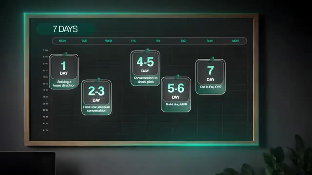
*⏱️ 00:19:56 — Diagramme de flux hebdomadaire présentant un cycle de 7 jours structuré par étapes (de "Setting a loose direction" à "Did it pay off?").*

---

### ⏱️ `[00:20:13 - 00:20:46]` | Segment #51

**🔊 Audio (Transcription Intégrale Mot pour Mot en Français) :**
> and then just repeat. And if you do this two or three times, you are no longer a beginner guessing in the dark. You can see that Christian actually got his second client basically just by posting his win in the community. And then someone reached out because they needed a developer that could work with clients. So I know that we covered a lot of information in today's video. So what I did is I threw all of this into a practical resource guide that you can access for completely free in my free school community. The link for that is down in the description. Now, if you did find this video valuable, signing your first client is only one part of making money with AI. There's actually several components involved, and I cover all of them in detail in this video. So if you want to make money with AI in 2026, then click there to check it out. Otherwise, if you enjoyed

**👁️ Analyse Visuelle d'Écran (gemini-3.5-flash-lite) :**
**Interface & Outils** : Communauté en ligne / Forum (type Skool ou plateforme similaire)

**Contenu textuel & Code** : Texte de la publication : "Signed My Second Client! This past week I was able to secure another client in the craziest way! ... I was looking for an AI Consultant for his business."

**Action / Démonstration** : Présentation d'une preuve sociale (témoignage de membre) pour illustrer comment l'activité sur une communauté peut générer des opportunités commerciales.

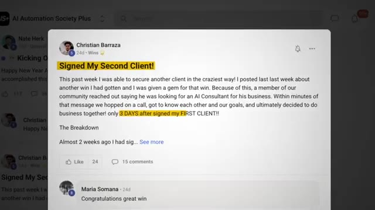
*⏱️ 00:20:22 — Une capture d'écran montrant une publication dans la communauté "AI Automation Society Plus" où Christian Barraza partage son succès d'avoir signé un deuxième client grâce à ses posts précédents.*

---

### ⏱️ `[00:20:46 - 00:20:54]` | Segment #52

**🔊 Audio (Transcription Intégrale Mot pour Mot en Français) :**
> the video or you learned something new, then please give it a like. It definitely helps me out a ton. And as always, I appreciate you guys making it to the end of the video. I'll see you on the next one. Thanks, everyone.

**👁️ Analyse Visuelle d'Écran (gemini-3.5-flash-lite) :**
**Interface & Outils** : Plateforme de lecture vidéo YouTube (interface utilisateur standard).

**Contenu textuel & Code** : Titre de la vidéo : "How to Sign Your First AI Workflow Client in 7 days (With Proof)".

**Action / Démonstration** : Le présentateur conclut sa vidéo en demandant aux spectateurs de liker et en annonçant la fin de la séquence.

---

