# 🎬 How I’d Teach a 10 Year Old to Build Agentic Workflows (Claude Code)

> **Chaîne** : [Nate Herk | AI Automation](https://www.youtube.com/@nateherk/featured)  
> **Lien YouTube** : [https://www.youtube.com/watch?v=3GAxd90fEE4](https://www.youtube.com/watch?v=3GAxd90fEE4)  
> **Date de publication** : 20260207  
> **Durée** : 00:28:23  
> **Identifiant vidéo** : `3GAxd90fEE4`  
> **Transcription & Analyse** : `whisper-v3-large-turbo+gemini-3.5-flash-lite`  

---

## 📌 Synthèse Exécutive & Outils

### 💡 Résumé
Dans cette vidéo intitulée **How I’d Teach a 10 Year Old to Build Agentic Workflows (Claude Code)**, Nate Herk décortique les capacités pratiques d'automatisation et de développement propulsées par les modèles de pointe.

### 🛠️ Outils, Modèles & Logiciels Présentés
- **Opus 5.5 & Claude Code** : Modèles d'ingénierie et agents de codage autonome.

### 🔑 Points Clés & Enseignements Stratégiques
- Optimiser le niveau d'effort et le raisonnement des modèles IA pour des résultats industriels.
- Automatiser les cycles de création logicielle de bout en bout.

---

## ⏱️ Chronologie & Transcription Complète Audio & Visuelle (Mot pour Mot)

### ⏱️ `[00:00:00 - 00:00:35]` | Segment #01

**🔊 Audio (Transcription Intégrale Mot pour Mot en Français) :**
> Agendic workflows are changing everything for AI automations. These workflows fix themselves and can be made 10 times faster than normal step-by-step automations without writing a single line of code. But recently, I saw that some people in my community are still confused about what they are and don't know where to start. So that's why in this video, I'm going to explain what agendic workflows are in the simplest way possible so that even a 10 year old can understand it. And then I'm going to build one right here in front of you guys so that you can see how simple it really is. By the end, you'll know exactly how to apply this to any workflow that you want to build. So let's get into it. So before we actually build anything let's make sure we're on the same page about what agentic workflows actually are with traditional workflow automation the stuff that i've been teaching on my channel for a while

**👁️ Analyse Visuelle d'Écran (gemini-3.5-flash-lite) :**
**Interface & Outils** : Interface de construction de workflow (outil type n8n ou similaire).

**Contenu textuel & Code** : "When clicking 'Execute workflow'", "Tavily1", "POST: https://api.tavily.com...", menu latéral avec options "AI", "Action in an app", "Data transformation".

**Action / Démonstration** : Construction visuelle d'un workflow d'automatisation par glisser-déposer de nœuds fonctionnels.

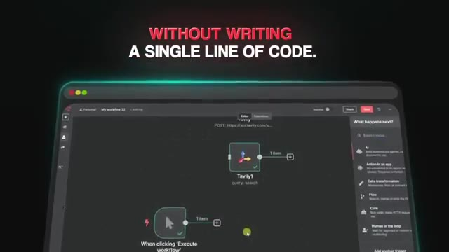
*⏱️ 00:00:09 — Une capture d'écran de l'interface de création de workflow (type drag-and-drop) montrant un nœud "Tavily" connecté à un déclencheur, illustrant la construction visuelle d'automatisation.*

---

### ⏱️ `[00:00:35 - 00:01:08]` | Segment #02

**🔊 Audio (Transcription Intégrale Mot pour Mot en Français) :**
> now you're basically showing the system exactly how to do something step by step that means that you're dragging nodes onto a canvas you're connecting them together you're making sure that the right data flows into the right spots you're setting up your own api calls you're the one who's mapping out pretty much every single step but with agentic workflows you just tell the system what you want and its job is to figure out how to get there on its own so here's the simplest way that i can explain it think about it like you're ordering food traditional automation is like cooking dinner for yourself based on a recipe. So you follow step one, you make sure you have the ingredients. You follow step two, step three, you grab everything you need, you measure it out, you set the timer, you set the oven, you have to flip the burger, whatever it is.

**👁️ Analyse Visuelle d'Écran (gemini-3.5-flash-lite) :**
**Interface & Outils** : Plateforme de workflow visuel (type Flowise/n8n) ; Éditeur de code (VS Code / Cursor).

**Contenu textuel & Code** : Diagramme de flux de données avec des nœuds de modèle IA ; Liste de tâches (To-dos) pour un projet de génération de leads incluant des scripts Python.

**Action / Démonstration** : Manipulation visuelle de nœuds de workflow ; Rédaction de directives de développement pour un agent IA.

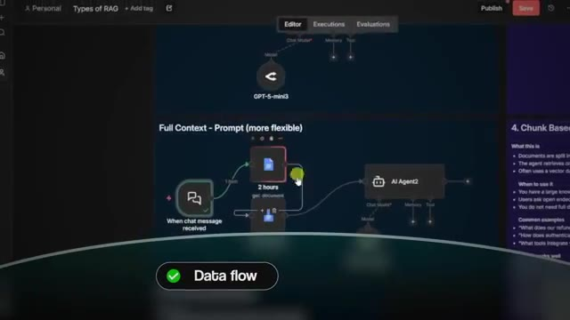
*⏱️ 00:00:43 — Interface de conception de workflow visuel (type plateforme d'automatisation IA) montrant des nœuds connectés représentant un flux de données.*

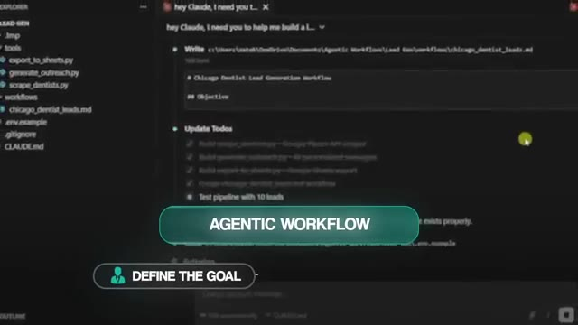
*⏱️ 00:00:52 — Éditeur de code (type VS Code ou Cursor) affichant un fichier Markdown de planification de workflow intitulé "Chicago Dentist Lead Generation".*

---

### ⏱️ `[00:01:08 - 00:01:28]` | Segment #03

**🔊 Audio (Transcription Intégrale Mot pour Mot en Français) :**
> If you skip a step or you mess something up and the whole thing kind of falls apart. Argentic workflows, on the other hand, are like walking into a restaurant and just telling the waiter, I want a delicious steak dinner. You're not telling them how to season the steak, what temperature the oven should be, or even maybe like what sides to pair it with. You're just giving them the outcome that you want and they figure out the rest. But of course, even a great chef might need a little more information from you.

**👁️ Analyse Visuelle d'Écran (gemini-3.5-flash-lite) :**
**Interface & Outils** : Aucune interface logicielle ou outil d'automatisation n'est affiché.

**Contenu textuel & Code** : Aucun contenu technique, code ou prompt n'est visible.

**Action / Démonstration** : Aucune action technique ou manipulation d'agent n'est réalisée.

---

### ⏱️ `[00:01:28 - 00:01:48]` | Segment #04

**🔊 Audio (Transcription Intégrale Mot pour Mot en Français) :**
> So they probably will come back and say, okay, cool, that sounds good. But how do you want your steak cooked? And once you tell them medium rare, they'll go off and they'll handle everything else until you pretty much get that end result. So that's exactly how agentic workflows work. You give the system a goal, it figures out the steps, but also it asks you clarifying questions to make sure that it gets exactly what you need. Because a lot of us are really good at knowing the end goal that we want, but not exactly how to get there.

**👁️ Analyse Visuelle d'Écran (gemini-3.5-flash-lite) :**
**Interface & Outils** : Superposition graphique (Overlay) personnalisée.

**Contenu textuel & Code** : Texte affiché : "GIVE THE SYSTEM A GOAL", avec deux sous-points : "Figures out steps" et "Asks you questions".

**Action / Démonstration** : Le présentateur explique conceptuellement le processus itératif des agents IA (fixer un objectif, définir les étapes, poser des questions de clarification).

*⏱️ 00:01:43 — Capture d'écran du présentateur avec une incrustation graphique expliquant le fonctionnement d'un flux de travail agentique (Agentic Workflow).*

---

### ⏱️ `[00:01:48 - 00:02:09]` | Segment #05

**🔊 Audio (Transcription Intégrale Mot pour Mot en Français) :**
> So let's make this practical. Let's say you need contact info for 50 dentists in Chicago so that you can send each one of those dentists a personalized outreach message. With an agentic workflow, you don't have to map out every single step. You just tell the agent what you need, and it goes and figures out how to scrape the data, where to scrape the data from, how to find the contacts, how to generate personalized emails for each one. Of course, I may need to ask you, okay, what services do you want to offer them so that I can make the personalized emails better?

**👁️ Analyse Visuelle d'Écran (gemini-3.5-flash-lite) :**
**Interface & Outils** : Graphiques animés illustrant des workflows d'automatisation.

**Contenu textuel & Code** : Schémas conceptuels détaillant les étapes logiques d'un workflow agentique pour la prospection.

**Action / Démonstration** : Présentation visuelle de la séquence automatisée d'un agent IA pour automatiser la collecte et la prise de contact.

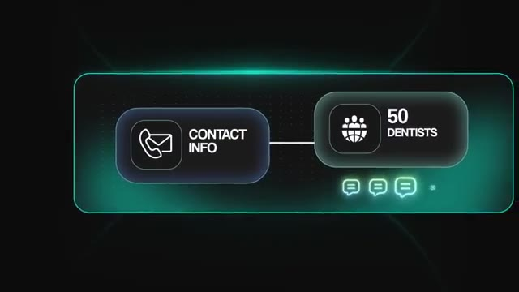
*⏱️ 00:01:53 — Un graphique montrant le lien entre la recherche d'informations de contact et une liste ciblée de 50 dentistes, avec des icônes de bulles de discussion en dessous.*

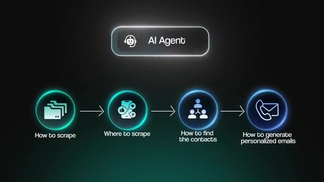
*⏱️ 00:02:04 — Un diagramme de flux illustrant les étapes d'un agent IA : "How to scrape", "Where to scrape", "How to find the contacts", et "How to generate personalized emails".*

---

### ⏱️ `[00:02:10 - 00:02:31]` | Segment #06

**🔊 Audio (Transcription Intégrale Mot pour Mot en Français) :**
> So if I showed you these two approaches side by side, here's kind of what they look like. A traditional automation might look like this. You've got a trigger, you've got a tool call, you've got maybe another tool call, you've got an AI step, maybe some conditional logic, and then a final output to Slack or ClickUp or wherever. But with an agentic workflow, you give it the input, and maybe you answer a question and then you get your output. That's it. Now that you understand that concept, let me show you what that actually looks like in practice so that you can see how simple it really is.

**👁️ Analyse Visuelle d'Écran (gemini-3.5-flash-lite) :**
**Interface & Outils** : Logiciel de création de diagrammes ou présentation (type éditeur de workflow).

**Contenu textuel & Code** : Texte "TRADITIONAL AUTOMATION" et un bloc symbolisant un "TRIGGER" avec une icône de globe.

**Action / Démonstration** : Présentation visuelle statique illustrant la structure séquentielle d'une automatisation traditionnelle.

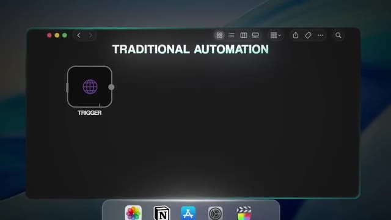
*⏱️ 00:02:15 — Une fenêtre graphique affichant un diagramme intitulé "TRADITIONAL AUTOMATION" avec une icône de déclencheur (trigger) au début du flux.*

---

### ⏱️ `[00:02:32 - 00:02:51]` | Segment #07

**🔊 Audio (Transcription Intégrale Mot pour Mot en Français) :**
> All right, so even if you don't know how to code or if you've never touched an IDE before, you're gonna be just fine. IDE stands for Integrated Development Environment and you don't even need to know that it's good for that. So what we're gonna do is we're gonna get into cloud code and I'm gonna walk through everything you need to know because it can be a little intimidating, but I'm gonna show you exactly what you need to look at and what you don't need to look at. And by the end, it's gonna be so much easier than you probably thought.

**👁️ Analyse Visuelle d'Écran (gemini-3.5-flash-lite) :**
**Interface & Outils** : Outil de présentation ou tableau blanc numérique (type Miro ou Canva).

**Contenu textuel & Code** : Texte affiché : "Even if you don't know how to code... And never touched an IDE before..." avec une flèche pointant vers "Integrated Development Environment".

**Action / Démonstration** : Le présentateur explique le concept d'IDE pour rassurer les débutants en programmation.

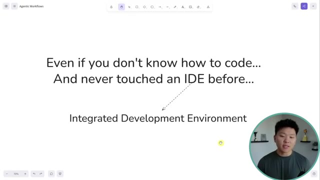
*⏱️ 00:02:37 — Une capture d'écran montrant une présentation sur fond blanc avec du texte pédagogique et la vidéo du présentateur en bas à droite.*

---

### ⏱️ `[00:02:51 - 00:03:10]` | Segment #08

**🔊 Audio (Transcription Intégrale Mot pour Mot en Français) :**
> So the first step is you need to go to Google, search for Visual Studio Code, and then just download this. It's completely free to download, and this is where we're going to be using Cloud Code. Once you open that up, this is what it's going to look like. And the first thing that I want you to do is go over to the left-hand side and click on Extensions. And once you get in here, just search for Cloud Code. And then when you click on that, it's going to allow you to install the Cloud Code extension for VS Code.

**👁️ Analyse Visuelle d'Écran (gemini-3.5-flash-lite) :**
**Interface & Outils** : Visual Studio Code (site web et logiciel).

**Contenu textuel & Code** : Image 1 : Bouton de téléchargement, aperçu d'une interface de codage avec GitHub Copilot Cloud Agent. Image 2 : Menu "Start" (New File, Open Folder, Generate New Workspace) et liste de projets récents ("Scraper", "Agentic Workflows Demo", etc.).

**Action / Démonstration** : Présentation du processus de téléchargement et d'installation initiale de l'environnement de développement.

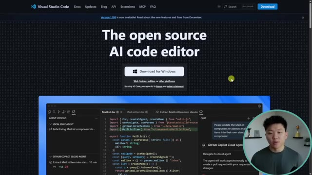
*⏱️ 00:02:56 — Page de téléchargement du site officiel de Visual Studio Code mettant en avant ses fonctionnalités d'éditeur IA.*

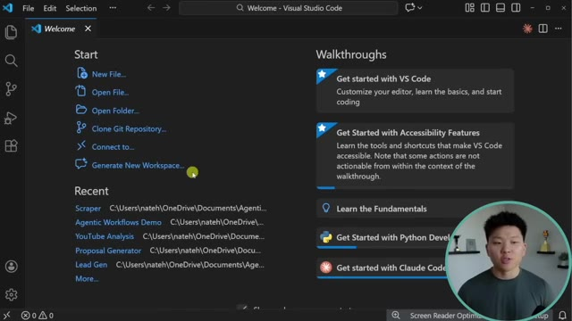
*⏱️ 00:03:01 — Interface de la page d'accueil (écran "Welcome") de Visual Studio Code avec les options de démarrage et les projets récents.*

---

### ⏱️ `[00:03:11 - 00:03:31]` | Segment #09

**🔊 Audio (Transcription Intégrale Mot pour Mot en Français) :**
> And that's how we actually use it. So if you don't have a Cloud plan, you are going to have to go get on a paid plan for Cloud. You can start at $17 a month, and this actually allows you to get Cloud Code, as you can see, includes Cloud Code with Opus 4.5. So you do have to be on a plan. And then once you open up the extension in here, it will prompt you to log in with that email that you have that plan for. And then it will basically sync it over here and you'll be able to use it.

**👁️ Analyse Visuelle d'Écran (gemini-3.5-flash-lite) :**
**Interface & Outils** : Site web Claude.ai (tarification), Visual Studio Code (Marketplace).

**Contenu textuel & Code** : Détails des abonnements "Pro" (17$/mois) et "Max" (à partir de 100$/mois), mention de l'inclusion de "Claude Code with Opus 4.5". Page de l'extension VS Code d'Anthropic.

**Action / Démonstration** : Navigation sur la page de tarification et présentation de l'extension officielle Claude Code dans VS Code.

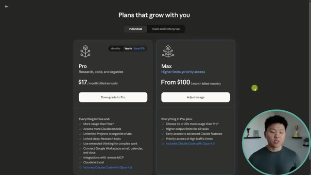
*⏱️ 00:03:16 — Page de tarification de Claude.ai montrant les plans "Pro" et "Max" avec leurs fonctionnalités respectives.*

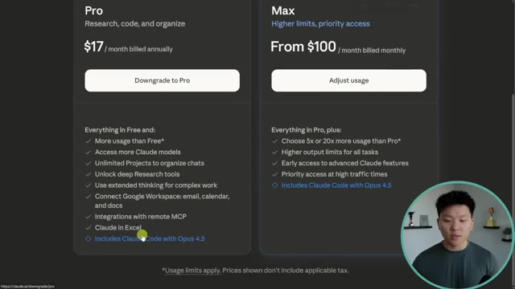
*⏱️ 00:03:21 — Zoom sur la section des fonctionnalités des plans "Pro" et "Max" sur le site de Claude.*

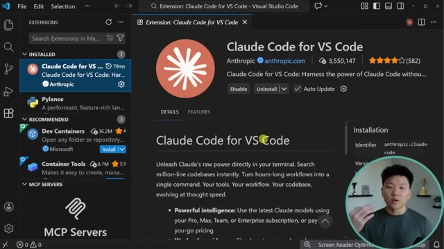
*⏱️ 00:03:26 — Interface de Visual Studio Code affichant la page de l'extension "Claude Code for VS Code" dans le marketplace.*

---

### ⏱️ `[00:03:31 - 00:03:51]` | Segment #10

**🔊 Audio (Transcription Intégrale Mot pour Mot en Français) :**
> So the next step then is to open up a project. So on the left hand side, instead of clicking on extensions, you're going to click on Explorer. And this says you're not in a project yet. You don't have a folder open. You need to open one up. So I've got a folder right in here called Argentic Workflows Demo. And that's the one that I'm going to open. If you don't already have one made, just go ahead and create one first and then you can open that up. And so you'll see if I click into this one, there's nothing in here.

**👁️ Analyse Visuelle d'Écran (gemini-3.5-flash-lite) :**
**Interface & Outils** : Visual Studio Code (VS Code)

**Contenu textuel & Code** : Détails de l'extension Anthropic "Claude Code for VS Code", liste des extensions installées et recommandées, et panneau "MCP Servers".

**Action / Démonstration** : Le présentateur explique comment naviguer dans l'interface et pointe visuellement vers le menu "Extensions" dans la barre d'activité latérale gauche.

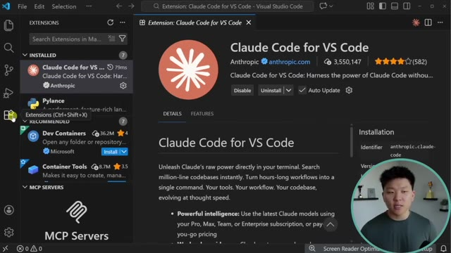
*⏱️ 00:03:36 — L'interface de Visual Studio Code affichant la page de détails de l'extension "Claude Code for VS Code" avec la barre latérale gauche ouverte sur l'onglet Extensions.*

---

### ⏱️ `[00:03:51 - 00:04:13]` | Segment #11

**🔊 Audio (Transcription Intégrale Mot pour Mot en Français) :**
> It's a completely blank project. So I'm gonna select that folder and now we have this right here. So this is our file explorer. This is where we can see a Gentic workflows demo. And then on the right hand side, what I'm gonna do is click on this button up here, which looks like the Claude logo and it says Claude code open. So I open that up, I'm gonna close out of this main window. And now what we have is Claude code, which kind of looks like a chat GPT or a regular Claude interface where we can talk with our coding assistant.

**👁️ Analyse Visuelle d'Écran (gemini-3.5-flash-lite) :**
**Interface & Outils** : Visual Studio Code (VS Code)

**Contenu textuel & Code** : Explorateur de fichiers avec le dossier « AGENTIC WORKFLOW... », liste de projets récents, et section « Walkthroughs ».

**Action / Démonstration** : Le présentateur présente l'ouverture d'un projet vierge dans l'explorateur de fichiers de VS Code.

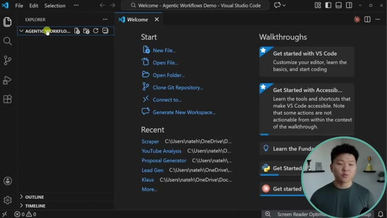
*⏱️ 00:03:57 — Interface de Visual Studio Code affichant le projet « Agentic Workflows Demo » dans l'explorateur de fichiers à gauche et la page d'accueil de l'éditeur au centre.*

---

### ⏱️ `[00:04:13 - 00:04:32]` | Segment #12

**🔊 Audio (Transcription Intégrale Mot pour Mot en Français) :**
> So this is what your screen should look like. Once you get here, let's talk about what comes next. Okay, the environment that we're currently working in. Cloud code within VS Code. On the left-hand side, we've got our files. So in ours right now, we have one called Agentec Workflows Demo, but there's no other files in there. This is where Cloud Code will actually build workflows for us and build files and things like that, and we'll see them populate on the left-hand side.

**👁️ Analyse Visuelle d'Écran (gemini-3.5-flash-lite) :**
**Interface & Outils** : Application de tableau blanc virtuel (type Excalidraw ou similaire).

**Contenu textuel & Code** : Schéma d'architecture d'agent IA illustrant la séparation entre les fichiers/outils et les capacités de l'agent.

**Action / Démonstration** : Présentation visuelle de la structure logique de l'environnement de développement pour les workflows agentiques.

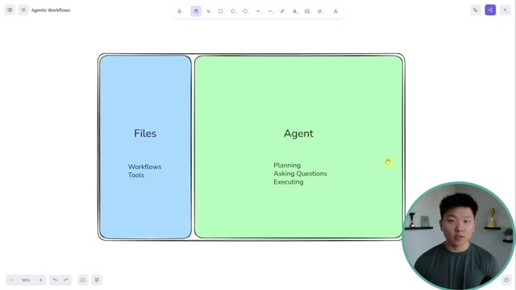
*⏱️ 00:04:18 — Un schéma conceptuel sur fond blanc divisé en deux sections : une zone bleue intitulée "Files" (comprenant "Workflows", "Tools") et une zone verte intitulée "Agent" (comprenant "Planning", "Asking Questions", "Executing").*

---

### ⏱️ `[00:04:32 - 00:04:52]` | Segment #13

**🔊 Audio (Transcription Intégrale Mot pour Mot en Français) :**
> Now, on the right-hand side, this is where we have our chat interface with the agent itself. This is where we do our planning. This is where it asks us questions, and this is where it actually executes its actions. And once again, we'll be able to see all of that live. So now I wanted to tell you guys about the framework that we're actually using today to build our Agentec Workflows. It's called WAT, which stands for Workflows, Agent, and Tools. So the agent itself is Cloud Code.

**👁️ Analyse Visuelle d'Écran (gemini-3.5-flash-lite) :**
**Interface & Outils** : Tableau blanc numérique (Excalidraw ou similaire) affichant des diagrammes et des blocs de code.

**Contenu textuel & Code** : Diagrammes de flux, icônes Markdown et Python, extraits de code source (Configuration et gestion d'API YouTube).

**Action / Démonstration** : Présentation théorique et visuelle de l'architecture des agents IA et de leur interaction avec des outils techniques.

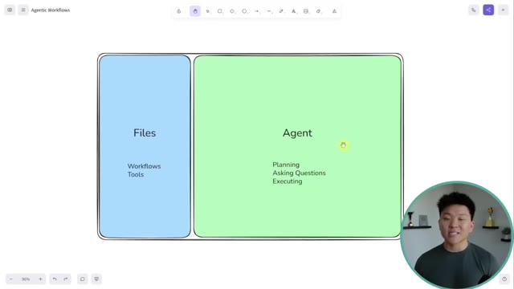
*⏱️ 00:04:37 — Schéma conceptuel sur un tableau blanc numérique présentant deux colonnes : "Files" (Workflows, Tools) et "Agent" (Planning, Asking Questions, Executing).*

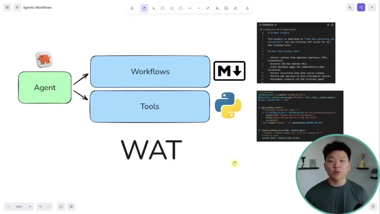
*⏱️ 00:04:47 — Schéma de workflow montrant un agent interagissant avec des "Workflows" (Markdown) et des "Tools" (Python), accompagné d'extraits de code sur la droite.*

---

### ⏱️ `[00:04:52 - 00:05:12]` | Segment #14

**🔊 Audio (Transcription Intégrale Mot pour Mot en Français) :**
> That's who we talk with. That's what the AI brain uses to build workflows and tools. The workflows are going to come in a format called Markdown, which just looks like this. It's natural language. It has headers and it has bullet points and bold font just to make it easier to read. But it's literally just a natural language document. And then the tools come in Python. So this is the logo. It'll be a .py file, which I'll show you guys.

**👁️ Analyse Visuelle d'Écran (gemini-3.5-flash-lite) :**
**Interface & Outils** : Éditeur de texte (interface type VS Code/Cursor) et schéma de workflow sur tableau blanc numérique.

**Contenu textuel & Code** : Fichier 'CLAUDE.md' (texte structuré en Markdown) et extrait de code Python (initialisation client API YouTube).

**Action / Démonstration** : Présentation visuelle de la structure des workflows de l'agent et explication du format de documentation technique.

*⏱️ 00:04:57 — Schéma conceptuel montrant un "Agent" interagissant avec des "Workflows" (format Markdown) et des "Tools" (Python), accompagné d'un aperçu de code.*

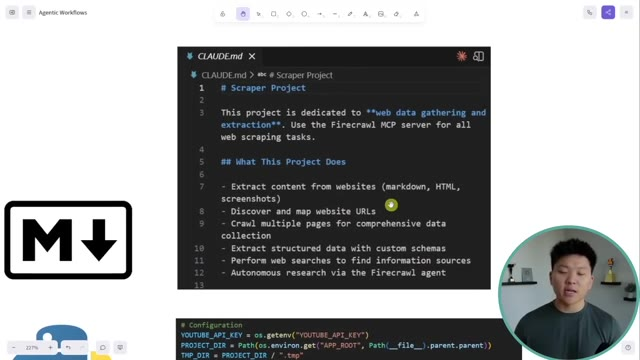
*⏱️ 00:05:02 — Gros plan sur un éditeur de texte affichant un fichier 'CLAUDE.md' contenant une documentation de projet en Markdown, avec titres et listes à puces.*

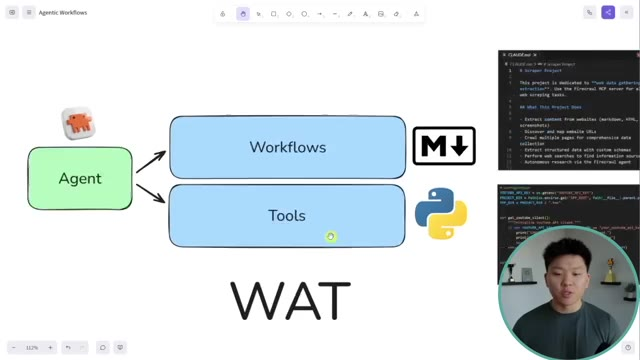
*⏱️ 00:05:07 — Retour au schéma conceptuel global illustrant la structure du système agentique avec l'aperçu du fichier Markdown et du code Python sur la droite.*

---

### ⏱️ `[00:05:12 - 00:05:32]` | Segment #15

**🔊 Audio (Transcription Intégrale Mot pour Mot en Français) :**
> And this is the ugly stuff. This is where we actually have code that I don't really want to look at. You guys don't want to look at, but luckily we don't have to. So what's the difference between these workflows and tools? Well, workflows are processes and tools are actions to take. So let's go back to our analogy of like, you know, food and maybe making a cake. So when you want to make a cake, you've got a recipe and then you've got a bunch of ingredients and you have to figure out what to do with them.

**👁️ Analyse Visuelle d'Écran (gemini-3.5-flash-lite) :**
**Interface & Outils** : Éditeur de code (type VS Code / environnement de développement Python).

**Contenu textuel & Code** : Code Python : configuration de variables d'environnement (`os.getenv`), fonction `get_youtube_client` utilisant la bibliothèque Google API pour initialiser la connexion YouTube.

**Action / Démonstration** : Le présentateur illustre visuellement la partie "Tools" du développement d'agents en montrant du code Python fonctionnel utilisé pour des intégrations API.

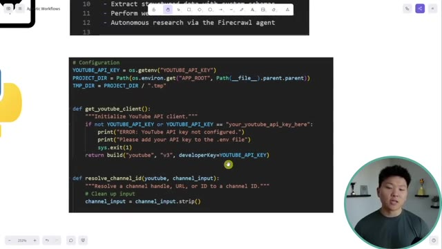
*⏱️ 00:05:17 — Gros plan sur un bloc de code Python affichant une configuration d'API YouTube et l'initialisation d'un client API.*

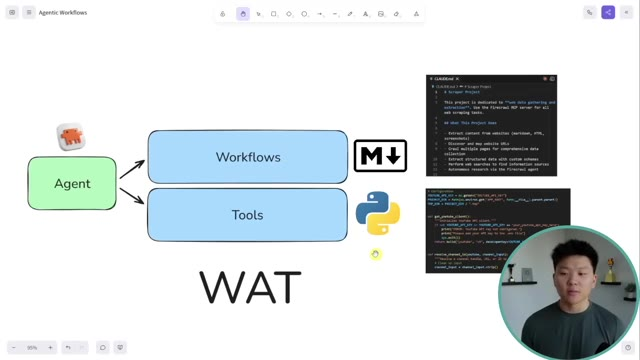
*⏱️ 00:05:22 — Vue d'ensemble montrant un diagramme conceptuel comparant "Workflows" et "Tools" à côté de blocs de code en arrière-plan.*

---

### ⏱️ `[00:05:32 - 00:05:58]` | Segment #16

**🔊 Audio (Transcription Intégrale Mot pour Mot en Français) :**
> So basically, the agent is a chef and the chef needs to make a cake. The chef is going to either read a pre-existing workflow, which is a recipe to how to make the cake, or the chef is going to build its own recipe. And within the recipe, it'll say, you know, like crack two eggs into a bowl, add a cup of flour, whatever. Those are the tools. So eggs are tools. Flour is a tool. Sugar is a tool. And so that's how the chef, the agent, uses a combination of recipes, workflows, ingredients, tools in order to make something, which is either a cake or an agentic workflow automation.

**👁️ Analyse Visuelle d'Écran (gemini-3.5-flash-lite) :**
**Interface & Outils** : Outil de diagramme en ligne (probablement Excalidraw) et éditeur de code.

**Contenu textuel & Code** : Schéma "Agent -> Workflows/Tools" ; extraits de code montrant une configuration pour un projet de scraping avec Firecrawl et l'initialisation d'un client API YouTube.

**Action / Démonstration** : Présentation théorique du fonctionnement d'un agent IA utilisant des workflows et des outils programmatiques.

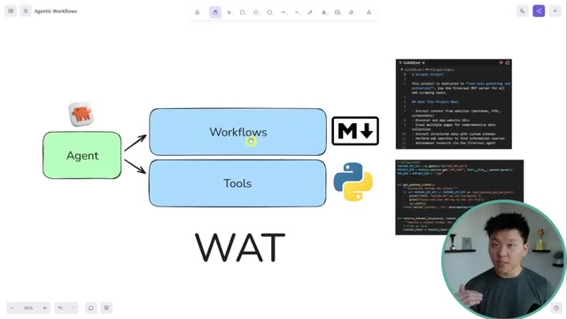
*⏱️ 00:05:38 — Un schéma conceptuel illustrant l'architecture "Agentic Workflows", montrant un "Agent" interagissant avec des "Workflows" (associés à une icône Markdown) et des "Tools" (associés à une icône Python), accompagné de deux extraits de code sur la droite.*

---

### ⏱️ `[00:05:59 - 00:06:22]` | Segment #17

**🔊 Audio (Transcription Intégrale Mot pour Mot en Français) :**
> So now that you guys understand that framework, we need to make sure that Claude Code understands that framework. So what I'm going to do is I'm going to drag in a file and this file will be available for download in my FreeSchool community. The link for that is down in the description. And this is our Claude.md file. So every time that you set up a new project in Claude Code, you have to give it a Claude.md file. They won't always be the same, but when you're building Ingentic workflows and you're using the WAT framework, you can just use this and copy and paste it every single time.

**👁️ Analyse Visuelle d'Écran (gemini-3.5-flash-lite) :**
**Interface & Outils** : Visual Studio Code (extension Claude Code).

**Contenu textuel & Code** : Texte "Claude Code", instruction de raccourci clavier "ctrl esc to focus or unfocus Claude" et option "Bypass permissions".

**Action / Démonstration** : Le présentateur présente l'interface de démarrage de Claude Code au sein de VS Code avant de procéder à l'importation d'un fichier de configuration.

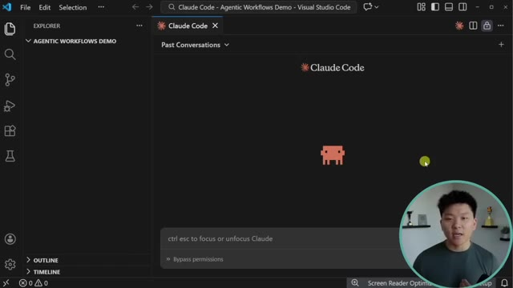
*⏱️ 00:06:05 — Interface de l'éditeur Visual Studio Code affichant l'extension Claude Code avec le logo et une animation de personnage pixel-art, incluant une fenêtre incrustée (PIP) du présentateur en bas à droite.*

---

### ⏱️ `[00:06:23 - 00:06:41]` | Segment #18

**🔊 Audio (Transcription Intégrale Mot pour Mot en Français) :**
> This is basically telling Claude Code how to work. This is its job instructions and description. So if you were to go get a job at a grocery store on your first day, they wouldn't just let you loose. They would say, hey, we're going to get you onboarded. Here's what you do. Here's what you wear. You know, here is specific tasks you do. So here we're telling the agent, you're working inside the WAT framework, which stands for Workflows, Agents, and Tools.

**👁️ Analyse Visuelle d'Écran (gemini-3.5-flash-lite) :**
**Interface & Outils** : Visual Studio Code.

**Contenu textuel & Code** : Texte Markdown détaillant le "WAT framework" (Workflows, Agents, Tools), incluant des directives sur la séparation des responsabilités entre le raisonnement probabiliste et l'exécution déterministe, ainsi que les définitions des couches "Workflows" et "Agents".

**Action / Démonstration** : Lecture et démonstration des "Agent Instructions" (les directives de travail fournies à l'IA pour encadrer son comportement).

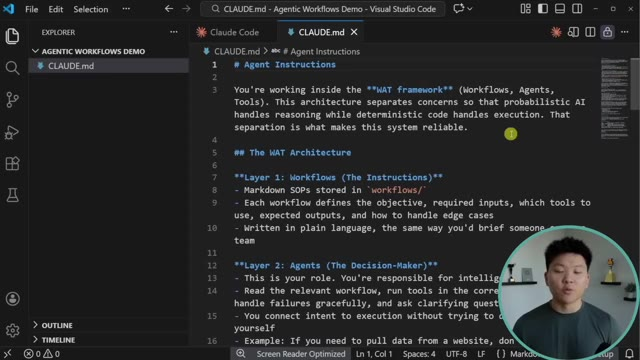
*⏱️ 00:06:27 — Une capture d'écran de l'éditeur Visual Studio Code affichant un fichier Markdown nommé "CLAUDE.md" qui contient les instructions système pour un agent IA, avec le présentateur en incrustation circulaire en bas à droite.*

---

### ⏱️ `[00:06:41 - 00:07:01]` | Segment #19

**🔊 Audio (Transcription Intégrale Mot pour Mot en Français) :**
> We have three layers. The first one is Workflows, which are the instructions. The second one is Agents, which is you, the decision maker. And the third one is Tools, which are the executions. So we talk about why this matters. The AI tries to handle every step directly. Accuracy drops fast. So if each step is 90% accurate, then you're down to 59% success after just five steps. So basically, we're just explaining why we're doing it like this.

**👁️ Analyse Visuelle d'Écran (gemini-3.5-flash-lite) :**
**Interface & Outils** : Visual Studio Code

**Contenu textuel & Code** : Texte Markdown expliquant les couches de l'architecture : "Layer 2: Agents (The Decision-Maker)" et "Layer 3: Tools (The Execution)", avec des descriptions techniques associées.

**Action / Démonstration** : Présentation conceptuelle et pédagogique de l'architecture agentique à travers la lecture du fichier de documentation dans l'éditeur de code.

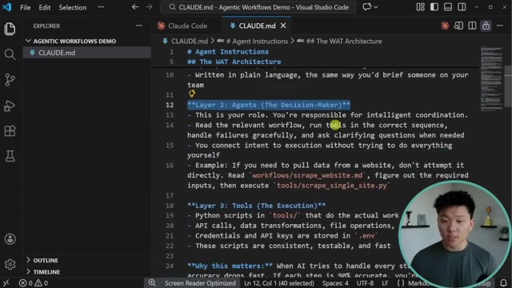
*⏱️ 00:06:46 — Une capture d'écran de l'éditeur Visual Studio Code affichant un fichier Markdown nommé CLAUDE.md détaillant l'architecture "WAT" (Workflows, Agents, Tools).*

---

### ⏱️ `[00:07:01 - 00:07:20]` | Segment #20

**🔊 Audio (Transcription Intégrale Mot pour Mot en Français) :**
> We then talk about how to operate. So you look for existing tools first. You learn and adapt when things fail. You keep your workflows current, blah, blah, blah. We've got a self-improvement loop. And then we've also got a file structure. So like I said, Cloud Code, when we're working with it, is gonna create files. It's gonna create tools. It's gonna create maybe temporary docs to look at, notepads. And when it does this, it adds them on the left-hand side.

**👁️ Analyse Visuelle d'Écran (gemini-3.5-flash-lite) :**
**Interface & Outils** : Visual Studio Code (VS Code).

**Contenu textuel & Code** : Texte structuré en Markdown détaillant les règles de fonctionnement : "## How to Operate", "2. Learn and adapt when things fail", et "3. Keep workflows current". Le texte explique comment gérer les erreurs, documenter les apprentissages et maintenir les workflows à jour.

**Action / Démonstration** : Lecture et démonstration des directives documentées pour la gestion opérationnelle et l'amélioration continue des workflows d'automatisation.

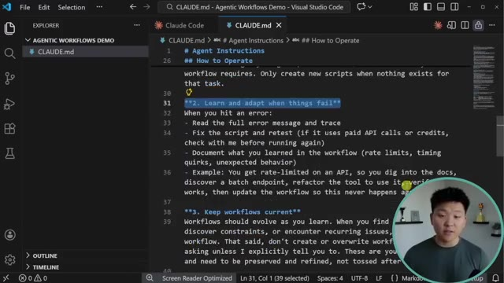
*⏱️ 00:07:05 — Capture d'écran de l'éditeur VS Code affichant un fichier Markdown nommé "CLAUDE.md" contenant les instructions opérationnelles pour un agent IA.*

---

### ⏱️ `[00:07:20 - 00:07:42]` | Segment #21

**🔊 Audio (Transcription Intégrale Mot pour Mot en Français) :**
> So if we don't tell Cloud how to organize its files, it's gonna get messy quick to the point where I don't understand where things are and neither does Cloud Code. So we're just giving it a nice structure for workflows, tools, temporary files, things like that. And so obviously you guys can read this whole thing. I don't wanna spend time reading this line by line, But really the moral of the story here is this helps CloudCode understand the framework that we want to use, how to build workflows so that when I'm talking to it, we're on the same page.

**👁️ Analyse Visuelle d'Écran (gemini-3.5-flash-lite) :**
**Interface & Outils** : Visual Studio Code (VS Code).

**Contenu textuel & Code** : Fichier Markdown structurant l'organisation des fichiers pour un agent : sections "Deliverables" (sorties finales), "Intermediates" (fichiers temporaires) et "Directory layout" (arborescence des dossiers `.tmp/`, `tools/`, `workflows/`, `.env`).

**Action / Démonstration** : Le présentateur explique et montre les directives de structuration des fichiers pour que l'agent IA (Claude Code) puisse maintenir un environnement de travail ordonné.

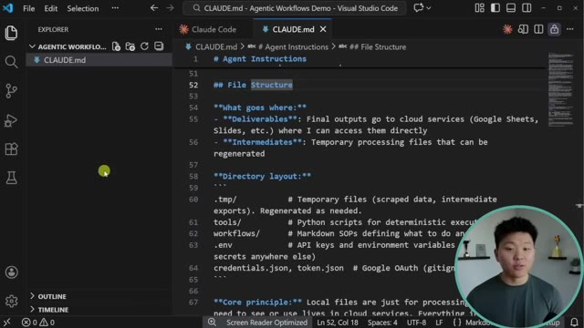
*⏱️ 00:07:25 — Une capture d'écran de l'éditeur Visual Studio Code affichant un fichier Markdown nommé "CLAUDE.md" qui définit la structure des fichiers et les instructions pour un agent IA.*

---

### ⏱️ `[00:07:42 - 00:08:02]` | Segment #22

**🔊 Audio (Transcription Intégrale Mot pour Mot en Français) :**
> All right. So what we want to do now is have CloudCode read that and then set up our actual file structure. Before that, I wanted to show you guys one thing at the bottom when you're talking to CloudCode, which is the mode. So you can be on ask before edits. You can be on edit automatically. You can be on plan mode and you can be on bypass permissions. So all of that just gives CloudCode a different level of autonomy. If you don't want it to do anything and you just want to make a plan, you start with plan mode.

**👁️ Analyse Visuelle d'Écran (gemini-3.5-flash-lite) :**
**Interface & Outils** : Visual Studio Code avec l'extension Claude Code activée.

**Contenu textuel & Code** : Zone de saisie textuelle affichant "Ctrl esc to focus or unfocus Claude" et des tags tels que "Bypass permissions" et "CLAUDE.md".

**Action / Démonstration** : Le présentateur illustre l'interface de discussion avec l'agent Claude Code pour préparer la configuration de la structure des fichiers.

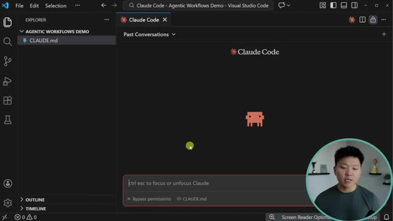
*⏱️ 00:07:47 — Interface de l'extension Claude Code dans Visual Studio Code montrant la zone de saisie des commandes en bas de l'éditeur.*

---

### ⏱️ `[00:08:02 - 00:08:22]` | Segment #23

**🔊 Audio (Transcription Intégrale Mot pour Mot en Français) :**
> And this is really important. I'll show you guys how this works. If you want it to ask for edits, you can have it do that. If you want it to just edit automatically, you can have it do that. Or if you want to have it just bypass permissions and just completely go, then you choose that. Now, if you don't see this option in yours, you have to go to your settings and then you'll type in Claude code and then you will enable allow dangerously skip permissions. And I only really like to do this if I'm sitting next to Claude watching it work.

**👁️ Analyse Visuelle d'Écran (gemini-3.5-flash-lite) :**
**Interface & Outils** : VS Code avec l'extension Claude Code.

**Contenu textuel & Code** : Texte "ctrl esc to focus or unfocus Claude" et "Edit automatically" associés au fichier CLAUDE.md.

**Action / Démonstration** : Configuration ou sélection du mode de fonctionnement de l'agent (édition automatique) dans l'environnement de développement.

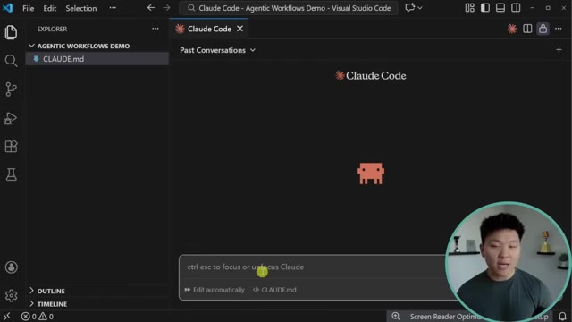
*⏱️ 00:08:07 — Interface de VS Code montrant l'extension Claude Code active avec une barre de contrôle affichant le mode "Edit automatically".*

---

### ⏱️ `[00:08:22 - 00:08:43]` | Segment #24

**🔊 Audio (Transcription Intégrale Mot pour Mot en Français) :**
> And if I realize it's going off track, I can just kind of poke it and steer it back in the right direction. So now that we've covered that, I'm going to be on bypass permissions mode and I'm going to say, hey, Claude, I just gave you a Claude.md file. I want you to go ahead and set up this project so that we're ready to go. We're ready to build agentic workflows together. So as I shoot that off, you can see that this is very similar to ChatGPT, except for in here, we can see everything that it's thinking and doing.

**👁️ Analyse Visuelle d'Écran (gemini-3.5-flash-lite) :**
**Interface & Outils** : Visual Studio Code, extension Claude Code.

**Contenu textuel & Code** : Le fichier "CLAUDE.md" est listé dans l'explorateur ; la barre de saisie de l'agent affiche les indicateurs "Bypass permissions" et "CLAUDE.md".

**Action / Démonstration** : L'utilisateur est en train de configurer l'agent Claude avec des permissions spécifiques pour initialiser le projet via le fichier de consignes.

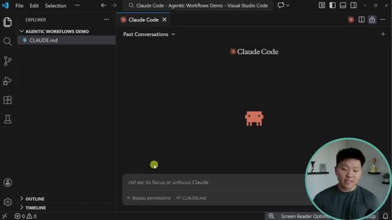
*⏱️ 00:08:27 — Interface de VS Code montrant l'extension Claude Code active avec le fichier CLAUDE.md ouvert dans l'explorateur de projet.*

---

### ⏱️ `[00:08:43 - 00:09:16]` | Segment #25

**🔊 Audio (Transcription Intégrale Mot pour Mot en Français) :**
> So let's just start from the top. It says, OK, cool. Let me read the Claude.md file to understand the project setup requirements. And then we can see it actually did this action. It read. It read this file that lives here. And now it said, OK, cool. I understand the WAT framework. let me check what already exists in the project, and then I'll set up the required structure. As you can see, it then goes to list the current project contents, and there's nothing. The product is empty except for the claw.md file. Let me set up the right structure. As you can see, it creates a to-do list, it thinks, it searches, it updates the to-dos, and it basically goes through this step-by-step process that you can have full visibility into and see what it's doing, see how it's thinking until we're done. So now it looks like the to-dos are pretty much all the way done,

**👁️ Analyse Visuelle d'Écran (gemini-3.5-flash-lite) :**
**Interface & Outils** : Visual Studio Code (VS Code) avec l'extension ou le panneau de chat dédié à l'agent Claude.

**Contenu textuel & Code** : Historique de discussion : "hey Claude, I just gave you a CLAUDE.md file...", suivi des étapes de réflexion et d'action de l'agent ("Thinking", "Read CLAUDE.md", "I understand the WAT framework...").

**Action / Démonstration** : L'agent IA exécute l'action de lecture (Read) du fichier `CLAUDE.md` situé dans le répertoire local du projet pour comprendre les prérequis de configuration.

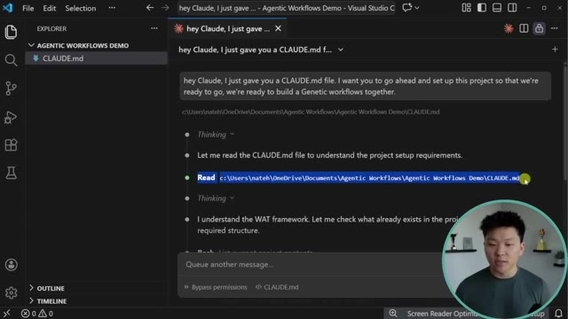
*⏱️ 00:08:51 — Capture d'écran de l'éditeur VS Code affichant l'interface de discussion avec l'agent IA "Claude" en train d'analyser le fichier CLAUDE.md.*

---

### ⏱️ `[00:09:16 - 00:09:38]` | Segment #26

**🔊 Audio (Transcription Intégrale Mot pour Mot en Français) :**
> and it's going to come back and say, nice, we're all set up, what do you want me to do next? And you can actually see in real time on the left-hand side, we now have different files. We've got our temporary folder. We've got our tools folder. We've got our workflows. Obviously there's nothing in these yet besides just some read me and some basic stuff, but that's why we gave it this folder structure so that it keeps it organized and it doesn't just throw a bunch of things in a random order. Cool. So it says ready to build a workflow. Let me know what you want to accomplish. Awesome.

**👁️ Analyse Visuelle d'Écran (gemini-3.5-flash-lite) :**
**Interface & Outils** : Visual Studio Code (avec extension IA intégrée).

**Contenu textuel & Code** : Arborescence avec dossiers : .tmp, tools, workflows, .env, .gitignore, CLAUDE.md. Fenêtre de chat indiquant l'écriture du fichier README.md dans le dossier "tools".

**Action / Démonstration** : L'agent IA génère et organise automatiquement la structure de fichiers du projet dans l'éditeur.

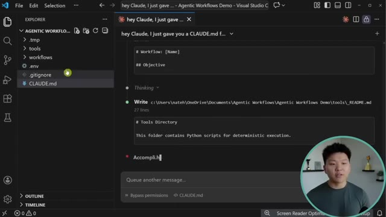
*⏱️ 00:09:22 — Interface VS Code affichant l'arborescence des fichiers du projet "Agentic Workflows" et la fenêtre de chat de l'IA.*

---

### ⏱️ `[00:09:38 - 00:10:11]` | Segment #27

**🔊 Audio (Transcription Intégrale Mot pour Mot en Français) :**
> So we're all set up. Let's actually start talking about the workflow that we want to build. So what I've got is this list of remote jobs. So I searched for social media. There's 622 remote jobs. And let's say I want to apply to all of these. Well, that would be really tough to log all of these manually. And there's multiple pages. There's 21 pages of these jobs. So what we can do is we can have cloud code, look at this stuff, get all the jobs we need, and then put it into an Excel sheet for us. And for this, we're going to be using a tool called Firecrawl. Firecrawl lets us do tons of different actions, and it lets us basically take a website like McDonald's right here. I can drop in the URL, and I can ask for a scrape, and it's going to go ahead and grab all of the

**👁️ Analyse Visuelle d'Écran (gemini-3.5-flash-lite) :**
**Interface & Outils** : DailyRemote (site web d'emploi) et Firecrawl (outil de scraping web).

**Contenu textuel & Code** : URL "example.com" dans le champ de saisie de Firecrawl, liste d'offres d'emploi "Social Media Manager", compteur "622".

**Action / Démonstration** : Démonstration du processus de recherche d'emploi et transition vers l'utilisation d'un outil d'automatisation (Firecrawl) pour extraire les données.

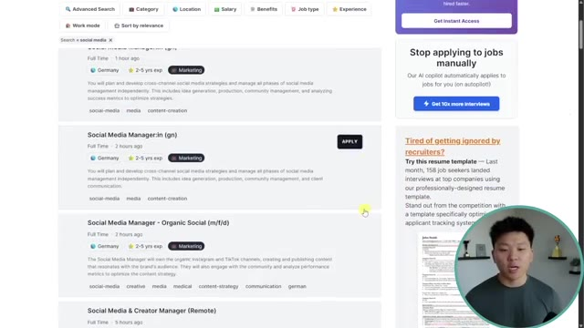
*⏱️ 00:09:46 — Interface du site DailyRemote affichant une liste de résultats pour la recherche "social media".*

*⏱️ 00:09:54 — Vue globale du site DailyRemote montrant la barre de recherche et le compteur de 622 opportunités d'emploi à distance.*

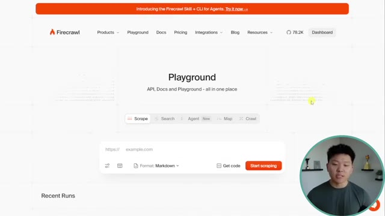
*⏱️ 00:10:03 — Interface de l'outil "Playground" de Firecrawl, permettant de configurer des tâches de scraping web (Scrape/Crawl).*

---

### ⏱️ `[00:10:11 - 00:10:44]` | Segment #28

**🔊 Audio (Transcription Intégrale Mot pour Mot en Français) :**
> information from that website. So in this case, I just requested Markdown, and it just pulls back all of the text from the website, as you can see. But it is a lot more powerful than that. It can turn websites into LLM ready data, whether that's scraping the data, getting screenshots, mapping the data, crawling the data, searching, extracting. There's a lot of different things that we can do with Firecrawl. Now, the thing is we want to just say, hey, CloudCode, use Firecrawl. Just go after it, use whatever the different tools that Firecrawl offers in order to accomplish the job that I've got for you. And so we do this using a framework called MCP, which stands for model context protocol. Now, I know that this may just sound like some tech jargon or some gibberish. So let's try to

**👁️ Analyse Visuelle d'Écran (gemini-3.5-flash-lite) :**
**Interface & Outils** : Tableau blanc numérique (type Excalidraw ou Miro) affichant une présentation interactive.

**Contenu textuel & Code** : Liste des fonctionnalités de Firecrawl : Scrape, Map, Crawl, Search, Extract, avec une description sous chaque icône. Mention des formats de sortie : markdown, JSON, screenshots, branding data.

**Action / Démonstration** : Le présentateur explique les capacités de l'outil Firecrawl à travers un schéma conceptuel illustrant ses fonctionnalités de traitement de données web.

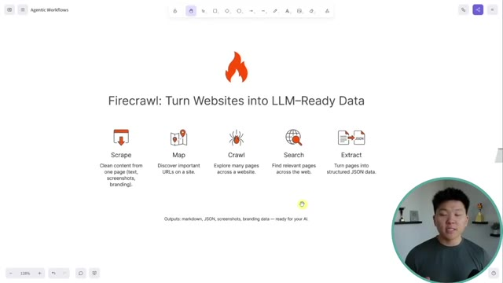
*⏱️ 00:10:19 — Une présentation visuelle sur un tableau blanc numérique montrant les fonctionnalités principales de l'outil Firecrawl pour transformer des sites web en données prêtes pour les LLM.*

---

### ⏱️ `[00:10:44 - 00:11:16]` | Segment #29

**🔊 Audio (Transcription Intégrale Mot pour Mot en Français) :**
> contextualize this a little bit. Think about Gmail, for example. In Gmail, you've got an action to send an email. You've got an action to draft an email. You've got an action to get a bunch of emails. There's so many different tools within that tool. So MCP basically says, okay, cool. The agent is going to figure out how to use all the tools, when to use all of them, what parameters to fill over, all that kind of stuff so that you, the human, don't have to think about that. So if we go back to our example of making a cake, let's say we realize, okay, so for this cake, we need eggs, flour, and frosting. Okay, well, how do we do that? Well, let's just give our agent access to the supermarket MCP and say, okay, whenever you need a new ingredient, just go to the supermarket

**👁️ Analyse Visuelle d'Écran (gemini-3.5-flash-lite) :**
**Interface & Outils** : Logiciel de présentation ou outil de tableau blanc numérique (type FigJam ou Miro).

**Contenu textuel & Code** : Logotype MCP (Model Context Protocol) et illustration symbolique de supermarché avec produits alimentaires.

**Action / Démonstration** : Présentation théorique du concept MCP par le créateur.

---

### ⏱️ `[00:11:16 - 00:11:46]` | Segment #30

**🔊 Audio (Transcription Intégrale Mot pour Mot en Français) :**
> an MCP, grab what you need. I don't really care. Just figure it out. And then come back with the right ingredients rather than saying, okay, cool. So like eggs, let's go to the egg store. Flour, let's go to the flour store. Frosting, let me go to the candy store. We're just going to get everything in one spot. And that's the power of MCP. So in Firecrawls docs, you can see that they have an MCP server, which is amazing. And this lets us get stuff like web scraping, crawling, searching, all this kind of stuff that we want in any of the tools that we want to use. So right here, I can click on running on cloud code. And this shows us how to add the Firecrawl MCP server using the Cloud Code CLI.

**👁️ Analyse Visuelle d'Écran (gemini-3.5-flash-lite) :**
**Interface & Outils** : - Image #1 : Outil de mind-mapping ou tableau blanc virtuel (type Excalidraw).
- Image #2 : Site web de documentation technique (Firecrawl).

**Contenu textuel & Code** : - Image #1 : Dessin symbolique représentant un supermarché et des ingrédients culinaires.
- Image #2 : Documentation Firecrawl : "Firecrawl MCP Server", "Use Firecrawl's API through the Model Context Protocol", liste des fonctionnalités (Web scraping, crawling, etc.).

**Action / Démonstration** : - Image #1 : Illustration conceptuelle pour expliquer le traitement des requêtes par un agent.
- Image #2 : Navigation dans la documentation technique pour présenter l'intégration MCP.

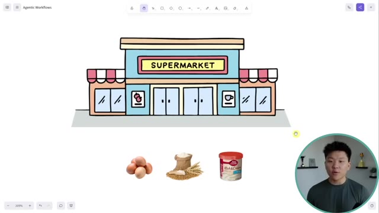
*⏱️ 00:11:23 — Un schéma illustrant un supermarché avec des ingrédients (œufs, farine, glaçage) pour expliquer le concept d'agent IA allant chercher toutes les ressources au même endroit.*

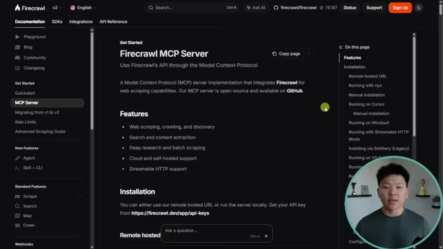
*⏱️ 00:11:31 — La documentation officielle de Firecrawl présentant son serveur MCP (Model Context Protocol), détaillant ses fonctionnalités de scraping et ses options d'installation.*

---

### ⏱️ `[00:11:46 - 00:12:07]` | Segment #31

**🔊 Audio (Transcription Intégrale Mot pour Mot en Français) :**
> So what I'm gonna do is go ahead and copy this message right here. I'm gonna come into Cloud Code and I'm going to clear out this conversation history. And I'm gonna say, hey, Claude, I want you to help me install the FireCrawl MCP server. You need to install it using this command in the Cloud Code CLI. And then I paste in that command. Now, what you'll notice here is that it's prompting us for our API key. And so an API key is basically like a password and I don't actually wanna give it to Cloud Code.

**👁️ Analyse Visuelle d'Écran (gemini-3.5-flash-lite) :**
**Interface & Outils** : Visual Studio Code (extension Claude Code).

**Contenu textuel & Code** : Texte d'aide dans la zone de prompt : "ctrl esc to focus or unfocus claude", ainsi que des métadonnées de projet ("Bypass permissions", "CLAUDE.md").

**Action / Démonstration** : Le présentateur s'apprête à interagir avec l'agent Claude Code pour installer le serveur MCP FireCrawl.

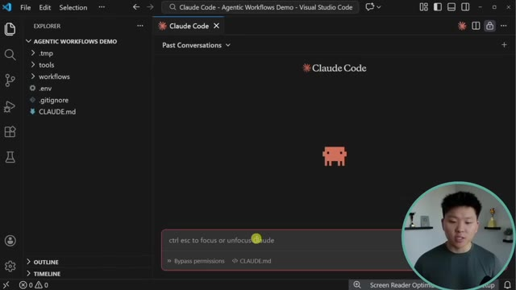
*⏱️ 00:11:51 — L'interface de "Claude Code" ouverte au sein de l'éditeur Visual Studio Code, affichant la zone de saisie des commandes en bas de l'écran avec une icône de petit monstre pixelisé.*

---

### ⏱️ `[00:12:07 - 00:12:26]` | Segment #32

**🔊 Audio (Transcription Intégrale Mot pour Mot en Français) :**
> I don't want my API key to be stored in the conversation history of Cloud Code. I wanna just put it into the file or into the project locally myself, just to do it a bit more secure. So I'm gonna say, go ahead and get this initialized, but I'm not gonna give you my API key directly. I'm gonna put it into the .env file. So help me get that set up as well. So I shoot off that message.

**👁️ Analyse Visuelle d'Écran (gemini-3.5-flash-lite) :**
**Interface & Outils** : VS Code (extension Claude Code)

**Contenu textuel & Code** : Commande affichée : "claude mcp add firecrawl -e FIRECRAWL_API_KEY=your-api-key -- npx -y firecrawl"

**Action / Démonstration** : L'utilisateur prépare la commande pour installer le serveur MCP FireCrawl en utilisant une clé API, tout en expliquant sa volonté de ne pas stocker cette clé dans l'historique des conversations pour des raisons de sécurité.

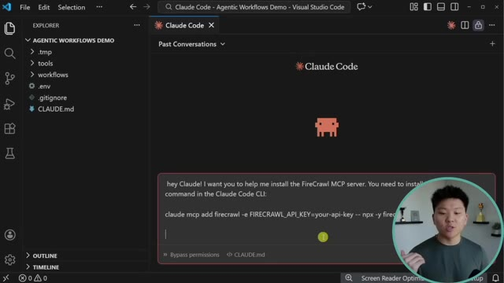
*⏱️ 00:12:12 — L'interface de l'extension Claude Code au sein de VS Code, montrant une fenêtre de chat où l'utilisateur saisit une commande pour installer un serveur MCP.*

---

### ⏱️ `[00:12:26 - 00:12:45]` | Segment #33

**🔊 Audio (Transcription Intégrale Mot pour Mot en Français) :**
> It's gonna think about how to actually help me set all this up. So it's checking in on the existing file. It's checking in on our project configuration, and then it's gonna help us actually do this. Okay, so it said that I've added the API key placeholder to your .env file. Now you just need to add it there. So the .env file is on this left-hand side. I'm gonna open that up and you can see now, It says, cool, Firecrawl MCP server, put in your API key right here.

**👁️ Analyse Visuelle d'Écran (gemini-3.5-flash-lite) :**
**Interface & Outils** : VS Code avec l'extension ou l'interface de discussion Claude intégrée.

**Contenu textuel & Code** : Historique de discussion affichant "Thinking", "I'll help you set up the FireCrawl MCP server", "Read .env" et l'étape "Effecting...". Dans l'explorateur de fichiers : .env, .gitignore, CLAUDE.md.

**Action / Démonstration** : L'agent IA est en train de lire et d'analyser le fichier `.env` local pour configurer le serveur MCP FireCrawl.

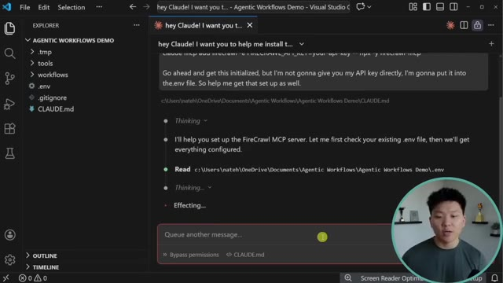
*⏱️ 00:12:31 — Interface de VS Code montrant l'agent Claude en train d'analyser les fichiers du projet.*

---

### ⏱️ `[00:12:45 - 00:13:04]` | Segment #34

**🔊 Audio (Transcription Intégrale Mot pour Mot en Français) :**
> So I'm going to delete this. I'm going to go into Firecrawl and I'm going to go to my dashboard. So if you haven't already, sign up for Firecrawl. You can get started for free and you can get 500 credits right away, which is more than enough to play around with. And then you can see right here, API key. So I'm going to copy this. I'm going to paste it right here into the actual .env file. And then I'm going to go to file and save this to make sure that it actually gets saved on our project.

**👁️ Analyse Visuelle d'Écran (gemini-3.5-flash-lite) :**
**Interface & Outils** : VS Code (Visual Studio Code)

**Contenu textuel & Code** : Fichier .env contenant des placeholders pour des clés API (OpenAI, Anthropic, Google) et la ligne "FIRECRAWL_API_KEY=" avec une valeur masquée.

**Action / Démonstration** : Édition et configuration des clés API dans les variables d'environnement du projet pour intégrer Firecrawl.

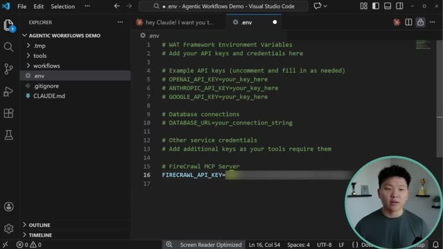
*⏱️ 00:12:59 — Éditeur VS Code ouvert sur un fichier .env montrant la configuration des variables d'environnement, notamment la clé API Firecrawl.*

---

### ⏱️ `[00:13:04 - 00:13:24]` | Segment #35

**🔊 Audio (Transcription Intégrale Mot pour Mot en Français) :**
> And then you can see it says, then run the MCP add command. And it gives me all this reasons. And I actually don't understand what this means. So I'm just going to ask it to see if it can do it itself. I don't exactly understand how to do that. I have added my Firecrawl API key to the .env file. Would you be able to actually just run this command to make sure we can install the Firecrawl MCP server? Okay, so went ahead and installed the MCP server.

**👁️ Analyse Visuelle d'Écran (gemini-3.5-flash-lite) :**
**Interface & Outils** : Visual Studio Code avec l'extension Claude intégrée.

**Contenu textuel & Code** : Instructions techniques pour PowerShell incluant une commande d'exportation de variable d'environnement (`$env:FIRECRAWL_API_KEY`) et l'exécution du package `npx -y firecrawl-mcp`.

**Action / Démonstration** : L'assistant Claude fournit des directives étape par étape pour aider l'utilisateur à installer et configurer correctement le serveur MCP Firecrawl.

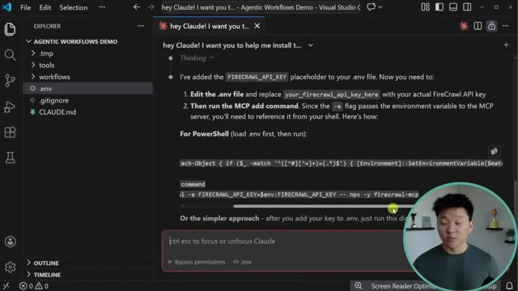
*⏱️ 00:13:09 — L'interface de l'éditeur Visual Studio Code affichant une fenêtre de chat de l'assistant Claude, détaillant les instructions pour configurer la variable d'environnement Firecrawl et exécuter la commande MCP.*

---

### ⏱️ `[00:13:24 - 00:13:49]` | Segment #36

**🔊 Audio (Transcription Intégrale Mot pour Mot en Français) :**
> Now, something I did want to bring up is that when it actually runs that command with this bash operation, it does put in the API key right here, which technically will be stored in conversation history. So in this case, we're fine because this is a free key. It doesn't have much access, and I'm probably just going to rotate it right after this video. So what you would want to do in an environment where you have a key that has a lot of risk is you would want to have Cloud Code just walk you through how you can run it in your own terminal in order to make sure that Cloud never actually touches the key.

**👁️ Analyse Visuelle d'Écran (gemini-3.5-flash-lite) :**
**Interface & Outils** : Visual Studio Code avec l'extension Claude Code.

**Contenu textuel & Code** : Commande affichée : `claude mcp add firecrawl -e FIRECRAWL_API_KEY=...` ; messages système confirmant la modification du fichier `.claude.json`.

**Action / Démonstration** : L'agent exécute la commande d'installation et de configuration du serveur MCP Firecrawl tout en enregistrant la clé API dans l'historique.

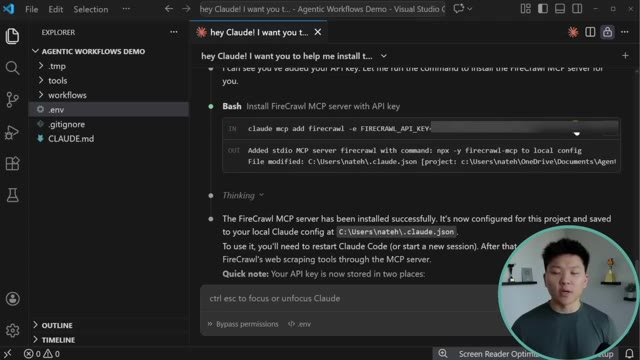
*⏱️ 00:13:30 — Interface de VS Code montrant l'extension Claude Code en pleine interaction pour l'installation d'un serveur MCP Firecrawl.*

---

### ⏱️ `[00:13:49 - 00:14:09]` | Segment #37

**🔊 Audio (Transcription Intégrale Mot pour Mot en Français) :**
> But still, best practice, always store them in a .env. That way, if you ever are pushing something to a public repository anywhere or someone gets access to your files, then that's all going to be encrypted. So now we are pretty much set up for actually starting to build this agentic workflow. So I'm going to do a slash clear, start a new conversation. And what we're going to do is, like I said earlier, we're just going to explain in super clear natural language what we want.

**👁️ Analyse Visuelle d'Écran (gemini-3.5-flash-lite) :**
**Interface & Outils** : Visual Studio Code (avec extension/CLI Claude Code intégrée).

**Contenu textuel & Code** : Explorateur de fichiers (fichiers .env, .gitignore, CLAUDE.md) et logs de Claude Code confirmant l'installation du serveur "firecrawl-mcp" via `npx -y firecrawl-mcp`.

**Action / Démonstration** : Configuration des variables d'environnement et vérification de l'installation du serveur MCP par l'agent.

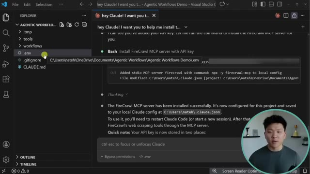
*⏱️ 00:13:54 — Interface VS Code affichant l'explorateur de fichiers avec un fichier .env sélectionné et une fenêtre de discussion "Claude Code" ouverte montrant l'installation réussie du serveur MCP Firecrawl.*

---

### ⏱️ `[00:14:09 - 00:14:30]` | Segment #38

**🔊 Audio (Transcription Intégrale Mot pour Mot en Français) :**
> So I'm going to go ahead and switch this to plan mode, which I would always recommend doing before you actually start building an agentic workflow. I'm going to go back into this tab and I'm going to grab the URL from this page where we have 622 job opportunities here for social media. Coming back into Cloud Code, I'm just going to start talking to it. So I'm going to paste in this URL and I'm going to say, hey, Cloud, I just gave you a URL for a website that has a bunch of job opportunities.

**👁️ Analyse Visuelle d'Écran (gemini-3.5-flash-lite) :**
**Interface & Outils** : Firecrawl (web), Navigateur web (plateforme d'emploi), VS Code (avec extension/terminal Claude Code).

**Contenu textuel & Code** : URL de recherche : "https://dailyremote.com/?search=social%20media&page=1#main", interfaces utilisateur de gestion d'agents.

**Action / Démonstration** : Passage en "Plan mode" dans Claude Code et récupération de l'URL cible pour initier un flux de travail agentique de scraping.

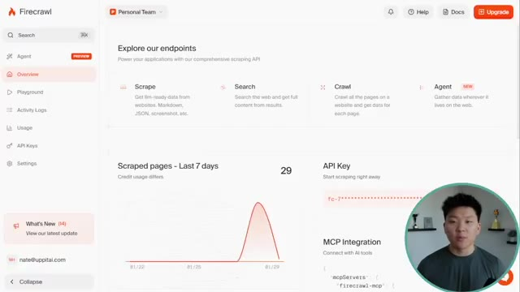
*⏱️ 00:14:14 — Interface de la plateforme Firecrawl affichant le tableau de bord avec les options de "Scrape", "Search" et "Crawl".*

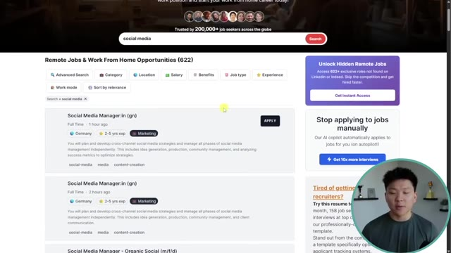
*⏱️ 00:14:19 — Page web de recherche d'emploi ("Remote Jobs") affichant 622 opportunités pour le terme "social media".*

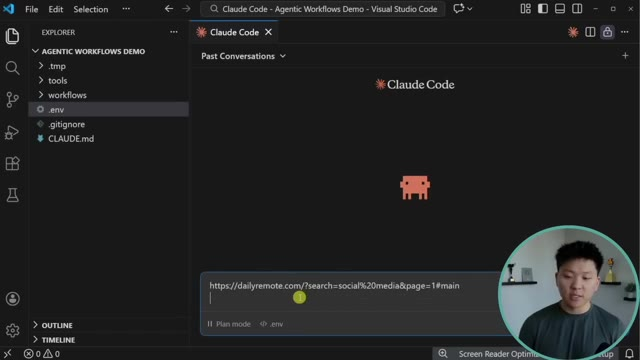
*⏱️ 00:14:25 — Éditeur VS Code avec l'interface de "Claude Code" activée en mode "Plan" et l'URL de recherche d'emploi saisie dans la barre de prompt.*

---

### ⏱️ `[00:14:30 - 00:14:50]` | Segment #39

**🔊 Audio (Transcription Intégrale Mot pour Mot en Français) :**
> There are about 622 job opportunities here, but they're spread across different pages. So there's like 21 total pages. And what I want you to do is go ahead and scrape all of those for me. And I just want you to put those into an Excel sheet so that I can actually look through them, you know, do things with them. Make sure you're getting all of the relevant fields that I may want. So that's kind of my overall plan. Let me know if you can help me make that project requirement more robust.

**👁️ Analyse Visuelle d'Écran (gemini-3.5-flash-lite) :**
**Interface & Outils** : Visual Studio Code avec l'extension/interface Claude Code.

**Contenu textuel & Code** : URL de ciblage : "https://dailyremote.com/?search=social%20media&page=1#main" affichée dans la zone de saisie de l'agent.

**Action / Démonstration** : L'utilisateur donne une instruction à l'agent IA (Claude Code) pour interagir avec une page web spécifique afin d'extraire des données.

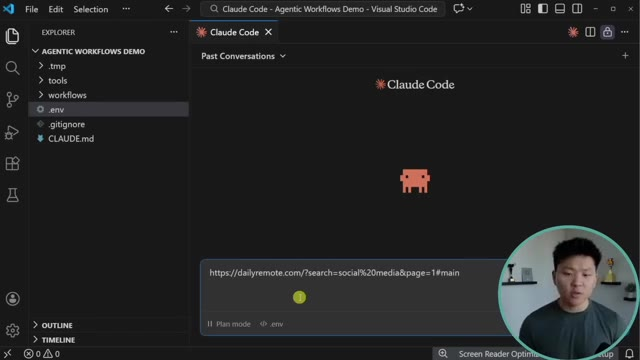
*⏱️ 00:14:35 — Interface de Visual Studio Code affichant l'extension Claude Code en cours d'utilisation pour une tâche de scraping web.*

---

### ⏱️ `[00:14:50 - 00:15:26]` | Segment #40

**🔊 Audio (Transcription Intégrale Mot pour Mot en Français) :**
> And you can feel free to ask me any questions that you may have for me to make sure that we can build out this workflow in a really high quality way. So just shut that off in plan mode. So it's going to do a lot of thinking. it's going to reason about like the way that we should actually do this. Hopefully it understands that it can use FireCross MCP server. As you can see, it's searching that right here. And then what it's going to do is it's going to come back to us with tons of questions, I'm sure. And then it's also going to come back to us with a plan. So once I'm able to approve that plan, it will start actually building the workflows and the tools for us. All right. So here we are with our first round of questions. Do you want me to also scrape each individual job detail for more complete info like company name, full description benefits, or just the listing? So for the, for right now,

**👁️ Analyse Visuelle d'Écran (gemini-3.5-flash-lite) :**
**Interface & Outils** : VS Code (avec extension ou agent intégré type Claude Code).

**Contenu textuel & Code** : Un prompt détaillant une tâche de scraping de 622 offres d'emploi sur le site dailyremote.com pour les exporter vers Excel, suivi de l'état "Thinking..." et "Effecting..." de l'agent.

**Action / Démonstration** : L'agent est en phase active de raisonnement et d'exécution après avoir reçu les instructions initiales de l'utilisateur.

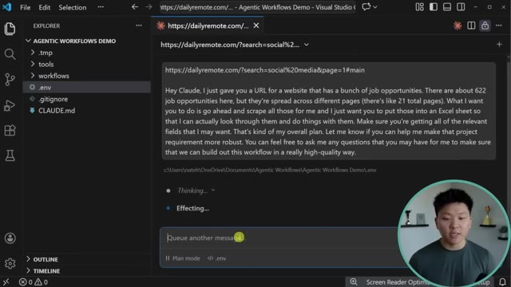
*⏱️ 00:14:59 — Interface de VS Code montrant l'agent Claude en train de traiter une requête de scraping web dans le panneau de chat latéral.*

---

### ⏱️ `[00:15:26 - 00:15:52]` | Segment #41

**🔊 Audio (Transcription Intégrale Mot pour Mot en Français) :**
> we're just going to go with the actual listing. For the output location, it says where should I save the Excel file? I'm just going to go ahead and do a local in the temporary folder, which we've created right over here. So I'll choose that. And then for filtering, do you want any filters applied or should I grab all 622 job posts? Now what I'm going to say here is other, and I'm going to go ahead and grab all the jobs, but I'm doing this as a demo for how to build an agentic workflow. So just go ahead and grab only 200 for now, just to prove that this concept works.

**👁️ Analyse Visuelle d'Écran (gemini-3.5-flash-lite) :**
**Interface & Outils** : Visual Studio Code avec un panneau de configuration d'agent IA interactif.

**Contenu textuel & Code** : Menu de sélection "Output location" avec l'option "Local .tmp/ folder (Recommended)" sélectionnée pour enregistrer le fichier sous ".tmp/social_media_jobs.xlsx".

**Action / Démonstration** : L'utilisateur configure l'emplacement de sortie des données extraites par l'agent avant de passer à l'étape suivante (Filtering).

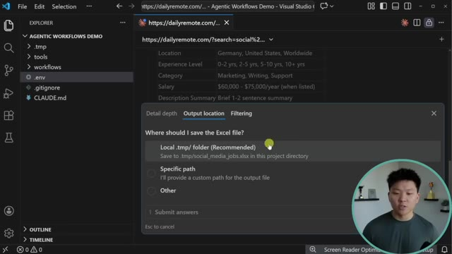
*⏱️ 00:15:33 — Une fenêtre modale s'affiche au centre de VS Code, demandant la destination de sauvegarde pour un fichier Excel généré.*

---

### ⏱️ `[00:15:52 - 00:16:25]` | Segment #42

**🔊 Audio (Transcription Intégrale Mot pour Mot en Français) :**
> So I've submitted those answers and now you can see it's going to keep on going with its plan. So we just got back this plan. I'm going to go ahead and give this a quick review. But also for the sake of the demo, I want to see how well it did on the first shot. So realistically, what I would do is I would go ahead and read this whole thing. And if there were any adjustments to be made, I would go ahead and make those. But what you can see is it gave us a pretty comprehensive plan of what it's going to do. It's going to create a tool called Scrape Daily Remote. It's going to create a workflow called Scrape Job Listings. And then it's going to actually execute that scrape and get us all this information. So I'm going to go ahead and say yes and auto accept. So it just spun up that to do list. It's going to start going and I'll check in with you guys when that's done. All right, that just finished up.

**👁️ Analyse Visuelle d'Écran (gemini-3.5-flash-lite) :**
**Interface & Outils** : VS Code (avec extension Claude intégrée).

**Contenu textuel & Code** : Une interface utilisateur interactive affichant un tableau "Data Fields to Extract" (Job Title, Job Type, etc.) et une fenêtre modale proposant les choix : "Yes, and auto-accept", "Yes, and manually approve edits", ou "No, keep planning".

**Action / Démonstration** : L'utilisateur est invité à valider ou modifier le plan d'action généré par l'IA pour automatiser la tâche d'extraction de données.

*⏱️ 00:16:01 — Une capture d'écran de l'interface VS Code montrant une boîte de dialogue "Accept this plan?" générée par l'agent Claude, avec des options de validation pour automatiser ou approuver manuellement les prochaines étapes.*

---

### ⏱️ `[00:16:25 - 00:17:00]` | Segment #43

**🔊 Audio (Transcription Intégrale Mot pour Mot en Français) :**
> we can see that we got 209 done. We have different metrics here. We have different locations and also created a tool and a workflow. So if I open up this folder, we can see we now have a scrape daily remote jobs tool. And in the workflows, we now have a scrape job listings workflow. So basically meaning next time we ask it to scrape jobs, it's going to be able to do it better. And it has more direction because it's already done it. And if it has any mistakes, it will update the workflows and the tools so that the next time it's even better. Let's go ahead and take a look at the output. So it said that it stored it in the temporary file. So right here, temp, and we've got social media jobs, Excel. All right. So this is the Excel sheet that it created for me. I'm

**👁️ Analyse Visuelle d'Écran (gemini-3.5-flash-lite) :**
**Interface & Outils** : Visual Studio Code (VS Code).

**Contenu textuel & Code** : Arborescence de fichiers (dossiers "tools" et "workflows"), fichier "scrape_dailyremote_jobs.py", et texte affiché dans l'éditeur détaillant la création d'outils de scraping et une commande Python pour l'exécution du script avec des arguments de recherche.

**Action / Démonstration** : Le présentateur navigue dans l'arborescence du projet pour démontrer les nouveaux fichiers et outils générés automatiquement par l'agent IA.

*⏱️ 00:16:34 — Une capture d'écran de l'interface VS Code montrant l'arborescence des fichiers du projet sur la gauche et la documentation du workflow générée par l'IA dans l'éditeur principal.*

---

### ⏱️ `[00:17:00 - 00:17:21]` | Segment #44

**🔊 Audio (Transcription Intégrale Mot pour Mot en Français) :**
> going to go ahead and zoom out a little bit so we can see, but it's got like different filters on here already, which is pretty cool that it did all this itself. We've got job title. We've got job type, position, location, experience, category, salary, description, summary, tags. We've got the actual URL and that's pretty much it. And like it said, it was able to get us, I think it said 209. So yep, this is 209 total job postings, just like that.

**👁️ Analyse Visuelle d'Écran (gemini-3.5-flash-lite) :**
**Interface & Outils** : Microsoft Excel (version web ou application de bureau).

**Contenu textuel & Code** : Tableau structuré avec les colonnes : Job Title, Job Type, Posted Time, Location, Experience Level, Category, Salary, Description, Summary, Tags, Job URL. Le menu contextuel montre des options de filtrage (tri et recherche par valeur).

**Action / Démonstration** : Le présentateur illustre la capacité de l'outil à automatiser la catégorisation et le filtrage des données d'offres d'emploi collectées.

*⏱️ 00:17:05 — Une feuille de calcul Excel affichant une base de données d'offres d'emploi, avec un menu de filtrage ouvert sur la colonne "Experience Level".*

---

### ⏱️ `[00:17:22 - 00:17:40]` | Segment #45

**🔊 Audio (Transcription Intégrale Mot pour Mot en Français) :**
> So we're gonna go ahead and try a different use case now that uses the Firecrawl MCP. But what I wanted to show you guys is down here, we have context. So it says 45% of your context is remaining until it will auto compact. And so you guys have might've heard of something called context rot. It basically just means the more context that you have in a conversation history with an AI model, the worse it kind of gets.

**👁️ Analyse Visuelle d'Écran (gemini-3.5-flash-lite) :**
**Interface & Outils** : Visual Studio Code (avec extension Claude intégrée).

**Contenu textuel & Code** : Documentation du projet ("Files Created", "Reuse for Future Scrapes"), commande Python pour le scraping, et barre d'état de l'agent indiquant "55% used" (contexte).

**Action / Démonstration** : Le présentateur illustre le résultat d'une tâche d'automatisation terminée, en montrant les fichiers créés et la commande pour réutiliser l'outil de scraping.

*⏱️ 00:17:26 — Interface de VS Code montrant le résultat d'un workflow de scraping de jobs avec un fichier Excel généré et la barre de statut de l'agent Claude en bas.*

---

### ⏱️ `[00:17:40 - 00:18:01]` | Segment #46

**🔊 Audio (Transcription Intégrale Mot pour Mot en Français) :**
> So typically whenever my context gets over 60, I'll probably just compact it or reset and then keep going. So what I'm gonna do is I'm just gonna go ahead and click this right now. and it's going to compact our workflow and all of our conversation history so we can keep going, but it still remembers the important things that we've done. All right, so that's been compacted. So it basically just summarized everything that we've done. So let's try something else now. Let me look at this same website, but now there's no search filter.

**👁️ Analyse Visuelle d'Écran (gemini-3.5-flash-lite) :**
**Interface & Outils** : Visual Studio Code avec l'extension Claude.

**Contenu textuel & Code** : Documentation Markdown ("Files Created", "Reuse for Future Scrapes"), arborescence de fichiers (dossiers "tools" et "workflows"), et barre d'état de l'agent indiquant "55% used".

**Action / Démonstration** : Visualisation de l'état de la mémoire du contexte de l'agent avant l'action de compactage mentionnée dans l'audio.

*⏱️ 00:17:45 — Interface VS Code affichant un document markdown dans un onglet, détaillant les fichiers créés lors d'une session de scraping et montrant la barre de contrôle de l'agent Claude en bas de l'écran avec une utilisation de contexte à 55 %.*

---

### ⏱️ `[00:18:01 - 00:18:25]` | Segment #47

**🔊 Audio (Transcription Intégrale Mot pour Mot en Français) :**
> So there's 214,000 jobs. I'm just gonna take the URL and I'm gonna go into Cloud Code and say, hey, Cloud, I've got this URL that I need help with. I want you to basically be able to scrape this. I want jobs that are sales opportunities or sales jobs. And I wanna look just in Europe. scrape all of this. I want to get like 500 jobs back and put it in a nicely formatted Excel sheet for me. Now this time what I'm going to do is we're just going to go ahead and do bypass permissions.

**👁️ Analyse Visuelle d'Écran (gemini-3.5-flash-lite) :**
**Interface & Outils** : VS Code (avec une extension d'agent IA intégrée).

**Contenu textuel & Code** : Arborescence de fichiers de projet (dossiers .tmp, tools, workflows, fichiers scrape_dailyremote_jobs.py), et une fenêtre de chat affichant une analyse textuelle d'une requête utilisateur, suivie d'une invite de commande pour entrer une URL (https://dailyremote.com/remote-jobs?search=&page=1).

**Action / Démonstration** : L'agent IA documente les étapes de sa réflexion (analyse chronologique) et attend une nouvelle saisie d'URL pour poursuivre le processus de scraping.

*⏱️ 00:18:07 — Une capture d'écran de l'éditeur VS Code montrant l'interface d'un agent IA (Claude Code) en train d'analyser une demande de scraping web sur dailyremote.com.*

---

### ⏱️ `[00:18:25 - 00:19:00]` | Segment #48

**🔊 Audio (Transcription Intégrale Mot pour Mot en Français) :**
> And like I said, normally you want to go on plan mode, you want to ask questions, but I just want to show you guys what this might look like with a pretty vague prompt and just letting Cloud Code go after it. And hopefully it's able to do a better job now because it understands how it can scrape job listings and it has this tool and it may even have to create a new tool. So let's just kind of let it run. I'm going to analyze what it's doing and then I'll report back once we see what it actually ended up doing. It started off by saying, cool, I have a scraping tool from before that I can use. So here's my plan. I'm going to scrape the sales jobs. I'm going to filter for Europe and then I'm going to export it all to an Excel sheet. It found 409 total sales jobs and now it has to filter for Europe. And when it did that, it basically found there's a limitation.

**👁️ Analyse Visuelle d'Écran (gemini-3.5-flash-lite) :**
**Interface & Outils** : Visual Studio Code avec le plugin/terminal Claude Code intégré.

**Contenu textuel & Code** : Prompt utilisateur : "Hey Claude, I've got this URL that I need help with. I want you to basically be able to scrape this. I want jobs that are sales opportunities or sales jobs and I want to look just in Europe. So scrape all of this. I want to get like 500 jobs back and put it in a nicely formatted Excel sheet for me."

**Action / Démonstration** : Exécution d'une requête de scraping automatisée par l'agent IA à partir d'un prompt utilisateur flou.

*⏱️ 00:18:34 — Interface de VS Code montrant l'agent Claude Code en pleine interaction, affichant un prompt utilisateur demandant de scraper des offres d'emploi sur DailyRemote pour le marché européen avec exportation en Excel.*

---

### ⏱️ `[00:19:00 - 00:19:34]` | Segment #49

**🔊 Audio (Transcription Intégrale Mot pour Mot en Français) :**
> There's only 52 sales jobs in Europe, but there are 409 total. So let me check if including worldwide would help get closer to the goal. So what's going on here? It has our natural language request, which was that we wanted 500 sales jobs in Europe. And it realized, okay, this actually isn't going to work. Let me brainstorm and see what else I can do. And now you can see what it did is it asked us a question because it wants to help us reach our end goal better. So it says, do you want me to expand the search to get more jobs? We can either keep the 55 sales jobs in Europe. We could broaden it to all job types, or we could also do US based sales jobs. So I'm just going to go add US jobs as well. And now it should keep going. And hopefully now you can also see why

**👁️ Analyse Visuelle d'Écran (gemini-3.5-flash-lite) :**
**Interface & Outils** : Visual Studio Code (avec intégration d'agent IA type Claude Code).

**Contenu textuel & Code** : Arborescence de fichiers (.py, .xlsx), journaux de l'agent ("Thinking", "There's a limitation...", "Write..."), et début du script `filter_europe_v2.py`.

**Action / Démonstration** : L'agent identifie une limitation dans les résultats de recherche (seulement 52 jobs en Europe) et planifie la modification du script Python pour inclure les jobs "Worldwide".

*⏱️ 00:19:09 — Interface de VS Code montrant l'exécution d'un agent IA (Claude) analysant les données de scraping de jobs et décidant de modifier le script de filtrage.*

---

### ⏱️ `[00:19:34 - 00:20:07]` | Segment #50

**🔊 Audio (Transcription Intégrale Mot pour Mot en Français) :**
> I wanted to give it a temporary folder because in this operation where it's running into a few issues, it's creating some other temporary files, like all sales jobs, sales jobs, raw. It's also created three different Python tools that are temporary tools just because it knows that it needs some help filtering things out. And now it was able to find 372 sales jobs and it was saved to sales jobs Europe and US. So it says that we've got 372 sales jobs. I'm going to open up that Excel sheet and we can see if we scroll all the way down, we should have gotten 372. Perfect. And this is also similar because we can filter up here with all of these pre-made filters that it put in.

**👁️ Analyse Visuelle d'Écran (gemini-3.5-flash-lite) :**
**Interface & Outils** : Visual Studio Code (VS Code) avec extension d'édition intégrée pour fichiers Excel/CSV.

**Contenu textuel & Code** : - Image 1 : Fichiers '.py' (filter_europe.py, etc.) et '.xlsx' (sales_jobs_raw.xlsx, etc.) dans le dossier '.tmp'.
- Image 2 : Données tabulaires sur les emplois (Sales & Partnerships Lead, etc.) avec des colonnes de filtrage automatique.

**Action / Démonstration** : Organisation des fichiers temporaires générés par l'agent et vérification visuelle du résultat final des données structurées dans Excel.

*⏱️ 00:19:42 — Vue de l'explorateur de fichiers dans VS Code montrant un répertoire '.tmp' contenant des scripts Python générés et des fichiers Excel de données de travail.*

*⏱️ 00:19:59 — Visualisation d'un fichier Excel ouvert dans VS Code, affichant une liste structurée d'offres d'emploi avec des colonnes telles que 'Job Title', 'Location', 'Region' et 'Salary'.*

---

### ⏱️ `[00:20:07 - 00:20:41]` | Segment #51

**🔊 Audio (Transcription Intégrale Mot pour Mot en Français) :**
> We've got job title, we've got all this information. And it said that it added a region column right here. And this is where we could get rid of US and mixed and worldwide. And we now should see that we've only got about different actual rows. Yeah, 49. And just as one final test, let's see what happens if it gets a crazy type of request that we haven't really prepared it for. So right now, this is good at scraping jobs from a given URL. What if I just said, hey, Claude, I'm looking to reach out to tons of dentists. Can you find me dentists in the United States and give me their contact information so that I can basically just build up a lead list of dentists that I can contact? I want this to be in an Excel sheet. I'm going to shoot that off. Once again, this is

**👁️ Analyse Visuelle d'Écran (gemini-3.5-flash-lite) :**
**Interface & Outils** : Microsoft Excel, Visual Studio Code (avec l'extension Claude Code).

**Contenu textuel & Code** : Image 1 : Tableau de données (noms de colonnes visibles). Image 2 : Explorateur de fichiers avec scripts (filter_europe.py, etc.) et fichiers de données (.xlsx).

**Action / Démonstration** : Présentation de la structure des données nettoyées dans Excel, puis retour à l'environnement de développement VS Code pour poursuivre l'automatisation via Claude Code.

*⏱️ 00:20:16 — Interface Excel affichant un tableau de données structuré avec des colonnes comme 'Job Title', 'Region', 'Experience Level', etc., illustrant le résultat du traitement des données.*

*⏱️ 00:20:24 — Interface VS Code ouverte sur le projet 'Agentic Workflows Demo', montrant l'extension 'Claude Code' prête à l'emploi dans le panneau principal avec une liste de fichiers de scripts Python et de fichiers Excel dans l'explorateur.*

---

### ⏱️ `[00:20:41 - 00:21:04]` | Segment #52

**🔊 Audio (Transcription Intégrale Mot pour Mot en Français) :**
> in bypass permissions mode. So we're going to see what it does. We're going to see if it uses Firecrawl. We're going to see if it thinks about, hey, actually I can't use Firecrawl. I need to get access to some sort of like, you know, lead generation API or lead list API. We're going to see what it does here. It said, I can help you build a dentist lead list. Let me first check what tools and workflows exist. Then it says, let me check the available APIs. You have Firecrawl available and I can build a similar tool to your existing job scraper, but for dentist leads instead.

**👁️ Analyse Visuelle d'Écran (gemini-3.5-flash-lite) :**
**Interface & Outils** : Visual Studio Code avec l'extension ou l'interface de chat "hey Claude" intégrée.

**Contenu textuel & Code** : Le prompt de l'utilisateur demande : "Can you find me dentists in the United States and give me their contact information... I want this to be in an Excel sheet." L'agent affiche son raisonnement ("Thinking") et exécute des commandes de recherche de fichiers (Glob pattern) dans le projet.

**Action / Démonstration** : L'agent analyse les fichiers du répertoire (`tools/`, `workflows/`) pour déterminer s'il existe des outils permettant de répondre à la demande de génération de leads avant de procéder.

*⏱️ 00:20:46 — Interface de VS Code montrant l'agent "hey Claude" en train de réfléchir à une requête utilisateur pour générer une liste de prospects (dentistes).*

---

### ⏱️ `[00:21:04 - 00:21:30]` | Segment #53

**🔊 Audio (Transcription Intégrale Mot pour Mot en Français) :**
> All right, so look at this. It used Firecrawl to search for dentist directory. And then it started scraping those sources. Once again, the ADA site uses JavaScript to load results dynamically, so the static scrape doesn't work. Let me try a different method. So I found out Yellow Pages works well. There are 3,000 dentists just in New York City, and now I'm gonna create a scraping tool so I can actually do all of this. Okay, so it looks like this is finishing up here, and what you guys can see is that it created a new workflow, which is scrape dentist leads, and it created a new tool, which is scrape dentist leads.

**👁️ Analyse Visuelle d'Écran (gemini-3.5-flash-lite) :**
**Interface & Outils** : VS Code avec l'extension ou le chat intégré "hey Claude".

**Contenu textuel & Code** : Le log de l'agent indique : "The ADA site uses JavaScript to load results dynamically, so the static scrape doesn't capture the listings. Let me try Yellow Pages which has more traditional page structure." suivi de l'exécution de l'outil `Firecrawl [firecrawl_scrape]` sur `www.yellowpages.com`.

**Action / Démonstration** : L'agent IA diagnostique un problème technique lié au rendu JavaScript du site cible et décide de changer de source de données pour une alternative plus accessible (Yellow Pages).

*⏱️ 00:21:10 — Interface de VS Code montrant l'agent "hey Claude" en train d'analyser l'échec du scraping du site de l'ADA et de rediriger l'exécution vers Yellow Pages.*

---

### ⏱️ `[00:21:30 - 00:21:49]` | Segment #54

**🔊 Audio (Transcription Intégrale Mot pour Mot en Français) :**
> All right, we ran into another issue. Only two dentists were found. The parsing might need adjustment. Let me check what was captured and then refine the regX pattern. So look how awesome this is. It found the issue right here, And now what it's doing is it's fixing the tool. So it's updating the tool so that it doesn't actually run into that issue again. Okay. I mean, look at this. It said, done. I've scraped 120 unique dentist leads from four major cities.

**👁️ Analyse Visuelle d'Écran (gemini-3.5-flash-lite) :**
**Interface & Outils** : Visual Studio Code avec l'extension Claude intégrée.

**Contenu textuel & Code** : Historique de discussion de l'agent identifiant un problème : "Only 2 dentists were found - the parsing might need adjustment. Let me check what was captured and refine the regex pattern." et une commande Bash pour charger le fichier Excel de résultats avec `openpyxl`.

**Action / Démonstration** : L'agent autonome identifie une erreur dans l'extraction des leads dentistes et prépare une vérification du fichier de sortie pour ajuster le motif (regex) de parsing.

*⏱️ 00:21:35 — Interface de VS Code montrant l'agent "Claude" en train d'analyser une erreur d'extraction de données.*

---

### ⏱️ `[00:21:49 - 00:22:08]` | Segment #55

**🔊 Audio (Transcription Intégrale Mot pour Mot en Français) :**
> Here are the cities we got. It includes all of this data, which is awesome. And then it says, for future scrapes, I've also created a reusable tool that you can run any time. So I'm going to open up that Excel sheet right here. And we can see that we do indeed have all of these different dentists here. It even formatted the Excel sheet a little bit. But we have phone number. We have address. We have city, state, zip code, websites, specialties.

**👁️ Analyse Visuelle d'Écran (gemini-3.5-flash-lite) :**
**Interface & Outils** : Visual Studio Code, extension Claude, Microsoft Excel.

**Contenu textuel & Code** : - Image 1 : Commande shell : `python tools/scrape_dentist_leads.py --cities "Miami, FL" "Dallas, TX" "Phoenix, AZ" --pages 5 --output ".tmp/dentist_leads.xlsx"`.
- Image 2 : Tableau Excel avec les colonnes : "Practice Name", "Phone", "Address", "City", "State", "ZIP Code", "Website", "Specialties".

**Action / Démonstration** : Présentation d'un outil réutilisable pour le scraping de données et visualisation du fichier de sortie généré (Excel) contenant les leads extraits.

*⏱️ 00:21:54 — Interface de VS Code montrant l'éditeur Claude et un exemple de commande Python pour scraper des leads de dentistes.*

*⏱️ 00:21:59 — Interface de Microsoft Excel ouverte au sein de VS Code (ou via une intégration), affichant un tableau structuré de données de dentistes (nom, téléphone, adresse, spécialités).*

---

### ⏱️ `[00:22:08 - 00:22:32]` | Segment #56

**🔊 Audio (Transcription Intégrale Mot pour Mot en Français) :**
> and we get the actual listing URL as well. So this is incredible. If you think about the fact that I didn't know what tools to use at all, I could have put this in plan mode and I could have said, hey, this is the workflow I want. Ask me questions, do research, figure out the best approach. And then I could have, you know, went back and forth a little bit. And this scrape might've even been better. But on the very limited amount of information I gave it, it still gave us a really good output that would have taken me so much longer to get manually or building it in end-to-end.

**👁️ Analyse Visuelle d'Écran (gemini-3.5-flash-lite) :**
**Interface & Outils** : Visual Studio Code (avec extension Claude/Agentic Workflow).

**Contenu textuel & Code** : Une liste de données extraites (Full Address, Website URL, Dental Specialties, etc.) et une commande shell : "python tools/scrape_dentist_leads.py --cities 'Miami, FL' 'Dallas, TX' 'Phoenix, AZ' --pages 5 --output '.tmp/dentist_leads.xlsx'".

**Action / Démonstration** : Visualisation du résultat d'un workflow automatisé créé par l'IA et présentation d'un script Python réutilisable pour le scraping de leads.

*⏱️ 00:22:14 — Interface de VS Code montrant une conversation active avec l'assistant Claude dans le panneau latéral, détaillant la génération d'un script de scraping.*

---

### ⏱️ `[00:22:33 - 00:22:51]` | Segment #57

**🔊 Audio (Transcription Intégrale Mot pour Mot en Français) :**
> Because the truth is a lot of us know what we want. We know the end result, but we don't exactly know the exact tech stack and all of the different things that we need to get that end result. So why not let an AI agent with a really smart brain like Opus 4.5 figure that out for us, look at five different approaches and then pick the best one. And the cool part is you're not just limited to one agent. You could open up five different agents in here.

**👁️ Analyse Visuelle d'Écran (gemini-3.5-flash-lite) :**
**Interface & Outils** : Visual Studio Code avec extension Claude intégrée.

**Contenu textuel & Code** : Commande shell affichée : `python tools/scrape_dentist_leads.py --cities "Miami, FL" "Dallas, TX" "Phoenix, AZ" --pages 5 --output ".tmp/dentist_leads.xlsx"`. La barre latérale liste des fichiers de workflow et des outils Python.

**Action / Démonstration** : L'agent IA génère et affiche une instruction de commande terminal pour automatiser le scraping de données ciblées.

*⏱️ 00:22:37 — Interface de VS Code montrant une conversation active avec Claude qui propose un script Python pour extraire des leads de dentistes.*

---

### ⏱️ `[00:22:51 - 00:23:10]` | Segment #58

**🔊 Audio (Transcription Intégrale Mot pour Mot en Français) :**
> As you can see, we could just keep stacking agents on agents. And then what I could do is I could just tell all of them to try a different method. So I could have four different workflows running and then I could test all four at the same time and whichever one gives me the best results, I would just delete all the other agents and then stick with that main workflow. So before we wrap up here, I actually wanted to just contextualize one more time what's going on. So let's take a look at that first workflow we did.

**👁️ Analyse Visuelle d'Écran (gemini-3.5-flash-lite) :**
**Interface & Outils** : Visual Studio Code avec l'extension Claude Code.

**Contenu textuel & Code** : L'interface affiche des résultats de scraping de leads (dentistes) avec des commandes Python (`python tools/scrape_dentist_leads.py`) et des instructions pour l'agent (ex: "ctrl esc to focus or unfocus Claude").

**Action / Démonstration** : Démonstration du lancement parallèle de plusieurs instances d'agents IA (stacking agents) au sein de l'éditeur de code pour tester différents flux de travail simultanément.

*⏱️ 00:22:56 — Une capture d'écran de l'éditeur Visual Studio Code divisé en trois colonnes, chacune affichant une instance de l'interface "Claude Code" en cours d'exécution.*

---

### ⏱️ `[00:23:10 - 00:23:30]` | Segment #59

**🔊 Audio (Transcription Intégrale Mot pour Mot en Français) :**
> This one was called Scrape Job Listings. This one says, the objective is to scrape job listings from dailyremote.com based on a search term. The required inputs are search term, max pages, output path. The tools to use are just this one, the one that we created called Scrape Daily Remote Jobs. And then it goes through the exact steps and the exact outputs, edge cases, error handling, all of the stuff that I didn't tell it to do.

**👁️ Analyse Visuelle d'Écran (gemini-3.5-flash-lite) :**
**Interface & Outils** : Visual Studio Code.

**Contenu textuel & Code** : Documentation Markdown détaillée du workflow : objectif (scraper dailyremote.com), entrées requises (search_term, max_pages, output_path), outils utilisés (scrape_dailyremote_jobs.py) et étapes du processus.

**Action / Démonstration** : Le présentateur passe en revue la documentation technique du workflow d'automatisation dans l'éditeur de code.

*⏱️ 00:23:15 — L'éditeur Visual Studio Code affichant un fichier Markdown nommé "scrape_job_listings.md" décrivant les spécifications d'un workflow d'automatisation.*

---

### ⏱️ `[00:23:30 - 00:24:03]` | Segment #60

**🔊 Audio (Transcription Intégrale Mot pour Mot en Français) :**
> It's because of the framework and it's because it understands how to fail safely so that every single time, whenever we say, hey, I want you to scrape leads from daily remote, it just invokes this workflow, which inside of it invokes the tool. So it's the exact same thing that just happened for scraping dentist leads, as you can see. So that's how simple it is to build an agentic workflow. But before you go to actually build one by yourself, you do need to understand the mistakes that most people are making right now. Because understanding how to think about these systems is what's actually going to make it valuable to you. So the first mistake is not being clear enough about the actual goal. You can't just say, I need a lead scraper for LinkedIn. That's way too vague. The agent will have no idea what kind of leads you want, what industry, what role. It'll

**👁️ Analyse Visuelle d'Écran (gemini-3.5-flash-lite) :**
**Interface & Outils** : Visual Studio Code (VS Code).

**Contenu textuel & Code** : Code Markdown : définition d'un workflow "Scrape Job Listings from DailyRemote", exemple d'exécution en ligne de commande (Python avec arguments --search, --pages, --output, --delay) et notes techniques sur l'utilisation de l'API FireCrawl.

**Action / Démonstration** : Présentation visuelle de la documentation technique et de la structure du projet pour automatiser la récupération de leads.

*⏱️ 00:23:39 — Interface VS Code affichant un fichier Markdown de documentation de workflow pour le scraping de sites d'emploi (DailyRemote).*

---

### ⏱️ `[00:24:03 - 00:24:36]` | Segment #61

**🔊 Audio (Transcription Intégrale Mot pour Mot en Français) :**
> to start pulling random profiles. Obviously, it can ask you questions, but you do need to be specific about the problem that you're actually trying to solve. And so what you're going to want to do, as you saw a little bit in the demo, is put the agent in plan mode and say something like, hey, here's a rough idea of what I want. Help me turn this into an actual solid PRD or project requirement doc. The agent then will have to brainstorm and it will reason and it will think and it will maybe even do research for you and it will ask you all the right questions so it knows exactly what to build. Just like the way if you wanted to give an actual human software developer specs for an app or for a workflow or whatever it is, you would have to give them enough information so that they could actually build that. You're totally allowed to treat the

**👁️ Analyse Visuelle d'Écran (gemini-3.5-flash-lite) :**
**Interface & Outils** : Éditeur de code (type VS Code) avec intégration d'agent IA (Claude) et documentation technique textuelle.

**Contenu textuel & Code** : Documentation sur le framework "WAT" : "Layer 1: Workflows (The Instructions)", "Layer 2: Agents (The Decision-Maker)". Instructions pour l'automatisation et la séparation des responsabilités entre raisonnement IA et exécution déterministe.

**Action / Démonstration** : Démonstration de la configuration d'un agent IA en "Plan mode" et lecture des directives de conception système pour l'architecture d'agents.

*⏱️ 00:24:11 — Interface de saisie sombre montrant l'activation du "Plan mode" dans un environnement de développement avec Claude.*

*⏱️ 00:24:20 — Texte détaillé affiché à l'écran expliquant le framework "WAT" (Workflows, Agents, Tools) pour la structuration d'agents IA.*

---

### ⏱️ `[00:24:36 - 00:24:54]` | Segment #62

**🔊 Audio (Transcription Intégrale Mot pour Mot en Français) :**
> agent like the expert. You're just the manager to make sure that you keep it on the right path. So mistake number two is not defining what done looks like. Agents need to know when to stop. If you don't give them the clear finish line, then they may overcomplicate things or break things or keep researching or keep looping, keep iterating, and they might just keep wasting time when the answer was actually simple. I've definitely seen agents overcomplicate a lot of things.

**👁️ Analyse Visuelle d'Écran (gemini-3.5-flash-lite) :**
**Interface & Outils** : Aucune interface logicielle ou outil technique n'est présenté.

**Contenu textuel & Code** : Texte informatif listant les erreurs de conception d'agents.

**Action / Démonstration** : Aucune action technique ou démonstration de code effectuée.

---

### ⏱️ `[00:24:55 - 00:25:27]` | Segment #63

**🔊 Audio (Transcription Intégrale Mot pour Mot en Français) :**
> So instead of saying search for LinkedIn profiles of CEOs at tech companies, which is pretty open say something like, I need exactly 75 LinkedIn profiles of CEOs at tech companies. Put them in a spreadsheet with their name, company email, their link to their profile. And once you have 75, you're done. It's a clear input and a very clear output. And that's how you're going to get consistent results. So now let's talk about why agentic workflows are just better. First, no more debugging loops. With traditional workflow automation, you'd build something, you'd run it, and then there would be some edge cases that you didn't think of, and that would break the system. So then you'd spend the next hour reading through the logs, looking at the error messages, looking at the execution data, and trying to figure out what

**👁️ Analyse Visuelle d'Écran (gemini-3.5-flash-lite) :**
**Interface & Outils** : Interface de chat (type Claude) / Interface de présentation de workflow.

**Contenu textuel & Code** : Texte de prompt : "Search for LinkedIn profiles of CEOs at tech companies" vs "I need exactly 75 LinkedIn profiles of CEOs at tech companies...".

**Action / Démonstration** : Démonstration de l'optimisation d'un prompt pour obtenir des résultats spécifiques de la part d'une IA.

*⏱️ 00:25:03 — Interface de discussion d'un modèle d'IA affichant une comparaison entre une requête vague et une requête précise.*

*⏱️ 00:25:19 — Graphique animé présentant trois étapes de workflow : "BUILD", "RUN IT", et "EDGE CASES" sous forme de boutons interactifs.*

---

### ⏱️ `[00:25:27 - 00:25:54]` | Segment #64

**🔊 Audio (Transcription Intégrale Mot pour Mot en Français) :**
> went wrong and why. With the Gentic workflows, the agent basically handles all of this for you without even asking. You saw it earlier in the build. As the agent was working, it would run into some sort of roadblock or it would hit an error and it would just say, okay, this is what happened. Let me think about what I could do differently. And then I fix it. And then I update my workflows and my tools so that it doesn't happen again. It's basically self-healing. And that's a massive time saver because this means that I can have an agent on my right monitor building stuff. And then on my left monitor, I can just be doing different work or maybe even watching a YouTube video or catching up on my favorite show. And I've got Claude Code right here building things for me.

**👁️ Analyse Visuelle d'Écran (gemini-3.5-flash-lite) :**
**Interface & Outils** : Claude AI (chat), VS Code (éditeur de code), terminal système.

**Contenu textuel & Code** : Code Python (`def _extract_phone`), regex (`re.search`), liste de commandes CLI pour `scrape_dentist_leads.py` avec arguments (villes, pages, output).

**Action / Démonstration** : Analyse automatique d'une erreur de parsing, correction du code source par l'agent, et présentation d'un outil réutilisable généré.

*⏱️ 00:25:34 — Interface de chat avec un agent IA (type Claude) analysant un problème de regex dans un script Python de scraping.*

*⏱️ 00:25:41 — Interface de chat affichant une liste de tâches accomplies par l'agent et une ligne de commande Python prête à l'emploi.*

---

### ⏱️ `[00:25:54 - 00:26:15]` | Segment #65

**🔊 Audio (Transcription Intégrale Mot pour Mot en Français) :**
> And all I have to do is sit here and make sure I can poke it in the right direction if I need to every once in a while. Because at the end of the day, it is AI and it is non-deterministic. So it might veer off the path a little bit. Second is natural language control. With tools like NITN, you had to pretty much learn every node. You had to know what each one did, when to use each one, and what all of the different parameters or settings meant. If you wanted to connect to an API, you had to read the API documentation.

**👁️ Analyse Visuelle d'Écran (gemini-3.5-flash-lite) :**
**Interface & Outils** : n8n (outil d'automatisation de workflows).

**Contenu textuel & Code** : Nœuds de workflow : "Scrape Trigger", "Loop Over Items", "Execute Workflow", "Wait". Liste numérotée sur les avantages de l'IA.

**Action / Démonstration** : Visualisation et démonstration d'un workflow d'automatisation nodale dans n8n, incluant une boucle d'itération sur des éléments ("Loop Over Items").

*⏱️ 00:26:05 — Une infographie présente une liste numérotée avec les points : "1. NO MORE DEBUGGING LOOPS", "2. NATURAL LANGUAGE CONTROL", et un troisième point flouté.*

*⏱️ 00:26:10 — L'interface de l'outil d'automatisation n8n montre un workflow visuel composé de nœuds ("When clicking 'Test workflow'", "Loop Over Items", "Execute Workflow", "Wait").*

---

### ⏱️ `[00:26:15 - 00:26:34]` | Segment #66

**🔊 Audio (Transcription Intégrale Mot pour Mot en Français) :**
> You had to find the right endpoint. You had to structure your JSON correctly. You had to set up the authentication. And that could be a loss, especially when you are new to the space. With the GenZig workflows, you just explain what you want. and the system will look at all the tools available, whether it has an MCP server or not, or whether it just has to look through and research the API documentation on its own. And this is absolutely beautiful. Third, it gets smarter over time. So I know we've talked about this a lot, but it's just so cool.

**👁️ Analyse Visuelle d'Écran (gemini-3.5-flash-lite) :**
**Interface & Outils** : Interface de présentation graphique animée (type motion design pour vidéo éducative).

**Contenu textuel & Code** : Texte affiché : "AGENTIC WORKFLOWS", "LOOK FOR MCP SERVERS", "RESEARCH API DOCUMENTATION".

**Action / Démonstration** : Illustration visuelle du processus automatisé par l'agent IA : recherche de serveurs MCP et consultation de la documentation API.

*⏱️ 00:26:29 — Une interface graphique animée montrant deux cartes illustrées avec des icônes représentant des serveurs et une API, légendées "LOOK FOR MCP SERVERS" et "RESEARCH API DOCUMENTATION".*

---

### ⏱️ `[00:26:34 - 00:26:55]` | Segment #67

**🔊 Audio (Transcription Intégrale Mot pour Mot en Français) :**
> If you wanted to update an automation in the past, you had to go in and you had to change the nodes and you had to configure it manually. With agentic workflows, every time the agent runs into an issue, it learns and it updates. Now there is one important caveat that I wanted to talk about, which is the difference between automations that you trigger yourself versus automations that run on a schedule. So if I'm sitting at my desk using Cloud Code and I say, hey, you know, we just had a call, go ahead and write up a proposal for client B.

**👁️ Analyse Visuelle d'Écran (gemini-3.5-flash-lite) :**
**Interface & Outils** : n8n (interface de workflow visuel), Visual Studio Code (éditeur de code).

**Contenu textuel & Code** : Nœuds de workflow ("Code in JavaScript", "Switch", "AI Agent") et structure de fichiers de projet (fichiers Python de scraping).

**Action / Démonstration** : Illustration comparative entre la configuration manuelle de nœuds logiques et le développement basé sur des agents autonomes via le code.

*⏱️ 00:26:39 — Comparaison visuelle divisée en deux parties : en haut, un workflow d'automatisation traditionnelle (n8n) avec des nœuds manuels ; en bas, un éditeur de code (VS Code) illustrant un agentique workflow.*

---

### ⏱️ `[00:26:55 - 00:27:17]` | Segment #68

**🔊 Audio (Transcription Intégrale Mot pour Mot en Français) :**
> That's a human triggered event in this case. And the agent's right there with me. So I can watch it, I can talk to it. And that's how it's able to self-heal in real time. But if you want something to run on a schedule, like every morning at 6 a.m. or maybe an event trigger, like whenever someone submits a form on your website or something like that, that's actually gonna be you deploying that code, not the actual agent. So the agent would deploy its workflows and tools, but not itself, not the cloud code model that lives in VS Code.

**👁️ Analyse Visuelle d'Écran (gemini-3.5-flash-lite) :**
**Interface & Outils** : Interface graphique de présentation (motion design).

**Contenu textuel & Code** : Texte affiché : "SCHEDULE TRIGGER" et "EVENT TRIGGER".

**Action / Démonstration** : Illustration visuelle des modes de fonctionnement d'un agent IA pour expliquer les différences entre une exécution programmée et une exécution basée sur un événement.

*⏱️ 00:27:06 — Graphique épuré sur fond sombre illustrant deux méthodes de déclenchement d'agents : "SCHEDULE TRIGGER" (icône de calendrier) et "EVENT TRIGGER" (icône de formulaire/liste).*

---

### ⏱️ `[00:27:17 - 00:27:37]` | Segment #69

**🔊 Audio (Transcription Intégrale Mot pour Mot en Français) :**
> And the agent is what actually makes the workflows and tools self-healing. So you're not deploying that. But anyways, I'm not gonna dive deep into that right now. That's a whole other video. You can also check out this video, which I will link right above up here, where I go into pretty much that whole process of building an automation in cloud code and then actually deploying it just so you guys can see what that actually looks like. So look, I know that this might feel a bit overwhelming at first, the space is moving really fast, but the reality is that this is just the beginning.

**👁️ Analyse Visuelle d'Écran (gemini-3.5-flash-lite) :**
**Interface & Outils** : YouTube (lecteur vidéo), Interface graphique de workflow (Overlay).

**Contenu textuel & Code** : Liste des étapes du tutoriel (Agenda) : 1. Interface, 2. Framework, 3. Planning, 4. Superpowers - MCPs and Skills, 5. Testing, 6. Deploy.

**Action / Démonstration** : Présentation conceptuelle des étapes de développement et déploiement d'automatisations IA.

*⏱️ 00:27:27 — Capture d'écran montrant une page web YouTube affichant le titre de la vidéo "Master 95% of Claude Code in 36 Mins" avec une liste des étapes ("Today's Agenda") incluant Interface, Framework, Planning, MCPs/Skills, Testing et Deploy.*

*⏱️ 00:27:32 — Overlay graphique affichant deux boutons liés verticalement : "BUILD" avec une icône de cubes et "DEPLOY" avec une icône de bouton d'alimentation, superposé sur le présentateur.*

---

### ⏱️ `[00:27:37 - 00:27:57]` | Segment #70

**🔊 Audio (Transcription Intégrale Mot pour Mot en Français) :**
> We're definitely headed towards like fully autonomous workflows, agents managing other agents and systems that improve themselves while you sleep. And the ones who understand how to make them faster will be ahead in this automation market. So I don't want you to worry if you're still learning how to make automations or you're still learning anything. Your job isn't over and I think that's a really good place to start. But now we're just moving from builders to architects. The key thing that matters is how you adapt to new challenges.

**👁️ Analyse Visuelle d'Écran (gemini-3.5-flash-lite) :**
**Interface & Outils** : Logiciel d'automatisation n8n (référencé par le texte et l'icône).

**Contenu textuel & Code** : Texte informatif listant les évolutions technologiques futures (IA autonome, systèmes auto-améliorés) et les compétences cibles (n8n, automation).

**Action / Démonstration** : Présentation conceptuelle et pédagogique des piliers de l'automatisation par l'IA.

*⏱️ 00:27:42 — Une infographie stylisée intitulée "THE FUTURE" présentant trois concepts clés : "Fully Autonomous Workflows", "Agents Managing Other Agents", et "Systems That Improve Themselves".*

*⏱️ 00:27:52 — Capture montrant deux incrustations textuelles superposées : "Learning automation" (avec une icône d'engrenage) et "Learning N8N" (avec une icône de nœuds de connexion).*

---

### ⏱️ `[00:27:57 - 00:28:16]` | Segment #71

**🔊 Audio (Transcription Intégrale Mot pour Mot en Français) :**
> And if you want to make it easier, you can check out my free community with over 200,000 AI builders like you. And I put everything that we talked about today into a completely free resource guide you can access in that community. The link for that is in the description. And if you're looking to dive deeper into this kind of stuff and you want to get unlimited tech support and weekly group calls with me, then check out my Plus community, which is also linked in the description. But anyways, that's going to do it for today.

**👁️ Analyse Visuelle d'Écran (gemini-3.5-flash-lite) :**
**Interface & Outils** : Interface de la plateforme communautaire "AI Automation Society Plus" (leaderboard) et interface d'incrustation de notification utilisateur.

**Contenu textuel & Code** : Classements (leaderboards) des membres avec noms, avatars et scores ; notification de type fichier "Resource pack".

**Action / Démonstration** : Présentation visuelle de la communauté et des ressources offertes aux membres pour illustrer le discours du présentateur.

*⏱️ 00:28:02 — Affichage à l'écran montrant les classements des membres de la communauté "AI Automation Society Plus" sur différentes périodes (7 jours, 30 jours, tout temps).*

*⏱️ 00:28:07 — Incrustation graphique à gauche de l'écran affichant une notification "Resource pack" avec les options "Accept" ou "Reject".*

---

### ⏱️ `[00:28:16 - 00:28:23]` | Segment #72

**🔊 Audio (Transcription Intégrale Mot pour Mot en Français) :**
> If you guys enjoyed the video, please give it a like. It definitely helps me out a ton. And as always, I appreciate you guys making it to the end of the video. I'll see you on the next one. Thanks, everyone.

**👁️ Analyse Visuelle d'Écran (gemini-3.5-flash-lite) :**
**Interface & Outils** : Plateforme YouTube (interface de lecteur vidéo).

**Contenu textuel & Code** : Aucun contenu technique ou code n'est affiché à l'écran.

**Action / Démonstration** : Le présentateur conclut sa vidéo et invite les spectateurs à liker le contenu.

---

