# 🎬 Turn Any Website Into LLM Ready Data INSTANTLY

> **Chaîne** : [Nate Herk | AI Automation](https://www.youtube.com/@nateherk/featured)  
> **Lien YouTube** : [https://www.youtube.com/watch?v=4efAzBiTeVo](https://www.youtube.com/watch?v=4efAzBiTeVo)  
> **Date de publication** : 20260211  
> **Durée** : 00:11:24  
> **Identifiant vidéo** : `4efAzBiTeVo`  
> **Transcription & Analyse** : `whisper-v3-large-turbo+gemini-3.5-flash-lite`  

---

## 📌 Synthèse Exécutive & Outils

### 💡 Résumé
Dans cette vidéo intitulée **Turn Any Website Into LLM Ready Data INSTANTLY**, Nate Herk décortique les capacités pratiques d'automatisation et de développement propulsées par les modèles de pointe.

### 🛠️ Outils, Modèles & Logiciels Présentés
- **Opus 5.5 & Claude Code** : Modèles d'ingénierie et agents de codage autonome.

### 🔑 Points Clés & Enseignements Stratégiques
- Optimiser le niveau d'effort et le raisonnement des modèles IA pour des résultats industriels.
- Automatiser les cycles de création logicielle de bout en bout.

---

## ⏱️ Chronologie & Transcription Complète Audio & Visuelle (Mot pour Mot)

### ⏱️ `[00:00:00 - 00:00:20]` | Segment #01

**🔊 Audio (Transcription Intégrale Mot pour Mot en Français) :**
> Today, I'm going to show you guys how you can take any website and turn it into LLM ready data in seconds. We're going to be able to take any website and fully scrape everything from it. We can get all the screenshots, the branding, we can map out the entire site, we can extract the data in any form we want. We can pretty much do it all. And we're going to be doing all of this through Cloud Code using a tool called Firecrawl, which I'm sure you guys might have heard of before.

**👁️ Analyse Visuelle d'Écran (gemini-3.5-flash-lite) :**
**Interface & Outils** : Visual Studio Code (avec extension d'agent IA), Microsoft Excel.

**Contenu textuel & Code** : Prompts de scraping, structure de données CSV (titres, salaires, localisation), et extraits de code Markdown générés par l'IA.

**Action / Démonstration** : L'agent IA analyse la structure d'un site web, extrait les données, les formate en CSV, puis les affiche dans un tableur.

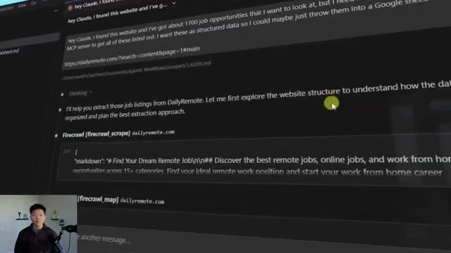
*⏱️ 00:00:05 — L'interface de discussion d'un agent IA (probablement Claude) au sein de VS Code, montrant une requête pour extraire des données structurées d'un site web.*

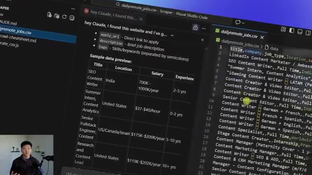
*⏱️ 00:00:10 — Éditeur VS Code affichant un tableau comparatif de prévisualisation de données et le contenu brut d'un fichier CSV d'offres d'emploi.*

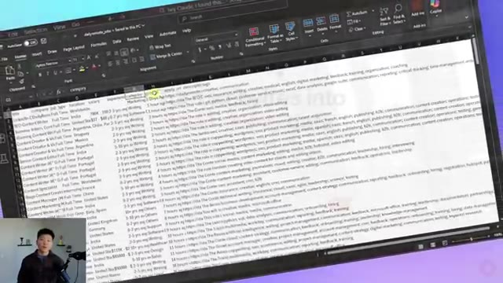
*⏱️ 00:00:15 — Visualisation du fichier CSV final importé dans Microsoft Excel, montrant les données structurées prêtes à l'emploi.*

---

### ⏱️ `[00:00:21 - 00:00:41]` | Segment #02

**🔊 Audio (Transcription Intégrale Mot pour Mot en Français) :**
> So within Firecrawl, there's a lot of different things that we can do. We can scrape content, so get everything from the page. We can map out a site, so get all the different URLs and understand the architecture of that website. We can crawl it, so then explore all of those pages. We can actually search. So do like a web search first and then scrape the data, which means that we can turn pages into structured content for us to use however we want.

**👁️ Analyse Visuelle d'Écran (gemini-3.5-flash-lite) :**
**Interface & Outils** : Outil de tableau blanc numérique / Canvas (identifié comme "Claude Code / Firecrawl").

**Contenu textuel & Code** : Schéma listant les capacités de Firecrawl : Scrape, Map, Crawl, Search, Extract, avec une brève description sous chaque catégorie.

**Action / Démonstration** : Présentation conceptuelle des capacités de la plateforme pour illustrer les explications de l'orateur sur les fonctionnalités de scraping et de crawl.

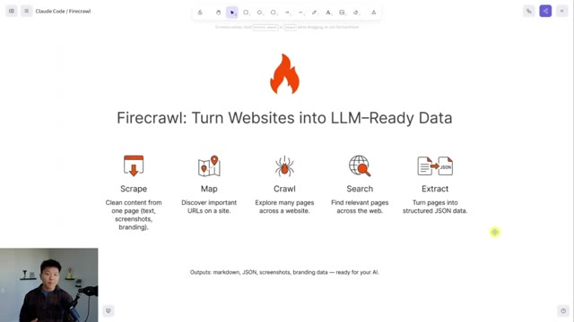
*⏱️ 00:00:26 — Une capture d'écran montrant une présentation visuelle (type tableau blanc collaboratif) intitulée "Firecrawl: Turn Websites into LLM-Ready Data", illustrant les cinq fonctionnalités principales de l'outil avec des icônes.*

---

### ⏱️ `[00:00:42 - 00:01:05]` | Segment #03

**🔊 Audio (Transcription Intégrale Mot pour Mot en Français) :**
> Now, the thing about this is there are a lot of different endpoints to hit if you were doing this through traditional like API calls. So we're going to be using the MCP server for Firecrawl. We're going to give that to Cloud Code so it can figure out based on Nate's natural language request, which of these tools do I invoke and in which order do I use them to actually get the end result that he's looking for. So just to start off with a quick example, I'm going to use Firecrawl in the playground, which is just on the web on firecrawl.dev.

**👁️ Analyse Visuelle d'Écran (gemini-3.5-flash-lite) :**
**Interface & Outils** : Site web Firecrawl (Interface de documentation/schéma et Playground interactif).

**Contenu textuel & Code** : Textes explicatifs sur la conversion de sites web en données prêtes pour LLM (Markdown, JSON, etc.) et barre d'entrée URL dans le playground.

**Action / Démonstration** : Présentation théorique des fonctionnalités de l'outil, suivie d'une démonstration de l'interface de test (Playground) pour configurer une tâche de scraping.

*⏱️ 00:00:48 — Une infographie présentant les capacités de Firecrawl, détaillant cinq fonctions principales : Scrape, Map, Crawl, Search et Extract.*

*⏱️ 00:00:59 — L'interface du "Playground" de Firecrawl sur le web, montrant un champ d'entrée d'URL et les options pour lancer le scraping de données.*

---

### ⏱️ `[00:01:06 - 00:01:27]` | Segment #04

**🔊 Audio (Transcription Intégrale Mot pour Mot en Français) :**
> You guys can get here using the link in the description. You can get on the free plan, which is more than enough to just play around. And then when you're ready to upgrade, use the link in the description and you can get 10% off a plan. But anyways, I'm gonna go to UpIt AI and I'm gonna copy this URL, paste that in here, and I'm gonna run a scrape. But first we have to choose the format. So by default, it'll pretty much say, okay, we're gonna turn this website into Markdown for you.

**👁️ Analyse Visuelle d'Écran (gemini-3.5-flash-lite) :**
**Interface & Outils** : Navigateur web (sites Firecrawl et Uppit AI).

**Contenu textuel & Code** : URL "uppitai.com" saisie dans le champ de recherche, choix du format "Markdown", et bouton "Start scraping".

**Action / Démonstration** : Navigation entre le site promotionnel, le site cible Uppit AI, et l'outil de scraping Firecrawl pour configurer l'extraction de données.

*⏱️ 00:01:11 — Page de destination de Firecrawl mettant en avant un partenariat avec Nate Herk, incluant une offre promotionnelle et des crédits gratuits.*

*⏱️ 00:01:16 — Page d'accueil du site Uppit AI, présentant les services d'automatisation IA, avec des boutons d'appel à l'action pour une consultation.*

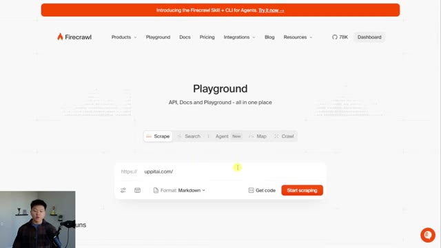
*⏱️ 00:01:21 — Interface "Playground" du site Firecrawl, montrant le champ de saisie d'URL avec le site "uppitai.com" prêt à être traité.*

---

### ⏱️ `[00:01:27 - 00:01:45]` | Segment #05

**🔊 Audio (Transcription Intégrale Mot pour Mot en Français) :**
> But what you could also do is get an AI generated summary You get all the links, you get HTML. You can get a screenshot of the full page. You could get the branding scrape so you can understand like the logo and the images and stuff like that. So I'm gonna go ahead and start the scrape. And what we'll see is it'll pop up down below and we'll get all of this data. So that's just finished up. We can see, first of all, we have markdowns.

**👁️ Analyse Visuelle d'Écran (gemini-3.5-flash-lite) :**
**Interface & Outils** : Interface web de Firecrawl (plateforme de scraping).

**Contenu textuel & Code** : Liste à cocher des options de format de données : Markdown, Summary, Links, HTML, Screenshot, JSON, Branding, Images. Un bouton "Start scraping" est visible en bas à droite.

**Action / Démonstration** : Le curseur de la souris survole l'option "HTML" dans le menu déroulant des formats de sortie pour configurer la tâche de scraping avant son lancement.

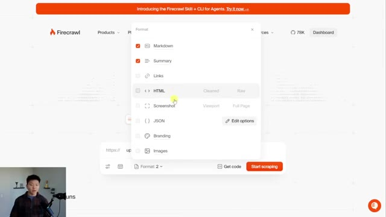
*⏱️ 00:01:31 — Une fenêtre contextuelle (pop-up) sur l'interface du site web Firecrawl permet de sélectionner les formats de sortie pour le scraping (Markdown, Summary, Links, HTML, Screenshot, JSON, Branding, Images).*

---

### ⏱️ `[00:01:45 - 00:02:17]` | Segment #06

**🔊 Audio (Transcription Intégrale Mot pour Mot en Français) :**
> So we get the actual like hero text. We get all of this stuff up here. We've got the process. We have the testimonials, get in touch, all of this kind of stuff. We have an AI generated summary of what the business aims to do. We've got a screenshot of the entire page, as you can see. We've got branding information, so the OG image, the favicon, the logo, colors, typography, stuff like that. And then we also have the JSON, if for some reason you're crazy enough to want to read this. So like I said, we're going to get this into CloudCode. So I'm going to click on the docs and on the right hand side or on the left hand side, we can see MCP server right here.

**👁️ Analyse Visuelle d'Écran (gemini-3.5-flash-lite) :**
**Interface & Outils** : Firecrawl (outil de web scraping et transformation de données).

**Contenu textuel & Code** : Résumé textuel généré par IA présentant les services de 'Uppit AI', incluant la méthodologie de travail et le parcours du fondateur Nate Herk.

**Action / Démonstration** : Navigation sur l'interface Firecrawl, spécifiquement sur l'onglet 'Summary' affichant l'analyse du site web ciblé.

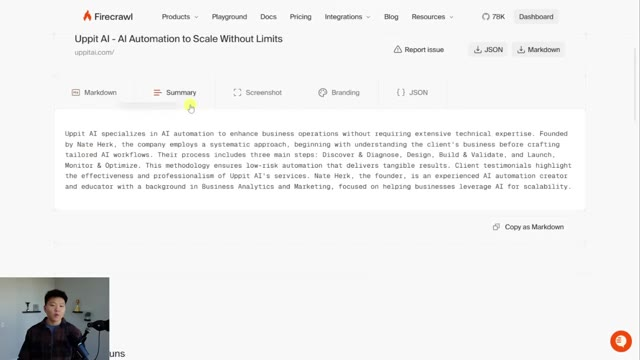
*⏱️ 00:01:53 — Interface de la plateforme Firecrawl affichant un résumé généré par IA du site web 'uppitai.com', avec des onglets pour accéder au Markdown, à la capture d'écran, au branding et au JSON.*

---

### ⏱️ `[00:02:18 - 00:02:51]` | Segment #07

**🔊 Audio (Transcription Intégrale Mot pour Mot en Français) :**
> And then what we want to look for is running this on CloudCode, as you can see right here. And now this gives us basically just this one line to put into CloudCode and it will be able to install this for us. So I'm just going to go ahead and copy this. I'm going to go into VS Code and we're going to start up a new project and get everything initialized. So if you've never actually been in VS Code or worked with Cloud Code, then I'm going to link a video right up here. It'll get you caught up and then you can come back over here when you are ready. So what I'm going to do is open up a folder. So I'm just going to open up a project called Scraper. There's nothing in here. It's a completely new project. So this is what your guys' setup should look like. Left-hand side, nothing.

**👁️ Analyse Visuelle d'Écran (gemini-3.5-flash-lite) :**
**Interface & Outils** : - Navigateur web (Documentation Firecrawl)
- Visual Studio Code (VS Code)

**Contenu textuel & Code** : - Commande terminal : `claude mcp add firecrawl -e FIRECRAWL_API_KEY=your-api-key -- npx ...`
- Liste des projets récents dans VS Code : "Scraper", "YouTube Analysis", "Lead Gen", "Klaus", "n8n-builder".

**Action / Démonstration** : - Copie d'une ligne de commande dans la documentation pour une installation ultérieure, suivie du basculement vers l'éditeur de code.

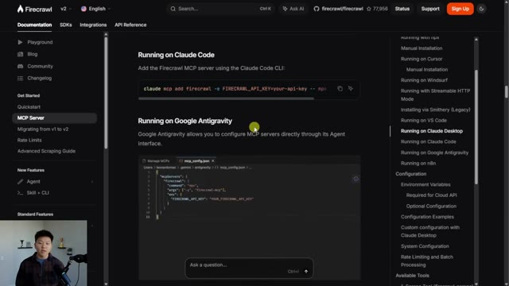
*⏱️ 00:02:26 — Page de documentation de Firecrawl affichant les instructions pour ajouter le serveur MCP via la ligne de commande "Claude Code".*

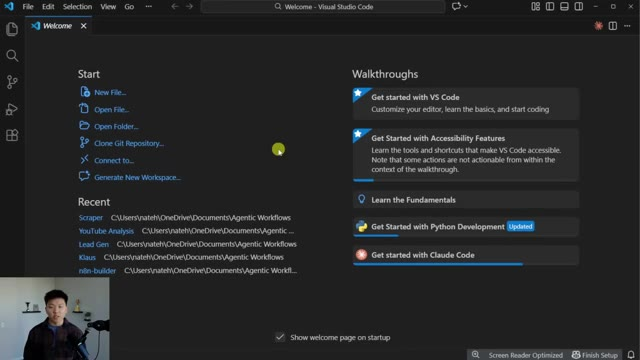
*⏱️ 00:02:35 — Interface de l'éditeur Visual Studio Code au démarrage, affichant la page d'accueil avec les options de projet récents.*

---

### ⏱️ `[00:02:52 - 00:03:12]` | Segment #08

**🔊 Audio (Transcription Intégrale Mot pour Mot en Français) :**
> Right-hand side, open up Cloud Code. And I'm just going to say, hey, Claude, I want to connect to firecrawls.mcp server, and you can do that using this command. But I'm not going to give you my API key. I'm just going to put it in a .env. So if you could create that file for me, I will put my API key in there, and then you can go ahead and initialize and connect to firecrawls.mcp server.

**👁️ Analyse Visuelle d'Écran (gemini-3.5-flash-lite) :**
**Interface & Outils** : Visual Studio Code (extension Claude Code).

**Contenu textuel & Code** : Zone de saisie de texte avec le message d'aide "ctrl esc to focus or unfocus Claude" et l'option "Bypass permissions".

**Action / Démonstration** : Préparation à la saisie d'une instruction pour connecter un serveur MCP (Firecrawl) et créer un fichier .env.

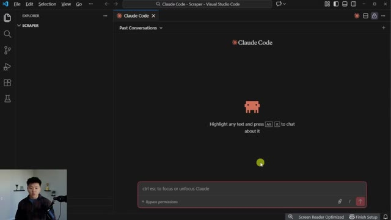
*⏱️ 00:02:57 — L'interface de l'extension Claude Code ouverte dans VS Code, affichant la zone de saisie du chat.*

---

### ⏱️ `[00:03:12 - 00:03:34]` | Segment #09

**🔊 Audio (Transcription Intégrale Mot pour Mot en Français) :**
> All right, so that's going to go ahead and get set up for us. You can see we now have a .env right here, which is a new file, and this is basically the best way for us to securely put in our API keys so that they're not being stored in the conversation history. So I'm going to delete this. I'm going to go back into Firecrawl. I'm going to go to my dashboard. And right here, you can see there is an MCP integration, but we wanted to use the Cloud Code version.

**👁️ Analyse Visuelle d'Écran (gemini-3.5-flash-lite) :**
**Interface & Outils** : Visual Studio Code

**Contenu textuel & Code** : Le fichier .env contient la ligne : `FIRECRAWL_API_KEY=your-api-key-here`.

**Action / Démonstration** : Le présentateur montre la création et la configuration initiale sécurisée du fichier d'environnement pour stocker la clé API.

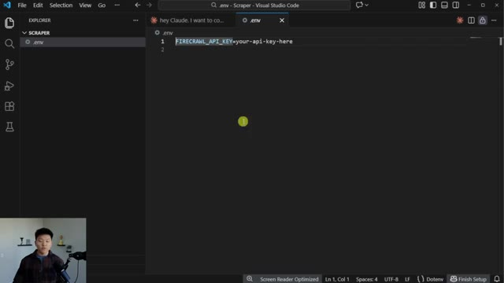
*⏱️ 00:03:18 — L'interface de l'éditeur Visual Studio Code affichant le contenu d'un fichier .env nouvellement créé dans le projet "Scraper".*

---

### ⏱️ `[00:03:34 - 00:03:59]` | Segment #10

**🔊 Audio (Transcription Intégrale Mot pour Mot en Français) :**
> And now we can see API key. I'm going to go ahead and copy that, paste in the API key right there. And then I'm going to do Control S just to save it. You could also go here and click File and then Save right there. And now we can close out of that file. My API key has been added to .env. Go ahead and set up the Firecrawl MCP server. So now everything should have been set up correctly. So I'm going to hit Control-Shift-P, and I'm going to say developer reload the window, which is just going to actually let Cloud Code be able to use this now.

**👁️ Analyse Visuelle d'Écran (gemini-3.5-flash-lite) :**
**Interface & Outils** : Visual Studio Code (VS Code)

**Contenu textuel & Code** : `FIRECRAWL_API_KEY=fc-...`

**Action / Démonstration** : Saisie et configuration de la clé API Firecrawl dans le fichier d'environnement (.env) du projet.

*⏱️ 00:03:41 — L'interface de Visual Studio Code affichant le contenu du fichier .env où la clé API Firecrawl est en cours de saisie.*

---

### ⏱️ `[00:04:00 - 00:04:18]` | Segment #11

**🔊 Audio (Transcription Intégrale Mot pour Mot en Français) :**
> So just sending off a request to make sure that that actually worked. As you can see, it was able to call the tool, and it decided to use the scrape endpoint rather than, you know, like a map or a crawl. So this is the actual, like, full markdown of the website itself. Cool. So the next thing I want to do is give our project a little bit more context as to what it's actually doing in here.

**👁️ Analyse Visuelle d'Écran (gemini-3.5-flash-lite) :**
**Interface & Outils** : Visual Studio Code (avec l'extension Claude/Projet).

**Contenu textuel & Code** : Historique de discussion affichant l'appel de l'outil `firecrawl_scrape` avec l'URL `uppitai.com` et le résultat retourné au format markdown.

**Action / Démonstration** : L'agent IA exécute une requête de scraping sur un site web cible et affiche les données extraites directement dans l'interface de discussion.

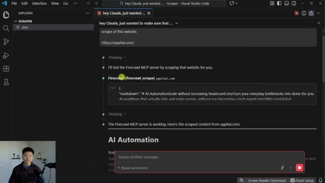
*⏱️ 00:04:04 — Une capture d'écran de l'interface Claude dans VS Code montrant l'exécution réussie d'une fonction de scraping via le serveur MCP Firecrawl.*

---

### ⏱️ `[00:04:18 - 00:04:39]` | Segment #12

**🔊 Audio (Transcription Intégrale Mot pour Mot en Français) :**
> So first of all, what I want to do is create a FireCrawl MCP guide. so that when we ask it something, it understands what are the tools I have access to and which ones should I use for what scenario. So I said, create a Firecrawl cheat sheet as a markdown file in this project that you can look at. And basically it should tell you about the different tools and how to use them. So it's gonna go ahead and create this markdown file for us.

**👁️ Analyse Visuelle d'Écran (gemini-3.5-flash-lite) :**
**Interface & Outils** : VS Code (avec extension Claude intégrée).

**Contenu textuel & Code** : Texte affichant des témoignages clients et une biographie de Nate Herkelman, suivi d'une invite de saisie "ctrl esc to focus or unfocus Claude".

**Action / Démonstration** : Visualisation du résultat d'une opération de scraping réussie dans l'environnement de développement, prête à être utilisée pour générer une documentation (cheat sheet).

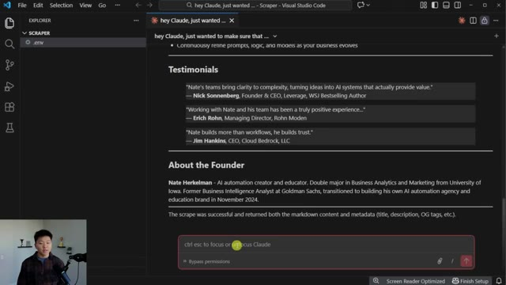
*⏱️ 00:04:23 — Une capture d'écran de l'interface VS Code montrant un panneau de discussion avec Claude intégré, affichant un résumé de scraping et une barre de saisie de prompt en bas.*

---

### ⏱️ `[00:04:39 - 00:04:58]` | Segment #13

**🔊 Audio (Transcription Intégrale Mot pour Mot en Français) :**
> All right, cool. So it created that cheat sheet as you can see right here. And if I just open up this full screen, you can see that we've got a quick reference guide. We've got the tool overview. And then it goes on to actually break down how you use each tool. So this should hopefully be good enough for now Claude to look at whenever we want it to do something else. It even gave it a quick little decision guide, which is pretty nice.

**👁️ Analyse Visuelle d'Écran (gemini-3.5-flash-lite) :**
**Interface & Outils** : Visual Studio Code (éditeur de code).

**Contenu textuel & Code** : Fichier Markdown contenant un tableau comparatif des outils Firecrawl (scrape, map, search, crawl, extract, agent) incluant leurs cas d'utilisation (Best For) et leurs vitesses (Speed), ainsi qu'une section détaillée sur l'outil "Scrape".

**Action / Démonstration** : Affichage et lecture du document récapitulatif (cheat sheet) généré par l'IA pour aider l'utilisateur à naviguer dans les fonctionnalités de Firecrawl.

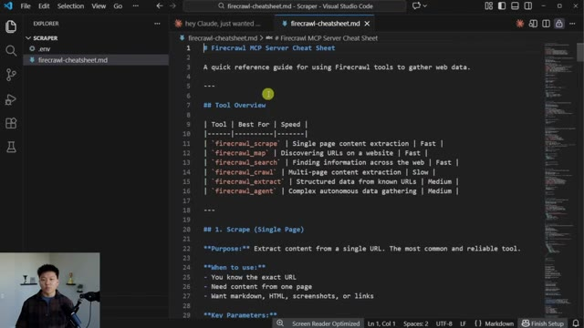
*⏱️ 00:04:44 — Une capture d'écran de l'éditeur Visual Studio Code affichant un fichier Markdown nommé "firecrawl-cheatsheet.md", qui présente un guide de référence rapide pour les outils Firecrawl MCP.*

---

### ⏱️ `[00:04:59 - 00:05:19]` | Segment #14

**🔊 Audio (Transcription Intégrale Mot pour Mot en Français) :**
> Now, finally, before we actually start running with this thing is we need a Claude.md file, which is basically the system prompts for this project. Hey, Claude, I need you to help me set up a Claude.md file for this project. I want this to basically explain that this project specifically is for scraping data, whether that is extracting it, getting screenshots, crawling everything, mapping everything.

**👁️ Analyse Visuelle d'Écran (gemini-3.5-flash-lite) :**
**Interface & Outils** : Visual Studio Code (avec extension Claude intégrée).

**Contenu textuel & Code** : Liste détaillée du contenu généré pour le fichier 'firecrawl-cheatseat.md' : Tool Overview Table, sections pour scrape, map, search, crawl, extract, agent, Quick Decision Guide, Common Patterns, Performance Tips, et Reference Tables.

**Action / Démonstration** : L'assistant Claude a terminé la génération du document et confirme qu'il peut désormais l'utiliser comme référence pour ses futures tâches de scraping.

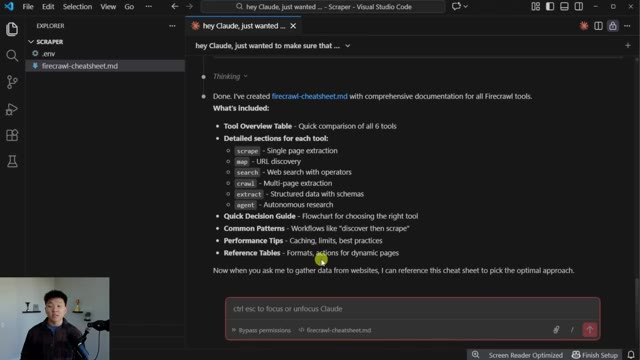
*⏱️ 00:05:04 — Interface de VS Code montrant une interaction avec l'assistant Claude dans le volet latéral, affichant la création d'un fichier 'firecrawl-cheatseat.md' et ses sections détaillées.*

---

### ⏱️ `[00:05:19 - 00:05:43]` | Segment #15

**🔊 Audio (Transcription Intégrale Mot pour Mot en Français) :**
> you have access to the Firecrawl MCP server to do everything that you need to do with websites. And you also have the firecrawl-cheatsheet.md which explains how that MCP server works and when to use each tool. So I just shot that off. I just did want to say, this is a demo, right? So I'm doing this all in bypass permissions mode. But in practice, what I would have done is went to plan mode, brainstormed with Claude a little bit to make sure that it agrees with the way that we're setting up all of these files.

**👁️ Analyse Visuelle d'Écran (gemini-3.5-flash-lite) :**
**Interface & Outils** : Visual Studio Code (avec extension Claude intégrée).

**Contenu textuel & Code** : Le chat montre une synthèse de "firecrawl-cheatsheet.md" détaillant les outils (scrape, map, search, crawl, extract, agent) et les fonctionnalités de ce guide.

**Action / Démonstration** : Présentation de la documentation générée ("firecrawl-cheatsheet.md") qui sert de base de connaissances à l'agent pour utiliser les outils Firecrawl via MCP.

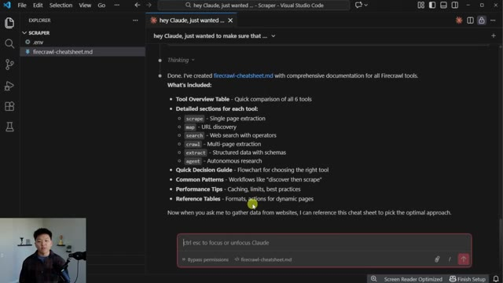
*⏱️ 00:05:25 — Interface de l'éditeur Visual Studio Code affichant une conversation avec une IA et le fichier "firecrawl-cheatsheet.md" dans l'explorateur de fichiers.*

---

### ⏱️ `[00:05:43 - 00:06:06]` | Segment #16

**🔊 Audio (Transcription Intégrale Mot pour Mot en Français) :**
> And then we'd go ahead and implement that plan once we are in alignment. But as you can see, we now have our Claude.md file. And this is basically a scraper project. We have some information about what this project does, how to actually use the tool, what to reference. And this document, as you can see, is a lot more concise than the cheat sheet. And the reason I wanted to separate this is because you don't actually need this entire cheat sheet to be in the Claude.md file.

**👁️ Analyse Visuelle d'Écran (gemini-3.5-flash-lite) :**
**Interface & Outils** : Visual Studio Code (avec extension Claude intégrée).

**Contenu textuel & Code** : Le fichier Markdown affiche une documentation de projet incluant "Project purpose", "What it includes", ainsi qu'une description des capacités de "Firecrawl MCP Server" pour l'extraction de données web. La fenêtre de chat présente un résumé de la création du fichier CLAUDE.md.

**Action / Démonstration** : Navigation et présentation de la documentation contextuelle du projet au sein de l'éditeur de code pour configurer les instructions de l'agent IA.

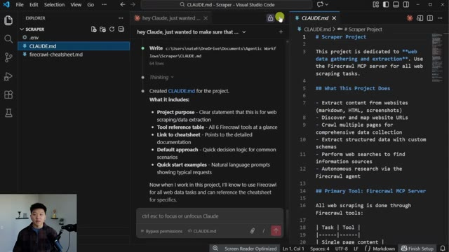
*⏱️ 00:05:49 — Capture d'écran de l'éditeur VS Code montrant le fichier 'CLAUDE.md' ouvert, accompagné d'une interface de chat IA intégrée (Claude) qui détaille les fonctionnalités du projet de scraper.*

---

### ⏱️ `[00:06:06 - 00:06:26]` | Segment #17

**🔊 Audio (Transcription Intégrale Mot pour Mot en Français) :**
> But now Claude knows that it's there in case it ever needs to use it. Okay, so let's think about a cool use case that we might actually wanna do with something like Firecrawl. So let's say we've got this remote job website And I searched for content and there's about 1700 different job opportunities here. And there's also, I'm assuming not all just on one page. So there's two, three, four, maybe even up to 60.

**👁️ Analyse Visuelle d'Écran (gemini-3.5-flash-lite) :**
**Interface & Outils** : Visual Studio Code (avec Claude Code), Navigateur Web (DailyRemote).

**Contenu textuel & Code** : Interface utilisateur de Claude Code avec invite "Ctrl esc to focus or unfocus Claude", résultats de recherche d'emploi et filtres de catégories.

**Action / Démonstration** : Présentation du flux de travail : recherche d'opportunités d'emploi sur une plateforme, suivie de l'utilisation de Claude Code pour automatiser le traitement de ces données.

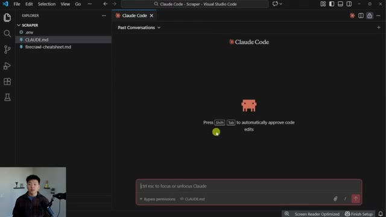
*⏱️ 00:06:11 — Interface de VS Code affichant l'extension Claude Code en attente d'interaction utilisateur.*

*⏱️ 00:06:16 — Page d'accueil du site "DailyRemote" affichant une recherche pour le mot-clé "content" avec 1 782 opportunités trouvées.*

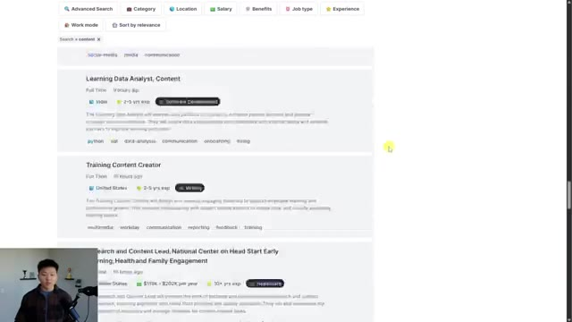
*⏱️ 00:06:21 — Liste détaillée des offres d'emploi sur le site DailyRemote (Learning Data Analyst, Training Content Creator).*

---

### ⏱️ `[00:06:26 - 00:06:46]` | Segment #18

**🔊 Audio (Transcription Intégrale Mot pour Mot en Français) :**
> So I'm just gonna go ahead and copy the URL of this first page right here. And we're gonna go into Claude and ask it to help us out with this. Hey Claude, so I found this website and I've got about 1700 job opportunities that I wanna look at, but I need help using the Firecall MCP server in order to get all of these listed out. I want these as structured data so I could maybe just throw them into a Google Sheet.

**👁️ Analyse Visuelle d'Écran (gemini-3.5-flash-lite) :**
**Interface & Outils** : Visual Studio Code, Claude Code CLI.

**Contenu textuel & Code** : La barre de saisie affiche le texte "ctrl esc to focus or unfocus Claude" et montre des options pour "Bypass permissions" et le fichier "CLAUDE.md" attaché.

**Action / Démonstration** : Le présentateur s'apprête à interagir avec l'interface de Claude Code pour envoyer une requête concernant l'utilisation du serveur MCP Firecrawl.

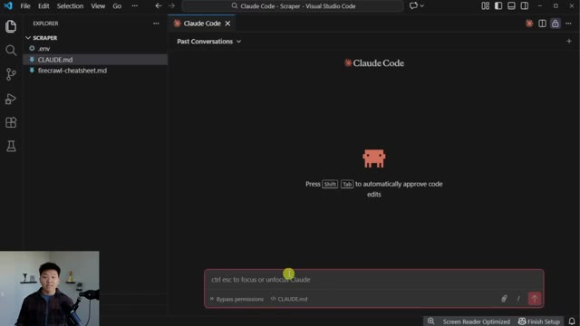
*⏱️ 00:06:31 — L'interface de Claude Code intégrée dans l'éditeur VS Code, avec la barre de saisie de prompt active en bas.*

---

### ⏱️ `[00:06:46 - 00:07:07]` | Segment #19

**🔊 Audio (Transcription Intégrale Mot pour Mot en Français) :**
> Now in this case, I am gonna go to plan mode because this might take a little bit of thinking as far as understanding the structure of the site and maybe using more than just a scrape. It might have to use a map or a crawl or something else. So we'll see what it decides to do here. So I hope you guys see now why I did this. It first decided to scrape, it understood the website, and then it decided to map. And now it's creating more of a comprehensive plan about what to find.

**👁️ Analyse Visuelle d'Écran (gemini-3.5-flash-lite) :**
**Interface & Outils** : Visual Studio Code avec l'extension Claude Code.

**Contenu textuel & Code** : Le prompt de l'utilisateur : "hey Claude, I found this website and I've got about 1700 job opportunities... I need help using the Fire Call MCP server to get all of these listed out... I want these as structured data... https://dailyremote.com/?search=content&page=1#main". On voit également l'activation du "Plan mode".

**Action / Démonstration** : L'utilisateur a soumis une requête complexe à l'agent Claude Code pour scraper et structurer des données d'un site d'offres d'emploi, en passant l'agent en mode plan ("Plan mode").

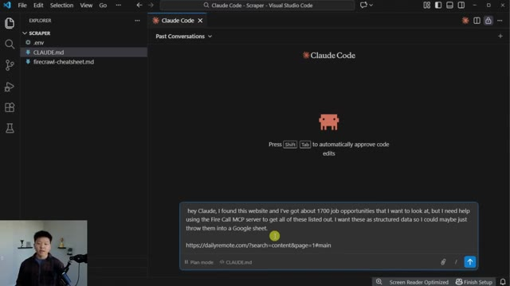
*⏱️ 00:06:51 — Interface de Claude Code intégrée dans Visual Studio Code, affichant une requête utilisateur dans la zone de saisie.*

---

### ⏱️ `[00:07:07 - 00:07:25]` | Segment #20

**🔊 Audio (Transcription Intégrale Mot pour Mot en Français) :**
> It's also asking me some questions, which is going to make this job work a lot better. So it asks if we want all 1782. I'm actually just going to go ahead and say like 200 because I don't want this to take forever. For data fields, I'm going to grab all of them. For description, let's just do a summary. And I'm going to go ahead and submit those answers and it's going to keep working on the plan. All right, so it looks like that is all done.

**👁️ Analyse Visuelle d'Écran (gemini-3.5-flash-lite) :**
**Interface & Outils** : Visual Studio Code avec une interface d'interaction de type agent IA intégrée.

**Contenu textuel & Code** : Texte de la fenêtre : "Do you want all ~1,782 'content' jobs, or would you like to filter by specific criteria (e.g., only US-based, only Full Time)?", avec des options sélectionnables : "All jobs", "Filter by criteria", et "Other".

**Action / Démonstration** : L'utilisateur est en train de configurer les paramètres de l'agent pour restreindre le nombre de données à extraire afin d'optimiser le processus.

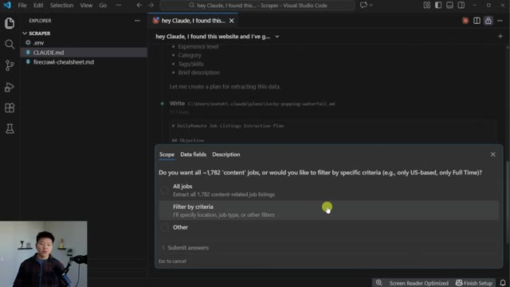
*⏱️ 00:07:11 — Une fenêtre contextuelle interactive s'affiche au centre de l'éditeur VS Code, posant une question à l'utilisateur concernant le volume d'extraction de données (filtrage des 1782 offres d'emploi détectées).*

---

### ⏱️ `[00:07:25 - 00:07:45]` | Segment #21

**🔊 Audio (Transcription Intégrale Mot pour Mot en Français) :**
> We're going to go ahead and auto accept this plan. So I'll check in with you guys when that's done. Now right here is the beauty of agentic workflows because it tried to, you know, execute the plan. But once it got into it, it realized that something didn't work. So it said that the extract actually returned empty results and the site might require more sophisticated handling. So now it's trying out the Firecrawl agent.

**👁️ Analyse Visuelle d'Écran (gemini-3.5-flash-lite) :**
**Interface & Outils** : Visual Studio Code avec une interface d'agent de type "Claude Code".

**Contenu textuel & Code** : Log d'exécution montrant un échec de "Firecrawl [firecrawl_extract]" suivi d'une réflexion de l'agent : "The extract returned empty results - the site likely requires more sophisticated handling." et le passage à "Firecrawl [firecrawl_agent]".

**Action / Démonstration** : L'agent IA analyse un résultat vide, auto-corrige son approche en basculant vers une méthode de scraping plus avancée (Firecrawl agent) pour traiter le contenu dynamique.

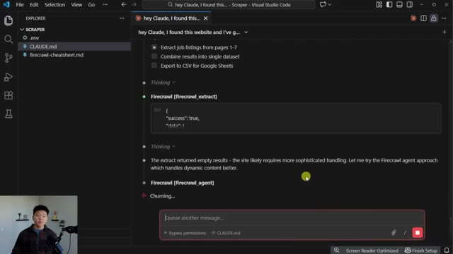
*⏱️ 00:07:30 — Une interface VS Code utilisant un agent IA (Claude) qui exécute un workflow de scraping, affichant une erreur lors de l'extraction initiale.*

---

### ⏱️ `[00:07:45 - 00:08:06]` | Segment #22

**🔊 Audio (Transcription Intégrale Mot pour Mot en Français) :**
> So just super cool the way that it's able to, you know, run into an issue and then fix it. Okay, so that just finished up and it was able to get 200 job listings for us. A few things happened in there, but it was able to just correct itself and change up the plan. And we did get our final output. So let me open up this CSV. You can also see that it dropped it in this project and we could look at it over here, but it's not really very nice to look at.

**👁️ Analyse Visuelle d'Écran (gemini-3.5-flash-lite) :**
**Interface & Outils** : Visual Studio Code (avec l'extension Claude ou intégration IA similaire).

**Contenu textuel & Code** : Le message de l'agent indique : "Done! I've extracted 200 job listings and created a CSV file ready for Google Sheets." ainsi qu'un résumé de la structure du fichier CSV (colonnes : title, company, job_type, location, salary, experience, category, posted).

**Action / Démonstration** : L'agent IA confirme avoir terminé l'exécution de la tâche de scraping, incluant la lecture du fichier et la finalisation de la structure des données extraites.

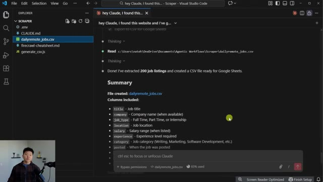
*⏱️ 00:07:50 — Une capture d'écran montrant l'interface de l'éditeur VS Code avec une conversation active de l'agent Claude, affichant la confirmation de l'extraction de 200 offres d'emploi dans un fichier CSV.*

---

### ⏱️ `[00:08:06 - 00:08:41]` | Segment #23

**🔊 Audio (Transcription Intégrale Mot pour Mot en Français) :**
> So here's the actual Excel file. We've got title, company, job type, location, salary, experience, category, posted, how long ago, apply URL description and tags, and we do indeed have 200 of these. So now if we wanted to apply to all of these, we've got all the URLs and we have all this info that we need in order to go and do that. So think about how long that would have taken you to build an automation in something like NNN in order to go scrape 200 of these job postings, or if you were to just do this manually, it would have taken a lot longer. And once again, I didn't have to think about any of the configuration. I just gave Cloud Code the MCP server and let it run. We're going to do two more really quick use cases. The first one I'm

**👁️ Analyse Visuelle d'Écran (gemini-3.5-flash-lite) :**
**Interface & Outils** : Visual Studio Code, Navigateur web (site DailyRemote).

**Contenu textuel & Code** : Données tabulaires (titres de postes, localisations, salaires, URLs) ; interface de recherche d'emploi et call-to-action pour un assistant de candidature automatique.

**Action / Démonstration** : Présentation de la base de données de jobs scrappés et démonstration de la source des données (site de recrutement).

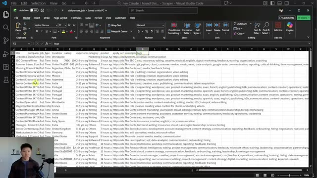
*⏱️ 00:08:15 — Capture d'écran montrant un fichier Excel ouvert dans Visual Studio Code, affichant une liste structurée d'offres d'emploi avec des colonnes comme titre, entreprise, salaire et URL de candidature.*

*⏱️ 00:08:32 — Capture d'écran du site web "DailyRemote", présentant une interface de recherche d'emploi filtrée par mot-clé avec des options pour automatiser les candidatures.*

---

### ⏱️ `[00:08:41 - 00:09:14]` | Segment #24

**🔊 Audio (Transcription Intégrale Mot pour Mot en Français) :**
> going to do is grab Claudebot or Moultbot and drop it in here and say, please grab screenshots of this page and help me understand the branding. And I'm assuming that this is going to use the Firecrawl MCP server. I hope it does. And then I'm going to grab this website, which is Coffee. And I'm going to open up a different agent on the right hand side. And for this one, I'm just going to tell it to map this site. Go ahead and map out this site for me and show me what it looks like. So now we've got two different cloud code agents working at the same time. They're both doing different tasks and they're using different fire crawl tools. And then I'll check in with you guys when we get both of these back. All right. So the map is already done. You can see that it comes

**👁️ Analyse Visuelle d'Écran (gemini-3.5-flash-lite) :**
**Interface & Outils** : Visual Studio Code (éditeur), terminal intégré Claude Code.

**Contenu textuel & Code** : Prompt : "please grab screenshots of this page and help me understand the branding. https://clawd.bot/"

**Action / Démonstration** : Préparation de l'envoi d'une instruction à l'agent Claude Code pour effectuer un scraping et une analyse de site web.

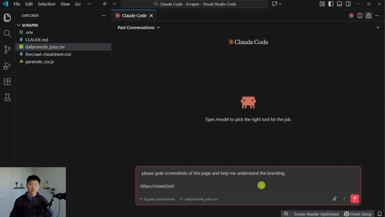
*⏱️ 00:08:49 — Interface de Claude Code ouverte dans Visual Studio Code, affichant un prompt utilisateur demandant l'analyse visuelle et le branding d'une URL spécifique.*

---

### ⏱️ `[00:09:14 - 00:09:49]` | Segment #25

**🔊 Audio (Transcription Intégrale Mot pour Mot en Français) :**
> back and it says, okay, so here are all the main pages and it gives me the links here are all the different categories. So bestsellers, coffee, instant, matcha, all this other stuff. We've got different collections. We've got different locations. We've got tons of different URLs for products, brew guides, all this kind of stuff. And so now that it has that context, I could have it go actually crawl those things if I wanted to, or, you know, extract all of that to a database or whatever we want to do with it. And now it looks like this one is finishing up over here with the MoltBot documentation. So the first thing we have is a screenshot. So if I open this up, we can see right here that we do have a screenshot of that whole landing page for MoltBot. And then

**👁️ Analyse Visuelle d'Écran (gemini-3.5-flash-lite) :**
**Interface & Outils** : Visual Studio Code avec l'extension Claude (interface de chat intégrée).

**Contenu textuel & Code** : Liste structurée des pages du site web : "Coffee Collections" (Blends, Single Origin, Espresso, etc.), "Cafe Locations" (Northern/Southern California, NY, Chicago, etc.) avec le nombre d'URLs associées. On aperçoit également des blocs de code Python et des commandes Bash pour l'extraction de données.

**Action / Démonstration** : L'agent IA génère une cartographie détaillée (sitemap) des différentes catégories et emplacements physiques du site web en vue d'un scraping automatisé.

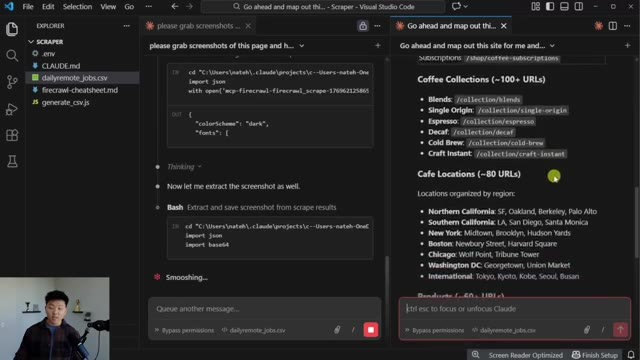
*⏱️ 00:09:23 — Une capture d'écran de l'éditeur Visual Studio Code montrant une interface de chat Claude (avec deux onglets ouverts) qui effectue le mapping d'une structure de site web.*

---

### ⏱️ `[00:09:49 - 00:10:11]` | Segment #26

**🔊 Audio (Transcription Intégrale Mot pour Mot en Français) :**
> we also have the branding, like the color palette, the typography, spacing and components. We've got the logo and you can see that all of this was able to be done with FireCrawl super easily. So I wanted to show you guys all of that stuff that we just did together, what that actually costed me. So I'm going to refresh my dashboard here when we're looking at the usage. And you can see that that took me about 30 credits out of my 500 that I get for free.

**👁️ Analyse Visuelle d'Écran (gemini-3.5-flash-lite) :**
**Interface & Outils** : - Image 1 : Visual Studio Code
- Image 2 : Interface web de FireCrawl (portail développeur)

**Contenu textuel & Code** : - Image 1 : Spécifications techniques CSS (noms de polices, codes couleurs hexadécimaux, description de la charte graphique).
- Image 2 : Données de facturation et de monitoring d'utilisation d'API (Credit Usage, Detailed Usage).

**Action / Démonstration** : - Image 1 : Documentation et structuration des consignes de design pour un projet web.
- Image 2 : Vérification du coût opérationnel de l'utilisation de l'outil FireCrawl.

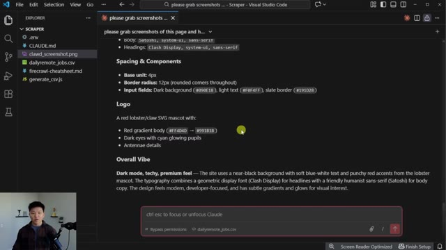
*⏱️ 00:09:54 — Éditeur de texte dans VS Code affichant les spécifications de branding : typographie, espacement, composants, détails du logo (mascotte homard) et l'ambiance globale du site.*

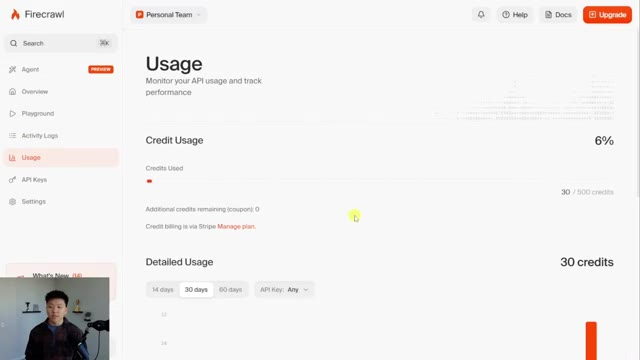
*⏱️ 00:10:06 — Interface de la plateforme FireCrawl montrant le tableau de bord "Usage" avec le suivi de la consommation des crédits API (30 sur 500 utilisés, soit 6%).*

---

### ⏱️ `[00:10:11 - 00:10:31]` | Segment #27

**🔊 Audio (Transcription Intégrale Mot pour Mot en Français) :**
> So 6% of my 500 credit limit. Now that's really the main difference when it comes to pricing. You've got these different plans. You've got a different amount of pages that you can scrape. You've got a different amount of credits. But the other big one is the concurrent requests. So with the free plan, you can only be doing two at a time. with this hobby plan in the middle, you can be doing five. If you scale that up, you can be doing more and more.

**👁️ Analyse Visuelle d'Écran (gemini-3.5-flash-lite) :**
**Interface & Outils** : Navigateur web (site Firecrawl).

**Contenu textuel & Code** : Tableau comparatif des plans : Free, Hobby ($16/mois), Standard ($83/mois) et Growth ($333/mois), détaillant les crédits mensuels, le nombre de pages autorisées, les requêtes simultanées et le niveau de support.

**Action / Démonstration** : Présentation visuelle des paliers tarifaires pour illustrer les différences de capacité de scraping entre les plans.

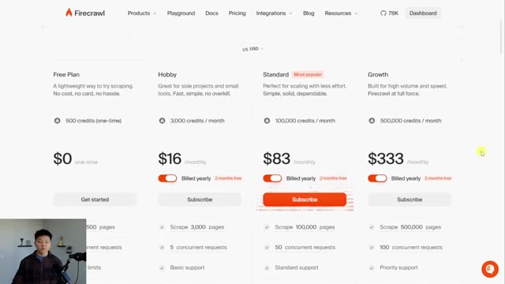
*⏱️ 00:10:16 — Page de tarification (pricing) du site web Firecrawl présentant les différentes offres d'abonnement.*

---

### ⏱️ `[00:10:31 - 00:10:53]` | Segment #28

**🔊 Audio (Transcription Intégrale Mot pour Mot en Français) :**
> And it's not really a huge deal because what would happen is Cloud Code would basically just queue them up and wait and retry. But if you did want to do some big operations in bulk, then it may be nice to have more concurrent requests running. And remember, you can use the link in the description to get 10% off your Firecraw plan. So I know this one was quick, but I really thought that it was a useful tool and skill to add to your Cloud Code workflows and projects.

**👁️ Analyse Visuelle d'Écran (gemini-3.5-flash-lite) :**
**Interface & Outils** : - Navigateur web (Firecrawl pricing page)
- Visual Studio Code (avec extension Claude)

**Contenu textuel & Code** : - Image 1 : Tableau comparatif avec des options allant de 2 à 100 requêtes simultanées.
- Image 2 : Documentation sur les composants UI, la typographie (Satoshi, Clash Display) et les codes couleurs hexadécimaux pour un projet de design.

**Action / Démonstration** : - Image 1 : Illustration des limites techniques liées aux requêtes simultanées.
- Image 2 : Utilisation de l'éditeur de code pour interagir avec une IA via le champ "Ctrl esc to focus or unfocus Claude".

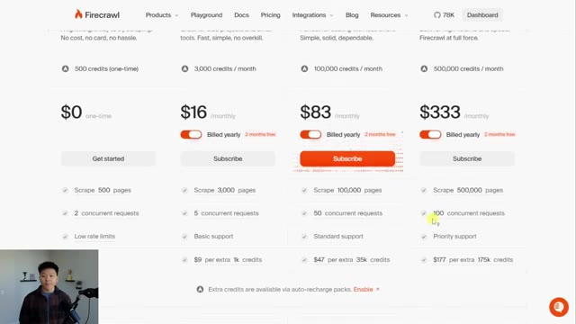
*⏱️ 00:10:37 — Page de tarification du service Firecrawl montrant les différents paliers d'abonnement et le nombre de requêtes concurrentes associés.*

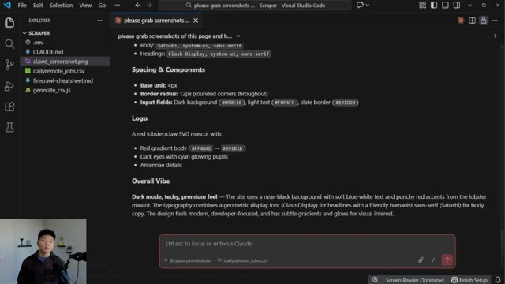
*⏱️ 00:10:48 — Interface de Visual Studio Code affichant un document de spécifications de design technique et une barre de saisie pour l'agent IA "Claude".*

---

### ⏱️ `[00:10:54 - 00:11:12]` | Segment #29

**🔊 Audio (Transcription Intégrale Mot pour Mot en Français) :**
> So I hope that you guys enjoyed. If you enjoyed this teaching style, and this way of thinking, then definitely check out my plus community. The link for that will be down in the description. We've got over 3000 members who are building businesses with AI every single day. So it's a great place to be if you have similar goals. We've also got a classroom section with full courses and we're bringing a ton of material around cloud code and vibe coding.

**👁️ Analyse Visuelle d'Écran (gemini-3.5-flash-lite) :**
**Interface & Outils** : Plateforme communautaire Skool (AI Automation Society Plus).

**Contenu textuel & Code** : Publications épinglées par Nate Herk sur "Meet Our New AI Instructor: Ines" et "AIS+ 2.0", ainsi que des statistiques communautaires (3.4k membres, 146 en ligne).

**Action / Démonstration** : Navigation au sein du forum de la communauté pour présenter l'écosystème aux utilisateurs.

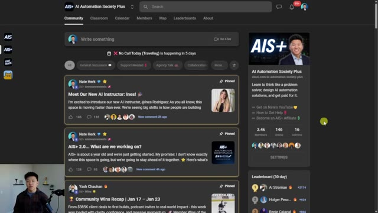
*⏱️ 00:10:58 — Capture d'écran de l'interface de la plateforme communautaire Skool pour "AI Automation Society Plus", montrant le flux d'actualités avec des annonces épinglées, une barre latérale d'information et un classement des membres.*

---

### ⏱️ `[00:11:12 - 00:11:23]` | Segment #30

**🔊 Audio (Transcription Intégrale Mot pour Mot en Français) :**
> So if you guys are interested, then definitely check it out. But anyways, that's gonna do it for today. If you enjoyed the video or you learned something new, please give it a like. It definitely helps me out a ton. And as always, I appreciate you guys making it to the end of the video. I'll see you on the next one. Thanks everyone.

**👁️ Analyse Visuelle d'Écran (gemini-3.5-flash-lite) :**
**Interface & Outils** : Interface de document/canevas (probablement Claude Canvas ou un outil de présentation de projet associé à Claude).

**Contenu textuel & Code** : Présentation visuelle de "Firecrawl : Turn Websites into LLM-Ready Data" avec des icônes descriptives pour chaque fonctionnalité (scraping, mapping, crawling, recherche et extraction de données JSON).

**Action / Démonstration** : Aucune action dynamique, il s'agit d'une présentation statique des capacités de Firecrawl utilisée comme support pédagogique.

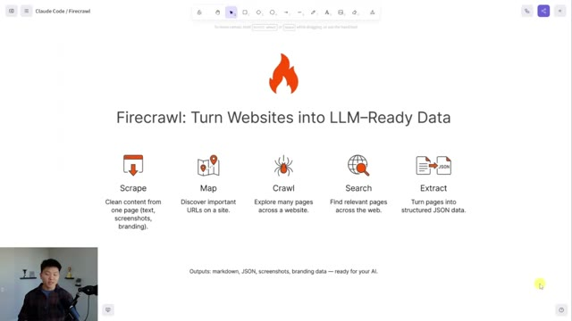
*⏱️ 00:11:15 — Une capture d'écran présentant l'interface de "Claude Code / Firecrawl" montrant les fonctionnalités principales de l'outil : Scrape, Map, Crawl, Search et Extract.*

---

