# 🎬 How a College Student Made $500k with Cold Email (Exact Framework)

> **Chaîne** : [Nate Herk | AI Automation](https://www.youtube.com/@nateherk/featured)  
> **Lien YouTube** : [https://www.youtube.com/watch?v=XB2xmX3USUI](https://www.youtube.com/watch?v=XB2xmX3USUI)  
> **Date de publication** : 20260214  
> **Durée** : 00:36:41  
> **Identifiant vidéo** : `XB2xmX3USUI`  
> **Transcription & Analyse** : `whisper-v3-large-turbo+gemini-3.5-flash-lite`  

---

## 📌 Synthèse Exécutive & Outils

### 💡 Résumé
Dans cette vidéo intitulée **How a College Student Made $500k with Cold Email (Exact Framework)**, Nate Herk décortique les capacités pratiques d'automatisation et de développement propulsées par les modèles de pointe.

### 🛠️ Outils, Modèles & Logiciels Présentés
- **Opus 5.5 & Claude Code** : Modèles d'ingénierie et agents de codage autonome.

### 🔑 Points Clés & Enseignements Stratégiques
- Optimiser le niveau d'effort et le raisonnement des modèles IA pour des résultats industriels.
- Automatiser les cycles de création logicielle de bout en bout.

---

## ⏱️ Chronologie & Transcription Complète Audio & Visuelle (Mot pour Mot)

### ⏱️ `[00:00:00 - 00:00:34]` | Segment #01

**🔊 Audio (Transcription Intégrale Mot pour Mot en Français) :**
> Cold email is responsible for some of the fastest client acquisition in the agency space, and it's even more powerful in 2026 if you know how to use AI right. So to show you guys how, I brought on Savam, who was able to generate over half a million dollars in sales opportunities in just six months as a full-time student with no sales background. So today he's going to be sharing the word-for-word copy that he used to land his first clients through cold email, how he uses a simple four-step automation to personalize at scale, the zero-risk offer framework that gets strangers to actually respond to cold emails and his full process for building lead lists using niche databases that most people don't even know exists.

**👁️ Analyse Visuelle d'Écran (gemini-3.5-flash-lite) :**
**Interface & Outils** : Plateforme de reporting de marketing sortant (outbound) et outil de gestion de contenu/CRM.

**Contenu textuel & Code** : Métriques de performance : "1,986 Contacted", "76 Replied", "39 Opportunities", "$117,000". Titre de section : "Zero-Risk Offer".

**Action / Démonstration** : Visualisation des résultats d'une campagne de prospection et présentation d'une structure d'offre commerciale.

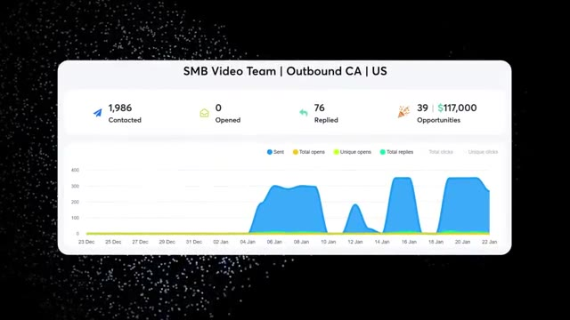
*⏱️ 00:00:17 — Tableau de bord d'analyse de campagne cold email montrant les statistiques : 1986 contacts, 76 réponses, 39 opportunités pour une valeur de 117 000 $.*

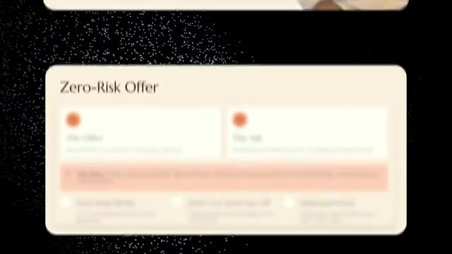
*⏱️ 00:00:25 — Interface de présentation de stratégie commerciale intitulée "Zero-Risk Offer" structurée en blocs d'informations.*

---

### ⏱️ `[00:00:34 - 00:00:53]` | Segment #02

**🔊 Audio (Transcription Intégrale Mot pour Mot en Français) :**
> And like I said, he built all of this with his girlfriend, Alexandra, in six months. So I hope that you guys enjoy and learn something new. All right, Savam, so you generated over half a million dollars in sales opportunities through only cold outreach. I'm really excited to have you here today and super excited to talk about how you were able to do that. It's great to meet you, man. Great to meet you too, Nick. Thanks for having me. Absolutely.

**👁️ Analyse Visuelle d'Écran (gemini-3.5-flash-lite) :**
**Interface & Outils** : Aucune interface logicielle ou outil technique n'est affiché.

**Contenu textuel & Code** : Aucun code, workflow ou donnée technique n'est présent à l'écran.

**Action / Démonstration** : Aucune démonstration technique ou manipulation d'outil n'est effectuée.

---

### ⏱️ `[00:00:53 - 00:01:14]` | Segment #03

**🔊 Audio (Transcription Intégrale Mot pour Mot en Français) :**
> So yeah, you've thrown together some resources here to basically be able to take someone from a complete beginner to understanding the theory of cold outreach. And I'm really excited to talk to you about it because I've never really done cold outreach and it's not really something that I teach to my students too much because I don't really do it that much. So I'm excited to hear kind of like the insights. And I've heard that you've only really been doing this for like six to eight months. So that's really, really cool.

**👁️ Analyse Visuelle d'Écran (gemini-3.5-flash-lite) :**
**Interface & Outils** : Aucune interface logicielle n'est affichée.

**Contenu textuel & Code** : Aucun code, commande ou donnée n'est visible.

**Action / Démonstration** : Le présentateur s'exprime verbalement sans effectuer aucune manipulation technique ou démonstration visuelle.

---

### ⏱️ `[00:01:14 - 00:01:32]` | Segment #04

**🔊 Audio (Transcription Intégrale Mot pour Mot en Français) :**
> So excited to dive into the slides you've got here. Yeah, perfect, man. I'm really excited to show you everything. I'm going to walk through the exact strategy I went to from zero to one. I'll show some copy. I'll even talk about infrastructure, lead list building, basically the whole shebang so that everyone kind of knows exactly what to do going forward. Absolutely. Yeah.

**👁️ Analyse Visuelle d'Écran (gemini-3.5-flash-lite) :**
**Interface & Outils** : N/A

**Contenu textuel & Code** : N/A

**Action / Démonstration** : Conversation entre les deux intervenants.

---

### ⏱️ `[00:01:32 - 00:01:51]` | Segment #05

**🔊 Audio (Transcription Intégrale Mot pour Mot en Français) :**
> And I see here that it says that you're also a full-time student. So do you want to give a real quick intro about kind of like your background and what you're up to now with your business? Yeah. So I started the business as a whole during the summer of 2025. And basically near the tail end is when it started generating traction, but obviously school started up again.

**👁️ Analyse Visuelle d'Écran (gemini-3.5-flash-lite) :**
**Interface & Outils** : Aucune interface logicielle ou outil d'automatisation n'est visible dans ces captures.

**Contenu textuel & Code** : Aucun code, commande, prompt ou donnée technique n'est affiché.

**Action / Démonstration** : Aucune manipulation d'outil ou démonstration technique n'est réalisée.

---

### ⏱️ `[00:01:51 - 00:02:14]` | Segment #06

**🔊 Audio (Transcription Intégrale Mot pour Mot en Français) :**
> I actually went to university for architecture, landscape architecture, so literally no relation whatsoever. And then during the school year, basically, it was go to class and then after class run to either a room, a cafe or back to my place and then just, you know, grind out business for another couple of hours and things like that.

**👁️ Analyse Visuelle d'Écran (gemini-3.5-flash-lite) :**
**Interface & Outils** : Aucune

**Contenu textuel & Code** : Aucun

**Action / Démonstration** : Aucune

---

### ⏱️ `[00:02:14 - 00:02:38]` | Segment #07

**🔊 Audio (Transcription Intégrale Mot pour Mot en Français) :**
> But right now, actually, just to be candid, I am taking like a gap semester gap year just since the business has gained some traction. Absolutely. Yeah. I mean, it's just one of those things, you know, you only get this type of opportunity once in maybe a hundred years, if that. So I love that. And it's that kind of like energy and excitement that really makes businesses succeed because you were so excited to leave class and sprint somewhere to go work on the business.

**👁️ Analyse Visuelle d'Écran (gemini-3.5-flash-lite) :**
**Interface & Outils** : Aucune.

**Contenu textuel & Code** : Aucun.

**Action / Démonstration** : Discussion en visioconférence entre deux personnes.

---

### ⏱️ `[00:02:38 - 00:03:03]` | Segment #08

**🔊 Audio (Transcription Intégrale Mot pour Mot en Français) :**
> So awesome. Yeah. Let me just jump right into it then. So building an AI automation business as a full-time student. So basically how I actually got started first steps was university summers. I needed cash. That was honestly the whole impetus. I don't have like some crazy origin story or anything like that. And I did outbound lead gen. Basically, I learned AI and automation just by doing. And that's when I started getting requests from just friends and family.

**👁️ Analyse Visuelle d'Écran (gemini-3.5-flash-lite) :**
**Interface & Outils** : Aucune (Il s'agit de diapositives de présentation de type PowerPoint/Keynote).

**Contenu textuel & Code** : Texte informatif sur le parcours entrepreneurial (besoin de revenus, prospection, apprentissage pratique, projets gratuits pour créer des études de cas).

**Action / Démonstration** : Aucune (Le contenu est purement informatif et statique).

---

### ⏱️ `[00:03:03 - 00:03:36]` | Segment #09

**🔊 Audio (Transcription Intégrale Mot pour Mot en Français) :**
> and a lot of people I think are really apprehensive about doing free work just for one reason or another especially if you're a full-time student but I definitely saw it as very strategic because I realized that if anyone else was going to trust me with their money then they would need it to see that I could actually bring a return and it started off with like really small things like nothing to even do with outbound legion it was just like helping create a website and like a booking automation for a salon for a family member it was like helping a person who was in like the medical field, integrate some sort of AI research. And that sounds so much more fancy than it is.

**👁️ Analyse Visuelle d'Écran (gemini-3.5-flash-lite) :**
**Interface & Outils** : Logiciel de présentation (type PowerPoint ou Google Slides).

**Contenu textuel & Code** : Texte structuré sur le parcours professionnel de l'intervenant : "University summers", "Outbound lead gen", "Built salon website", "Integrated AI for medical research", "Proved I could deliver".

**Action / Démonstration** : Présentation visuelle des étapes stratégiques suivies par l'intervenant pour lancer son activité d'automatisation.

*⏱️ 00:03:11 — Une diapositive de présentation titrée "How I Actually Got Started" divisée en deux sections : "First Steps" (apprentissage de l'IA/automatisation via des projets pour amis/famille) et "Doing Free Work" (réalisation de sites web et intégrations IA pour créer des études de cas).*

---

### ⏱️ `[00:03:36 - 00:04:05]` | Segment #10

**🔊 Audio (Transcription Intégrale Mot pour Mot en Français) :**
> But at the time, people are not even familiar with how to use these tools like perplexity or claw. They only know chat GPT. And so just sitting down with them and teaching them how to use those tools proved to be really, really beneficial for them. And once I could prove I could deliver, I could use them as a case study. And then I was able to build trust from there. Yeah. Yeah, that's huge. You know, the thing that I've always thought about cold outreach and cold email is that it's kind of hard unless you have some sort of proof. You know, you have to say, The person has to understand that they should work with you for a reason.

**👁️ Analyse Visuelle d'Écran (gemini-3.5-flash-lite) :**
**Interface & Outils** : Présentation ou face-caméra explicatif sans interface logicielle partagée.

**Contenu textuel & Code** : Explications orales et mise en contexte méthodologique.

**Action / Démonstration** : Explications face caméra et démonstration conceptuelle.

---

### ⏱️ `[00:04:06 - 00:04:32]` | Segment #11

**🔊 Audio (Transcription Intégrale Mot pour Mot en Français) :**
> And so if you have never done any work before, you have no case studies, you have no social proof out there. I feel like it's really hard, but you can let me know if I'm kind of off the mark there. No, yeah, you're absolutely right. The first question anyone's ever going to ask you, especially if you get them on a meeting is where are your case studies? Where's the proof and things like that. And so actually having, I guess, like a Rolodex of case studies actually fall back on, even if they're not necessarily one for one, because like I said, like I'm building like a salon website.

**👁️ Analyse Visuelle d'Écran (gemini-3.5-flash-lite) :**
**Interface & Outils** : Aucune interface logicielle ou technique n'est affichée.

**Contenu textuel & Code** : Aucun contenu technique, code ou donnée visible.

**Action / Démonstration** : Discussion en face à face entre le présentateur et son invité sans support visuel technique.

---

### ⏱️ `[00:04:32 - 00:05:06]` | Segment #12

**🔊 Audio (Transcription Intégrale Mot pour Mot en Français) :**
> I'm, you know, helping like medical research and things like that. But I'm reaching out to like video production companies and I'm reaching out on behalf of like Legion and Outbound. And so they asked me questions, but just the idea that you can even help other businesses and you know how to talk to other business owners, how to integrate your systems with other businesses that reducing that level of friction for them is also going to be massive to actually have someone trust you and actually, you know, send you some cash along the way. A hundred percent. So, so just to be clear your kind of first couple case studies that you were able to do, um, or your first couple products

**👁️ Analyse Visuelle d'Écran (gemini-3.5-flash-lite) :**
**Interface & Outils** : Aucune.

**Contenu textuel & Code** : Aucun.

**Action / Démonstration** : Le présentateur est en train de parler et de gesticuler, expliquant son expérience professionnelle.

---

### ⏱️ `[00:05:06 - 00:05:42]` | Segment #13

**🔊 Audio (Transcription Intégrale Mot pour Mot en Français) :**
> you were able to turn into case studies were kind of like warm referrals a bit, like friends and families, you did stuff for them. And then you were able to scale up with cold outreach once you had that under your belt. Yeah, exactly. It's like, um, I'm sure everyone's seen that YouTube short of like Alex Ramosey talking about how to get your first customer. And it's like text everyone to text all your friends, text all your family. And that's exactly what happened. Um, yeah, it's going to be a little bit weird, obviously, because I'm sure people feel some type of way about talking to friends and family about, you know, getting a business started and things like that. But there's so many ways that you can like really take those case studies and spin it and make it seem very, very valuable. And it can be very, very valuable. So like for the specific

**👁️ Analyse Visuelle d'Écran (gemini-3.5-flash-lite) :**
**Interface & Outils** : N/A

**Contenu textuel & Code** : N/A

**Action / Démonstration** : N/A

---

### ⏱️ `[00:05:42 - 00:06:17]` | Segment #14

**🔊 Audio (Transcription Intégrale Mot pour Mot en Français) :**
> beauty salon, um, where I helped like create basically like a digital presence for them and set their booking appointment. Uh, this was like when they were first getting their start. Right. And so once I actually was able to do that for them, they were actually able to scale like as a solo operator within a beauty salon, like just one person to like $10,000 monthly recurring revenue and they still continue to do that today. And so having, even if it at the time, it doesn't seem like massive leverage, doing things like that have proven to be like really, really beneficial now, because being able to say that in and of itself gets a lot of trust from people, right? Absolutely. Absolutely. Yeah. And trust is the greatest currency you can have right

**👁️ Analyse Visuelle d'Écran (gemini-3.5-flash-lite) :**
**Interface & Outils** : Aucune

**Contenu textuel & Code** : Aucun

**Action / Démonstration** : Aucune

---

### ⏱️ `[00:06:17 - 00:06:46]` | Segment #15

**🔊 Audio (Transcription Intégrale Mot pour Mot en Français) :**
> now. For sure. Yeah. So what actually worked when I was first starting out was not really endlessly building. I kind of assumed that there was never going to be like a perfect product and I want to build later. So I would always sell the outcome first and only build after a commitment. And this also allowed me to test different offers. So I think this, if anyone takes away one thing from this presentation, this is the biggest thing I would have them take away. And it's really just that classic like speed to execution kind of framework that a lot of entrepreneurs talk about.

**👁️ Analyse Visuelle d'Écran (gemini-3.5-flash-lite) :**
**Interface & Outils** : Présentation visuelle (diaporama/slide deck).

**Contenu textuel & Code** : Texte listant les méthodes : "01 No Endless Building", "02 Sold First", "03 Tested Offers" avec des sous-titres expliquant la logique métier derrière chaque point.

**Action / Démonstration** : Aucune, il s'agit d'un support visuel statique appuyant les propos de l'orateur sur sa méthodologie de vente et de développement.

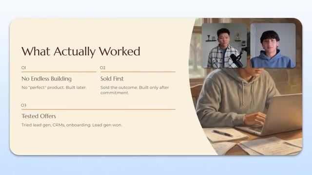
*⏱️ 00:06:24 — Une diapositive de présentation illustrant la stratégie de démarrage de l'auteur, structurée en trois points clés : éviter le développement sans fin, vendre le résultat avant de construire, et tester différentes offres.*

---

### ⏱️ `[00:06:46 - 00:07:23]` | Segment #16

**🔊 Audio (Transcription Intégrale Mot pour Mot en Français) :**
> There's so much information out there, like your channel and tons of other AI and automation channels that allow you to build things out, that allow you to, you know, test cloud code, test n8n test make all that great stuff um but at the end of the day i think a lot of people get really bogged down by the amount of things that they can actually build that they don't actually go out and talk to customers and try to sell what they build right and it sounds really harsh but if you're trying to make a business out of it and all you're doing is you know building you don't actually have a business yet you kind of just have like a project or a portfolio of projects or kind of a hobby and so what i would do is i would always like create offers and i knew outbound existed

**👁️ Analyse Visuelle d'Écran (gemini-3.5-flash-lite) :**
**Interface & Outils** : Présentation (diapositive textuelle).

**Contenu textuel & Code** : Texte : "01 No Endless Building", "02 Sold First", "03 Tested Offers".

**Action / Démonstration** : Aucune, il s'agit d'un support visuel statique résumant des concepts théoriques.

---

### ⏱️ `[00:07:23 - 00:07:56]` | Segment #17

**🔊 Audio (Transcription Intégrale Mot pour Mot en Français) :**
> since then um so i would i knew this was like a really easy way to test them out and i would create offers around things that i knew i could build so let me like give like a very pragmatic example or a practical example so like on your channel you have a bunch of videos talking about like hey like sell this xyz system for xyz dollars right and you've been in the industry for very long you have tons of experience and so you've sold these actual systems and so it would behoove me to go out of my way and figure out or reinvent the wheel and find systems that i think are going to work instead of just trusting someone who's already sold them before for a bunch of money, right? And so if I

**👁️ Analyse Visuelle d'Écran (gemini-3.5-flash-lite) :**
**Interface & Outils** : Logiciel de présentation (type PowerPoint ou Canva).

**Contenu textuel & Code** : Texte : "01 No Endless Building (No 'perfect' product. Built later)", "02 Sold First (Sold the outcome. Built only after commitment)", "03 Tested Offers (Tried lead gen, CRMs, onboarding. Lead gen won)".

**Action / Démonstration** : Présentation conceptuelle des étapes de validation d'une offre commerciale avant le développement technique.

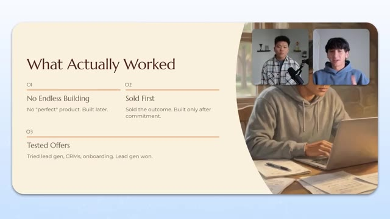
*⏱️ 00:07:31 — Une diapositive de présentation titrée "What Actually Worked" listant trois stratégies clés : "No Endless Building", "Sold First", et "Tested Offers".*

---

### ⏱️ `[00:07:56 - 00:08:14]` | Segment #18

**🔊 Audio (Transcription Intégrale Mot pour Mot en Français) :**
> know these systems can be built because you have the tutorials and the templates, and I know that these systems can be sold for money because you have the experience that tons of other people do, then why not just essentially put that out into the ether? And if people actually commit to the actual investment, they're like, oh, okay, like that sounds interesting. Oh, like lead gen, outbound, CRM, hiring pipeline, whatever. It sounds really interesting. Proposal generator.

**👁️ Analyse Visuelle d'Écran (gemini-3.5-flash-lite) :**
**Interface & Outils** : Logiciel de présentation (type Canva ou Google Slides).

**Contenu textuel & Code** : Texte structuré en trois points : 01 "No Endless Building", 02 "Sold First", 03 "Tested Offers" avec des descriptions détaillées pour chaque point.

**Action / Démonstration** : Présentation de la méthodologie métier adoptée par les intervenants.

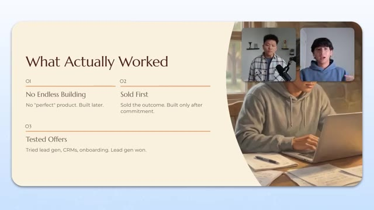
*⏱️ 00:08:00 — Une diapositive de présentation titrée "What Actually Worked" listant trois stratégies clés : éviter de construire sans fin, vendre le résultat avant de construire le produit, et tester différentes offres comme la génération de leads ou les CRM.*

---

### ⏱️ `[00:08:16 - 00:08:50]` | Segment #19

**🔊 Audio (Transcription Intégrale Mot pour Mot en Français) :**
> Let me, you know, like, let me pay you for that. Let me do that. And once they're in the door and they're willing to pay you for that, then you can always turn around and actually build those systems out. And we have, you know, galaxy brain intelligence at the tip of our fingers nowadays. And we have tons of people like you posting YouTube videos. And so I think it's really like the ability to build something is no longer the actual bottleneck for a lot of people. It's really just the ability to talk to customers and see if it's actually going to be something that they could sell. Moving forward. Um, I actually want to talk about like the exact offer I gave people and I was really, really aggressive with it. Um, so my offer was literally, you don't have to pay

**👁️ Analyse Visuelle d'Écran (gemini-3.5-flash-lite) :**
**Interface & Outils** : Aucune interface logicielle ou technique (présentation sous forme de diapositives de texte uniquement).

**Contenu textuel & Code** : Textes informatifs sur la stratégie de vente et le développement commercial (conseils en entrepreneuriat).

**Action / Démonstration** : Aucune action technique, démonstration de code ou manipulation système ; il s'agit d'un segment théorique de conseil business.

---

### ⏱️ `[00:08:50 - 00:09:23]` | Segment #20

**🔊 Audio (Transcription Intégrale Mot pour Mot en Français) :**
> me anything. You don't even have to sign a contract with me. It's going to be totally free and it's going to be zero risk. And once I started talking to companies that weren't just friends and family, because at the end of the day, like I did, I did do free work for them, but because of their friends or family, they're going to want to put some cash in your hand, right? I'm sure everyone's experienced that. When you're talking to cold companies and when I hop on the screen and they see like a 20 year old college kid, there's already so much trust I have to build back up. And so I would try to make it as little risk as possible. And, you know, with you and I being Asian, we look like three years younger than we really are as well. That is true. So what I would essentially say is like, hey,

**👁️ Analyse Visuelle d'Écran (gemini-3.5-flash-lite) :**
**Interface & Outils** : Présentation visuelle (type slides/infographie).

**Contenu textuel & Code** : Structure d'une offre commerciale : "The Offer" (sans paiement/contrat), "The Ask" (permission de citer l'entreprise comme preuve sociale), ainsi que trois principes directeurs : "Don't Build Blindly", "Smart Free Work Pays Off" et "Outbound Works". Il contient également un témoignage ("True story") sur une agence vidéo.

**Action / Démonstration** : Le présentateur expose une méthodologie commerciale pour acquérir ses premiers clients payants par le biais de projets gratuits à faible risque.

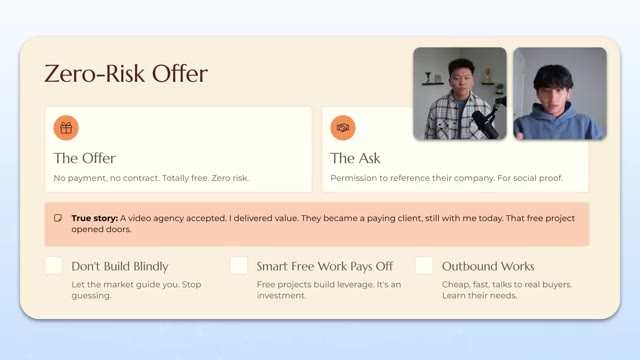
*⏱️ 00:08:58 — Une diapositive de présentation intitulée "Zero-Risk Offer" illustrant la stratégie de conversion client.*

---

### ⏱️ `[00:09:24 - 00:09:44]` | Segment #21

**🔊 Audio (Transcription Intégrale Mot pour Mot en Français) :**
> here's like a, here's like a snapshot. There's like a demonstration of me actually building the exact thing I want to build for you. You don't have to pay me. You don't have to con, you don't have to sign a contract with me. And I can even build this entire thing out and you could just ghost me and I could waste hours of my time. The only thing I asked for is the permission to actually reference their company. So I could reach out to other companies like them who are are probably willing to pay me, right?

**👁️ Analyse Visuelle d'Écran (gemini-3.5-flash-lite) :**
**Interface & Outils** : Logiciel de présentation ou outil de design type Canva/Slide deck.

**Contenu textuel & Code** : Texte structuré : "The Offer" (No payment, no contract. Zero risk), "The Ask" (Permission to reference company), encart "True story" sur une agence vidéo, et trois piliers : "Don't Build Blindly", "Smart Free Work Pays Off", "Outbound Works". Deux fenêtres vidéo incrustées montrent les interlocuteurs.

**Action / Démonstration** : Présentation conceptuelle et stratégique du modèle économique "Zero-Risk".

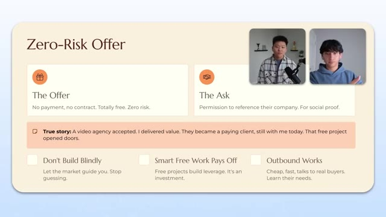
*⏱️ 00:09:29 — Une diapositive de présentation titrée "Zero-Risk Offer" expliquant la stratégie commerciale de proposer un travail gratuit sans contrat pour obtenir une preuve sociale.*

---

### ⏱️ `[00:09:44 - 00:10:06]` | Segment #22

**🔊 Audio (Transcription Intégrale Mot pour Mot en Français) :**
> And so literally one of my very first people that I reached out to was a video agency. And this was like my very first client. And I reached out to them with this exact offer. And I'm gonna be honest, like, there is like some level, I guess luck in this game or opportunity in this game, where they, I offered like this completely free offer for them and eventually they really grew to like me.

**👁️ Analyse Visuelle d'Écran (gemini-3.5-flash-lite) :**
**Interface & Outils** : Logiciel de présentation (type Notion ou Canva).

**Contenu textuel & Code** : Schéma détaillant une stratégie commerciale : "The Offer" (sans paiement ni contrat), "The Ask" (autorisation d'utiliser le nom du client comme preuve sociale), et une section "True story" confirmant la conversion d'une agence vidéo en client payant. Trois points clés sont listés en bas : "Don't Build Blindly", "Smart Free Work Pays Off" et "Outbound Works".

**Action / Démonstration** : Le présentateur explique sa méthode de prospection initiale ayant mené à son premier client.

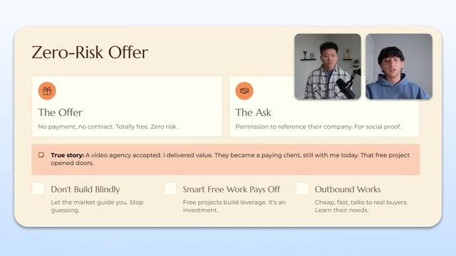
*⏱️ 00:09:50 — Une diapositive de présentation titrée "Zero-Risk Offer" illustrant la stratégie de prospection avec une offre sans risque et une étude de cas.*

---

### ⏱️ `[00:10:06 - 00:10:26]` | Segment #23

**🔊 Audio (Transcription Intégrale Mot pour Mot en Français) :**
> And they became like literally like my first paying client. They're like, hey, like we understand that you're willing to do this for free, but we like you, We want to actually pay you. And we enjoy like the fact that you're actually willing to, you know, put your skin in the game and that free client turned into a paid client. And they literally still work with me like today, even like six to eight months later, even though I was like a complete beginner and in tandem.

**👁️ Analyse Visuelle d'Écran (gemini-3.5-flash-lite) :**
**Interface & Outils** : Diapositive de présentation (type Keynote ou Slides).

**Contenu textuel & Code** : Texte structuré : "Zero-Risk Offer" ; "The Offer: No payment, no contract. Totally free. Zero risk." ; "The Ask: Permission to reference their company. For social proof." ; "True story: A video agency accepted... They became a paying client" ; "Don't Build Blindly", "Smart Free Work Pays Off", "Outbound Works".

**Action / Démonstration** : Présentation théorique d'une stratégie commerciale d'acquisition client par le travail gratuit ("skin in the game").

*⏱️ 00:10:11 — Une diapositive de présentation illustrant la stratégie "Zero-Risk Offer" (offre sans risque) avec des sections pour "The Offer", "The Ask" et un témoignage personnel.*

---

### ⏱️ `[00:10:26 - 00:10:45]` | Segment #24

**🔊 Audio (Transcription Intégrale Mot pour Mot en Français) :**
> And I'll talk about this later as well is I was working with like another video agency who didn't want to pay me at the time. And I basically spent like three, four hours with them live demonstrating how the system works. They had no experience with AI and automation whatsoever, if not region. and I would have to like literally be on Zoom and I would like tell them where to click their mouse and everything like that.

**👁️ Analyse Visuelle d'Écran (gemini-3.5-flash-lite) :**
**Interface & Outils** : Logiciel de présentation de type slide (type Canva ou PowerPoint).

**Contenu textuel & Code** : Texte explicatif : "The Offer: No payment, no contract. Totally free. Zero risk", "The Ask: Permission to reference their company. For social proof", et un encadré "True story" sur une agence vidéo devenue cliente.

**Action / Démonstration** : Présentation théorique d'une stratégie de vente sans démonstration technique ou logicielle.

---

### ⏱️ `[00:10:45 - 00:11:06]` | Segment #25

**🔊 Audio (Transcription Intégrale Mot pour Mot en Français) :**
> It was a massive investment of my own time. But at the end of it, they were so happy. They were like happy to give me the ability to say, hey, I helped this company do this exact outcome or deliver this exact system. And being able to literally just put that one extra line inside of my outbound messaging immediately like nearly doubled like my reply rates and it increased the amount of meetings I could get.

**👁️ Analyse Visuelle d'Écran (gemini-3.5-flash-lite) :**
**Interface & Outils** : Logiciel de présentation (type Canva ou PowerPoint).

**Contenu textuel & Code** : Texte structuré : "Zero-Risk Offer", "The Offer" (No payment, no contract. Totally free. Zero risk.), "The Ask" (Permission to reference their company), et une anecdote : "True story: A video agency accepted...". Trois piliers stratégiques sont listés : "Don't Build Blindly", "Smart Free Work Pays Off", "Outbound Works".

**Action / Démonstration** : Le présentateur utilise ce visuel comme support pédagogique pour expliquer sa méthode d'acquisition client par l'investissement initial gratuit pour obtenir des témoignages.

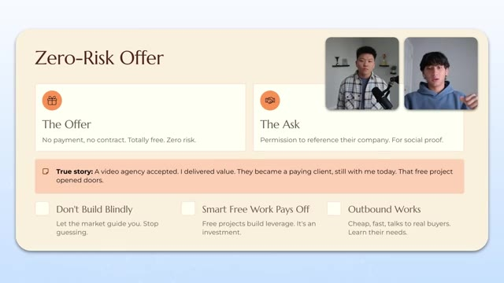
*⏱️ 00:10:50 — Une diapositive de présentation illustrant la stratégie de "Zero-Risk Offer" (offre sans risque) avec des points clés sur l'approche commerciale et l'utilisation de preuves sociales.*

---

### ⏱️ `[00:11:06 - 00:11:43]` | Segment #26

**🔊 Audio (Transcription Intégrale Mot pour Mot en Français) :**
> And I think that that sole case study or that piece of free work alone probably got me to the point where I am today. And I don't think if I, I think if I didn't do that, I would probably have to wait months. If not, you know, I would have never gotten there and I would still be in the same position today, but because I kind of just like, I guess, ate that frog, I was able to kind of leverage that as a case study and then get other people to actually be willing to pay me for it. Yeah, no, it's super cool that the data actually shows the increase after you were able to put that, that line in there. You know, I think a lot of people at the beginning, they don't think about it right because they think they're hopping into this opportunity.

**👁️ Analyse Visuelle d'Écran (gemini-3.5-flash-lite) :**
**Interface & Outils** : Logiciel de présentation graphique (type Canva ou Pitch).

**Contenu textuel & Code** : Texte structuré : "The Offer (No payment, no contract. Totally free. Zero risk)", "The Ask (Permission to reference their company. For social proof)", et une section "True story" illustrant comment un projet gratuit a converti une agence vidéo en client payant.

**Action / Démonstration** : Présentation de concepts théoriques et stratégiques sur la vente de services d'automatisation IA, aucune manipulation technique directe.

*⏱️ 00:11:16 — Une diapositive de présentation titrée "Zero-Risk Offer", détaillant la stratégie de proposer un travail gratuit en échange d'une preuve sociale.*

---

### ⏱️ `[00:11:43 - 00:12:16]` | Segment #27

**🔊 Audio (Transcription Intégrale Mot pour Mot en Français) :**
> And if they don't see money by, you know, the end of month one, it's they're failing, but really upfront, it's about how can you prioritize yourself to get reps, to get experience, to get proof rather than money. The money will come later on once you have all that. And it gets easier and easier once you have more and more, but it's just one of those things where it's like, you could be the most skilled NNN workflow builder in the world, but with zero experience that kind of just like evens out your your advantage there you know experiences is what you need experience obviously builds trust and we just talked about for a long time how important trust is so i love the zero risk

**👁️ Analyse Visuelle d'Écran (gemini-3.5-flash-lite) :**
**Interface & Outils** : Aucune.

**Contenu textuel & Code** : Aucun code, terminal ou interface logicielle n'est affiché.

**Action / Démonstration** : Les deux participants sont simplement en train de discuter en face-à-face à travers leur webcam.

---

### ⏱️ `[00:12:16 - 00:12:53]` | Segment #28

**🔊 Audio (Transcription Intégrale Mot pour Mot en Français) :**
> offer yeah no dude you're absolutely right so like like a lot of people who are probably watching this video i'm part of like you know school communities i teach ai and automation like yours and basically there was like a point where i posted and this is probably like this is how the conversations are right like i made a post where i was like oh like this is how i made half a million dollars in sales opportunities inside of Instantly. And I remember I would look at some of the systems that a lot of people in that community would build. And it was like, I could barely even understand like how they actually put it all together. You know, like I felt so technically behind compared to them. But the weird thing was a lot of them were reaching out to me because they couldn't get

**👁️ Analyse Visuelle d'Écran (gemini-3.5-flash-lite) :**
**Interface & Outils** : Aucune interface logicielle montrée.

**Contenu textuel & Code** : Aucun contenu technique (code, terminal, workflow) n'est visible.

**Action / Démonstration** : Les deux participants sont en train de discuter en face à face via webcam.

---

### ⏱️ `[00:12:53 - 00:13:13]` | Segment #29

**🔊 Audio (Transcription Intégrale Mot pour Mot en Français) :**
> like the sales part or the marketing part, right? They couldn't generate interest from customers, but they could spend all day in front of a computer and build like these massive, massive systems on N8N and make and use like these agentic workflows. But it was all kind of just sitting there collecting dust because they hadn't actually figured out the part where they could actually talk to customers and get their product or service out in front of customers.

**👁️ Analyse Visuelle d'Écran (gemini-3.5-flash-lite) :**
**Interface & Outils** : Aucune

**Contenu textuel & Code** : Aucun

**Action / Démonstration** : Aucune

---

### ⏱️ `[00:13:13 - 00:13:33]` | Segment #30

**🔊 Audio (Transcription Intégrale Mot pour Mot en Français) :**
> Yeah. That actually is something we've been seeing big time in our communities as well about like sometimes it's very rare that you can be someone that's both. If you are, that's great. But if you're one or the other and you specialize in that, maybe just go look to partner with someone that can compliment you really well. And then you guys are a super team. So yeah, what's on the next slide for us?

**👁️ Analyse Visuelle d'Écran (gemini-3.5-flash-lite) :**
**Interface & Outils** : Aucune interface logicielle ou outil technique n'est présent.

**Contenu textuel & Code** : Aucun contenu technique, code ou donnée n'est affiché.

**Action / Démonstration** : Les deux participants sont en train de discuter en direct lors d'une interview.

---

### ⏱️ `[00:13:35 - 00:13:54]` | Segment #31

**🔊 Audio (Transcription Intégrale Mot pour Mot en Français) :**
> So next, I kind of want to talk about like my actual outbound campaign playbook. This is literally like everything I do from top to bottom when I'm actually creating outbound campaign, not just for myself, but also for my clients as well. So this is not going to be just like a zero to one game, but it's also something that I hope people can use for their fulfillment process as well.

**👁️ Analyse Visuelle d'Écran (gemini-3.5-flash-lite) :**
**Interface & Outils** : Diapositive de présentation ou document structuré.

**Contenu textuel & Code** : Liste des étapes : 3. Scrape & Clean Contacts, 4. Personalize with AI, 5. Set Up Deliverability, 6. Craft Campaign & Offer, 7. Lead with Value, 8. Tweak as I Go.

**Action / Démonstration** : Présentation visuelle de la stratégie opérationnelle pour les campagnes de prospection.

*⏱️ 00:13:40 — Une liste à puces numérotée (de 3 à 8) présentant les étapes clés du "playbook" de campagne outbound, avec le présentateur en médaillon sur la droite.*

---

### ⏱️ `[00:13:55 - 00:14:31]` | Segment #32

**🔊 Audio (Transcription Intégrale Mot pour Mot en Français) :**
> And hopefully this is like something that they can immediately take action on today. So the first thing I do is I'll find niche databases. And I think this is something that people don't talk about, at least not enough. So nowadays we have like, you know, GPT research, we have, um, Claude, which can also do research. And we also have like research enabled models from the beginning, like perplexity or XAI. And a lot of people, when they think about like, Hey, like what, um, where do I look for? Like my leads, they immediately go to like the classic LinkedIn sales navigator, Apollo, or all these other like huge tools, right? But a lot of people aren't aware that there's a bunch of niche databases

**👁️ Analyse Visuelle d'Écran (gemini-3.5-flash-lite) :**
**Interface & Outils** : Présentation visuelle (Slide de cours/tutoriel).

**Contenu textuel & Code** : Liste des étapes : 1. Find Niche Databases, 2. Grab Domains & Enrich, 3. Scrape & Clean Contacts, 4. Personalize with AI, 5. Set Up Deliverability.

**Action / Démonstration** : Le présentateur explique sa méthodologie stratégique étape par étape pour automatiser la prospection sortante.

*⏱️ 00:14:04 — Une diapositive de présentation titrée "My Outbound Campaign Playbook" détaillant un processus en 5 étapes pour l'automatisation de campagnes d'emailing.*

---

### ⏱️ `[00:14:31 - 00:14:57]` | Segment #33

**🔊 Audio (Transcription Intégrale Mot pour Mot en Français) :**
> that actually hold the leads that you're looking for, and it's already pre-selected for you, right? So off the top of my head, the biggest one I know about is like, I think it's called AIA, American Institute of Architects, right? So let's imagine you were doing an outbound campaign targeted towards architects, and your go-to gut feeling is to go into like Apollo or these massive lead-based directories, and basically just try and play around with the filters and hope that the lead list that you scrape is actually going to be all architects.

**👁️ Analyse Visuelle d'Écran (gemini-3.5-flash-lite) :**
**Interface & Outils** : Présentation visuelle (type slides/diapositives).

**Contenu textuel & Code** : Le texte liste les étapes : 1. Find Niche Databases, 2. Grab Domains & Enrich, 3. Scrape & Clean Contacts, 4. Personalize with AI, 5. Set Up Deliverability.

**Action / Démonstration** : Le présentateur illustre et explique sa stratégie globale de workflow pour les campagnes d'outbound marketing.

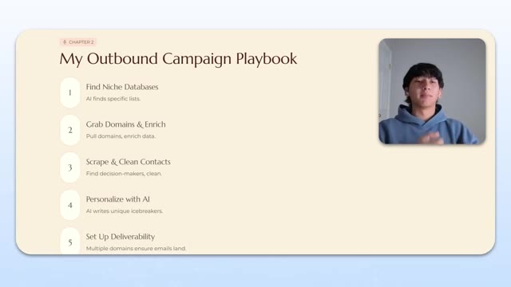
*⏱️ 00:14:38 — Une diapositive de présentation intitulée "My Outbound Campaign Playbook" détaillant un processus en 5 étapes pour l'acquisition de leads et l'automatisation d'e-mails.*

---

### ⏱️ `[00:14:57 - 00:15:16]` | Segment #34

**🔊 Audio (Transcription Intégrale Mot pour Mot en Français) :**
> Where you could have, if you just did a little bit of research on perplexing, asked like, hey, where are some niche databases that hold a bunch of architecture companies? It would probably tell you like AI, American Institute of Architects, right? And the reason that's really important is because they've already done the filtering for you. There's a 0% chance that inside that list, there's a company that isn't an architecture firm, right?

**👁️ Analyse Visuelle d'Écran (gemini-3.5-flash-lite) :**
**Interface & Outils** : Logiciel de présentation (type Canva ou Slides).

**Contenu textuel & Code** : Liste des 5 étapes du workflow : 1. Find Niche Databases, 2. Grab Domains & Enrich, 3. Scrape & Clean Contacts, 4. Personalize with AI, 5. Set Up Deliverability.

**Action / Démonstration** : Présentation théorique du flux de travail de la campagne d'outbound marketing.

*⏱️ 00:15:02 — Une diapositive de présentation titrée "My Outbound Campaign Playbook" détaillant un processus en 5 étapes pour l'automatisation de prospection, avec le présentateur en médaillon dans le coin supérieur droit.*

---

### ⏱️ `[00:15:16 - 00:15:49]` | Segment #35

**🔊 Audio (Transcription Intégrale Mot pour Mot en Français) :**
> And so instead of playing that guessing game, you can just use AI, spend a couple of minutes researching specific databases, find one that is already really easily scrapable. And then now from there, you already have like a perfect list of company domains that you can just have to pull decision makers from, which is like the third step. And basically you already have like a perfect lead list to start reaching out to. I think that's like a really big thing. That's a really big unlock that I think a lot of people aren't taking advantage of nowadays as well. And then from there, it's really just setting up deliverability. So basically just setting up multiple domains to ensure emails land. That basically means like if you have one domain, you can set up a couple of

**👁️ Analyse Visuelle d'Écran (gemini-3.5-flash-lite) :**
**Interface & Outils** : Aucune (il s'agit d'une présentation de type diaporama/slide).

**Contenu textuel & Code** : Liste des étapes : 1. Find Niche Databases, 2. Grab Domains & Enrich, 3. Scrape & Clean Contacts, 4. Personalize with AI, 5. Set Up Deliverability.

**Action / Démonstration** : Présentation théorique du workflow de prospection par le présentateur.

---

### ⏱️ `[00:15:49 - 00:16:23]` | Segment #36

**🔊 Audio (Transcription Intégrale Mot pour Mot en Français) :**
> email accounts. You can't send a thousand emails from one account. I'm not going to go too deep into this because it's like a massive rabbit hole, but basically instead of sending 3,000 emails from one account, just set up like a hundred emails and send 30 emails from each one of them. And none of them will be marked as spam and you'll get the same volume out there. From there, it's crafting campaign and offers, which we'll talk about in depth a little bit later. This is really like the crux of the entire thing. If this falls flat, then it's going to be pretty hard. I always lead with value. So I always send like a free video first, which I'll talk about a little bit more as well, just because people are nowadays a little bit more apprehensive to get on a meeting off the a bat. And if you don't give them a little bit of like a lead magnet per se, they're not going to

**👁️ Analyse Visuelle d'Écran (gemini-3.5-flash-lite) :**
**Interface & Outils** : Présentation type PowerPoint/Keynote.

**Contenu textuel & Code** : Liste des étapes : 3. Scrape & Clean Contacts, 4. Personalize with AI, 5. Set Up Deliverability, 6. Craft Campaign & Offer, 7. Lead with Value, 8. Tweak as I Go.

**Action / Démonstration** : Présentation visuelle des étapes stratégiques de la campagne d'emailing automatisé.

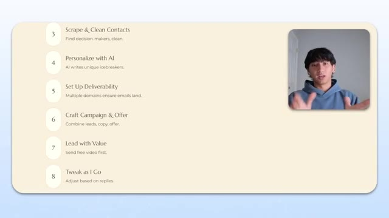
*⏱️ 00:15:57 — Une diapositive de présentation listant les étapes 3 à 8 d'un workflow d'automatisation d'emails, avec une incrustation vidéo du présentateur.*

---

### ⏱️ `[00:16:23 - 00:16:56]` | Segment #37

**🔊 Audio (Transcription Intégrale Mot pour Mot en Français) :**
> be willing to want to talk to you. And then obviously like with any sort of marketing strategy, you want to tweak as you go, right? Whether it's like a paid ad strategy, whether it's like a UGC strategy or outbound strategy, you take the data that you've collected from what you did, and then you want to iterate on a weekly, monthly, or bi-weekly basis or something like that. Gotcha. Yeah. So on that last point, one thing that I want to ask you about is how should a beginner know how much to be doing? Because I know that cold email is definitely a numbers game. And there's that story from Hermosi where he was putting out flyers on cars and he was doing like a hundred a day, which he felt was like was a ton. But then his mentor was like, dude,

**👁️ Analyse Visuelle d'Écran (gemini-3.5-flash-lite) :**
**Interface & Outils** : Présentation visuelle (slide) d'une stratégie de prospection.

**Contenu textuel & Code** : Texte énumérant des étapes : "3. Scrape & Clean Contacts", "4. Personalize with AI", "5. Set Up Deliverability", "6. Craft Campaign & Offer", "7. Lead with Value", "8. Tweak as I Go".

**Action / Démonstration** : Illustration visuelle du processus d'automatisation marketing discuté par l'intervenant.

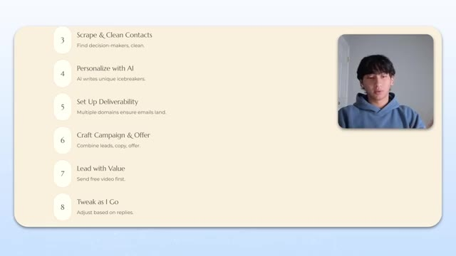
*⏱️ 00:16:31 — Une liste à puces numérotée présentant les étapes clés d'une stratégie marketing automatisée, avec le présentateur en médaillon.*

---

### ⏱️ `[00:16:56 - 00:17:30]` | Segment #38

**🔊 Audio (Transcription Intégrale Mot pour Mot en Français) :**
> you got to be doing like a thousand, 2000 a day. So how did you get started? You know, what do those stats look like? How many are you sending out per day? And then how is that scaled up? Yeah, that's a great, great question. So when I first started, I literally bought one domain and I wouldn't advise this, but I got like five email inboxes under each because I was a broke college student. So I was that means so what is 30 divide what is 30 times five um 150 right and basically i would send out 150 emails a day from these accounts once they were like fully warmed up and stuff but i think

**👁️ Analyse Visuelle d'Écran (gemini-3.5-flash-lite) :**
**Interface & Outils** : Aucune.

**Contenu textuel & Code** : Aucun.

**Action / Démonstration** : Aucune.

---

### ⏱️ `[00:17:30 - 00:17:49]` | Segment #39

**🔊 Audio (Transcription Intégrale Mot pour Mot en Français) :**
> i got very lucky to actually get traction from that level of volume maybe it was my email maybe it was my offer obviously but i think there's a level of luck that played into that as well but honestly i think for beginners starting out by three domains um you'd have 15 inboxes in total If you go like for the max amount, you could put like five domain inboxes underneath each domain.

**👁️ Analyse Visuelle d'Écran (gemini-3.5-flash-lite) :**
**Interface & Outils** : Aucune

**Contenu textuel & Code** : Aucun

**Action / Démonstration** : Aucune

---

### ⏱️ `[00:17:49 - 00:18:10]` | Segment #40

**🔊 Audio (Transcription Intégrale Mot pour Mot en Français) :**
> It's not advisable. People typically recommend like two or three. But if you're really on a budget and you're trying to get as much volume out there as possible, just try it out. And that will allow you to do basically triple the volume that I did. So 450 emails. If you kind of multiply that out on like a monthly basis, I think that's like it's like nearly 9000 emails or something like that.

**👁️ Analyse Visuelle d'Écran (gemini-3.5-flash-lite) :**
**Interface & Outils** : Aucun.

**Contenu textuel & Code** : Aucun.

**Action / Démonstration** : Discussion orale entre les deux interlocuteurs.

---

### ⏱️ `[00:18:10 - 00:18:32]` | Segment #41

**🔊 Audio (Transcription Intégrale Mot pour Mot en Français) :**
> Yeah, like 9000 emails on a monthly basis. And if you're reaching out to 9000 leads, the way I think about it, I think about like in terms of numbers and you have a decent campaign, let's say like 5% reply rates, 5% of 9,000 is going to be like 450 people are going to reply back to you. If you have a decent offer, maybe half of them are actually interested in what you have to say. So you have 225 people reaching back out to you saying like, Hey, that sounds kind of interesting. Let me hear more.

**👁️ Analyse Visuelle d'Écran (gemini-3.5-flash-lite) :**
**Interface & Outils** : Aucune interface logicielle montrée.

**Contenu textuel & Code** : Aucun contenu technique, code ou donnée affiché.

**Action / Démonstration** : Aucune action ou démonstration technique effectuée.

---

### ⏱️ `[00:18:32 - 00:19:07]` | Segment #42

**🔊 Audio (Transcription Intégrale Mot pour Mot en Français) :**
> And depending on how good you are with nurturing leads and booking them on a calendar, I'm sure that will elicit some amount of momentum and you'll have some people on your calendar actually talk to. But nowadays, like obviously since I've scaled up, I probably have like, I want to say like 40 to 50 inboxes running at any given time. So obviously it's a lot different now. Nice. Nice. So like, what is the, what's the golden standard? Like if you could have, I know there's lots of metrics and as the funnel gets smaller, as you go down each step, you significantly lose more people all the way down, but let's just say reply rate. What is like a really, really good percentage of reply? Yeah, that's a really great question. So let me give,

**👁️ Analyse Visuelle d'Écran (gemini-3.5-flash-lite) :**
**Interface & Outils** : Aucune.

**Contenu textuel & Code** : Aucun (appel vidéo standard).

**Action / Démonstration** : Aucune action technique n'est effectuée, les intervenants sont simplement en train de discuter.

---

### ⏱️ `[00:19:07 - 00:19:28]` | Segment #43

**🔊 Audio (Transcription Intégrale Mot pour Mot en Français) :**
> Let me give people like the reply rates that I look at. So typically if there's anything under a 2% reply rate for me, I start wondering if my lead list or my deliverability is off, right? So either the inboxes are not landing in the actual, the emails are not landing in the inbox or landing in spam, or my lead list is totally wrong. So I'm aiming at architects, but I'm talking to a bunch of like contractors or something like that, right?

**👁️ Analyse Visuelle d'Écran (gemini-3.5-flash-lite) :**
**Interface & Outils** : Aucune.

**Contenu textuel & Code** : Aucun contenu technique (code, dashboard, workflow).

**Action / Démonstration** : Discussion entre deux personnes.

---

### ⏱️ `[00:19:28 - 00:19:50]` | Segment #44

**🔊 Audio (Transcription Intégrale Mot pour Mot en Français) :**
> Because that's going to fall in deaf ears. Then if it's above 2% and below 5%, I'm usually just worried about copy because it probably means that you're landing inside the inbox, but people just are not responding because your copy is not, you know, interesting enough to actually respond to it. And they're just ignoring it. Right. And then if you have anything above a 5% reply rate, below a 10% reply rate, I would say that's like the golden zone.

**👁️ Analyse Visuelle d'Écran (gemini-3.5-flash-lite) :**
**Interface & Outils** : Aucune interface logicielle ou outil technique n'est présent à l'écran.

**Contenu textuel & Code** : Il s'agit uniquement d'une séquence de discussion entre les deux interlocuteurs.

**Action / Démonstration** : Les présentateurs discutent face caméra, aucune manipulation technique ou démonstration de workflow n'est visible.

---

### ⏱️ `[00:19:50 - 00:20:24]` | Segment #45

**🔊 Audio (Transcription Intégrale Mot pour Mot en Français) :**
> I'm not saying it's like a perfect reply rate. There's people out there getting, you know, 15%, 25% reply rates, which is fantastic and stuff like that. Yeah, it's insane. But with a meaningful amount of leads, like 3000 leads, a five to 10% reply rate is more than enough to get you a meaningful amount of pipeline volume, right? Like enough leads that are interested in what you have to say so that you can eventually nurture a good chunk of them and get them on a meeting. And if you can get even 10 of those people on a meeting and you have like basically little to no sales experience, I'm pretty confident that you'll be able to like close one of them, even if it's like for a really small deal. Right. So I'd say below 2%, look back at your lead list, look back at your infrastructure

**👁️ Analyse Visuelle d'Écran (gemini-3.5-flash-lite) :**
**Interface & Outils** : Aucune.

**Contenu textuel & Code** : Aucun.

**Action / Démonstration** : Aucune.

---

### ⏱️ `[00:20:24 - 00:20:46]` | Segment #46

**🔊 Audio (Transcription Intégrale Mot pour Mot en Français) :**
> above 2%, below 5%, look at your copy and your offer between 5 and 10%. You're probably good, but if you really care, then, you know, keep looking at your copy and offer and basically just make everything a little bit better. And then if you're above 10%, then, you know, send me an email, I'd love to work with you. But yeah, hey, guys, real quick, just wanted to say that I know we're covering a lot of information in today's episode. So I don't want you to worry about taking notes.

**👁️ Analyse Visuelle d'Écran (gemini-3.5-flash-lite) :**
**Interface & Outils** : Aucune.

**Contenu textuel & Code** : Aucun contenu technique, de code ou d'automatisation n'est présent à l'écran.

**Action / Démonstration** : Les individus sont simplement en train de discuter en visioconférence.

---

### ⏱️ `[00:20:46 - 00:21:21]` | Segment #47

**🔊 Audio (Transcription Intégrale Mot pour Mot en Français) :**
> I've compiled all of this into a resource guide that you can access for completely free. You can find that inside of my free school community. The link for that will be down in the description. So hop in there, grab that guide, check out the other resources that we have available in there once again, for free. And let's get back to the video, my lead process just to get a little bit nitty-gritty and I'll just kind of glean over this really quickly is that I'll have AI find niche databases because we already talked about this I'll have to do some level enrichment so I'll still use Apollo to actually find the email addresses and decision maker names and you can obviously use like sales navigator and Appify which is a massive platform that people use nowadays as well I'll clean the data which is really important don't forget this step basically

**👁️ Analyse Visuelle d'Écran (gemini-3.5-flash-lite) :**
**Interface & Outils** : Présentation de type diapositive (slide deck) avec incrustation vidéo du présentateur.

**Contenu textuel & Code** : Texte structuré sur le processus de lead : utilisation de bases de données (Clutch, GetLaka), outils d'enrichissement (Apollo, Sales Navigator, Apify), nettoyage de données (MillionVerifier, AnyMailFinder) et stratégie de personnalisation via Perplexity/ChatGPT.

**Action / Démonstration** : Présentation théorique du flux de travail automatisé pour la prospection commerciale.

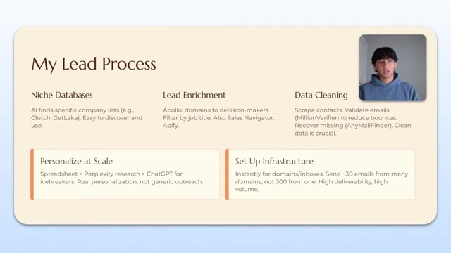
*⏱️ 00:21:04 — Diapositive récapitulative intitulée "My Lead Process" détaillant les étapes de génération de leads (Niche Databases, Enrichment, Data Cleaning, Personalization, Infrastructure).*

---

### ⏱️ `[00:21:21 - 00:21:54]` | Segment #48

**🔊 Audio (Transcription Intégrale Mot pour Mot en Français) :**
> just go on to a website called million million verifier or any mail finder and basically just make sure those emails are real emails so that you don't bounce and these this clean data is is really crucial because you don't want to pay for all these domains and inboxes and then have them all be destroyed because you didn't send to the right lead list. And I actually personalize that scale. So I'll run an automation. And my automation is like stupid, simple. It's literally just attached to a Google sheet. That Google sheet will feed perplexity relevant data about that decision maker. So like their name, their company, perplexity was prompted to create like a robust research report. It's pretty short research report, just like just the things that I really

**👁️ Analyse Visuelle d'Écran (gemini-3.5-flash-lite) :**
**Interface & Outils** : Présentation visuelle (diapositive pédagogique).

**Contenu textuel & Code** : Texte structuré : "Niche Databases", "Lead Enrichment" (Apollo, Apify), "Data Cleaning" (MillionVerifier, AnyMailFinder), "Personalize at Scale" (Perplexity, ChatGPT) et "Set Up Infrastructure".

**Action / Démonstration** : Présentation conceptuelle des outils et du flux de travail pour la génération et le nettoyage de leads.

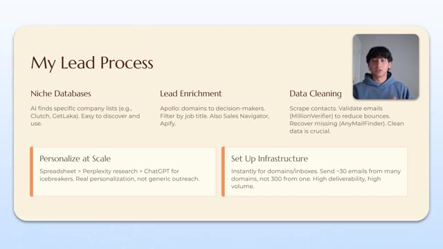
*⏱️ 00:21:29 — Une diapositive de présentation titrée "My Lead Process" détaillant les étapes de la génération de leads, incluant le nettoyage des données avec MillionVerifier et AnyMailFinder.*

---

### ⏱️ `[00:21:54 - 00:22:27]` | Segment #49

**🔊 Audio (Transcription Intégrale Mot pour Mot en Français) :**
> care about. It'll feed that into chat GPT, which is obviously also prompted to make a really casual personal sounding icebreaker. Icebreaker is created and then boom, it's popped back into the Google Sheets. Literally, I think when I first started, I made it at make.com. It's four modules long, so you don't need anything crazy. And that's really what got me to like zero to one to like 10 and so on and so forth. And then obviously I would set up infrastructure. So like 30 emails from many domains instead of 300 from one. But that's like a more, I guess, like a closer look at all that stuff, but nothing really new there. Moving on though. So here's a little bit about like

**👁️ Analyse Visuelle d'Écran (gemini-3.5-flash-lite) :**
**Interface & Outils** : Diapositive de présentation (graphique informatif).

**Contenu textuel & Code** : Le processus est structuré en cinq étapes : Niche Databases, Lead Enrichment, Data Cleaning, Personalize at Scale (incluant Spreadsheet, Perplexity, ChatGPT) et Set Up Infrastructure.

**Action / Démonstration** : Illustration visuelle du flux de travail stratégique utilisé par le présentateur pour le traitement des leads.

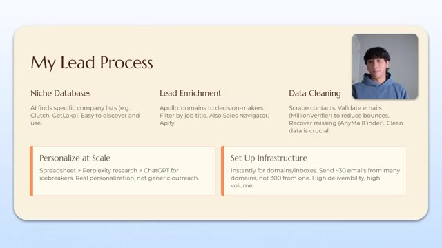
*⏱️ 00:22:02 — Une diapositive de présentation titrée "My Lead Process" détaillant les étapes de prospection commerciale via l'automatisation.*

---

### ⏱️ `[00:22:27 - 00:23:00]` | Segment #50

**🔊 Audio (Transcription Intégrale Mot pour Mot en Français) :**
> my copy and offer. And I'm going to actually show the exact copy I use as well. The, I always treat the subject in the first line as like the things that are going to get people to open the email. Right. So like, okay, cool. What can you say in the subject line? I always try to treat the subject line as what would somebody inside their own team say to them. Right. So like, you wouldn't want to reach out with them. Like, I wouldn't want to reach out to them and say like, Hey, I want to create a cold email campaign for you. Cause they immediately know like, Oh, this guy's going to try and sell me something. Right. Yeah. I immediately, I immediately marked those as red or as red exactly exactly but what i did what one of the things i did actually i'll show you later

**👁️ Analyse Visuelle d'Écran (gemini-3.5-flash-lite) :**
**Interface & Outils** : Logiciel de présentation (type diaporama).

**Contenu textuel & Code** : La diapositive présente trois étapes clés : "Subject & First Line" (personnalisation), "The Offer" (clarté), et "Lead with Video" (envoyer une vidéo gratuite). Elle inclut également des principes de base : utiliser des bases de données existantes, vérifier la donnée, personnaliser systématiquement, et privilégier une offre forte sur un simple copywriting.

**Action / Démonstration** : Le présentateur utilise ce visuel comme support pédagogique pour structurer son explication sur l'optimisation des emails de prospection.

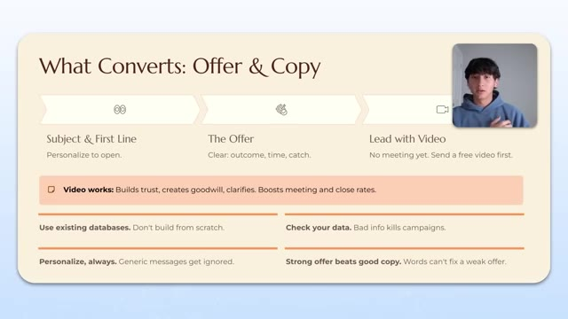
*⏱️ 00:22:36 — Une diapositive de présentation structurée intitulée "What Converts: Offer & Copy" détaillant les piliers d'une stratégie d'emailing efficace.*

---

### ⏱️ `[00:23:00 - 00:23:31]` | Segment #51

**🔊 Audio (Transcription Intégrale Mot pour Mot en Français) :**
> is like i would create like these cliffhanger um subject lines that make it sound like it's either from someone on their team or like a friend or a family member or something like that and it's just kind of like a cliffhanger so they want to open it and then the personalized line goes the very top because if it's just like a a specific compliment like hey i saw that recent project you did with xyz company really cool that you did this thing they there's like a bit of like curiosity like okay like they can be reaching out to me about a plethora of things. They can be reaching out to me about, you know, inquiring about my own business. They can be reaching out to me because I have a question about this project I work on, all that great stuff. And it just gets them to open the email.

**👁️ Analyse Visuelle d'Écran (gemini-3.5-flash-lite) :**
**Interface & Outils** : Présentation visuelle (slide) avec incrustation vidéo du présentateur.

**Contenu textuel & Code** : Texte structuré listant des conseils : "Subject & First Line: Personalize to open", "The Offer: Clear: outcome, time, catch", "Lead with Video: No meeting yet. Send a free video first", "Video works: Builds trust...", "Use existing databases", "Check your data", "Personalize, always", "Strong offer beats good copy".

**Action / Démonstration** : Présentation théorique illustrant les éléments clés d'une campagne d'outreach efficace.

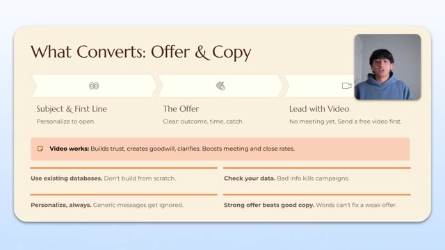
*⏱️ 00:23:08 — Une diapositive de présentation titrée "What Converts: Offer & Copy" détaillant trois piliers stratégiques : l'objet et la première ligne, l'offre, et l'utilisation de la vidéo.*

---

### ⏱️ `[00:23:32 - 00:23:51]` | Segment #52

**🔊 Audio (Transcription Intégrale Mot pour Mot en Français) :**
> And that's all that I want them to do because the offer is going to be the biggest part here. You want to make sure that there's an outcome, a time and a catch. And the way I think about offers is literally like you have a desired outcome. So like what's their desired reality within a specific timeframe. And then basically a risk reversal or a guarantee if you're not able to achieve that for them, right?

**👁️ Analyse Visuelle d'Écran (gemini-3.5-flash-lite) :**
**Interface & Outils** : Présentation visuelle (diapositive) avec vidéo incrustée du présentateur.

**Contenu textuel & Code** : Texte structuré sur la stratégie : "Subject & First Line", "The Offer" (outcome, time, catch), "Lead with Video", et des conseils sur l'utilisation des bases de données, la personnalisation et la qualité des données.

**Action / Démonstration** : Le présentateur utilise ce support visuel pour illustrer sa théorie sur la construction d'une offre efficace.

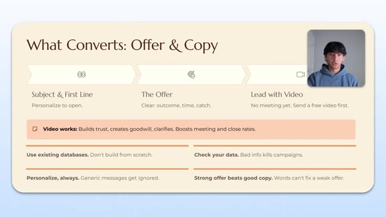
*⏱️ 00:23:36 — Une diapositive de présentation structurée intitulée "What Converts: Offer & Copy" détaillant les piliers d'une stratégie de conversion : objet, offre et vidéo.*

---

### ⏱️ `[00:23:51 - 00:24:15]` | Segment #53

**🔊 Audio (Transcription Intégrale Mot pour Mot en Français) :**
> So I will get you 10 meetings on the calendar in 30 days. And if not, you don't have to pay me a dime, right? So the outcome is the meetings, the times the 30 days and the catch, the risk reversal is basically what happens if I don't do that because that essentially makes them lower their guard down and it makes it a lot more likely for them to wanna talk to you, right? And then I lead with the video. So the video is basically my low pressure ask instead of like asking them for 30 minutes on their calendar.

**👁️ Analyse Visuelle d'Écran (gemini-3.5-flash-lite) :**
**Interface & Outils** : Présentation de diapositives (type Canva ou Pitch).

**Contenu textuel & Code** : Texte structuré : "Subject & First Line", "The Offer (Clear: outcome, time, catch)", "Lead with Video", et des conseils pratiques sur l'utilisation des bases de données, la personnalisation et la vérification des données.

**Action / Démonstration** : Le présentateur illustre visuellement les composants clés d'une offre irrésistible en marketing sortant.

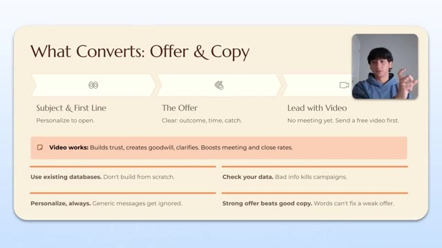
*⏱️ 00:23:57 — Une diapositive de présentation titrée "What Converts: Offer & Copy" détaillant trois piliers de conversion : l'objet/première ligne, l'offre (résultat, temps, condition) et l'utilisation de la vidéo.*

---

### ⏱️ `[00:24:15 - 00:24:34]` | Segment #54

**🔊 Audio (Transcription Intégrale Mot pour Mot en Français) :**
> I'll just say like, hey, I have this video that actually explains everything that's necessary. and can I just send that over? It's gonna be five minutes. They're a lot more likely to say yes. And I think the reason the video works really well is because even though it takes longer for them to book a meeting with you, if they do book a meeting with you, especially once they watch the video, they basically know everything about you and your offer and selling is so much easier.

**👁️ Analyse Visuelle d'Écran (gemini-3.5-flash-lite) :**
**Interface & Outils** : Diapositive de présentation (style minimaliste).

**Contenu textuel & Code** : Texte structuré : "Subject & First Line", "The Offer", "Lead with Video". Points clés : "Video works: Builds trust...", "Use existing databases", "Check your data", "Personalize, always", "Strong offer beats good copy".

**Action / Démonstration** : Présentation théorique d'un workflow de conversion pour les ventes ou le marketing.

*⏱️ 00:24:20 — Une diapositive de présentation titrée "What Converts: Offer & Copy" détaillant les étapes d'une stratégie de prospection, incluant la personnalisation et l'utilisation de la vidéo.*

---

### ⏱️ `[00:24:34 - 00:25:08]` | Segment #55

**🔊 Audio (Transcription Intégrale Mot pour Mot en Français) :**
> Okay, so let me go ahead and talk about my copy from zero to one. This is literally the word for word verbatim copy I use to get like my first client and a handful of other clients after that as well. So the very first one was Q, is company name taking on more clients or first name Q? and basically it's like a question i'll be honest it's a little bit of a bait and switch i'm not gonna i'm not gonna lie about that because it sounds like i'm inquiring about their business but it ripped um and basically i would have the icebreaker and i would say something like hey saw you guys were just down the street because i was going local um location thought i'd reach out been getting an agency up and running which i was recently helped scale a local business sarah's tnw

**👁️ Analyse Visuelle d'Écran (gemini-3.5-flash-lite) :**
**Interface & Outils** : Logiciel de présentation ou éditeur graphique.

**Contenu textuel & Code** : Texte de deux scripts d'e-mail de prospection :
- Script 1 : "My Copy From 0 to 1" incluant des variables comme {{firstName}}, {{companyName}}, {{location}}, {{icebreaker}} et {{accountSignature}}.
- Script 2 : Un modèle axé sur la proximité géographique ("from your neighbor").

**Action / Démonstration** : Le présentateur illustre et détaille le texte verbatim utilisé pour acquérir ses premiers clients via le démarchage (outreach).

*⏱️ 00:24:42 — Une diapositive de présentation affiche deux modèles de texte (« copy ») destinés à la prospection commerciale, avec des espaces réservés (variables) entre doubles accolades.*

---

### ⏱️ `[00:25:08 - 00:25:43]` | Segment #56

**🔊 Audio (Transcription Intégrale Mot pour Mot en Français) :**
> which is the beauty salon um to six figures with our ai driven automations um and basically I was kind of intentionally ambiguous with the name as well because if I said it was like a beauty salon stuff like that they probably immediately disqualify themselves in their brain and so I said hey I put together something I think you'd find interesting it's basically a intent-based email scraping and outreach system we used to book 23 discovery calls a month uh would this be of interest you wouldn't owe me anything else actually drives results let me know if I can send over a 90-second video showcasing how it works or if you want to just talk appreciate the time and then I would sign off and my second email was cue from your neighbor first name cue from

**👁️ Analyse Visuelle d'Écran (gemini-3.5-flash-lite) :**
**Interface & Outils** : Logiciel de présentation (type diaporama).

**Contenu textuel & Code** : Modèles de scripts d'e-mails incluant des variables dynamiques ({{firstName}}, {{companyName}}, {{location}}, {{icebreaker_b}}, {{accountSignature}}) visant à automatiser la prise de rendez-vous pour des entreprises locales.

**Action / Démonstration** : Présentation des techniques de copywriting utilisées dans une stratégie d'outreach automatisée pour capter l'intérêt de nouveaux clients.

*⏱️ 00:25:17 — Une diapositive de présentation affichant deux modèles de messages de prospection (cold email) côte à côte, titrée "My Copy From 0 to 1".*

---

### ⏱️ `[00:25:43 - 00:26:03]` | Segment #57

**🔊 Audio (Transcription Intégrale Mot pour Mot en Français) :**
> your neighbor, which again, is kind of like that little bit of like a cliffhanger thing, because it could literally be about anything, especially with the first line being personalized. Bit out there, but we put together an outbound tool that books over 20 meetings a month, no added headcount, and you don't pay till we deliver results. Recently worked with a small business near me, and we built something similar to help them break through a 10K a month. Would love to send over a two-minute loom talking about how it's done.

**👁️ Analyse Visuelle d'Écran (gemini-3.5-flash-lite) :**
**Interface & Outils** : Présentation visuelle / Éditeur de texte.

**Contenu textuel & Code** : Modèles d'emails utilisant des variables de personnalisation comme {{firstName}}, {{companyName}} et {{location}}, incluant des accroches ("icebreakers") et des arguments de vente pour un outil d'automatisation d'outbound.

**Action / Démonstration** : Comparaison et démonstration textuelle de stratégies d'emailing pour l'automatisation de la prise de rendez-vous.

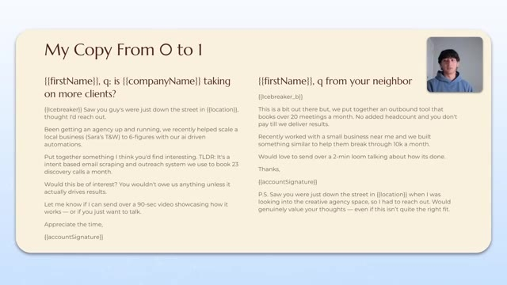
*⏱️ 00:25:48 — Une présentation sous forme de diapositive montrant deux modèles d'emails de prospection (cold email) côte à côte, intitulée "My Copy From 0 to 1".*

---

### ⏱️ `[00:26:03 - 00:26:37]` | Segment #58

**🔊 Audio (Transcription Intégrale Mot pour Mot en Français) :**
> Thanks. P.S. Saw you were just down the street in location when I was looking into creative agency space, because this was targeted at video agencies. So I had to reach out. would genuinely allow your thoughts, even if it isn't quite the fit, right? So I think, so let me just break it down, like kind of like dissect it a little bit. So obviously the top line is personalized, right? And then I get straight into my social proof, especially in the left-hand email here, which is Sarah's TNW six figures, basically just saying like, I've worked with businesses before. And then I get into my offer. I try to explain it as coherently as possible where I use intent-based data. So like at the time, what I would do is

**👁️ Analyse Visuelle d'Écran (gemini-3.5-flash-lite) :**
**Interface & Outils** : Logiciel de présentation (type Canva ou Google Slides).

**Contenu textuel & Code** : Deux variantes de scripts d'email utilisant des variables de personnalisation ({{firstName}}, {{companyName}}, {{location}}, {{icebreaker}}). Le texte détaille une stratégie d'outbound marketing basée sur l'IA et le scraping d'intention pour générer des rendez-vous.

**Action / Démonstration** : Présentation visuelle et comparaison de techniques de rédaction pour l'automatisation de la prospection commerciale.

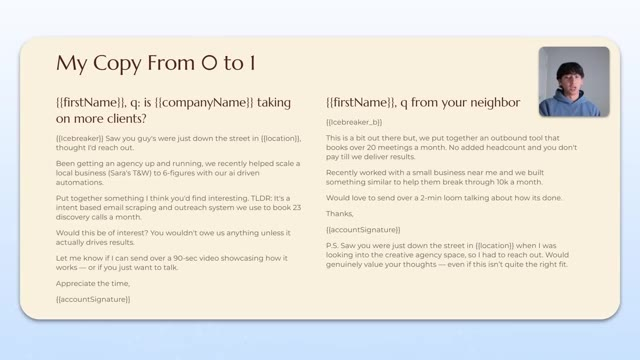
*⏱️ 00:26:12 — Une diapositive de présentation comparant deux modèles de scripts d'email de prospection ("My Copy From 0 to 1"), avec une vidéo du présentateur en médaillon dans le coin supérieur droit.*

---

### ⏱️ `[00:26:37 - 00:27:10]` | Segment #59

**🔊 Audio (Transcription Intégrale Mot pour Mot en Français) :**
> like, I would use like LinkedIn job boards where companies were hiring for video agencies. I would scrape a bunch of leads from there for those companies because they're essentially raising their hand and saying like hey We need video work done, right? And then I would put my clients in front of them instead Would this be of interest you wouldn't owe me anything and that's kind of the risk reversal, right? So I have the desired outcome 23 book discovery calls time frame is a month And then the risk reversal is basically you don't pay us anything until it drives results And the whole point of this actually from the very beginning was to get people to Want to work with me and I was going to do the work completely for free until I actually deliver results second one very similar thing i'd just get straight into the actual offer 20 book meetings a month

**👁️ Analyse Visuelle d'Écran (gemini-3.5-flash-lite) :**
**Interface & Outils** : Logiciel de présentation (type Canva ou Google Slides).

**Contenu textuel & Code** : Scripts d'e-mails de démarchage à froid incluant des variables comme {{firstName}}, {{companyName}}, {{location}} et {{icebreaker}}. Les textes détaillent des méthodes d'acquisition client basées sur l'automatisation et le scraping.

**Action / Démonstration** : Présentation visuelle des modèles de messages utilisés pour transformer les leads identifiés via le scraping en opportunités de rendez-vous (booking).

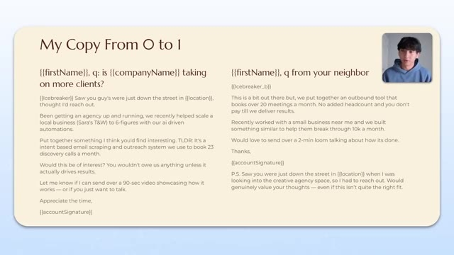
*⏱️ 00:26:45 — Une diapositive présentant deux modèles de scripts de prospection ("Copy") par e-mail avec des variables dynamiques (type {{firstName}}).*

---

### ⏱️ `[00:27:10 - 00:27:43]` | Segment #60

**🔊 Audio (Transcription Intégrale Mot pour Mot en Français) :**
> uh no added headcount and then i would i get into the social proof would love to send over a two minute loom which is like the actual video and this is like literally the offer that i ran and i think a big uh part of this offer that or this copy that worked really well was this we had i think for like the last few years we just came off the back end of people sending like these kind of like um i don't know how to spell like bro-y emails where they kind of act like you know like i'm the top dog, like they would like send like 10 word emails and they were kind of just like, it was kind of like this assumed close kind of email, right? It was like, I already know you

**👁️ Analyse Visuelle d'Écran (gemini-3.5-flash-lite) :**
**Interface & Outils** : Logiciel de présentation ou éditeur de documents textuels.

**Contenu textuel & Code** : Deux exemples d'e-mails de prospection intitulés "My Copy From 0 to 1", incluant des variables comme {{firstName}}, {{companyName}}, {{location}}, et {{icebreaker}}. Le contenu détaille une approche basée sur des systèmes d'automatisation IA et des résultats chiffrés.

**Action / Démonstration** : Le présentateur illustre les stratégies de rédaction d'e-mails pour générer des rendez-vous de découverte.

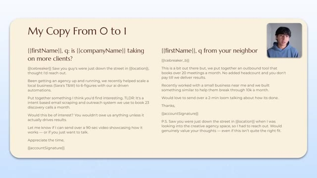
*⏱️ 00:27:19 — Une diapositive de présentation montrant deux modèles de "copywriting" pour du démarchage à froid (cold outreach) avec des variables dynamiques.*

---

### ⏱️ `[00:27:43 - 00:28:16]` | Segment #61

**🔊 Audio (Transcription Intégrale Mot pour Mot en Français) :**
> want to work with me type of thing. And I think just being honest and literally just literally, even if it like discredited me saying like, Hey, I'm just trying to get an agency up and running. I don't have that much experience. I would do this for free. Let me see. Let me know if your thoughts are right. Like kind of coming at from more of a humility standpoint or a sincerity standpoint. And actually, I think it worked as like a pattern to show up. And I think it was really refreshing to people as well. And so it was like, oh, okay, like, cool. Like, let me, let me like, you know, let me give this guy a chance. Let me talk to him. And I think coming from that purview at the time worked really, really well. And so I know a lot of people out there when they talk about cold email copy, they talk about like writing in this really like

**👁️ Analyse Visuelle d'Écran (gemini-3.5-flash-lite) :**
**Interface & Outils** : Diapositive de présentation (style éditeur de texte ou document).

**Contenu textuel & Code** : Scripts de cold email segmentés en deux versions, utilisant des variables comme {{firstName}}, {{companyName}} et {{location}}, mettant en avant une approche basée sur les résultats ("pay till we deliver results") et l'honnêteté sur le stade de l'agence.

**Action / Démonstration** : Comparaison et démonstration de stratégies textuelles pour le démarchage à froid de prospects.

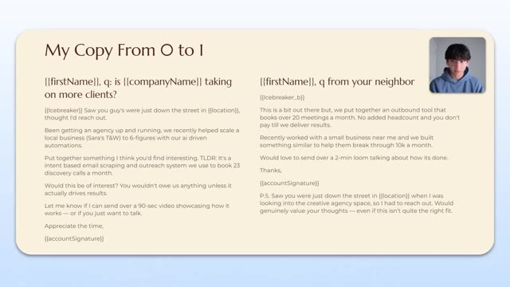
*⏱️ 00:27:51 — Une diapositive présentant deux modèles de cold email ("My Copy From 0 to 1") conçus pour une prospection d'agence, incluant des variables dynamiques.*

---

### ⏱️ `[00:28:16 - 00:28:38]` | Segment #62

**🔊 Audio (Transcription Intégrale Mot pour Mot en Français) :**
> stoic, super marketing, super punchy tone, which 100% works depending on your offer. But I would not stray too far away from writing emails that are kind of actually personal and make you actually sound like a normal human being and not just like this massive faceless corporation that's sending like, you know, 60 word emails and things like that. So let me go ahead and move on to basically stuff I wish I knew.

**👁️ Analyse Visuelle d'Écran (gemini-3.5-flash-lite) :**
**Interface & Outils** : Logiciel de présentation (type Canva ou Google Slides).

**Contenu textuel & Code** : Deux variantes de scripts d'e-mails utilisant des balises de personnalisation (variables) telles que {{firstName}}, {{companyName}}, {{location}} et {{icebreaker}}. Le texte détaille des approches de prospection pour vendre des systèmes d'automatisation par IA.

**Action / Démonstration** : Comparaison visuelle des stratégies de rédaction pour illustrer une transition vers un ton plus humain et conversationnel dans les e-mails de vente.

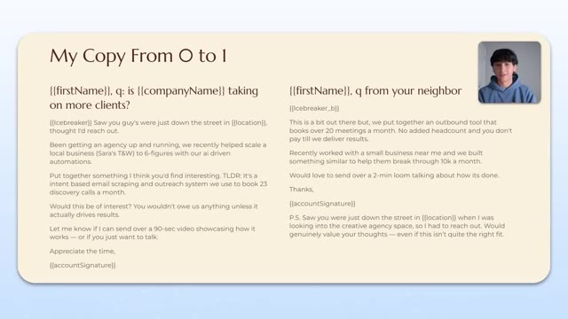
*⏱️ 00:28:21 — Une diapositive de présentation intitulée "My Copy From 0 to 1" montrant deux modèles d'e-mails de prospection côte à côte, avec le présentateur visible dans une petite fenêtre en haut à droite.*

---

### ⏱️ `[00:28:38 - 00:29:03]` | Segment #63

**🔊 Audio (Transcription Intégrale Mot pour Mot en Français) :**
> So firstly, I would say, even if you don't have sales, just start a project and outbound will prove demand really, really quickly. So basically don't try and overbuild or anything like that. Just use outbound because it's going to be like really good direct market feedback. And if people are not really listening to what you have to say, people read your email and they're like, okay, like they're not responding whatsoever, then either you're framing the email incorrectly or the offer itself is not that good.

**👁️ Analyse Visuelle d'Écran (gemini-3.5-flash-lite) :**
**Interface & Outils** : Présentation (slide deck) affichée à l'écran.

**Contenu textuel & Code** : Texte structuré : "Start Outbound" (No sales? Just a project. Outbound proves demand, fast.), "Minimal Setup" (Outbound needs few tools. Get real meetings. Each outreach is feedback.), "Sell, Then Build" (Don't wait to 'feel ready.' Talk to customers. Learn from real problems and budgets.) et un encadré "Heads Up: Outbound Can Be Rough".

**Action / Démonstration** : Présentation visuelle des concepts clés pour valider une idée d'entreprise avant le développement technique.

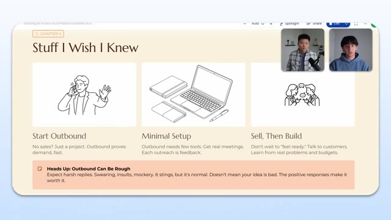
*⏱️ 00:28:44 — Une diapositive de présentation intitulée "Stuff I Wish I Knew" illustrant trois conseils stratégiques : "Start Outbound", "Minimal Setup", et "Sell, Then Build", avec un avertissement sur la difficulté du démarchage.*

---

### ⏱️ `[00:29:03 - 00:29:21]` | Segment #64

**🔊 Audio (Transcription Intégrale Mot pour Mot en Français) :**
> Right. And so you need to be really, really good at that. If you go on an email and you say, Hey, I built an 18 module N8N proposal system using gamma and Slack and all these other things. Like, even though it is valuable, like business owners don't really care about that. Nobody cares. Yeah. Nobody knows what that means. Nobody cares. Nobody cares. Except us. Right.

**👁️ Analyse Visuelle d'Écran (gemini-3.5-flash-lite) :**
**Interface & Outils** : Logiciel de présentation (type Slide/PowerPoint/Gamma).

**Contenu textuel & Code** : Texte : "Start Outbound: No sales? Just a project. Outbound proves demand, fast.", "Minimal Setup: Outbound needs few tools. Get real meetings. Each outreach is feedback.", "Sell, Then Build: Don't wait to 'feel ready.' Talk to customers. Learn from real problems and budgets.", "Heads Up: Outbound Can Be Rough: Expect harsh replies. Swearing, insults, mockery. It stings, but it's normal."

**Action / Démonstration** : Présentation conceptuelle et conseils stratégiques pour les entrepreneurs en automatisation.

*⏱️ 00:29:08 — Une diapositive de présentation intitulée "Stuff I Wish I Knew" illustrant trois conseils stratégiques : "Start Outbound", "Minimal Setup", et "Sell, Then Build", avec un bandeau informatif sur la difficulté de la prospection.*

---

### ⏱️ `[00:29:21 - 00:29:51]` | Segment #65

**🔊 Audio (Transcription Intégrale Mot pour Mot en Français) :**
> Like we're like in a bubble basically. But if you position it in a very different way, like, Hey, I think I have a system that's going to increase sales cycles by like 23%. I think it's, I have a system that I think can increase your sales closing right by 15%. I plug it in for your business completely for free. And if it doesn't work out for you, then, Hey, you don't have to pay me a dime. Then they're going to be a lot more likely to actually be interested. And then you actually have proof of concept and now you can start building this out and now you can actually start putting in businesses. Right. And we have, there's tons of infinite resources online to actually figure that out. I would say like the minimal setup is you just need a few tools to actually get meetings from now on. Right.

**👁️ Analyse Visuelle d'Écran (gemini-3.5-flash-lite) :**
**Interface & Outils** : Logiciel de présentation (type Canva ou Pitch).

**Contenu textuel & Code** : Texte : "Chapter 4: Stuff I Wish I Knew", "Start Outbound", "Minimal Setup", "Sell, Then Build", et un avertissement "Heads Up: Outbound Can Be Rough".

**Action / Démonstration** : Aucune démonstration technique ou logicielle ; il s'agit d'un support visuel pour accompagner le discours théorique des présentateurs.

---

### ⏱️ `[00:29:51 - 00:30:20]` | Segment #66

**🔊 Audio (Transcription Intégrale Mot pour Mot en Français) :**
> When, once you get a meeting, then obviously you need to have the wherewithal to take the money that you got from that closed deal and then reinvest it into the setup because that's how you actually scale. Talk to customers. That's the biggest thing. If anyone takes away one thing from this entire process, it's talk to customers first and then build once they actually tell you that they actually value what you're actually putting in front of them. That way you're not wasting time building things that nobody actually wants or nobody's actually going to sell or buy from you and you don't have that sunk cost. And one really big thing is outbound's rough, right?

**👁️ Analyse Visuelle d'Écran (gemini-3.5-flash-lite) :**
**Interface & Outils** : Diapositive de présentation (type Slide/Keynote).

**Contenu textuel & Code** : Texte : "Start Outbound" (No sales? Just a project. Outbound proves demand, fast), "Minimal Setup" (Outbound needs few tools. Get real meetings. Each outreach is feedback), "Sell, Then Build" (Don't wait to "feel ready." Talk to customers. Learn from real problems and budgets), et "Heads Up: Outbound Can Be Rough".

**Action / Démonstration** : Présentation conceptuelle des conseils business pour le lancement d'une automatisation ou d'un service IA.

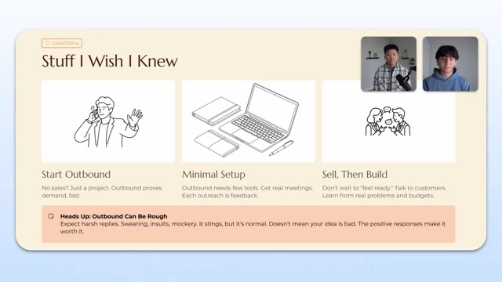
*⏱️ 00:29:58 — Une diapositive de présentation intitulée "Stuff I Wish I Knew" résumant trois piliers stratégiques : "Start Outbound", "Minimal Setup" et "Sell, Then Build", avec un encart informatif sur la difficulté du démarchage à froid.*

---

### ⏱️ `[00:30:20 - 00:30:43]` | Segment #67

**🔊 Audio (Transcription Intégrale Mot pour Mot en Français) :**
> people are going to say some crazy things to you, like expect harsh results, swearing, insults, mockery. It's going to sting, but it's very, very normal. And it doesn't mean your idea is bad. It doesn't mean you're doing something wrong. It's just part of the process. I would say, even if you have a killer, killer campaign, there's going to be a lot of people that cuss you out. Like I've had campaigns that have almost like gotten 20% reply rates and, you know, half of them are positive.

**👁️ Analyse Visuelle d'Écran (gemini-3.5-flash-lite) :**
**Interface & Outils** : Présentation visuelle (diapositive pédagogique).

**Contenu textuel & Code** : Texte à l'écran : "Start Outbound", "Minimal Setup", "Sell, Then Build", et le message d'avertissement : "Heads Up: Outbound Can Be Rough. Expect harsh replies. Swearing, insults, mockery. It stings, but it's normal."

**Action / Démonstration** : Présentation des étapes clés pour lancer une activité de prospection (outbound) tout en gérant les retours négatifs.

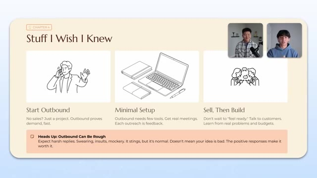
*⏱️ 00:30:26 — Une diapositive de présentation intitulée "Stuff I Wish I Knew" résumant trois conseils pour l'outbound, avec une section encadrée soulignant que les réponses négatives font partie du processus.*

---

### ⏱️ `[00:30:44 - 00:31:16]` | Segment #68

**🔊 Audio (Transcription Intégrale Mot pour Mot en Français) :**
> And there's some, there's still going to be replies within that exact campaign that are telling you like screw off. Yeah, man. I think that's why people, a lot of people that try to do cold outreach end up kind of quitting because it's such a numbers game. And because you have to get through a lot of that stuff that doesn't really feel great. And at the end of the day, yeah, humans, humans are humans. But, um, when you talked about with like talking to customers, I couldn't like repeat that enough. If you think about like, we've all fallen victim to maybe a dropshipping ad or some sort of impulse buy. And it's all because these companies are doing research to understand

**👁️ Analyse Visuelle d'Écran (gemini-3.5-flash-lite) :**
**Interface & Outils** : Aucune interface logicielle ou technique n'est présente.

**Contenu textuel & Code** : Aucun code, commande ou élément graphique lié à l'automatisation n'est affiché.

**Action / Démonstration** : Discussion informelle entre deux personnes, sans manipulation technique ou démonstration de workflow.

---

### ⏱️ `[00:31:16 - 00:31:50]` | Segment #69

**🔊 Audio (Transcription Intégrale Mot pour Mot en Français) :**
> what are the exact specific pain points that people have. So that way I can just chuck up an ad somewhere. They have no idea about my brand or me, but they're still going to buy because that pain point resonates with them so deeply. That's what it's all about. Yeah, 100%. And the thing is, sometimes when you talk to customers, even if it's revealed that your specific offer is not that valuable to them, it's really easy to segue that conversation into finding a solution that is valuable to them. Like I've had conversations with people where I've positioned lead gen to them. I've had a conversation with them. They said it's not that valuable to them. And then I literally just, I just posed the question like, okay, like, is there anything else that you need to help with right now? And they talk about it and then boom,

**👁️ Analyse Visuelle d'Écran (gemini-3.5-flash-lite) :**
**Interface & Outils** : Aucune.

**Contenu textuel & Code** : Aucun contenu technique ou code source visible.

**Action / Démonstration** : Les deux participants sont en train de discuter ; il n'y a pas d'action de manipulation logicielle ou de démonstration technique.

---

### ⏱️ `[00:31:50 - 00:32:23]` | Segment #70

**🔊 Audio (Transcription Intégrale Mot pour Mot en Français) :**
> you're kind of back in the game and now you can actually build something that they care about. Right. Yeah. Starting from scratch, uh, from zero to one, I would do some free work. Don't build stuff. Nobody wants. I chat with customers all the time. That's going to be your most important. That's going to be your higher highest leverage task. And I would find a crowd by seeing who responds. Uh, that's like a big thing. I also did basically when I got positive responses, I would actually place them all in a Google sheet and I would track the company size, the industry, a general description of who they are, who I actually spoke to. And what I would do is when I built a new lead list, I would use that as like my frame of reference because I knew like,

**👁️ Analyse Visuelle d'Écran (gemini-3.5-flash-lite) :**
**Interface & Outils** : Diapositive de présentation (type Slide/Keynote).

**Contenu textuel & Code** : Texte structuré : "Do Free Work (Smartly)", "Don't Build Stuff Nobody Wants", "Chat with Customers, All the Time", "Find Your Crowd by Seeing Who Responds". Encart : "My First Paid Client Story: My first paid client's project was weeks from completion. I offered a free 3-hour session...".

**Action / Démonstration** : Présentation théorique et stratégique sur le développement de clientèle.

*⏱️ 00:31:58 — Une diapositive de présentation titrée "Starting from Scratch (0 -> 1)" détaillant une stratégie en quatre points pour lancer une activité : offrir du travail gratuit intelligemment, ne pas construire de produits inutiles, discuter constamment avec les clients, et identifier sa cible par les retours. Un encart en bas illustre une anecdote personnelle sur le premier client payant.*

---

### ⏱️ `[00:32:23 - 00:32:59]` | Segment #71

**🔊 Audio (Transcription Intégrale Mot pour Mot en Français) :**
> okay, out of a thousand people I reached to, these 10 people were the most interested and they all have this, this, and this in common. And that's how I went from, you know, a 3% reply rate to a 5% to an 8% to a 10% and so on and so forth. Cause I would keep just doubling down on basically the people that were actually interested in me. Absolutely. I've got one final question to end off here and it's about data. So earlier you talked a little bit about metrics, about how many emails you send, about what kind of KPIs you're looking at. What I wanted to ask you about to close off here is about when you see all these numbers, what do you actually do to, let's just say your copy

**👁️ Analyse Visuelle d'Écran (gemini-3.5-flash-lite) :**
**Interface & Outils** : Aucune (support de présentation type slides).

**Contenu textuel & Code** : Texte structuré : "Do Free Work (Smartly)", "Don't Build Stuff Nobody Wants", "Chat with Customers, All the Time", "Find Your Crowd by Seeing Who Responds" et une note sur "My First Paid Client Story".

**Action / Démonstration** : Présentation de conseils stratégiques pour valider une idée d'entreprise et acquérir ses premiers clients.

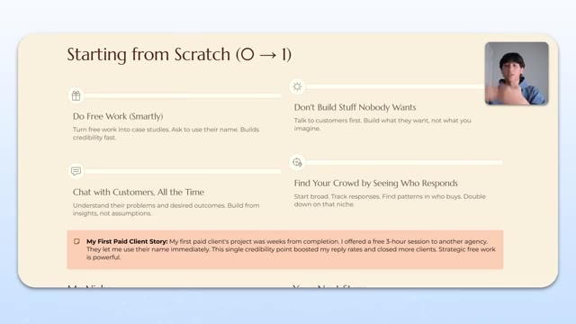
*⏱️ 00:32:32 — Une diapositive de présentation titrée "Starting from Scratch (0 -> 1)" détaillant quatre piliers stratégiques : Do Free Work, Don't Build Stuff Nobody Wants, Chat with Customers et Find Your Crowd.*

---

### ⏱️ `[00:32:59 - 00:33:34]` | Segment #72

**🔊 Audio (Transcription Intégrale Mot pour Mot en Français) :**
> or to your strategy? Because I think the thing that really separates winners from losers is that everyone fails. Everyone goes through challenges, right? And so the winners are the ones that take those challenges and look at the data and take the learnings and fix something. And losers are the ones that don't change anything and just kind of expect the system to improve. So if you could give like one key takeaway of something that you always watch and make sure to optimize, what would that be? Yeah, for sure. I would say data is super duper important when you're trying to iterate. And a lot of people only focus on positive data, right? They only focus on the positive

**👁️ Analyse Visuelle d'Écran (gemini-3.5-flash-lite) :**
**Interface & Outils** : Aucun logiciel, éditeur ou terminal n'est affiché.

**Contenu textuel & Code** : Aucun code, commande ou donnée visible.

**Action / Démonstration** : Aucune manipulation technique n'est effectuée, il s'agit d'une séquence de discussion conversationnelle.

---

### ⏱️ `[00:33:34 - 00:33:59]` | Segment #73

**🔊 Audio (Transcription Intégrale Mot pour Mot en Français) :**
> responses as well, or one or the other, honestly, just negative or just positive. But I would say that data is basically just a compass towards the direction you want to move in. If you have positive data, positive replies, meetings, people who close deals, it's basically a signal from the market telling you, hey, this is the correct direction to move in, keep moving in this direction, right? And if you get negative data, negative, like uninterested replies, people who aren't booking meetings with you, people who don't choose to close, it's not data that isn't valuable.

**👁️ Analyse Visuelle d'Écran (gemini-3.5-flash-lite) :**
**Interface & Outils** : Aucune interface logicielle ou technique n'est affichée.

**Contenu textuel & Code** : Aucun code, aucune donnée ou interface visible.

**Action / Démonstration** : Le présentateur s'exprime face caméra sans illustration technique à l'écran.

---

### ⏱️ `[00:33:59 - 00:34:18]` | Segment #74

**🔊 Audio (Transcription Intégrale Mot pour Mot en Français) :**
> It's actually just data telling you, hey, this is the opposite direction of where you want to go. Biggest point of data that I always focus on is going to be reply rates. So how many people are actually responding to your email. Then I would focus on positive responses. So what percentage of that is positive? I would focus on what percentage of people are actually either looking at the video. If you do a video, like you can track it on Loom.

**👁️ Analyse Visuelle d'Écran (gemini-3.5-flash-lite) :**
**Interface & Outils** : Aucune

**Contenu textuel & Code** : Aucun

**Action / Démonstration** : Le présentateur s'exprime face caméra en utilisant des gestes de la main pour illustrer ses propos sur les données d'analyse d'e-mails.

---

### ⏱️ `[00:34:18 - 00:34:38]` | Segment #75

**🔊 Audio (Transcription Intégrale Mot pour Mot en Français) :**
> So I always track how many people are actually viewing the video compared to how many people I send it. And then I would track how many people are converting into a meeting. Yeah, and I love how you broke it down because it's really important to think about the steps in between. You can't just think about a thousand emails resulted in one client. Because in there, all the drop-offs, there's something different you have to do to improve each of those metrics.

**👁️ Analyse Visuelle d'Écran (gemini-3.5-flash-lite) :**
**Interface & Outils** : Aucune interface logicielle ou technique n'est présente, il s'agit uniquement d'une vue de la conversation vidéo.

**Contenu textuel & Code** : Aucun contenu technique (code, diagrammes ou données) n'est affiché.

**Action / Démonstration** : Discussion orale entre les deux intervenants.

---

### ⏱️ `[00:34:38 - 00:34:58]` | Segment #76

**🔊 Audio (Transcription Intégrale Mot pour Mot en Français) :**
> So it's really about dissecting and, you know, actually going through the journey of a customer and, you know, making changes based on that. So thanks so much for hopping in here today, Savam. You gave us a lot of good information. So I think that someone now who's either starting out with cold outreach, or maybe they haven't been doing it for a while, has some really practical steps to scale up and get started there.

**👁️ Analyse Visuelle d'Écran (gemini-3.5-flash-lite) :**
**Interface & Outils** : Aucune.

**Contenu textuel & Code** : Aucun.

**Action / Démonstration** : Les deux participants sont en train de converser face caméra dans le cadre d'une interview ou d'un podcast.

---

### ⏱️ `[00:34:58 - 00:35:19]` | Segment #77

**🔊 Audio (Transcription Intégrale Mot pour Mot en Français) :**
> So where can people find you if they want to work with you, learn more about you? Yeah, for sure. I really appreciate you giving me the chance to talk. So the first thing I would tell people to look at is not even my company. You have the Gamma link, so they can actually watch this video that I actually broke down how I generated $500,000 with cold email. I posted it in school, but it's on a Loom video, so hopefully a lot more people can watch it now.

**👁️ Analyse Visuelle d'Écran (gemini-3.5-flash-lite) :**
**Interface & Outils** : Navigateur web / Plateforme de présentation type Gamma.

**Contenu textuel & Code** : Texte : "Some more sauce", "Generated $700K+ pipeline", "1-hour step-by-step walkthrough", "Includes infrastructure, list building, and my exact script", "Community Q&A", "Enjoy!". Aperçu vidéo Loom : "How I generated 500K with cold em...".

**Action / Démonstration** : Présentation visuelle de ressources éducatives et de preuves de résultats pour inciter l'audience à cliquer sur un lien externe.

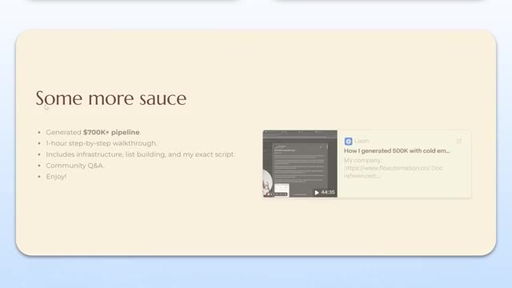
*⏱️ 00:35:04 — Une présentation de type slide montrant une section intitulée "Some more sauce" listant les bénéfices d'une ressource (pipeline à 700K$, tutoriel vidéo, infrastructure, scripts) et intégrant un aperçu de vidéo Loom.*

---

### ⏱️ `[00:35:19 - 00:35:39]` | Segment #78

**🔊 Audio (Transcription Intégrale Mot pour Mot en Français) :**
> It talks about how I generate 700K plus in pipeline at this point. It's like a one-hour step-by-step walkthrough. It includes the infrastructure list building and my exact script, just like the ones I showed you. I also do like a quick community Q&A, basically just answering questions that people have. So hopefully answers that as well. So at the first and foremost, like I want people to get value from this. So hopefully this sauce helps.

**👁️ Analyse Visuelle d'Écran (gemini-3.5-flash-lite) :**
**Interface & Outils** : Lecteur vidéo Loom intégré dans une interface de présentation (type Notion ou slides).

**Contenu textuel & Code** : Texte promotionnel : "Some more sauce", "Generated $700K+ pipeline", "1-hour step-by-step walkthrough", "Includes infrastructure, list building, and my exact script", "Community Q&A". Aperçu vidéo intitulé "How I generated 500K with cold em..." avec lien vers "floautomation.co".

**Action / Démonstration** : Présentation des résultats commerciaux et partage d'une ressource vidéo pédagogique pour la communauté.

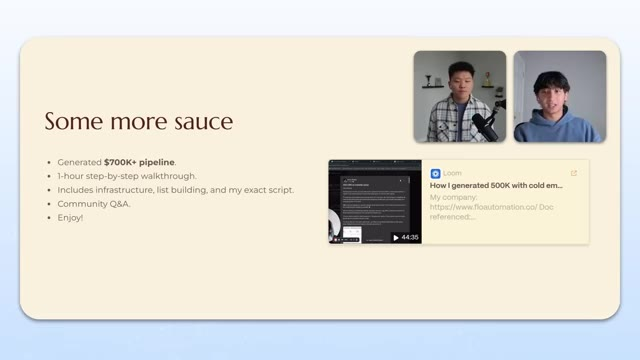
*⏱️ 00:35:24 — Une diapositive de présentation illustrant les résultats obtenus et le contenu d'une formation, incluant un aperçu vidéo Loom.*

---

### ⏱️ `[00:35:39 - 00:35:57]` | Segment #79

**🔊 Audio (Transcription Intégrale Mot pour Mot en Français) :**
> And then if they're actually interested in what I specifically do, they can find me at flowautomation.co. This is my website at the very bottom. You can also find me on LinkedIn, flowautomation as well, Instagram. And then obviously you can always email me and I'll be the one to respond at contact.flowautomation.co as well. Awesome.

**👁️ Analyse Visuelle d'Écran (gemini-3.5-flash-lite) :**
**Interface & Outils** : N/A (diapositive de présentation)

**Contenu textuel & Code** : URL du site web (floautomation.co), adresse email (contact@floautomation.co), noms des plateformes sociales et informations de contact professionnel.

**Action / Démonstration** : N/A (présentation statique des coordonnées de contact)

---

### ⏱️ `[00:35:57 - 00:36:18]` | Segment #80

**🔊 Audio (Transcription Intégrale Mot pour Mot en Français) :**
> Well, thanks again for taking the time to hop in and share all these insights with us. I really enjoyed getting to meet you and getting to hear about how you've been able to find so much success through the cold email game. So thanks so much, Savam. Yeah, thanks so much for having me, Nate. So I hope you guys enjoyed today's episode with Savam. If you're also interested in checking out some cold email techniques and growing an AI automation agency, then definitely check out my Plus community.

**👁️ Analyse Visuelle d'Écran (gemini-3.5-flash-lite) :**
**Interface & Outils** : Aucune interface logicielle ou outil technique n'est affiché.

**Contenu textuel & Code** : Aucun code, commande ou élément graphique n'est présent.

**Action / Démonstration** : Discussion conversationnelle de fin d'entretien entre le présentateur et son invité.

---

### ⏱️ `[00:36:18 - 00:36:41]` | Segment #81

**🔊 Audio (Transcription Intégrale Mot pour Mot en Français) :**
> The link for that is down in the description. We've got an amazing community of over 3.5,000 members who are building businesses with AI automation. So it's a great spot to be. Lots of other entrepreneurs in there and lots of other people who are just as obsessed with AI as you probably are. So I hope to see you guys in that community, but that's going to do it for today. So if you enjoyed the video or you learned something new, please give it a like. It definitely helps me out a ton. And as always, I appreciate you guys making it to the end of the video. I'll see you on the next one.

**👁️ Analyse Visuelle d'Écran (gemini-3.5-flash-lite) :**
**Interface & Outils** : Plateforme communautaire Skool.

**Contenu textuel & Code** : Texte promotionnel pour la communauté "AI Automation Society Plus", statistiques de membres (1799), et liens vers des ressources ("Get on Nate's YouTube", "How to Get Help", "Become an AIS+ Affiliate").

**Action / Démonstration** : Promotion visuelle de la plateforme communautaire pour inciter les spectateurs à rejoindre le groupe.

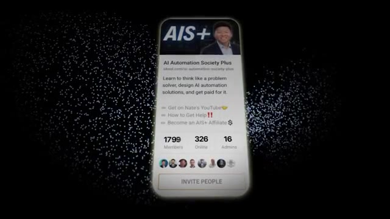
*⏱️ 00:36:24 — Interface de présentation de la communauté "AI Automation Society Plus" (Skool), affichant le nombre de membres, d'utilisateurs en ligne et les accès aux ressources.*

---

