# 🎬 How to Sign AI Workflow Clients (With 0 Followers)

> **Chaîne** : [Nate Herk | AI Automation](https://www.youtube.com/@nateherk/featured)  
> **Lien YouTube** : [https://www.youtube.com/watch?v=_rZAR-s4KIo](https://www.youtube.com/watch?v=_rZAR-s4KIo)  
> **Date de publication** : 20260216  
> **Durée** : 00:14:28  
> **Identifiant vidéo** : `_rZAR-s4KIo`  
> **Transcription & Analyse** : `whisper-v3-large-turbo+gemini-3.5-flash-lite`  

---

## 📌 Synthèse Exécutive & Outils

### 💡 Résumé
Dans cette vidéo intitulée **How to Sign AI Workflow Clients (With 0 Followers)**, Nate Herk décortique les capacités pratiques d'automatisation et de développement propulsées par les modèles de pointe.

### 🛠️ Outils, Modèles & Logiciels Présentés
- **Opus 5.5 & Claude Code** : Modèles d'ingénierie et agents de codage autonome.

### 🔑 Points Clés & Enseignements Stratégiques
- Optimiser le niveau d'effort et le raisonnement des modèles IA pour des résultats industriels.
- Automatiser les cycles de création logicielle de bout en bout.

---

## ⏱️ Chronologie & Transcription Complète Audio & Visuelle (Mot pour Mot)

### ⏱️ `[00:00:00 - 00:00:22]` | Segment #01

**🔊 Audio (Transcription Intégrale Mot pour Mot en Français) :**
> People keep telling me they can't land AI clients because they don't have a YouTube channel, since I got my first clients through content. But you don't actually need content at all. If I lost my YouTube channel tomorrow and I had to start from zero, there are three simple ways that I'd get clients fast, and I hardly see anyone talking about the third method. So in this video, I'll show you real proof that you can land clients without a YouTube channel and the exact three steps you can follow to sign your first few clients this month. So let's get into it.

**👁️ Analyse Visuelle d'Écran (gemini-3.5-flash-lite) :**
**Interface & Outils** : Aucune interface logicielle de travail (éditeur de code ou outil d'automatisation) n'est visible.

**Contenu textuel & Code** : Texte informatif (titres) uniquement.

**Action / Démonstration** : Aucune action technique ou manipulation d'outil n'est démontrée.

---

### ⏱️ `[00:00:22 - 00:00:55]` | Segment #02

**🔊 Audio (Transcription Intégrale Mot pour Mot en Français) :**
> So just to start off, I'm not going to pretend that YouTube or content doesn't help. It absolutely does. Because when someone watches a ton of your videos before reaching out, they already have trust and they've heard your voice. They see how you think. And by the time they book that call, they're basically sold. And that's the power of content. But what most people don't realize, the agency that I founded and exited, True Horizon, scaled past 100k a month. And even though the majority of our leads were coming from YouTube, that's not where our best clients were coming from. The clients we ended up actually working with, the ones who paid well, stuck around, and were a dream to work with, came from two things, referrals and partnerships. So we'd make one client happy and then they'd tell their network. Or we'd partner with tools or other

**👁️ Analyse Visuelle d'Écran (gemini-3.5-flash-lite) :**
**Interface & Outils** : Site web de TrueHorizon AI.

**Contenu textuel & Code** : Texte affiché : "We build intelligent AI Solutions designed for business growth" et une miniature de vidéo YouTube intitulée "THAI About Us".

**Action / Démonstration** : Présentation visuelle de la vitrine web utilisée comme preuve de crédibilité et outil de conversion pour les clients potentiels.

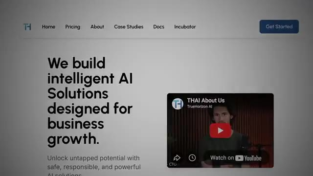
*⏱️ 00:00:39 — Capture d'écran du site web de "TrueHorizon AI", montrant la page d'accueil avec une proposition de valeur sur les solutions IA et une vidéo YouTube intégrée.*

---

### ⏱️ `[00:00:55 - 00:01:28]` | Segment #03

**🔊 Audio (Transcription Intégrale Mot pour Mot en Français) :**
> businesses that already had demand that they couldn't service themselves. And that's where the real growth came from. So yes, content is one path and it's a really great way to build momentum, but it's not the only path. And I get it because I know a lot of you guys don't want to start a YouTube channel or don't want to be consistently posting on LinkedIn every day. You don't want to be on camera. You don't want to wait 12 months to see results. And that's totally fair. So we're going to talk about three ways that you can land clients without posting a single piece of content, starting with number one, which is cold outreach. Now, before I get into this, I need to be real with you. Cold outreach is brutal when you have zero proof. The first thing that any prospect is going to ask you is, who have you done this for? And if your answer is nobody, you're fighting

**👁️ Analyse Visuelle d'Écran (gemini-3.5-flash-lite) :**
**Interface & Outils** : Aucune interface logicielle ou outil technique n'est affiché.

**Contenu textuel & Code** : Aucun code, commande ou prompt n'est visible à l'écran.

**Action / Démonstration** : Aucune action technique ou démonstration d'outil n'est réalisée.

---

### ⏱️ `[00:01:28 - 00:02:00]` | Segment #04

**🔊 Audio (Transcription Intégrale Mot pour Mot en Français) :**
> uphill the entire conversation. So before you go off and send a bunch of cold messages, go get some proof. Even if it's small, even if it's free, even if it's for your cousin's salon, the product doesn't need to match what you eventually want to sell. All that matters is that you can say, yeah, I have done this before. I've helped X business get Y result. That alone separates you from everyone who's purely theoretical. So there are four components to cold outreach, platforms, finding leads, reaching out, and then volume. So let's start with platforms. For B2B, here's where you should be looking. LinkedIn, Facebook groups, email, school communities, YouTube channels, Instagram, Reddit. Cold email has an average response rate of 1-5%,

**👁️ Analyse Visuelle d'Écran (gemini-3.5-flash-lite) :**
**Interface & Outils** : Make (plateforme d'automatisation de workflow).

**Contenu textuel & Code** : Schéma de workflow montrant des nœuds de connexion, infographie textuelle "PROOF" avec catégories "Small", "Free", "Local", liste numérotée "PLATFORMS", "FINDING LEADS".

**Action / Démonstration** : Illustration visuelle des concepts théoriques du discours via des diagrammes animés et des captures d'écran de services.

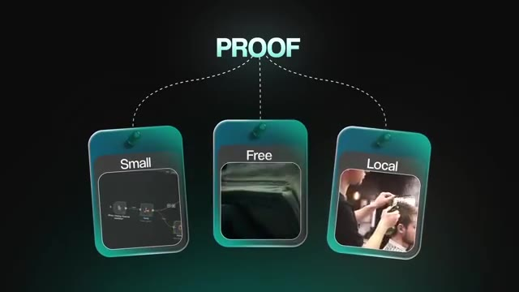
*⏱️ 00:01:36 — Infographie présentant le concept de "PROOF" avec trois piliers illustrés : Small (montrant un workflow Make), Free, et Local (montrant une scène de salon de coiffure).*

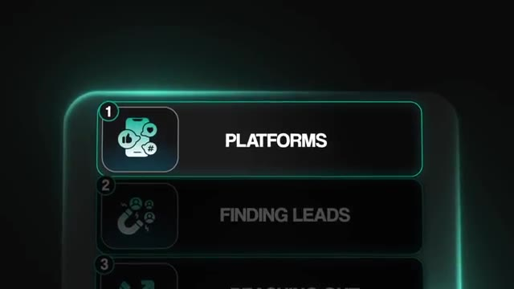
*⏱️ 00:01:52 — Interface graphique affichant une liste de étapes de stratégie commerciale, avec l'élément "PLATFORMS" mis en surbrillance en première position.*

---

### ⏱️ `[00:02:00 - 00:02:35]` | Segment #05

**🔊 Audio (Transcription Intégrale Mot pour Mot en Français) :**
> but personalized emails see up to 17% higher rates. LinkedIn in-mail DMs have a 10-25% response rate compared to email, which is much lower, but the LinkedIn DMs require more time per message. So I wanted to just throw those stats at you, but pick one or two to start. Don't try to do outreach on all of those platforms. You're going to spread yourself too thin because they all have different methods of what works best. So once you've picked your platform, here's where to actually find people worth reaching out to. Communities in your niche, followers of relevant pages or creators, business owners already complaining about wasting time or making mistakes, job boards and comment sections, because if someone's hiring for a role, you could automate, that's a signal. You could also look at local businesses in your area. Pro tip though,

**👁️ Analyse Visuelle d'Écran (gemini-3.5-flash-lite) :**
**Interface & Outils** : Aucune interface logicielle montrée, uniquement des éléments graphiques textuels.

**Contenu textuel & Code** : "Communities", "Target followers", "Frustrated owners".

**Action / Démonstration** : Présentation visuelle de stratégies de segmentation pour l'outreach.

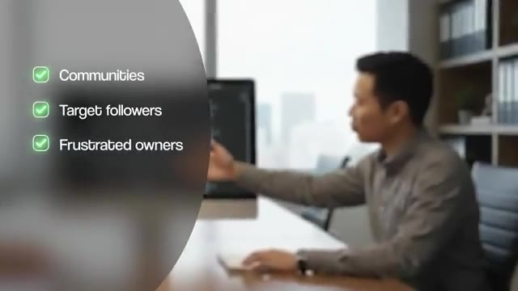
*⏱️ 00:02:27 — Capture d'écran montrant une liste de cibles potentielles (Communities, Target followers, Frustrated owners) avec des coches vertes, sur fond flou d'un environnement de bureau.*

---

### ⏱️ `[00:02:35 - 00:03:10]` | Segment #06

**🔊 Audio (Transcription Intégrale Mot pour Mot en Français) :**
> before you jump into something like Apollo or LinkedIn Sales Navigator to find a lead list, spend 10 minutes asking Chachibiti or Perplexity where industry-specific directories exist. So like architects have the American Institute of Architects. Coaches have coaching directories. Every industry probably has something, and these databases have already been filtered for you. Now, when it comes to reaching out, keep it simple. Focus on, of course, the problem, the outcome, not the actual tech solution. Nobody really cares if you built an 18 node automation with NNN and Slack and Notion MCP. They care about the results, which is, you know, more leads, less manual work, fewer errors, faster turnaround. Short value focused messages work better than long

**👁️ Analyse Visuelle d'Écran (gemini-3.5-flash-lite) :**
**Interface & Outils** : n8n (workflow automation), Interface de présentation de workflow (UI personnalisée).

**Contenu textuel & Code** : Schéma d'automatisation n8n montrant l'utilisation de modèles GPT-4o-mini, des agents de création d'images/vidéos et des publications automatisées sur réseaux sociaux (TikTok, Instagram, X).

**Action / Démonstration** : Navigation dans le menu des étapes de prospection et visualisation du design d'un workflow d'agent d'automatisation média sur n8n.

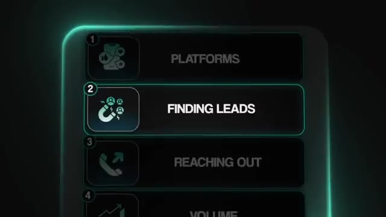
*⏱️ 00:02:53 — Interface graphique représentant un menu de workflow divisé en 4 étapes, avec l'étape "FINDING LEADS" mise en évidence.*

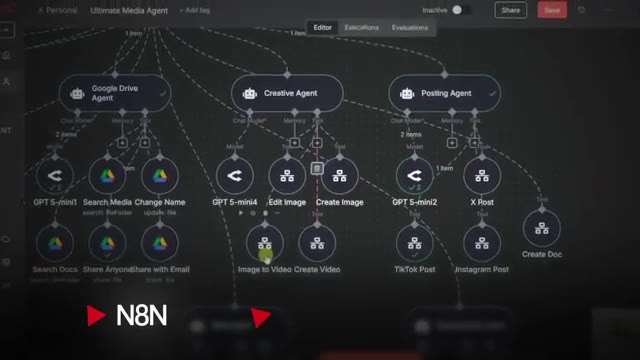
*⏱️ 00:03:01 — Tableau de bord du logiciel n8n illustrant un workflow complexe d'automatisation avec plusieurs agents (Google Drive, Creative, Posting) et leurs nœuds de connexion.*

---

### ⏱️ `[00:03:10 - 00:03:42]` | Segment #07

**🔊 Audio (Transcription Intégrale Mot pour Mot en Français) :**
> pitches. Your goal is not to close them in one message. That's just not realistic. Your goal is to get them curious, to start a conversation, get them wanting more. That's why the subject line is so important because if they're not curious at all, they're not going to click to open the email. Now, here's something, and I know it sounds a little bit counterintuitive, but just be completely honest about where you're at. That's my approach, at least. So saying something like, yeah, I'm just getting started. I'm trying to start up a business and that doesn't undercut you. It actually creates like a pattern interrupt and it builds trust because the prospect thinks, OK, this is actually a real human instead of, wow, great, you know, another face's pitch of someone trying to sell me. And of course, because you're unknown and unproven, you want to remove all the risk from

**👁️ Analyse Visuelle d'Écran (gemini-3.5-flash-lite) :**
**Interface & Outils** : Interface de messagerie mobile (iOS), interface de communication textuelle.

**Contenu textuel & Code** : Texte de conversation simulé : "Yeah," et "okay, this is actually a".

**Action / Démonstration** : Illustration visuelle du processus de conversation (pitching) décrit oralement par le créateur pour susciter l'intérêt du prospect.

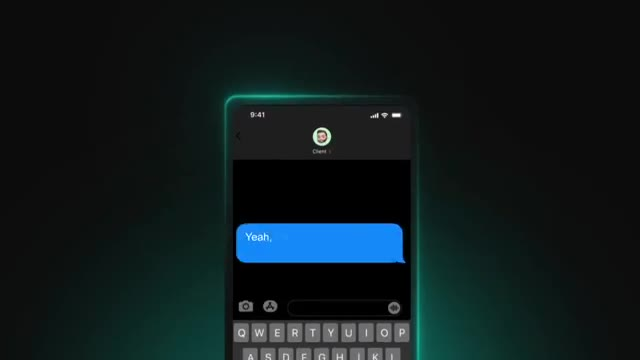
*⏱️ 00:03:26 — Simulation d'une interface de messagerie mobile (type iMessage) avec une bulle de texte bleue affichant "Yeah,".*

*⏱️ 00:03:34 — Représentation visuelle d'un utilisateur devant un ordinateur portable, avec une bulle de texte flottante affichant "okay, this is actually a".*

---

### ⏱️ `[00:03:42 - 00:04:02]` | Segment #08

**🔊 Audio (Transcription Intégrale Mot pour Mot en Français) :**
> your offer. So no payment until results, no contract. The only thing that you ask for is permission to use them as a case study if the solution works. You're not asking them to trust you and give you a ton of money. You're making it a no-brainer for them to say yes. And then one more thing, asking a stranger for 30 minutes on their calendar is a big ask. People are busy. People don't want to hop on calls with random people just to be sold. So instead, get them curious again.

**👁️ Analyse Visuelle d'Écran (gemini-3.5-flash-lite) :**
**Interface & Outils** : Aucune interface logicielle montrée.

**Contenu textuel & Code** : Texte informatif (titres de stratégie) et sous-titres dynamiques.

**Action / Démonstration** : Présentation face caméra (face-to-camera talk).

---

### ⏱️ `[00:04:02 - 00:04:37]` | Segment #09

**🔊 Audio (Transcription Intégrale Mot pour Mot en Français) :**
> Ask them if you can send them a two-minute loom video explaining the offer. And then you can record a quick video walking through how you'd help their specific business and let them do the heavy lifting before they ever get on a call with you. All right, the numbers game. So in the wise words of Alex Ramosi, someone I've actually had the pleasure of meeting multiple times, volume negates luck. So if you want to guarantee clients, you just need to increase the volume. At the very least, you should be sending 100 messages a day. I know that sounds like a lot, but understand this. A small percentage of replies is actually a really good metric. So we talked about the 1-5% average with cold email. If you're doing anything above 5%, you're crushing it. Which means if you send 100 emails and you only get 5 people to respond, not book in a call or pay you, just respond.

**👁️ Analyse Visuelle d'Écran (gemini-3.5-flash-lite) :**
**Interface & Outils** : Aucune interface logicielle ou outil technique n'est affiché.

**Contenu textuel & Code** : Texte affiché : "1-5%" et "COLD EMAIL".

**Action / Démonstration** : Aucune manipulation de code ou démonstration d'outil d'automatisation. Il s'agit d'une illustration graphique théorique.

---

### ⏱️ `[00:04:37 - 00:05:11]` | Segment #10

**🔊 Audio (Transcription Intégrale Mot pour Mot en Français) :**
> That's actually really good. But you do need to track everything. Your reply rate, your positive responses, your meetings booked, your deals closed. Each metric tells you what area you need to improve. And you don't just track the wins, you also have to track all of the negative responses because that tells you what not to do. So when you get positive replies, you write down the company size, the industry, the job title, anything else that's relevant, and then you can start to build your future lead lists around those patterns. And this is how you actually systematically improve instead of just guessing. Now here are the two things that most people do get wrong with cold outreach. The first one is maybe just don't build before you sell. If you're spending weeks perfecting an automation before you've talked to a single customer, you don't have a business, you just have

**👁️ Analyse Visuelle d'Écran (gemini-3.5-flash-lite) :**
**Interface & Outils** : Logiciel de montage graphique pour présentation vidéo.

**Contenu textuel & Code** : Logos d'outils d'automatisation (n8n) et icône de modèle d'IA stylisée sur des cartes numériques.

**Action / Démonstration** : Transition graphique illustrant l'intégration ou l'automatisation de flux de données.

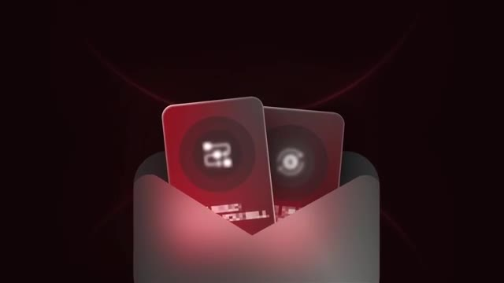
*⏱️ 00:05:03 — Illustration graphique abstraite montrant deux cartes de style technologique avec des logos (n8n et OpenAI/autre) émergeant d'une enveloppe stylisée.*

---

### ⏱️ `[00:05:11 - 00:05:40]` | Segment #11

**🔊 Audio (Transcription Intégrale Mot pour Mot en Français) :**
> a hobby. You need to use cold outreach as market research. Create an offer around something that you could build that you know it's feasible and then send messages about it. See if anyone bites. If they do and you see market validation, then go build it. But don't build before you sell. Once again, if you're spending all your time building something that no one's going to buy, there's just no point. So the second one is to start small and then reinvest. You don't need massive email infrastructure with thousands of domains. You just need a few. And each domain can send about 30 messages a day. And that's enough to generate real data. Once you close your first deal, you reinvest that money into scaling up your outreach.

**👁️ Analyse Visuelle d'Écran (gemini-3.5-flash-lite) :**
**Interface & Outils** : Interface web (potentiellement une plateforme de type gestionnaire de tâches ou interface d'automatisation) et interface de messagerie (Gmail).

**Contenu textuel & Code** : Dans l'image #3, on observe une série de messages intitulés "Let's do business together" adressés à différents destinataires (Meredith, Ajay, Brian Smith, Dylan McKay, etc.).

**Action / Démonstration** : Illustration de la démarche de "cold outreach" : l'utilisateur utilise une messagerie pour envoyer des propositions commerciales massives afin de valider une idée avant de procéder au développement technique.

*⏱️ 00:05:18 — Un utilisateur travaillant sur un ordinateur tard le soir, avec une interface de gestion de projet ou de workflow affichée à l'écran.*

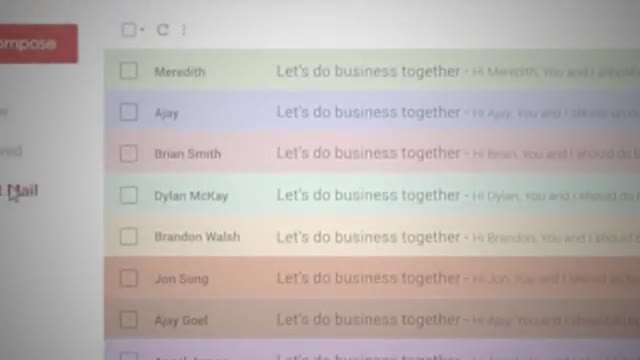
*⏱️ 00:05:33 — Gros plan sur une liste d'e-mails dans une boîte de réception, affichant des brouillons ou des messages sortants intitulés "Let's do business together".*

---

### ⏱️ `[00:05:40 - 00:06:02]` | Segment #12

**🔊 Audio (Transcription Intégrale Mot pour Mot en Français) :**
> And look, the thing is, people will ignore you. People will tell you to screw off, and that's normal. Most people quit because of that emotional weight and how tough it is to do cold outreach. So just understand that, and don't take it personally. Use it as data, and then if you can push through, you're already ahead. If you guys are interested in diving deeper specifically on cold email, then I just did a podcast with Savam, who was able to generate over half a million dollars in sales opportunities with cold email in six months as a beginner.

**👁️ Analyse Visuelle d'Écran (gemini-3.5-flash-lite) :**
**Interface & Outils** : AUCUNE

**Contenu textuel & Code** : AUCUN

**Action / Démonstration** : AUCUNE

---

### ⏱️ `[00:06:02 - 00:06:22]` | Segment #13

**🔊 Audio (Transcription Intégrale Mot pour Mot en Français) :**
> So I'll go ahead and link that right up here. But anyways, that is cold outreach. So let's talk about method number two, which is referrals. So why do referrals work so well? Simple, because business owners trust recommendations way more than strangers. And that's not even about business owners, that's just people in general. Think about how many times your friend has told you about a great restaurant or a TV show. You're way more likely to go check it out than if you saw an ad or a review for it because you trust your friend.

**👁️ Analyse Visuelle d'Écran (gemini-3.5-flash-lite) :**
**Interface & Outils** : AUCUNE

**Contenu textuel & Code** : AUCUN

**Action / Démonstration** : AUCUNE

---

### ⏱️ `[00:06:22 - 00:06:43]` | Segment #14

**🔊 Audio (Transcription Intégrale Mot pour Mot en Français) :**
> In fact, 92% of B2B buyers trust referrals from people that they know. And being in the AI space, it's really good to lead on referrals because it's very new right now and a lot of people are thinking, you know, I don't even know where I could go find a vendor to help me out with this problem. Business owners wanna know that someone that they trust has already taken the risk and it worked out well for them. When I first started freelancing, I'd make it a priority to over-deliver for the client.

**👁️ Analyse Visuelle d'Écran (gemini-3.5-flash-lite) :**
**Interface & Outils** : Éditeur de code (type IDE sombre).

**Contenu textuel & Code** : Code source non lisible (interface sombre typique de développement logiciel).

**Action / Démonstration** : Le présentateur est assis devant son poste de travail, en pleine réflexion, illustrant le processus de recherche de solutions techniques.

*⏱️ 00:06:32 — Le présentateur devant un écran d'ordinateur affichant une interface sombre de type éditeur de code ou IDE.*

---

### ⏱️ `[00:06:43 - 00:07:02]` | Segment #15

**🔊 Audio (Transcription Intégrale Mot pour Mot en Français) :**
> So maybe that looks like adding a simple dashboard that they didn't ask for or creating full documentation so that they could understand how everything works and they can maintain it if they choose to. Then, and only then, I knew they were happy. Usually after we'd been working together for a while, I'd whip out the golden question. Hey, do you have any friends or know any other business owners who might need AI automation or might just be interested in talking to me about this kind of stuff?

**👁️ Analyse Visuelle d'Écran (gemini-3.5-flash-lite) :**
**Interface & Outils** : Navigateur web (Instagram, interface de gestion de projet/documentation).

**Contenu textuel & Code** : Texte de la conversation : "Hey, do you have any friends or know any other", document "Connexus Build Strategy", interface de configuration de tableau de bord.

**Action / Démonstration** : Illustration visuelle des livrables de service client (tableaux de bord et documentation) suivie d'une mise en situation de communication client sur les réseaux sociaux.

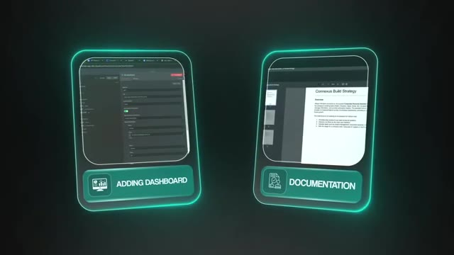
*⏱️ 00:06:48 — Deux cartes graphiques côte à côte intitulées "ADDING DASHBOARD" et "DOCUMENTATION", montrant respectivement une interface de configuration et un document intitulé "Connexus Build Strategy".*

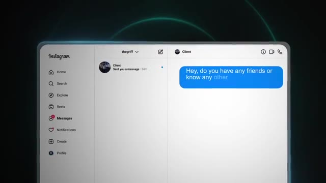
*⏱️ 00:06:57 — Interface web d'Instagram ouverte sur la page de messagerie, affichant une conversation avec un "Client" envoyant une demande.*

---

### ⏱️ `[00:07:02 - 00:07:26]` | Segment #16

**🔊 Audio (Transcription Intégrale Mot pour Mot en Français) :**
> You don't need a fancy script or a formal incentive program. Just a simple question. after you've earned the right to ask. Happy clients want to share. Think about how many times that you've wanted to put on a friend to a new restaurant, a new song, or a new product. People typically enjoy telling other people about things that worked for them. So if you've done great work, they'll probably want to brag about it. But the timing really matters because obviously you can't ask for referrals until you know that they're happy and that they have to truly believe you did provide them value.

**👁️ Analyse Visuelle d'Écran (gemini-3.5-flash-lite) :**
**Interface & Outils** : Aucune interface logicielle ou outil technique n'est affiché.

**Contenu textuel & Code** : Texte à l'écran : "RESTAURANT", "SONG", "PRODUCT" et "SO IF YOU'VE DONE GREAT WORK, THEY'LL PROBABLY WANT TO BRAG ABOUT IT."

**Action / Démonstration** : Aucune manipulation logicielle ou démonstration technique n'est effectuée, il s'agit d'une séquence de présentation orale.

---

### ⏱️ `[00:07:26 - 00:07:46]` | Segment #17

**🔊 Audio (Transcription Intégrale Mot pour Mot en Français) :**
> So typically I'd wait about a month or two after something's been like pushed live. And ideally you'd want to tie that into a moment where you can show them results. So maybe you're doing a month one performance review. So you would obviously say, you know, like, hey, when we started, here are all the KPIs and the metrics that we had documented and here's what we were going to track. And now after one month of the solution being in production, we've hit all of these KPIs and your business has grown, you know, X amount.

**👁️ Analyse Visuelle d'Écran (gemini-3.5-flash-lite) :**
**Interface & Outils** : n8n (nœuds de workflow d'automatisation)

**Contenu textuel & Code** : Nœuds de workflow incluant : "AI Agent", "Vector Store Retriever", "Document Loader", et intégrations OpenAI.

**Action / Démonstration** : Visualisation de l'architecture d'un agent IA pour le traitement de documents.

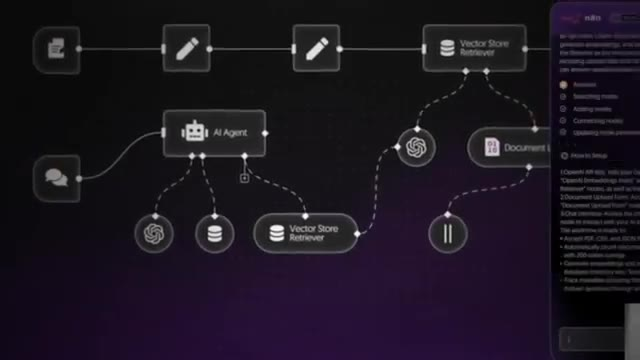
*⏱️ 00:07:31 — Un schéma de workflow complexe dans l'interface de n8n, montrant un "AI Agent" interconnecté avec des nœuds de stockage vectoriel (Vector Store Retriever) et des outils de traitement de documents.*

---

### ⏱️ `[00:07:47 - 00:08:05]` | Segment #18

**🔊 Audio (Transcription Intégrale Mot pour Mot en Français) :**
> The project has been a success. And then once they actually see that data, you can ask about, you know, the golden question. The conversation then feels a lot more natural because you've just reminded them of the value you delivered. It's not awkward. It's not like you're trying to sell them again. It's earned. And you could absolutely set up like a formal referral structure if you want. But honestly, a lot of times you don't need anything formal. Just do great work and then ask.

**👁️ Analyse Visuelle d'Écran (gemini-3.5-flash-lite) :**
**Interface & Outils** : Aucune interface logicielle ou outil technique n'est affiché.

**Contenu textuel & Code** : Aucun contenu technique, code ou donnée n'est visible.

**Action / Démonstration** : Aucune action technique ou démonstration de workflow n'est effectuée, il s'agit uniquement d'une séquence de type "talking head" (parole face caméra).

---

### ⏱️ `[00:08:05 - 00:08:24]` | Segment #19

**🔊 Audio (Transcription Intégrale Mot pour Mot en Français) :**
> Now, here are the common mistakes I see when people are trying to get into like the referral game. The first one is asking too early before you've actually proven yourself. And then the second one is not asking at all and just leaving that money on the table because you were too scared to ask. According to Dale Carnegie Research, only 11% of salespeople are actually asking for referrals. Yet, 91% of customers said that they'd gladly give one if they were asked.

**👁️ Analyse Visuelle d'Écran (gemini-3.5-flash-lite) :**
**Interface & Outils** : Navigateur web (site web de Dale Carnegie).

**Contenu textuel & Code** : Texte de l'article : "91% of clients will give a referral, but only 11% of salespeople will ask one."

**Action / Démonstration** : Citation d'une statistique clé pour illustrer l'argument commercial sur les opportunités manquées.

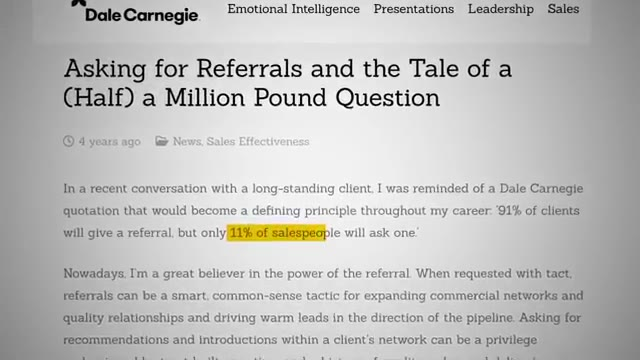
*⏱️ 00:08:20 — Capture d'écran d'un article du site Dale Carnegie soulignant l'importance statistique des demandes de recommandation.*

---

### ⏱️ `[00:08:25 - 00:08:46]` | Segment #20

**🔊 Audio (Transcription Intégrale Mot pour Mot en Français) :**
> So make sure you are asking for referrals. They will lead to bigger projects. They'll lead to longer term clients and there'll be way less friction than doing cold outreach. And once you've got clients that you're working with for longer term, it opens up method number three. And honestly, this is the one that I'd be going all in on if I was starting from zero. I call it the Trojan horse method. The big idea here is that instead of trying to build trust from scratch with cold prospects and build up all of your own authority, you borrow someone else's.

**👁️ Analyse Visuelle d'Écran (gemini-3.5-flash-lite) :**
**Interface & Outils** : Infographie de présentation (logiciel de montage vidéo type After Effects ou Canva).

**Contenu textuel & Code** : Texte affiché : "BIGGER PROJECTS", "LONG TERM CLIENTS", "LESS FRICTION", "COLD OUTREACH", "REFERRALS".

**Action / Démonstration** : Présentation orale des avantages des recommandations (referrals) par rapport au démarchage à froid, illustrée par une hiérarchie de concepts à l'écran.

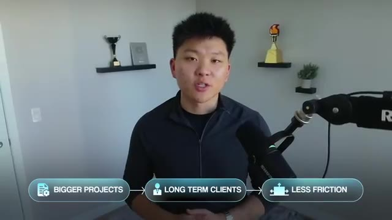
*⏱️ 00:08:30 — Le présentateur est face caméra, avec une infographie incrustée en bas montrant un flux logique : "BIGGER PROJECTS" -> "LONG TERM CLIENTS" -> "LESS FRICTION".*

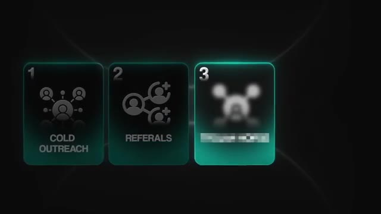
*⏱️ 00:08:35 — Capture d'écran d'un graphique présentant trois étapes de développement commercial : 1. Cold Outreach, 2. Referrals, 3. Une troisième option floutée (probablement pour créer du suspense ou introduire le sujet suivant).*

---

### ⏱️ `[00:08:46 - 00:09:04]` | Segment #21

**🔊 Audio (Transcription Intégrale Mot pour Mot en Français) :**
> You borrow their trust, you borrow their authority, and you borrow their existing client relationships. Partner source deals close 46% faster than other deal types. So think about it like this. Marketing agencies, consultants, coaches, law firms, they already have clients who trust them and have maybe been working with them for years. They've already built those relationships. And right now, a lot of those clients are thinking, I need AI.

**👁️ Analyse Visuelle d'Écran (gemini-3.5-flash-lite) :**
**Interface & Outils** : Document textuel de présentation (type rapport d'analyse).

**Contenu textuel & Code** : "In our 2023 State of the Partner Ecosystem Report, we found that deals close 46% faster when a partner is involved."

**Action / Démonstration** : Affichage informatif de statistiques professionnelles pour appuyer l'argumentation sur le partenariat.

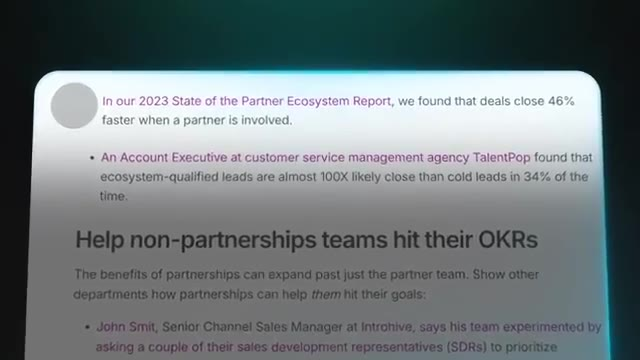
*⏱️ 00:08:51 — Une capture d'écran textuelle issue d'un rapport sur les écosystèmes de partenariat, soulignant que les transactions se concluent 46% plus vite grâce aux partenaires.*

---

### ⏱️ `[00:09:04 - 00:09:23]` | Segment #22

**🔊 Audio (Transcription Intégrale Mot pour Mot en Français) :**
> And the agency itself is probably thinking, I need to be able to offer AI to my clients. So instead of competing for their attention, you partner with people who already have it. So here's what you could say. Hey, I help businesses implement AI automation. I'd love to offer free AI discovery calls to your clients. No cost to you, no cost to them. You get to look like a hero because you brought in an AI expert and you gave them free value.

**👁️ Analyse Visuelle d'Écran (gemini-3.5-flash-lite) :**
**Interface & Outils** : Application de messagerie instantanée (type iMessage).

**Contenu textuel & Code** : "Hey, I help businesses implement AI automation. I love to offer free AI discovery calls to your clients. No cost to you,"

**Action / Démonstration** : Simulation d'une séquence de messagerie utilisée pour le démarchage commercial.

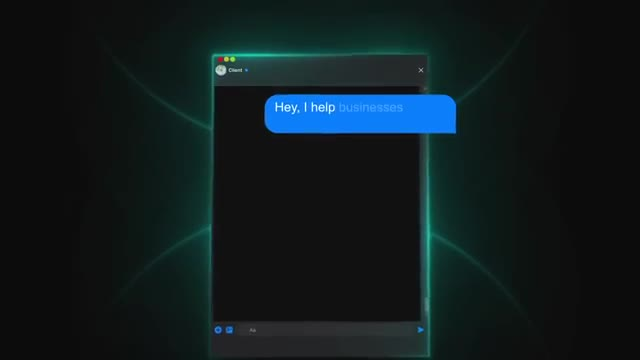
*⏱️ 00:09:14 — Capture d'écran d'une interface de messagerie montrant le début d'un script de vente concernant l'implémentation de l'IA.*

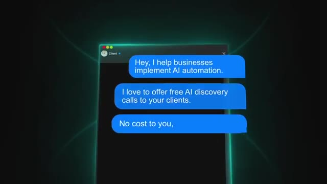
*⏱️ 00:09:18 — Suite du script de messagerie proposant des appels de découverte IA gratuits pour les clients de l'agence.*

---

### ⏱️ `[00:09:23 - 00:09:58]` | Segment #23

**🔊 Audio (Transcription Intégrale Mot pour Mot en Français) :**
> And if any of them end up wanting to work with me, I'll give you 20% of that project's revenue. There's essentially no risk for them. They're not paying you. You're not asking for anything from them up front as far as money. you're just saying, let me make you look good to your clients. So this works well because when the agency owner says to their client, hey, you know, I'm going to bring in this expert to give you a free audit, you instantly have more authority. You're being called in like a consultant. You're the specialist that they are introducing. Compare that to cold outreach when you're a complete stranger in an inbox trying to prove yourself. So with the Trojan horse method, you borrow credibility from day one and you're getting access into probably a bunch of clients who already trust and already pay and are already warm to spending money on services. So they're not tire kickers.

**👁️ Analyse Visuelle d'Écran (gemini-3.5-flash-lite) :**
**Interface & Outils** : Superpositions graphiques animées (Motion Graphics) intégrées au flux vidéo.

**Contenu textuel & Code** : Dialogue simulé : "Hey, you know, I'm going to bring in this expert to give you a free audit." suivi de "Sounds good, thank you". Texte conceptuel : "TROJAN HORSE", "BORROW CREDIBILITY FROM DAY ONE".

**Action / Démonstration** : Illustration visuelle du modèle de prospection par recommandation (le "Cheval de Troie") pour acquérir de la crédibilité et des clients.

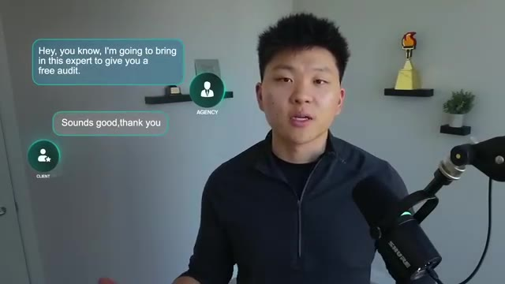
*⏱️ 00:09:41 — Capture d'écran montrant une simulation de conversation textuelle entre une "Agence" et un "Client", illustrant la proposition d'un audit gratuit.*

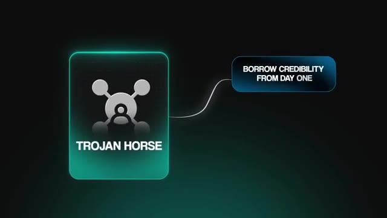
*⏱️ 00:09:50 — Graphique animé illustrant le concept de "Cheval de Troie" (Trojan Horse) comme stratégie marketing, avec le texte "BORROW CREDIBILITY FROM DAY ONE" (Emprunter de la crédibilité dès le premier jour).*

---

### ⏱️ `[00:09:58 - 00:10:24]` | Segment #24

**🔊 Audio (Transcription Intégrale Mot pour Mot en Français) :**
> They're real businesses with hopefully real budgets. Now, when you are able to secure a few yeses, just keep it simple. Hop on the discovery call, learn about their business, understand their processes, and tell them where AI could help them. Now, if they hop in the call and say, you know, like, no, I need to use AI, and I'm glad that we're having this session, but I have no clue where to even start, tell me what I don't know. What you wanna do is help them identify their current constraints. So a really good question you could ask is, if tomorrow you've got 300 people that wanted your services, what process would break first in that, you know, customer lifecycle?

**👁️ Analyse Visuelle d'Écran (gemini-3.5-flash-lite) :**
**Interface & Outils** : Interface de visioconférence générique (simulée).

**Contenu textuel & Code** : Bulles de dialogue : "Hey, I know I need to use AI" et "and I'm glad".

**Action / Démonstration** : Illustration d'un échange client typique lors d'un appel de découverte pour un projet d'automatisation IA.

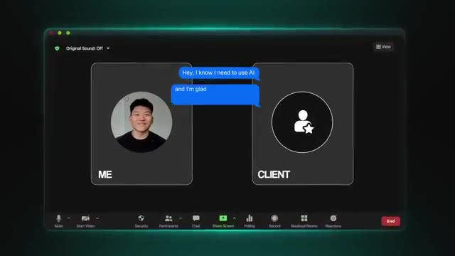
*⏱️ 00:10:11 — Interface de type visioconférence (type Zoom) illustrant une conversation textuelle entre "Me" (le présentateur) et "Client".*

---

### ⏱️ `[00:10:24 - 00:10:42]` | Segment #25

**🔊 Audio (Transcription Intégrale Mot pour Mot en Français) :**
> And then they'll think about it, they'll run it through in their head, and then they'll say something, and you just dive in on that process. And here's the best part about the Trojan Horse method. Even if they don't end up becoming a client, I think it's still a win-win-win. You got experience doing a discovery call, the business owner got free insights about AI, and the agency looked like a hero for bringing you in. Win-win-win. And some percentages of those calls will turn into paid projects.

**👁️ Analyse Visuelle d'Écran (gemini-3.5-flash-lite) :**
**Interface & Outils** : Interface graphique animée (motion design) utilisée pour illustrer les concepts de la méthode de vente.

**Contenu textuel & Code** : Texte sur les cartes : "Experience doing a discovery call", "Free insights about AI", "Looks like a hero for bringing you in".

**Action / Démonstration** : Transition animée présentant les acteurs impliqués dans une stratégie de prospection et leurs gains respectifs.

*⏱️ 00:10:33 — Un graphique animé affiche une seule carte avec l'étiquette "YOU" et une icône de profil utilisateur, illustrant le début du concept.*

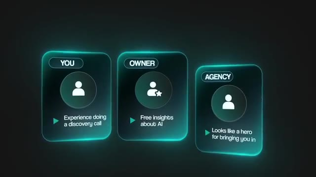
*⏱️ 00:10:38 — Un schéma montrant trois cartes interactives nommées "YOU", "OWNER" et "AGENCY", détaillant les bénéfices mutuels de la "Trojan Horse method".*

---

### ⏱️ `[00:10:43 - 00:11:07]` | Segment #26

**🔊 Audio (Transcription Intégrale Mot pour Mot en Français) :**
> Remember, it's a numbers game. You need to do 10 times more than you think. Finding partners is the same process as cold outreach. Building a lead list of agencies, consultants, and service providers and niches that you wanna work with, reach out with an offer that's hard to say no to. And luckily, that's kind of what this method is. It's an offer with like zero downside for them unless you mess up the discovery call big time. And that's basically the risk that they have. But of course, the upside is they're providing tons of extra value to their clients and they might get 20% of a big project.

**👁️ Analyse Visuelle d'Écran (gemini-3.5-flash-lite) :**
**Interface & Outils** : AUCUNE

**Contenu textuel & Code** : AUCUN

**Action / Démonstration** : AUCUNE

---

### ⏱️ `[00:11:08 - 00:11:42]` | Segment #27

**🔊 Audio (Transcription Intégrale Mot pour Mot en Français) :**
> So if you construct that offer and you hit their inbox or their LinkedIn DMs, most agency owners will actually at least hear you out. So that's the Trojan horse method. Borrow trust, make partners look like heroes, get in front of warm clients without building your own audience. So now that we've talked about those three methods, let me give you a roadmap. But first, I need to do one thing. I need to flip how you're thinking about this. A lot of people think about this backwards. They spend weeks, maybe even months, building out elaborate systems, perfecting every deal, and then they try to sell it. By that point, they've invested all this time into something that they have no idea anyone actually wants. There's no market validation. So the smarter thing is to actually flip that order and create an offer around something that you know you could build. Maybe you see other people building it so you know it's

**👁️ Analyse Visuelle d'Écran (gemini-3.5-flash-lite) :**
**Interface & Outils** : Aucune interface logicielle ou outil de développement n'est présenté dans ce segment.

**Contenu textuel & Code** : Aucun code, commande ou donnée technique n'est affiché.

**Action / Démonstration** : Le présentateur explique simplement sa stratégie commerciale sans démonstration pratique.

---

### ⏱️ `[00:11:42 - 00:12:15]` | Segment #28

**🔊 Audio (Transcription Intégrale Mot pour Mot en Français) :**
> possible. And then start sending outreach as if you have the thing built. See if there's anyone interested. See if people respond. If they do, then build it out. But if nobody bites, then you should pivot to something else and test that offer again before you build it all out. In that case, the only thing you've lost is a little bit of time that it took to write some of those messages. But the lesson is stark. You can have the most technically impressive system in the world, but if you built it in isolation without talking to customers first, you just have an expensive portfolio piece that nobody actually wants. Cold outreach gives you direct primary research from the market before you commit to building anything. People either respond or they don't, and that signal is worth more than any amount of guessing. So now that we've covered

**👁️ Analyse Visuelle d'Écran (gemini-3.5-flash-lite) :**
**Interface & Outils** : Aucune.

**Contenu textuel & Code** : Aucun.

**Action / Démonstration** : Le présentateur parle et gesticule pour illustrer ses propos sur la stratégie de validation d'offre.

---

### ⏱️ `[00:12:15 - 00:12:34]` | Segment #29

**🔊 Audio (Transcription Intégrale Mot pour Mot en Français) :**
> that, let's talk about the four-step framework. Step one is offer first. So pick a niche, pick a problem, do some research, create an offer around an outcome that you're confident you could deliver. Now, I do think that building simple POCs and demos is fine and probably a good idea, just in case on that Loom video, you can show them how it works or on a call. But don't pour weeks and weeks into building something, once again, if you don't know the market wants it.

**👁️ Analyse Visuelle d'Écran (gemini-3.5-flash-lite) :**
**Interface & Outils** : Tableau de bord d'analyse de données (type SaaS ou outil de reporting).

**Contenu textuel & Code** : Graphiques, courbes de progression et listes de données chiffrées sur le tableau de bord visible sur l'ordinateur.

**Action / Démonstration** : Le présentateur travaille activement sur son ordinateur tout en consultant simultanément un appel vidéo, illustrant une démonstration concrète de gestion de workflow.

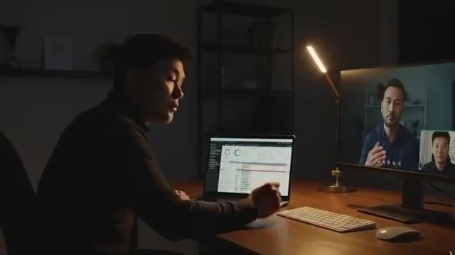
*⏱️ 00:12:29 — Le présentateur est assis devant son ordinateur, visualisant un tableau de bord analytique complexe sur son écran principal, tout en étant en visioconférence sur un second écran.*

---

### ⏱️ `[00:12:34 - 00:12:55]` | Segment #30

**🔊 Audio (Transcription Intégrale Mot pour Mot en Français) :**
> Step two is validate with volume. So test it with outreach. Aim to get five clients so that you can start getting referrals and case studies. If you're doing manual DMs on LinkedIn or Instagram, maybe aim for at least 100 a day. I know it's aggressive, but that's what it takes to get real data fast. And if you want to take the cold email route, then definitely just invest in some domains. Maybe you could buy domains that are already warmed up and get some inboxes that you can scale up to like 500 emails a day.

**👁️ Analyse Visuelle d'Écran (gemini-3.5-flash-lite) :**
**Interface & Outils** : Google Sheets

**Contenu textuel & Code** : Tableau de données de prospection incluant : "Founder", "Co-Founder", "CEO", "Managing Director" avec colonnes pour les prénoms, noms, postes et emails de contact.

**Action / Démonstration** : Présentation d'une méthode de prospection manuelle à haut volume pour la validation d'une offre commerciale.

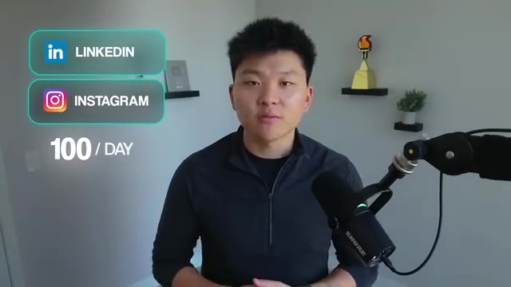
*⏱️ 00:12:45 — Le présentateur avec une incrustation graphique affichant les logos de LinkedIn et Instagram suivis de la mention "100 / DAY".*

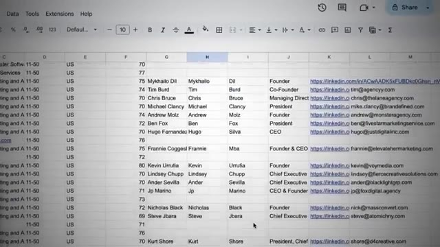
*⏱️ 00:12:50 — Capture d'écran d'une feuille Google Sheets contenant une base de données de prospects (noms, titres de poste, liens LinkedIn et adresses e-mail).*

---

### ⏱️ `[00:12:55 - 00:13:15]` | Segment #31

**🔊 Audio (Transcription Intégrale Mot pour Mot en Français) :**
> Just keep in mind, even if you're getting a 3% reply rate, that's still pretty good. But here's what separates winners from losers because both winners and losers will fail. Everyone hits roadblocks. The difference is that winners understand why they failed and they change something. Losers keep throwing time and resources into a broken system. So monitor your data every single day. Track your open rate, track your reply rate, track your positive response rate.

**👁️ Analyse Visuelle d'Écran (gemini-3.5-flash-lite) :**
**Interface & Outils** : Aucune interface logicielle, terminal ou outil d'automatisation n'est visible. Il s'agit d'éléments graphiques de montage vidéo (infographie).

**Contenu textuel & Code** : Texte affiché : "WINNERS", "Understand why", "LOSERS".

**Action / Démonstration** : Aucune action de démonstration technique ou manipulation d'outil IA n'est effectuée.

---

### ⏱️ `[00:13:15 - 00:13:34]` | Segment #32

**🔊 Audio (Transcription Intégrale Mot pour Mot en Français) :**
> If something's not working, then figure out why and actually adjust it. Step three is to deliver and then document. So once you do land a client, your job is to over deliver and then track everything. So before you start, you have to get those baseline metrics. How long does the process take manually? What's the error rate? What are the current KPIs? And then after your system is live, you measure those same numbers again. You show them the before, you show them the after, and that does two things.

**👁️ Analyse Visuelle d'Écran (gemini-3.5-flash-lite) :**
**Interface & Outils** : Terminal de commande (environnement type VS Code ou terminal Linux).

**Contenu textuel & Code** : Code source et lignes de commandes (non identifiables précisément car partiellement masqués par le texte "BASELINE METRICS").

**Action / Démonstration** : Saisie clavier sur un ordinateur portable pour mesurer les temps de traitement manuels (baseline metrics).

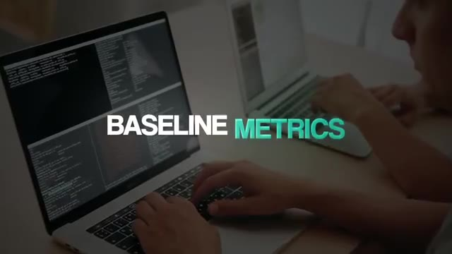
*⏱️ 00:13:24 — Vue rapprochée d'un utilisateur travaillant sur un ordinateur portable affichant une interface de terminal de ligne de commande avec du texte.*

---

### ⏱️ `[00:13:34 - 00:14:09]` | Segment #33

**🔊 Audio (Transcription Intégrale Mot pour Mot en Français) :**
> It first of all proves ROI so they know it was actually a good investment. And the second thing is that it gives you a rock solid case study to use for future clients. And then of course, once you've shown them all that data, ask for the referral. And then step four is to scale with borrowed authority. Now that you've got some results under your belt, start using the Trojan Horse method. reach out to agencies, consultants, and service providers. Offer to do free audits for their clients. Make them look like the hero. Take 20% rev share on any deals that you close. This gets you in front of warm leads without building your own audience. And because you're introduced by someone that they already trust, you have instant credibility. So I know we covered a ton of information in this video. So what I did is I threw all of this into a resource guide, which you can access for completely free in my free school community. The link for that is down in

**👁️ Analyse Visuelle d'Écran (gemini-3.5-flash-lite) :**
**Interface & Outils** : Graphisme d'animation de présentation (type Slide/Keynote).

**Contenu textuel & Code** : Texte : "4 STEP ROADMAP", "Offer first", "Validate with volume", "Deliver and document", "CREDIBILITY", "AGENCY", "YOU".

**Action / Démonstration** : Illustration schématique du processus de vente et de transfert de confiance dans une stratégie d'automatisation.

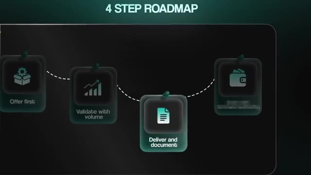
*⏱️ 00:13:42 — Une infographie présente un "4 STEP ROADMAP" sous forme de parcours jalonné, affichant les étapes : "Offer first", "Validate with volume", et "Deliver and document".*

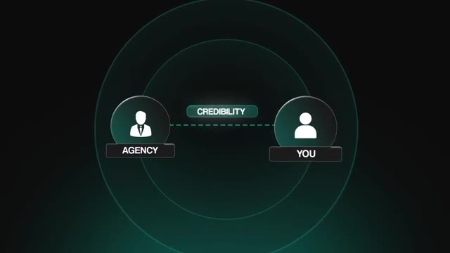
*⏱️ 00:14:00 — Une animation illustre un transfert de "CREDIBILITY" entre deux icônes représentant une "AGENCY" et "YOU".*

---

### ⏱️ `[00:14:09 - 00:14:27]` | Segment #34

**🔊 Audio (Transcription Intégrale Mot pour Mot en Français) :**
> the description. And if you want to dive deeper into all of this kind of stuff and connect with over 3000 members who are building their own AI automation businesses and check out my plus community. The link for that is also down in the description, but that's going to do it for today. So if you guys enjoyed the video or you learned something new, then please give it a like. It definitely helps me out a ton. And as always, I appreciate you guys making it to the end of the video. I'll see you on the next one. Thanks everyone.

**👁️ Analyse Visuelle d'Écran (gemini-3.5-flash-lite) :**
**Interface & Outils** : Plateforme communautaire Skool, interface web YouTube.

**Contenu textuel & Code** : Classements de membres avec scores d'engagement, titres de posts (ex: "Community Wins Recap"), compteurs de membres (3k).

**Action / Démonstration** : Navigation dans les onglets de classement et présentation de l'interface communautaire.

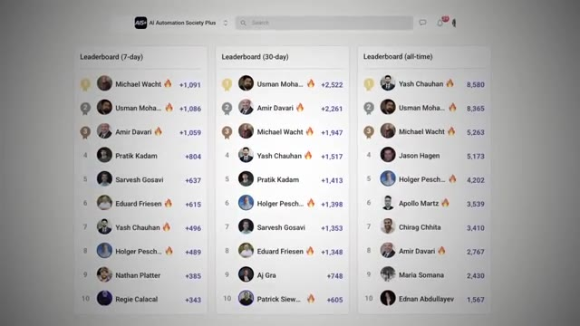
*⏱️ 00:14:13 — Vue détaillée du tableau de bord "Leaderboard" de la communauté "AI Automation Society Plus", classant les membres sur 7 jours, 30 jours et historiquement (all-time).*

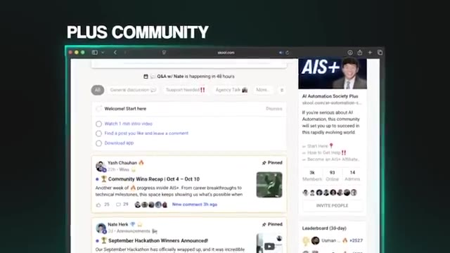
*⏱️ 00:14:18 — Interface de la plateforme Skool affichant le flux de la communauté "AIS+", avec des publications épinglées, des annonces et des statistiques de membres.*

---

