# 🎬 Building Beautiful Websites with Claude Code Is Too Easy

> **Chaîne** : [Nate Herk | AI Automation](https://www.youtube.com/@nateherk/featured)  
> **Lien YouTube** : [https://www.youtube.com/watch?v=86HM0RUWhCk](https://www.youtube.com/watch?v=86HM0RUWhCk)  
> **Date de publication** : 20260219  
> **Durée** : 00:27:51  
> **Identifiant vidéo** : `86HM0RUWhCk`  
> **Transcription & Analyse** : `whisper-v3-large-turbo+gemini-3.5-flash-lite`  

---

## 📌 Synthèse Exécutive & Outils

### 💡 Résumé
Dans cette vidéo intitulée **Créer de superbes sites web avec Claude Code, c'est trop facile**, Nate Herk décortique les capacités pratiques d'automatisation et de développement propulsées par les modèles de pointe.

### 🛠️ Outils, Modèles & Logiciels Présentés
- **Opus 5.5 & Claude Code** : Modèles d'ingénierie et agents de codage autonome.

### 🔑 Points Clés & Enseignements Stratégiques
- Optimiser le niveau d'effort et le raisonnement des modèles IA pour des résultats industriels.
- Automatiser les cycles de création logicielle de bout en bout.

---

## ⏱️ Chronologie & Transcription Complète Audio & Visuelle (Mot pour Mot)

### ⏱️ `[00:00:00 - 00:00:19]` | Segment #01

**🔊 Audio (Transcription Intégrale Mot pour Mot en Français) :**
> Aujourd'hui, je vais vous montrer cinq astuces simples que vous pouvez utiliser pour vous assurer que Claude Code vous crée des sites Web qui n'ont pas l'air d'avoir été codés au feeling par une IA, mais qui ont réellement un aspect professionnel et fidèle à votre image de marque. Et nous allons parcourir tout cela de manière à ce que, même si vous n'avez jamais utilisé Claude Code auparavant, ce ne soit absolument pas un problème. Vous allez pouvoir, d'ici la fin de cette vidéo, créer des pages d'atterrissage et des sites Web au rendu vraiment génial.

**👁️ Analyse Visuelle d'Écran (gemini-3.5-flash-lite) :**
**Interface & Outils** : Navigateur web affichant une page SaaS et tableau blanc de type Miro / Figma Canvas.

**Contenu textuel & Code** : Maquette de site web SaaS avec en-tête, bannière principale "Build Faster. Ship Smarter.", et grille de moodboard de design.

**Action / Démonstration** : Présentation visuelle de sites web professionnels créés avec Claude Code.

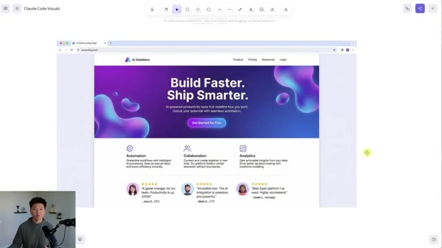
*⏱️ 00:00:05 — Aperçu d'une page de destination SaaS générée avec un design épuré, des graphismes violets et bleus, et des sections de témoignages.*

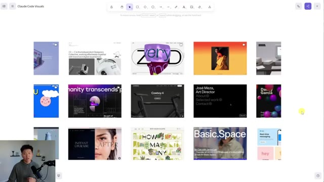
*⏱️ 00:00:09 — Grille d'exemples de sites web et d'interfaces de design de référence présentés sur un tableau blanc numérique.*

---

### ⏱️ `[00:00:19 - 00:00:48]` | Segment #02

**🔊 Audio (Transcription Intégrale Mot pour Mot en Français) :**
> Très bien, donc je ne veux pas perdre de temps du tout. La première chose que vous devez faire, c'est d'aller télécharger Visual Studio Code. Allez donc sur un navigateur et tapez VS Code, puis téléchargez-le pour votre système d'exploitation. C'est essentiellement l'EDI dans lequel nous allons utiliser CloudCode. Une fois que vous aurez fait cela et que vous l'aurez ouvert, voici à quoi cela ressemblera. Vous allez aller sur le côté gauche juste ici et cliquer sur les extensions, et vous allez taper CloudCode et l'installer comme ce que vous voyez juste ici. Et une fois que vous aurez fait cela, il vous sera demandé de vous connecter avec votre abonnement Anthropic ou votre abonnement Cloud, pour lequel vous avez besoin d'un compte payant.

**👁️ Analyse Visuelle d'Écran (gemini-3.5-flash-lite) :**
**Interface & Outils** : Visual Studio Code (site web et logiciel local).

**Contenu textuel & Code** : Interface utilisateur de VS Code, liste des projets récents ("Trading Bot", "Claude Exec"), et page descriptive de l'extension "Claude Code for VS Code" éditée par Anthropic.

**Action / Démonstration** : Navigation sur le site de téléchargement, ouverture de l'éditeur et consultation du gestionnaire d'extensions pour installer l'intégration Claude Code.

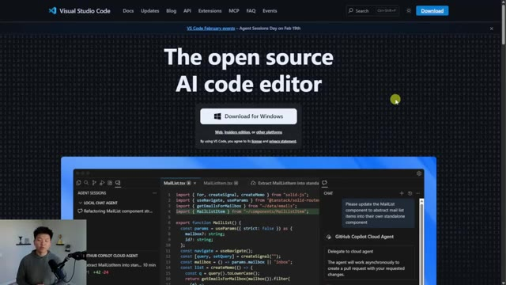
*⏱️ 00:00:27 — Page web officielle de téléchargement de Visual Studio Code affichant l'interface de l'éditeur avec un agent IA intégré.*

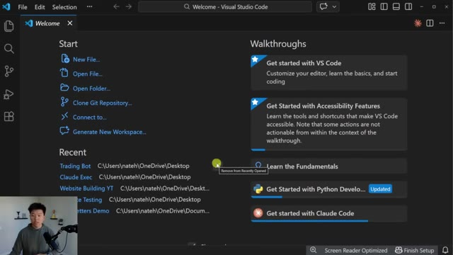
*⏱️ 00:00:34 — Écran d'accueil (Welcome) de l'application Visual Studio Code avec les options de démarrage rapide et les projets récents.*

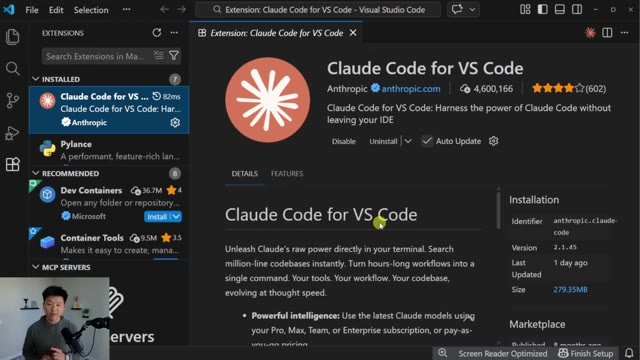
*⏱️ 00:00:41 — Vue du catalogue d'extensions dans Visual Studio Code, focalisée sur la page de l'extension "Claude Code for VS Code".*

---

### ⏱️ `[00:00:49 - 00:01:09]` | Segment #03

**🔊 Audio (Transcription Intégrale Mot pour Mot en Français) :**
> Comme vous pouvez le voir ici, si vous êtes sur l'offre gratuite, vous n'avez pas accès à CloudCode, mais ici sur Pro, vous pouvez effectivement utiliser Cloud Code. Que vous soyez sur Pro ou Max, vous pouvez l'utiliser. Je commencerais probablement juste par Pro ; si vous atteignez des limites, ce qui sera probablement le cas si vous voulez créer des sites web toute la journée, alors vous devriez probablement passer à Max. Donc, une fois que vous avez installé cela, vous verrez ce petit bouton ici en haut, qui est Cloud Code.

**👁️ Analyse Visuelle d'Écran (gemini-3.5-flash-lite) :**
**Interface & Outils** : Interface web de tarification (pricing page) de Claude / Anthropic.

**Contenu textuel & Code** : Comparatif des offres : Free, Pro (avec mention de Claude Code, Cowork, etc.) et Max, avec les tarifs associés.

**Action / Démonstration** : Le présentateur compare les différentes offres et met en évidence la disponibilité de Claude Code dans l'offre Pro.

*⏱️ 00:00:54 — Page de tarification de Claude affichant les trois offres : Free ($0), Pro ($17/mois) et Max (à partir de $100/mois). Un curseur de souris pointe sur la mention 'Claude Code' dans l'offre Pro. Le présentateur apparaît en médaillon dans le coin inférieur gauche.*

---

### ⏱️ `[00:01:09 - 00:01:42]` | Segment #04

**🔊 Audio (Transcription Intégrale Mot pour Mot en Français) :**
> Et quand vous cliquez là-dessus, c'est là que ça vous donne la possibilité d'utiliser réellement Cloud Code, de parler à ce petit agent crabe. Et c'est très similaire à une sorte de ChatGPT ou à l'utilisation de Claude sur le web. Maintenant, la façon dont cela fonctionne lorsque vous utilisez Cloud Code dans Visual Studio Code, ou vraiment partout où vous l'utilisez, c'est que vous avez des fichiers sur le côté gauche et ensuite vous avez votre agent sur le côté droit. La première chose que nous devons faire est donc d'ouvrir un projet afin de pouvoir commencer à travailler avec des fichiers. Je vais donc aller ici en haut à gauche et je vais cliquer sur Explorateur. Ce que vous pouvez voir, c'est qu'il est indiqué que vous n'avez pas encore ouvert de dossier. Je vais donc aller de l'avant et ouvrir un nouveau dossier qui ne contient rien. Nous voici donc dans la création de mon site web

**👁️ Analyse Visuelle d'Écran (gemini-3.5-flash-lite) :**
**Interface & Outils** : Visual Studio Code (VS Code), extension Claude Code.

**Contenu textuel & Code** : Zone de texte avec le message 'Ctrl esc to focus or unfocus Claude' et l'option 'Bypass permissions'.

**Action / Démonstration** : L'utilisateur présente l'interface de l'extension Claude Code intégrée dans VS Code avec l'agent conversationnel.

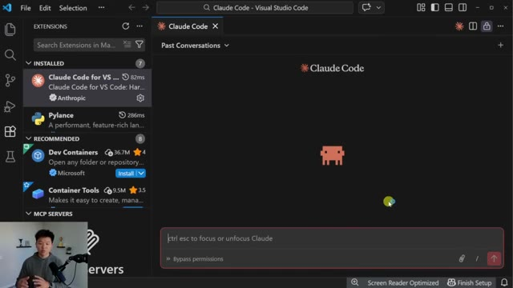
*⏱️ 00:01:18 — Interface de Visual Studio Code affichant l'extension Claude Code avec un avatar de petit agent en forme de crabe et une zone de texte pour interagir.*

---

### ⏱️ `[00:01:42 - 00:02:15]` | Segment #05

**🔊 Audio (Transcription Intégrale Mot pour Mot en Français) :**
> Dossier YouTube, qui comme je l'ai dit, est un projet vide. Si vous n'avez pas de dossier, allez-y et créez-en un, que ce soit sur votre bureau ou dans vos documents, créez-en un pour commencer, puis ouvrez-le et c'est là que nous allons travailler sur ce projet. Donc, commençons à passer en revue ces cinq astuces. La première est en fait le numéro zéro et la raison pour laquelle j'ai fait cela est parce que la première est un fichier claw.md et j'ai mis cela comme numéro zéro parce que c'est en quelque sorte un prérequis mais aussi souvent vers la fin, même après un, deux, trois et quatre, vous devrez peut-être y retourner et mettre à jour votre fichier claw.md ou simplement demander à claw de le faire lui-même. Qu'est-ce qu'un claw.md

**👁️ Analyse Visuelle d'Écran (gemini-3.5-flash-lite) :**
**Interface & Outils** : Visual Studio Code (VS Code), extension Claude Code et outil de dessin/diagramme interactif (ex: Excalidraw).

**Contenu textuel & Code** : Explorateur de fichiers vide dans VS Code, invite de commande Claude Code, et schéma séquentiel numéroté de 0 à 4.

**Action / Démonstration** : Présentation de l'environnement de travail initial avec un projet vide et explication visuelle d'un processus ou workflow en étapes.

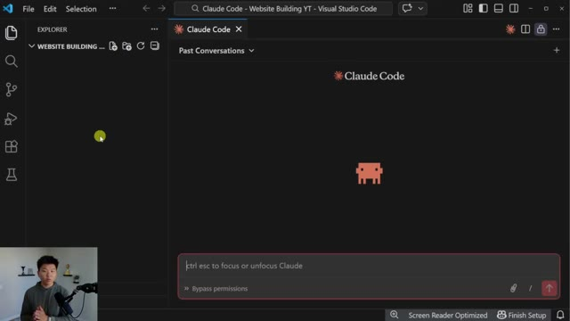
*⏱️ 00:01:50 — Interface de VS Code montrant un dossier de projet vide nommé WEBSITE BUILDING YT et une extension Claude Code ouverte.*

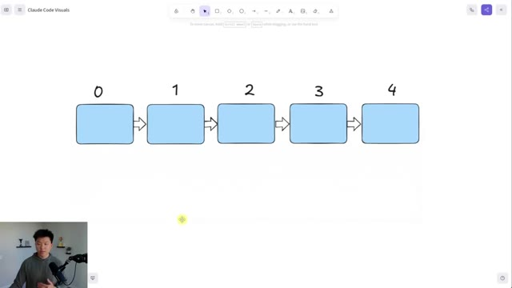
*⏱️ 00:01:59 — Diagramme explicatif sur fond blanc avec des boîtes numérotées de 0 à 4 reliées par des flèches.*

---

### ⏱️ `[00:02:15 - 00:02:50]` | Segment #06

**🔊 Audio (Transcription Intégrale Mot pour Mot en Français) :**
> fichier ? Pensez-y simplement comme à un prompt système. Pensez-y comme si, à chaque fois avant de demander à Claw Code de faire quelque chose, il lira d'abord le fichier claw.md. Il traitera toujours cela. Donc ce que vous voulez faire, c'est vous assurer qu'il est plutôt concis. Vous ne voulez pas trop l'alourdir avec du contexte, mais vous voulez lui donner les règles dont il a besoin. Donc à chaque fois que vous faites quelque chose dans ce projet, ce projet de création de site web, faites ceci, cela et cela, et rappelez-vous toujours que c'est un peu le but final. Et donc si vous ne connaissez pas encore exactement votre processus complet ou le but final, alors vous pourriez commencer sans fichier claw.md. Mais heureusement pour vous, si vous allez dans ma communauté School gratuite, dont le lien est dans la description, vous allez dans le

**👁️ Analyse Visuelle d'Écran (gemini-3.5-flash-lite) :**
**Interface & Outils** : Outil de création de diagrammes (type Excalidraw).

**Contenu textuel & Code** : Le schéma montre que le fichier "CLAUDE.md" (Project Instructions) est injecté dans le "System Prompt", lequel est combiné avec le "User Message" pour alimenter le "Claude Code Agent", garantissant que le fichier est chargé avant chaque message.

**Action / Démonstration** : Présentation visuelle du workflow d'automatisation et de la gestion du contexte par l'agent.

*⏱️ 00:02:24 — Un schéma illustrant le fonctionnement du fichier `CLAUDE.md` comme instruction système pour l'agent Claude Code.*

---

### ⏱️ `[00:02:50 - 00:03:23]` | Segment #07

**🔊 Audio (Transcription Intégrale Mot pour Mot en Français) :**
> classroom, tu vas dans Claude code et juste ici, tu verras le fichier web design Claude.md, qui est celui que nous allons utiliser aujourd'hui. Tu peux simplement le télécharger gratuitement juste ici. Maintenant, une fois que c'est fait, tu peux en fait juste le glisser juste ici sur le côté gauche. Comme je vous l'ai dit les gars, le côté gauche est l'endroit où nous pouvons voir nos fichiers et nos dossiers. Et ce que ça fait, c'est que ça ouvre le fichier Claude.md, que si je glisse par ici, nous pouvons le voir en quelque sorte en plein écran. Maintenant, le .md signifie markdown, ce qui est fondamentalement juste ceci ici. Nous avons des signes dièse, nous avons des astérisques, et ça aide simplement à garder le texte organisé pour que l'agent puisse lire, tu sais, qu'est-ce qui est un en-tête, qu'est-ce qui est un sous-en-tête, qu'est-ce qui est en gras,

**👁️ Analyse Visuelle d'Écran (gemini-3.5-flash-lite) :**
**Interface & Outils** : Plateforme communautaire (Navigateur web), Visual Studio Code (VS Code), extension/interface Claude Code.

**Contenu textuel & Code** : Contenu textuel du fichier « CLAUDE.md » incluant les sections « Output Defaults », « Brand Assets », « Anti-Generic Guardrails » et « Hard Rules » concernant le développement web.

**Action / Démonstration** : Navigation et présentation du fichier de configuration « CLAUDE.md » destiné à être utilisé dans l'environnement de développement pour guider l'agent IA.

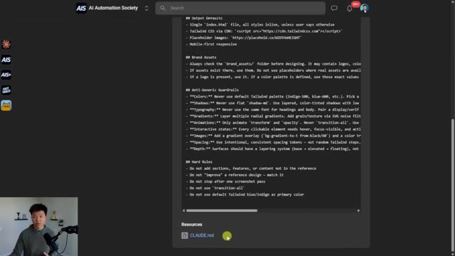
*⏱️ 00:02:59 — Vue d'une plateforme de communauté (AI Automation Society) affichant le contenu du fichier texte « CLAUDE.md » qui détaille les règles de design frontend et les contraintes pour l'IA.*

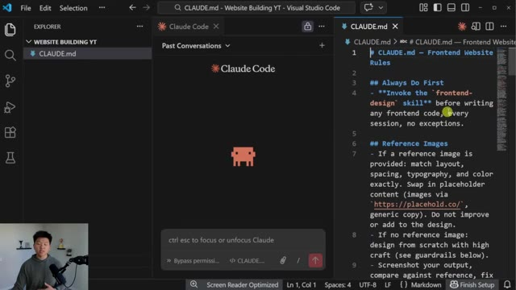
*⏱️ 00:03:07 — Capture de l'éditeur VS Code montrant une vue en trois colonnes : l'explorateur de fichiers, l'interface de discussion Claude Code et le contenu ouvert du fichier « CLAUDE.md ».*

---

### ⏱️ `[00:03:24 - 00:03:51]` | Segment #08

**🔊 Audio (Transcription Intégrale Mot pour Mot en Français) :**
> que sont des points clés, des choses comme ça. Vous pouvez donc évidemment lire tout ce fichier Claude.md si vous le souhaitez, pour comprendre un peu ce que nous lui demandons de faire dans ce projet. Je ne vais pas tout lire parce que vous pouvez simplement, vous savez, le regarder ici ou le télécharger. Et au fur et à mesure que nous explorerons ces autres astuces, vous verrez pourquoi j'ai mis certaines de ces choses ici. Mais cela m'amène en fait à notre première, techniquement notre première astuce, qui est la compétence de conception front-end, et c'est pourquoi vous pouvez voir juste ici dans notre Claude.md, la première chose que j'ai écrite est : toujous invoquer la compétence de conception front-end avant d'écrire le moindre code front-end.

**👁️ Analyse Visuelle d'Écran (gemini-3.5-flash-lite) :**
**Interface & Outils** : Visual Studio Code

**Contenu textuel & Code** : Fichier Markdown nommé CLAUDE.md contenant des sections de règles comme 'Anti-Generic Guardrails' (couleurs, ombres, typographie, gradients, animations, états interactifs, images, espacement, profondeur) et 'Hard Rules'.

**Action / Démonstration** : Le présentateur présente et commente le contenu du fichier de configuration CLAUDE.md utilisé pour guider l'assistant IA.

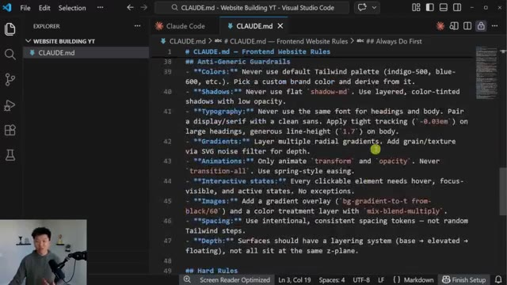
*⏱️ 00:03:30 — Vue de l'éditeur de code Visual Studio Code affichant le fichier CLAUDE.md avec des règles de conception front-end, avec une incrustation vidéo du présentateur en bas à gauche.*

---

### ⏱️ `[00:03:51 - 00:04:10]` | Segment #09

**🔊 Audio (Transcription Intégrale Mot pour Mot en Français) :**
> Chaque session, sans exception. Donc tout d'abord, très rapidement, que sont les compétences ? Eh bien, si vous allez sur la doc de Cloud Code, vous pouvez lire des informations sur les compétences juste ici. Essentiellement, ce sont des instructions personnalisées. Donc chaque fois que vous créez par exemple un GPT personnalisé ou un projet Cloud, vous y intégrez généralement des connaissances et vous y mettez des instructions. Et en gros, les

**👁️ Analyse Visuelle d'Écran (gemini-3.5-flash-lite) :**
**Interface & Outils** : Navigateur web affichant la documentation technique de Claude Code (Claude Developer Platform).

**Contenu textuel & Code** : Texte explicatif sur la création et la gestion des "skills" (compétences) dans Claude Code, mentionnant l'utilisation de fichiers SKILL.md, les commandes slash personnalisées et le standard "Agent Skills".

**Action / Démonstration** : Navigation sur la page de documentation pour expliquer le concept de compétences étendues dans l'écosystème Claude.

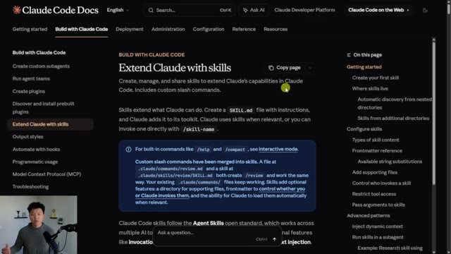
*⏱️ 00:03:56 — Capture d'écran de la documentation officielle "Claude Code Docs" affichant la section "Extend Claude with skills".*

---

### ⏱️ `[00:04:10 - 00:04:38]` | Segment #10

**🔊 Audio (Transcription Intégrale Mot pour Mot en Français) :**
> Et la raison pour laquelle c'est si important et cool, c'est que chaque fois que vous posez une question à Claude, d'abord il lit son fichier cloud.md, mais ensuite il va se dire : « D'accord, l'utilisateur m'a demandé ça, est-ce que j'ai des compétences dans ma bibliothèque qui m'aident à mieux le faire ? ». Si oui, je vais prendre la compétence, je vais la lire et ensuite je vais passer à l'action. Si non, je vais juste utiliser mes connaissances générales. C'est donc pour cela que nous devons avoir la compétence front-end, parce qu'elle nous aide à créer des designs qui sont beaucoup plus modernes et professionnels et qui ne ressemblent pas autant à du code vibe-codé, vibe-codé par une IA.

**👁️ Analyse Visuelle d'Écran (gemini-3.5-flash-lite) :**
**Interface & Outils** : Logiciel de tableau blanc numérique / outil de diagramme (type Excalidraw).

**Contenu textuel & Code** : Diagramme de flux titré avec les étapes : "STEP 1: You ask Claude for help" vers "STEP 2: Claude checks: Can a Skill help?". Le "Path A" mène à une "Skills Library" (workflows, Python, etc.) pour une "Enhanced Answer", tandis que le "Path B" mène à une "Standard Answer" basée sur les connaissances générales.

**Action / Démonstration** : Présentation visuelle du mécanisme d'augmentation des capacités de Claude par l'intégration de bibliothèques de compétences personnalisées.

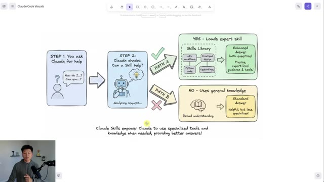
*⏱️ 00:04:17 — Un schéma explicatif illustrant le flux de travail décisionnel de Claude lorsqu'il reçoit une requête, divisé en deux chemins : l'utilisation d'une bibliothèque de compétences spécialisées (Path A) ou l'usage des connaissances générales (Path B).*

---

### ⏱️ `[00:04:38 - 00:05:14]` | Segment #11

**🔊 Audio (Transcription Intégrale Mot pour Mot en Français) :**
> And the good news is it's super, super simple. You just have to install it. So here's a tweet that showed the power of this. All they prompted Cloud Code to do was use the front end design skill, create a music player app, and it created this. That has some animations, it has some dynamic elements. And if you would have just told CloudCode to do this without that skill, it would have looked much worse. So I'll leave a link to this tweet in the description of this video. You basically just have to run this command and then you run this one and then you should be good with the skill installed globally across any CloudCode project that you might use in the future. And when I say run these commands, you can literally just copy this if you wanted to and just paste that right into here in CloudCode and it would install that

**👁️ Analyse Visuelle d'Écran (gemini-3.5-flash-lite) :**
**Interface & Outils** : Plateforme de réseau social X (Twitter).

**Contenu textuel & Code** : Texte du prompt : "use the frontend design skill, Create a music player app." et commandes terminal : "/plugin marketplace add anthropic/claude-code" et "/plugin install frontend-design@claude-code-plugins".

**Action / Démonstration** : Démonstration visuelle du résultat de génération d'UI par une IA et instructions textuelles pour l'installation des outils nécessaires dans Claude Code.

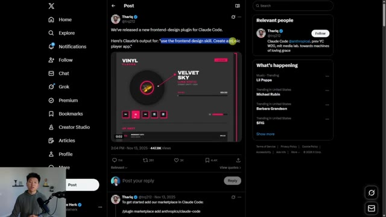
*⏱️ 00:04:47 — Capture d'écran d'un post sur la plateforme X présentant une interface de lecteur de musique ("Vinyl Player") générée via le plugin "frontend-design" de Claude Code.*

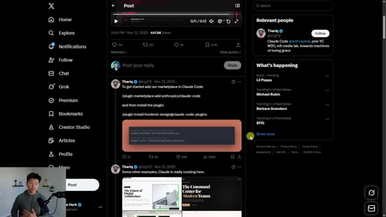
*⏱️ 00:05:05 — Capture d'écran montrant la suite du thread X, détaillant les commandes de terminal nécessaires pour installer et utiliser le plugin Claude Code via le marketplace.*

---

### ⏱️ `[00:05:14 - 00:05:43]` | Segment #12

**🔊 Audio (Transcription Intégrale Mot pour Mot en Français) :**
> pour vous. Très bien. Donc laissez-moi vous montrer à quel point cette compétence de design front-end est vraiment impressionnante avec un prompt aussi minimal. Alors avant de donner un prompt à cet agent, je voulais juste vous montrer autre chose que vous pouvez faire, ce qui est une sorte d'astuce bonus. Ce que je vais faire, c'est que je vais créer un nouveau dossier. Je vais l'appeler brand underscore assets. Et notre fichier claw.md explique en fait que cela pourrait être un fichier ou un dossier que claw code doit examiner. Et ce que je vais mettre ici, ce sont deux choses, mon logo et la charte graphique pour qu'il crée ce site web.

**👁️ Analyse Visuelle d'Écran (gemini-3.5-flash-lite) :**
**Interface & Outils** : Visual Studio Code avec l'extension ou l'intégration Claude Code.

**Contenu textuel & Code** : Zone de texte interactive affichant "Ctrl esc to focus or unfocus Claude", accompagnée d'options pour "Bypass permissions" et le fichier "CLAUDE.md".

**Action / Démonstration** : Le présentateur introduit l'interface de Claude Code au sein de l'éditeur avant de passer à une démonstration de design front-end.

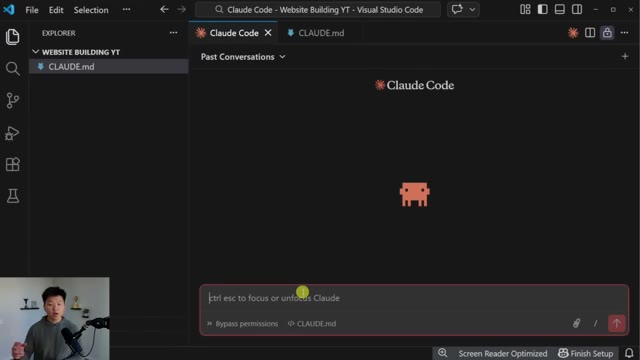
*⏱️ 00:05:21 — Interface de VS Code montrant l'outil Claude Code intégré, avec un champ de saisie de commande au centre de l'éditeur et une mascotte pixel art.*

---

### ⏱️ `[00:05:43 - 00:06:06]` | Segment #13

**🔊 Audio (Transcription Intégrale Mot pour Mot en Français) :**
> et ça donne vraiment l'impression d'être aux couleurs de ma marque et de mon entreprise. Donc juste ici, je fais glisser le logo d'AI Automation Society, comme vous pouvez le voir, comme ça. Et ensuite, je vais aussi faire glisser notre charte graphique, qui contient des choses comme nos couleurs, notre typographie, des icônes, des choses comme ça. Et donc maintenant que Claude peut examiner tout ça, je vais juste lui donner un prompt très, très simple. Donc tout ce que je dis, c'est : « Crée-moi une landing page moderne et professionnelle pour AI Automation Society. »

**👁️ Analyse Visuelle d'Écran (gemini-3.5-flash-lite) :**
**Interface & Outils** : Visual Studio Code.

**Contenu textuel & Code** : Explorateur de fichiers avec les éléments 'brand_assets', 'AIS PNG.png' et 'CLAUDE.md'. Panneau central affichant le logo 'AIS' sur fond transparent.

**Action / Démonstration** : Manipulation de fichiers graphiques (glisser-déposer du logo) dans l'éditeur pour intégrer la charte graphique de la marque.

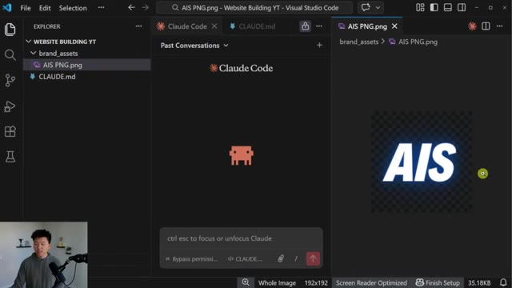
*⏱️ 00:05:49 — L'interface de Visual Studio Code affichant un dossier 'brand_assets' dans l'explorateur de fichiers, avec une image PNG du logo 'AIS' ouverte dans le panneau central.*

---

### ⏱️ `[00:06:06 - 00:06:29]` | Segment #14

**🔊 Audio (Transcription Intégrale Mot pour Mot en Français) :**
> Et je vais aussi lui dire : voici mon logo et voici ma charte graphique. Il serait capable de le comprendre de toute façon parce qu'on l'a mis dans le Claude.md, mais je voulais juste vous montrer que vous pouvez en fait taguer directement des ressources. Donc si je mets un arobase, ça va en gros apparaître et me laisser choisir ou pointer vers les bonnes choses. Donc maintenant je peux explicitement dire, hé, voici les, vous savez, voici la charte graphique et voici le logo, parce que peut-être qu'ils ne sont pas nommés d'une manière super intuitive.

**👁️ Analyse Visuelle d'Écran (gemini-3.5-flash-lite) :**
**Interface & Outils** : Visual Studio Code (VS Code) avec l'extension Claude Code.

**Contenu textuel & Code** : Prompt utilisateur : "build me a modern and professional landing page for our community called AI Automation Society. Here is my logo: Here are our brand guidelines:". Dans l'explorateur de fichiers à gauche : dossier "brand_assets" contenant "AIS Brand Guidelines-1.png", "AIS PNG.png" et le fichier "CLAUDE.md".

**Action / Démonstration** : L'utilisateur est en train de rédiger un prompt dans l'interface de l'agent IA pour l'instruction de construction d'une page web en utilisant des ressources de charte graphique présentes dans le projet.

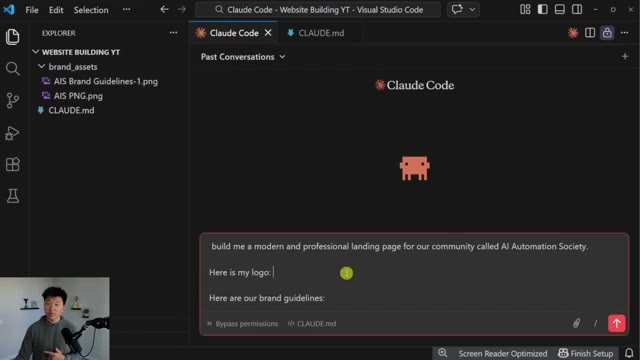
*⏱️ 00:06:12 — Interface de l'éditeur VS Code affichant l'extension Claude Code en cours d'utilisation, avec une zone de saisie de prompt où l'utilisateur rédige une demande pour la création d'une landing page.*

---

### ⏱️ `[00:06:30 - 00:06:50]` | Segment #15

**🔊 Audio (Transcription Intégrale Mot pour Mot en Français) :**
> Et maintenant, je montre juste à Cloud Code exactement ce que je veux. Donc je vais envoyer ça. Je ne suis même pas en mode plan. Je veux juste vous montrer, les gars, à quel point cette compétence de design front-end est excellente. Et ce que vous allez remarquer, c'est tout d'abord que ce qu'il a fait, c'est qu'il a lu le fichier Cloud Denim D et maintenant il lit les éléments de la marque. Et maintenant, ce qu'il va faire, c'est qu'il devrait, espérons-le, invoquer la compétence de design front-end et commencer à construire ce site web pour nous.

**👁️ Analyse Visuelle d'Écran (gemini-3.5-flash-lite) :**
**Interface & Outils** : Visual Studio Code avec l'extension ou le terminal Claude Code actif.

**Contenu textuel & Code** : Un prompt textuel demandant de construire une landing page pour "AI Automation Society" en utilisant des fichiers de ressources spécifiques (@brand_assets/AIS PNG.png et @brand_assets/AIS Brand Guidelines-1.png). L'état du processus affiche "Thinking..." et "Wrangling...".

**Action / Démonstration** : Envoi d'une instruction (prompt) à l'agent IA pour générer une interface front-end, avec une barre de saisie en bas attendant la prochaine commande.

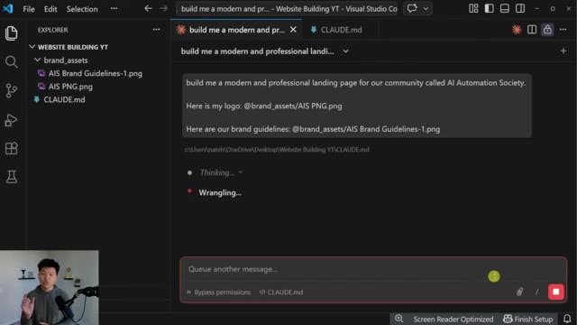
*⏱️ 00:06:35 — Une capture d'écran de l'interface de l'éditeur VS Code montrant l'utilisation de Claude Code (CLI intégrée) pour envoyer une requête de création de page web.*

---

### ⏱️ `[00:06:51 - 00:07:09]` | Segment #16

**🔊 Audio (Transcription Intégrale Mot pour Mot en Français) :**
> Et voilà, pile au bon moment. Il a invoqué la compétence de design front-end juste là. Très bien, donc c'est terminé. Vous pouvez voir que nous avons une barre de navigation, un hero, un défilé d'outils. Nous avons des statistiques sur les avantages. Donc une landing page complète sur une seule page et elle devrait correspondre parfaitement à notre marque en ce qui concerne le logo, les couleurs et la typographie. Il a également ajouté un peu d'animation.

**👁️ Analyse Visuelle d'Écran (gemini-3.5-flash-lite) :**
**Interface & Outils** : Visual Studio Code avec l'extension/chat Claude intégré.

**Contenu textuel & Code** : Fichier "MEMORY.md" listant les composants techniques de la page : "Nav - Sticky with blur-on-scroll", "Hero - Animated particle network", "Tools Marquee", "Stats - 4 column counter row".

**Action / Démonstration** : L'IA confirme la finalisation de la structure de la page web après exécution des directives de design front-end.

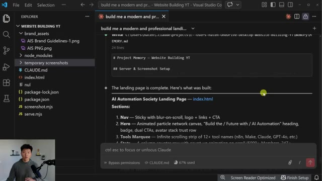
*⏱️ 00:06:55 — Interface de VS Code montrant l'agent Claude terminant le développement d'une landing page, avec une liste des sections créées (Nav, Hero, Tools Marquee, Stats).*

---

### ⏱️ `[00:07:09 - 00:07:28]` | Segment #17

**🔊 Audio (Transcription Intégrale Mot pour Mot en Français) :**
> Alors j'ai hâte de voir comment ça fonctionne. Et il nous l'a mis sur localhost pour qu'on jette un œil. Alors allons-y. Très bien, regardez ça. On a comme une petite animation ici en haut. On a une ligne qui descend. On peut voir qu'on a bien notre logo ici en haut ainsi que nos couleurs et notre police exactes. On a une note de la communauté. Oh, c'est super sympa. On a aussi des entreprises tech qui défilent.

**👁️ Analyse Visuelle d'Écran (gemini-3.5-flash-lite) :**
**Interface & Outils** : Navigateur web (localhost).

**Contenu textuel & Code** : Interface utilisateur du site web comprenant une barre de navigation, un titre principal "Build the Future with AI Automation", un sous-titre explicatif, des boutons d'appel à l'action et des badges de preuves sociales (nombre de membres et avis).

**Action / Démonstration** : Démonstration visuelle de l'interface du site web développée localement par le présentateur.

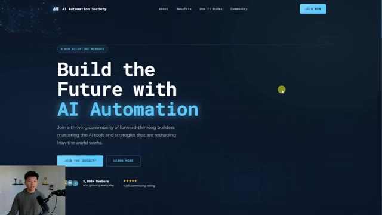
*⏱️ 00:07:14 — Page d'accueil du site web "AI Automation Society" affichée dans un navigateur, présentant un design sombre avec des éléments graphiques néon bleu.*

---

### ⏱️ `[00:07:28 - 00:07:47]` | Segment #18

**🔊 Audio (Transcription Intégrale Mot pour Mot en Français) :**
> So we've got NNN, Make, Claude, GPT-4O, Zapier, Airtable. We've got some random stats here. Obviously we'd have to fill this in with our own copy, but keep in mind, all of this happened with only us saying, create me a landing page for our community called AI Automation Society. That was literally it. And it created all of this. We've got testimonials. We've got a final call to action here.

**👁️ Analyse Visuelle d'Écran (gemini-3.5-flash-lite) :**
**Interface & Outils** : Navigateur web (interface de site vitrine) intégrant un composant de terminal fictif.

**Contenu textuel & Code** : Texte de présentation de la communauté, statistiques (5000+ membres, 247+ ressources, etc.), liste d'outils (n8n, Make, Claude AI, GPT-4o, etc.) et un bloc "status" simulant un terminal (Community: LIVE, Members: 5,241).

**Action / Démonstration** : Affichage du résultat visuel complet d'une landing page créée par une IA à partir d'un prompt simple.

*⏱️ 00:07:33 — Capture d'écran montrant le rendu final d'une landing page générée pour la communauté "AI Automation Society", présentant des statistiques communautaires, une barre de logos d'outils (Notion, n8n, Make, etc.) et une section "About" avec un terminal stylisé.*

---

### ⏱️ `[00:07:48 - 00:08:21]` | Segment #19

**🔊 Audio (Transcription Intégrale Mot pour Mot en Français) :**
> The logo is doing a little floating for basically a one sentence prompt. This is super, super solid with the front end design skill. Now there was another secret thing going on here that I didn't yet tell you guys about, but if you've already read the Claude.MD, you might have noticed. And that brings us on to hack number two, which is the screenshot loop. So the idea here is that AI is really good at getting you where you want to go, but it takes a lot of manual correction and steering. So let's say I just told Cloud Code to build us that website. Without the front-end design skill, it might have gotten us like 40% of the way there. But now that we added the front-end design skill, it's going to

**👁️ Analyse Visuelle d'Écran (gemini-3.5-flash-lite) :**
**Interface & Outils** : Visual Studio Code (avec extension Claude Code) et un outil de tableau blanc/diagramme en ligne.

**Contenu textuel & Code** : Historique de discussion de l'agent confirmant l'exécution du serveur sur localhost:3000 ; schéma en 5 étapes numérotées de 0 à 4.

**Action / Démonstration** : Consultation de l'état de l'agent dans VS Code et explication théorique du workflow via un diagramme.

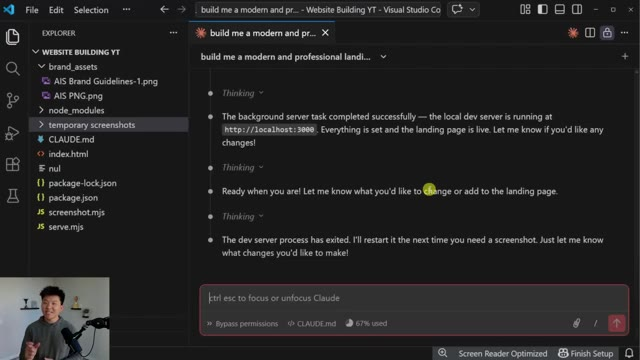
*⏱️ 00:07:56 — Interface de VS Code montrant une interaction avec un agent IA (Claude Code) qui confirme le déploiement local d'une landing page.*

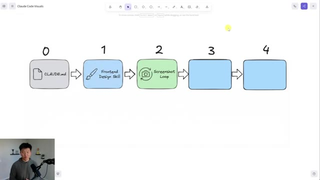
*⏱️ 00:08:04 — Diagramme de flux visualisant un processus séquentiel en étapes : CLAUDE.md, Frontend Design Skill, et Screenshot Loop.*

---

### ⏱️ `[00:08:21 - 00:08:57]` | Segment #20

**🔊 Audio (Transcription Intégrale Mot pour Mot en Français) :**
> get us maybe, let's just call it 60. What we can do now is use screenshots to help AI iterate upon itself. So instead of it getting 60% of the way there, and then we make an improvement, and then we make another improvement, and we keep doing this, it basically should just bridge this gap itself because it's able to take a screenshot, look at the browser, see what it looks like, and then make changes. So what you guys didn't notice, or maybe you did, is over here it created a new folder for us called temporary screenshots. And we can see that in that process of building out that first version of our workflow, it took 10 screenshots. So I can click here and I can see what it looked at. It looked at the hero section, which kind of was a random full page. It got the

**👁️ Analyse Visuelle d'Écran (gemini-3.5-flash-lite) :**
**Interface & Outils** : Présentation ou face-caméra explicatif sans interface logicielle partagée.

**Contenu textuel & Code** : Explications orales et mise en contexte méthodologique.

**Action / Démonstration** : Explications face caméra et démonstration conceptuelle.

---

### ⏱️ `[00:08:57 - 00:09:33]` | Segment #21

**🔊 Audio (Transcription Intégrale Mot pour Mot en Français) :**
> viewport, which was, that's more of the hero section. It looked at the stats, it looked at the about page. And what it did is it used these screenshots as it kept clicking through and looking and improved things. So you guys didn't see this, but in the actual to-dos, it wrote the index.html, it started the server and screenshot the workflow, and then it did a two-pass screenshot review and polish. So it basically uses its eyes to check that what it's building actually looks good. And in order to set that up, it's actually really, really easy. If you go to the claw.md file, you can see that I've got a section for screenshot workflow, and we're just doing this using Puppeteer. So literally, if you take this Cloud.md and say, hey, Cloud Code, can you set up

**👁️ Analyse Visuelle d'Écran (gemini-3.5-flash-lite) :**
**Interface & Outils** : VS Code (Visual Studio Code).

**Contenu textuel & Code** : Liste de fichiers incluant "screenshot-1-hero.png" jusqu'à "screenshot-10-hero-viewport.png". Panneau de texte détaillant la structure d'une page web (Benefits, How It Works, Testimonials, Join CTA, Footer) et les codes couleurs hexadécimaux (#4FC1FF, #071226, #FFA41F).

**Action / Démonstration** : Navigation dans l'explorateur de fichiers du projet pour gérer les captures d'écran servant de référence visuelle à l'agent IA.

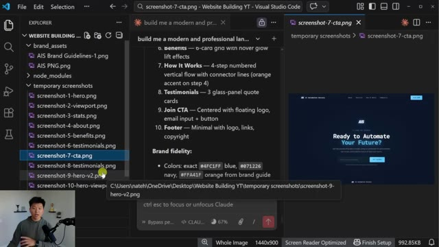
*⏱️ 00:09:06 — Une capture d'écran de l'interface VS Code montrant une liste de fichiers images dans l'explorateur (dossier 'temporary screenshots') et un panneau central décrivant les spécifications de design d'une page web (section 'Join CTA', palette de couleurs).*

---

### ⏱️ `[00:09:33 - 00:09:53]` | Segment #22

**🔊 Audio (Transcription Intégrale Mot pour Mot en Français) :**
> Puppeteer to take screenshots? It should be able to install all of that stuff for you right there, really simply. And so yes, that's cool on its own, but where it actually comes into handy a lot more is when we look at hack number three, which is using other websites as inspiration. Because what we're able to do is say, hey, Cloud Code, take this website right here and build me a clone.

**👁️ Analyse Visuelle d'Écran (gemini-3.5-flash-lite) :**
**Interface & Outils** : Visual Studio Code (Image 1), outil de diagramme de type tableau blanc interactif (Image 2).

**Contenu textuel & Code** : Documentation technique sur l'automatisation des captures d'écran (Image 1), étapes de workflow : CLAUDE.md, Frontend Design Skill, Screenshot Loop, Inspiration Websites (Image 2).

**Action / Démonstration** : Présentation de la documentation technique du projet puis démonstration visuelle du flux de travail séquentiel.

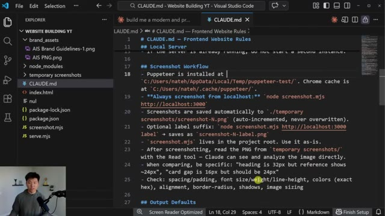
*⏱️ 00:09:38 — Éditeur VS Code affichant un fichier Markdown 'CLAUDE.md' qui documente les règles de workflow pour la prise de captures d'écran avec Puppeteer.*

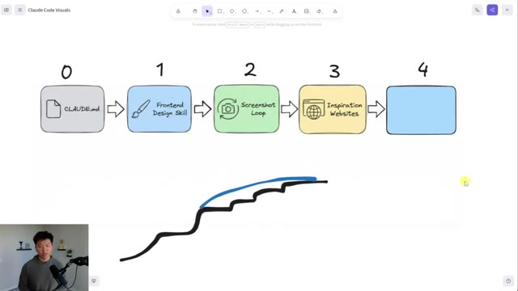
*⏱️ 00:09:48 — Diagramme de workflow numéroté (de 0 à 4) illustrant les étapes du processus, incluant "Screenshot Loop" et "Inspiration Websites".*

---

### ⏱️ `[00:09:53 - 00:10:20]` | Segment #23

**🔊 Audio (Transcription Intégrale Mot pour Mot en Français) :**
> So you should build one that looks exactly like this one. And then what it's able to do is use its eyes, use its screenshot tool to screenshot what it's building and look at the reference and keep going back and forth until it's close enough. So let me show you guys that in action right now. So there's tons of sites that you could go to for website inspiration. Here's one example called Dribbble. Here's another example called godly.website. And here's another really cool example called awards with three Ws. So there's tons of places that you can find inspiration.

**👁️ Analyse Visuelle d'Écran (gemini-3.5-flash-lite) :**
**Interface & Outils** : Navigateur web (Dribbble), logiciel de diagramme (type Excalidraw).

**Contenu textuel & Code** : Schémas de processus itératif, galerie d'inspiration de design d'interface utilisateur (UI).

**Action / Démonstration** : Présentation conceptuelle du workflow d'un agent IA utilisant des références visuelles pour itérer sur son propre code.

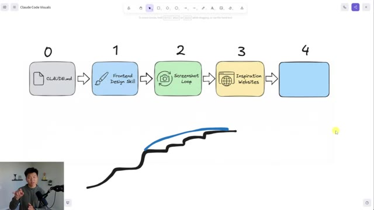
*⏱️ 00:10:00 — Schéma de workflow illustrant les étapes de développement d'un agent IA, de la lecture de fichier au design frontend et à la boucle de capture d'écran.*

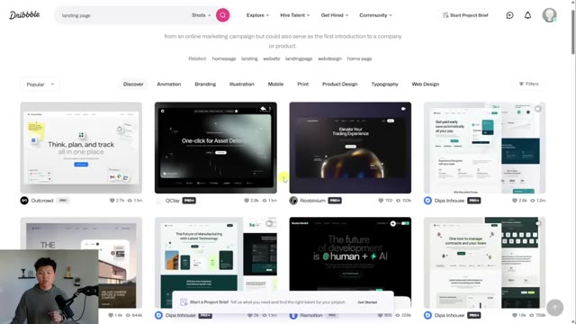
*⏱️ 00:10:07 — Interface du site web Dribbble affichant une galerie de designs de landing pages pour inspiration.*

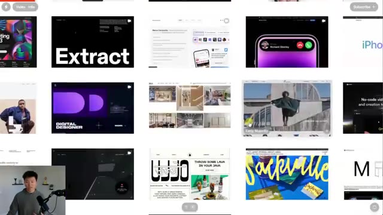
*⏱️ 00:10:13 — Vue en grille de diverses captures d'écran de sites web et portfolios montrant des exemples de designs UI modernes.*

---

### ⏱️ `[00:10:20 - 00:10:41]` | Segment #24

**🔊 Audio (Transcription Intégrale Mot pour Mot en Français) :**
> So for the sake of this video, I found this one that I want to use. It's got a nice little animation in the background. It's obviously not our color scheme, but it has some cool things as you scroll down, like a dashboard. It's got some other little cards down here. None of this is really too animated. Well, I guess that is, but let's just say we wanted our website to look like this one, for example. First thing that I would do is I would hit F12. I'm on Windows, by the way.

**👁️ Analyse Visuelle d'Écran (gemini-3.5-flash-lite) :**
**Interface & Outils** : Navigateur web affichant le site internet de la plateforme SaaS "Yeldra".

**Contenu textuel & Code** : Interface utilisateur affichant des données financières, des objectifs de revenus, des marges commerciales, des graphiques prévisionnels de trésorerie et une structure de pilotage d'activité.

**Action / Démonstration** : Défilement vertical (scrolling) sur la page de destination (landing page) pour présenter les fonctionnalités du produit.

*⏱️ 00:10:26 — Page d'accueil du site web Yeldra montrant une section héro avec un aperçu visuel d'un tableau de bord financier.*

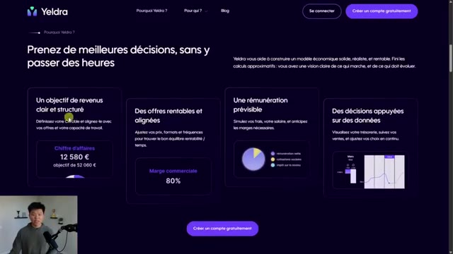
*⏱️ 00:10:31 — Section du site détaillant les fonctionnalités avec des cartes contenant des graphiques (camemberts, courbes) et des indicateurs de performance.*

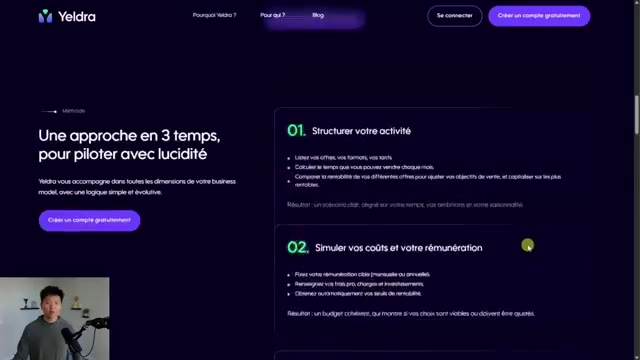
*⏱️ 00:10:36 — Section expliquant la méthodologie en trois étapes ("Une approche en 3 temps") de la plateforme Yeldra.*

---

### ⏱️ `[00:10:42 - 00:11:16]` | Segment #25

**🔊 Audio (Transcription Intégrale Mot pour Mot en Français) :**
> I would go to console and I would do control shift P and search for screenshot. What this lets me do is capture a full size screenshot of the entire page rather than just my current view. So here you can see it downloaded this screenshot and you can see that that is indeed the entire website. Now, if you're on Mac, that's still doable, but you just have to Google the different buttons to do it. And then the next thing I want to do is on the top right here, I'm going to go to elements and in the style section down here, I'm just going to copy everything. So I'm actually copying basically like the raw code or HTML or, you know, whatever you want to consider this as

**👁️ Analyse Visuelle d'Écran (gemini-3.5-flash-lite) :**
**Interface & Outils** : Chrome DevTools (Panneau Console).

**Contenu textuel & Code** : Messages d'erreur de console relatifs à des attributs SVG et interface "What's new in DevTools 144".

**Action / Démonstration** : Utilisation des outils de développement du navigateur pour inspecter la page et préparer la capture d'écran complète.

*⏱️ 00:10:50 — Une capture d'écran montrant le site web "Yeldra" sur la gauche et le panneau des outils de développement Chrome (DevTools) ouvert sur la console à droite.*

---

### ⏱️ `[00:11:16 - 00:11:41]` | Segment #26

**🔊 Audio (Transcription Intégrale Mot pour Mot en Français) :**
> that tells the website how this is styled. And we're going to give Claude code that. So I'm to go ahead and do a clear so we can start a fresh session. I'm going to, first of all, just paste in the code that we just copied, which is the style information. So I said, I want you to spin up a new website for us, get rid of the old one, and you can put this one on localhost. I basically want you to clone this website. So I'm going to give you the screenshot, which what I'm going to do is just drag it in from my files and put it right over here.

**👁️ Analyse Visuelle d'Écran (gemini-3.5-flash-lite) :**
**Interface & Outils** : Visual Studio Code (avec extension ou agent intégré type Claude).

**Contenu textuel & Code** : Explorateur de fichiers à gauche ; zone de chat à droite affichant l'historique de la conversation précédente et une barre de saisie active avec la commande "/clear".

**Action / Démonstration** : L'utilisateur saisit la commande "/clear" dans le champ de saisie de l'agent pour effacer la session de conversation actuelle et démarrer une nouvelle itération.

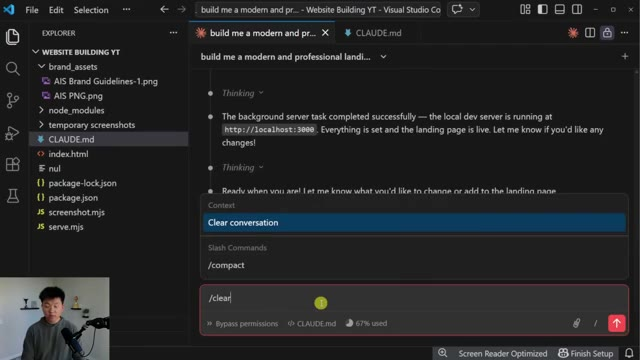
*⏱️ 00:11:22 — Interface de VS Code montrant l'éditeur avec un volet de discussion IA ouvert, où l'utilisateur saisit une commande pour réinitialiser la session.*

---

### ⏱️ `[00:11:41 - 00:12:14]` | Segment #27

**🔊 Audio (Transcription Intégrale Mot pour Mot en Français) :**
> As you can see, that is the screenshot we just took. And I'm going to point to it so it knows what to use, which is the www right there. And then I said, here's the screenshot, here's the style and just go ahead and clone this website for us. So that is all we're going to do to start. And then we can come back in later and tell it to use our branding and our colors and logo and everything like that. Now, a couple of things to keep in mind when you're doing some of the big processes, like spinning up a website from scratch or comparing two websites and cloning them, that coding process and thinking will take longer. But once you have a working version,

**👁️ Analyse Visuelle d'Écran (gemini-3.5-flash-lite) :**
**Interface & Outils** : VS Code (Visual Studio Code) avec l'extension Claude Code.

**Contenu textuel & Code** : Un prompt textuel demandant de cloner le site web en utilisant la référence "@www.yeldra.com_.png" et un bloc de code CSS (element.style, body avec background-color).

**Action / Démonstration** : L'utilisateur soumet une instruction à Claude Code pour générer un nouveau site web localement en se basant sur une image de référence et un style spécifique.

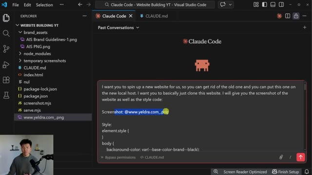
*⏱️ 00:11:49 — Une interface VS Code avec l'outil Claude Code ouvert, affichant un prompt envoyé à l'IA pour cloner un site web à partir d'une capture d'écran.*

---

### ⏱️ `[00:12:15 - 00:12:42]` | Segment #28

**🔊 Audio (Transcription Intégrale Mot pour Mot en Français) :**
> making small changes or tweaks, that happens pretty quickly. And one other thing is you might have noticed that this really isn't stopping to ask me questions. And that's because I'm using bypass permissions mode. So if you don't see this in your instance, you're going to go to settings, you're going to type in Claude code. And then right here, you should see allow dangerously skip permissions. And that is where you turn that on. Now, I definitely have a responsibility to tell you that this is dangerous. It has the potential to just kind of like run any command that it wants.

**👁️ Analyse Visuelle d'Écran (gemini-3.5-flash-lite) :**
**Interface & Outils** : Visual Studio Code avec l'extension Claude (Claude Dev/Cline).

**Contenu textuel & Code** : Arborescence de projet (fichiers .mjs, .html, .png) ; journal d'exécution de l'agent affichant les étapes "Thinking", "Read" (chemin du fichier image) et "Envisioning". On note également la mention "Bypass permissions" active en bas de la fenêtre de chat.

**Action / Démonstration** : L'agent IA est en train de lire et d'analyser un fichier image (capture d'écran de site web) afin de planifier le développement du code associé.

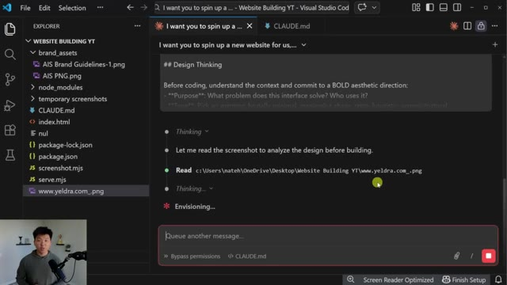
*⏱️ 00:12:21 — Interface de VS Code montrant l'extension Claude en pleine exécution, analysant un fichier image local pour concevoir un site web.*

---

### ⏱️ `[00:12:42 - 00:13:19]` | Segment #29

**🔊 Audio (Transcription Intégrale Mot pour Mot en Français) :**
> But in my practice, I've never really had this be an issue, especially because I'm never like setting this to code all night long and then going to sleep, I'm always still kind of like watching it or I'm nearby and nothing bad really is going to happen. All right. Awesome. So we just got to the point where now it is creating a to-do list. And what you can see here is once it actually writes the code for the website, it's going to start up the server and it's going to take screenshots and it's going to do two rounds at least of comparing. It's going to look at what it built versus the reference. It's going to fix any mismatches. And then it's going to do that again. And that is why the screenshot loop is so powerful. So logically, this is really cool. I mean,

**👁️ Analyse Visuelle d'Écran (gemini-3.5-flash-lite) :**
**Interface & Outils** : Visual Studio Code (VS Code)

**Contenu textuel & Code** : Menu des paramètres de l'extension Claude, avec notamment l'option "Claude Code: Allow Dangerously Skip Permissions" cochée, ainsi que les options "Autosave" et "Claude Process Wrapper".

**Action / Démonstration** : Navigation dans les paramètres de VS Code pour configurer les permissions et le comportement de l'agent Claude Code.

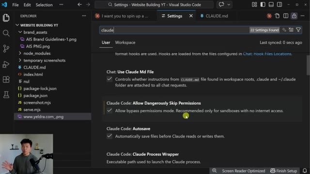
*⏱️ 00:12:51 — Une capture d'écran de l'interface VS Code montrant les paramètres de configuration de l'extension Claude Code.*

---

### ⏱️ `[00:13:19 - 00:13:52]` | Segment #30

**🔊 Audio (Transcription Intégrale Mot pour Mot en Français) :**
> it's going through and it's looking section by section and analyzing how well it's stacking up, but we will have to see how it actually turns out. Okay, so that just finished up. And before we actually see how good it really built this, I wanted to point out one thing about the screenshots. So you can see that we have screenshot one, two, three, four, all of this kind of stuff, but we don't really know which one is which without clicking on them. So it looks like these are the clones, as you can see, because they're coming out looking like the website that we gave Well, we either should have, before we started this new build, we should have told Claw Code, hey, you can delete all of those temporary screenshots. Or in the claw.md, we should be

**👁️ Analyse Visuelle d'Écran (gemini-3.5-flash-lite) :**
**Interface & Outils** : Visual Studio Code avec l'extension/interface Claude active.

**Contenu textuel & Code** : Liste à puces détaillant la structure du site web : Nav, Hero (avec dashboard, KPI, lueur violette), Features (grille 4 colonnes), Steps, Profiles, Stats et Footer. Mention de l'URL locale "http://localhost:3000".

**Action / Démonstration** : Analyse et validation des sections du site web construites par l'IA dans l'éditeur de code.

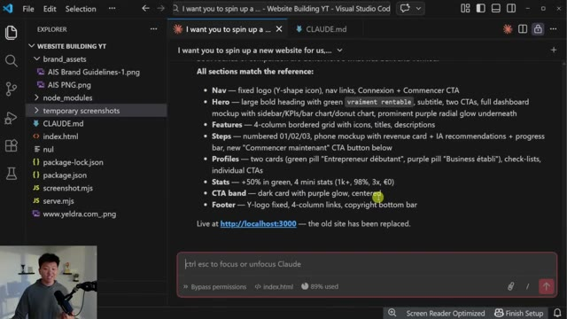
*⏱️ 00:13:27 — L'éditeur Visual Studio Code affiche un récapitulatif détaillé des sections du site web généré par l'IA (Nav, Hero, Features, Steps, etc.) avec une liste de vérification des éléments de design, dans l'interface de Claude.*

---

### ⏱️ `[00:13:52 - 00:14:26]` | Segment #31

**🔊 Audio (Transcription Intégrale Mot pour Mot en Français) :**
> more specific about the naming convention of the screenshots so that we can actually tell. Now, realistically, these temporary screenshots are more for Claw Code's benefit than for ours, but that is something else that you can be thinking about if you do want to be able to click through and see the changes that were made with each version. Anyways, let's go ahead and open up this link and see what we got. All right, so I'm going to switch this to English for my head. But we can see we've got the purple colors. We've got your strategic ally for a truly profitable business. We've got the same top menu bar, a similar type of dashboard here. We've got some cards. And as we scroll down, it feels very similar to the real version that we gave it,

**👁️ Analyse Visuelle d'Écran (gemini-3.5-flash-lite) :**
**Interface & Outils** : VS Code, Navigateur web.

**Contenu textuel & Code** : Spécifications techniques du site web dans le fichier CLAUDE.md ; page web fonctionnelle avec une barre de navigation, un titre accrocheur et un tableau de bord d'analyse.

**Action / Démonstration** : Revue des spécifications du projet dans l'éditeur de code, suivie de la visualisation du résultat final rendu dans le navigateur.

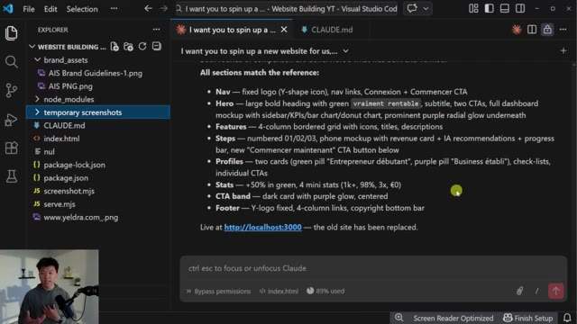
*⏱️ 00:14:01 — Interface VS Code affichant un fichier Markdown 'CLAUDE.md' détaillant la structure technique et les composants du site web (Nav, Hero, Features, etc.).*

*⏱️ 00:14:09 — Aperçu du site web généré 'Yeldra' dans un navigateur, présentant une interface moderne avec un en-tête, une section héros et un tableau de bord financier.*

---

### ⏱️ `[00:14:26 - 00:14:58]` | Segment #32

**🔊 Audio (Transcription Intégrale Mot pour Mot en Français) :**
> which was this one. Obviously, some of the dynamic elements in the background and some of the actual images could not have been the exact same. But for a clone, this is very, very similar. And it is a really good spot for us to actually start. And now we can just start to integrate our own colors and logos and copy right into this template. And it's as simple as just asking it to do so. So I'm going to go ahead and clear this out. I'm going to say, go ahead and delete all of the temporary screenshots in the temporary screenshots folder. And so now all of those have been deleted, as you can see.

**👁️ Analyse Visuelle d'Écran (gemini-3.5-flash-lite) :**
**Interface & Outils** : Navigateur web (présentation du site Yeldra), Visual Studio Code.

**Contenu textuel & Code** : Fichier "CLAUDE.md" contenant une spécification technique détaillée des composants du site (Nav, Hero, Features, Steps, Profiles) pour le développement par l'IA.

**Action / Démonstration** : Revue des éléments de design et de la structure du site web en vue de leur intégration et personnalisation.

*⏱️ 00:14:34 — Interface web du site "Yeldra" en français, présentant une section "Une approche en 3 temps" avec des points de détail et des appels à l'action.*

*⏱️ 00:14:42 — Interface web du site "Yeldra" en anglais, affichant la section "Hero" avec un titre principal en gras, un sous-titre et un aperçu graphique d'un tableau de bord financier.*

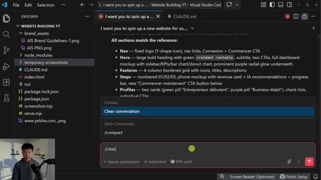
*⏱️ 00:14:50 — Éditeur de code Visual Studio Code avec une fenêtre de chat d'agent IA ouverte (interface type Cursor/Claude), affichant un fichier Markdown listant des instructions de design pour la construction du site.*

---

### ⏱️ `[00:14:58 - 00:15:26]` | Segment #33

**🔊 Audio (Transcription Intégrale Mot pour Mot en Français) :**
> And we're basically going to say the most recent landing page looks really good. What I want you to do now is work in our brand assets. So our brand guidelines and our AIS logo. And this is for our community called AI Automation Society. So just work in those changes to that website clone that you just built. And once again, we are just going to stay on bypass permissions. I'm going to shoot that off, one shot prompt this thing, and hopefully we should get something that looks pretty solid.

**👁️ Analyse Visuelle d'Écran (gemini-3.5-flash-lite) :**
**Interface & Outils** : Visual Studio Code avec l'interface de l'agent Claude intégrée.

**Contenu textuel & Code** : Arborescence du projet avec le dossier "brand_assets", journal d'exécution de l'agent montrant la commande Bash `rm` utilisée pour supprimer des captures d'écran temporaires, et barre de saisie de prompt Claude en bas.

**Action / Démonstration** : L'agent Claude exécute une commande système pour supprimer des fichiers temporaires dans le répertoire du projet avant la suite des opérations.

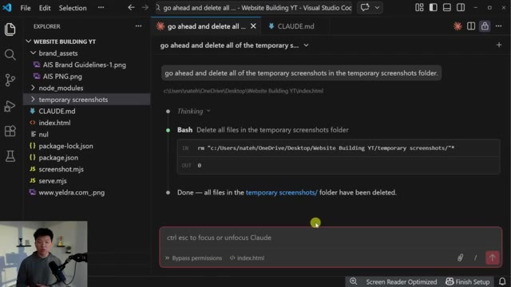
*⏱️ 00:15:05 — Capture d'écran de l'éditeur Visual Studio Code montrant l'extension Claude en pleine exécution de nettoyage de fichiers.*

---

### ⏱️ `[00:15:27 - 00:16:03]` | Segment #34

**🔊 Audio (Transcription Intégrale Mot pour Mot en Français) :**
> Now, what I'm interested to see is what it ends up doing with this dashboard and what it ends up doing with this iPhone screen because we haven't given any other pictures. As you saw in our website, we obviously gave it some different pictures like the school games dashboard or me with Hermosi and Sam Ovens. But that's what you could do is you would come back into Cloud Code and you would say, hey, I gave you some more pictures in the brand assets, put this one here, put this one there, and it would figure that out for you. And of course, you would also have to say, cool, when they click on start for free, take them to this link. Or when they click on see the demo, take them to this link. So there's other little pieces that you would obviously have to configure as well. But those changes take basically no time. Okay, so that finished up pretty quickly.

**👁️ Analyse Visuelle d'Écran (gemini-3.5-flash-lite) :**
**Interface & Outils** : VS Code (avec extension Claude Code), Navigateur web.

**Contenu textuel & Code** : Fichiers du projet (index.html, package.json, assets), logs d'exécution de l'agent (Read index.html, Considering...), interface utilisateur Yeldra.

**Action / Démonstration** : L'agent IA analyse le code source du site web et ses assets pour potentiellement effectuer des modifications ou des tests de rendu.

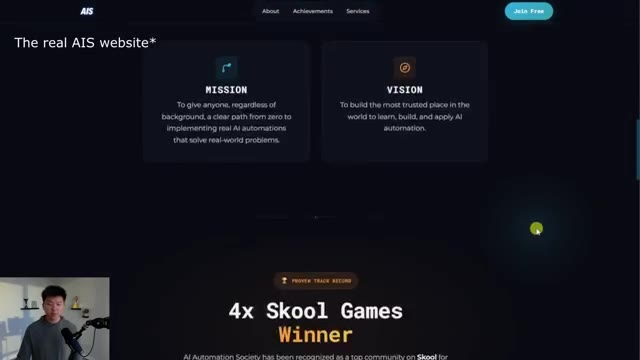
*⏱️ 00:15:36 — Capture d'écran montrant la page web "AIS" avec les sections Mission et Vision et la mention "4x Skool Games Winner".*

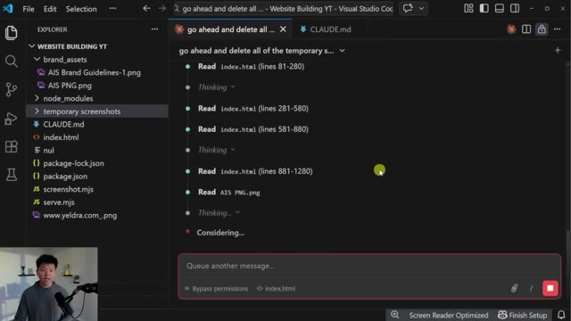
*⏱️ 00:15:45 — Interface de VS Code montrant l'activité de l'agent "Claude Code" en train de lire des fichiers sources du projet (index.html, images).*

*⏱️ 00:15:54 — Aperçu de la page d'accueil du site web "Yeldra" affichant un tableau de bord analytique et des boutons d'appel à l'action.*

---

### ⏱️ `[00:16:03 - 00:16:24]` | Segment #35

**🔊 Audio (Transcription Intégrale Mot pour Mot en Français) :**
> We've got three screenshots here, but I'm not going to click into them because I don't want to ruin the final reveal here. But it used our colors. We have our primary accent, our secondary, our dark background, and our mid-background. We've got the right typography. We've got the right logo. And everything was fully translated from French to English. Thank goodness. And now it's rewritten for our community, which once again, we didn't actually give it facts about the community yet.

**👁️ Analyse Visuelle d'Écran (gemini-3.5-flash-lite) :**
**Interface & Outils** : Visual Studio Code (VS Code) avec une instance intégrée de l'assistant Claude.

**Contenu textuel & Code** : Document Markdown listant les codes hexadécimaux des couleurs (AIS blue #4FC1FF, AIS orange #FFA41F), les polices (Roboto Mono, Montserrat) et le logo, dans le contexte d'une automatisation.

**Action / Démonstration** : Revue des changements de branding appliqués à un projet de développement web, avec l'assistant Claude prêt à recevoir une instruction dans la zone de saisie.

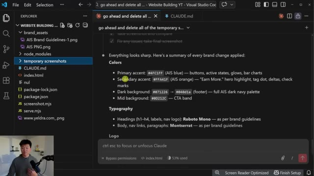
*⏱️ 00:16:08 — Interface de VS Code affichant un document Markdown détaillant les spécifications de la charte graphique (couleurs, typographie) appliquées par l'agent IA.*

---

### ⏱️ `[00:16:24 - 00:16:45]` | Segment #36

**🔊 Audio (Transcription Intégrale Mot pour Mot en Français) :**
> This is just very simple prompting. It also mocked up a dashboard. So let's head over to our local host. Let's give this a hard refresh and boom, we now have our new site, master AI automation, build faster, earn more. For the dashboard, it worked in like a little bit of a, it's got members, it's got automations, courses. It's got, it's kind of like a community tracker dashboard and it uses our colors in there too, which is cool.

**👁️ Analyse Visuelle d'Écran (gemini-3.5-flash-lite) :**
**Interface & Outils** : Navigateur web (localhost).

**Contenu textuel & Code** : Textes marketing ("Master AI Automation", "Build Faster", "Earn More"), statistiques de performance, interfaces de tableau de bord utilisateur (UI SaaS).

**Action / Démonstration** : Présentation du résultat final généré par une IA suite à un prompt, affiché via un rafraîchissement de page dans le navigateur.

*⏱️ 00:16:29 — Page d'accueil du site web "Yeldra" affichant un tableau de bord financier avec des indicateurs de revenus et de profits.*

*⏱️ 00:16:34 — Page d'accueil du site web "AI Automation Society" affichant un tableau de bord de communauté avec des statistiques sur les membres et les automatisations.*

---

### ⏱️ `[00:16:46 - 00:17:07]` | Segment #37

**🔊 Audio (Transcription Intégrale Mot pour Mot en Français) :**
> We've got different things on here, workshops, templates, expert community. It also changed this iPhone thing to member growth this month. So it's keeping all of this on brand with the actual original reference site, which once again, looks like this. However, now it has our colors and it has our information in here. We've got two paths and then we have some other stats down here and a nice little call to action at the bottom.

**👁️ Analyse Visuelle d'Écran (gemini-3.5-flash-lite) :**
**Interface & Outils** : Site web (Landing pages de AI Automation Society et Yeldra).

**Contenu textuel & Code** : Textes explicatifs, sections de services (Beginners/Professionals), listes à puces de bénéfices et interfaces de démonstration.

**Action / Démonstration** : Navigation et défilement sur des pages web pour illustrer la refonte du design et de l'image de marque.

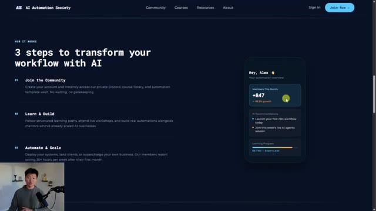
*⏱️ 00:16:51 — Page d'accueil du site "AI Automation Society" détaillant les 3 étapes de transformation des workflows avec l'IA.*

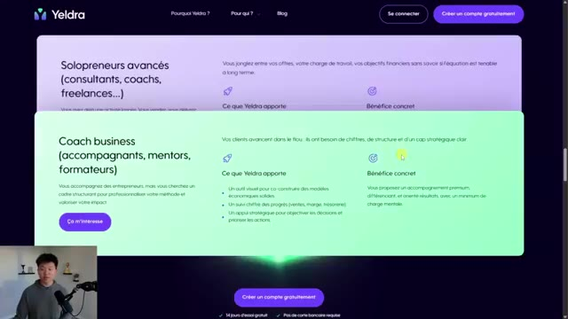
*⏱️ 00:16:56 — Interface du site web "Yeldra" présentant une section ciblée pour les coachs business avec des bénéfices concrets.*

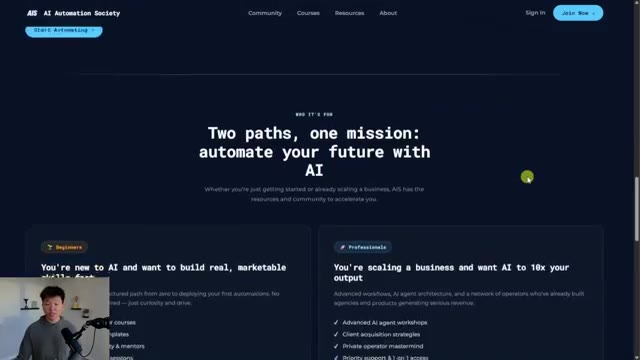
*⏱️ 00:17:02 — Section "Who it's for" du site "AI Automation Society" distinguant les parcours pour débutants et professionnels.*

---

### ⏱️ `[00:17:07 - 00:17:41]` | Segment #38

**🔊 Audio (Transcription Intégrale Mot pour Mot en Français) :**
> So cool. What we could do now is obviously go back and forth a little bit, maybe change some texts, make things bigger, you know, change the images and stuff like that. But let's say we're at a spot where we like the overall feel and vibe of the website. But now how do we really up it to the next level to make it feel unique. Well, what we're going to do is unlock the final hack, which is individual components. And what I mean by that is taking inspiration from different places, but for very individual components, for small pieces, not entire websites. So what we can do is we can go to a website called 21st.dev, which has some of the best website components you might be

**👁️ Analyse Visuelle d'Écran (gemini-3.5-flash-lite) :**
**Interface & Outils** : Navigateur web (site web généré) et application de création de diagrammes/canvas (probablement Excalidraw).

**Contenu textuel & Code** : Texte du site web (titre, sous-titre) et étapes du diagramme : "CLAUDE.md", "Frontend Design Skill", "Screenshot Loop", "Inspiration Websites", "Individual Components".

**Action / Démonstration** : Présentation visuelle de l'état actuel d'une interface web, puis transition vers un schéma conceptuel illustrant les étapes pour passer au niveau supérieur ("up it to the next level").

*⏱️ 00:17:16 — Page d'accueil du site "AI Automation Society" avec une interface sombre, un titre d'appel à l'action et un aperçu partiel d'un tableau de bord en bas de page.*

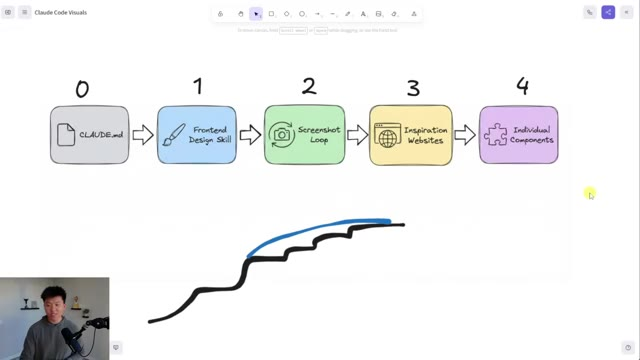
*⏱️ 00:17:24 — Diagramme de workflow numéroté de 0 à 4, représentant un processus de design itératif (CLAUDE.md, Frontend Design, Screenshot Loop, etc.) avec une courbe de progression manuscrite.*

---

### ⏱️ `[00:17:41 - 00:18:16]` | Segment #39

**🔊 Audio (Transcription Intégrale Mot pour Mot en Français) :**
> able to find. It's got shaders, it's got backgrounds, it's got home screens, it's got buttons, it's got, you know, mouse highlights. It's got so many different things that you can do. So here you can see I've got buttons and I could make them have a rainbow outline. I could make them shiny. We could toggle, you know, dark mode or light mode. There's lots of different things we could do here. Or I could just click on backgrounds in here and I could look at other ways that we could have our background. So maybe we want these little kind of dropdown pills instead, or maybe we want these hero waves in the background. I think we should actually do this instead. So what I'm going to do is just copy this prompt right here. This will basically copy a chunk of code for us to give to Cloud Code. And I'm just going to say, I want you to work in

**👁️ Analyse Visuelle d'Écran (gemini-3.5-flash-lite) :**
**Interface & Outils** : Plateforme de composants web (type 21st.dev ou bibliothèque de composants UI/UX).

**Contenu textuel & Code** : Galerie de composants interactifs, titres de sections ("Components", "Backgrounds"), labels de bibliothèques (Magic UI, Aceternity UI, Kokonut UI), options de configuration (Copy prompt, réglages de vitesse/densité).

**Action / Démonstration** : Navigation à travers une bibliothèque de ressources graphiques pour développeurs, démonstration visuelle des effets de composants (boutons, arrière-plans animés).

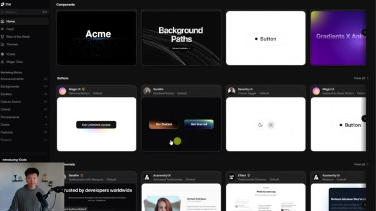
*⏱️ 00:17:50 — Interface de bibliothèque de composants UI affichant des boutons (Rainbow, Gradient, Interactive) et des éléments de design.*

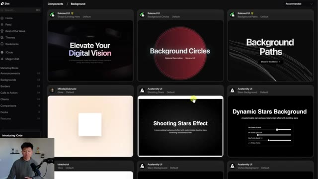
*⏱️ 00:17:58 — Catalogue de composants "Background" présentant divers effets visuels comme "Background Circles", "Shooting Stars" et "Dynamic Stars".*

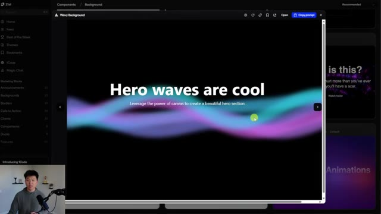
*⏱️ 00:18:07 — Aperçu détaillé du composant "Wavy Background" avec une animation de vagues colorées en plein écran et des options de contrôle.*

---

### ⏱️ `[00:18:16 - 00:18:43]` | Segment #40

**🔊 Audio (Transcription Intégrale Mot pour Mot en Français) :**
> this background element right behind the hero text. And after I give it that prompt, I just paste in what we grabbed from 21st.dev and it should be able to use all of this and understand how to put that into our site. So I'm just going to go ahead and shoot this off and we will see. Actually, one thing that I forgot to mention is in this case, because we're working with an animation, the screenshot might not always work the best. So sometimes you might want to tell it not to do the screenshot flow.

**👁️ Analyse Visuelle d'Écran (gemini-3.5-flash-lite) :**
**Interface & Outils** : Visual Studio Code (avec Claude Code intégré) et navigateur web (21st.dev).

**Contenu textuel & Code** : Image 1 : Extraits de code liés au composant `<WavyBackground>` et instructions pour installer la dépendance `simplex-noise`. Image 2 : Composant UI avec effets de vagues animées et bouton "Copy prompt".

**Action / Démonstration** : Copie d'un prompt depuis 21st.dev pour l'intégrer dans le projet via l'agent Claude Code afin d'ajouter un arrière-plan animé au site web.

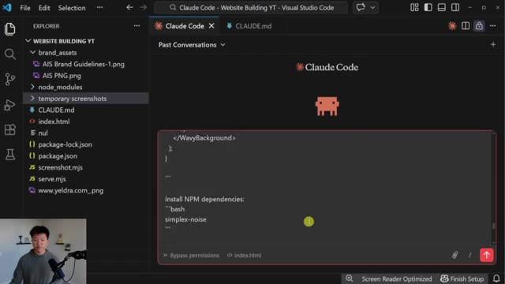
*⏱️ 00:18:23 — Interface de Visual Studio Code affichant l'outil Claude Code en plein milieu de l'écran, traitant une requête de code pour l'intégration d'un composant d'arrière-plan.*

*⏱️ 00:18:36 — Interface web de la plateforme 21st.dev affichant une prévisualisation interactive d'un composant "Wavy Background" avec un titre "Hero waves are cool".*

---

### ⏱️ `[00:18:43 - 00:19:02]` | Segment #41

**🔊 Audio (Transcription Intégrale Mot pour Mot en Français) :**
> So I'm basically actually just gonna copy all of this text. Once again, I'm gonna clear this out. I'm gonna paste it back in, but then I'm also going to say, because this is an animated background, do not use the screenshot tool to compare, just work in the code. And then I will let you know if we need to make any changes.

**👁️ Analyse Visuelle d'Écran (gemini-3.5-flash-lite) :**
**Interface & Outils** : Visual Studio Code (éditeur de code) avec l'extension ou l'interface Claude Code active.

**Contenu textuel & Code** : Zone de saisie textuelle avec le message "ctrl esc to focus or unfocus Claude" et un bouton d'envoi ; barre latérale montrant l'arborescence du projet "WEBSITE BUILDING YT".

**Action / Démonstration** : Le présentateur prépare l'environnement de développement pour interagir avec Claude Code, en manipulant l'éditeur pour insérer du code ou des instructions.

*⏱️ 00:18:48 — Interface de Claude Code intégrée dans Visual Studio Code, affichant une zone de chat avec une invite de commande interactive.*

---

### ⏱️ `[00:19:02 - 00:19:20]` | Segment #42

**🔊 Audio (Transcription Intégrale Mot pour Mot en Français) :**
> So hopefully with that mention, even though it's gonna read the claw.md, it won't do a bunch of screenshots here because I've actually tested this out and I've had different background elements come through. And because they're dynamic, sometimes the screenshot doesn't fully capture it. So it gets stuck in this loop of thinking, I haven't built this good enough, I'm gonna keep trying. And it like over engineers and it just doesn't really work.

**👁️ Analyse Visuelle d'Écran (gemini-3.5-flash-lite) :**
**Interface & Outils** : VS Code avec l'extension Claude Code active.

**Contenu textuel & Code** : Le prompt de l'utilisateur demande d'intégrer un composant React dans une codebase supportant Shadcn, Tailwind CSS et Typescript. On voit également l'arborescence du projet dans le panneau latéral (fichiers comme 'CLAUDE.md', 'index.html', 'screenshot.mjs').

**Action / Démonstration** : L'agent IA est en phase de "Thinking" et prépare l'analyse du projet pour effectuer l'intégration demandée.

*⏱️ 00:19:06 — Une interface de VS Code affichant un agent IA (Claude) en train de traiter une requête de développement web dans le volet central.*

---

### ⏱️ `[00:19:20 - 00:19:38]` | Segment #43

**🔊 Audio (Transcription Intégrale Mot pour Mot en Français) :**
> So sometimes you may wanna turn off the screenshot tool. All right, so that just finished up. It didn't take a bunch of screenshots, so it didn't take forever. Let's go to the website. Let's give it a refresh and see. Okay, okay, so we've got a background. It looks a little bit distracting. It also looks a little bit cheap.

**👁️ Analyse Visuelle d'Écran (gemini-3.5-flash-lite) :**
**Interface & Outils** : VS Code, Navigateur Web.

**Contenu textuel & Code** : Code HTML (`<canvas id="hero-canvas" ...>`), texte de présentation de la plateforme "AI Automation Society".

**Action / Démonstration** : Modification du code source suivie de l'actualisation de la page web pour visualiser l'intégration de l'élément visuel.

*⏱️ 00:19:25 — Interface de VS Code montrant l'insertion d'un élément canvas HTML pour un fond animé.*

*⏱️ 00:19:29 — Page web de la communauté "AI Automation Society" affichée sans le fond dynamique.*

*⏱️ 00:19:34 — Page web de la communauté "AI Automation Society" affichant le fond dynamique ondulé (wavy background).*

---

### ⏱️ `[00:19:38 - 00:19:58]` | Segment #44

**🔊 Audio (Transcription Intégrale Mot pour Mot en Français) :**
> It looks like too pixelated. So what I'm gonna do now is just iterate. I'm going to tell it that I think that it's a little bit distracting as far as it makes the hero text right behind it a little bit tough to read. Also, in the hero text, I'd like it if the earn more was maybe a blue or a different color.

**👁️ Analyse Visuelle d'Écran (gemini-3.5-flash-lite) :**
**Interface & Outils** : Navigateur web (site vitrine de AI Automation Society).

**Contenu textuel & Code** : Texte hero : "Master AI Automation. Build Faster. Earn More.", boutons "Join the Community" et "Watch Demo", et interface de tableau de bord montrant des statistiques de membres et d'automatisations.

**Action / Démonstration** : Analyse visuelle du design : le présentateur évalue la lisibilité du texte sur l'arrière-plan pixelisé et planifie une itération pour modifier la couleur du texte "Earn More" et ajuster l'arrière-plan.

*⏱️ 00:19:43 — Interface web d'une plateforme communautaire "AI Automation Society" affichant une section hero avec un titre en texte blanc sur un arrière-plan abstrait bleu pixelisé, ainsi qu'une prévisualisation d'un tableau de bord utilisateur en bas.*

---

### ⏱️ `[00:19:58 - 00:20:33]` | Segment #45

**🔊 Audio (Transcription Intégrale Mot pour Mot en Français) :**
> I think that doesn't really feel good to have that be orange. It would be good if there was maybe some sort of background behind the hero text so that we could see it and it would still stand out and contrast against the background animation. but the background animation looks super fuzzy and super pixely if you could make that look a little bit more professional and clean that would be great and if you guys were curious why i was just like staring at that and talking is because i was dictating and i wanted to be able to look at what i was talking about so we've given some feedback now let's see if they can go ahead and make those changes and once again like we're being pretty vague here and it would be up to the

**👁️ Analyse Visuelle d'Écran (gemini-3.5-flash-lite) :**
**Interface & Outils** : Visual Studio Code, Navigateur Web (Interface de site).

**Contenu textuel & Code** : - Code : Propriétés CSS/JS pour l'animation (CENTER_Y, BLUR, WAVE_WIDTH, globalAlpha).
- Texte : Instructions de correction sur la lisibilité du texte "Hero" et demande de changement de couleur pour "Earn More".

**Action / Démonstration** : Revue de design et itération sur le code source de l'animation d'arrière-plan via un prompt Claude.

*⏱️ 00:20:07 — Interface web du site "AI Automation Society" montrant un texte "Hero" imposant avec un mot en orange sur un arrière-plan animé flou.*

*⏱️ 00:20:24 — Éditeur VS Code affichant un fichier Markdown (CLAUDE.md) contenant des instructions techniques pour le réglage de l'animation de fond et des commentaires sur le design.*

---

### ⏱️ `[00:20:33 - 00:21:08]` | Segment #46

**🔊 Audio (Transcription Intégrale Mot pour Mot en Français) :**
> creativity of the model to understand what we're asking for and be able to make these changes now if you were on plan mode, it might be able to do a little bit better job of asking you some questions and maybe helping you get to a better solution first before it starts coding. But for the sake of the video, let's see how well it does with this prompt. All right, that just finished up and you can see that that looks much, much better. This is definitely more what I was looking for when we copied over that animation into this website. So from here, we would just keep going through and we'd keep being really nitpicky about what we want to change. We'd add our own pictures in, we'd maybe want to change some of these buttons to be more dynamic. We'd want to maybe

**👁️ Analyse Visuelle d'Écran (gemini-3.5-flash-lite) :**
**Interface & Outils** : VS Code (avec extension d'agent IA intégrée), Navigateur web (rendu du site).

**Contenu textuel & Code** : Texte de prompt détaillant des améliorations de lisibilité ("Earn More" en bleu, ajout d'un arrière-plan derrière le texte, amélioration de l'animation de fond).

**Action / Démonstration** : Interaction en langage naturel avec un agent IA pour itérer sur le design du code source et visualisation du rendu final sur le site.

*⏱️ 00:20:42 — Interface de VS Code montrant une fenêtre de discussion avec un agent IA (probablement Claude Code) où l'utilisateur exprime des besoins de design pour une page web.*

*⏱️ 00:20:50 — Aperçu du site web "AI Automation Society" en cours de développement, affichant une section hero avec un fond animé abstrait et du texte typographique.*

---

### ⏱️ `[00:21:08 - 00:21:42]` | Segment #47

**🔊 Audio (Transcription Intégrale Mot pour Mot en Français) :**
> animate some of this other stuff, which we could easily do just by asking Cloud Code to do so. So from here, the question is, how do you actually get this onto a real landing page? Because right now we're still developing all of this code and we're previewing this in our local host. So what we're going to do is we're going to use a combination of GitHub and Vercel to do this. Cloud Code is where we're working right now. All of these folders, all of these files are local, meaning if I pulled up my laptop, I wouldn't be able to access them. And when we're building our website, which is obviously this website right here, this is all made up of a bunch of code in our Cloud Code project. So what we need to do with that is we sync that code to GitHub.

**👁️ Analyse Visuelle d'Écran (gemini-3.5-flash-lite) :**
**Interface & Outils** : Diagramme explicatif (type Excalidraw ou tableau blanc numérique).

**Contenu textuel & Code** : Schéma technique montrant les étapes : "git push", "auto-deploy on push" et "CDN serve" reliant les outils Claude Code, GitHub, Vercel et le "Live Site".

**Action / Démonstration** : Explication pédagogique du pipeline de mise en production automatique pour déployer le code développé localement.

*⏱️ 00:21:25 — Diagramme de workflow illustrant le processus de déploiement : Claude Code -> GitHub -> Vercel -> Site en ligne.*

---

### ⏱️ `[00:21:43 - 00:22:12]` | Segment #48

**🔊 Audio (Transcription Intégrale Mot pour Mot en Français) :**
> And GitHub has version control. We can see all of our commits. Other people can work on it, stuff like that. We basically host our code or our project in the cloud. And we set up a really cool auto deploy between Vercel and GitHub. And Vercel is basically just where we deploy our code to a live site. So basically what this means is whenever we tell Cloud Code, hey, this looks good. Push these changes to GitHub. GitHub grabs the new changes. And then Vercel automatically grabs those from GitHub and then updates the real working version of our site.

**👁️ Analyse Visuelle d'Écran (gemini-3.5-flash-lite) :**
**Interface & Outils** : Outil de dessin/tableau blanc numérique (Excalidraw).

**Contenu textuel & Code** : Diagramme de flux avec les étapes : "git push" vers GitHub, "auto-deploy on push" vers Vercel, et "CDN serve" vers un Live Site, accompagné de descriptions textuelles pour chaque outil.

**Action / Démonstration** : Visualisation du workflow technique pour expliquer l'automatisation du déploiement de code de l'environnement IA vers la production.

*⏱️ 00:21:50 — Un schéma explicatif illustré à la main montrant le pipeline de déploiement : Claude Code -> GitHub -> Vercel -> Site Live.*

---

### ⏱️ `[00:22:12 - 00:22:33]` | Segment #49

**🔊 Audio (Transcription Intégrale Mot pour Mot en Français) :**
> And I will show you guys that. But let's first of all, do this pipeline. So the first thing that you're going to need to do is go to GitHub, create an account if you already have one, and you're going to need to create a new repository. So I'm going to create a repository right here called AIS test website. I'm not going to worry right now about a description or all of and I'm just gonna go ahead and create that repository.

**👁️ Analyse Visuelle d'Écran (gemini-3.5-flash-lite) :**
**Interface & Outils** : Navigateur web (GitHub - New repository).

**Contenu textuel & Code** : Formulaire de création de dépôt : champs "Owner" (nateherkai), "Repository name" (vide), description, et options de configuration (visibilité, README, .gitignore, licence).

**Action / Démonstration** : Le présentateur explique la procédure pour créer un nouveau dépôt en remplissant les champs requis sur l'interface GitHub.

*⏱️ 00:22:17 — Interface web GitHub pour la création d'un nouveau dépôt (repository) avec le présentateur visible en médaillon dans le coin inférieur gauche.*

---

### ⏱️ `[00:22:33 - 00:22:53]` | Segment #50

**🔊 Audio (Transcription Intégrale Mot pour Mot en Français) :**
> Now, what you also could do is you could tell Claude Code, hey, create me a GitHub repository and it could actually do that. But right now I just wanted to show you guys so you can get a feel for GitHub if you've never used it before. So anyways, now we have this repository called AIS Test Website. I'm just gonna copy the name of that real quick. And I'm gonna come back into Claude Code. We're gonna clear this out and say, awesome.

**👁️ Analyse Visuelle d'Écran (gemini-3.5-flash-lite) :**
**Interface & Outils** : - Image #1 : GitHub (Interface web).
- Image #2 : Visual Studio Code avec extension Claude Code.

**Contenu textuel & Code** : - Image #1 : Instructions Git (init, add, commit, branch, remote add, push).
- Image #2 : Liste de fichiers du projet (index.html, package.json, assets) et notes techniques sur le rendu du canvas et le style CSS (couleurs, opacité).

**Action / Démonstration** : - Image #1 : Présentation de l'état vide d'un dépôt GitHub pour les débutants.
- Image #2 : Revue des modifications apportées par l'agent IA (Claude) au projet "Website Building YT".

*⏱️ 00:22:38 — Interface web du dépôt GitHub nouvellement créé intitulé "AIS-test-website", affichant les options de configuration initiale et les commandes Git.*

*⏱️ 00:22:48 — Éditeur VS Code avec le plugin Claude activé, affichant un fichier Markdown de journal de modifications ("CLAUDE.md") et un panneau de chat IA en bas.*

---

### ⏱️ `[00:22:53 - 00:23:14]` | Segment #51

**🔊 Audio (Transcription Intégrale Mot pour Mot en Français) :**
> So now that this site looks good, we need to actually deploy this on our domain. I need you to help push this to GitHub and we're gonna push it to a GitHub repository called, and then I'm gonna paste in the name. Now, so far it has not yet gotten our GitHub credentials. So we're gonna have to obviously authenticate into GitHub first so it can push that into GitHub.

**👁️ Analyse Visuelle d'Écran (gemini-3.5-flash-lite) :**
**Interface & Outils** : Visual Studio Code, Claude Code (interface d'agent IA intégrée).

**Contenu textuel & Code** : Structure de fichiers incluant "index.html", "package.json", et le logo Claude Code affiché dans la zone de chat. La barre de saisie de l'agent indique "Ctrl esc to focus or unfocus Claude".

**Action / Démonstration** : L'utilisateur est en train de préparer l'environnement pour interagir avec l'agent Claude Code afin de procéder au déploiement du projet sur GitHub, comme mentionné dans la narration.

*⏱️ 00:22:58 — Une capture d'écran de l'éditeur Visual Studio Code montrant l'extension ou l'interface "Claude Code" active, avec la structure de fichiers du projet dans la barre latérale gauche.*

---

### ⏱️ `[00:23:14 - 00:23:32]` | Segment #52

**🔊 Audio (Transcription Intégrale Mot pour Mot en Français) :**
> So I just got logged in as nathurkai and now it's gonna create the .git ignore and get everything set up so it can actually do so. Now it's not too big of a deal right now because nothing that we'd be pushing into the public GitHub or onto the cloud has API keys or has any usernames or passwords or any sensitive information or webhook abilities.

**👁️ Analyse Visuelle d'Écran (gemini-3.5-flash-lite) :**
**Interface & Outils** : Visual Studio Code avec l'extension ou l'interface intégrée de "Claude Code".

**Contenu textuel & Code** : Contenu d'un fichier `.gitignore` nouvellement créé (node_modules/, temporary screenshots/, .DS_Store) et logs de terminal affichant la commande `git init` et l'initialisation du dépôt dans le répertoire de projet.

**Action / Démonstration** : L'agent automatise la configuration initiale du contrôle de version (Git) pour le projet en cours.

*⏱️ 00:23:19 — Capture d'écran de Visual Studio Code affichant l'interface de l'agent "Claude Code" en train d'initialiser un dépôt Git.*

---

### ⏱️ `[00:23:32 - 00:23:54]` | Segment #53

**🔊 Audio (Transcription Intégrale Mot pour Mot en Français) :**
> But that is something to be aware of once you actually are pushing automations and things like that to the cloud, make sure that you're not putting any of your sensitive information out there. Awesome, so it now says that our site is live on GitHub. So if I click into this link, we should see that we now have a new commit. We have all of this stuff like our cloud.md, we have our screenshot stuff, we have brand assets, and now we can sync this to Vercel.

**👁️ Analyse Visuelle d'Écran (gemini-3.5-flash-lite) :**
**Interface & Outils** : Visual Studio Code (avec extension de chat IA), Navigateur web (GitHub).

**Contenu textuel & Code** : Commandes terminal `gh repo create`, logs d'erreur GraphQL (nom déjà existant), structure de fichiers du projet (index.html, package.json, etc.).

**Action / Démonstration** : Tentative automatisée de création de dépôt GitHub par l'agent IA, suivie de la vérification du dépôt effectif sur la plateforme GitHub.

*⏱️ 00:23:38 — Interface de Visual Studio Code affichant l'historique d'exécution d'un agent IA (Claude) tentant de créer un dépôt GitHub via la ligne de commande Bash.*

*⏱️ 00:23:48 — Interface web de GitHub affichant le dépôt "AIS-test-website" nouvellement créé avec succès, contenant les fichiers du projet.*

---

### ⏱️ `[00:23:54 - 00:24:13]` | Segment #54

**🔊 Audio (Transcription Intégrale Mot pour Mot en Français) :**
> So that would be step two is you're gonna go to vercel.com, create an account. When you create that account, It's much easier if you just sign in or create that account with your GitHub credentials. And then all we have to do is go ahead and add a new project. And then we're able to just choose a GitHub repository as simple as that. So I can literally just hit import on our AIS test website, which you guys just saw me set up.

**👁️ Analyse Visuelle d'Écran (gemini-3.5-flash-lite) :**
**Interface & Outils** : Plateforme de déploiement cloud Vercel (interface web).

**Contenu textuel & Code** : Noms des dépôts GitHub (AIS-test-website, Klaus-dashboard, etc.) et modèles (Next.js Boilerplate, AI Chatbot, Express.js, Vite + React Starter).

**Action / Démonstration** : Navigation dans le tableau de bord Vercel pour initier le déploiement d'un nouveau projet en important un dépôt depuis GitHub.

*⏱️ 00:23:58 — Tableau de bord principal de Vercel affichant la liste des projets existants, les statistiques d'utilisation des 30 derniers jours et une barre de navigation supérieure.*

*⏱️ 00:24:08 — Interface de création de projet sur Vercel avec l'option "Import Git Repository" et une liste de dépôts GitHub accessibles pour importation, ainsi que des modèles (templates) proposés.*

---

### ⏱️ `[00:24:13 - 00:24:32]` | Segment #55

**🔊 Audio (Transcription Intégrale Mot pour Mot en Français) :**
> And then all I have to do is go ahead and deploy this project. Awesome. So I've deployed a new project to my projects. I can go ahead and continue to the dashboard here. And what this now does is we can actually visit this by going to AIS-test-website.versight. cell.app. I open that up and now this is no longer local. I could open up my phone and type in this.

**👁️ Analyse Visuelle d'Écran (gemini-3.5-flash-lite) :**
**Interface & Outils** : Vercel Dashboard (Plateforme de déploiement cloud).

**Contenu textuel & Code** : URL du projet : "ais-test-website.vercel.app", nom du projet : "ais-test-website", statut : "Ready", commit : "Initial commit — AI Automation Society website".

**Action / Démonstration** : Le présentateur confirme le succès du déploiement d'un nouveau projet et navigue vers le tableau de bord pour accéder à l'URL live du site.

*⏱️ 00:24:18 — Interface de confirmation de déploiement sur Vercel affichant un aperçu du site "AI Automation Society" nouvellement déployé.*

*⏱️ 00:24:23 — Tableau de bord du projet sur Vercel montrant le statut "Ready" pour "ais-test-website" avec les détails du déploiement en production.*

---

### ⏱️ `[00:24:33 - 00:25:06]` | Segment #56

**🔊 Audio (Transcription Intégrale Mot pour Mot en Français) :**
> You could open up your browser and type this in and you guys could all visit this site because it's now deployed on the cloud. But of course it's got an ugly domain. So what you would have to do now is you would have to go to your project settings. You would go to domains and then this is where you would actually just have to either buy a domain right here or add an existing one. And it's really simple. It would walk you through the DNS configuration that you need to set up and it's not too difficult, but I'm not going to actually do that live in this video. So what I wanted to show you guys real quick before we end off this video is what actually happens if we realize that we want to make a change to our website that is on the cloud. Well, that's why it's good that we

**👁️ Analyse Visuelle d'Écran (gemini-3.5-flash-lite) :**
**Interface & Outils** : Vercel (plateforme de déploiement cloud).

**Contenu textuel & Code** : URL de déploiement (ais-test-website-m21f0213r-nateherks-projects.vercel.app), statut "Ready", options de configuration de domaines.

**Action / Démonstration** : Navigation dans le tableau de bord Vercel pour accéder aux paramètres de gestion des domaines afin de modifier l'adresse du site déployé.

*⏱️ 00:24:41 — Tableau de bord du projet Vercel montrant l'état "Production Deployment" avec une prévisualisation du site et l'URL générée.*

*⏱️ 00:24:50 — Interface de configuration des domaines dans les réglages du projet Vercel, permettant d'ajouter des domaines personnalisés.*

*⏱️ 00:24:58 — Retour à la vue d'ensemble (Overview) du tableau de bord Vercel pour le projet "ais-test-website".*

---

### ⏱️ `[00:25:06 - 00:25:43]` | Segment #57

**🔊 Audio (Transcription Intégrale Mot pour Mot en Français) :**
> still have, you guys can't see because you can't see the URL, but we still do have our local version because if I make a change here and I don't like it, I don't want that to automatically get pushed to Vercel. So what you'd probably want to do is in your claw.md file, you would say, ultimately what's going to happen is we're syncing all of the changes to GitHub. GitHub's going to automatically push them to Vercel and we'll be good to go. But when I'm making changes with you here, we're always going to test on local host until I tell you explicitly to push that to GitHub or commit those changes to GitHub. Okay, so this is our local version. And let's just say, for example, we wanted to make this button a little bit cooler. So I'm going to ask in Cloud Code,

**👁️ Analyse Visuelle d'Écran (gemini-3.5-flash-lite) :**
**Interface & Outils** : Visual Studio Code avec l'extension Claude intégrée.

**Contenu textuel & Code** : Le fichier Markdown affiche des informations sur le déploiement sur GitHub Pages (URL du dépôt, fichiers poussés comme index.html, et étapes de configuration des paramètres du dépôt). La zone de texte de l'agent contient le placeholder "Ctrl esc to focus or unfocus Claude".

**Action / Démonstration** : Le présentateur explique le workflow de déploiement et la gestion des fichiers locaux par rapport au déploiement en ligne.

*⏱️ 00:25:16 — Interface de Visual Studio Code affichant un fichier Markdown (CLAUDE.md) contenant des instructions de déploiement GitHub et la barre de saisie de l'agent Claude dans le coin inférieur droit.*

---

### ⏱️ `[00:25:44 - 00:26:03]` | Segment #58

**🔊 Audio (Transcription Intégrale Mot pour Mot en Français) :**
> could you go ahead and make the join the community button in the main hero tech section, make it more professional. So give it like a cool glow. And once you've made this change, Let me see it in localhost. Don't push it to GitHub until I tell you to. This thing is getting pretty screenshot happy. I may have to adjust the wording in the cloud.md file a little bit.

**👁️ Analyse Visuelle d'Écran (gemini-3.5-flash-lite) :**
**Interface & Outils** : Visual Studio Code (avec l'extension Claude Code).

**Contenu textuel & Code** : Explorateur de fichiers (fichiers HTML, JSON, assets), champ de saisie de l'agent : "ctrl esc to focus or unfocus Claude".

**Action / Démonstration** : L'utilisateur a l'éditeur de code ouvert et est prêt à envoyer une instruction à l'agent Claude pour modifier le bouton "Join the community".

*⏱️ 00:25:48 — L'interface de l'éditeur Visual Studio Code avec le panneau "Claude Code" ouvert, montrant l'arborescence des fichiers du projet et la zone de saisie pour interagir avec l'agent IA.*

---

### ⏱️ `[00:26:03 - 00:26:22]` | Segment #59

**🔊 Audio (Transcription Intégrale Mot pour Mot en Français) :**
> It literally took one of the main screen and then it took one of where it just cropped the actual button, but hey, it looks good. Okay, so what happens is here's the localhost. I'll refresh that. Now we can see the little glow behind the join the community button. And here is the web app version. I refresh this and we don't have that change yet, which is great because we don't wanna push changes if they're not good, right?

**👁️ Analyse Visuelle d'Écran (gemini-3.5-flash-lite) :**
**Interface & Outils** : VS Code (avec extension Claude Code), Navigateur web.

**Contenu textuel & Code** : Logs d'exécution de Claude Code ("Take cropped 2x screenshot of the hero button"), code Puppeteer, et interface UI du site web AIS.

**Action / Démonstration** : Exécution d'un script de capture d'écran automatisé pour isoler un composant spécifique du site (bouton) et visualisation du résultat sur le site en direct.

*⏱️ 00:26:08 — Interface VS Code affichant un agent Claude Code effectuant un recadrage (crop) ciblé sur le bouton d'appel à l'action.*

*⏱️ 00:26:12 — Interface web du site "AI Automation Society" affichée dans un navigateur, mettant en évidence le bouton "Join the Community" avec un effet lumineux (glow).*

---

### ⏱️ `[00:26:22 - 00:26:45]` | Segment #60

**🔊 Audio (Transcription Intégrale Mot pour Mot en Français) :**
> But now what I'll do is say, awesome, I love that change. Go ahead and push that to GitHub. All right, so just push that. We have a new commit. If I go to GitHub and I give this a refresh, we can see that we should see right here two commits. This one was add glowing pulse effect to hero join the community button. And then if I go to Vercel and we go to our deployments, we should see that we just got a second one come through as well just now.

**👁️ Analyse Visuelle d'Écran (gemini-3.5-flash-lite) :**
**Interface & Outils** : Visual Studio Code (avec extension Claude), GitHub, Vercel.

**Contenu textuel & Code** : Commandes git dans le terminal VS Code, liste des commits sur GitHub ("Add glowing pulse effect..."), logs de déploiement sur Vercel.

**Action / Démonstration** : Validation du commit et du push du code vers GitHub, suivi de la vérification de l'historique des commits et de l'état du déploiement sur Vercel.

*⏱️ 00:26:28 — Interface de VS Code montrant l'agent Claude terminant le commit et le push des modifications pour le bouton hero.*

*⏱️ 00:26:33 — Page GitHub affichant l'historique des commits du dépôt, montrant le nouveau commit "Add glowing pulse effect".*

*⏱️ 00:26:39 — Tableau de bord Vercel affichant les détails du déploiement en production du site web "ais-test-website".*

---

### ⏱️ `[00:26:45 - 00:27:05]` | Segment #61

**🔊 Audio (Transcription Intégrale Mot pour Mot en Français) :**
> And now if I go to the site on the web and I refresh, we see the actual glowing join the community button. All right, so those are the five hacks that I wanted to cover today. We have our claw.md file, which as you could tell by this video, yes, it's nice to have something to start, but you are going to continue to iterate upon it throughout your project until you get to a good spot. We've got the front-end design skill, which is just like way too easy to not use.

**👁️ Analyse Visuelle d'Écran (gemini-3.5-flash-lite) :**
**Interface & Outils** : Navigateur web (site web d'automation) et outil de dessin/tableau blanc (type Excalidraw).

**Contenu textuel & Code** : Interface utilisateur web (landing page) et schéma conceptuel du processus de développement (workflow).

**Action / Démonstration** : Visualisation du résultat final après implémentation (bouton lumineux) suivie de la présentation récapitulative du processus de travail.

*⏱️ 00:26:50 — Page d'accueil du site "AI Automation Society" avec une interface moderne, sombre, affichant un bouton "Join the Community" avec un effet lumineux (glow).*

*⏱️ 00:26:55 — Diagramme de flux (workflow) numéroté de 0 à 4 illustrant les étapes du projet : CLAUDE.md, Frontend Design Skill, Screenshot Loop, Inspiration Websites, Individual Components.*

---

### ⏱️ `[00:27:05 - 00:27:41]` | Segment #62

**🔊 Audio (Transcription Intégrale Mot pour Mot en Français) :**
> We've got the screenshot loop, which you've got to be careful about, but it is very helpful. We've got inspiration websites, and then we have inspiration individual components. And now it's just a matter of making small tweaks and iterating upon your website. Just a reminder, you can grab this claw.md file for free in my free school community. The link for that is down in the description. And if you're looking to dive deeper with clawed code, AI automation, building an AI agency, all this kind of stuff, then definitely check out our paid community, AI automation society plus. We've got a great community of thousands of members in here who are building businesses with AI. And we've also got a full course with tons of more content coming over the next few months. So we'd love to see you guys in this community. But anyways, that's going to do

**👁️ Analyse Visuelle d'Écran (gemini-3.5-flash-lite) :**
**Interface & Outils** : Logiciel de tableau blanc numérique (ex: Excalidraw) pour le diagramme, navigateur web pour la plateforme Skool.

**Contenu textuel & Code** : Étapes du processus : 0 (CLAUDE.md), 1 (Frontend Design Skill), 2 (Screenshot Loop), 3 (Inspiration Websites), 4 (Individual Components).

**Action / Démonstration** : Présentation visuelle structurée du processus de design itératif utilisé pour le développement web.

*⏱️ 00:27:14 — Un diagramme de workflow séquentiel illustrant les étapes de conception : CLAUDE.md, Frontend Design Skill, Screenshot Loop, Inspiration Websites, et Individual Components.*

---

### ⏱️ `[00:27:41 - 00:27:50]` | Segment #63

**🔊 Audio (Transcription Intégrale Mot pour Mot en Français) :**
> it for today. If you guys enjoyed the video or you learned something new, please give it a like. It definitely helps me out a ton. And as always, I appreciate you guys making it to the end of the video. I'll see you on the next one. Thanks everyone.

**👁️ Analyse Visuelle d'Écran (gemini-3.5-flash-lite) :**
**Interface & Outils** : Navigateur web (site web communautaire AIS).

**Contenu textuel & Code** : Texte promotionnel : "Master AI Automation. Build Faster. Earn More." et barre de navigation supérieure.

**Action / Démonstration** : Affichage promotionnel de la plateforme communautaire de l'auteur en fin de vidéo.

*⏱️ 00:27:44 — Page d'accueil du site "AI Automation Society" (AIS) présentant la proposition de valeur avec un bouton d'appel à l'action, surmontant un aperçu flou d'un tableau de bord utilisateur.*

---

