# 🎬 The EASIEST Way to Host Your Claude Code Agents

> **Chaîne** : [Nate Herk | AI Automation](https://www.youtube.com/@nateherk/featured)  
> **Lien YouTube** : [https://www.youtube.com/watch?v=UGIZnh6HNLc](https://www.youtube.com/watch?v=UGIZnh6HNLc)  
> **Date de publication** : 20260220  
> **Durée** : 00:20:57  
> **Identifiant vidéo** : `UGIZnh6HNLc`  
> **Transcription & Analyse** : `whisper-v3-large-turbo+gemini-3.5-flash-lite`  

---

## 📌 Synthèse Exécutive & Outils

### 💡 Résumé
Cette vidéo de la chaîne Nate Herk | AI Automation explore l'alliance stratégique entre **Claude Code** et **Trigger.dev** pour concevoir, orchestrer et héberger des agents IA et des automatisations non déterministes dans le cloud. Le présentateur démontre comment passer rapidement d'une simple idée formulée en langage naturel à des flux de travail autonomes et robustes. L'objectif est d'exécuter des tâches complexes — telles que le scraping de vidéos YouTube, la recherche automatisée d'entreprises via ClickUp ou l'interaction conversationnelle avec un agent — sans s'enliser dans la gestion d'une infrastructure complexe.

La démonstration en direct met en scène un agent intégré à ClickUp : lorsqu'une nouvelle tâche (par exemple, « NVIDIA ») est ajoutée, le système déclenche un agent de recherche autonome qui interroge le web, analyse les URLs pertinentes, compile un dossier complet directement dans les commentaires, et reste capable de répondre à des requêtes contextuelles de suivi (comme « comment se porte leur action ? »). L'ensemble du code TypeScript nécessaire est généré itérativement par Claude Code à partir de consignes textuelles simples, puis déployé sur Trigger.dev pour garantir une exécution continue, planifiée et résiliente.

Au-delà de la vitesse de prototypage (compter moins d'une heure pour l'ensemble du projet), la méthode se distingue par sa supériorité par rapport à des solutions comme Modal. En effet, l'utilisation de Trigger.dev apporte nativement des fonctionnalités indispensables en production : exécutions programmées, nouvelles tentatives automatiques en cas d'échec (*retries*), mise en file d'attente, orchestration fine des tâches et journalisation en temps réel de chaque étape franchie par l'agent.

---

### 🛠️ Outils, Modèles & Logiciels Présentés
* **Claude Code** : Outil de développement en ligne de commande alimenté par IA permettant de traduire des requêtes textuelles en code fonctionnel, en générant notamment des scripts TypeScript complexes et structurés.
* **Trigger.dev** : Plateforme d'infrastructure cloud et d'orchestration pour TypeScript, utilisée pour héberger, exécuter, planifier et monitorer des flux de travail et des agents IA de manière hautement résiliente.
* **Anthropic (Claude / Opus 5.5)** : Modèle de langage sous-jacent et écosystème d'IA fournissant les capacités de raisonnement, d'utilisation d'outils et de traitement du langage naturel aux agents.
* **ClickUp** : Outil de gestion de projet et de tâches utilisé comme interface principale pour déclencher les automatisations et centraliser les rapports générés par les agents.
* **Modal** : Alternative d'infrastructure cloud mentionnée et comparée, jugée moins flexible et dotée d'une orchestration moins épurée que Trigger.dev pour ce type de cas d'usage.
* **VS Code** : Environnement de développement intégré (IDE) de référence employé pour exécuter Claude Code et gérer l'arborescence des fichiers du projet.

---

### 🔑 Points Clés & Enseignements Stratégiques
* **Synergie CLI-Cloud** : Associer Claude Code (pour la génération rapide de code à partir d'anglais simple) et Trigger.dev (pour l'hébergement cloud) permet de combler l'écart entre le prototypage local et la production robuste.
* **Automatisation non déterministe** : Contrairement aux scripts séquentiels classiques (1, 2, 3), l'utilisation d'agents dotés d'outils permet d'exécuter des boucles décisionnelles complexes adaptées à des tâches de recherche et d'analyse ouvertes.
* **Supériorité de Trigger.dev face aux alternatives** : La plateforme surclasse des outils comme Modal grâce à une interface plus propre, une gestion native des files d'attente, des déclencheurs planifiés et une orchestration inter-tâches supérieure.
* **Résilience et auto-correction** : L'intégration de mécanismes de nouvelles tentatives automatiques (*auto-retries*) avec délais configurés permet aux flux de travail de surmonter les pannes temporaires d'API ou de réseau sans intervention humaine.
* **Observabilité en temps réel** : Le suivi visuel des exécutions dans Trigger.dev permet de auditer chaque étape franchie par l'agent, le temps d'exécution par action et d'isoler instantanément les causes d'échec.
* **Guidage contextuel par fichiers de référence** : L'utilisation de fichiers de configuration spécifiques (comme `Claude.md` et `trigger.ref.md`) injectés dans l'espace de travail permet de cadrer les réponses de Claude Code et de lui fournir la documentation d'API indispensable pour générer du TypeScript valide du premier coup.
* **Architecture modulaire du code** : Organiser les scripts TypeScript dans un dossier `src` structuré par sous-dossiers (sépare l'infrastructure de déclenchement des différentes logiques métier) garantit la maintenabilité du projet à mesure qu'il s'étoffe.
* **Prompt engineering itératif** : Il n'est pas nécessaire de concevoir un plan architectural complexe en amont ; une requête initiale claire permet à l'IA d'interroger l'utilisateur sur les prérequis techniques manquants avant d'entamer la production du code.
* **Gestion du contexte conversationnel** : Les agents intégrés à des outils comme ClickUp sont capables de lire l'historique et les commentaires précédents pour résoudre les ambiguïtés sémantiques (par exemple, comprendre à quelle entreprise renvoie le pronom « ils » dans une question de suivi).
* **Gain de productivité massif** : La capacité à concevoir, tester et déployer des agents opérationnels et interconnectés (scraping, recherche web, CRM) en moins d'une heure redéfinit les standards de rentabilité du développement logiciel moderne.

---

## ⏱️ Chronologie & Transcription Complète Audio & Visuelle (Mot pour Mot)

### ⏱️ `[00:00:00 - 00:00:29]` | Segment #01

**🔊 Audio (Transcription Intégrale Mot pour Mot en Français) :**
> Donc, ça fait un moment que j'utilise CloudCode, et j'ai ouvert Trigger.dev pour la première fois, je ne rigole pas, il y a environ une heure et demie, et j'ai déjà mis en place quelques automatisations et agents vraiment sympas. Je peux déjà voir que cette combinaison va être un élément central de mon flux de travail, que ce soit en interne ou pour des clients, et cette combinaison de CloudCode et Trigger.dev est incroyablement puissante. Donc la première chose que j'ai essayée, c'était simplement de créer un flux de travail pour scraper les vidéos YouTube de Nate B. Jones, c'est un peu ma chaîne d'actualité IA préférée, et ça vérifierait s'il a une nouvelle vidéo. Si oui, ça me donnerait les points clés, si non, ça ne ferait rien.

**👁️ Analyse Visuelle d'Écran (gemini-3.5-flash-lite) :**
**Interface & Outils** : Trigger.dev, outil de gestion de projet/tâches et application de diagramme (Excalidraw).

**Contenu textuel & Code** : Noms de tâches automatisées (clickup-followup-poller, company-researcher, process-video) et organigramme de décision logique (Every 8 hours -> Checks YT -> New Video?).

**Action / Démonstration** : Présentation des automatisations mises en place, affichage des résultats d'analyse et explication du workflow logique.

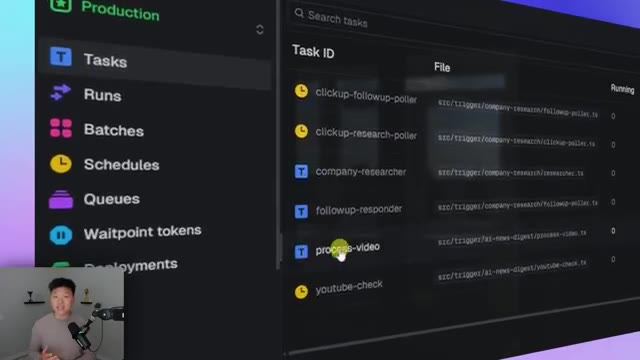
*⏱️ 00:00:07 — Interface de Trigger.dev affichant la liste des tâches configurées avec leurs identifiants et chemins de fichiers associés.*

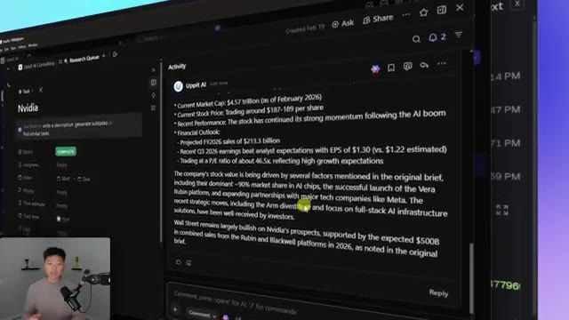
*⏱️ 00:00:14 — Interface de gestion de projet (type ClickUp / Notion) montrant des rapports d'analyse financière générés par l'IA sur Nvidia.*

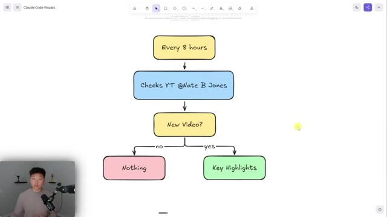
*⏱️ 00:00:22 — Diagramme de flux dessiné (sur Excalidraw ou similaire) illustrant l'automatisation d'une vérification YouTube toutes les 8 heures.*

---

### ⏱️ `[00:00:29 - 00:01:02]` | Segment #02

**🔊 Audio (Transcription Intégrale Mot pour Mot en Français) :**
> Et donc voici à quoi ressemble le résultat avec un minimum de consignes. Nous avons la vidéo YouTube. Nous avons des concepts clés, des citations qui valent la peine d'être retenues, des statistiques et des données. Donc c'est cool parce que j'ai monté ça en genre 10 minutes, mais en vrai ce n'est pas si impressionnant que ça. Mais ensuite je me suis dit, à cause de la façon dont trigger.dev fonctionne, je veux placer un agent dans le cloud. Donc ce que j'ai fait, c'est que j'ai construit un agent qui surveille cette liste dans mon ClickUp. Et chaque fois que j'entre une entreprise en tant que tâche, il va fondamentalement faire des recherches sur elle. Donc je mets ça, ça déclenche l'agent, il fait des recherches, et ensuite il revient et me laisse un commentaire. Mais pas seulement ça, l'agent peut aussi converser avec moi ici. Donc pour celui-ci concernant Anthropic, j'ai dit, hé,

**👁️ Analyse Visuelle d'Écran (gemini-3.5-flash-lite) :**
**Interface & Outils** : Application collaborative type Uppit AI / Microsoft Teams, affichant des notes textuelles et des tableaux de gestion de tâches.

**Contenu textuel & Code** : Texte structuré contenant des données chiffrées sur le marché de l'IA, des analyses financières, ainsi que des listes de tâches (Perplexity AI, Anthropic).

**Action / Démonstration** : Navigation et présentation des résultats générés et structurés par l'application pour illustrer le résumé d'actualités technologiques.

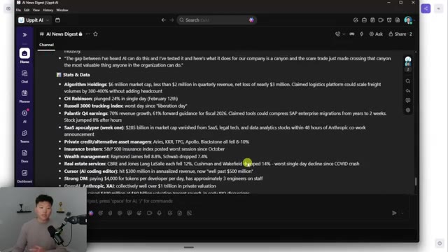
*⏱️ 00:00:37 — Capture montrant l'interface d'une application affichant une liste structurée de statistiques et de données sur l'intelligence artificielle (AI News Digest).*

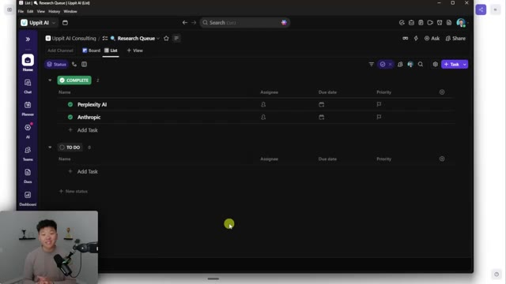
*⏱️ 00:00:45 — Capture montrant l'interface d'une application de gestion de tâches sous forme de liste avec des sections 'Complete' et 'To Do'.*

---

### ⏱️ `[00:01:02 - 00:01:34]` | Segment #03

**🔊 Audio (Transcription Intégrale Mot pour Mot en Français) :**
> est-ce que cette entreprise a une valorisation récente ? Et il a fait plus de recherches et est revenu vers moi. Donc ce n'est pas seulement une automatisation déterministe de type un, deux, trois, quatre, cinq. C'est une automatisation non déterministe, j'ai différents outils. Je dois décider dans quelle boucle je dois aller. Et c'est là que je me suis dit, d'accord, waouh, je viens de faire tout ça en genre 20 minutes. C'est génial. Donc d'ici la fin de cette vidéo, vous comprendrez exactement comment vous pouvez créer des flux de travail et des agents dans Cloud Code, les placer sur trigger.dev et automatiser à peu près n'importe quoi. Donc avant de nous lancer dans la création, mettons-nous sur la même longueur d'onde. Nous utilisons Cloud Code pour décrire ce que nous voulons en anglais simple. Cela pourrait être quelque chose aussi simple que, je veux surveiller YouTube pour de nouvelles

**👁️ Analyse Visuelle d'Écran (gemini-3.5-flash-lite) :**
**Interface & Outils** : Application web de gestion de projet/tâches et tableau blanc interactif.

**Contenu textuel & Code** : Texte de rapport sur la valorisation d'Anthropic (380 milliards de dollars) et phrase explicative sur l'utilisation du langage naturel.

**Action / Démonstration** : Présentation du résultat de recherche de l'agent IA et explication visuelle du fonctionnement de l'automatisation.

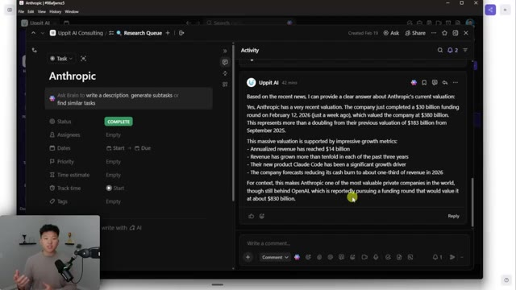
*⏱️ 00:01:10 — Une interface de gestion de tâches (type Notion) montrant le résultat d'une recherche sur la valorisation d'Anthropic par un agent IA.*

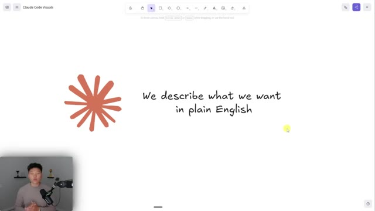
*⏱️ 00:01:26 — Un tableau blanc interactif affichant le texte explicatif "We describe what we want in plain English" avec une illustration graphique.*

---

### ⏱️ `[00:01:34 - 00:01:56]` | Segment #04

**🔊 Audio (Transcription Intégrale Mot pour Mot en Français) :**
> des vidéos par IA et m'envoie un résumé quotidien. Cloud Code dira alors, d'accord, eh bien, pour faire cela, j'ai besoin de X, Y et Z de votre part. Cela transforme donc une demande vague en une automatisation réellement fonctionnelle. Ensuite, il fonce et commence à écrire son code. Et comme je l'ai dit, il peut s'agir de tâches simples comme récupérer des données d'une API, ou cela peut être en fait des agents assez complexes qui ont différents outils et différentes actions qu'ils peuvent entreprendre et ils doivent décider quand c'est suffisant.

**👁️ Analyse Visuelle d'Écran (gemini-3.5-flash-lite) :**
**Interface & Outils** : Tableau blanc numérique (type Excalidraw) avec barre d'outils de dessin en haut.

**Contenu textuel & Code** : Le texte 'I need X, Y, and Z' illustrant la demande de paramètres par l'IA.

**Action / Démonstration** : Le présentateur explique comment l'outil identifie les prérequis nécessaires pour accomplir une tâche d'automatisation.

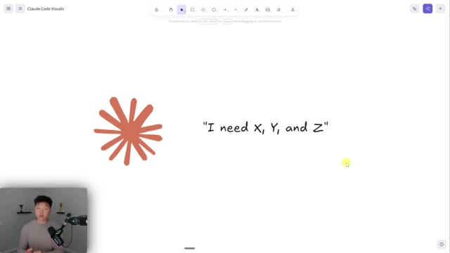
*⏱️ 00:01:40 — Un tableau blanc numérique montrant une étoile orange stylisée et le texte manuscrit 'I need X, Y, and Z', avec le présentateur en médaillon vidéo en bas à gauche.*

---

### ⏱️ `[00:01:57 - 00:02:15]` | Segment #05

**🔊 Audio (Transcription Intégrale Mot pour Mot en Français) :**
> Et cette automatisation réelle ou cet agent est du code, et c'est fondamentalement un projet, et c'est comme un fichier. Et ensuite, ce que nous devons faire, c'est le sortir de notre environnement Cloud Code local sur notre ordinateur portable ou notre bureau et le placer dans trigger.dev sur le cloud afin que ceux-ci puissent réellement s'exécuter tout le temps. Et donc dans de précédentes vidéos sur Cloud Code, vous m'avez peut-être vu utiliser quelque chose comme modal.

**👁️ Analyse Visuelle d'Écran (gemini-3.5-flash-lite) :**
**Interface & Outils** : Tableau blanc numérique (type Excalidraw ou similaire) avec webcam du présentateur incrustée en bas à gauche

**Contenu textuel & Code** : Icône de dossier étiquetée 'Automation', flèche de transition, et logo/nom de la plateforme 'Trigger.dev'

**Action / Démonstration** : Explication schématique de la migration du code d'automatisation vers le cloud Trigger.dev

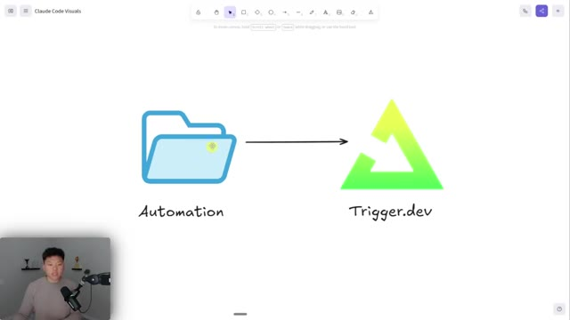
*⏱️ 00:02:01 — Schéma explicatif illustrant le transfert d'un dossier de code nommé 'Automation' vers la plateforme 'Trigger.dev'*

---

### ⏱️ `[00:02:15 - 00:02:51]` | Segment #06

**🔊 Audio (Transcription Intégrale Mot pour Mot en Français) :**
> Alors, pourquoi est-ce qu'on utilise trigger.dev plutôt que modal aujourd'hui ? C'est tout simplement beaucoup plus flexible. Il y a des exécutions programmées, des nouvelles tentatives automatiques, il y a la mise en file d'attente, il y a l'orchestration, qui est l'élément de différentes tâches et des choses comme ça, ce qui est vraiment cool. Et je trouve aussi que l'interface utilisateur est beaucoup plus épurée. Donc voici mon projet actuel dans trigger.dev en mode production. Et vous pouvez voir que j'ai en gros ces six différents types de tâches. Ces trois-là sont les vrais outils. Donc ça, c'est le traitement de vidéo, ça, c'est l'agent répondeur, ça, c'est l'agent chercheur. Et ensuite, ceux qui ont une horloge à côté d'eux sont des tâches programmées. Donc on a le vérificateur YouTube, on a l'interrogeur de recherche, et l'interrogeur de suivi. Si je vais ici sur le côté gauche dans les planifications, vous pouvez voir à quelle fréquence

**👁️ Analyse Visuelle d'Écran (gemini-3.5-flash-lite) :**
**Interface & Outils** : Tableau de bord web de Trigger.dev

**Contenu textuel & Code** : Liste des tâches (Task ID) : clickup-followup-poller, clickup-research-poller, company-researcher, followup-responder, process-video, youtube-check.

**Action / Démonstration** : Navigation et présentation des différentes tâches configurées dans l'interface de gestion de Trigger.dev.

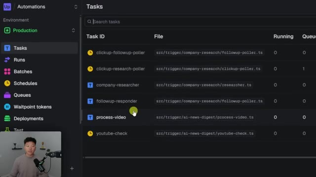
*⏱️ 00:02:33 — L'interface du tableau de bord de Trigger.dev affichant la liste des tâches avec leurs identifiants et les fichiers sources associés.*

---

### ⏱️ `[00:02:51 - 00:03:22]` | Segment #07

**🔊 Audio (Transcription Intégrale Mot pour Mot en Français) :**
> et ceux-ci s'exécutent. Donc ces deux-là s'exécutent toutes les deux minutes et celui-ci s'exécute toutes les huit heures. Si je vais dans les exécutions, vous pouvez voir toutes les différentes exécutions que nous avons eues, qu'elles aient réussi ou qu'elles aient échoué. Et donc j'ai filtré pour vous montrer une exécution échouée parce que je voulais voir la nouvelle tentative. C'était donc un collecteur de recherche ClickUp et ce qui s'est passé, c'est qu'il a échoué. Et donc il ajoute un délai, puis il réessaie. Il intègre donc cette nouvelle tentative automatique, ce qui est vraiment génial. Et lorsque nous regardons ces agents ou ces tâches s'exécuter en direct, nous voyons exactement chaque étape qu'ils franchissent et nous voyons combien de temps ils prennent pour chaque étape.

**👁️ Analyse Visuelle d'Écran (gemini-3.5-flash-lite) :**
**Interface & Outils** : Interface web d'automatisation (type Prefect ou outil similaire).

**Contenu textuel & Code** : Tableau listant les exécutions : ID, Task (clickup-research-poller, clickup-followup-poller), Version (20260219.8), Status (Completed), Started (horodatages du 19 fév 2026), et durée.

**Action / Démonstration** : Consultation de l'historique des exécutions et des statuts de réussite des tâches automatisées.

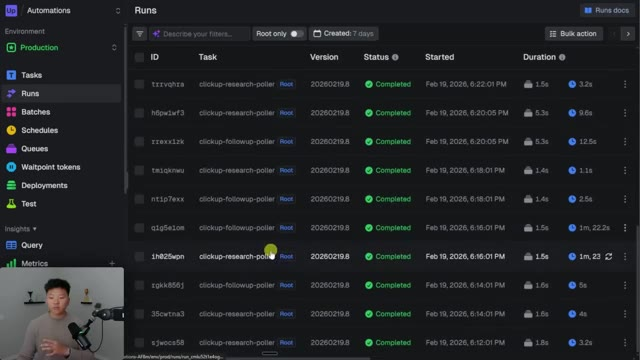
*⏱️ 00:02:59 — Tableau de bord affichant la liste des exécutions (Runs) de tâches automatisées avec leur statut et leur durée.*

---

### ⏱️ `[00:03:22 - 00:03:42]` | Segment #08

**🔊 Audio (Transcription Intégrale Mot pour Mot en Français) :**
> Donc je vais faire une démo en direct et je vais vous montrer ça. Très bien, alors je suis dans mon ClickUp et ce que je vais faire, c'est ajouter une nouvelle tâche et je vais simplement aller de l'avant et dire NVIDIA et je vais enregistrer ça. Et maintenant que cela a été traité, nous allons devoir attendre ici et nous verrons le ClickUp Research Polar démarrer et ensuite il dira fondamentalement, ok, super, j'ai trouvé une nouvelle tâche et je vais l'envoyer à l'agent de recherche de l'entreprise.

**👁️ Analyse Visuelle d'Écran (gemini-3.5-flash-lite) :**
**Interface & Outils** : ClickUp

**Contenu textuel & Code** : Liste de tâches comprenant des éléments complétés comme "Perplexity AI" et "Anthropic", ainsi qu'une zone de saisie pour ajouter une nouvelle tâche.

**Action / Démonstration** : Ajout d'une nouvelle tâche dans ClickUp.

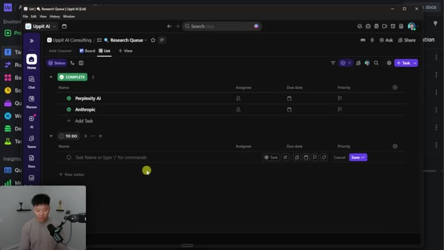
*⏱️ 00:03:27 — Capture d'écran montrant l'interface de ClickUp avec la liste des tâches (Research Queue) et le présentateur visible dans un petit encadré en bas à gauche.*

---

### ⏱️ `[00:03:43 - 00:04:01]` | Segment #09

**🔊 Audio (Transcription Intégrale Mot pour Mot en Français) :**
> Donc juste ici, nous pouvons voir que cela a été pris en compte et que ça a été envoyé au chercheur. Et si j'ouvre le chercheur, qui est actuellement en train de s'exécuter, vous pouvez voir qu'il tourne en direct. Donc nous pouvons voir juste ici qu'il s'exécute pour NVIDIA, qui est celui que nous venons d'entrer ici. En ce moment, Claude appelle son outil de recherche sur le web et il l'a appelé deux fois. Il a en fait décidé « je vais l'invoquer une fois de plus pour m'assurer d'obtenir un rapport de recherche complet ».

**👁️ Analyse Visuelle d'Écran (gemini-3.5-flash-lite) :**
**Interface & Outils** : Interface web ClickUp Automations, panneau des logs d'exécution.

**Contenu textuel & Code** : Payload JSON affichant `{"companyName": "Nvidia", "clickupTaskId": "86afjy@ym"}` et statut d'exécution "Executing".

**Action / Démonstration** : Suivi en direct de l'exécution de l'agent de recherche pour l'entreprise Nvidia.

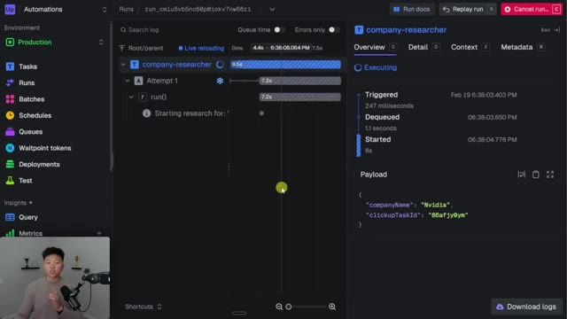
*⏱️ 00:03:47 — Capture d'écran montrant le tableau de bord d'une plateforme d'automatisation (ClickUp) avec les journaux d'exécution en direct (Live logs) d'un agent de recherche d'entreprise ciblant Nvidia.*

---

### ⏱️ `[00:04:02 - 00:04:24]` | Segment #10

**🔊 Audio (Transcription Intégrale Mot pour Mot en Français) :**
> Maintenant, il utilise un outil de lecture d'URL. Il utilise un autre outil de lecture d'URL. Donc peut-être qu'il a trouvé deux sites Web à consulter. Et voilà. Après environ 45 secondes, il a terminé. Donc maintenant, si j'ouvre ClickUp et que nous allons sur NVIDIA, nous pouvons voir que ceci est maintenant marqué comme complet. Et quand je clique dessus ici, nous pouvons voir que nous avons obtenu un dossier de recherche complet sur NVIDIA. Et donc maintenant, si je viens dans cette tâche et que je dis, @UpentAI, comment se porte leur action ?

**👁️ Analyse Visuelle d'Écran (gemini-3.5-flash-lite) :**
**Interface & Outils** : Tableau de bord d'automatisation et interface ClickUp

**Contenu textuel & Code** : Logs d'exécution de l'agent IA, appels de fonctions (search_web, read_url), charge utile JSON {"companyName": "Nvidia", "clickupTaskId": "86afjy0ym"}, et note rédigée par l'IA sur Nvidia.

**Action / Démonstration** : Visualisation des résultats de l'agent de recherche d'entreprise et affichage du rapport finalisé dans ClickUp.

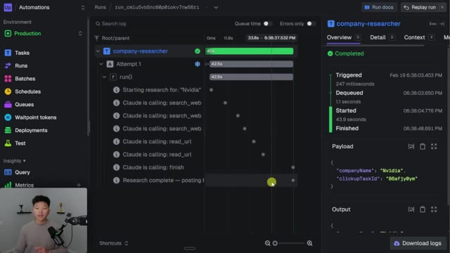
*⏱️ 00:04:07 — L'interface de surveillance d'exécution d'un agent IA (company-researcher) montrant les logs d'appels d'outils (recherche web, lecture d'URL) et le panneau de détails avec la charge utile pour "Nvidia".*

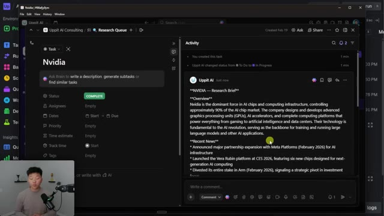
*⏱️ 00:04:19 — L'interface de ClickUp affichant une tâche "Nvidia" complétée, avec un résumé de recherche détaillé généré par l'IA dans la section activité.*

---

### ⏱️ `[00:04:25 - 00:04:45]` | Segment #11

**🔊 Audio (Transcription Intégrale Mot pour Mot en Français) :**
> Ça va lire ceci, mais gardez à l'esprit que ça doit venir ici et ça doit lire le contexte pour s'assurer de savoir qui est "ils". Dans ce cas, quand je viens de dire, comment se porte leur action ? Et si je retourne dans les exécutions, vous pouvez voir que le répondeur de suivi est en train de s'exécuter. Si je clique dessus, nous devrions pouvoir le regarder en train de regarder cette tâche, de faire une recherche sur le web. Et maintenant, après environ 22 secondes, celui-ci est terminé.

**👁️ Analyse Visuelle d'Écran (gemini-3.5-flash-lite) :**
**Interface & Outils** : Interface web de gestion de projet / agent IA (ClickUp).

**Contenu textuel & Code** : Tâche Nvidia avec statut "COMPLETE", et un message de l'utilisateur @Nate Herk interrogeant l'assistant sur l'action de l'entreprise.

**Action / Démonstration** : Consultation de l'interface de l'agent IA et du fil de discussion sur la tâche Nvidia.

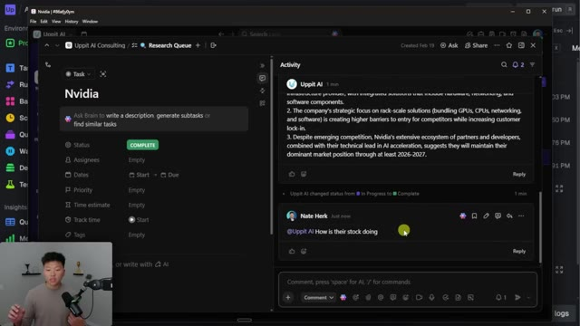
*⏱️ 00:04:30 — Interface de gestion de tâches et de projet (type ClickUp) montrant une tâche concernant Nvidia avec un historique d'activité et un commentaire de l'utilisateur demandant comment se porte leur action ("@Uppit AI How is their stock doing").*

---

### ⏱️ `[00:04:45 - 00:05:05]` | Segment #12

**🔊 Audio (Transcription Intégrale Mot pour Mot en Français) :**
> Je vais ouvrir ClickUp et nous devrions pouvoir faire défiler vers le bas et voir que nous venons de recevoir une réponse juste ici de UpIt AI. Démarrage rapide, juste une petite démo, et je voulais vous montrer à quoi ressemble trigger.dev avant que nous n'entrions réellement dedans et que nous en construisions un nous-mêmes. Et je sais que ce ne sont pas les choses les plus impressionnantes au monde, mais gardez à l'esprit que tout cela a été généré en un seul prompt et que j'ai construit tout ça en environ 45 minutes.

**👁️ Analyse Visuelle d'Écran (gemini-3.5-flash-lite) :**
**Interface & Outils** : ClickUp (application web)

**Contenu textuel & Code** : Question '@UpIt AI How is their stock doing' et réponse détaillée de UpIt AI concernant la performance boursière de Nvidia (Market Cap de 4.57 billions, prix de l'action, etc.).

**Action / Démonstration** : Consultation de la réponse automatisée de l'agent UpIt AI intégrée dans un fil de discussion ClickUp.

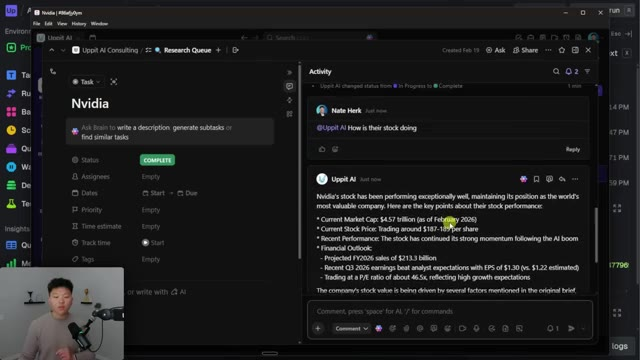
*⏱️ 00:04:50 — Interface ClickUp affichant une tâche sur Nvidia avec une réponse de UpIt AI dans le volet d'activité.*

---

### ⏱️ `[00:05:06 - 00:05:38]` | Segment #13

**🔊 Audio (Transcription Intégrale Mot pour Mot en Français) :**
> Ok, maintenant passons sur Cloud Code. Ça, c'est le projet Cloud Workflow Builder que je viens de configurer et dans lequel j'ai commencé à créer ces workflows. Si vous n'avez jamais utilisé Cloud Code auparavant, alors je vous recommanderais vraiment d'aller voir cette vidéo. Je vais la mettre en lien juste ici. Et ensuite, une fois que vous aurez compris l'interface, le fonctionnement des fichiers et tout le reste, revenez ici et ça aura beaucoup plus de sens. Donc ce que je vais faire dans cette vidéo, c'est créer un tout nouveau projet et tout parcourir avec vous, étape par étape, pour que vous puissiez voir exactement comment ça fonctionne. Mais rapidement avant de faire ça, je voulais juste vous montrer à quoi ressemble ce résultat final, parce que ces dossiers et ces fichiers s'accumulent au fur et à mesure que vous créez de nouveaux workflows.

**👁️ Analyse Visuelle d'Écran (gemini-3.5-flash-lite) :**
**Interface & Outils** : Visual Studio Code (avec l'interface Claude Code intégrée)

**Contenu textuel & Code** : Arborescence de fichiers du projet (dossiers .claude, .github, trigger, src, fichiers .env, package.json, trigger.config.ts, tsconfig.json) et champ de saisie avec le texte 'ctrl esc to focus or unfocus Claude'.

**Action / Démonstration** : Navigation et présentation du projet Claude Workflow Builder dans l'environnement de développement.

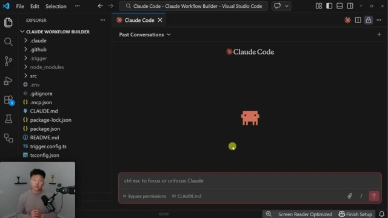
*⏱️ 00:05:14 — Vue de l'interface de Visual Studio Code affichant le projet 'Claude Workflow Builder' dans le panneau de gauche et l'extension ou l'interface 'Claude Code' au centre avec une zone de saisie en bas.*

---

### ⏱️ `[00:05:38 - 00:05:59]` | Segment #14

**🔊 Audio (Transcription Intégrale Mot pour Mot en Français) :**
> En fait, la principale chose que je voulais vous montrer, les gars, c'est où ces fichiers TypeScript résident réellement, c'est-à-dire juste ici dans un dossier SRC. Nous avons le dossier trigger, qui est trigger.dev. Et ensuite, j'ai deux dossiers différents pour les différents types de flux de travail. Nous avons l'AI News Digest, qui contient les deux, vous savez, le TypeScript process video et le TypeScript YouTube check, que vous avez vus juste ici, YouTube check et process video.

**👁️ Analyse Visuelle d'Écran (gemini-3.5-flash-lite) :**
**Interface & Outils** : Visual Studio Code (VS Code) avec l'extension Claude Code.

**Contenu textuel & Code** : Arborescence du projet : dossier src contenant trigger, avec les sous-dossiers ai-news-digest (process-video.ts, youtube-check.ts) et company-research (clickup-poller.ts, followup-poller.ts, followup-responder.ts, researcher.ts).

**Action / Démonstration** : Le présentateur navigue dans l'arborescence des fichiers du projet pour montrer l'emplacement des fichiers TypeScript des flux de travail.

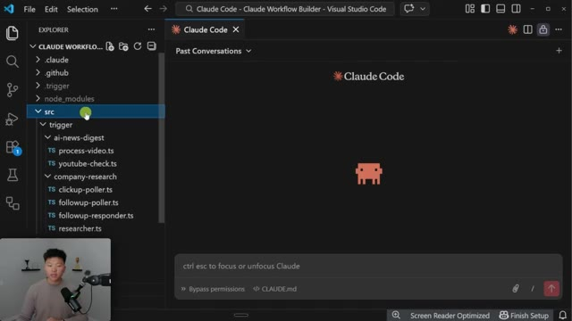
*⏱️ 00:05:43 — Vue de l'explorateur de fichiers de VS Code montrant l'arborescence du projet sous le dossier src avec trigger.dev et ses sous-dossiers, ainsi qu'une incrustation du présentateur en bas à gauche.*

---

### ⏱️ `[00:05:59 - 00:06:25]` | Segment #15

**🔊 Audio (Transcription Intégrale Mot pour Mot en Français) :**
> Et ensuite, nous avons ceux pour la recherche d'entreprise, les deux interrogateurs et l'agent répondeur et chercheur, que vous avez vus juste ici, les deux interrogateurs, le chercheur et le répondeur. Donc, ce que je voulais vraiment faire là, c'est simplement de vous contextualiser comment Cloud Code nous aide à créer ces fichiers TypeScript, et ensuite nous les envoyons vers Trigger, et ils peuvent alors réellement s'exécuter en direct. Mais je vous avais promis qu'on allait faire tout cela ensemble. Donc, je vais aller ouvrir un nouveau dossier ici. J'ai créé un nouveau dossier appelé trigger demo, et il est complètement vide.

**👁️ Analyse Visuelle d'Écran (gemini-3.5-flash-lite) :**
**Interface & Outils** : Interface web Trigger.dev et éditeur de code Visual Studio Code

**Contenu textuel & Code** : Code source TypeScript pour l'automatisation de tâches et listes de tâches avec chemins de fichiers (src/trigger/...)

**Action / Démonstration** : Présentation des différents scripts d'automatisation et de recherche d'entreprise configurés dans le projet.

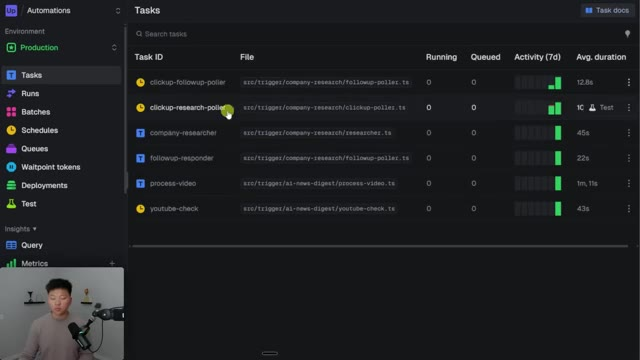
*⏱️ 00:06:05 — L'interface web de Trigger.dev affichant une liste de tâches d'automatisation, incluant clickup-research-poller et company-researcher.*

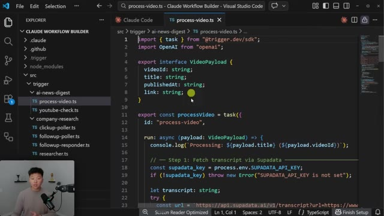
*⏱️ 00:06:12 — L'éditeur de code Visual Studio Code montrant le fichier process-video.ts avec du code TypeScript utilisant l'API Trigger.dev et OpenAI.*

---

### ⏱️ `[00:06:25 - 00:07:01]` | Segment #16

**🔊 Audio (Transcription Intégrale Mot pour Mot en Français) :**
> Et maintenant, vous devriez tous avoir votre instance Cloud Code qui ressemble exactement à la mienne. Et d'ailleurs, j'utilise ceci dans VS Code. Donc je vais fermer tout ça, ouvrir Cloud Code, et nous sommes maintenant sur la même longueur d'onde. Donc la première chose que je veux que vous fassiez, c'est d'aller sur ma communauté School gratuite. Le lien se trouve dans la description. Allez dans la classe, allez dans Claude Code, et allez dans la section trigger.dev juste ici. Et vous allez récupérer le fichier Claude.md et le fichier trigger.ref.md. Vous allez télécharger les deux. Et ensuite, vous allez simplement glisser ces deux fichiers sur le côté gauche juste ici. Je ne vais pas entrer très, très en profondeur dans les détails, mais le fichier trigger.ref est essentiellement comme le trigger.dev

**👁️ Analyse Visuelle d'Écran (gemini-3.5-flash-lite) :**
**Interface & Outils** : Visual Studio Code, Navigateur web (plateforme AI Automation Society)

**Contenu textuel & Code** : Menus de VS Code, liste des fichiers récents (Claude Exec, Claude Workflow Builder, etc.), et modules de cours sur la plateforme web.
[DESC_IMAGE_3] Navigation et affichage des ressources et fichiers de configuration Markdown pour le projet.

**Action / Démonstration** : Explications face caméra et démonstration conceptuelle.

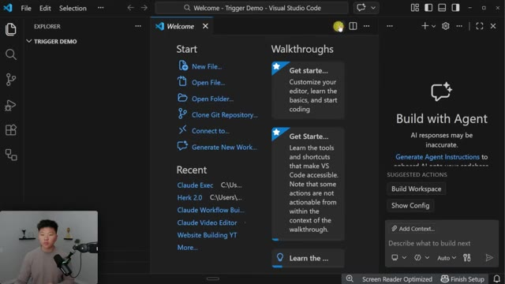
*⏱️ 00:06:34 — Interface de VS Code montrant la page d'accueil de Cloud Code et les actions récentes.*

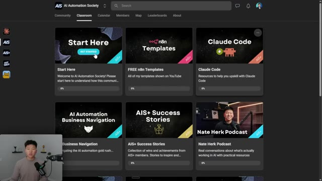
*⏱️ 00:06:43 — Interface web de la plateforme de formation AI Automation Society affichant différents modules de cours.*

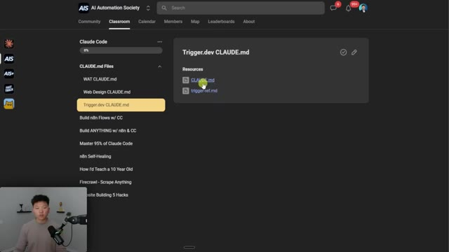
*⏱️ 00:06:52 — Navigation dans la section ressources du cours de la plateforme web, affichant les fichiers de configuration CLAUDE.md pour Trigger.dev.*

---

### ⏱️ `[00:07:01 - 00:07:34]` | Segment #17

**🔊 Audio (Transcription Intégrale Mot pour Mot en Français) :**
> référence d'API et comment faire du TypeScript. Et c'est important parce qu'au bas du fichier Claude.md, nous lui disons de regarder ici s'il a besoin de consulter des exemples de code, des modèles et des choses de ce genre. Donc maintenant que vous avez le fichier Claude.md ici, que vous avez le fichier trigger ref md ici, nous allons pouvoir créer des automatisations beaucoup plus facilement maintenant. Très bien, alors ce que je vais faire, c'est donner à Claude Code une requête assez vague. Je ne vais même pas utiliser le mode plan, et je vais vous montrer à quel point il va être bon. J'ai besoin que tu me construises une automatisation qui va se déclencher chaque lundi, et elle va faire des recherches sur le web, et elle va me trouver des prospects. Elle va trouver

**👁️ Analyse Visuelle d'Écran (gemini-3.5-flash-lite) :**
**Interface & Outils** : Visual Studio Code (éditeur de code)

**Contenu textuel & Code** : Fichier Markdown `CLAUDE.md` avec des instructions sur Trigger.dev, les packages npm, et la référence d'API complète mentionnant `/trigger-ref`.

**Action / Démonstration** : Visualisation du contenu de CLAUDE.md dans l'éditeur de code pour montrer comment l'assistant est configuré pour référencer des exemples.

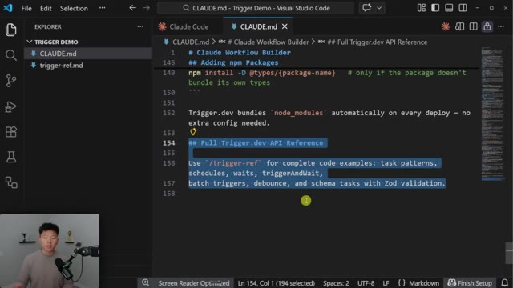
*⏱️ 00:07:09 — Vue de l'éditeur Visual Studio Code affichant le fichier CLAUDE.md ouvert avec du texte de référence sur l'API Trigger.dev, et la vidéo incrustée du présentateur en bas à gauche.*

---

### ⏱️ `[00:07:34 - 00:08:02]` | Segment #18

**🔊 Audio (Transcription Intégrale Mot pour Mot en Français) :**
> des cabinets dentaires auxquels je peux vendre des sites Web. Donc je vais lancer ça. Et ce que ça va faire, tout d'abord, c'est lire le fichier cloud.md pour comprendre quel est son objectif. Et avec un peu de chance, ça devrait revenir et nous poser quelques questions afin de savoir comment bien construire ce flux de travail, parce qu'on ne lui a rien dit sur la stack technique ou presque rien du tout. Et il faut qu'il écrive cette automatisation vraiment bien pour nous. Donc la première chose qu'il fait, c'est qu'il nous demande où les prospects doivent-ils être livrés chaque lundi ? Et je vais simplement répondre, ClickUp pour l'emplacement.

**👁️ Analyse Visuelle d'Écran (gemini-3.5-flash-lite) :**
**Interface & Outils** : Visual Studio Code (avec une extension de chat/agent IA Claude) et incrustation vidéo du présentateur en bas à gauche.

**Contenu textuel & Code** : Prompt utilisateur : "I need you to build me an automation that's going to go off every single Monday. It's going to search the web and it's going to find me leads, dental practices that I can sell websites to." - Actions de l'agent : lecture de "c:\Users\nateh\OneDrive\Desktop\Trigger Demo\CLAUDE.md" et phase de "Noodling...".

**Action / Démonstration** : L'assistant IA analyse le fichier de contexte du projet (CLAUDE.md) pour comprendre l'objectif de l'automatisation avant de procéder à la génération du code.

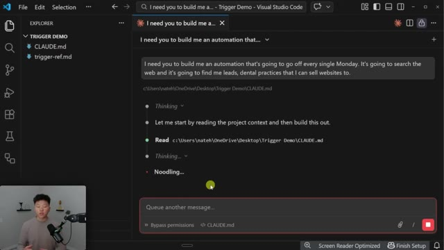
*⏱️ 00:07:41 — Interface de VS Code montrant l'exécution d'un assistant de code (Claude) qui analyse le fichier CLAUDE.md pour automatiser la recherche de prospects dentaires.*

---

### ⏱️ `[00:08:02 - 00:08:34]` | Segment #19

**🔊 Audio (Transcription Intégrale Mot pour Mot en Français) :**
> il est écrit, où est-ce que ça devrait chercher ? Je vais simplement dire à l'échelle nationale. Et ensuite le dernier, est-ce que tu as l'API SERP, Google Maps, ou quelque chose comme ça de configuré ? Et pour celui-ci, je vais en fait cliquer sur autre. Et je vais dire, je n'ai encore rien configuré de tout ça. Et idéalement, je ne veux pas avoir à payer pour une quelconque formule d'abonnement pour ça. Et nous verrons s'il peut s'en sortir avec ça. Je vais lui dire de créer une nouvelle liste dans mon ClickUp. Et pour le volume, je vais simplement lancer 25 prospects, un petit lot, juste pour commencer. Maintenant, le mien va tricher un peu parce que par le passé, il a déjà utilisé mon ClickUp. Mais ce que vous auriez besoin de faire, c'est qu'il va essentiellement vous créer un fichier .env

**👁️ Analyse Visuelle d'Écran (gemini-3.5-flash-lite) :**
**Interface & Outils** : VS Code (Visual Studio Code) avec un panneau d'interaction d'assistant IA.

**Contenu textuel & Code** : Question sur l'accès aux API de recherche avec les choix : "No, nothing yet", "Google Maps API", "SerpAPI", "Other".

**Action / Démonstration** : Le curseur survole les options pour configurer l'accès à l'API de recherche.

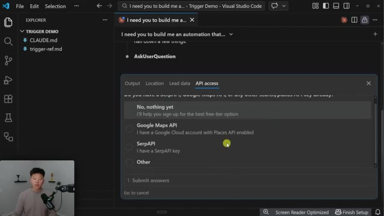
*⏱️ 00:08:10 — Interface de VS Code affichant un assistant interactif avec des options de configuration d'API (Google Maps API, SerpAPI, No, nothing yet).*

---

### ⏱️ `[00:08:34 - 00:08:58]` | Segment #20

**🔊 Audio (Transcription Intégrale Mot pour Mot en Français) :**
> et vous placerez les secrets de votre projet dans ce fichier .env. Ce sera donc comme votre clé API ClickUp, ou votre identifiant d'espace de travail, ou votre clé API Open Router, des choses comme ça. Donc maintenant, il nous demande si nous sommes prêts à construire ce plan. Nous avons donc notre générateur de prospects dentaires pour le lundi. Chaque lundi à 8 heures du matin, nous rechercherons sur Yelp Fusion AI des cabinets dentaires à travers les États-Unis, puis nous créerons de nouvelles tâches dans la liste des prospects dentaires dans ClickUp.

**👁️ Analyse Visuelle d'Écran (gemini-3.5-flash-lite) :**
**Interface & Outils** : Visual Studio Code avec extension ou panneau latéral d'assistant IA intégré (type Claude).

**Contenu textuel & Code** : Explorateur affichant 'TRIGGER DEMO' avec les fichiers 'CLAUDE.md' et 'trigger-ref.md', ainsi que les journaux d'exécution de l'agent (Glob pattern, Bash 'ls').

**Action / Démonstration** : L'assistant IA analyse le contenu du répertoire racine du projet et prépare la construction de l'automatisation.

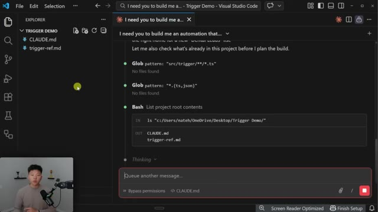
*⏱️ 00:08:40 — Vue de l'éditeur Visual Studio Code montrant l'explorateur de fichiers à gauche et une interface de chat/agent IA à droite avec des commandes Bash exécutées.*

---

### ⏱️ `[00:08:59 - 00:09:18]` | Segment #21

**🔊 Audio (Transcription Intégrale Mot pour Mot en Français) :**
> Yelp Fusion est 100 % gratuit, c'est génial. Pour l'architecture, elle va créer en gros deux outils différents, disons. Le premier outil va trouver des prospects, et le deuxième outil va créer les prospects dans ClickUp, ce qui est super parce que si une chose échoue, elle peut réessayer et elle peut, vous savez, mettre en file d'attente juste cette seule tâche plutôt que de casser toute l'automatisation. Et ça, c'est génial.

**👁️ Analyse Visuelle d'Écran (gemini-3.5-flash-lite) :**
**Interface & Outils** : Visual Studio Code (éditeur de code)

**Contenu textuel & Code** : Texte Markdown décrivant l'architecture (Architecture: 2 files, src/trigger/dental-leads/find-leads.ts, create-lead.ts), une stratégie de rotation des villes, et un prompt de validation « Ready to build this? Any changes to the plan? ».

**Action / Démonstration** : Le présentateur présente le plan d'architecture généré par l'IA dans l'éditeur de code avant de lancer l'implémentation.

*⏱️ 00:09:04 — L'éditeur Visual Studio Code affichant un document Markdown décrivant l'architecture de l'automatisation avec deux fichiers distincts (`find-leads.ts` et `create-lead.ts`), ainsi qu'une boîte de dialogue de validation en bas.*

---

### ⏱️ `[00:09:18 - 00:09:39]` | Segment #22

**🔊 Audio (Transcription Intégrale Mot pour Mot en Français) :**
> Il s'occupe automatiquement de l'idempotence dont j'ai parlé tout à l'heure, et il s'assure qu'un même cabinet ne soit jamais ajouté deux fois. Et avoir ce processus de déduplication pris en charge automatiquement est vraiment appréciable. Je vais donc simplement lui dire de commencer la construction. Donc, comme d'habitude, il commence à configurer le projet comme vous pouvez le voir, tout en créant sa liste de tâches, et il va parcourir tout cela pour nous le construire. Bon. Il a construit ça très rapidement.

**👁️ Analyse Visuelle d'Écran (gemini-3.5-flash-lite) :**
**Interface & Outils** : Visual Studio Code

**Contenu textuel & Code** : Plan du projet détaillant la stratégie de rotation des villes, la déduplication (utilisation de l'ID d'entreprise Yelp comme clé d'idempotence), la configuration ClickUp et les options d'approbation ("Build it", "Changes needed").

**Action / Démonstration** : L'assistant présente le plan d'automatisation généré et attend l'approbation de l'utilisateur pour lancer le codage.

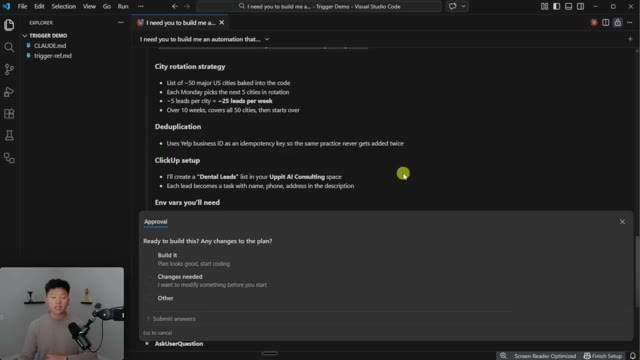
*⏱️ 00:09:23 — Vue de l'interface de Visual Studio Code affichant un plan de construction pour l'automatisation avec une section sur la déduplication et une invite d'approbation en bas.*

---

### ⏱️ `[00:09:39 - 00:10:14]` | Segment #23

**🔊 Audio (Transcription Intégrale Mot pour Mot en Français) :**
> Il a dit qu'il a créé une nouvelle liste ClickUp pour nous, ce que, si je vais dans ClickUp, nous pouvons voir juste ici, nous avons des prospects dentaires. Il a créé les deux scripts TypeScript. Donc si je regarde ici, nous avons déclencheur, nous avons prospects dentaires et nous avons créer un prospect ainsi que trouver des prospects. Et c'est la partie où j'ai dit qu'il a un peu triché parce qu'il avait déjà notre ID de liste de tout à l'heure. Mais ce que nous devons faire maintenant, c'est aller chercher notre clé API Yelp. Donc je vais aller la récupérer. Et ensuite, nous devons insérer une clé API ClickUp. Waouh. Donc il a fini par découvrir que Yelp a supprimé son niveau d'API gratuit. Il va donc modifier ceci pour utiliser l'API SERP à la place. D'accord. Donc maintenant, il a déjà modifié cela pour utiliser l'API SERP. J'ai donc ces deux clés API et voici ce que nous allons faire. Nous allons aller sur le

**👁️ Analyse Visuelle d'Écran (gemini-3.5-flash-lite) :**
**Interface & Outils** : Visual Studio Code (éditeur de code avec extension Claude / panneau Markdown intégré).

**Contenu textuel & Code** : Arborescence du projet avec `src/trigger/dental-leads/create-lead.ts` et `find-leads.ts`, et document Markdown décrivant les fichiers du projet ("What's done", "ClickUp - 'Dental Leads' list", "find-leads.ts", "create-lead.ts").

**Action / Démonstration** : Navigation dans l'arborescence des fichiers du projet et survol du fichier `create-lead.ts` dans Visual Studio Code.

*⏱️ 00:09:48 — Capture d'écran de l'interface de Visual Studio Code montrant l'arborescence du projet Trigger Demo avec les scripts TypeScript `create-lead.ts` et `find-leads.ts` sous le dossier `src/trigger/dental-leads`, ainsi qu'un panneau Markdown détaillant l'avancement des tâches et l'intégration avec ClickUp.*

---

### ⏱️ `[00:10:14 - 00:10:49]` | Segment #24

**🔊 Audio (Transcription Intégrale Mot pour Mot en Français) :**
> .env et vous pouvez voir qu'il a placé cet espace réservé ici pour SERP et pour ClickUp. Vous allez donc venir ici et y coller vos deux clés API, puis vous allez vous assurer d'enregistrer ce fichier et ensuite vous pourrez le fermer. D'accord, il veut donc faire son test d'exécution dans l'environnement de développement de notre trigger.dev. Rappelez-vous donc que nous sommes en production, nous pouvons aussi être en développement. C'est donc ici que nous pouvons tester des choses, c'est ici que nous pouvons faire des changements et ensuite, lorsque nous en sommes satisfaits, nous envoyons cela en production pour que ce soit réellement en ligne. Ce que je vais faire, c'est que dans mon trigger.dev, je vais ouvrir un nouveau projet puisque c'est à cela que le vôtre devrait ressembler. Nous allons simplement appeler celui-ci test et je vais le créer. Maintenant, une fois que nous sommes ici, je vais descendre vers

**👁️ Analyse Visuelle d'Écran (gemini-3.5-flash-lite) :**
**Interface & Outils** : Visual Studio Code

**Contenu textuel & Code** : Fichier `.env` contenant les variables `SERPAPI_KEY=`, `CLICKUP_API_KEY=` et `CLICKUP_LIST_ID=901325634101`.

**Action / Démonstration** : Configuration des clés API dans le fichier d'environnement avant l'exécution du test.

*⏱️ 00:10:23 — Éditeur de code affichant le fichier de configuration `.env` avec les variables d'environnement requises pour SerpAPI et ClickUp.*

---

### ⏱️ `[00:10:49 - 00:11:21]` | Segment #25

**🔊 Audio (Transcription Intégrale Mot pour Mot en Français) :**
> le bas et allez dans les paramètres du projet. Et juste ici, nous voyons une référence de projet. Je vais donc copier cette valeur et nous devons la donner à Claude Code pour qu'il puisse réellement y transférer des éléments. Bon, alors ça travaille en ce moment même, mais vous pouvez voir que nous avons bien deux tâches ici. Nous avons notre recherche de prospects dentaires et nous avons notre création de prospects dentaires. Si je vais dans les plannings, nous devrions voir que la recherche de prospects dentaires s'exécute à 8 heures du matin uniquement les lundis. Et maintenant, ce qu'il fait, c'est qu'il va essayer de le tester pour voir si cela fonctionne réellement. Mais ce qui va se passer, c'est que ça ne va probablement pas marcher parce que si vous vous en souvenez, nous devions donner à Claude Code notre fichier .env, qui était, vous savez,

**👁️ Analyse Visuelle d'Écran (gemini-3.5-flash-lite) :**
**Interface & Outils** : Interface web de configuration de projet (Dashboard cloud / Trigger.dev ou similaire)

**Contenu textuel & Code** : Champs 'Project ref' avec une valeur masquée, 'Project name' configuré sur 'Testt', et options de connexion Git et Vercel.

**Action / Démonstration** : Récupération et copie de la référence du projet pour l'utiliser avec l'assistant de code (Claude Code).

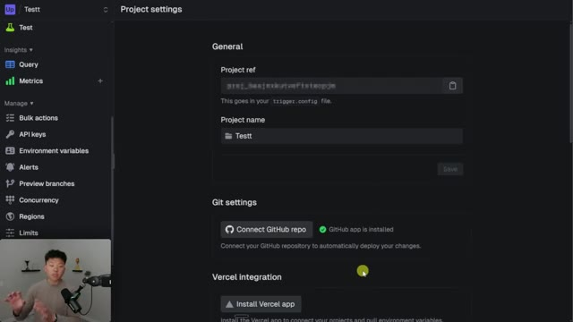
*⏱️ 00:10:57 — Capture d'écran montrant les paramètres d'un projet web avec la section 'Project ref' (référence du projet) et un bouton de copie, ainsi que les options Git et Vercel.*

---

### ⏱️ `[00:11:22 - 00:11:44]` | Segment #26

**🔊 Audio (Transcription Intégrale Mot pour Mot en Français) :**
> La clé d'API ClickUp ainsi que cette clé d'API SERP. Mais ces clés d'API ne sont en fait envoyées nulle part. Elles ne sont pas envoyées sur GitHub. Elles ne sont pas envoyées sur trigger.dev parce qu'elles se trouvent dans un fichier .env. Et si quoi que ce soit ici a un point devant, c'est pratiquement masqué des commits et des choses de ce genre. Donc ce que nous devons réellement faire, c'est aller dans trigger.dev. Nous devons descendre tout en bas ici jusqu'aux variables d'environnement. Et c'est là que nous les ajoutons une fois de plus.

**👁️ Analyse Visuelle d'Écran (gemini-3.5-flash-lite) :**
**Interface & Outils** : Visual Studio Code (VS Code) avec panneau latéral explorateur de fichiers et interface de chat IA.

**Contenu textuel & Code** : Arborescence montrant les fichiers .env, .gitignore, package.json, trigger.config.ts, et dans l'éditeur de texte un échange avec un assistant IA concernant une automatisation de leads dentaires.

**Action / Démonstration** : Le présentateur explique la configuration du projet et le fonctionnement du fichier .env pour la sécurité des clés d'API.

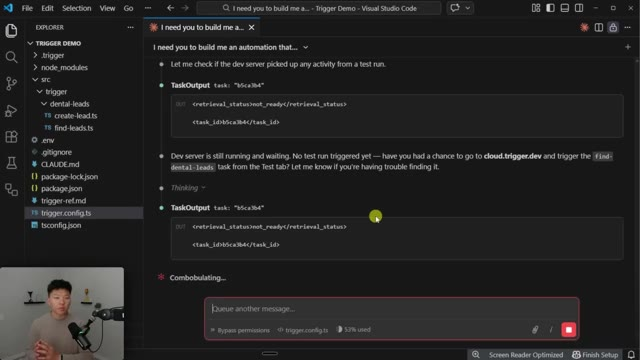
*⏱️ 00:11:27 — Vue de l'éditeur de code VS Code affichant un projet Trigger Demo avec l'arborescence des fichiers à gauche et une discussion d'assistant IA au centre.*

---

### ⏱️ `[00:11:44 - 00:12:17]` | Segment #27

**🔊 Audio (Transcription Intégrale Mot pour Mot en Français) :**
> Donc je vais cliquer sur "ajouter un nouveau" et tout ce que j'ai à faire en fait, c'est vraiment simple, c'est que je viens dans le fichier dot env ici, je peux copier tout ça et ensuite, quand je retourne dans Trigger, je peux coller tout ça et les trois vont être ajoutés, au lieu d'avoir à faire ça un par un. Et maintenant, avant de sauvegarder ceci, vous allez vouloir le faire en développement et en production, parce qu'il n'y a aucun intérêt à l'ajouter seulement au développement puisque, en fin de compte, vous allez le pousser vers la production. Autant le faire directement en développement et en production, puis aller de l'avant et sauvegarder cela, et maintenant Trigger, quand il exécute réellement ces fichiers TypeScript, vous savez, il peut réellement les utiliser.

**👁️ Analyse Visuelle d'Écran (gemini-3.5-flash-lite) :**
**Interface & Outils** : Visual Studio Code et interface web Trigger.

**Contenu textuel & Code** : Variables d'environnement (.env) incluant SERPAPI_KEY, CLICKUP_API_KEY, et CLICKUP_LIST_ID.

**Action / Démonstration** : Copie des variables d'environnement depuis le fichier .env de VS Code pour les coller dans le tableau de bord de Trigger.

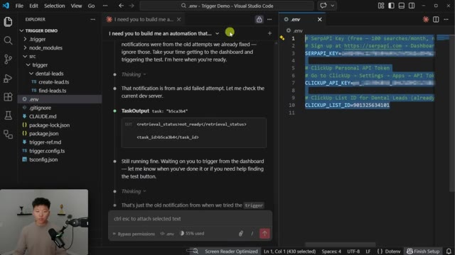
*⏱️ 00:11:52 — VS Code ouvert avec un fichier .env sélectionné sur la droite, montrant des clés API (SERPAPI_KEY, CLICKUP_API_KEY, etc.) en cours de sélection et de copie.*

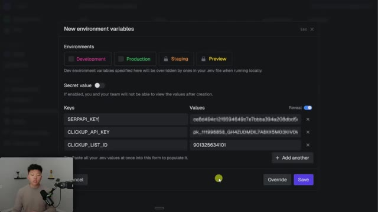
*⏱️ 00:12:01 — Interface web de configuration montrant le formulaire 'New environment variables' avec les clés et valeurs collées (SERPAPI_KEY, CLICKUP_API_KEY, CLICKUP_LIST_ID).*

---

### ⏱️ `[00:12:17 - 00:12:49]` | Segment #28

**🔊 Audio (Transcription Intégrale Mot pour Mot en Français) :**
> ces clés API dans son travail et il va réellement réussir, donc ce qui s'est passé, c'est que ceci essayait réellement de déclencher un test dans Trigger, donc il essayait de faire cela par lui-même, mais une chose que vous pouvez faire pour rendre cela vraiment beaucoup mieux, c'est que vous pouvez lui donner le serveur MCP de Trigger.dev, donc voici un fichier que vous pouvez glisser sur le côté gauche, il configure fondamentalement juste la configuration MCP pour Trigger.dev. Et je vais aussi lier ceci dans la même section exacte de la classe juste ici. Vous pouvez donc simplement le télécharger et le glisser dedans. Mais maintenant, je peux aller de l'avant et lui demander d'essayer de le tester à nouveau.

**👁️ Analyse Visuelle d'Écran (gemini-3.5-flash-lite) :**
**Interface & Outils** : Visual Studio Code avec une extension d'assistant IA (Claude)

**Contenu textuel & Code** : Historique de discussion avec l'IA montrant des blocs de code, des statuts de tâches et des messages de statut du serveur de développement.

**Action / Démonstration** : L'assistant analyse le serveur de développement et attend que l'utilisateur déclenche un test depuis le tableau de bord.

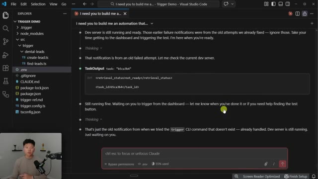
*⏱️ 00:12:25 — Interface de VS Code montrant une conversation avec un assistant IA (Claude) intégrée, affichant des messages de réflexion et de statut d'une tâche d'automatisation.*

---

### ⏱️ `[00:12:49 - 00:13:14]` | Segment #29

**🔊 Audio (Transcription Intégrale Mot pour Mot en Français) :**
> Et j'espère que ça marche et que ça peut envoyer une charge utile et tout le tralala. Et ce que je veux que vous compreniez aussi, c'est que oui, je viens juste de faire ça, mais c'est un peu différent à chaque fois que vous le construisez. Parce qu'en fin de compte, ce qui se passe, c'est qu'on parle à un modèle d'IA qui réfléchit et possède des capacités de décision. Donc si vous saisissez exactement les mêmes invites que moi, vous n'obtiendrez peut-être pas exactement le même résultat. C'est donc vraiment juste une question de lui parler, de lui demander ce qui ne va pas et de l'aider. Et donc maintenant, il nous demande une clé secrète trigger.dev.

**👁️ Analyse Visuelle d'Écran (gemini-3.5-flash-lite) :**
**Interface & Outils** : Visual Studio Code (avec panneau de chat IA et explorateur de fichiers)

**Contenu textuel & Code** : Commandes terminal Bash : `cd "c:/Users/nateh/OneDrive/Desktop/Trigger Demo" && cat .mcp.json` et `npx trigger.dev@4.4.0 mcp --help 2>&1`, affichant la sortie du serveur MCP.

**Action / Démonstration** : L'assistant IA teste et vérifie la configuration et les capacités du serveur MCP Trigger.dev via des commandes dans l'éditeur.

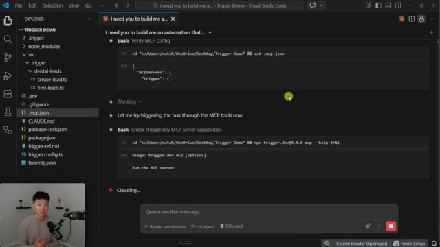
*⏱️ 00:12:55 — Vue de l'éditeur Visual Studio Code montrant l'interface de l'assistant IA avec des commandes Bash en cours d'exécution pour vérifier la configuration MCP et les capacités du serveur Trigger.dev.*

---

### ⏱️ `[00:13:14 - 00:13:47]` | Segment #30

**🔊 Audio (Transcription Intégrale Mot pour Mot en Français) :**
> Eh bien, allons dans trigger.dev. Allons ici et allons dans les clés API. Et nous devons récupérer ceci et le donner à Cloud Code. Mais bien sûr, je ne veux pas donner cela directement dans le chat. Donc je vais dire, hé, j'ai ceci. Peux-tu mettre un espace réservé dans le .env ? Et ensuite je le collerai dedans. C'est vraiment la meilleure pratique de ne jamais donner de secrets directement ici dans le chat. Vous voulez juste le mettre dans des fichiers de configuration ou généralement le .env. D'accord. Alors, collez simplement cette clé API. Je l'ai sauvegardée. Et maintenant, voyons s'il peut réellement redémarrer le serveur et essayer de tester notre flux de travail. C'est pourquoi c'est si difficile de faire des démos de cloud code en direct. C'est juste parce que genre

**👁️ Analyse Visuelle d'Écran (gemini-3.5-flash-lite) :**
**Interface & Outils** : Visual Studio Code (interface de chat de l'assistant IA)

**Contenu textuel & Code** : Question de l'IA : "Can you grab your Trigger.dev secret key? It's in your dashboard under API Keys..." avec des options ("I'll paste it now", "Where do I find it?", "Other").

**Action / Démonstration** : L'utilisateur visualise la demande de l'assistant IA au sein de l'éditeur de code pour récupérer la clé secrète Trigger.dev.

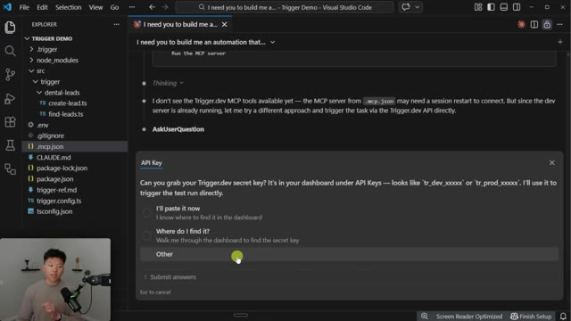
*⏱️ 00:13:22 — L'éditeur de code Visual Studio Code affichant une interface d'assistant IA demandant la clé API Trigger.dev avec des options de réponse.*

---

### ⏱️ `[00:13:47 - 00:14:22]` | Segment #31

**🔊 Audio (Transcription Intégrale Mot pour Mot en Français) :**
> ça s'exécute littéralement différemment à chaque fois. D'accord. Donc ça indique qu'un exécution a été déclenchée. Maintenant, si je reviens ici et que je vais dans exécutions, nous devrions voir, ouah. D'accord. Donc nous avons en fait eu beaucoup d'exécutions différentes qui sont arrivées. Il essayait beaucoup de choses différentes. Celles-ci sont actuellement en train de s'exécuter. Oh, d'accord, eh bien, la raison pour laquelle il en a fait autant, c'est parce qu'il doit créer une fiche de prospect dentaire pour chaque prospect qu'il a trouvé. Et si j'ouvre mon ClickUp, nous pouvons voir que nous avons effectivement 25 prospects ici même. Alors cliquons sur l'un d'eux pour voir à quoi il ressemble. Nous avons Tampa Dental à Tampa, en Floride. Et dans la description, il nous a donné l'adresse, le téléphone, la note et le site web. Donc c'est vraiment intéressant pour moi. Le premier flux de travail, qui est le déclencheur,

**👁️ Analyse Visuelle d'Écran (gemini-3.5-flash-lite) :**
**Interface & Outils** : Interface web d'une plateforme d'automatisation ou d'orchestration d'agents (type Prefect, Temporal ou outil cloud similaire).

**Contenu textuel & Code** : Tableau des exécutions (Runs) affichant les identifiants (ID), les tâches ("create-dental-lead"), les versions ("20260220.1"), les statuts ("Executing" et "Completed"), l'heure de démarrage et la durée.

**Action / Démonstration** : Consultation du tableau de bord affichant l'historique et le statut en temps réel des différentes exécutions de tâches déclenchées.

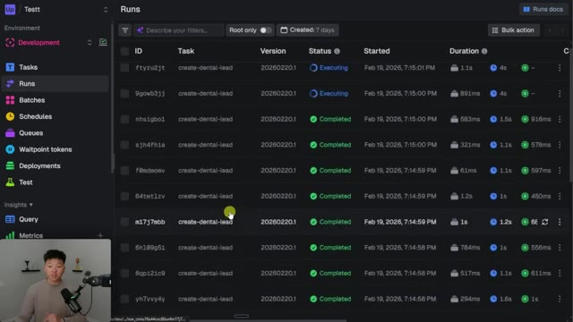
*⏱️ 00:13:56 — Capture d'écran montrant l'onglet "Runs" (exécutions) d'une application d'automatisation ou d'orchestration, avec une liste de plusieurs tâches exécutées pour "create-dental-lead".*

---

### ⏱️ `[00:14:22 - 00:14:48]` | Segment #32

**🔊 Audio (Transcription Intégrale Mot pour Mot en Français) :**
> il trouve les prospects. Donc si j'ouvre ceci et que je clique dessus, nous pouvons voir ce qu'il a fait. Il en a trouvé cinq, puis il en a trouvé cinq de plus, et il en a trouvé cinq de plus jusqu'à ce qu'il arrive à 25. Et puis après avoir trouvé ces 25, il a pour ainsi dire dit, OK, super. Je vais confier chacun de ces prospects à un type de travailleur individuel. Et c'est pourquoi nous avons vu l'outil de création de prospects dentaires être appelé 25 fois. Cloud Code revient et dit, super. Ça fonctionne parfaitement. 25 prospects créés en neuf secondes dans cinq villes.

**👁️ Analyse Visuelle d'Écran (gemini-3.5-flash-lite) :**
**Interface & Outils** : Interface web d'une plateforme d'automatisation (type Trigger.dev).

**Contenu textuel & Code** : Journal d'exécution avec des messages comme "Found 5 dentists in A...", des durées en millisecondes et un panneau de sortie JSON indiquant "citiesSearched".

**Action / Démonstration** : Consultation des logs de l'exécution pour vérifier les étapes de recherche par lots de 5 prospects dentaires.

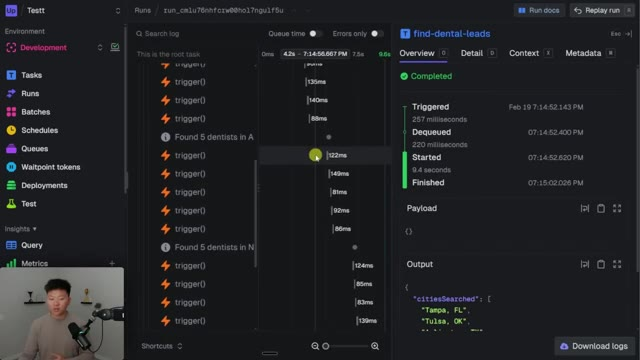
*⏱️ 00:14:28 — Interface d'une application montrant les logs d'exécution (Runs) d'un workflow nommé "find-dental-leads" avec des listes de déclencheurs (triggers) et le détail des résultats.*

---

### ⏱️ `[00:14:48 - 00:15:10]` | Segment #33

**🔊 Audio (Transcription Intégrale Mot pour Mot en Français) :**
> Plutôt génial. Donc à partir de là, évidemment, ce que vous faites, c'est que vous améliorez un peu le flux de travail. Vous essayez de l'améliorer de plus en plus. Vous ajoutez différentes fonctionnalités si vous voulez. Peut-être qu'on veut ajouter une prospection personnalisée et y intégrer un élément d'IA. Mais maintenant, une fois que vous arrivez à un point où vous êtes prêt, nous voulons le mettre en production, car en ce moment nous sommes en développement, ce qui signifie que si nous ne gardons pas cette connexion ouverte, juste ici, il est dit que votre serveur de développement local est connecté à trigger.dev.

**👁️ Analyse Visuelle d'Écran (gemini-3.5-flash-lite) :**
**Interface & Outils** : Visual Studio Code (éditeur de code avec extension Claude / assistant IA).

**Contenu textuel & Code** : Un message de Claude indiquant le succès d'une automatisation avec un tableau récapitulatif par ville (Tampa, Tulsa, Arlington, New Orleans, Cleveland) et un champ de saisie de prompt en bas.

**Action / Démonstration** : Affichage des résultats d'un test d'automatisation réussi pour la prospection de leads dentaires.

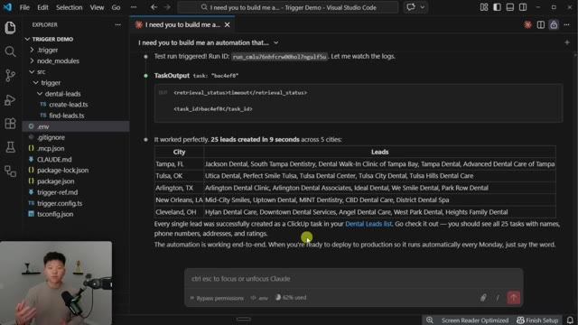
*⏱️ 00:14:54 — Interface de Visual Studio Code affichant un panneau de chat Claude avec un rapport d'exécution montrant 25 leads créés dans ClickUp.*

---

### ⏱️ `[00:15:10 - 00:15:31]` | Segment #34

**🔊 Audio (Transcription Intégrale Mot pour Mot en Français) :**
> Si ceci n'était pas ouvert, comme nous le voyons dans notre projet principal ici, vous pouvez voir que je l'ai désactivé, alors ceux-ci ne s'exécuteraient pas, c'est pourquoi nous devons les pousser vers la production. Il y a donc plusieurs façons de faire cela. La façon dont je recommanderais de faire cela est donc en vous connectant à GitHub et en poussant votre base de code. Donc, en gros, tout ce projet dans GitHub. Donc, comme vous pouvez le voir, c'est le dépôt GitHub que j'ai créé pour les flux de travail précédents.

**👁️ Analyse Visuelle d'Écran (gemini-3.5-flash-lite) :**
**Interface & Outils** : Interface web de Trigger.dev (tableau de bord d'automatisations).

**Contenu textuel & Code** : Liste des tâches : clickup-followup-poller, clickup-research-poller, company-researcher, followup-responder, process-video, youtube-check, ainsi que leurs chemins de fichiers source respectifs.

**Action / Démonstration** : Le présentateur navigue et présente la liste des tâches automatisées configurées dans l'environnement de développement.

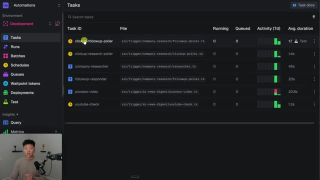
*⏱️ 00:15:15 — Capture d'écran montrant l'interface de Trigger.dev avec la liste des tâches (Tasks) en cours de développement, incluant des fichiers TypeScript et un aperçu vidéo du présentateur en bas à gauche.*

---

### ⏱️ `[00:15:31 - 00:16:04]` | Segment #35

**🔊 Audio (Transcription Intégrale Mot pour Mot en Français) :**
> Et j'avais tout cela dans un seul dépôt GitHub, ce qui va dans ce cas. Si je vais sur le déclencheur SRC, vous pouvez voir que nous avions l'AI News Digest et la recherche d'entreprise. Donc voici ce que nous allons faire. Nous allons pousser ce projet dans GitHub, puis faire en sorte que GitHub se synchronise avec trigger.dev. Et ensuite, ils pourront tout intégrer en production. Et maintenant, encore une fois, je voulais simplement souligner que c'est pour cela qu'il faut s'assurer que les éléments se trouvent dans un fichier .env et que vous n'avez aucun secret dans votre projet, car sinon ils se retrouveront sur GitHub. Et je les rends toujours privés de toute façon, mais c'est quand même la meilleure pratique. Et ensuite, vous allez ajouter, bien sûr, vos clés API dans trigger.dev.

**👁️ Analyse Visuelle d'Écran (gemini-3.5-flash-lite) :**
**Interface & Outils** : Visual Studio Code (éditeur de code avec extension/intégration Claude)

**Contenu textuel & Code** : Explorateur de fichiers montrant un projet avec des dossiers 'src/trigger/dental-leads' contenant des fichiers TypeScript ('create-lead.ts', 'find-leads.ts'). Dans le panneau principal, historique de discussion avec Claude affichant un tableau récapitulatif des résultats d'automatisation (25 leads créés dans 5 villes) et une zone de saisie pour interagir avec Claude.

**Action / Démonstration** : Consultation de l'arborescence du projet et du rapport d'exécution de l'automatisation générée par l'IA dans VS Code.

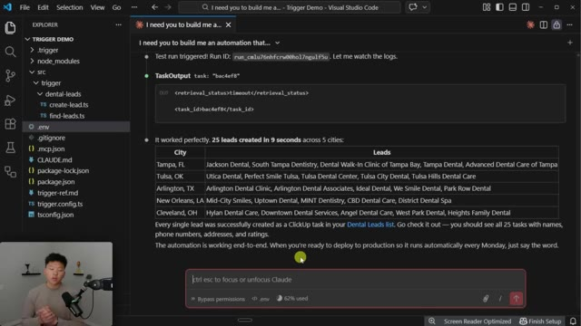
*⏱️ 00:15:40 — L'éditeur Visual Studio Code affichant l'explorateur de fichiers à gauche et une discussion avec Claude (assistant IA) montrant l'exécution réussie d'une automatisation pour générer 25 leads dentaires dans plusieurs villes.*

---

### ⏱️ `[00:16:05 - 00:16:24]` | Segment #36

**🔊 Audio (Transcription Intégrale Mot pour Mot en Français) :**
> Donc, à ce stade, ce qu'il va probablement faire, c'est qu'il va probablement utiliser votre interface de ligne de commande et il va vous demander de vous connecter avec GitHub. Donc, une fois que vous êtes authentifié, c'est vraiment facile et il peut créer des dépôts et il peut faire des commits. Et c'est très, très simple. Donc, si vous avez regardé l'une de mes vidéos où nous avons construit des sites Web, alors vous savez exactement comment fonctionne ce flux. Nous construisons du code et du code cloud.

**👁️ Analyse Visuelle d'Écran (gemini-3.5-flash-lite) :**
**Interface & Outils** : Visual Studio Code et outil de mind-mapping/schéma en ligne.

**Contenu textuel & Code** : Commandes Git (`git init`, `git status`) et statut d'authentification GitHub (`gh auth status`).

**Action / Démonstration** : L'assistant initialise le dépôt Git et vérifie l'authentification GitHub de l'utilisateur pour automatiser le versioning.

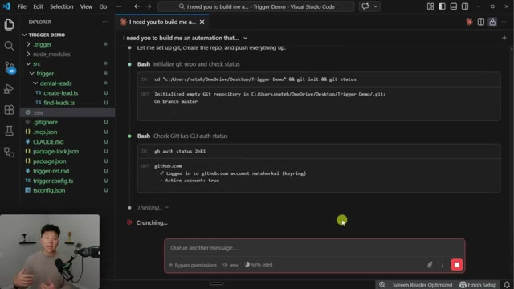
*⏱️ 00:16:10 — VS Code affichant l'exécution de commandes Bash par l'assistant pour initialiser Git et vérifier l'authentification GitHub CLI.*

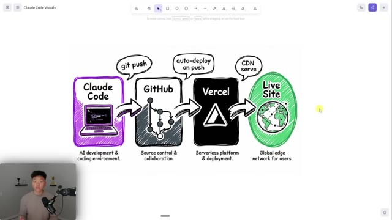
*⏱️ 00:16:19 — Schéma explicatif illustrant le flux de travail entre Claude Code, GitHub, Vercel et le site en ligne.*

---

### ⏱️ `[00:16:25 - 00:16:44]` | Segment #37

**🔊 Audio (Transcription Intégrale Mot pour Mot en Français) :**
> Nous envoyons cela sur GitHub. Et ensuite, GitHub se synchronise automatiquement avec Vercel, ou dans notre cas, trigger.dev, ce qui signifie que notre automatisation en direct ou notre site en direct se synchronise automatiquement avec GitHub. Et la raison pour laquelle nous voulons utiliser GitHub, c'est pour le contrôle de version. Cela garde les choses dans le cloud. Et nous pouvons aussi faire plus de collaboration avec d'autres ingénieurs, d'autres personnes, peu importe qui c'est.

**👁️ Analyse Visuelle d'Écran (gemini-3.5-flash-lite) :**
**Interface & Outils** : Outil de tableau blanc numérique montrant un diagramme de workflow.

**Contenu textuel & Code** : Diagramme avec quatre étapes principales : Claude Code (AI development), GitHub (Source control avec mention git push et auto-deploy), Vercel (Serverless platform), et Live Site (Global edge network).

**Action / Démonstration** : Le présentateur explique le processus de synchronisation et de déploiement automatique du code via GitHub et Vercel.

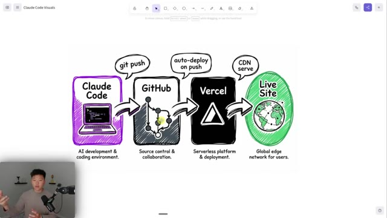
*⏱️ 00:16:29 — Schéma explicatif illustrant le flux de déploiement de Claude Code vers GitHub, puis vers Vercel et enfin vers le site en direct.*

---

### ⏱️ `[00:16:44 - 00:17:19]` | Segment #38

**🔊 Audio (Transcription Intégrale Mot pour Mot en Français) :**
> Donc je dirais que se familiariser avec GitHub est probablement une bonne idée. Et juste pour bien insister là-dessus, vous pouvez voir qu'il est écrit que le fichier point env est exclu de notre validation sur GitHub. Ok, génial. Nous avons donc maintenant notre nouveau dépôt GitHub juste ici. Il s'appelle trigger-test. Je vais donc l'ouvrir, m'assurer que tout va bien. Est-ce que nous avons nos flux de travail ? Oui, nous les avons juste là. Et maintenant, je vais retourner dans trigger. Je vais faire défiler la page tout en bas jusqu'aux paramètres du projet, et je vais me connecter au dépôt GitHub. Je vais m'inscrire avec mon compte et je vais connecter le dépôt que nous venons de créer et cliquer sur connecter. Maintenant, juste ici, il est écrit que chaque poussée vers la branche de suivi sélectionnée crée un déploiement dans l'environnement correspondant, ce qui signifie que chaque fois

**👁️ Analyse Visuelle d'Écran (gemini-3.5-flash-lite) :**
**Interface & Outils** : Visual Studio Code, Navigateur Web (GitHub)

**Contenu textuel & Code** : Commandes Git (`git add`, `git commit`), arborescence de fichiers d'un projet TypeScript (`create-lead.ts`, `find-leads.ts`).

**Action / Démonstration** : Exécution des commandes d'initialisation du dépôt Git et vérification de la présence du projet sur GitHub.

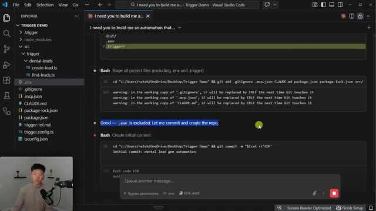
*⏱️ 00:16:53 — Vue de l'éditeur VS Code montrant un panneau de terminal Bash avec l'assistant IA qui confirme l'exclusion du fichier .env et la création du commit initial.*

*⏱️ 00:17:01 — Interface web de GitHub montrant le nouveau dépôt distant créé (`trigger-test`) avec l'arborescence des fichiers du projet.*

---

### ⏱️ `[00:17:19 - 00:17:51]` | Segment #39

**🔊 Audio (Transcription Intégrale Mot pour Mot en Français) :**
> nous avons une nouvelle modification poussée vers la branche principale dans notre dépôt GitHub, elle sera automatiquement synchronisée dans notre environnement de production. Donc pour l'instant nous sommes en développement. Si je vais en production, nous devrions voir que cela va effectivement construire ces éléments maintenant que j'ai connecté notre dépôt GitHub. Parce qu'ici même dans GitHub, vous pouvez voir que nous sommes sur la branche principale et nous avons notre TypeScript ici même. Maintenant, si pour une raison quelconque cela ne fonctionne pas ou si vous ne voulez pas prendre la voie de GitHub, vous pouvez toujours déployer manuellement ce genre de choses. Et vous pouvez simplement dire à Cloud Code de regarder ceci et il vous aidera à le pousser dans l'environnement de production. D'accord. Donc vous pouvez

**👁️ Analyse Visuelle d'Écran (gemini-3.5-flash-lite) :**
**Interface & Outils** : Interface web de gestion de projet (Type Trigger.dev) avec menu latéral et paramètres Git.

**Contenu textuel & Code** : Noms des environnements (Development, Production, Staging, Preview) et paramètres Git connectés au dépôt nateherkai/trigger-test avec la branche master.

**Action / Démonstration** : Clic de la souris sur l'option "Production" dans le menu déroulant des environnements pour changer de vue.

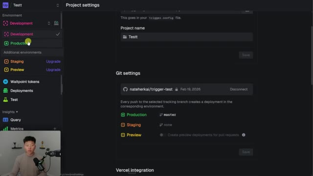
*⏱️ 00:17:27 — Capture d'écran montrant les paramètres du projet avec un menu déroulant permettant de basculer entre les environnements Development et Production, ainsi que les configurations Git liées au dépôt GitHub.*

---

### ⏱️ `[00:17:51 - 00:18:24]` | Segment #40

**🔊 Audio (Transcription Intégrale Mot pour Mot en Français) :**
> voyez que ceux-là viennent d'être poussés en production. Et malheureusement, en production réelle, cela ne s'exécuterait en fait qu'à 8 heures du matin les lundis. Nous allons donc faire un lancement manuel ici même. Je vais aller ici, je vais cliquer sur tester, et je vais simplement lancer le test. Et donc ça va déclencher tout ça. Nous allons voir ceci trouver effectivement ces 25 prospects. Rappelez-vous, il ne devrait automatiquement pas en charger si les prospects ont déjà été traités auparavant. Donc il cherche à Tampa, Tulsa, Arlington, il a trouvé ces prospects. Et si je vais dans les exécutions, il est également, il devrait tous les planifier pour ClickUp, ce que à 19h29, il est en train de faire

**👁️ Analyse Visuelle d'Écran (gemini-3.5-flash-lite) :**
**Interface & Outils** : Application web Trigger.dev (interface de gestion de tâches et de flux d'automatisation)

**Contenu textuel & Code** : Liste des tâches affichant les identifiants 'create-dental-lead' et 'find-dental-leads' avec leurs chemins de fichiers TypeScript respectifs.

**Action / Démonstration** : Le curseur de la souris survole la ligne de la tâche 'find-dental-leads' pour préparer le lancement du test manuel.

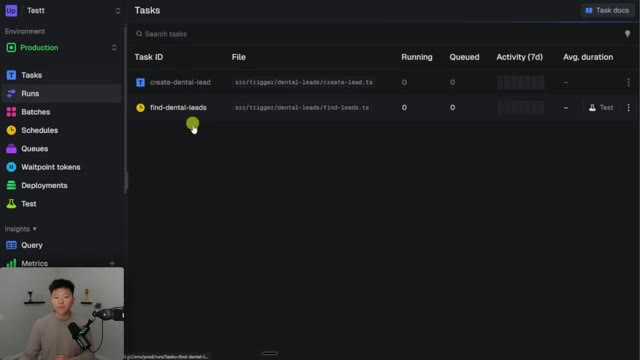
*⏱️ 00:18:00 — Interface de gestion de tâches montrant une liste de tâches, dont 'find-dental-leads' avec un bouton Test visible sur la droite.*

---

### ⏱️ `[00:18:24 - 00:19:01]` | Segment #41

**🔊 Audio (Transcription Intégrale Mot pour Mot en Français) :**
> maintenant. Et si je vais dans notre ClickUp, nous devrions voir maintenant que nous avons 50 prospects ici. Et je veux juste m'assurer qu'aucun d'entre eux n'a été dupliqué. D'accord. En fait, il semble que certains le soient. Laissez-moi donc vous montrer très rapidement ce que nous pourrions faire à ce sujet. J'ai donc fait un test de recherche de prospects et tout a fonctionné. Cependant, j'ai remarqué que certains prospects étaient des doublons. Je pensais donc que vous aviez travaillé sur l'idempotence ici pour vous assurer que cela ne se produisait pas, mais apparemment cela se produisait. Pouvez-vous donc corriger cela ? D'accord. Il a donc apporté une modification dans le flux de travail de création de prospects où il va essentiellement faire une recherche dans ClickUp avant de créer et avoir maintenant un identifiant de lieu. Il est donc indiqué que ce changement devrait être plus permanent, mais il n'affecte pas ceux

**👁️ Analyse Visuelle d'Écran (gemini-3.5-flash-lite) :**
**Interface & Outils** : ClickUp, Visual Studio Code

**Contenu textuel & Code** : Code source TypeScript pour la recherche de prospects et documentation textuelle sur les modifications apportées pour éviter les doublons avec ClickUp et Trigger.dev.

**Action / Démonstration** : Navigation dans la liste des prospects ClickUp puis bascule vers l'éditeur de code pour analyser et expliquer la logique de déduplication.

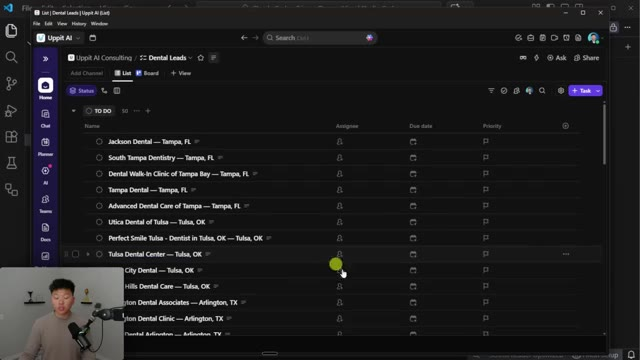
*⏱️ 00:18:33 — Vue d'une liste de prospects (Dental Leads) dans l'application ClickUp avec une incrustation vidéo du présentateur en bas à gauche.*

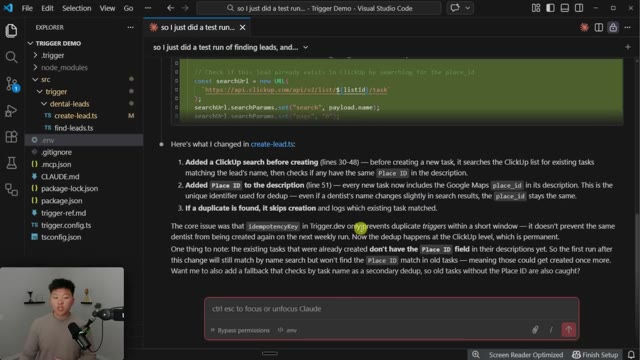
*⏱️ 00:18:52 — Interface de l'éditeur Visual Studio Code montrant du code TypeScript et des explications textuelles concernant la gestion des doublons (Trigger.dev et ClickUp).*

---

### ⏱️ `[00:19:01 - 00:19:35]` | Segment #42

**🔊 Audio (Transcription Intégrale Mot pour Mot en Français) :**
> qui avaient déjà été faites. Donc je vais lancer ceci deux fois et nous verrons s'il y a des doublons. D'accord. Donc j'ai dû faire quelques modifications supplémentaires, et cela montre vraiment l'importance d'utiliser le mode plan et d'avoir une idée très précise de ce que vous voulez construire avant de lui dire réellement de le faire. Pour les besoins de la vidéo, j'essayais de vous montrer comment je pouvais utiliser des prompts du premier coup et que ce serait quand même plutôt bien. Mais cet exemple a vraiment montré pourquoi il faut planifier plus sérieusement, car les critères de recherche n'étaient pas très larges et il y avait une façon bizarre de dédupliquer, mais maintenant nous sommes dans une bien meilleure situation où nous avons 48 lignes et cela montre que certaines d'entre elles ont été filtrées parce qu'elles étaient des doublons. Et il cherchait encore et encore jusqu'à

**👁️ Analyse Visuelle d'Écran (gemini-3.5-flash-lite) :**
**Interface & Outils** : Visual Studio Code, panneau latéral Explorateur de fichiers, zone de chat/terminal Claude en bas, et incrustation vidéo du présentateur dans le coin inférieur gauche.

**Contenu textuel & Code** : Fichiers source TypeScript (`create-lead.ts`, `find-leads.ts`), logs d'exécution montrant "Trigger [trigger_task]", "Trigger [wait_for_run_to_complete]", et les détails d'un test avec les résultats de recherche par ville (Tampa, Tulsa, Arlington).

**Action / Démonstration** : Le présentateur montre les résultats d'un test d'exécution d'automatisation pour trouver de nouveaux leads sans doublons.

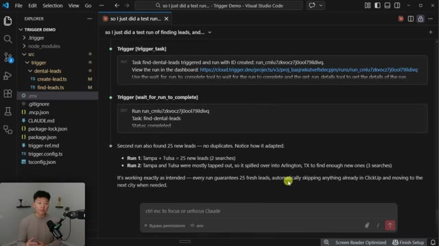
*⏱️ 00:19:09 — Capture d'écran de l'éditeur Visual Studio Code montrant l'arborescence du projet à gauche et un fichier ouvert dans l'éditeur principal avec des résultats de tests de recherche de leads et des blocs de code de tâches Trigger.*

---

### ⏱️ `[00:19:35 - 00:20:08]` | Segment #43

**🔊 Audio (Transcription Intégrale Mot pour Mot en Français) :**
> Il a été capable de remplir tous les créneaux. Et maintenant, nous avons plus d'entreprises. Donc, de toute façon, tout cela était exécuté dans notre environnement de développement parce que nous ne voulions rien perturber en production. Et maintenant, ce que nous ferions, c'est de revenir ici et de dire : super, ça a l'air bien. Pousse ça sur GitHub. Et ensuite, Trigger récupérait automatiquement ces modifications en direct depuis GitHub. Et nous serions prêts pour lundi à 8 heures du matin. D'accord. Donc, j'espère qu'à présent, vous vous sentez tous en confiance quant à votre capacité à vous lancer dans Cloud Code, à aller dans ma communauté gratuite School, à récupérer ces ressources, à les jeter là-dedans, puis à commencer à créer des automatisations que vous pourrez ensuite balancer dans trigger.dev pour qu'elles tournent tout le temps pour vous. S'il y a une seule chose que je veux que vous reteniez

**👁️ Analyse Visuelle d'Écran (gemini-3.5-flash-lite) :**
**Interface & Outils** : Application web Trigger.dev et plateforme communautaire Skool (AI Automation Society).

**Contenu textuel & Code** : Tableaux de bord de gestion de tâches automatisées, statuts d'exécution (Completed) et listes de fichiers de configuration Markdown (CLAUDE.md).

**Action / Démonstration** : Navigation dans l'interface de développement pour observer l'historique des exécutions de tâches et consultation de ressources pédagogiques.

*⏱️ 00:19:43 — Image montrant le tableau de bord Trigger.dev avec l'environnement de développement sélectionné et la liste des exécutions ("Runs") de tâches ("create-dental-lead") ayant toutes le statut "Completed".*

*⏱️ 00:19:59 — Image montrant la plateforme web de la communauté "AI Automation Society" (AIS) avec des ressources et fichiers de documentation liés à Claude Code et Trigger.dev.*

---

### ⏱️ `[00:20:08 - 00:20:27]` | Segment #44

**🔊 Audio (Transcription Intégrale Mot pour Mot en Français) :**
> de cette vidéo, c'est le fait que l'IA reste encore largement une boîte noire. Ces modèles sont incroyablement intelligents. Vous pouvez voir ce qu'ils font, mais vous avez aussi vu dans cette vidéo à quel point je devais lui parler, et je devais simplement être très clair. C'est toute l'idée de ne plus avoir à écrire de code, mais de devoir être la personne qui assure la qualité et s'assure que tout est sur la bonne voie.

**👁️ Analyse Visuelle d'Écran (gemini-3.5-flash-lite) :**
**Interface & Outils** : Tableau blanc numérique / outil de schématisation (type Excalidraw ou équivalent) avec incrustation vidéo du présentateur en bas à gauche.

**Contenu textuel & Code** : Texte et symboles dessinés : "Claude Code" (logo étoile rouge), un signe "+", "Trigger.dev" (logo triangle vert), un signe "=" et "Automate Anything" (symbole infini).

**Action / Démonstration** : Le présentateur explique conceptuellement le mariage des technologies d'automatisation et de l'IA pour tout automatiser.

*⏱️ 00:20:12 — Schéma explicatif dessiné à la main sur fond blanc montrant l'association entre Claude Code, Trigger.dev et l'automatisation infinie.*

---

### ⏱️ `[00:20:27 - 00:20:48]` | Segment #45

**🔊 Audio (Transcription Intégrale Mot pour Mot en Français) :**
> Mais de toute façon, je m'amuse tellement à apprendre ces nouveaux outils et à explorer différents cas d'usage. Alors dites-moi vraiment dans les commentaires ce que vous voulez continuer à voir. Et si vous voulez vraiment rester branchés, si vous voulez plus de cours, si vous voulez des sessions de questions-réponses en direct et une communauté de plus de 3000 personnes qui construisent leurs propres entreprises avec l'IA, alors allez absolument jeter un œil à ma communauté payante, AIS Plus. Le lien pour cela se trouve dans la description. J'adorerais vous voir dans l'une ou l'autre de ces communautés, mais c'est tout pour aujourd'hui.

**👁️ Analyse Visuelle d'Écran (gemini-3.5-flash-lite) :**
**Interface & Outils** : Canevas numérique de type tableau blanc et interface de la communauté en ligne Skool.

**Contenu textuel & Code** : Schéma d'automatisation avec logos et texte, et tableau de bord de communauté avec publications épinglées et classement.

**Action / Démonstration** : Présentation visuelle du concept d'automatisation combinant Claude Code et Trigger.dev, suivie de la promotion de la communauté payante.

*⏱️ 00:20:32 — Un schéma explicatif sur canevas numérique illustrant l'association 'Claude Code + Trigger.dev = Automate Anything'.*

*⏱️ 00:20:38 — L'interface de la communauté Skool 'AI Automation Society Plus' (AIS+), montrant le fil d'actualité et les discussions.*

---

### ⏱️ `[00:20:48 - 00:20:56]` | Segment #46

**🔊 Audio (Transcription Intégrale Mot pour Mot en Français) :**
> Donc si vous avez apprécié la vidéo ou si vous avez appris quelque chose de nouveau, veuillez s'il vous plaît mettre un pouce bleu. Ça m'aide vraiment énormément. Et comme toujours, je vous remercie d'être arrivés jusqu'à la fin de la vidéo. Je vous vois sur la prochaine. Merci à tous.

**👁️ Analyse Visuelle d'Écran (gemini-3.5-flash-lite) :**
**Interface & Outils** : Outil de tableau blanc numérique avec le présentateur en médaillon dans le coin inférieur gauche.

**Contenu textuel & Code** : Texte et illustrations : "Claude Code" + "Trigger.dev" = "Automate Anything" avec le symbole de l'infini.

**Action / Démonstration** : Le présentateur conclut la vidéo en résumant le concept global présenté.

*⏱️ 00:20:50 — Schéma explicatif illustrant l'association entre Claude Code et Trigger.dev pour aboutir à l'automatisation.*

---

