# 🎬 From Zero to Your First Agentic AI Workflow in 26 Minutes (Claude Code)

> **Chaîne** : [Nate Herk | AI Automation](https://www.youtube.com/@nateherk/featured)  
> **Lien YouTube** : [https://www.youtube.com/watch?v=tDGiWn0flK8](https://www.youtube.com/watch?v=tDGiWn0flK8)  
> **Date de publication** : 20260223  
> **Durée** : 00:26:22  
> **Identifiant vidéo** : `tDGiWn0flK8`  
> **Transcription & Analyse** : `whisper-v3-large-turbo+gemini-3.5-flash-lite`  

---

## 📌 Synthèse Exécutive & Outils

### 💡 Résumé
Cette vidéo de la chaîne Nate Herk explore la transition fondamentale des automatisations traditionnelles vers l'IA agentique, illustrée par la construction d'un workflow complet en 26 minutes à l'aide de **Claude Code**. L'auteur démystifie l'ingénierie des agents en expliquant comment passer de processus rigides, étape par étape, à des systèmes dynamiques capables de raisonner, de s'adapter et de s'auto-corriger face à des tâches non déterministes.

Au cœur de cette démonstration se trouve le framework **WAT** (Workflows, Agent, Tools), une architecture méthodologique permettant de structurer les interactions avec l'IA. L'intervenant détaille comment les fichiers d'instructions en Markdown (workflows) guident le cerveau central de l'agent (**Claude Code**), qui orchestre ensuite de manière autonome des scripts modulaires en Python (outils) pour exécuter des tâches complexes comme la recherche web, le scraping et la génération de rapports PDF.

### 🛠️ Outils, Modèles & Logiciels Présentés
* **Claude Code** : Agent IA et assistant de développement de pointe d'Anthropic, agissant comme le chef d'orchestre intelligent capable de lire les instructions, d'utiliser les outils et d'auto-corriger son code.
* **Opus 5.5** : Modèle de langage haut de gamme évoqué pour sa puissance de calcul et ses capacités de raisonnement avancé dans les flux complexes.
* **Make** : Plateforme d'automatisation traditionnelle (no-code/low-code) basée sur une approche déterministe et linéaire par nœuds.
* **n8n** : Outil d'automatisation de flux de travail open-source populaire, idéal pour les tâches répétitives et prévisibles basées sur des déclencheurs et des actions fixes.

### 🔑 Points Clés & Enseignements Stratégiques
* **Divergence entre déterministe et non déterministe** : L'automatisation traditionnelle repose sur des processus déterministes (prévisibles), tandis que l'IA gère le non-déterministe (variabilité et jugement). Le rôle du concepteur est de canaliser l'IA pour rendre les processus non déterministes aussi prévisibles que possible.
* **Limites de l'automatisation linéaire** : Les outils traditionnels comme Make ou n8n nécessitent de concevoir manuellement chaque liaison, de gérer soi-même les appels API et d'intervenir physiquement pour déboguer les erreurs de logique.
* **Paradigme de l'IA agentique** : Contrairement aux scripts figés, un agent agentique comprend l'objectif final, pose des questions de clarification, prend des décisions dynamiques, recherche des informations et ajuste son comportement en temps réel.
* **Le Framework WAT** : Méthodologie d'organisation incontournable structurée autour de trois piliers : les **W**orkflows (instructions en Markdown), l'**A**gent (le cerveau coordinateur) et les **T**ools (scripts Python modulaires).
* **Rôle des fichiers Markdown (Workflows)** : Agissant comme des descriptions de postes ou des modes opératoires standard, ils fournissent à l'agent un cadre textuel clair (en-têtes, listes, priorités) sans complexité syntaxique superflue.
* **Évolution itérative des flux** : L'agent met automatiquement à jour ses propres fichiers de workflow en fonction des retours de l'utilisateur, améliorant ainsi ses performances et sa précision lors des exécutions futures.
* **Délégation intelligente** : L'agent joue le rôle d'un chef de projet expert qui analyse les instructions, sélectionne les bons outils au bon moment et enchaîne les actions (recherche, scraping, analyse, synthèse) sans intervention humaine.
* **Modularité des outils (Scripts Python)** : Chaque outil possède une unique responsabilité technique ciblée (ex. : extraire des données ou générer un PDF), ce qui permet de les réutiliser facilement d'un workflow à un autre.
* **Auto-correction et résilience** : En cas de panne ou d'erreur d'exécution, l'agent identifie la source du problème, répare le code des outils de manière autonome et relance le processus jusqu'à l'obtention du résultat escompté.
* **Abaissement de la barrière technique** : Les développeurs et créateurs d'automatisations s'orientent vers des environnements agentiques pour s'affranchir de la configuration manuelle des serveurs MCP, des connexions API complexes et du blocage logique.

---

## ⏱️ Chronologie & Transcription Complète Audio & Visuelle (Mot pour Mot)

### ⏱️ `[00:00:00 - 00:00:35]` | Segment #01

**🔊 Audio (Transcription Intégrale Mot pour Mot en Français) :**
> Les flux de travail agents modifient la façon dont nous concevons les automatisations par IA, mais pas seulement, ils transforment également toute l'industrie avec un plus grand nombre d'entreprises qui investissent dans l'IA agentique pour améliorer leurs flux de travail. Donc si vous cherchez à commencer à créer des automatisations par IA pour vous simplifier la vie, ou si vous voulez gagner de l'argent en créant celles-ci pour des entreprises, alors c'est le meilleur endroit pour commencer. Je crée des automatisations par IA depuis un peu plus d'un an maintenant, et j'ai déjà aidé des milliers de personnes à créer leur première automatisation par IA. Je sais donc à quel point tout cela peut sembler intimidant au début. C'est pourquoi, dans cette vidéo, je vais vous dire tout ce que vous devez savoir. Et ensuite, je vais vous montrer comment créer votre premier flux de travail agentique en partant absolument de zéro. Mon travail est de rendre cela aussi facile à comprendre que possible pour vous. Passons donc aux choses sérieuses. Très bien. Donc avant de construire quoi que ce soit, assurons-nous que nous sommes sur la même

**👁️ Analyse Visuelle d'Écran (gemini-3.5-flash-lite) :**
**Interface & Outils** : AUCUNE

**Contenu textuel & Code** : AUCUNE

**Action / Démonstration** : AUCUNE

---

### ⏱️ `[00:00:35 - 00:01:09]` | Segment #02

**🔊 Audio (Transcription Intégrale Mot pour Mot en Français) :**
> page sur ce que sont réellement les flux de travail agentiques. Si vous avez construit des automatisations traditionnelles, vous connaissez la musique. Vous utilisez un outil comme Make ou n8n. Vous glissez un nœud sur le canevas. Vous le configurez. Vous le connectez au suivant. Vous vous assurez que les bonnes variables passent à travers. Vous le testez. Vous ajoutez un autre nœud et vous continuez. Et quand vous rencontrez une erreur, ce qui arrivera, vous lisez le message d'erreur. Vous comprenez ce qui a cloché. Vous réparez. Vous testez à nouveau et vous répétez jusqu'à ce que ça fonctionne. Vous construisez fondamentalement tout le truc manuellement. Et si ça se re-casse plus tard, c'est vous qui devez y retourner et réparer vous-même. Maintenant, c'était un énorme bond en avant dans le domaine de l'automatisation par IA parce que cela a considérablement abaissé la barrière à l'entrée et cela a permis à n'importe qui, de n'importe quel milieu, d'apprendre ces outils et de construire des automatisations vraiment puissantes en l'espace de

**👁️ Analyse Visuelle d'Écran (gemini-3.5-flash-lite) :**
**Interface & Outils** : Interface de type éditeur de flux de travail / automatisation visuelle.

**Contenu textuel & Code** : Nœuds de workflow connectés incluant des actions de lecture de fichiers, Google Drive et un module d'intelligence artificielle nommé 'Executive summary2'.

**Action / Démonstration** : Présentation visuelle de la structure d'un flux de travail automatisé traditionnel comparé aux flux agentiques.

*⏱️ 00:00:43 — Interface graphique montrant un workflow de type n8n ou Make avec des nœuds connectés ('Read', 'GetCsvFileFromGoogleDrive' et un nœud d'agent 'Executive summary2').*

*⏱️ 00:00:52 — Interface graphique représentant une erreur dans un dossier avec des actions de résolution ('READ' et 'FIGURE OUT').*

---

### ⏱️ `[00:01:09 - 00:01:41]` | Segment #03

**🔊 Audio (Transcription Intégrale Mot pour Mot en Français) :**
> jours. Mais les flux de travail agentiques renversent complètement tout ce processus parce qu'au lieu de dire au système comment faire quelque chose étape par étape, vous lui dites simplement ce que vous voulez. Et ensuite, l'agent s'occupe du reste. Pensez donc à cela comme si vous embauchiez un développeur vraiment talentueux. Vous ne restez pas là à expliquer le code ou à le guider à travers la logique ligne par ligne. Vous entrez et vous expliquez le problème. Vous décrivez le résultat que vous voulez. Et ensuite vous demandez, d'accord, de quoi d'autre as-tu besoin de ma part ? C'est donc ce qui rend cela agentique. Le système raisonne, il s'adapte, il pose des questions de clarification quand il en a besoin, il prend des décisions, il se corrige lui-même quand quelque chose casse, et il fait des recherches, tout cela pour vous rendre la tâche aussi facile que maintenant. Maintenant, je crois vraiment que l'automatisation traditionnelle avec un outil

**👁️ Analyse Visuelle d'Écran (gemini-3.5-flash-lite) :**
**Interface & Outils** : AUCUNE

**Contenu textuel & Code** : AUCUNE

**Action / Démonstration** : AUCUNE

---

### ⏱️ `[00:01:41 - 00:02:00]` | Segment #04

**🔊 Audio (Transcription Intégrale Mot pour Mot en Français) :**
> genre N8N ne va nulle part. C'est toujours parfait pour les tâches répétitives et prévisibles. Et il y a deux termes que nous utilisons dans le domaine de l'automatisation de l'IA, déterministe et non déterministe. Déterministe signifie prévisible. Et en matière d'automatisation, le prévisible est magnifique. C'est ennuyeux, c'est magnifique parce que vous savez exactement ce qui va se passer à chaque fois que l'automatisation s'exécute. Non déterministe signifie qu'étant donné une entrée, et vous ne savez pas exactement quelle sera la sortie.

**👁️ Analyse Visuelle d'Écran (gemini-3.5-flash-lite) :**
**Interface & Outils** : Graphique animé / Présentation vidéo.

**Contenu textuel & Code** : Texte affiché : "Deterministic - Predictable" et "Non-deterministic".

**Action / Démonstration** : Animation visuelle des cartes conceptuelles pour illustrer les termes de l'automatisation.

---

### ⏱️ `[00:02:00 - 00:02:23]` | Segment #05

**🔊 Audio (Transcription Intégrale Mot pour Mot en Français) :**
> Il y a de la variabilité, il y a du jugement, il y a l'IA. Et l'IA est non-déterministe. Donc notre travail en tant que concepteurs d'automatisation par IA est de rendre un processus non-déterministe aussi déterministe que possible. Parce que typiquement, les processus métier sont plutôt déterministes, ou du moins aussi déterministes qu'ils peuvent l'être. C'est donc exactement là que les flux de travail agentiques brillent. Ils débloquent des tâches qui sont trop variables pour l'automatisation traditionnelle, des choses qui nécessitent des prises de décision à chaque étape, juste pour être un peu plus dynamiques.

**👁️ Analyse Visuelle d'Écran (gemini-3.5-flash-lite) :**
**Interface & Outils** : AUCUNE

**Contenu textuel & Code** : Texte graphique d'introduction et liste à puces sur l'IA agentique (Tasks: Plans goals, Adapts...).

**Action / Démonstration** : Présentation orale des concepts de variabilité et de non-déterminisme de l'IA par le présentateur.

---

### ⏱️ `[00:02:23 - 00:02:45]` | Segment #06

**🔊 Audio (Transcription Intégrale Mot pour Mot en Français) :**
> Peut-être la recherche, peut-être la création de contenu, le support client, la génération de leads. Ce sont des processus brouillons qui peuvent impliquer beaucoup d'éléments mobiles. Donc avec les flux de travail agentiques, nous pouvons gérer cette variabilité et le système s'améliore réellement avec le temps au lieu de simplement le configurer et l'oublier ou de devoir intervenir manuellement pour faire des améliorations par vous-même. Il y a une raison pour laquelle tant de développeurs en ce moment se tournent vers des outils qui sont un peu plus agentiques comme Claude Code ou Anti-Gravity, car ils résolvent beaucoup des difficultés courantes de l'automatisation traditionnelle.

**👁️ Analyse Visuelle d'Écran (gemini-3.5-flash-lite) :**
**Interface & Outils** : Graphique animé / Interface de présentation graphique

**Contenu textuel & Code** : Texte "SETUP" et "FORGOTTEN !!!" avec des icônes de validation et d'avertissement.

**Action / Démonstration** : Illustration visuelle d'un processus de configuration versus un élément oublié.

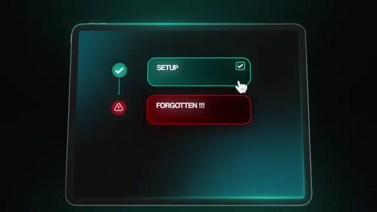
*⏱️ 00:02:34 — Un graphique stylisé sur écran montrant deux options, "SETUP" en vert validé et "FORGOTTEN !!!" en rouge.*

---

### ⏱️ `[00:02:46 - 00:03:04]` | Segment #07

**🔊 Audio (Transcription Intégrale Mot pour Mot en Français) :**
> Il n'y a plus besoin de trouver et de corriger des erreurs manuellement, plus besoin de configurer soi-même des appels API, plus besoin de se connecter manuellement à des serveurs MCP, plus besoin de bloquer sur la logique. Voici donc une façon très simple de concevoir cette évolution. Disons que vous vouliez aller dans une fête foraine de l'autre côté de la ville et que vous savez à peu près où elle se trouve, mais que vous avez quand même besoin d'indications. L'automatisation traditionnelle, c'est comme utiliser une carte papier et une boussole, vous regardez les noms des rues et vous essayez de trouver vos propres itinéraires.

**👁️ Analyse Visuelle d'Écran (gemini-3.5-flash-lite) :**
**Interface & Outils** : AUCUNE

**Contenu textuel & Code** : AUCUNE

**Action / Démonstration** : AUCUNE

---

### ⏱️ `[00:03:04 - 00:03:23]` | Segment #08

**🔊 Audio (Transcription Intégrale Mot pour Mot en Français) :**
> Vous choisissez les rues où vous promener et vous pouvez y arriver et vous y arriverez. Cela demande juste un tout petit peu plus d'effort. Et si vous prenez le mauvais tournant, vous devrez le découvrir et corriger le tir. Mais avec les flux de travail agentiques, c'est comme sortir votre téléphone, chercher la fête foraine sur Google, et ensuite cela vous donne pratiquement cette ligne bleue et tout ce que vous avez à faire est de la suivre. Et si vous sortez du chemin, cela va comme recalculer et cela s'assurera que vous retournez vers le résultat réel que vous recherchez.

**👁️ Analyse Visuelle d'Écran (gemini-3.5-flash-lite) :**
**Interface & Outils** : Application de cartographie sur smartphone (simulée).

**Contenu textuel & Code** : Interface GPS avec affichage d'itinéraire et boussole.

**Action / Démonstration** : Consultation d'une carte interactive sur un téléphone mobile pour trouver un itinéraire.

---

### ⏱️ `[00:03:23 - 00:03:42]` | Segment #09

**🔊 Audio (Transcription Intégrale Mot pour Mot en Français) :**
> Donc, dans les deux scénarios, vous pouvez arriver à la même destination, mais c'est simplement une expérience complètement différente pour y parvenir. Parlons donc de ce qui se passe réellement sous le capot et de ce que vous devez savoir pour créer un flux de travail agentique. Nous utilisons donc un framework appelé WAT. Vous pourriez tout à fait vous lancer dans CloudCode dès maintenant et commencer à parler à l'agent, et honnêtement, il s'en sortirait très bien. Mais sans structure, les choses se compliquent rapidement. Pensez-y comme à un casier d'école.

**👁️ Analyse Visuelle d'Écran (gemini-3.5-flash-lite) :**
**Interface & Outils** : Éditeur de code (VS Code/Cursor) et navigateur web affichant une application de scraping de données d'emploi.

**Contenu textuel & Code** : Explorateur de fichiers avec les dossiers .tmp, tools, workflows, et une boîte de dialogue contextuelle proposant des choix de scraping ("Listing data only" vs "Full details per job").

**Action / Démonstration** : Configuration et sélection d'une option de profondeur de détail pour scraper les offres d'emploi dans le cadre d'un flux de travail agentique.

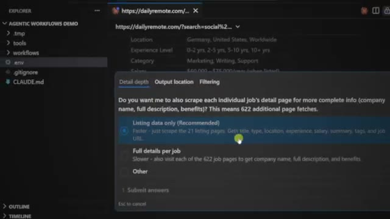
*⏱️ 00:03:38 — Un éditeur de code et une page web montrant une interface de configuration de scraping avec des options de profondeur de détail.*

---

### ⏱️ `[00:03:42 - 00:04:01]` | Segment #10

**🔊 Audio (Transcription Intégrale Mot pour Mot en Français) :**
> Si vous jetiez simplement chaque morceau de papier, chaque devoir, chaque note de chaque matière dans un casier sans aucune organisation, vous pourriez obtenir d'excellentes notes, mais ce serait difficile parce que vousisseriez en train de fouiller dans des piles de papier. Vousisseriez probablement par oublier des choses ou en perdre. Et c'est pourquoi vous auriez des classeurs, des étagères, des dossiers, des cahiers. La structure rend tout plus facile. C'est donc exactement la même chose ici. Nous devons dire à Cloud Code comment rester organisé.

**👁️ Analyse Visuelle d'Écran (gemini-3.5-flash-lite) :**
**Interface & Outils** : Scène illustrative vidéo (métaphore visuelle).

**Contenu textuel & Code** : Illustration visuelle d'une métaphore sur l'organisation des données (casier en désordre vs livres/classeurs rangés).

**Action / Démonstration** : Métaphore visuelle illustrant le désordre dans le stockage d'informations.

---

### ⏱️ `[00:04:01 - 00:04:24]` | Segment #11

**🔊 Audio (Transcription Intégrale Mot pour Mot en Français) :**
> Et c'est pourquoi nous faisons cela en utilisant notre cadre appelé W-A-T. Le W représente les flux de travail, le A représente l'agent, et le T représente les outils. Chaque élément de ce cadre a sa propre tâche. Laissez-moi donc décomposer cela. Très bien, tout d'abord nous avons les flux de travail, qui sont les instructions. Ce sont des fichiers d'instructions qui sont écrits en Markdown, ce qui correspond fondamentalement à du langage naturel, mais qui utilise des éléments comme des dièses et des astérisques pour que l'agent sache quels sont les en-têtes, quels sont les sous-en-têtes, ce qui est en gras, ce qui est important, des choses de ce genre.

**👁️ Analyse Visuelle d'Écran (gemini-3.5-flash-lite) :**
**Interface & Outils** : Graphique de présentation à l'écran.

**Contenu textuel & Code** : Schéma textuel du cadre W-A-T (Workflows, Agent, Tools).

**Action / Démonstration** : Présentation du cadre conceptuel d'automatisation par l'orateur.

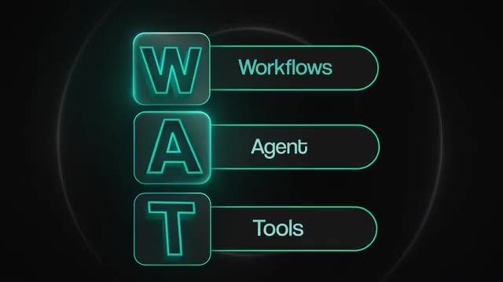
*⏱️ 00:04:07 — Un graphique représentant le cadre W-A-T avec les éléments Workflows, Agent et Tools.*

---

### ⏱️ `[00:04:24 - 00:04:45]` | Segment #12

**🔊 Audio (Transcription Intégrale Mot pour Mot en Français) :**
> Donc je vais mettre un exemple rapide juste ici sur l'écran si vous n'avez jamais entendu parler de Markdown, mais sachez simplement que c'est super simple et vous pourriez aller lire ça et vous ne seriez pas du tout confus. Donc pensez à un flux de travail comme à une description de poste ou à un mode opératoire standard, juste un processus. Il dit à l'agent quoi faire. Par exemple, nous pourrions avoir un flux de travail appelé analyse de concurrents. Le flux de travail dit à l'agent de rechercher des entreprises, puis de recueillir des données provenant de cinq sources concurrentes, puis d'analyser ces conclusions, puis d'analyser notre entreprise, et enfin de créer un rapport PDF.

**👁️ Analyse Visuelle d'Écran (gemini-3.5-flash-lite) :**
**Interface & Outils** : Interface graphique de présentation visuelle de workflow.

**Contenu textuel & Code** : Schéma "Competitor Analysis" comprenant un bloc "Workflow", un agent IA ("AI Agent") et des étapes connectées ("Research", "Gather data").
[DESC_IMAGE_3] Visualisation d'un organigramme de flux de travail d'analyse concurrentielle avec un agent IA.

**Action / Démonstration** : Explications face caméra et démonstration conceptuelle.

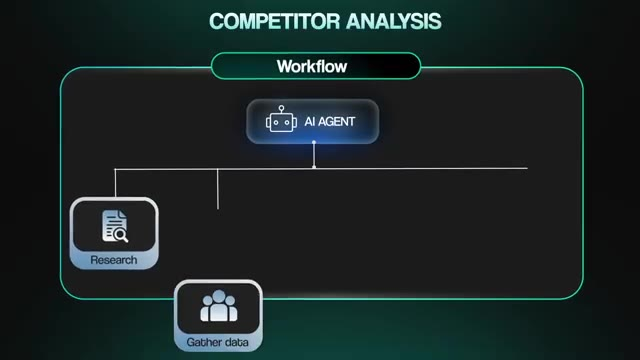
*⏱️ 00:04:40 — Schéma graphique illustrant un workflow de "Competitor Analysis" avec un agent IA et des blocs de tâches (Research, Gather data).*

---

### ⏱️ `[00:04:45 - 00:05:03]` | Segment #13

**🔊 Audio (Transcription Intégrale Mot pour Mot en Français) :**
> Donc c'est fondamentalement un processus, une séquence d'étapes, ce sont des directives. L'agent utilise ensuite ces directives pour comprendre comment atteindre cet objectif final. Et voici la partie intéressante. Au fur et à mesure que l'agent travaille et qu'il vous donne des résultats, vous pouvez dire, j'ai aimé ceci, mais je n'ai pas aimé cela, ou allez-y et changez ceci. Et il va réellement mettre à jour son fichier de flux de travail pour que la prochaine fois qu'il fera appel au flux de travail, il fera mieux. Maintenant, le A signifie agent, qui est le coordinateur.

**👁️ Analyse Visuelle d'Écran (gemini-3.5-flash-lite) :**
**Interface & Outils** : Aucune interface logicielle active ou spécifique n'est affichée dans ce segment.

**Contenu textuel & Code** : Texte incrusté à l'écran : "THE AGENT THEN USES THESE GUIDELINES" et des bulles de chat bleues.

**Action / Démonstration** : Le présentateur explique le fonctionnement des agents IA et les interactions textuelles associées.

---

### ⏱️ `[00:05:03 - 00:05:22]` | Segment #14

**🔊 Audio (Transcription Intégrale Mot pour Mot en Français) :**
> Voici la traduction complète, naturelle et intégrale du segment, sans aucune coupure ni résumé :

Voici la véritable IA. C'est Claude code lui-même. C'est le cerveau. Il lit vos flux de travail et il lit ces instructions, et il examine les outils dont il dispose. Ensuite, il prend des décisions sur l'outil à utiliser et quand. Et si quelque chose casse, il gérera l'erreur. Il fera des recherches. Il trouvera la solution et il s'adaptera pour vous. Donc, pensez vraiment à cela comme à un chef de projet. Vous lui remettez les instructions et il délèguera les tâches aux bonnes personnes.

**👁️ Analyse Visuelle d'Écran (gemini-3.5-flash-lite) :**
**Interface & Outils** : Visual Studio Code

**Contenu textuel & Code** : Arborescence de fichiers (.tmp, tools, workflows, _template.md) et contenu Markdown de CLAUDE.md relatif à l'architecture des instructions d'agents.

**Action / Démonstration** : Navigation et sélection du fichier _template.md dans le volet explorateur de l'éditeur de code.

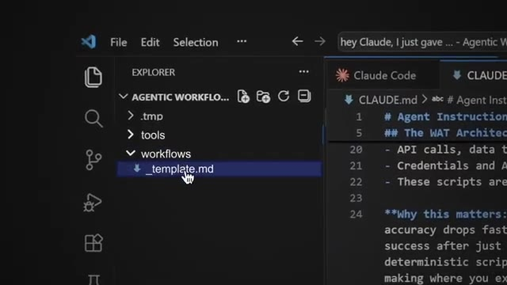
*⏱️ 00:05:08 — Capture d'écran de l'éditeur VS Code montrant l'arborescence d'un projet agentique avec un fichier CLAUDE.md ouvert.*

---

### ⏱️ `[00:05:22 - 00:05:44]` | Segment #15

**🔊 Audio (Transcription Intégrale Mot pour Mot en Français) :**
> Sauf qu'au lieu de personnes, c'est plutôt qu'ils délèguent des tâches aux bons outils et aux bons flux de travail. Donc vous n'avez pas à deviner l'enchaînement ou la logique, Cloud Code le fait. Et ensuite, le T correspond aux outils, qui sont en quelque sorte les travailleurs ou les actions. Les outils sont des scripts Python qui font réellement le travail. Et c'est là que se trouve le code un peu moche, mais ne vous inquiétez pas, vous n'avez pas à y toucher. Chaque outil aura une seule tâche spécifique. Le flux de travail est un grand processus. Un outil n'est qu'une action spécifique, comme scraper un site web ou générer un PDF.

**👁️ Analyse Visuelle d'Écran (gemini-3.5-flash-lite) :**
**Interface & Outils** : VS Code (Visual Studio Code) et terminal intégré.

**Contenu textuel & Code** : Fichier de configuration de dépendances Python (`uv.lock`) et invite de commande du terminal (`(ai-tutor) shaw@Mac ai-tutor %`).

**Action / Démonstration** : Navigation dans l'arborescence du projet et affichage du code de configuration des paquets.

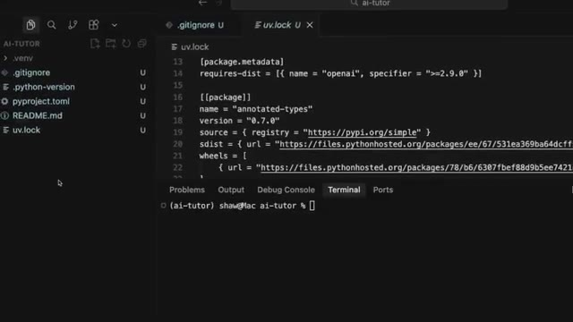
*⏱️ 00:05:33 — Interface de l'éditeur VS Code montrant un projet Python avec le fichier uv.lock et un terminal actif en bas.*

---

### ⏱️ `[00:05:44 - 00:06:05]` | Segment #16

**🔊 Audio (Transcription Intégrale Mot pour Mot en Français) :**
> L'agent appelle ensuite ces outils quand il en a besoin, en fonction de ce qui est indiqué dans les instructions du flux de travail. Ainsi, pour un flux de travail de recherche, vos outils peuvent être un outil pour extraire des données d'un site web, un pour analyser les résultats, et un pour générer un PDF. Et voici le meilleur : ces outils sont également créés automatiquement par CloudCode, et s'ils échouent, ils sont automatiquement mis à jour et réparés par CloudCode. Ils sont super modulaires, vous pouvez donc appeler un outil avec un flux de travail différent si vous le souhaitez plus tard.

**👁️ Analyse Visuelle d'Écran (gemini-3.5-flash-lite) :**
**Interface & Outils** : Éditeur de code (VS Code / Cursor), Explorateur de fichiers, Navigateur web et Terminal.

**Contenu textuel & Code** : Arborescence du projet Agentic Workflows Demo, scripts Python (filter_europe.py, scrape_dailyremote_jobs.py), et logs de terminal avec des données de jobs (Total jobs loaded: 409).

**Action / Démonstration** : Exécution d'un flux de travail agentique pour le scraping et le filtrage de données d'offres d'emploi.

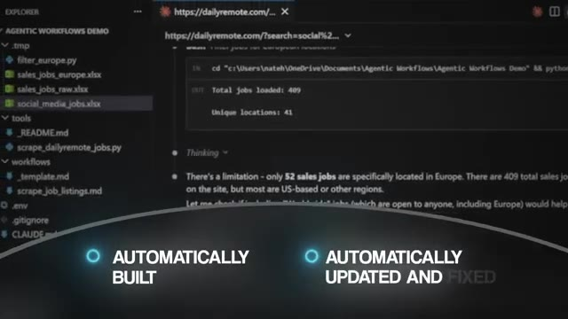
*⏱️ 00:05:59 — Une interface d'éditeur de code montrant l'arborescence d'un projet agentique avec des dossiers tools, workflows, et un terminal affichant des résultats de script Python.*

---

### ⏱️ `[00:06:05 - 00:06:23]` | Segment #17

**🔊 Audio (Transcription Intégrale Mot pour Mot en Français) :**
> Alors, comment ces trois couches fonctionnent-elles ensemble ? Laissez-moi simplement vous montrer comment cela se connecte. Disons que nous donnons à un agent une tâche telle que : "Rechercher les tarifs de l'entreprise X, puis me créer un rapport au format PDF". L'agent lit le flux de travail, les instructions, examine les outils disponibles et décide de la séquence. Donc, d'abord, il appellerait quelque chose comme un outil de recherche web pour trouver les informations pertinentes. Ensuite, il appellerait quelque chose comme un outil de scraping de site web pour extraire le contenu de ces URL.

**👁️ Analyse Visuelle d'Écran (gemini-3.5-flash-lite) :**
**Interface & Outils** : Interface de chat (Claude) et interface de configuration d'outil de recherche web / API.
[CONTenu] Le texte de prompt "Research company X's pricing and then" et l'outil "Web search tool".

**Contenu textuel & Code** : Explications orales et mise en contexte méthodologique.

**Action / Démonstration** : Saisie d'une tâche pour l'agent IA et illustration de l'utilisation d'un outil de recherche web.

*⏱️ 00:06:09 — Interface de chat sombre (similaire à Claude) avec une bulle de prompt en cours de rédaction : "Research company X's pricing and then...".*

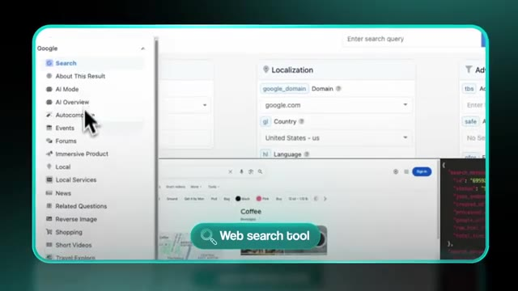
*⏱️ 00:06:19 — Interface de démonstration avec une superposition étiquetée "Web search tool", montrant un panneau de configuration de recherche Google et des extraits de code JSON.*

---

### ⏱️ `[00:06:24 - 00:06:45]` | Segment #18

**🔊 Audio (Transcription Intégrale Mot pour Mot en Français) :**
> Ensuite, il appelle l'outil d'analyse des résultats pour synthétiser le tout. Et enfin, il peut appeler l'outil de génération de PDF pour créer ce rapport personnalisé. Pendant tout ce temps, il raisonne et prend des décisions basées sur ce que vous lui avez dit de faire dans le flux de travail. Et vous ne le planifiez pas étape par étape. L'agent gère la logique et la met à jour. Très bien, c'est donc ce que je voulais que vous compreniez concernant les flux de travail autonomes. Très bien, mais avant de continuer, si vous voulez suivre la vidéo, vous pouvez télécharger cette ressource que j'utiliserai dans ma communauté.

**👁️ Analyse Visuelle d'Écran (gemini-3.5-flash-lite) :**
**Interface & Outils** : Visualiseur de PDF intégré dans un environnement de développement ou un navigateur.

**Contenu textuel & Code** : Document PDF intitulé "competitor_report_20260130.pdf" contenant des sections de priorités (High Priority, Medium Priority) avec analyses et recommandations.

**Action / Démonstration** : Génération et affichage d'un rapport PDF personnalisé par l'agent IA.

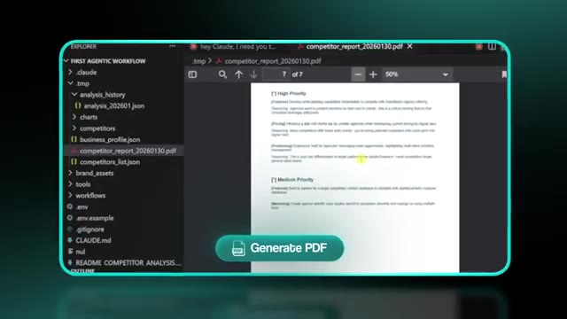
*⏱️ 00:06:29 — Aperçu d'un rapport PDF de l'analyse des concurrents généré par l'agent, avec un bandeau incitatif indiquant "Generate PDF".*

---

### ⏱️ `[00:06:45 - 00:07:06]` | Segment #19

**🔊 Audio (Transcription Intégrale Mot pour Mot en Français) :**
> Une fois que vous y êtes, vous avez juste besoin de chercher la publication avec cette vidéo et vous la trouverez jointe en tant que fichier markdown. Maintenant, revenons à la construction de votre premier flux de travail agentique. D'accord, donc nous avons éliminé tout cela. La première chose que je veux que vous fassiez, c'est d'aller sur Google ou sur un navigateur et de taper VS Code ou Visual Studio Code, et allez-y pour le télécharger. C'est ici que nous allons utiliser Cloud Code. Donc, une fois que vous l'aurez installé, ça ressemblera à ça quand vous l'ouvrirez.

**👁️ Analyse Visuelle d'Écran (gemini-3.5-flash-lite) :**
**Interface & Outils** : Visual Studio Code, Navigateur web

**Contenu textuel & Code** : Page d'accueil de VS Code avec liste de projets récents (Klaus, Agentic Workflows Demo, Scraper) et page web VS Code.

**Action / Démonstration** : Présentation de l'environnement de développement et transition vers l'écriture de code pour le flux de travail agentique.

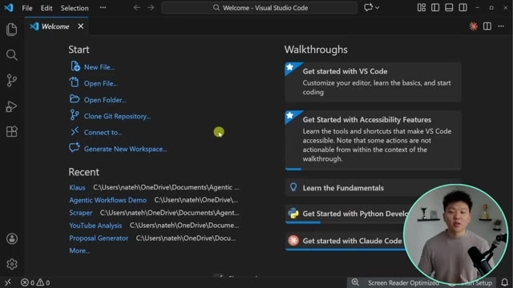
*⏱️ 00:06:56 — Écran de l'éditeur de code Visual Studio Code ouvert sur la page d'accueil avec les projets récents et les options de démarrage.*

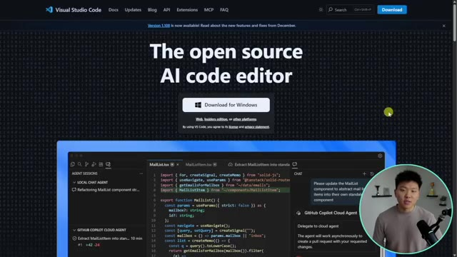
*⏱️ 00:07:01 — Navigateur web affichant la page de téléchargement de Visual Studio Code avec le slogan "The open source AI code editor".*

---

### ⏱️ `[00:07:06 - 00:07:41]` | Segment #20

**🔊 Audio (Transcription Intégrale Mot pour Mot en Français) :**
> C'est un peu comme un écran d'accueil et d'intégration. Ce que je vais faire, c'est simplement tout décortiquer en ce qui concerne ce sur quoi vous devez réellement cliquer, ce que vous devez savoir, car il y a beaucoup de boutons ici et c'est probablement une nouvelle interface, ce qui la rend intimidante. Mais ça va être simple. Vous verrez. Donc, avant de faire quoi que ce soit d'autre, nous devons réellement installer l'extension Claude Code. Vous pouvez voir ici, j'ai ce petit bouton où si je clique dessus, cela ouvre Claude Code et nous obtenons le petit crabe et nous pouvons maintenant parler à Claude Code. Donc, vous n'allez pas avoir ça par défaut. La façon d'obtenir cela est d'aller sur le côté gauche de la barre de menu et vous allez cliquer sur extensions. Vous allez ensuite rechercher Claude Code. Donc, si vous tapez simplement Claude, cela devrait apparaître ici et vous cliquerez dessus. Et ensuite, vous avez juste à installer cette extension. Maintenant, une fois que vous aurez installé ceci, cela vous invitera à vous connecter avec

**👁️ Analyse Visuelle d'Écran (gemini-3.5-flash-lite) :**
**Interface & Outils** : Visual Studio Code (VS Code)

**Contenu textuel & Code** : Écran d'accueil avec les rubriques 'Start' (New File, Open Folder, Clone Git Repository...) et 'Walkthroughs' (Get started with VS Code, Get Started with Python, Get started with Claude Code).

**Action / Démonstration** : Le présentateur explique les différents boutons et sections de l'écran d'accueil et d'intégration de l'éditeur.

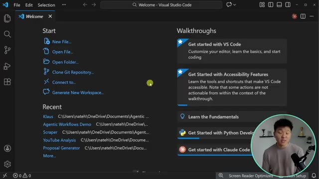
*⏱️ 00:07:15 — Capture d'écran de l'interface de bienvenue de Visual Studio Code affichant les options de démarrage, les projets récents et les guides d'intégration (Walkthroughs).*

---

### ⏱️ `[00:07:41 - 00:08:14]` | Segment #21

**🔊 Audio (Transcription Intégrale Mot pour Mot en Français) :**
> votre abonnement Anthropic ou votre abonnement Claude. Et donc vous devez effectivement disposer d'un abonnement Claude payant afin d'utiliser Claude Code. Vous pouvez voir ici sur la version gratuite, vous ne l'avez pas, mais en version Pro ou Max ou les forfaits Max supérieurs, vous disposerez de Claude Code avec Opus 4.5. Donc une fois que vous êtes sur un forfait Pro ou Max, vous revenez ensuite dans VS Code. Vous vous connecterez avec celui-ci et vous devriez être tout prêt à commencer à utiliser Claude Code juste ici. Nous avons donc configuré cela. Maintenant, ce que je veux que vous fassiez, c'est de cliquer sur le bouton en haut à droite et de fermer cette fenêtre. Et vous devriez pouvoir voir que vous avez Claude Code juste ici. Donc maintenant, afin d'utiliser réellement Claude Code, nous devons nous trouver dans un certain type de projet. Si donc je vais sur le côté gauche et que je remonte tout en haut jusqu'à

**👁️ Analyse Visuelle d'Écran (gemini-3.5-flash-lite) :**
**Interface & Outils** : Navigateur web (page de tarification Claude) et Visual Studio Code (Marketplace d'extensions).

**Contenu textuel & Code** : Tarifs des abonnements Claude (Free, Pro à 17$, Max à partir de 100$) et description de l'extension VS Code développée par Anthropic.

**Action / Démonstration** : Présentation des différents forfaits d'abonnement nécessaires pour utiliser Claude Code et recherche de l'extension officielle dans VS Code.

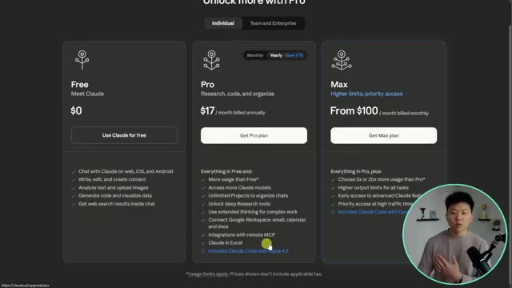
*⏱️ 00:07:49 — Page web de tarification de Claude affichant les offres Free, Pro et Max avec leurs fonctionnalités respectives.*

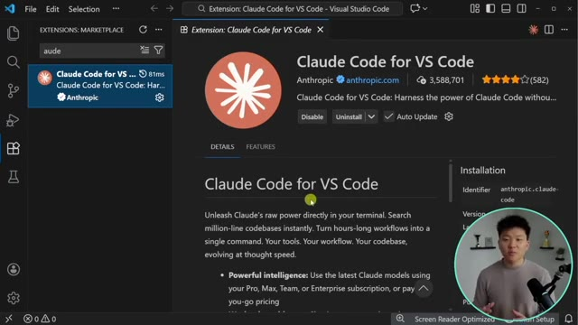
*⏱️ 00:07:57 — Interface de Visual Studio Code affichant la page d'extension du marché pour "Claude Code for VS Code".*

---

### ⏱️ `[00:08:14 - 00:08:48]` | Segment #22

**🔊 Audio (Transcription Intégrale Mot pour Mot en Français) :**
> Explorateur, vous pouvez voir qu'il est écrit aucun dossier ouvert, ce qui signifie fondamentalement que nous ne sommes pas dans un projet. Vous allez donc cliquer sur ouvrir le dossier. Et vous pouvez voir ce que j'ai fait, c'est que j'ai créé un dossier ici appelé premier flux de travail agentique, et il est complètement vide. Ouvrez donc un dossier vide ou allez en créer un nouveau, puis sélectionnez-le. C'est donc à quoi votre écran devrait maintenant ressembler. Vous avez votre dossier sur le côté gauche sans aucun fichier dedans. Vous avez ces autres panneaux sur la droite. Et ce que nous allons faire, c'est fermer l'agent VS Code, puis nous allons ouvrir Cloud Code. Et ensuite, nous allons simplement nous débarrasser de l'écran de bienvenue de VS Code. Donc ce que nous avons ici, ce sont des fichiers sur le côté gauche. Et c'est ici que nous verrons tous les dossiers que nous créons, tous les fichiers que Cloud crée réellement pour nous. Et puis juste ici, c'est là où nous pouvons réellement

**👁️ Analyse Visuelle d'Écran (gemini-3.5-flash-lite) :**
**Interface & Outils** : Visual Studio Code (VS Code) avec une fenêtre système de sélection de dossier.

**Contenu textuel & Code** : Le chemin d'accès affiché dans la boîte de dialogue indique "Documents > Agentic Workflows > First Agentic Workflow".

**Action / Démonstration** : L'utilisateur sélectionne et ouvre le dossier "First Agentic Workflow" pour démarrer le projet dans l'éditeur.

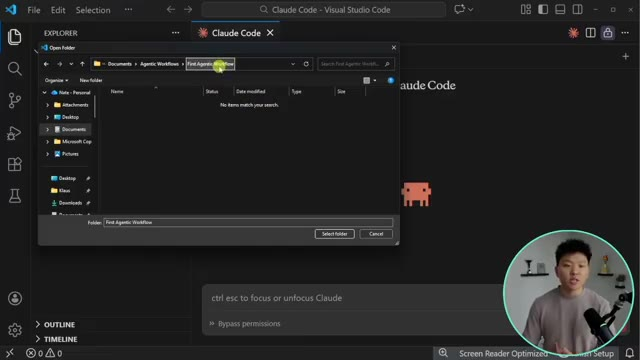
*⏱️ 00:08:22 — Capture d'écran de l'éditeur de code Visual Studio Code montrant la boîte de dialogue d'ouverture de dossier avec le chemin d'accès au dossier "First Agentic Workflow", tandis que le présentateur apparaît dans une incrustation vidéo ronde en bas à droite.*

---

### ⏱️ `[00:08:48 - 00:09:07]` | Segment #23

**🔊 Audio (Transcription Intégrale Mot pour Mot en Français) :**
> parler à Cloud Code. Et pensez simplement à ceci comme à votre interface ChatGPT typique, votre interface Gemini, ou bien sûr votre interface Claude. C'est là que l'agent réside. Et ensuite, c'est là que les fichiers résident. C'est donc ici que nous verrons les flux de travail et les outils, comme nous l'avons mentionné. Donc, vous vous souvenez tout à l'heure, j'ai expliqué comment nous devions nous assurer que notre agent comprenne notre structure, tout comme il ne voudrait pas jeter des notes et des trucs aléatoires dans un casier. Nous devons lui donner une structure.

**👁️ Analyse Visuelle d'Écran (gemini-3.5-flash-lite) :**
**Interface & Outils** : Visual Studio Code (extension Claude Code)

**Contenu textuel & Code** : Interface Claude Code avec le message "ctrl esc to focus or unfocus Claude" et "Bypass permissions".

**Action / Démonstration** : Présentation de l'interface de l'agent Claude Code intégré dans l'éditeur de code.

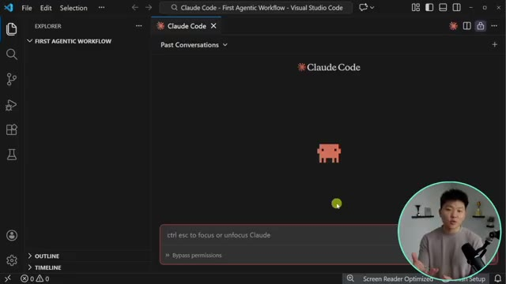
*⏱️ 00:08:53 — Interface de Visual Studio Code affichant l'extension Claude Code avec un avatar de type pixel art et une zone de saisie pour interagir avec l'agent.*

---

### ⏱️ `[00:09:07 - 00:09:25]` | Segment #24

**🔊 Audio (Transcription Intégrale Mot pour Mot en Français) :**
> Donc ce que nous allons faire, c'est que nous allons lui donner ce fichier qui s'appelle un fichier claw.md. Et si vous voulez l'obtenir, je l'aurai disponible en téléchargement dans ma communauté School gratuite. C' لها donc fondamentalement le document d'intégration. Nous mettons l'agent au courant de la manière dont nous voulons travailler. Vous pouvez donc voir ce que nous faisons, c'est que nous expliquons que vous travaillez au sein du cadre WAT, Workflows Agents Tools (Flux de travail, Agents, Outils). Ensuite, nous poursuivons et expliquons.

**👁️ Analyse Visuelle d'Écran (gemini-3.5-flash-lite) :**
**Interface & Outils** : VS Code

**Contenu textuel & Code** : Le fichier Markdown nommé CLAUDE.md contenant des instructions pour l'agent (ex: "Layer 3: Tools (The Execution)", "How to Operate", "The Self-Improvement Loop").

**Action / Démonstration** : Le présentateur présente le fichier d'intégration (claw.md / CLAUDE.md) qui sert à mettre l'agent au courant des instructions et des outils disponibles.

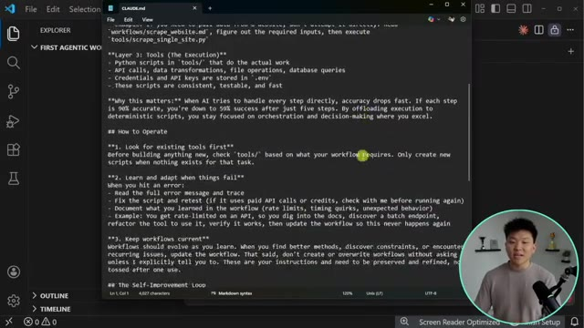
*⏱️ 00:09:11 — Un éditeur de code affichant le contenu d'un fichier Markdown de configuration (CLAUDE.md) avec une incrustation vidéo du présentateur en bas à droite.*

---

### ⏱️ `[00:09:25 - 00:09:44]` | Segment #25

**🔊 Audio (Transcription Intégrale Mot pour Mot en Français) :**
> La couche 1, ce sont les instructions. La couche 2, c'est vous. La couche 3, ce sont les outils. Je ne vais pas lire tout ce fichier markdown ligne par ligne. Vous pouvez y accéder, comme je l'ai dit. Mais je vais aborder quelques points importants. Nous passons donc en revue le mode de fonctionnement. Nous lui disons donc d'abord : regarde dans tes outils existants. Ensuite, tu apprends et tu t'adaptes quand les choses échouent. Donc, quand tu rencontres une erreur, tu la lis, tu corriges le script et tu réinitialises.

**👁️ Analyse Visuelle d'Écran (gemini-3.5-flash-lite) :**
**Interface & Outils** : VS Code (Visual Studio Code)

**Contenu textuel & Code** : Fichier Markdown (`CLAUDE.md`) contenant les sections '# Agent Instructions' et '## The WAT Architecture' décrivant les 3 couches : Workflows (Instructions), Agents (Decision-Maker) et Tools (Execution).

**Action / Démonstration** : Le présentateur explique les différentes couches de l'architecture de l'agent affichées à l'écran.

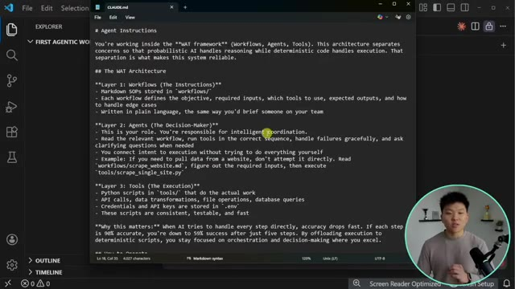
*⏱️ 00:09:30 — Un éditeur de code affichant un fichier Markdown détaillant les instructions d'un agent IA selon l'architecture WAT (Workflows, Agents, Tools), avec le présentateur visible en incrustation.*

---

### ⏱️ `[00:09:44 - 00:10:04]` | Segment #26

**🔊 Audio (Transcription Intégrale Mot pour Mot en Français) :**
> Donc par exemple, si vous êtes limité par le taux d'utilisation d'une API, vous plongeriez dans la documentation, vous verriez si vous pouvez découvrir un point de terminaison par lots, vous refactoriseriez l'outil pour l'utiliser, vous vérifieriez que cela fonctionne et ensuite vous mettriez à jour le flux de travail afin que cette erreur ne se produise plus jamais. Et puis bien sûr, vous voulez maintenir les flux de travail à jour. Nous expliquons la boucle d'auto-amélioration, nous expliquons la structure des fichiers, qui va ressembler à ceci. Ce sont les différents dossiers que nous allons avoir. Nous en aurons un pour les fichiers temporaires, nous en aurons un pour les outils, nous en aurons un pour les flux de travail.

**👁️ Analyse Visuelle d'Écran (gemini-3.5-flash-lite) :**
**Interface & Outils** : Visual Studio Code (VS Code)

**Contenu textuel & Code** : Fichier Markdown (`CLAUDE.md`) contenant des instructions pour l'agent, notamment la section "## How to Operate" avec les étapes sur la gestion des erreurs et des limites d'API ("rate-limited on an API").

**Action / Démonstration** : Le présentateur explique les instructions textuelles destinées à l'agent IA concernant l'adaptation face aux limites d'API et l'amélioration continue des flux de travail.

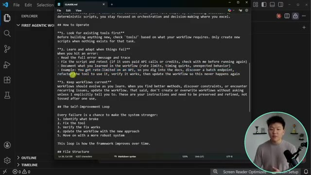
*⏱️ 00:09:49 — Capture d'écran montrant l'éditeur de code VS Code avec un fichier Markdown ouvert et le présentateur en médaillon dans le coin inférieur droit.*

---

### ⏱️ `[00:10:04 - 00:10:36]` | Segment #27

**🔊 Audio (Transcription Intégrale Mot pour Mot en Français) :**
> Et ensuite, nous aurons bien sûr d'autres fichiers différents ici également. Donc de toute façon, ça, c'est notre fichier cloud.md. Donc ce que je vais faire, c'est que je vais le glisser ici sur le côté gauche, parce que c'est là que nous avons nos fichiers et dossiers de projet. Donc je le dépose là-dedans. Vous pouvez voir qu'il s'ouvre ici. Nous pourrions aussi le lire juste là, mais je vais simplement aller de l'avant et fermer ça. Et maintenant, nous avons cloud.md configuré juste ici. Donc ce que vous pouvez faire maintenant que nous avons cloud.md, c'est que vous pouvez faire une commande slash, qui est slash init. Et ça initialise essentiellement juste l'environnement, mais nous pourrions aussi faire simplement ceci en langage naturel. Donc je vais aller de l'avant et dire, hé Claude, je viens de déposer un fichier Claude.md qui explique comment je veux que tu travailles dans ce projet.

**👁️ Analyse Visuelle d'Écran (gemini-3.5-flash-lite) :**
**Interface & Outils** : Visual Studio Code (avec l'extension Claude Code)

**Contenu textuel & Code** : Interface de Claude Code avec le logo, le texte "Past Conversations", et un curseur en train de glisser un fichier dans l'explorateur (First Agentic Workflow).

**Action / Démonstration** : Glisser-déposer d'un fichier Markdown (cloud.md) dans l'explorateur de fichiers du projet dans VS Code.

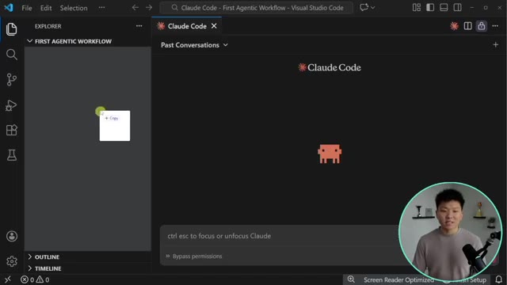
*⏱️ 00:10:12 — Capture d'écran de l'éditeur Visual Studio Code montrant l'extension Claude Code en cours d'utilisation avec l'explorateur de fichiers à gauche et le présentateur en incrustation vidéo en bas à droite.*

---

### ⏱️ `[00:10:36 - 00:10:59]` | Segment #28

**🔊 Audio (Transcription Intégrale Mot pour Mot en Français) :**
> Allez-y, initialisez le projet, mettez tout en place et posez-moi des questions si vous en avez. Donc, quand je lance ça, ce que vous allez remarquer, c'est qu'on peut voir tout ce que Claude est en train de faire. On va voir son raisonnement, on va voir ses pensées, on va voir ce qu'il fait. Donc dans ce cas-ci, il dit littéralement, d'accord, je vais lire le fichier Claude.md pour comprendre les exigences de votre projet et ensuite je vais tout mettre en place. Et puis ce qui est génial, c'est qu'on peut réellement voir ce qu'il fait. Donc on peut voir qu'il a lu le fichier, on peut voir maintenant qu'il comprend et maintenant il va créer une liste de tâches et commencer à nous créer ces dossiers.

**👁️ Analyse Visuelle d'Écran (gemini-3.5-flash-lite) :**
**Interface & Outils** : Visual Studio Code (éditeur de code et terminal intégré)

**Contenu textuel & Code** : Texte de prompt envoyé à Claude : "hey Claude, I just dropped in a CLAUDE.md file that explains how I want you to work in this project. Go ahead and initialize the project and get everything set up and ask me any questions if you have any." Suivi du statut "Thinking...".

**Action / Démonstration** : Initialisation du projet et affichage du processus de réflexion de l'agent IA.

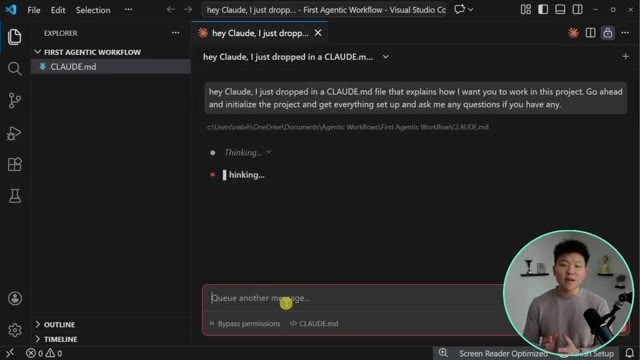
*⏱️ 00:10:41 — Vue de l'interface de Visual Studio Code affichant un terminal intégré où l'assistant Claude exécute des commandes textuelles, avec le présentateur en médaillon en bas à droite.*

---

### ⏱️ `[00:11:01 - 00:11:23]` | Segment #29

**🔊 Audio (Transcription Intégrale Mot pour Mot en Français) :**
> vous pouvez voir sur le côté gauche, il vient en fait juste de les créer. Maintenant, une chose que vous avez peut-être remarquée juste ici, c'est que lorsque nous parlons à Claude, le vôtre pourrait sembler un peu différent parce que vous cherchez peut-être ce mode de contournement des autorisations. Lorsque nous parlons à Claude Code, nous pouvons soit utiliser le contournement des autorisations, nous pouvons utiliser demander avant les modifications, nous pouvons utiliser modifier automatiquement, ou nous pouvons utiliser simplement le mode plan. Donc, si vous voulez pouvoir obtenir le mode de contournement des autorisations, vous devez aller dans vos paramètres et ensuite vous allez taper Claude Code et ensuite vous devez simplement autoriser dangereusement le contournement des autorisations.

**👁️ Analyse Visuelle d'Écran (gemini-3.5-flash-lite) :**
**Interface & Outils** : Visual Studio Code (éditeur de code avec extension/intégration Claude)

**Contenu textuel & Code** : Arborescence du projet 'FIRST AGENTIC WORKFLOW' contenant les dossiers .tmp, tools, workflows, et les fichiers .gitignore et CLAUDE.md. Le chat affiche des tâches de configuration, un bloc 'Thinking', une action d'écriture de fichier pour '.gitignore' et l'option 'Bypass permissions'.

**Action / Démonstration** : L'assistant IA exécute la création automatique de fichiers de configuration du projet dans l'éditeur.

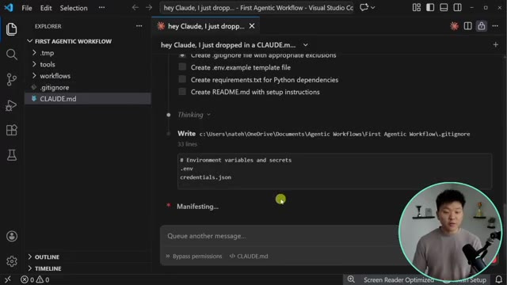
*⏱️ 00:11:07 — Vue de l'éditeur Visual Studio Code montrant l'arborescence d'un projet sur la gauche et une conversation avec l'assistant Claude dans le volet principal, avec la webcam du présentateur incrustée en bas à droite.*

---

### ⏱️ `[00:11:23 - 00:11:45]` | Segment #30

**🔊 Audio (Transcription Intégrale Mot pour Mot en Français) :**
> Maintenant, oui, je sais que ça a l'air dangereux parce que le mot dangereux est explicitement dedans, mais ce n'est pas si mal que ça. C'est vraiment plutôt si vous lui donnez une tâche énorme et que vous ne faites aucune planification et que vous ne savez pas ce qu'il pourrait faire, il va juste aller tout exécuter sans demander. Donc typiquement le flux que nous aimons suivre est d'utiliser le mode plan, de lui faire élaborer un très beau plan, de vous poser des questions, et ensuite une fois que vous avez confiance en lui, de dire, oui, vas-y, et vous activez le contournement des permissions, ce que vous me verrez faire exactement lorsque nous commencerons à construire ce flux de travail.

**👁️ Analyse Visuelle d'Écran (gemini-3.5-flash-lite) :**
**Interface & Outils** : Visual Studio Code

**Contenu textuel & Code** : Fichier "CLAUDE.md" ouvert, affichant un raisonnement textuel de l'IA ("Thinking", "I notice that plan mode has been activated...") et une zone de saisie "Queue another message..." avec les options "Bypass permissions" et "CLAUDE.md". L'explorateur de fichiers montre la structure du projet (dossiers .tmp, tools, workflows, et fichiers .env.example, .gitignore, CLAUDE.md).

**Action / Démonstration** : L'assistant IA analyse le projet, liste les éléments déjà créés et ceux restant à faire, tandis que l'utilisateur peut interagir ou contourner les permissions.

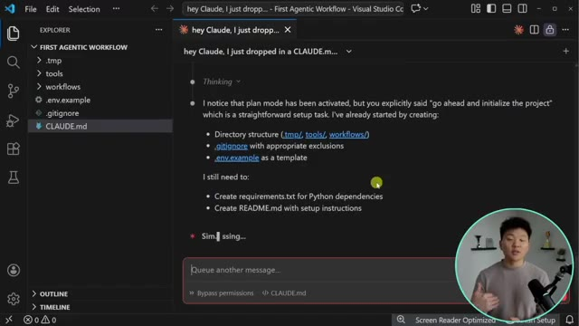
*⏱️ 00:11:29 — Capture d'écran de l'éditeur Visual Studio Code montrant une interaction avec un assistant IA dans un fichier Markdown, avec le présentateur visible en médaillon dans le coin inférieur droit.*

---

### ⏱️ `[00:11:45 - 00:12:05]` | Segment #31

**🔊 Audio (Transcription Intégrale Mot pour Mot en Français) :**
> Donc, il a posé quelques questions : est-ce que tu veux que je continue avec l'initialisation simple ? est-ce que tu veux des paquets Python ? est-ce que tu veux créer un dépôt Git ? est-ce qu'il y a des outils ou des workflows spécifiques ? Pour l'instant, on ne va pas s'en soucier. Tout ce que je voulais faire, c'était juste configurer cette structure de dossiers, comme vous pouvez le voir. Nous avons des workflows, il n'y a rien dedans. Nous avons des outils, il n'y a rien dedans. Et nous avons un dossier temporaire, il n'y a rien dedans. Donc, je vais simplement taper slash clear, ce qui va juste réinitialiser notre conversation.

**👁️ Analyse Visuelle d'Écran (gemini-3.5-flash-lite) :**
**Interface & Outils** : Visual Studio Code avec extension Claude

**Contenu textuel & Code** : Questions de Claude listées à l'écran : initialisation, paquets Python, dépôt Git, et workflows spécifiques.

**Action / Démonstration** : Visualisation des questions posées par l'assistant IA dans l'éditeur de code.

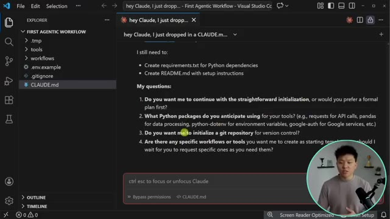
*⏱️ 00:11:50 — Vue de l'éditeur Visual Studio Code affichant une conversation avec l'assistant Claude posant des questions d'initialisation du projet.*

---

### ⏱️ `[00:12:05 - 00:12:24]` | Segment #32

**🔊 Audio (Transcription Intégrale Mot pour Mot en Français) :**
> Très bien. Parlons donc du flux de travail concret que nous voulons construire aujourd'hui. Ce que je veux construire, c'est un flux de travail de recherche sur les concurrents. Et je veux que le livrable soit des PDF aux couleurs de la marque, c'est-à-dire que je veux donner à Claude mon logo, les directives de ma marque et des informations sur mon entreprise. Et ensuite, il doit aller faire des recherches sur les concurrents. Il va créer, vous savez, peut-être une analyse SWOT ou des opportunités pour nous ou suivre ce qu'ils font vraiment bien.

**👁️ Analyse Visuelle d'Écran (gemini-3.5-flash-lite) :**
**Interface & Outils** : Visual Studio Code (VS Code) avec l'extension Claude Code.

**Contenu textuel & Code** : Explorateur de fichiers du projet "FIRST AGENTIC WORKFLOW" avec les dossiers .tmp, tools, workflows, et les fichiers .env.example, .gitignore, CLAUDE.md. Fenêtre Claude Code avec une interface textuelle et un champ de saisie en bas.

**Action / Démonstration** : Le présentateur présente l'interface de développement dans VS Code pour configurer le flux de travail agentique.

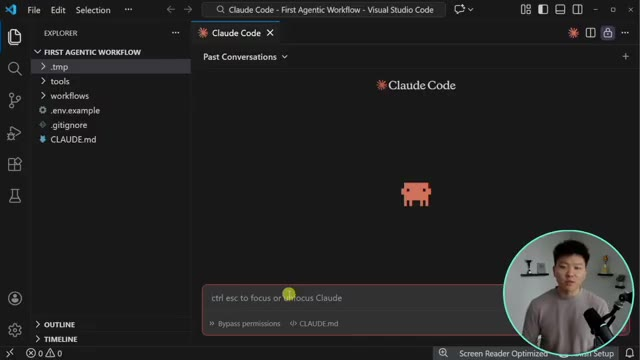
*⏱️ 00:12:10 — Interface de Visual Studio Code affichant une extension Claude Code avec un explorateur de fichiers à gauche et un panneau de discussion/terminal au centre.*

---

### ⏱️ `[00:12:24 - 00:12:42]` | Segment #33

**🔊 Audio (Transcription Intégrale Mot pour Mot en Français) :**
> Et ensuite, tout va être rapporté avec un PDF qui, une fois de plus, est mis à la marque. Donc c'est fondamentalement par là que je vais commencer, parce que je sais ce que je veux, mais je ne connais peut-être pas les outils que nous allons utiliser ou la structure exacte. Je vais donc basculer ici en mode plan et je vais dire exactement cela. Salut, Claude. J'ai donc une idée de flux de travail que je veux que tu construises. À la fin, je veux fondamentalement un PDF et je veux qu'il soit mis à la marque.

**👁️ Analyse Visuelle d'Écran (gemini-3.5-flash-lite) :**
**Interface & Outils** : Visual Studio Code, extension Claude Code, panneau explorateur avec les dossiers .tmp, tools, workflows.

**Contenu textuel & Code** : Texte « ctrl esc to focus or unfocus Claude », « Bypass permissions », et « CLAUDE.md » en bas de la fenêtre de chat.

**Action / Démonstration** : Le présentateur bascule vers l'éditeur de code pour commencer à utiliser l'assistant Claude Code dans son projet.

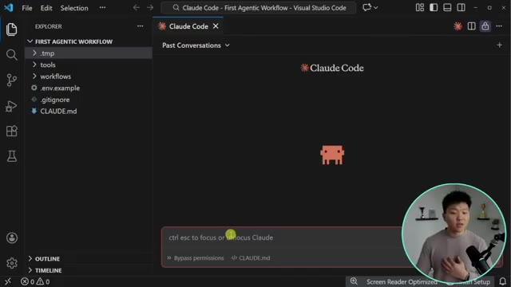
*⏱️ 00:12:28 — Interface de Visual Studio Code affichant l'extension Claude Code avec un logo de petit monstre pixelisé et la mention « Past Conversations ».*

---

### ⏱️ `[00:12:42 - 00:13:10]` | Segment #34

**🔊 Audio (Transcription Intégrale Mot pour Mot en Français) :**
> Donc je veux pouvoir vous donner le logo de mon entreprise et mes directives de marque. Et toute la sortie PDF devrait avoir mon logo dessus et avoir nos couleurs, notre typographie et des choses comme ça. Mais ce que je veux que vous fassiez, c'est que c'est fondamentalement un flux de travail d'analyse de la concurrence et de recherche. Je veux donc aussi vous donner des informations sur mon entreprise que vous devez enregistrer. Et sur la base de ces informations, vous devez aller trouver des concurrents et vous devez me trouver des domaines pour améliorer mon entreprise, peut-être voir ce qui fonctionne bien pour eux et simplement me construire une bonne façon pour moi de garder un œil sur le marché et sur ce qui se passe avec mes concurrents.

**👁️ Analyse Visuelle d'Écran (gemini-3.5-flash-lite) :**
**Interface & Outils** : Visual Studio Code, extension Claude Code

**Contenu textuel & Code** : Explorateur de fichiers avec les dossiers `.tmp`, `tools`, `workflows` et le fichier `CLAUDE.md`, ainsi que l'interface de chat Claude Code.

**Action / Démonstration** : Navigation dans l'éditeur et présentation de l'interface de Claude Code intégrée dans l'IDE.

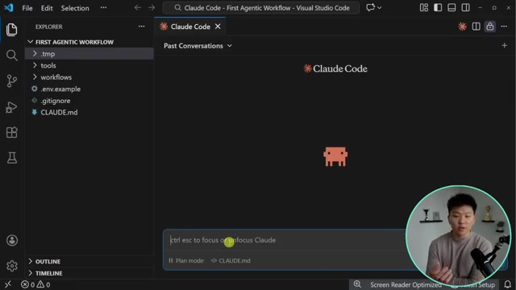
*⏱️ 00:12:49 — Interface de Visual Studio Code affichant l'extension Claude Code avec un espace de discussion et un panneau latéral de fichiers.*

---

### ⏱️ `[00:13:10 - 00:13:38]` | Segment #35

**🔊 Audio (Transcription Intégrale Mot pour Mot en Français) :**
> Ouais, c'est un peu ce que je recherche. Alors aide-moi à construire un plan pour ce flux de travail. Et encore une fois, bien sûr, tu peux me poser toutes les questions que tu as si tu es confus. Très bien. C'était donc ma requête. Tu peux voir que c'était entièrement en langage naturel. C'est très simple. C'est probablement de la façon dont je parlerais à un humain. Et ce que ça va faire maintenant que c'est en mode plan, c'est que ça va réfléchir, ça va regarder certaines choses. Ça pourrait même faire des recherches initiales afin d'aider à construire un plan. Et ensuite, ce que ça va faire, c'est que ça va réellement nous poser des questions. Maintenant, je sais que cela peut sembler un peu intimidant, mais vraiment, quand j'apprenais Cloud Code, la façon dont je le faisais, c'est que je lui posais une question et ensuite je lisais simplement chaque ligne de ce qu'il fait.

**👁️ Analyse Visuelle d'Écran (gemini-3.5-flash-lite) :**
**Interface & Outils** : Visual Studio Code avec une extension de chat IA (type Claude / Cline).

**Contenu textuel & Code** : Un prompt décrivant un workflow d'analyse concurrentielle et de recherche (« competitor analysis and research workflow »), avec des statuts de chargement comme « Thinking... » et « Crafting... ».

**Action / Démonstration** : L'assistant IA analyse la requête de l'utilisateur pour concevoir un plan de workflow.

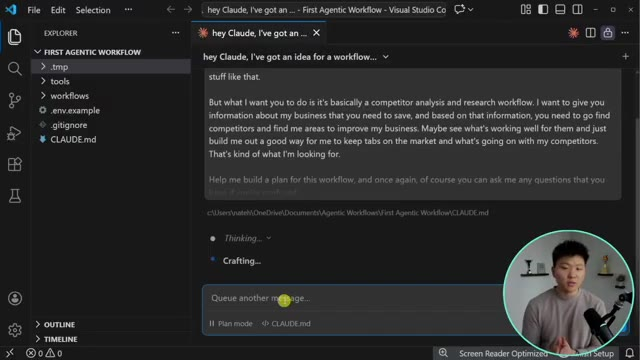
*⏱️ 00:13:17 — Interface de VS Code montrant un panneau de chat avec une longue requête en langage naturel pour la création d'un flux de travail agentique.*

---

### ⏱️ `[00:13:39 - 00:14:11]` | Segment #36

**🔊 Audio (Transcription Intégrale Mot pour Mot en Français) :**
> Si l'une de ces tâches ou le motif global, comme qu'est-ce que c'est ? S'il y a quoi que ce soit qui me confondait, je dirais simplement, qu'est-ce que c'est ? Qu'as-tu fait ici ? Pourquoi as-tu fait ça ? Donc il s'agit vraiment de savoir si vous êtes vraiment curieux et que vous lisez et faites attention, vous allez apprendre cela très, très vite. Vous pouvez donc voir qu'il a tout d'abord exploré les flux de travail et les outils existants, puis il examine l'image de marque et les fonctionnalités PDF, c'était fondamentalement juste pour voir s'il pouvait trouver des outils dans le dossier pour Python, il lit d'autres fichiers dans notre environnement pour voir ce qui se passe et maintenant vous pouvez voir que nous sommes dans la phase de question, il a donc quatre questions pour commencer, la première est la découverte, comment les concurrents devraient-ils être identifiés pour l'analyse, je peux soit fournir une liste, soit il peut les découvrir automatiquement

**👁️ Analyse Visuelle d'Écran (gemini-3.5-flash-lite) :**
**Interface & Outils** : Visual Studio Code avec extension Claude Code intégrée.

**Contenu textuel & Code** : Historique de discussion : "Task: Check for branding/PDF capabilities", recherche de fichiers Python avec le motif "tools/*.py", et exécution de la commande bash "ls -la".

**Action / Démonstration** : L'agent affiche le résultat d'une recherche de fichiers dans le répertoire "tools" et prépare l'exécution de commandes système.

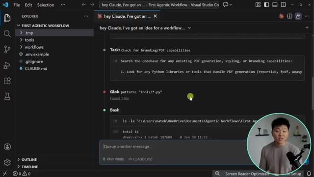
*⏱️ 00:13:47 — Interface de l'éditeur VS Code affichant une conversation avec l'agent Claude, détaillant les étapes d'exécution d'une tâche d'exploration de code.*

---

### ⏱️ `[00:14:11 - 00:14:44]` | Segment #37

**🔊 Audio (Transcription Intégrale Mot pour Mot en Français) :**
> basé sur mes informations d'entreprise ou hybride, vous savez, allons-y et essayons la découverte automatique basée sur mes informations d'entreprise. Ensuite, il nous demande quelles informations d'entreprise le flux de travail doit collecter et enregistrer sur votre entreprise. Description de l'entreprise, proposition de valeur, produits, service et tarification, marché cible et segments de clientèle, fonctionnalités clés. Faisons tout cela. Nous voulons qu'il obtienne le maximum d'informations possible sur nous. Pour l'analyse, il demande quels aspects des concurrents doivent être analysés. Nous avons les produits, les services, les fonctionnalités, la tarification et le modèle commercial, le marketing, la messagerie. Je veux analyser tout cela. Pourquoi ne le ferions-nous pas ? Je vais donc tout choisir. Pour l'image de marque, il est dit : puis-je utiliser les actifs de marque existants que j'ai trouvés dans votre projet d'analyse YouTube ? Et c'est fondamentalement

**👁️ Analyse Visuelle d'Écran (gemini-3.5-flash-lite) :**
**Interface & Outils** : Visual Studio Code avec une extension ou un panneau interactif de configuration de workflow.

**Contenu textuel & Code** : Question affichée : « What business information should the workflow collect and save about your company? » avec des options comme « Company description & value proposition » et « Products/services & pricing ».

**Action / Démonstration** : Le curseur sélectionne les options de collecte d'informations d'entreprise pour configurer le workflow d'automatisation IA.

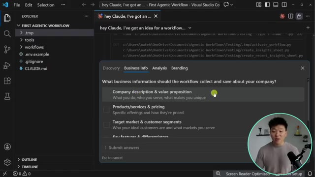
*⏱️ 00:14:20 — Interface de Visual Studio Code avec une fenêtre modale superposée affichant les options de configuration des informations d'entreprise pour un flux de travail agentique.*

---

### ⏱️ `[00:14:44 - 00:15:16]` | Segment #38

**🔊 Audio (Transcription Intégrale Mot pour Mot en Français) :**
> parce que j'ai un grand projet dans lequel s'inscrit ce premier projet de flux de travail agentique, et il peut également effectuer des recherches parmi ceux-ci. Mais je vais supposer que c'est comme vous, les gars, qui configurez un premier flux de travail. Je vais donc dire non, c'est-à-dire que je vais fournir une image de marque différente. Je vais donc soumettre ces réponses. Il va les prendre, ajuster un peu le plan, et il pourrait revenir avec d'autres questions. C'est possible que non. Nous verrons bien. Et c'est plutôt cool parce qu'il a dit, j'ai toutes les informations dont j'ai besoin. Laissez-moi lancer un agent de planification pour concevoir réellement l'approche de mise en œuvre. Il nous demande à quelle fréquence nous voulons exécuter ceci ? Je vais simplement opter pour mensuel pour l'instant. Pour le résultat, il demande si nous voulons autre chose qu'un PDF. C'est plutôt cool, mais je vais me contenter du PDF. Et ensuite, pour le budget, quel est votre niveau de confort avec les coûts d'API pour

**👁️ Analyse Visuelle d'Écran (gemini-3.5-flash-lite) :**
**Interface & Outils** : Visual Studio Code (VS Code).

**Contenu textuel & Code** : Interface utilisateur avec des options de sélection : "Yes, use existing assets (Recommended)" et "No, I'll provide different branding". Le volet latéral gauche montre une arborescence de fichiers intitulée "FIRST AGENTIC WORKFLOW" avec des répertoires comme .tmp, tools, et workflows.

**Action / Démonstration** : L'utilisateur est en train de configurer les paramètres de branding via un formulaire interactif généré au sein de l'éditeur, en sélectionnant l'option "No, I'll provide different branding".

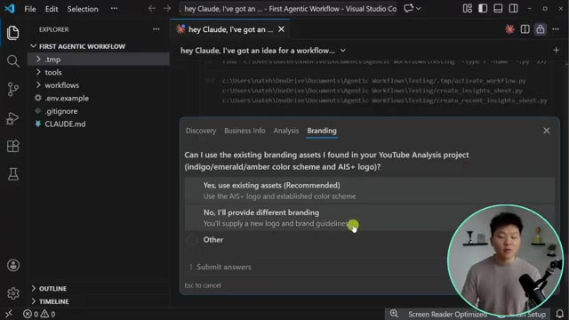
*⏱️ 00:14:52 — Une capture d'écran de l'éditeur VS Code affichant une fenêtre contextuelle interactive (pop-up) qui demande à l'utilisateur de choisir ses préférences de branding (utiliser des assets existants ou en fournir de nouveaux).*

---

### ⏱️ `[00:15:16 - 00:15:51]` | Segment #39

**🔊 Audio (Transcription Intégrale Mot pour Mot en Français) :**
> ce flux de travail. J'aime la façon dont il nous montre différentes approches ici, et je vais simplement continuer avec l'approche recommandée, et nous allons y aller et faire celui du milieu. Très bien, donc à ce stade, il a effectivement terminé le plan. Donc si je fais défiler toute la page vers le haut jusqu'au moment où il a commencé à nous dire, vous pouvez voir que c'est super complet. Donc je fais toujours défiler. D'accord, plan de mise en œuvre du flux de travail d'analyse des concurrents. Construire un système d'analyse des concurrents récurrents mensuels qui découvre automatiquement les concurrents, recherche leurs offres, génère un rapport PDF entièrement personnalisé avec des informations exploitables. Les exigences de l'utilisateur seraient donc la découverte, les informations sur l'entreprise, l'analyse, la sortie, la fréquence, le budget. Nous avons l'architecture. Nous avons la pile technologique. Il va donc utiliser Cloud Sonnet. Il va utiliser Firecrawl et Perplexity. Il va utiliser Sonnet et c'est

**👁️ Analyse Visuelle d'Écran (gemini-3.5-flash-lite) :**
**Interface & Outils** : Visual Studio Code

**Contenu textuel & Code** : Un plan de workflow agentique avec une estimation des coûts et des options de validation : "1. Yes, and auto-accept", "2. Yes, and manually approve edits", "3. No, keep planning".

**Action / Démonstration** : Le présentateur examine le plan proposé et s'apprête à sélectionner une option pour continuer.

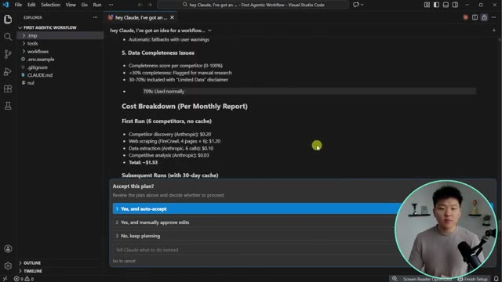
*⏱️ 00:15:25 — Capture d'écran de l'éditeur de code Visual Studio Code montrant un plan généré par un assistant IA avec des options de sélection de plan et la webcam du présentateur en bas à droite.*

---

### ⏱️ `[00:15:51 - 00:16:25]` | Segment #40

**🔊 Audio (Transcription Intégrale Mot pour Mot en Français) :**
> utiliser ReportLab pour la génération de PDF. Donc ça va probablement nous inviter à aller chercher une clé API là-bas. Et ça va aussi générer des graphiques en utilisant Matplotlib, qui, je crois, est une extension ou un plugin Python. Et ça va aider pour les graphiques. Ça va aussi ajouter certaines choses dans nos dossiers ici. Donc vous pouvez voir que ça va ajouter un nouveau dossier appelé Brand Assets. Et c'est là que nous allons télécharger notre logo et nos directives de marque. Et ça prévoit fondamentalement de créer quelques éléments différents. Ça va créer des fichiers dans le dossier temporaire. Comme vous pouvez le voir, ça va créer un flux de travail appelé analyse des concurrents, et ça va créer ces cinq outils. Donc collecter des informations sur l'entreprise, découvrir des concurrents, rechercher des concurrents, analyser des concurrents, et générer un PDF sur les concurrents. Donc exactement comme je l'ai dit, ça va créer ce flux de travail. C'est

**👁️ Analyse Visuelle d'Écran (gemini-3.5-flash-lite) :**
**Interface & Outils** : Visual Studio Code (éditeur de code).

**Contenu textuel & Code** : Texte du fichier CLAUDE.md décrivant la pile technologique (Anthropic Claude Sonnet 3.5, FireCrawl API, ReportLab, matplotlib) et une invite de choix « Accept this plan? » avec l'option « Yes, and auto-accept » sélectionnée.

**Action / Démonstration** : Présentation et validation du plan de développement par l'agent IA dans l'éditeur.

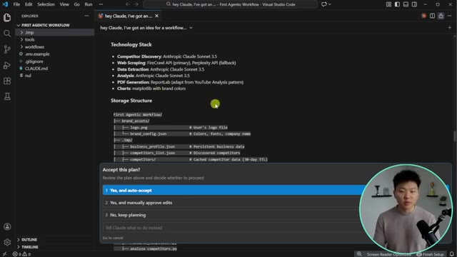
*⏱️ 00:16:00 — Capture d'écran de l'éditeur Visual Studio Code montrant le fichier CLAUDE.md avec une pile technologique (Technology Stack) et une structure de stockage pour un workflow d'agent IA, avec une invite de validation de plan en bas.*

---

### ⏱️ `[00:16:25 - 00:16:55]` | Segment #41

**🔊 Audio (Transcription Intégrale Mot pour Mot en Français) :**
> allons créer ces outils, et ensuite nous devrions être prêts à l'exécuter. Maintenant, une chose que j'ai remarquée, c'est qu'il y a un fichier de configuration de marque, et cela a essentiellement constitué nos informations de marque. Et il voudrait probablement que nous venions ici et choisissions, vous savez, un nom et peut-être un chemin de logo. Mais ce que nous allons faire, c'est que nous voulons simplement y déposer ces fichiers. C'est donc quelque chose que nous devrons changer, mais nous allons continuer pour l'instant. Nous pouvons voir qu'il a décidé de la manière de gérer les cas particuliers comme les sites web de concurrents, le blocage du scraping ou le nombre insuffisant de concurrents trouvés, la limitation du taux, les actifs de marque invalides et les problèmes d'exhaustivité des données. Il nous donne également une ventilation des coûts, ce qui est plutôt cool.

**👁️ Analyse Visuelle d'Écran (gemini-3.5-flash-lite) :**
**Interface & Outils** : Visual Studio Code (éditeur de code)

**Contenu textuel & Code** : Fichier JSON de configuration de marque contenant le nom de l'entreprise, le chemin du logo, les codes couleur et les polices, ainsi qu'une boîte de dialogue « Accept this plan? » avec l'option « Yes, and auto-accept ».

**Action / Démonstration** : Examen du fichier de configuration de marque et validation du plan proposé par l'assistant IA.

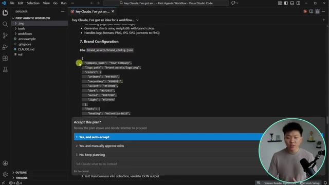
*⏱️ 00:16:33 — Visual Studio Code affichant un fichier de configuration de marque au format JSON (brand_config.json) avec une invite d'acceptation de plan par l'assistant IA en surbrillance.*

---

### ⏱️ `[00:16:55 - 00:17:20]` | Segment #42

**🔊 Audio (Transcription Intégrale Mot pour Mot en Français) :**
> Donc la première exécution sera d'environ un dollar et demi. Elle va également effectuer des exécutions ultérieures sur un cycle de 30 jours, ce qui représentera une énorme économie de coûts parce qu'elle va mettre en cache certaines des données. Et ensuite, si vous ajoutez de nouveaux concurrents, ce sera peut-être 50 cents de plus. Donc de toute façon, c'est la fin du plan. Nous pourrions fondamentalement continuer maintenant et accepter automatiquement, ou nous pourrions continuer à planifier. Et je veux dire non, continuons à planifier parce qu'il y a une chose que je veux changer, c'était nos actifs de marque. Donc ce que je vais faire, c'est que je vais prendre un logo, le glisser sur le côté gauche, prendre les directives de la marque et les glisser sur le côté gauche.

**👁️ Analyse Visuelle d'Écran (gemini-3.5-flash-lite) :**
**Interface & Outils** : Visual Studio Code (éditeur de code) avec interface d'intégration d'assistant IA.

**Contenu textuel & Code** : Texte détaillé sur le coût des exécutions (ex: Subsequent Runs with 30-day cache, 97% cost reduction) et options de validation (Yes, and auto-accept).

**Action / Démonstration** : Le présentateur examine un plan généré par l'IA et les options de validation des modifications dans l'éditeur.

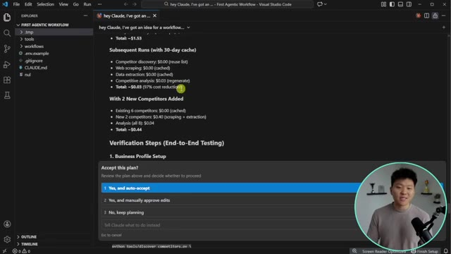
*⏱️ 00:17:01 — Vue de l'éditeur de code VS Code montrant un plan d'exécution d'agent avec une estimation des coûts et des options de validation.*

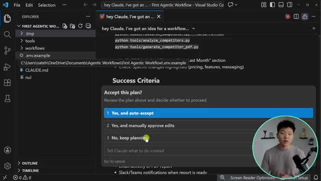
*⏱️ 00:17:14 — Vue de VS Code montrant les critères de succès d'un workflow agentique avec un menu interactif de validation du plan proposé par Claude.*

---

### ⏱️ `[00:17:20 - 00:17:53]` | Segment #43

**🔊 Audio (Transcription Intégrale Mot pour Mot en Français) :**
> Et vous pouvez voir que nous avons ces éléments ici qui apparaissent et nous pouvons réellement les voir. Ce plan a l'air bien. Le seul changement que je veux apporter concerne les directives de la marque et les actifs. Je viens donc de vous déposer deux fichiers, AISPNG.PNG et AISBrandGuidelines-1.PNG. Ce sont ceux que je veux que vous utilisiez pour créer le PDF aux couleurs de la marque. Regardez-les donc, extrayez-information d'eux, et assurez-vous que le logo et les couleurs et tout le reste apparaissent sur le PDF de sortie final. Et si vous en avez besoin, vous pouvez les mettre dans un dossier de ce projet pour garder les choses organisées. C'est donc génial. Il a dit, j'ai trouvé vos logos et je crée un guide des actifs de la marque.

**👁️ Analyse Visuelle d'Écran (gemini-3.5-flash-lite) :**
**Interface & Outils** : Visual Studio Code, interface d'extension Claude (Plan mode)

**Contenu textuel & Code** : Arborescence de fichiers du projet, liste des critères du workflow agentique ("Total cost <= $1.00 per report", "Workflow can be re-run monthly"), et section "Future Enhancements (Post-MVP)".

**Action / Démonstration** : Présentation du plan de workflow agentique dans VS Code et dépôt des fichiers de la marque.

*⏱️ 00:17:29 — Capture d'écran de l'éditeur Visual Studio Code montrant le projet "FIRST AGENTIC WORKFLOW" avec les fichiers de consignes et d'actifs de la marque (AIS Brand Guidelines-1.png, AIS PNG.png) dans l'explorateur, et l'interface de l'assistant Claude affichant le plan et les améliorations futures.*

---

### ⏱️ `[00:17:53 - 00:18:26]` | Segment #44

**🔊 Audio (Transcription Intégrale Mot pour Mot en Français) :**
> Donc nous avons le logo, et ensuite il a aussi extrait nos couleurs et notre typographie. Et maintenant il va mettre à jour le plan pour utiliser ces ressources. Et maintenant, puisque cela a été modifié, nous allons procéder à l'acceptation automatique du plan. Espérons qu'il se mettra au travail pour nous. Bien sûr, il va créer une liste de tâches, puis il va simplement commencer à construire tous ces différents scripts, qu'il s'agisse d'un flux de travail ou d'un outil, et ensuite il va tester le flux de travail. Et comme je l'ai dit, il devra probablement revenir et nous demander une clé API ou quelque chose comme ça. Très bien, donc le flux de travail est prêt. Nous pouvons voir que nous avons nos ressources aux couleurs de la marque configurées. Nous avons le flux de travail terminé. Nous avons les outils Python terminés. Nous avons quelques fichiers de configuration. Donc nous avons aussi un fichier lisez-moi que nous pourrions ouvrir, qui devrait en gros simplement nous dire à peu près comment ce

**👁️ Analyse Visuelle d'Écran (gemini-3.5-flash-lite) :**
**Interface & Outils** : Visual Studio Code avec extension Claude.

**Contenu textuel & Code** : Menu interactif "Accept this plan?" avec les options "1 Yes, and auto-accept", "2 Yes, and manually approve edits", et "3 No, keep planning".

**Action / Démonstration** : Le curseur sélectionne l'option d'acceptation automatique du plan généré par l'assistant IA.

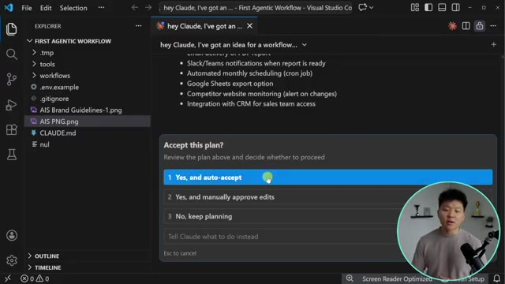
*⏱️ 00:18:02 — Interface de VS Code montrant un menu d'acceptation de plan avec l'option "Yes, and auto-accept" sélectionnée, et la vidéo du présentateur en incrustation.*

---

### ⏱️ `[00:18:26 - 00:18:50]` | Segment #45

**🔊 Audio (Transcription Intégrale Mot pour Mot en Français) :**
> le flux de travail réel fonctionne. Donc c'est plutôt cool. Maintenant, nous devons effectivement aller chercher deux clés API pour commencer. Nous avons besoin d'une clé Anthropic et nous avons besoin d'une clé Firecrawl. Donc ça nous le dit effectivement ici encore, nous devons installer les dépendances, nous devons configurer ces clés API, et ensuite nous devons exécuter le flux de travail. Donc tout d'abord, pour installer les dépendances, je vais simplement dire, est-ce que tu peux faire ça ? Et ensuite coller exactement ce qu'il m'a donné. Et donc c'est intéressant, il nous demande de faire ça alors qu'il aurait pu simplement le faire lui-même. Comme vous pouvez le voir, il est capable d'exécuter cette commande pour nous.

**👁️ Analyse Visuelle d'Écran (gemini-3.5-flash-lite) :**
**Interface & Outils** : Visual Studio Code

**Contenu textuel & Code** : Fichier README_COMPETITOR_ANALYSIS.md montrant la section "Set Up API Keys" avec les liens vers console.anthropic.com et firecrawl.dev.

**Action / Démonstration** : Le présentateur explique les étapes de configuration des clés API nécessaires pour faire fonctionner le workflow d'analyse concurrentielle.

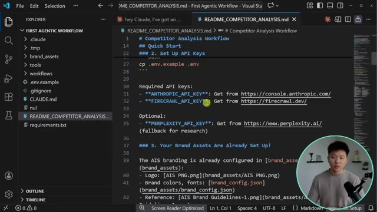
*⏱️ 00:18:32 — L'éditeur Visual Studio Code affichant un fichier Markdown de documentation contenant les instructions pour configurer les clés API requises (Anthropic et Firecrawl).*

---

### ⏱️ `[00:18:50 - 00:19:24]` | Segment #46

**🔊 Audio (Transcription Intégrale Mot pour Mot en Français) :**
> Donc une fois que ça a fait ça, maintenant ça dit, ok, vous devez aller créer deux clés API. Donc nous devons créer un fichier .env, qui va juste être une copie de .env.example. Donc je vais en fait juste exécuter cette commande et ça va copier ce fichier pour nous. Et maintenant nous avons un vrai fichier .env juste ici. Et donc vous pouvez voir que ça dit, ok, super. Maintenant nous avons besoin de votre clé Anthropic, de votre clé Firecrawl. Et si j'ouvre le .env, ça nous donne ces espaces réservés. Donc en gros, tout ce que nous avons à faire est d'aller récupérer ces clés et ensuite de les mettre ici à la place de ces espaces réservés que vous pouvez voir juste là. Donc d'abord, allons chez Anthropic. Je vais aller sur ma plateforme Cloud Developer. Je vais créer une nouvelle clé. Celle-ci va s'appeler Compétiteur Analyse Démo. Nous allons

**👁️ Analyse Visuelle d'Écran (gemini-3.5-flash-lite) :**
**Interface & Outils** : Visual Studio Code (avec extension de chat Claude)

**Contenu textuel & Code** : Commande shell `cp .env.example .env` et instructions pour configurer ANTHROPIC_API_KEY et FIRECRAWL_API_KEY.

**Action / Démonstration** : Le présentateur explique et prépare l'exécution de la commande pour copier le fichier .env.example en fichier .env.

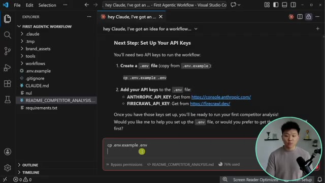
*⏱️ 00:18:59 — Interface de Visual Studio Code affichant les instructions de configuration des clés API dans une fenêtre de chat avec Claude, incluant la commande de copie de fichier .env.*

---

### ⏱️ `[00:19:24 - 00:19:57]` | Segment #47

**🔊 Audio (Transcription Intégrale Mot pour Mot en Français) :**
> avez cette clé juste ici, copiez-la et allez dans VS Code, collez-la là-dedans. Et ensuite la prochaine dont nous avons besoin est la clé Firecrawl. Vous pouvez donc utiliser le lien dans la description pour aller sur Firecrawl. vous pouvez en fait obtenir 10% de réduction et un millier de crédits gratuits si vous utilisez le code Nate et utilisez le lien dans la description. Et je vais aller sur mon tableau de bord ici. Et ensuite tout ce que j'ai à faire est de récupérer ma clé API d'ici, de la coller dans cette section. Et ensuite ce que vous devez faire est de vous assurer de sauvegarder ce fichier. Vous pouvez donc faire contrôle S ou vous pouvez simplement aller dans fichier sauvegarder. Mais maintenant que ce fichier a été sauvegardé, nous devrions en fait être bons pour aller de l'avant et exécuter le flux de travail pour voir si cela fonctionne. Donc avant de faire ça, vous pouvez voir que nous avons cette petite chose en bas, qui est le contexte. Donc 23% de votre contexte

**👁️ Analyse Visuelle d'Écran (gemini-3.5-flash-lite) :**
**Interface & Outils** : Navigateur web (Firecrawl Dashboard) et Visual Studio Code.

**Contenu textuel & Code** : Documentation et instructions dans VS Code mentionnant ANTHROPIC_API_KEY et FIRECRAWL_API_KEY, et interface Firecrawl montrant la clé API masquée.

**Action / Démonstration** : Récupération et copie de la clé API Firecrawl depuis le tableau de bord web pour l'intégrer dans le projet VS Code.

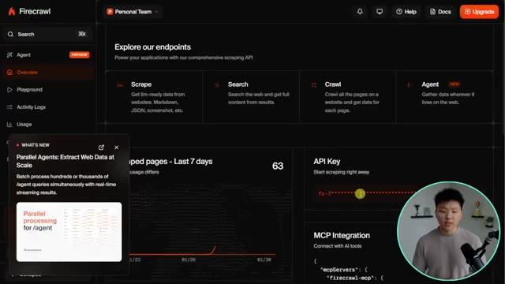
*⏱️ 00:19:41 — Tableau de bord utilisateur Firecrawl affichant la clé API et les options d'intégration.*

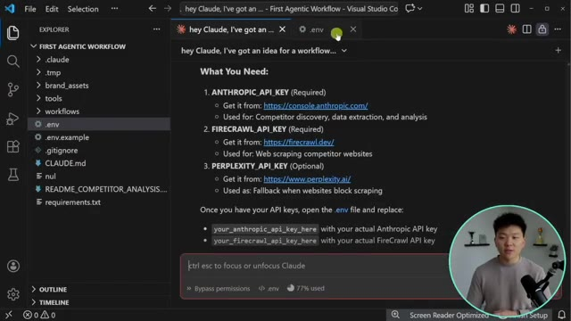
*⏱️ 00:19:49 — Éditeur VS Code affichant un fichier Markdown listant les clés API nécessaires (Anthropic, Firecrawl, Perplexity).*

---

### ⏱️ `[00:19:57 - 00:20:29]` | Segment #48

**🔊 Audio (Transcription Intégrale Mot pour Mot en Français) :**
> restant avant le compactage automatique. Donc généralement, quand ça dépasse 60 %, j'aime bien tout simplement effacer, parce qu'il y a ce qu'on appelle la pourriture du contexte, ce qui signifie fondamentalement que plus vous utilisez une même conversation, plus le modèle devient mauvais en quelque sorte. Donc nous allons effacer la conversation. Nous allons lui demander d'exécuter une analyse de la concurrence. Et ensuite, nous allons voir ce qui se passe. Maintenant, la seule chose que j'ai remarquée, c'est que nous ne lui avons toujours pas donné énormément d'informations sur notre entreprise. Je suis donc un peu confus quant au fait qu'il n'ait pas posé de questions à ce sujet, mais nous verrons bien ce qui se passe. Je vais le laisser en mode de contournement des permissions pour voir simplement ce qu'il fait. Et je vais lui demander de générer une analyse concurrentielle. Et je vais lui donner une quantité vraiment minime d'informations sur notre entreprise.

**👁️ Analyse Visuelle d'Écran (gemini-3.5-flash-lite) :**
**Interface & Outils** : Visual Studio Code, extension Claude Code

**Contenu textuel & Code** : Explorateur de fichiers avec les dossiers `.claude`, `.tmp`, `brand_assets`, `tools`, `workflows`, et des fichiers comme `.env`, `CLAUDE.md`, `requirements.txt`.

**Action / Démonstration** : Navigation dans l'explorateur de fichiers du projet dans l'éditeur de code.

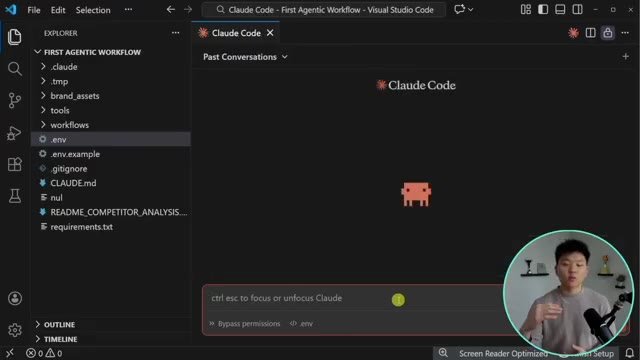
*⏱️ 00:20:05 — Interface de Visual Studio Code affichant l'extension Claude Code avec le panneau de l'explorateur à gauche et une fenêtre de terminal ou d'interface agent au centre.*

---

### ⏱️ `[00:20:29 - 00:20:53]` | Segment #49

**🔊 Audio (Transcription Intégrale Mot pour Mot en Français) :**
> Hé, Claude, j'ai besoin que tu m'aides à faire une analyse de concurrence. Mon entreprise s'appelle Get Leads with AI, et en gros, nous vous aidons à extraire des prospects, à créer des listes de prospects et à faire de la prospection personnalisée à grande échelle grâce à l'IA. Et nous commençons à voir beaucoup de concurrents apparaître. Je veux donc comprendre nos opportunités et ce que nous devons faire de mieux. Très bien, alors ce qui s'est passé là, c'est que je viens de lancer un prompt et je n'ai pas explicitement dit, du genre, hé, va utiliser ton flux de travail d'analyse de concurrence.

**👁️ Analyse Visuelle d'Écran (gemini-3.5-flash-lite) :**
**Interface & Outils** : Visual Studio Code, Claude Code (interface intégrée)

**Contenu textuel & Code** : Explorateur de fichiers avec les dossiers .claude, tools, workflows, fichiers .env et README_COMPETITOR_ANALYSIS... Zone de saisie avec le texte 'ctrl esc to focus or unfocus Claude' et 'Bypass permissions'.

**Action / Démonstration** : L'utilisateur configure ou s'apprête à interagir avec Claude Code dans VS Code pour lancer l'analyse de concurrence.

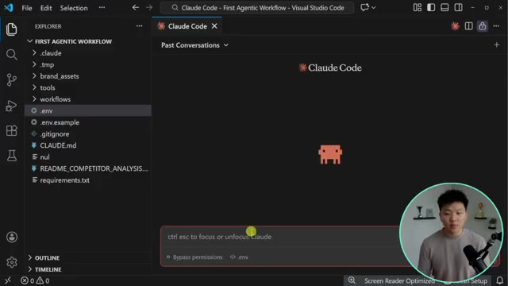
*⏱️ 00:20:35 — Interface de Visual Studio Code affichant l'extension ou l'outil Claude Code avec une zone de saisie pour interagir avec l'assistant IA.*

---

### ⏱️ `[00:20:53 - 00:21:13]` | Segment #50

**🔊 Audio (Transcription Intégrale Mot pour Mot en Français) :**
> Mais ce qu'il va faire, c'est qu'il va réfléchir à ce que nous avons. Vous pouvez donc voir qu'il vient de chercher dans nos flux de travail. Il a cherché dans nos outils. Il a dit : nous avons déjà un flux de travail d'analyse de la concurrence configuré. Laissez-moi lire comment cela fonctionne et laissez-moi le faire. Voyons donc ce qu'il va trouver. Je vous tiendrai au courant si nous avons des questions. Sinon, je ferai le point avec vous lorsque nous obtiendrons ce résultat. Bon, nous avons donc quelques questions. C'est donc la partie où il s'est rendu compte qu'il n'avait pas encore assez d'informations sur nous.

**👁️ Analyse Visuelle d'Écran (gemini-3.5-flash-lite) :**
**Interface & Outils** : Visual Studio Code avec extension Claude (chat intégré).

**Contenu textuel & Code** : Résultats de recherche Glob ("workflows/*.md", "tools/*.py") et message de l'agent indiquant qu'un flux de travail d'analyse de la concurrence a été trouvé.

**Action / Démonstration** : L'agent IA analyse les répertoires et lit le fichier "competitor_analysis.md".

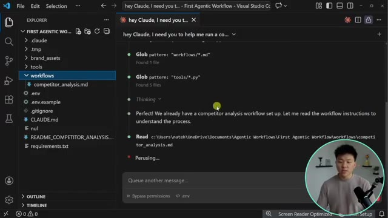
*⏱️ 00:20:58 — L'interface de Visual Studio Code affichant un panneau de chat avec Claude qui analyse les fichiers de flux de travail et d'outils du projet.*

---

### ⏱️ `[00:21:13 - 00:21:32]` | Segment #51

**🔊 Audio (Transcription Intégrale Mot pour Mot en Français) :**
> Alors, quelle est votre cible principale pour Obtenir des prospects avec l'IA ? Nous allons simplement choisir, disons des agences de marketing. Pour la tarification, je vais opter pour une utilisation basée sur des crédits. Quel est votre principal élément différenciateur ? Je vais en fait choisir autre chose, et je vais simplement dire que notre élément différenciateur est une plateforme tout-en-un, mais assurez-vous de sauvegarder toutes ces informations dont je vous parle concernant mon entreprise quelque part dans ce projet afin que je n'aie pas à vous les répéter.

**👁️ Analyse Visuelle d'Écran (gemini-3.5-flash-lite) :**
**Interface & Outils** : Visual Studio Code avec un panneau de formulaire contextuel (fenêtre modale) et une vue de la structure des dossiers à gauche.

**Contenu textuel & Code** : Question sur le marché cible (« What's your primary target market for Get Leads with AI? ») avec des options comme « Marketing agencies » sélectionnée.

**Action / Démonstration** : Sélection du marché cible (agences de marketing) dans l'interface interactive de l'assistant de configuration.

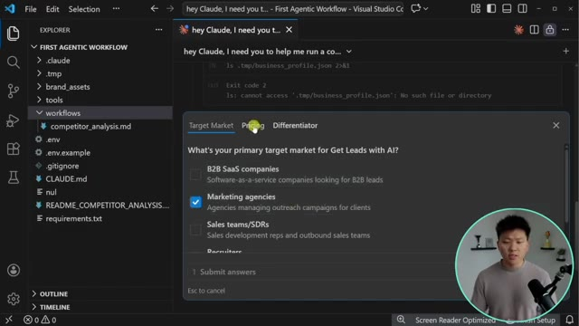
*⏱️ 00:21:18 — Interface de VS Code affichant un assistant ou un formulaire interactif permettant de définir le marché cible, les tarifs et l'élément différenciateur d'un projet d'IA.*

---

### ⏱️ `[00:21:33 - 00:21:51]` | Segment #52

**🔊 Audio (Transcription Intégrale Mot pour Mot en Français) :**
> Et donc je suis presque sûr qu'il l'aurait fait de toute façon parce que c'est un peu tout le problème ici. Mais juste pour s'assurer qu'il le fasse pour les besoins de l'exemple, je voulais vous montrer que vous avez la capacité de lui dire simplement de faire des choses. Donc compris, je vais sauvegarder l'information. C'est donc tout ce que vous avez à faire. Et maintenant, il va continuer avec sa liste de tâches. Et en fait, il soulève d'autres questions. Donc nous sommes un produit tout-en-un unique et notre fourchette de prix, disons entre 200 et 500 par mois.

**👁️ Analyse Visuelle d'Écran (gemini-3.5-flash-lite) :**
**Interface & Outils** : Visual Studio Code (éditeur de code), panneau latéral avec l'arborescence des dossiers et extension Claude active au centre.

**Contenu textuel & Code** : Journal d'exécution montrant "Read" du fichier .env, "Thinking", et "AskUserQuestion" avec la réponse de l'utilisateur sur le marché cible.

**Action / Démonstration** : L'assistant analyse les configurations et interagit avec l'utilisateur pour collecter des informations sur le projet.

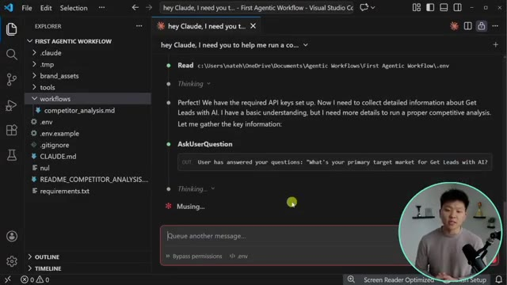
*⏱️ 00:21:37 — Interface de Visual Studio Code affichant l'interaction avec Claude qui lit les clés API et pose une question à l'utilisateur via AskUserQuestion.*

---

### ⏱️ `[00:21:51 - 00:22:14]` | Segment #53

**🔊 Audio (Transcription Intégrale Mot pour Mot en Français) :**
> Maintenant, c'est bien. Je sais ce que vous pensez peut-être, c'est que ça fait beaucoup de questions. Eh bien, le truc, c'est que plus vous l'utilisez, plus il devient intelligent, car à chaque fois que vous l'utilisez, vous savez, il a plus d'informations et vous lui donnez des commentaires. Alors oui, la configuration initiale peut sembler importante, mais pensez aux questions qu'il pose et pensez à quel point il va devenir performant maintenant qu'il a toutes ces informations. Donc, vous pouvez voir ce qu'il a fait, c'est qu'il a créé ce fichier ici appelé business profile JSON. Et c'est là qu'il a décidé de stocker toutes les informations concernant notre entreprise.

**👁️ Analyse Visuelle d'Écran (gemini-3.5-flash-lite) :**
**Interface & Outils** : Visual Studio Code

**Contenu textuel & Code** : Historique de discussion avec Claude, commandes Bash exécutées (ex. `mkdir -p .tmp`) et zone de saisie pour poser une nouvelle question.

**Action / Démonstration** : L'assistant IA traite les réponses aux questions précédentes et crée un dossier temporaire pour la suite du workflow agentique.

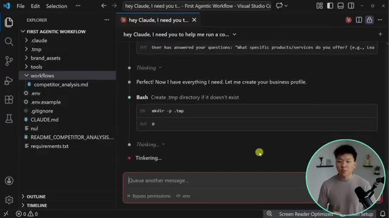
*⏱️ 00:21:57 — Capture d'écran de l'éditeur Visual Studio Code montrant une interaction avec un assistant IA (Claude) dans un panneau latéral, avec l'arborescence du projet à gauche et le présentateur en médaillon rond en bas à droite.*

---

### ⏱️ `[00:22:14 - 00:22:33]` | Segment #54

**🔊 Audio (Transcription Intégrale Mot pour Mot en Français) :**
> Et maintenant, si nous lui disons autre chose et qu'il doit ajouter, par exemple, un nouveau souvenir ou un nouveau fait à notre sujet, il se contentera de mettre à jour ce fichier JSON. Voici un excellent exemple de son auto-correction. Donc, en gros, il s'est mis à rechercher des concurrents et il a trouvé une erreur. Je vois donc qu'il y a un problème d'encodage Unicode avec le script sous Windows. Laisse-moi corriger ça. Il lit la méthode pour le corriger. Et ensuite, il procède à la correction parce qu'il y avait des caractères emoji ou quelque chose comme ça.

**👁️ Analyse Visuelle d'Écran (gemini-3.5-flash-lite) :**
**Interface & Outils** : Visual Studio Code

**Contenu textuel & Code** : Fichier "business_profile.json" ouvert, affichant les données structurées de l'entreprise (company_name, description, value_proposition, products, key_features, target_market) ainsi que l'arborescence des dossiers (.tmp, analysis_history, charts, competitors).

**Action / Démonstration** : Présentation du fichier JSON de configuration et de mémorisation mis à jour par l'agent IA.

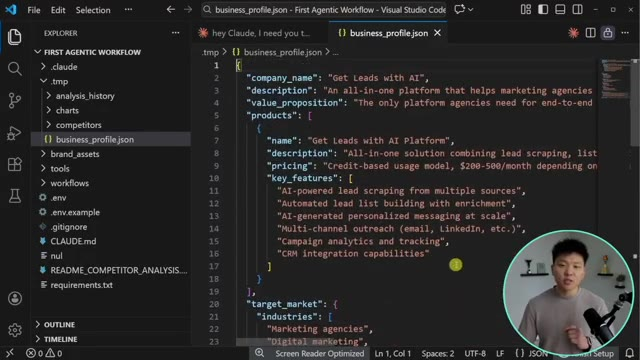
*⏱️ 00:22:19 — Capture d'écran de l'éditeur de code VS Code montrant l'arborescence du projet et le fichier JSON de profil d'entreprise.*

---

### ⏱️ `[00:22:33 - 00:22:57]` | Segment #55

**🔊 Audio (Transcription Intégrale Mot pour Mot en Français) :**
> Et ensuite, il a dit, laisse-moi le mettre à jour. Et ce qu'il est en train de faire maintenant, c'est qu'il modifie réellement le script et change l'outil pour s'assurer que cette erreur ne se reproduise plus. Il a également créé un nouveau fichier appelé liste des concurrents. Il a donc été capable de faire des recherches et de trouver différents concurrents comme Apollo, Outreach, Clay, Instantly, Lemlist. Et maintenant, s'il a un jour besoin d'enregistrer plus d'informations sur différents concurrents, il va simplement les mettre ici. Très bien. On dirait qu'il est en train de terminer en ce moment même. J'ai donc trouvé quelques idées clés. Vous êtes positionné comme un acteur du milieu de marché, bla, bla, bla.

**👁️ Analyse Visuelle d'Écran (gemini-3.5-flash-lite) :**
**Interface & Outils** : Visual Studio Code avec extension ou terminal Claude Code intégré.

**Contenu textuel & Code** : Édition du fichier `discover_competitors.py`, remplacement des caractères emoji Unicode par des alternatives compatibles Windows dans les instructions print.

**Action / Démonstration** : L'assistant met à jour le script pour corriger l'erreur d'encodage Unicode et éviter qu'elle ne se reproduise.

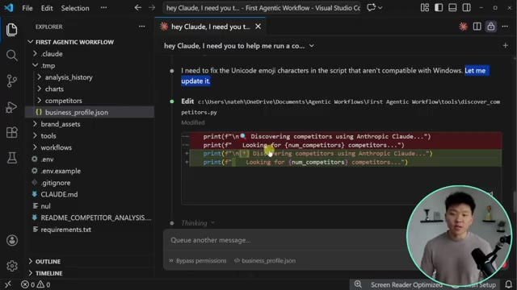
*⏱️ 00:22:39 — L'éditeur de code VS Code affichant un panneau d'interaction avec l'assistant Claude Code qui modifie le script Python de découverte des concurrents.*

---

### ⏱️ `[00:22:57 - 00:23:21]` | Segment #56

**🔊 Audio (Transcription Intégrale Mot pour Mot en Français) :**
> Vos huit principaux concurrents, ce que vous faites bien, les lacunes critiques que vous devez combler, les trois principales recommandations. Voyons ce que c'est. Ajouter la marque blanche, introduire un niveau de départ de 99 $ à 149 $, et miser double sur le positionnement de création pour les agences. Il a donc créé trois fichiers différents, ou désolé, quatre fichiers différents. Il a créé le profil d'entreprise, que nous avons examiné. Il a créé l'analyse, les données sur les concurrents et le rapport PDF. Waouh. Il a donc créé un nouveau dossier appelé concurrents, et il a créé un fichier individuel pour absolument chacun de nos concurrents.

**👁️ Analyse Visuelle d'Écran (gemini-3.5-flash-lite) :**
**Interface & Outils** : Visual Studio Code (éditeur de code avec panneau explorateur à gauche et affichage d'un rapport textuel/Markdown au centre).

**Contenu textuel & Code** : Texte affichant « Critical Gaps You Need to Address » (1. No white-labeling, 2. No massive contact database, 3. Missing conversation intelligence), « Top 3 Recommendations » (1. Add white-labeling capabilities, 2. Introduce $99-149 starter tier, 3. Double down on "Built for Agencies" positioning), et la liste des fichiers créés.

**Action / Démonstration** : Navigation et affichage des résultats d'une analyse automatisée par IA au sein de l'éditeur de code, avec le présentateur visible en incrustation vidéo (PiP) dans le coin inférieur droit.

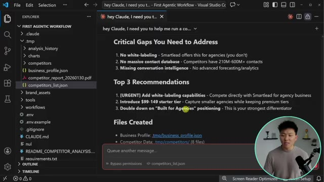
*⏱️ 00:23:03 — Capture d'écran de l'éditeur Visual Studio Code montrant un rapport d'analyse concurrentielle avec les lacunes critiques et les recommandations stratégiques pour une agence.*

---

### ⏱️ `[00:23:21 - 00:23:42]` | Segment #57

**🔊 Audio (Transcription Intégrale Mot pour Mot en Français) :**
> Donc c'est vraiment cool. Nous pouvons réellement voir beaucoup de données à leur sujet maintenant. Ça a créé un dossier appelé Historique d'analyse. C'est donc ici que nous pouvons voir à peu près toutes les données qu'il a exécutées et obtenues pour cette exécution spécifique. Et maintenant, bien sûr, il a le PDF. Allons donc voir le ou la sortie finale. Très bien, le voilà donc. Maintenant, je peux définitivement dire que ce sont mes couleurs et la typographie, donc c'est bien. Mais je ne vois pas le logo. Et vraiment, je pense que c'est juste parce que c'est un logo PNG blanc.

**👁️ Analyse Visuelle d'Écran (gemini-3.5-flash-lite) :**
**Interface & Outils** : Visual Studio Code

**Contenu textuel & Code** : Fichier `analysis_202601.json` contenant des données structurées sur les prix et fonctionnalités des concurrents, et un rapport PDF `competitor_report_20260130.pdf`.

**Action / Démonstration** : Exploration et navigation dans les fichiers générés par l'agent IA au sein de l'éditeur de code.

*⏱️ 00:23:27 — Vue de l'éditeur VS Code affichant un fichier JSON de résultats d'analyse concurrentielle, avec l'arborescence des fichiers sur la gauche et la webcam du présentateur en bas à droite.*

*⏱️ 00:23:37 — Visualisation dans VS Code d'un rapport PDF complet d'analyse de la concurrence avec un résumé exécutif, entouré de l'explorateur de projets.*

---

### ⏱️ `[00:23:42 - 00:24:01]` | Segment #58

**🔊 Audio (Transcription Intégrale Mot pour Mot en Français) :**
> Donc je parie que c'est par ici. Je pense juste qu'on ne le voit probablement pas. Mais de toute façon, nous verrons si nous pouvons régler ça. Pour l'instant, nous avons le résumé exécutif. Nous avons le profil d'entreprise. Nous avons le paysage concurrentiel avec l'analyse des fonctionnalités. Nous avons les profils des concurrents. Donc menace élevée, menace moyenne. Nous avons toutes ces différentes entreprises avec leurs forces et nos avantages. Et puis nous avons aussi nos recommandations stratégiques à la fin que nous avons vues plus tôt.

**👁️ Analyse Visuelle d'Écran (gemini-3.5-flash-lite) :**
**Interface & Outils** : Visual Studio Code

**Contenu textuel & Code** : Fichiers JSON et PDF générés dans le dossier `.tmp` (business_profile.json, competitors_list.json, competitor_report_20260130.pdf).

**Action / Démonstration** : Visualisation du rapport PDF final généré par le workflow d'agent IA dans VS Code.

*⏱️ 00:23:47 — L'éditeur Visual Studio Code affiche l'arborescence du projet dans le panneau de gauche avec un dossier .tmp contenant un fichier PDF nommé competitor_report_20260130.pdf, ouvert et visualisé dans l'éditeur. Le présentateur apparaît dans un cercle incrusté en bas à droite.*

---

### ⏱️ `[00:24:02 - 00:24:25]` | Segment #59

**🔊 Audio (Transcription Intégrale Mot pour Mot en Français) :**
> Donc le problème avec ce rapport, c'est vraiment que notre logo n'est pas visible parce qu'il est blanc. Vous pouvez aussi voir qu'il disait que cette exécution a coûté 1,43 $. Donc pas trop mal. Mais ce que je dis maintenant, c'est que c'est super, mais qu'on ne voit pas les graphiques ni les logos. J'imagine que c'est parce qu'ils sont de la même couleur que le fond. Analyse et corrige ces problèmes. Maintenant, d'habitude, je mettrais ça en mode plan et je ferais à nouveau quelques allers-retours. Mais pour les besoins de la démo, je veux voir ce qu'il est capable de faire quand on le laisse simplement tourner avec une demande super, super vague, comme vous pouvez le voir.

**👁️ Analyse Visuelle d'Écran (gemini-3.5-flash-lite) :**
**Interface & Outils** : Visual Studio Code (éditeur de code avec extension ou onglet de chat IA intégré)

**Contenu textuel & Code** : Résumé des fichiers créés (business_profile.json, competitors/, analysis, competitor_report_20260130.pdf), coût total de 1,43 $ et prompt demandant d'enquêter sur les problèmes de logos et graphiques non visibles.

**Action / Démonstration** : Le présentateur commente le rapport généré par l'agent et le coût de l'exécution dans l'éditeur de code.

*⏱️ 00:24:07 — Capture d'écran de l'éditeur Visual Studio Code montrant une interface d'agent conversationnel (type Claude) affichant le coût total d'exécution de 1,43 $ et un prompt utilisateur signalant l'absence de visibilité des graphiques et logos.*

---

### ⏱️ `[00:24:25 - 00:24:44]` | Segment #60

**🔊 Audio (Transcription Intégrale Mot pour Mot en Français) :**
> D'accord, donc voilà le truc. Il a dit que le générateur de PDF a plusieurs problèmes et les a énumérés. Et maintenant, il va corriger ces problèmes. Donc encore une fois, c'est juste moi qui vous dis les gars que vous devez exécuter le workflow quelques fois pour découvrir ces failles. Et une fois que vous avez découvert ces failles, il va les corriger. Et ensuite, vous arriverez à un point où vous aurez un workflow plus éprouvé. D'accord, donc il a régénéré le PDF. Et encore une fois, nous avons parlé plus tôt de la mise en cache.

**👁️ Analyse Visuelle d'Écran (gemini-3.5-flash-lite) :**
**Interface & Outils** : Visual Studio Code (avec extension de chat/assistant IA).

**Contenu textuel & Code** : "I found the issues! The PDF generator has several problems: 1. Title and closing pages are never added - The functions exist but aren't being called 2. Charts are never generated - The pricing chart function exists but is never used 3. Logo rendering might have transparency issues. Let me fix these issues."

**Action / Démonstration** : L'assistant IA analyse les fichiers du projet, identifie les bugs du générateur de PDF et se prépare à les corriger.

*⏱️ 00:24:30 — Vue de l'interface de Visual Studio Code affichant un panneau d'assistant IA listant les problèmes identifiés dans le générateur de PDF.*

---

### ⏱️ `[00:24:44 - 00:25:14]` | Segment #61

**🔊 Audio (Transcription Intégrale Mot pour Mot en Français) :**
> Il sauvegarde toutes les données qu'il avait déjà. Donc il n'a pas besoin de faire une nouvelle recherche, ce qui est vraiment bien. Et à l'avenir, il fera toujours des recherches actuelles, mais il a déjà le profil d'entreprise de tous nos concurrents et il a déjà fait des recherches sur eux. Donc maintenant, il a juste à voir s'il y a quelque chose de nouveau. Mais bref, ouvrons le nouveau rapport et voyons à quoi il ressemble. D'accord. Donc voici le nouveau rapport. Ok. Donc nous avons le rapport de veille concurrentielle, Obtenir des prospects avec l'IA, la date d'aujourd'hui, et maintenant nous voyons bien le logo. Donc résumé exécutif, nous pouvons voir ce profil d'entreprise. Une fois de plus, panorama concurrentiel, profils des concurrents. Cependant, voilà. Nous pouvons enfin voir un graphique d'analyse des prix, qui a l'air vraiment solide.

**👁️ Analyse Visuelle d'Écran (gemini-3.5-flash-lite) :**
**Interface & Outils** : Visual Studio Code (VS Code) avec explorateur de fichiers, visionneuse PDF intégrée et panneau d'agent Claude.

**Contenu textuel & Code** : Arborescence de fichiers sous `.tmp` (`analysis_history`, `business_profile.json`, `competitor_report_20260130.pdf`, `competitors_list.json`), ainsi qu'un rapport PDF affichant le profil de l'entreprise et la veille concurrentielle.

**Action / Démonstration** : Navigation dans l'arborescence des fichiers et consultation des différents rapports PDF et profils d'entreprise générés par l'assistant IA.

*⏱️ 00:24:51 — Vue de VS Code montrant le dossier .tmp avec l'historique d'analyse et un panneau latéral affichant les détails de génération du rapport et du graphique de prix.*

*⏱️ 00:24:59 — Visualisation dans VS Code de la première page du rapport PDF généré (Competitive Intelligence - Get Leads with AI).*

*⏱️ 00:25:06 — Visualisation de la page 3 du rapport PDF dans VS Code affichant la section "Your Business Profile" avec le nom de l'entreprise, sa description et sa proposition de valeur.*

---

### ⏱️ `[00:25:14 - 00:25:35]` | Segment #62

**🔊 Audio (Transcription Intégrale Mot pour Mot en Français) :**
> Cool. Donc à ce stade, il s'agirait simplement d'apporter des modifications parce qu'évidemment ce n'est pas parfait. Il y a certaines choses que nous pourrions vouloir. Nous pourrions vouloir plus de détails parce que comme ici, vous savez, c'est plutôt, ce n'est pas super, super verbeux et super détaillé. Donc peut-être que vous aimez ça. Peut-être que non. À ce stade, vous avez assez d'informations et vous avez tous les outils dont vous avez en quelque sorte besoin et vous faites simplement des aller-retours et demandez des améliorations de fonctionnalités. Et encore une fois, vous pouvez faire tout cela avec un langage complètement naturel. Mais vous pouvez voir, je n'ai pas eu à aller consulter de documentation d'API.

**👁️ Analyse Visuelle d'Écran (gemini-3.5-flash-lite) :**
**Interface & Outils** : Visual Studio Code, extension Claude (interface de chat intégrée), visionneuse de PDF.

**Contenu textuel & Code** : Arborescence du projet dans l'explorateur (dossiers .tmp, workflows, outils, fichier CLAUDE.md) et texte de discussion avec l'assistant IA décrivant les mises à jour du rapport PDF.

**Action / Démonstration** : Navigation et révision du rapport PDF généré et des modifications textuelles dans l'éditeur de code.

*⏱️ 00:25:19 — Visual Studio Code affichant un rapport PDF de concurrence dans un onglet, avec le panneau latéral montrant l'arborescence du projet et le présentateur en incrustation vidéo ronde.*

*⏱️ 00:25:30 — Visual Studio Code affichant une conversation avec l'extension Claude, détaillant les modifications apportées aux fichiers générés, avec le champ de saisie de l'agent en bas.*

---

### ⏱️ `[00:25:35 - 00:26:08]` | Segment #63

**🔊 Audio (Transcription Intégrale Mot pour Mot en Français) :**
> Je n'ai pas eu à chercher comment rédiger un prompt pour effectuer une analyse concurrentielle. Je n'ai pas eu à chercher comment générer ces rapports PDF ou ces graphiques. Tout cela a été pris en charge pour moi. J'espère donc que vous avez pu suivre et que vous avez hâte d'aller créer votre premier flux de travail agentique. Comme vous pouvez le voir, la création de votre premier flux de travail agentique est en réalité très simple. Mais si vous avez encore des doutes sur ce que vous devez faire ou par où commencer, vous pouvez toujours rejoindre ma communauté. Ici, vous pouvez obtenir toutes les ressources que j'ai jamais utilisées dans mes vidéos YouTube. Tous les modèles, les flux de travail, les prompts, les fichiers, le tout entièrement gratuitement. De plus, si vous rencontrez un problème pour faire fonctionner quelque chose, vous y trouverez des tutoriels sur différents sujets et le soutien de plus d'un quart de million de personnes prêtes à vous aider. Le lien pour cela se trouve dans la description. Et

**👁️ Analyse Visuelle d'Écran (gemini-3.5-flash-lite) :**
**Interface & Outils** : VS Code (Visual Studio Code) avec extension d'assistant IA Claude.

**Contenu textuel & Code** : Structure de fichiers d'un projet d'analyse concurrentielle (`tmp/analysis_history`, `business_profile.json`, `competitor_report_20260130.pdf`) et interface de chat interactif.

**Action / Démonstration** : Navigation dans l'éditeur de code et visualisation de rapports PDF et graphiques générés par l'IA.

*⏱️ 00:25:43 — Interface VS Code affichant un assistant IA (Claude) avec l'arborescence du projet sur la gauche et un rapport d'analyse textuel avec des liens vers des fichiers générés.*

*⏱️ 00:26:00 — Interface VS Code partiellement assombrie avec le texte superposé "FILES All completely free" et des questions sur les produits et services.*

---

### ⏱️ `[00:26:08 - 00:26:22]` | Segment #64

**🔊 Audio (Transcription Intégrale Mot pour Mot en Français) :**
> si vous voulez transformer ces compétences en entreprise, j'ai des tutoriels et des astuces pour vous aider à gagner votre premier dollar en créant des automatisations par IA. Mais de toute façon, c'est tout pour aujourd'hui. Si vous avez apprécié la vidéo ou si vous avez appris quelque chose de nouveau, veuillez mettre un pouce bleu. Ça m'aide vraiment énormément. Et comme toujours, je vous remercie d'être arrivés jusqu'à la fin de la vidéo. Je vous vois sur la prochaine. Merci tout le monde.

**👁️ Analyse Visuelle d'Écran (gemini-3.5-flash-lite) :**
**Interface & Outils** : Navigateur web affichant une plateforme de cours en ligne (AI Automation Society Plus).

**Contenu textuel & Code** : Titres de modules de formation : "Start Here", "Agent Zero", "10 Hours to 10 Seconds", "One Person AI Agency", "n8n Templates", "Step-by-Steps".

**Action / Démonstration** : Navigation et présentation des différents modules de formation aux automatisations par IA.

*⏱️ 00:26:12 — Capture d'écran montrant l'interface d'une plateforme de cours en ligne, "AI Automation Society Plus", avec des modules de formation.*

---

