# 🎬 Claude Code Just Added What Everyone Wanted (Remote Control)

> **Chaîne** : [Nate Herk | AI Automation](https://www.youtube.com/@nateherk/featured)  
> **Lien YouTube** : [https://www.youtube.com/watch?v=EqhKw0Oro_k](https://www.youtube.com/watch?v=EqhKw0Oro_k)  
> **Date de publication** : 20260225  
> **Durée** : 00:08:01  
> **Identifiant vidéo** : `EqhKw0Oro_k`  
> **Transcription & Analyse** : `whisper-v3-large-turbo+gemini-3.5-flash-lite`  

---

## 📌 Synthèse Exécutive & Outils

### 💡 Résumé

La vidéo de la chaîne *Nate Herk | AI Automation* met en lumière une avancée majeure pour les développeurs et ingénieurs en IA : l'introduction de la fonctionnalité de contrôle à distance pour **Claude Code**. Traditionnellement restreint à une utilisation locale via une fenêtre de chat ou un terminal de bureau, cet outil permet désormais de piloter des sessions de développement à distance à l'aide d'un simple QR code ou d'une URL sécurisée, directement depuis un smartphone, une tablette ou n'importe quel navigateur web. 

Pour démontrer l'efficacité de ce système, l'analyste met en scène une automatisation concrète baptisée « Herc 2.0 ». Depuis son téléphone portable, il soumet une tâche complexe d'analyse de commentaires YouTube et de génération d'idées de contenu. Tout en étant en déplacement (à la salle de sport ou en pause déjeuner), les agents IA locaux exécutent le workflow en arrière-plan, exploitant le contexte complet, les compétences et les règles métier de l'espace de travail de la machine hôte. Le système orchestre ainsi l'extraction des données et le lancement d'agents de recherche en parallèle, démontrant qu'il est possible de maintenir une productivité continue sans être physiquement cloué à son bureau.

L'analyse replace également cette nouveauté dans un contexte macroéconomique florissant pour Anthropic. Porté par une adoption massive (notamment 29 millions d'installations quotidiennes dans Visual Studio Code) et un taux annualisé frôlant les 2,5 milliards de dollars, l'écosystème de codage par IA redéfinit les standards de l'ingénierie logicielle. Alors que l'IA génère déjà près de 41 % du code mondial, l'arrivée du contrôle à distance marque un tournant vers une supervision asynchrone et mobile des agents autonomes.

---

### 🛠️ Outils, Modèles & Logiciels Présentés

* **Claude Code** : L'outil de développement en ligne de commande d'Anthropic, désormais doté d'une fonction de contrôle à distance pour exécuter et superviser du code depuis n'importe quel appareil mobile ou navigateur.
* **Herc 2.0** : L'assistant personnel et le projet local du créateur, structuré autour d'agents spécialisés, de compétences modulaires et de règles métier contextuelles exécutés en local.
* **Visual Studio Code** : L'environnement de développement intégré (IDE) de référence qui enregistre une adoption record avec des millions d'installations quotidiennes liées aux outils d'Anthropic.
* **Opus 5.5** : Le modèle linguistique de pointe mentionné dans le contexte technologique global des avancées d'Anthropic en matière de raisonnement et de génération de code.

---

### 🔑 Points Clés & Enseignements Stratégiques

* **Architecture locale sécurisée** : La fonctionnalité de contrôle à distance agit comme une simple « fenêtre » visuelle ; l'exécution et le stockage des fichiers restent entièrement locaux sur la machine hôte, garantissant qu'aucune donnée de code sensible ne transite par le cloud d'Anthropic.
* **Simplicité de configuration (Zero-Friction)** : L'initialisation d'une session distante ne requiert aucune infrastructure complexe : une simple commande dans le terminal (`claude remote-control` ou `/remote-control` en cours de session) génère instantanément un QR code ou une URL de connexion.
* **Orchestration d'agents multi-tâches** : L'utilisation combinée du terminal local et de la télécommande permet de piloter des agents autonomes capables d'exécuter des workflows complexes en parallèle (analyse de tendances, traitement de données textuelles, recherche).
* **Continuité de la synchronisation** : Toute conversation menée depuis l'appareil mobile est instantanément synchronisée avec la session ouverte sur le bureau, permettant une transition fluide entre le travail de terrain et l'analyse approfondie sur poste fixe.
* **Prérequis d'abonnement et limitations d'authentification** : L'accès à cette fonctionnalité est strictement restreint aux abonnements personnels de type Pro ou Max (excluant pour l'instant les forfaits d'équipe/entreprise) et interdit l'utilisation via des clés API directes.
* **Exigences matérielles et de connectivité** : Le poste hôte doit impérativement rester allumé, doté d'un terminal actif et d'une connexion Internet stable (une coupure de plus de dix minutes entraînant la déconnexion de la session distante).
* **Impossibilité de démarrage à froid distant** : Il est impossible de lancer une nouvelle session de contrôle à distance si l'ordinateur hôte est éteint, en veille profonde ou si aucun terminal Claude Code n'est préalablement lancé localement.
* **Risques de sécurité critiques (Absence de 2FA)** : L'URL de session et le QR code donnent un accès direct aux fichiers locaux sans authentification à deux facteurs ni mot de passe ; ils ne doivent en aucun cas être partagés ou exposés sur Internet.
* **Gestion des mises à jour** : En cas de dysfonctionnement technique lors de la connexion mobile, la mise à jour des applications (Claude Code et client mobile) ainsi que des paramètres système constitue le premier réflexe de résolution de problèmes.
* **Hyper-croissance économique d'Anthropic** : Avec un taux annualisé atteignant 2,5 milliards de dollars en l'espace d'un an, l'outil s'inscrit dans un moment charnière de type « ChatGPT » caractérisé par une explosion des installations et des usages professionnels.
* **Évolution vers le « Code au Feeling » et l'ingénierie par agents** : L'ère des outils d'IA autonomes transforme le métier d'ingénieur logiciel, l'IA générant déjà près de 41 % du code mondial et s'appuyant sur des agents réviseurs capables d'identifier des failles invisibles pour l'humain.
* **Perspectives d'amélioration native** : Bien que des solutions de contournement permettent de simuler un accès universel, l'évolution idéale attendue réside dans la capacité à lancer de nouvelles sessions de manière totalement native et déconnectée de la présence physique d'un terminal allumé.

---

## ⏱️ Chronologie & Transcription Complète Audio & Visuelle (Mot pour Mot)

### ⏱️ `[00:00:00 - 00:00:24]` | Segment #01

**🔊 Audio (Transcription Intégrale Mot pour Mot en Français) :**
> Normalement, lorsque nous voulons utiliser Cloud Code, nous devons le faire dans une fenêtre de chat comme celle-ci sur notre machine locale, ou nous pourrions évidemment ouvrir le terminal, taper Cloud, puis y accéder de cette façon. Mais maintenant, nous pouvons taper cette commande, Cloud Remote-Control, et cela nous donne essentiellement ce QR code, que nous pouvons utiliser pour nous connecter à distance à ceci depuis notre téléphone ou n'importe où ailleurs. Donc, si je vais de l'avant et scanne ce QR code juste ici, cela ouvre ma session de contrôle à distance de mon projet Herc 2.0.

**👁️ Analyse Visuelle d'Écran (gemini-3.5-flash-lite) :**
**Interface & Outils** : VS Code / Terminal PowerShell

**Contenu textuel & Code** : Commande de terminal et affichage d'un QR code pour l'authentification ou la connexion mobile.

**Action / Démonstration** : Saisie et exécution de commandes dans le terminal pour configurer le mode distant de l'outil.

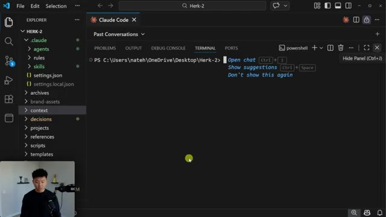
*⏱️ 00:00:06 — Vue de l'éditeur VS Code avec le terminal affichant l'explorateur de projets et une invite PowerShell ouverte.*

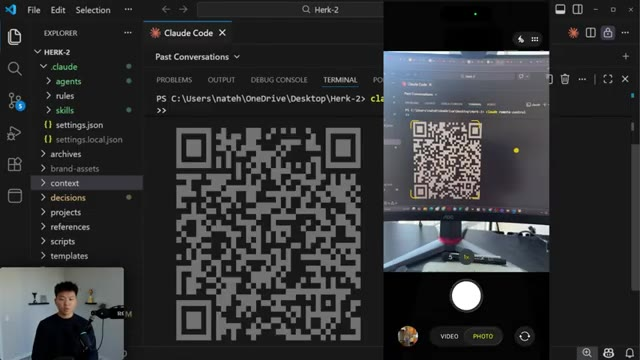
*⏱️ 00:00:18 — Affichage d'un grand QR code dans le terminal suite à l'exécution de la commande de contrôle à distance.*

---

### ⏱️ `[00:00:24 - 00:00:57]` | Segment #02

**🔊 Audio (Transcription Intégrale Mot pour Mot en Français) :**
> Et donc ce que je peux faire, c'est envoyer ce message dans cette session qui dit : effectue une analyse des commentaires de mes vidéos YouTube et trouve de nouvelles idées de sujets. Et ça va en fait le faire vraiment, vraiment bien, parce que dans ce projet, mon assistant personnel Herc 2, il a ces différents agents, il a ces différentes compétences, et il peut en fait utiliser tout ça depuis mon téléphone. Donc ici, vous pouvez voir, il est écrit : laissez-moi lancer le processus d'extraction d'idées. Je vais d'abord vérifier la fraicheur des données, puis je vais lancer ces agents en parallèle. Il a le contexte de mon entreprise, de mes priorités actuelles, de ce sur quoi je travaille, et ça va rendre les choses tellement mieux. Donc j'ai pratiquement maintenant Cloud Code dans ma poche. Il fait exactement les mêmes choses ici, comme vous pouvez le voir.

**👁️ Analyse Visuelle d'Écran (gemini-3.5-flash-lite) :**
**Interface & Outils** : VS Code et interface mobile de contrôle à distance ("Remote Control session").

**Contenu textuel & Code** : Le prompt dans l'application mobile : "Run a comment analysis from my YouTube videos and ideate new topics".

**Action / Démonstration** : Envoi d'un message textuel à l'assistant virtuel pour déclencher une tâche d'analyse des commentaires YouTube.

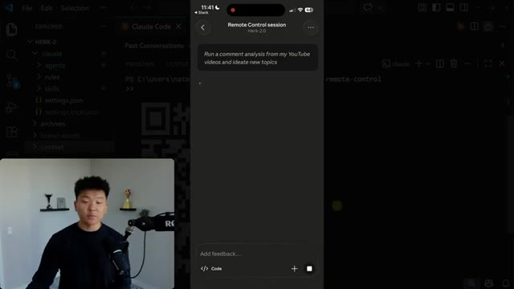
*⏱️ 00:00:33 — Capture d'écran montrant à gauche le présentateur et l'éditeur VS Code, et au centre une application mobile (interface de contrôle à distance) affichant un prompt envoyé à un agent.*

---

### ⏱️ `[00:00:57 - 00:01:16]` | Segment #03

**🔊 Audio (Transcription Intégrale Mot pour Mot en Français) :**
> Et je pouvais aller déjeuner, je pouvais aller à la salle de sport, et je pouvais quand même continuer à travailler et à surveiller mon code dans le cloud. D'accord, donc ça vient juste de se terminer. Ça a exécuté un agent d'analyse YouTube et mon agent de recherche.

**👁️ Analyse Visuelle d'Écran (gemini-3.5-flash-lite) :**
**Interface & Outils** : VS Code, application mobile (Remote Control session), Terminal / Claude Code

**Contenu textuel & Code** : "Run a comment analysis from my YouTube videos and ideate new topics", "Launching skill: idea-mining", commandes Bash et scripts d'analyse de données.

**Action / Démonstration** : Surveillance et exécution à distance d'un agent IA d'analyse YouTube depuis un smartphone.

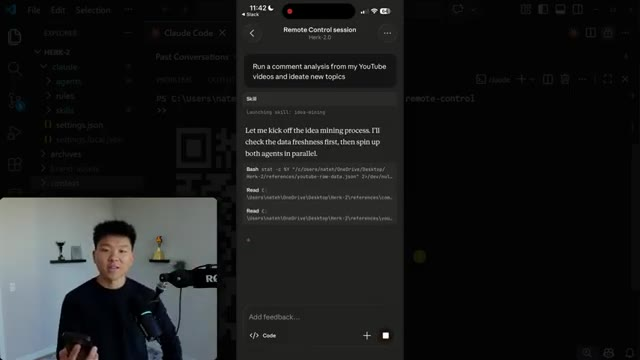
*⏱️ 00:01:02 — Un écran partagé montrant en arrière-plan l'éditeur VS Code et une interface de terminal Claude Code, et au premier plan une session de contrôle à distance sur smartphone affichant l'exécution d'un agent d'analyse YouTube.*

---

### ⏱️ `[00:01:16 - 00:01:39]` | Segment #04

**🔊 Audio (Transcription Intégrale Mot pour Mot en Français) :**
> Et maintenant nous avons un dossier complet pour le 25 février avec les meilleures idées de vidéos. Comme vous pouvez le voir, cela examine ce qui est tendance, mais cela regarde aussi mes commentaires. Ce qui est également cool, c' même si cela s'exécute toujours, si je ferme ce terminal ici, et que je vais dans mes conversations passées, vous pouvez voir que c'est exactement ce que je viens de déclencher depuis mon téléphone. Et je pourrais maintenant reprendre la conversation ici, puis je pourrais retourner sur mon téléphone, et je pourrais juste continuer à travailler tout le temps, tant que je suis capable de maintenir une connexion Internet.

**👁️ Analyse Visuelle d'Écran (gemini-3.5-flash-lite) :**
**Interface & Outils** : VS Code, interface mobile de session de contrôle distant, extension Claude Code.

**Contenu textuel & Code** : Sessions de recherche d'idées vidéo, analyse de commentaires YouTube et tâches en parallèle.

**Action / Démonstration** : Navigation dans l'historique des sessions et affichage des résultats d'analyse sur mobile et bureau.

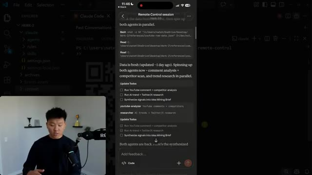
*⏱️ 00:01:22 — Vue d'un éditeur VS Code avec une superposition de smartphone montrant une session de contrôle à distance d'agents IA et des todos.*

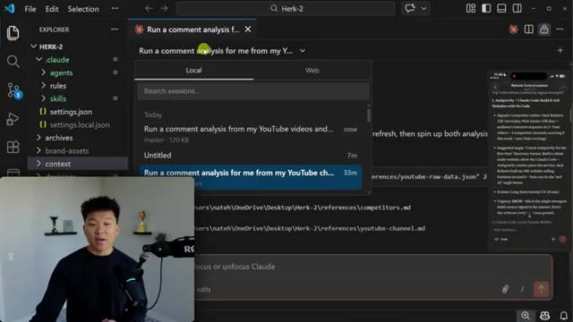
*⏱️ 00:01:28 — Interface de VS Code montrant l'historique des sessions Claude avec la liste des analyses de commentaires YouTube.*

---

### ⏱️ `[00:01:39 - 00:01:57]` | Segment #05

**🔊 Audio (Transcription Intégrale Mot pour Mot en Français) :**
> Donc tout cela grâce à la nouvelle fonctionnalité de CloudCode, le contrôle à distance. C'est donc exactement de cela dont je vais vous parler aujourd'hui, en vous montrant comment le configurer, en passant en revue certaines choses que vous devez savoir et pourquoi c'est excitant. Mon résumé en une phrase est donc que vous lancez une tâche de programmation sur votre ordinateur et que vous êtes en quelque sorte lié à votre bureau, mais qu'en utilisant la télécommande, vous pouvez la contrôler de n'importe où.

**👁️ Analyse Visuelle d'Écran (gemini-3.5-flash-lite) :**
**Interface & Outils** : Tableau blanc virtuel (type Excalidraw) avec incrustation vidéo du présentateur en bas à gauche.

**Contenu textuel & Code** : Texte du titre "Claude Code Remote Control" et trois blocs descriptifs : "Control from Anywhere", "Automate Tasks", "No Setup Required".

**Action / Démonstration** : Le présentateur introduit les concepts clés du contrôle à distance de Claude Code à l'aide d'un schéma visuel.

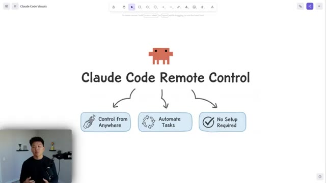
*⏱️ 00:01:44 — Schéma explicatif dessiné à la main sur un tableau blanc virtuel avec le titre "Claude Code Remote Control" et trois fonctionnalités clés.*

---

### ⏱️ `[00:01:57 - 00:02:18]` | Segment #06

**🔊 Audio (Transcription Intégrale Mot pour Mot en Français) :**
> Vous pourriez être en train de déjeuné, de prendre une tasse de coffee, d'aller vous promener, et tous vos différents agents peuvent tourner pour vous. Le travail continue. Et ce qui est génial là-dedans, c'est que la configuration ne peut littéralement pas être plus simple. Vous tapez une commande, vous scannez un code, et ensuite vous êtes connecté. Donc, en allant directement sur la documentation officielle de Cloud Code ici pour la nouvelle télécommande, il est indiqué que vous êtes capable de continuer une session Cloud Code locale depuis votre téléphone, votre tablette, ou n'importe quel navigateur.

**👁️ Analyse Visuelle d'Écran (gemini-3.5-flash-lite) :**
**Interface & Outils** : Application de prise de notes/diagramme (image 1) et navigateur web affichant la documentation de Claude Code (image 2).

**Contenu textuel & Code** : Texte explicatif sur le contrôle à distance des sessions de codage local et diagramme illustrant le passage du bureau à la mobilité.

**Action / Démonstration** : Présentation visuelle du concept de contrôle à distance et des fonctionnalités de l'outil de documentation.

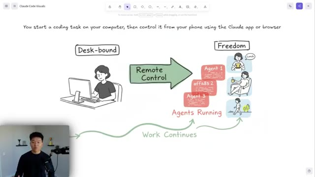
*⏱️ 00:02:03 — Schéma explicatif illustrant le fonctionnement du mode 'Remote Control' avec des agents s'exécutant en arrière-plan pendant que l'utilisateur est en pause.*

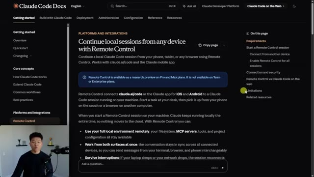
*⏱️ 00:02:13 — Documentation officielle de Claude Code affichant la page 'Continue local sessions from any device with Remote Control'.*

---

### ⏱️ `[00:02:18 - 00:02:38]` | Segment #07

**🔊 Audio (Transcription Intégrale Mot pour Mot en Français) :**
> Lorsque vous commencez cette session, Cloud reste exécuté localement, donc rien ne va jamais dans le cloud. Donc, comme je l'ai mentionné dans la démo, je travaillais dans ce projet local, donc j'avais accès à tout ce contexte et à toutes ces compétences et règles. Et vous pouvez travailler à partir des deux services en même temps, toute la conversation reste synchronisée. Donc les exigences sont que vous devez avoir un abonnement pro ou max.

**👁️ Analyse Visuelle d'Écran (gemini-3.5-flash-lite) :**
**Interface & Outils** : VS Code (avec extension Claude Code) et navigateur web affichant la documentation de Claude Code.

**Contenu textuel & Code** : Arborescence de fichiers du projet local (dossiers .claude, agents, rules, skills, settings.json) et texte de documentation sur les sessions distantes et locales.

**Action / Démonstration** : Navigation dans l'explorateur de fichiers du projet dans VS Code et lecture de la documentation officielle de Claude Code.

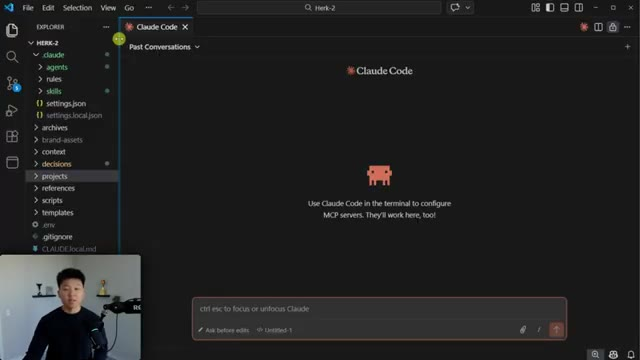
*⏱️ 00:02:23 — Image #1 montre l'interface de l'éditeur de code VS Code avec le plugin Claude Code ouvert, affichant l'explorateur de fichiers du projet "HERK-2" sur la gauche et la fenêtre de chat Claude Code au centre.*

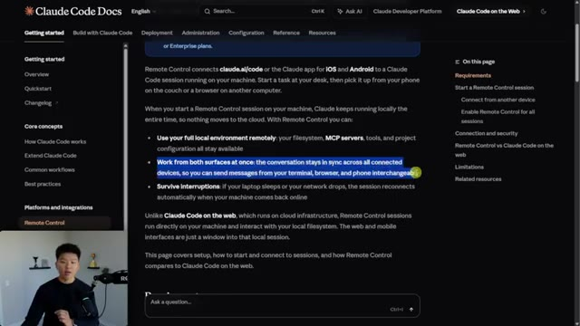
*⏱️ 00:02:33 — Image #2 montre la documentation officielle de Claude Code dans un navigateur web, affichant une page sur la fonctionnalité "Remote Control" avec du texte surligné décrivant l'exécution locale.*

---

### ⏱️ `[00:02:38 - 00:02:57]` | Segment #08

**🔊 Audio (Transcription Intégrale Mot pour Mot en Français) :**
> Vous ne pouvez pas utiliser de clé API. Et ensuite, tout ce que vous avez à faire, à peu près, c'est de lancer Claude et de vous connecter. Et ensuite, vous devez simplement accorder votre confiance à cet espace de travail. Et ensuite, si vous êtes déjà dans une session existante, vous faites simplement slash remote control. Et si vous voulez démarrer une nouvelle session, vous faites simplement Claude remote dash control, comme vous l'avez vu dans ma démonstration. Vous pouvez donc faire de plus amples recherches dans ces documents.

**👁️ Analyse Visuelle d'Écran (gemini-3.5-flash-lite) :**
**Interface & Outils** : Navigateur web affichant la documentation de Claude Code (Claude Code Docs) avec la webcam du présentateur incrustée en bas à gauche.

**Contenu textuel & Code** : Texte décrivant les prérequis : abonnement Pro ou Max requis (pas de clé API), authentification avec la commande `claude` puis `/login`, et gestion de la confiance de l'espace de travail (Workspace trust).

**Action / Démonstration** : Le présentateur commente la documentation officielle pour expliquer comment configurer et démarrer une session Claude Code en se connectant via le compte claude.ai.

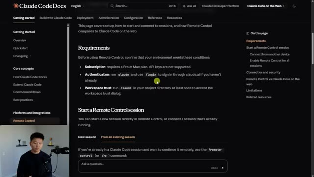
*⏱️ 00:02:43 — Capture d'écran de la documentation officielle de Claude Code montrant les prérequis (Requirements), notamment l'authentification avec la commande /login et la gestion de la confiance de l'espace de travail.*

---

### ⏱️ `[00:02:57 - 00:03:21]` | Segment #09

**🔊 Audio (Transcription Intégrale Mot pour Mot en Français) :**
> Ça va t'expliquer à peu près tout à ce sujet. Mais comme je l'ai dit, c'est super, super simple. Il s'agit littéralement juste de ces quatre étapes et tu es paré. Maintenant, une chose à garder à l'esprit, c'est l'URL de session, ne la mets pas sur Internet, ne la montre pas aux gens ou le code QR. Donc si je devais ouvrir un nouveau terminal et que je voulais simplement lancer un contrôle à distance Cloud, vous pouvez voir qu'on obtient ici cette URL réelle et je pourrais appuyer sur la barre d'espace si je veux le code QR, mais cette URL fonctionne aussi.

**👁️ Analyse Visuelle d'Écran (gemini-3.5-flash-lite) :**
**Interface & Outils** : Visual Studio Code (VS Code) avec terminal intégré.

**Contenu textuel & Code** : Commande `claude remote-control` exécutée dans le terminal, affichant un statut "Connected" et une URL de session Claude.ai.

**Action / Démonstration** : Exécution de la commande de contrôle à distance dans le terminal de l'éditeur de code.

*⏱️ 00:03:15 — Interface de VS Code avec un terminal affichant la commande `claude remote-control` et l'URL de session associée.*

---

### ⏱️ `[00:03:21 - 00:03:39]` | Segment #10

**🔊 Audio (Transcription Intégrale Mot pour Mot en Français) :**
> Donc si je clique sur ce lien, ça va essentiellement ouvrir ça dans mon navigateur web juste ici sur mon bureau, ou je pourrais mettre ça sur mon téléphone et ensuite je pourrais me connecter à la session de contrôle à distance. Comme vous pouvez le voir, voici toutes celles que je faisais pendant les tests, et nous avons toujours quelques sessions actives juste ici. Mais le point important, c'est que n'importe qui peut aller sur ce lien et ensuite contrôler vos fichiers locaux. Donc ne donnez tout simplement pas ça à des gens.

**👁️ Analyse Visuelle d'Écran (gemini-3.5-flash-lite) :**
**Interface & Outils** : Aucun

**Contenu textuel & Code** : Aucun

**Action / Démonstration** : Aucun

---

### ⏱️ `[00:03:39 - 00:03:59]` | Segment #11

**🔊 Audio (Transcription Intégrale Mot pour Mot en Français) :**
> Maintenant, je vais dire que j'ai essayé de me connecter depuis, genre, un autre compte Claude avec une e-mail différente et cela prenait beaucoup de temps pour se connecter et je ne suis pas convaincu que cela m'aurait vraiment laissé entrer, mais je dirais quand même simplement, ne partagez pas cette URL. Mais vous devez juste faire attention aux sessions que vous avez ouvertes. Comme vous pouvez le voir, si elles sont déconnectées, cela ne vous laissera pas chatter, mais si elles sont connectées, vous pouvez voir qu'elles peuvent encore techniquement accéder à des trucs.

**👁️ Analyse Visuelle d'Écran (gemini-3.5-flash-lite) :**
**Interface & Outils** : Claude Code (interface web / application de recherche) et diagramme explicatif.

**Contenu textuel & Code** : Question sur la sécurité de l'URL de session, avertissement « Never share », et panneau latéral listant des sessions de contrôle à distance déconnectées.
[DESC_IMAGE_2] Explication des risques de partage d'URL de session et visualisation d'une interface de gestion de sessions Claude Code.

**Action / Démonstration** : Explications face caméra et démonstration conceptuelle.

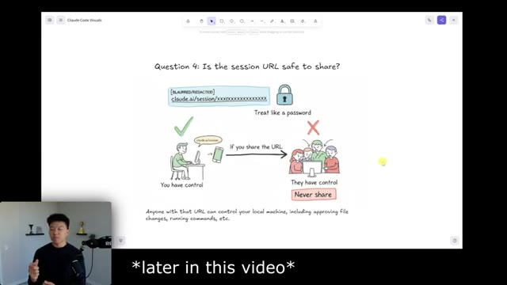
*⏱️ 00:03:44 — Schéma explicatif illustrant la sécurité d'une URL de session Claude Code (« Is the session URL safe to share? ») avec des avertissements sur le partage et le contrôle de la machine locale.*

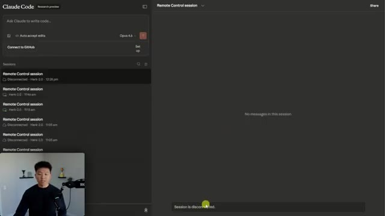
*⏱️ 00:03:54 — Interface de Claude Code (Research preview) montrant une session de contrôle à distance (« Remote Control session ») déconnectée avec une liste de sessions précédentes.*

---

### ⏱️ `[00:03:59 - 00:04:24]` | Segment #12

**🔊 Audio (Transcription Intégrale Mot pour Mot en Français) :**
> D'accord, donc quelques petites choses très rapides à savoir ou peut-être simplement à bien retenir, la première serait que si vous rencontrez des difficultés, essayez de mettre les choses à jour. Essayez de mettre à jour votre code cloud ou l'application sur votre téléphone, ou peut-être certains paramètres de votre ordinateur. Essayez simplement de mettre à jour certaines choses avant de supposer que le pire s'est produit. La première question que je voulais aborder, que nous avons déjà en quelque sorte traitée, c'est : est-ce que cela s'exécute dans le cloud ? Non, votre téléphone est simplement la fenêtre sur ce qui se passe réellement en local, ce qui est différent du code cloud sur le web, qui s'exécute sur les serveurs d'Anthropic.

**👁️ Analyse Visuelle d'Écran (gemini-3.5-flash-lite) :**
**Interface & Outils** : Tableau blanc numérique (type Excalidraw ou similaire)

**Contenu textuel & Code** : Texte affiché : "Having trouble? Update things. Claude Code, Claude phone app, etc."

**Action / Démonstration** : Le présentateur explique les conseils de dépannage en pointant ou illustrant avec des notes textuelles à l'écran.

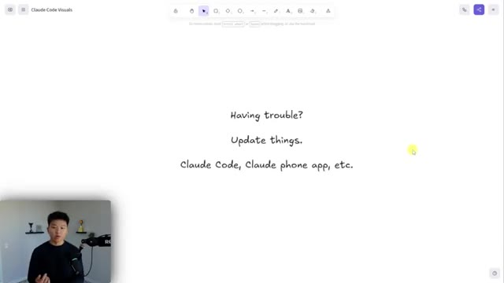
*⏱️ 00:04:06 — Un tableau blanc numérique montrant du texte manuscrit : 'Having trouble? Update things. Claude Code, Claude phone app, etc.' avec le présentateur en médaillon en bas à gauche.*

---

### ⏱️ `[00:04:24 - 00:04:44]` | Segment #13

**🔊 Audio (Transcription Intégrale Mot pour Mot en Français) :**
> Mais bien sûr, les modèles d'IA se connectent aux serveurs d'Anthropic via l'API, mais les fichiers et tout le reste, tout cela reste entièrement local. Nano Banana a eu beaucoup de mal ici à écrire Anthropic comme vous pouvez voir, mais il a fini par l'écrire correctement là. Donc je ne sais pas. La deuxième question est : qu'est-ce qui doit rester allumé ? Donc vous devez maintenir une connexion internet. Si vous n'avez pas de connexion pendant environ 10 minutes, je crois que c'est à ce moment-là que vous êtes déconnecté.

**👁️ Analyse Visuelle d'Écran (gemini-3.5-flash-lite) :**
**Interface & Outils** : Tableau blanc numérique / outil de dessin (ex: Excalidraw ou similaire)

**Contenu textuel & Code** : Schéma intitulé 'Question 1: Is this running in the cloud?' illustrant la différence entre l'exécution locale ('Your machine does the work') et sur le web ('Anthropic servers do the work').

**Action / Démonstration** : Le présentateur explique et commente le schéma comparatif affiché à l'écran concernant l'exécution locale de l'IA.

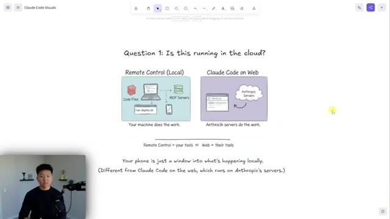
*⏱️ 00:04:29 — Schéma explicatif dessiné à la main comparant 'Remote Control (Local)' et 'Claude Code on Web', avec le présentateur visible en incrustation vidéo dans le coin inférieur gauche.*

---

### ⏱️ `[00:04:44 - 00:05:06]` | Segment #14

**🔊 Audio (Transcription Intégrale Mot pour Mot en Français) :**
> Votre ordinateur portable ou de bureau doit rester allumé. Je pense que le mode veille fonctionne, mais il doit rester allumé. Et le terminal doit rester ouvert. C'est-à-dire que si vous voulez vous absenter pendant, genre, quelques heures, ça ira peut-être. Vous voudrez peut-être simplement modifier les paramètres de votre ordinateur portable pour qu'il ne s'éteigne pas. Mais si vous vouliez vous absenter pendant, genre, une semaine, ce pour quoi ce produit n'est définitivement pas conçu. Vous devriez également vous assurer que les choses ne se mettent pas à jour et ne redémarrent pas automatiquement, et que votre connexion Internet va être bonne, des choses comme ça.

**👁️ Analyse Visuelle d'Écran (gemini-3.5-flash-lite) :**
**Interface & Outils** : Tableau blanc numérique / Outil de schématisation (ex: Excalidraw) avec incrustation vidéo du présentateur en bas à gauche.

**Contenu textuel & Code** : Texte « Question 2: What has to stay on? » et trois conditions illustrées : « Internet connected », « Terminal open », « Power on ». Une phrase de synthèse en bas : « Your terminal has to stay open; your computer must stay on. You must maintain an internet connection. »

**Action / Démonstration** : Le présentateur explique les prérequis nécessaires au fonctionnement de l'outil en s'appuyant sur le schéma visuel.

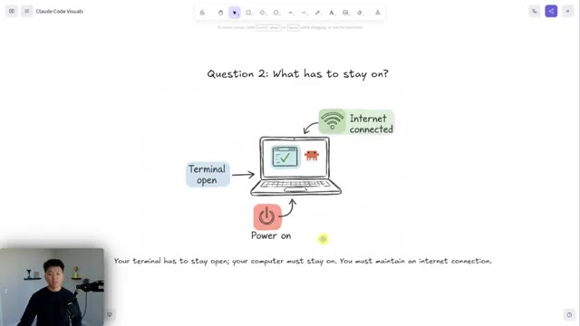
*⏱️ 00:04:49 — Schéma explicatif illustrant les prérequis matériels et logiciels (ordinateur allumé, terminal ouvert et connexion Internet active).*

---

### ⏱️ `[00:05:06 - 00:05:31]` | Segment #15

**🔊 Audio (Transcription Intégrale Mot pour Mot en Français) :**
> Maintenant, à cause de cela, malheureusement, nous ne pouvons démarrer de nouvelles sessions de contrôle à distance qu'à partir de notre terminal. Si vous êtes loin de votre ordinateur et qu'aucune session n'est en cours d'exécution, vous ne pourriez pas en lancer une nouvelle. Si votre ordinateur se met en veille, la session meurt. S'il n'y a pas de terminal en cours d'exécution localement, il n'y a rien auquel votre téléphone ou la télécommande puisse réellement se connecter. Et c'est ce que j'aimerais vraiment voir ensuite. Évidemment, il existe certaines façons de bricoler votre solution pour englober Cloud Code afin de pouvoir y accéder n'importe où et lancer des conversations n'importe où.

**👁️ Analyse Visuelle d'Écran (gemini-3.5-flash-lite) :**
**Interface & Outils** : Tableau blanc numérique / outil de dessin (ex: Excalidraw ou équivalent) avec incrustation vidéo du présentateur en bas à gauche.

**Contenu textuel & Code** : Texte et illustrations : "How Remote Sessions Start", "YOUR TERMINAL" (avec coche verte), "CLAUDE CODE", "Mobile - No", "Remote - No", ainsi que trois points résumant les limitations des sessions distantes.

**Action / Démonstration** : Présentation visuelle et explication des limitations de démarrage des sessions à distance pour Claude Code.

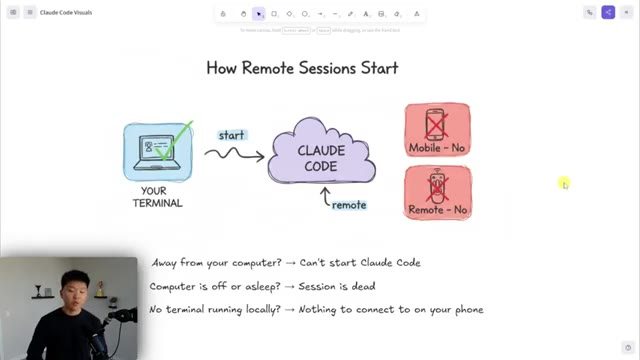
*⏱️ 00:05:13 — Schéma explicatif illustrant comment les sessions distantes de Claude Code démarrent, montrant qu'elles doivent être initiées depuis le terminal local.*

---

### ⏱️ `[00:05:31 - 00:05:50]` | Segment #16

**🔊 Audio (Transcription Intégrale Mot pour Mot en Français) :**
> Mais j'adorerais voir cela en natif et c'est vraiment ce que j'espère voir arriver bientôt. La question suivante est de savoir qui peut utiliser ceci, ce qui est également presque entièrement couvert dans la documentation, mais vous devez être sur le forfait pro ou max. Le forfait pro coûte donc environ 20 dollars par mois. Le max coûte soit 100, soit 200, et vous ne pouvez pas encore être sur un forfait d'équipe ou d'entreprise. Je suis sûr que cela arrivera bientôt, mais pour l'instant, il doit s'agir d'un forfait personnel.

**👁️ Analyse Visuelle d'Écran (gemini-3.5-flash-lite) :**
**Interface & Outils** : Logiciel de tableau blanc ou de prise de notes visuelle (type Excalidraw).

**Contenu textuel & Code** : Texte « Question 3: Who can use this? » avec des blocs de schémas reliant les plans Claude Pro, Claude Max, Personal plan, Team plan, Enterprise plan et API keys.

**Action / Démonstration** : Présentation graphique des prérequis d'abonnement pour utiliser Claude Code.

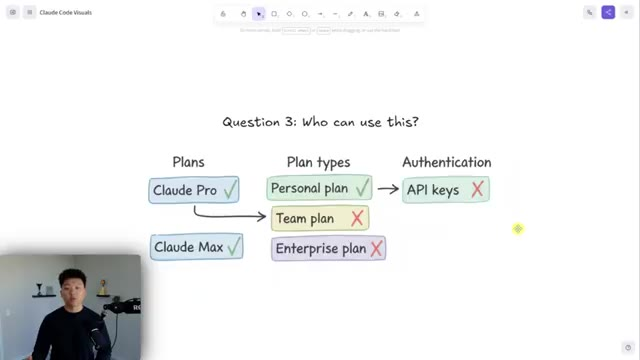
*⏱️ 00:05:36 — Schéma explicatif illustrant les différents abonnements et types d'authentification compatibles (« Claude Pro », « Claude Max », « Personal plan » avec coche verte, contre « Team plan », « Enterprise plan » et « API keys » avec croix rouge).*

---

### ⏱️ `[00:05:50 - 00:06:09]` | Segment #17

**🔊 Audio (Transcription Intégrale Mot pour Mot en Français) :**
> Et bien sûr, vous ne pouvez pas vous authentifier via des API. Et enfin, je voulais juste dire cela une fois de plus, ne montrez pas aux gens le code QR ou l'URL de session à moins que cette session n'ait déjà été détruite. Parce que si vous pouvez simplement cliquer sur un lien et accéder à tous vos fichiers locaux, n'importe qui d'autre ayant ce lien le peut aussi. Parce que si vous vous en souvenez, il n'y avait pas d'authentification à deux facteurs, il n'y avait pas de mot de passe.

**👁️ Analyse Visuelle d'Écran (gemini-3.5-flash-lite) :**
**Interface & Outils** : Tableau blanc numérique / Outil de dessin (canvas)

**Contenu textuel & Code** : Texte manuscrit : "Question 4: Is the session URL safe to share?", "Treat like a password", "Never share", et des illustrations montrant le contrôle de la machine par l'utilisateur vs par d'autres personnes.

**Action / Démonstration** : Le présentateur explique les risques liés au partage d'une URL de session Claude Code.

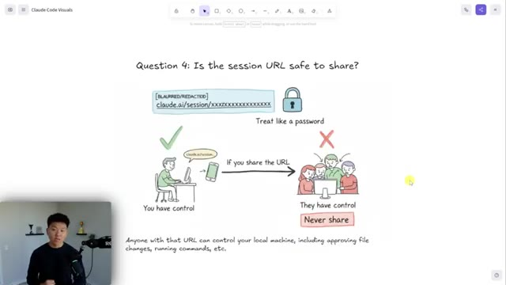
*⏱️ 00:05:55 — Schéma explicatif illustrant la question de la sécurité d'une URL de session, avec un avertissement indiquant qu'elle équivaut à un mot de passe et ne doit jamais être partagée.*

---

### ⏱️ `[00:06:09 - 00:06:27]` | Segment #18

**🔊 Audio (Transcription Intégrale Mot pour Mot en Français) :**
> On a pour ainsi dire ouvert les vannes. Maintenant, je dois dire que j'ai essayé de me connecter depuis un autre compte Claude avec une adresse e-mail différente, et la connexion prenait beaucoup de temps, et je ne suis pas convaincu que cela m'aurait vraiment laissé entrer, mais je dirais quand même simplement : ne partagez pas cette URL. Et je voulais terminer cette vidéo juste en parlant, vous savez, de pourquoi c'est excitant et un peu de ce qui se passe chez Anthropic.

**👁️ Analyse Visuelle d'Écran (gemini-3.5-flash-lite) :**
**Interface & Outils** : Tableau blanc ou application de dessin numérique présentant un schéma illustré.

**Contenu textuel & Code** : Texte « Question 4: Is the session URL safe to share? », URL floutée « claude.ai/session/xxxxxxxxxxxx », et les mentions « Treat like a password », « You have control », « They have control », « Never share ».

**Action / Démonstration** : Le présentateur explique les risques liés au partage d'une URL de session Claude Code et pourquoi elle doit être traitée comme un mot de passe.

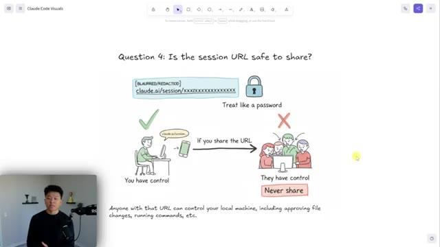
*⏱️ 00:06:13 — Schéma explicatif illustrant la question de la sécurité d'une URL de session, avec des illustrations de type dessin animé montrant les risques de partage.*

---

### ⏱️ `[00:06:27 - 00:06:51]` | Segment #19

**🔊 Audio (Transcription Intégrale Mot pour Mot en Français) :**
> Donc j'ai trouvé cet article ici que je pensais avoir des statistiques intéressantes et j'en ai juste extrait quelques-unes que je trouvais plutôt cool à souligner, mais je mettrai le lien vers l'article complet dans la description. L'agent à 2,5 milliards de dollars, le lancement de la télécommande sert de force d'escalade dans ce qui est devenu une entreprise dominante pour Anthropic. Cloud Code a maintenant atteint en pratiquement un an, un taux annualisé de 2,5 milliards de dollars, ce qui a plus que doublé depuis le début de cette année.

**👁️ Analyse Visuelle d'Écran (gemini-3.5-flash-lite) :**
**Interface & Outils** : Navigateur web / Outil de prise de notes ou de présentation avec une barre d'outils d'annotation en haut.

**Contenu textuel & Code** : Texte en anglais détaillant les statistiques de Claude Code (« $2.5 billion annualized run rate », « 29 million daily installs »).

**Action / Démonstration** : Le présentateur commente et met en avant les chiffres clés d'un article concernant les performances et l'adoption de l'agent IA.

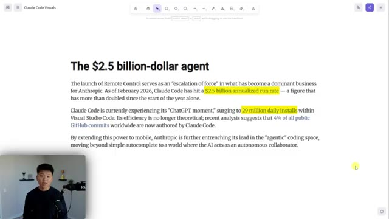
*⏱️ 00:06:33 — Un article de texte affiché à l'écran intitulé 'The $2.5 billion-dollar agent' avec des statistiques sur Claude Code surlignées en jaune, et le présentateur visible en incrustation dans le coin inférieur gauche.*

---

### ⏱️ `[00:06:52 - 00:07:25]` | Segment #20

**🔊 Audio (Transcription Intégrale Mot pour Mot en Français) :**
> Donc, vous savez, au cours des deux derniers mois, ils vivent actuellement leur moment ChatGPT, avec une explosion à 29 millions d'installations quotidiennes dans Visual Studio Code. C'est donc super cool. Et cette statistique peut sembler fausse, mais on s'oriente vers une situation où tout est en quelque sorte codé au feeling, et tout ce que j'ai entendu dire sur les ingénieurs d'Anthropic qui ne codent plus vraiment et qui disposent également d'une tonne d'agents réviseurs de code qui détectent des choses que les humains ratent. Mais apparemment, nous entrons dans cette ère où les outils d'IA écrivent environ 41 % de tout le code. Et j'imagine qu'au cours des prochains mois, nous pourrons certainement dépasser les 50 % de code écrit par l'IA.

**👁️ Analyse Visuelle d'Écran (gemini-3.5-flash-lite) :**
**Interface & Outils** : Document texte / Article web avec barre d'outils de surbrillance

**Contenu textuel & Code** : Texte sur l'agent à 2.5 milliards de dollars, mentionnant un chiffre d'affaires annualisé de 2,5 milliards de dollars en février 2026 et 29 millions d'installations quotidiennes dans Visual Studio Code.

**Action / Démonstration** : Affichage d'un article texte illustrant les statistiques de croissance de l'outil avec du texte surligné en jaune.

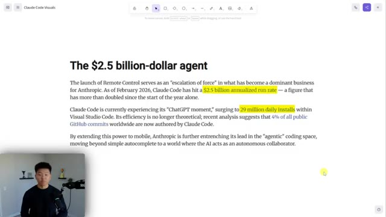
*⏱️ 00:07:00 — Un article de texte intitulé 'The $2.5 billion-dollar agent' mettant en évidence des statistiques sur Claude Code, avec le présentateur en médaillon en bas à gauche.*

---

### ⏱️ `[00:07:26 - 00:08:01]` | Segment #21

**🔊 Audio (Transcription Intégrale Mot pour Mot en Français) :**
> Et évidemment, on a vu ça partout avec la rapidité des POC, des startups, et, vous savez, différents produits qui sont tous écrits avec des outils de codage par IA. Bref, je sais que c'était rapide, mais je voulais juste vous montrer comment ce genre de truc fonctionne et ce que j'en pensais. Si vous adorez geeker sur ce genre de sujet, alors allez absolument jeter un œil à mon groupe « plus ». Le lien pour ça se trouve en bas dans la description. On a plus de 3 000 membres qui construisent avec l'IA chaque jour, qui créent des entreprises avec l'IA, et c'est un super endroit où être si vous avez des objectifs similaires. J'adorerais donc vous voir dans cette communauté, mais c'est tout pour aujourd'hui. Si vous avez apprécié la vidéo ou si vous avez appris quelque chose de nouveau, n'hésitez pas à lui donner un pouce bleu. Ça m'aide vraiment énormément. Et comme toujours, je vous remercie d'être arrivés jusqu'à la fin de la vidéo. Je vous verrai dans la prochaine. Merci.

**👁️ Analyse Visuelle d'Écran (gemini-3.5-flash-lite) :**
**Interface & Outils** : Navigateur web affichant un document partagé et une plateforme communautaire Skool.

**Contenu textuel & Code** : Texte sur l'avenir du code généré par l'IA et interface de forum communautaire.

**Action / Démonstration** : Présentation de concepts théoriques et de pages de documentation sans manipulation de code en direct.

---

### ⏱️ `[00:08:01 - 00:08:01]` | Segment #22

**🔊 Audio (Transcription Intégrale Mot pour Mot en Français) :**
> tout le monde.

**👁️ Analyse Visuelle d'Écran (gemini-3.5-flash-lite) :**
**Interface & Outils** : Outil de tableau blanc (Excalidraw) avec le présentateur incrusté en bas à gauche.

**Contenu textuel & Code** : Texte et icônes décrivant les fonctionnalités de Claude Code Remote Control.

**Action / Démonstration** : Présentation visuelle des concepts clés du contrôle à distance de Claude Code.

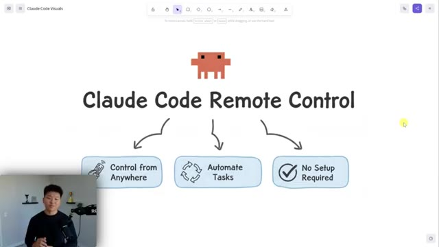
*⏱️ 00:08:01 — Schéma explicatif dessiné à la main (style Excalidraw) titré 'Claude Code Remote Control' avec trois sections : Control from Anywhere, Automate Tasks, et No Setup Required.*

---

