# 🎬 The NEW Nano Banana 2 + Antigravity Destroys Every AI Image Tool

> **Chaîne** : [Nate Herk | AI Automation](https://www.youtube.com/@nateherk/featured)  
> **Lien YouTube** : [https://www.youtube.com/watch?v=iTKkoGd3YcM](https://www.youtube.com/watch?v=iTKkoGd3YcM)  
> **Date de publication** : 20260227  
> **Durée** : 00:14:32  
> **Identifiant vidéo** : `iTKkoGd3YcM`  
> **Transcription & Analyse** : `whisper-v3-large-turbo+gemini-3.5-flash-lite`  

---

## 📌 Synthèse Exécutive & Outils

### 💡 Résumé

La vidéo de Nate Herk met en lumière le modèle de génération d'images « Nano Banana 2 » (identifié dans l'API comme *Gemini 3.1 Flash Image Preview*), présenté comme une révolution en termes de rapidité, de coût et de cohérence par rapport à son prédécesseur, Nano Banana Pro. Capable d'intégrer des données en temps réel grâce à l'ancrage de la recherche Web Google et doté d'une limite de connaissances actualisée à janvier 2025, Nano Banana 2 surpasse les précédents standards notamment sur la précision orthographique textuelle, les diagrammes complexes et le réalisme photographique (portraits, infographies, interfaces).

Pour pallier le caractère aléatoire des prompts en texte brut — comparés au fait de tirer le levier d'une machine à sous —, la vidéo introduit une méthodologie d'ingénierie avancée basée sur l'utilisation de structures de requêtes en JSON. En couplant l'agent IA d'Antigravity (propulsé par Gemini 3.1 Pro) à des fichiers de configuration contextuels de type `Gemini.md` (similaires à des `Claude.md`), l'auteur automatise la conversion de prompts flous en instructions JSON ultra-précises (sujet, éclairage, caméra, objectifs, profondeur de champ, prompts négatifs). Cette synergie garantit un contrôle granulaire et une reproductibilité stylistique parfaite à moindre coût.

Le système démontre l'efficacité des environnements de développement intégrés (IDE) orientés agents pour orchestrer des flux de travail multimodaux complexes. En déléguant la rédaction structurée des prompts à un modèle doté d'un haut niveau d'effort et d'expertise esthétique, les créateurs et développeurs s'affranchissent des limites des interfaces grand public pour industrialiser la production visuelle de haute fidélité.

### 🛠️ Outils, Modèles & Logiciels Présentés

* **Nano Banana 2** (Gemini 3.1 Flash Image Preview) : Modèle natif de génération d'images de Google, caractérisé par sa vitesse d'exécution accrue, son coût réduit, ses capacités de recherche Web intégrées et sa supériorité dans le rendu textuel.
* **Nano Banana Pro** : Version précédente du modèle d'image de Google, jugée plus lente, plus onéreuse et sujette à des erreurs orthographiques récurrentes.
* **Antigravity** : IDE open-source et gratuit (disponible sur antigravity.google), doté d'un agent IA intégré permettant de concevoir, structurer et automatiser des flux de développement.
* **Gemini 3.1 Pro** : Modèle linguistique grand format hautement performant utilisé au sein d'Antigravity pour interpréter les intentions créatives et générer des structures de prompts JSON hautement optimisées.
* **Gemini.md** (et équivalent Claude.md) : Fichier de configuration contextuel injecté dans l'espace de travail de l'agent pour lui inculquer des instructions permanentes, des règles de gouvernance et des compétences spécifiques (skills) à appliquer systématiquement.
* **Claude Code** : Outil de développement en ligne de commande mentionné pour sa compatibilité conceptuelle avec les fichiers de configuration de projet basés sur Markdown.

### 🔑 Points Clés & Enseignements Stratégiques

* **Supériorité technique de Nano Banana 2** : Le modèle offre une amélioration drastique sur quatre axes majeurs : vitesse d'exécution (génération en ~10 secondes), contrôle sémantique accru, intégration de données en temps réel via la recherche Google, et réduction tarifaire par rapport au modèle Pro.
* **Maîtrise absolue du texte et des infographies** : Contrairement aux anciennes générations souvent sujettes à des artefacts textuels ou des fautes d'orthographe, Nano Banana 2 génère des diagrammes scientifiques et du texte publicitaire impeccables.
* **Ancrage Web en temps réel** : La possibilité d'activer l'index de recherche Google lors de la génération permet au modèle de mobiliser des connaissances actualisées (jusqu'à janvier 2025) et d'assurer l'exactitude contextuelle de sujets complexes (références de séries, données factuelles).
* **Limitation des prompts en texte brut** : Les requêtes textuelles classiques agissent comme une "machine à sous" : bien que les modèles soient performants, l'absence de contraintes strictes conduit à des résultats imprévisibles et incohérents d'une génération à l'autre.
* **Efficacité du format JSON pour l'IA** : Les ordinateurs et les modèles de langage traitent le JSON avec une efficacité maximale grâce à des arguments typés et explicites (sujet, style, éclairage, optique, cadrage, format).
* **Granularité du contrôle créatif** : L'utilisation de structures JSON permet de paramétrer finement chaque composante visuelle d'une image, éliminant l'aléa artistique et garantissant une identité visuelle unifiée à travers des séries de productions.
* **Automatisation par l'IA générative de prompts** : Plutôt que de rédiger manuellement des structures JSON complexes, l'ingénierie moderne délosse cette tâche à un LLM supérieur (comme Gemini 3.1 Pro) chargé de transformer une intention vague en spécifications techniques rigoureuses.
* **Rôle central des fichiers contextuels (`Gemini.md`)** : L'utilisation de fichiers de configuration persistants au sein de l'IDE permet d'inculquer des compétences (skills) automatisées à l'agent, garantissant qu'il applique systématiquement la même méthodologie de prompt engineering à chaque requête.
* **Synergie entre IDE et Agents IA** : Antigravity illustre la transition des éditeurs de code traditionnels vers des environnements pilotés par des agents, où l'humain supervise l'orchestration des flux de travail plutôt que d'écrire chaque ligne de configuration ou de code manuellement.
* **Démocratisation des outils de production de niveau professionnel** : L'association d'un modèle d'image rapide et économique à un agent de structuration de prompt permet d'atteindre une qualité de rendu digne d'une agence spécialisée (gestion de la texture de peau, imperfections réalistes, étalonnage des couleurs) sans compétences graphiques avancées.

---

## ⏱️ Chronologie & Transcription Complète Audio & Visuelle (Mot pour Mot)

### ⏱️ `[00:00:00 - 00:00:20]` | Segment #01

**🔊 Audio (Transcription Intégrale Mot pour Mot en Français) :**
> Donc le nouveau modèle d'image de Google, Nano Banana 2, vient de sortir. Et il est moins cher, plus rapide et plus intelligent que Nano Banana Pro. Et ce sont de bonnes choses. J'en suis donc obnubilé depuis sa sortie, et j'ai trouvé un moyen de l'associer à l'anti-gravité pour rendre les résultats plus cohérents, meilleurs et moins chers. Donc dans cette vidéo, je vais vous montrer exactement ce que je veux dire par là, et vous donner tout ce dont vous avez besoin gratuitement pour copier ce système.

**👁️ Analyse Visuelle d'Écran (gemini-3.5-flash-lite) :**
**Interface & Outils** : AUCUNE

**Contenu textuel & Code** : AUCUN

**Action / Démonstration** : AUCUNE

---

### ⏱️ `[00:00:20 - 00:00:39]` | Segment #02

**🔊 Audio (Transcription Intégrale Mot pour Mot en Français) :**
> Donc ne perdons pas de temps et entrons directement dans le vif du sujet. Très bien, commençons simplement par regarder quelques exemples et par apprécier à quel point ce modèle est réellement bon. Je veux dire, regardez à quel point ça a l'air réaliste. Regardez ça. Les détails sur son visage, le plan avant-après, la photographie panoramique. On a du texte là-dessus qui pourrait être utilisé comme une publicité. C'est Sydney Sweeney en plus. Ça a juste l'air d'un vrai selfie.

**👁️ Analyse Visuelle d'Écran (gemini-3.5-flash-lite) :**
**Interface & Outils** : AUCUNE

**Contenu textuel & Code** : AUCUNE

**Action / Démonstration** : AUCUNE

---

### ⏱️ `[00:00:40 - 00:01:00]` | Segment #03

**🔊 Audio (Transcription Intégrale Mot pour Mot en Français) :**
> Et même d'être capable de repenser des interfaces utilisateur de jeux et des choses comme ça. Maintenant, tous ces exemples que nous venons de voir sont des choses qui auraient normalement pris du temps, du matériel, de l'argent, et même de la chance si vous aviez besoin de faire des trucs comme, vous savez, de la photographie. Vous auriez eu besoin d'un beau temps ou d'un coucher de soleil ou peu importe ce que c'est. Mais je sais que vous savez tous cela. Je vais donc parler de la raison pour laquelle Nano Banana 2 est réellement meilleur.

**👁️ Analyse Visuelle d'Écran (gemini-3.5-flash-lite) :**
**Interface & Outils** : AUCUNE

**Contenu textuel & Code** : AUCUNE

**Action / Démonstration** : AUCUNE

---

### ⏱️ `[00:01:00 - 00:01:30]` | Segment #04

**🔊 Audio (Transcription Intégrale Mot pour Mot en Français) :**
> Il a reçu trois améliorations majeures à mon avis, qui étaient, tout d'abord, qu'il est beaucoup plus rapide. La deuxième est un meilleur contrôle. Donc j'ai l'impression que lorsque je lui parle, il me comprend réellement mieux. Et la troisième est qu'il peut utiliser des données réelles et qu'il fait réellement des recherches par lui-même. Donc il est tellement plus intelligent. Et bien sûr, numéro quatre, nous ne pouvons pas oublier le fait que c'est moins cher que Nano Banana Pro. Donc l'une des choses qui m'a vraiment enthousiasmé était le saut qualitatif du texte réel, car j'utilisais Nano Banana Pro pour créer un tas de ces infographies ou miniatures et tous les diagrammes que vous regardez aujourd'hui ont été générés avec le nouveau modèle Nano Banana 2.

**👁️ Analyse Visuelle d'Écran (gemini-3.5-flash-lite) :**
**Interface & Outils** : Présentation vidéo avec incrustation d'un schéma explicatif dessiné (style sketch/diagramme).

**Contenu textuel & Code** : Texte du schéma listant les améliorations (1. Faster Gen - Pro + Fast, 2. Better Control - Complex Prompts, 3. World Data - Real Subjects).

**Action / Démonstration** : Le présentateur explique et commente les graphiques schématiques affichés à l'écran concernant les mises à jour majeures.

---

### ⏱️ `[00:01:31 - 00:01:51]` | Segment #05

**🔊 Audio (Transcription Intégrale Mot pour Mot en Français) :**
> Et je n'ai jamais vu cela mal orthographier quoi que ce soit. Avec Nano Banana Pro, cela mal orthographiait des choses ou avait des caractères bizarres tout le temps. Donc voici un exemple rapide. Tout ce que j'ai dit, c'était crée-moi une infographie sur le fonctionnement de la photosynthèse. Il y a toutes ces flèches, il y a tous les éléments spatiaux à prendre en compte, et cela orthographie correctement tous ces mots. Du moins, je le crois parce que je ne sais pas ce que cela devrait réellement être.

**👁️ Analyse Visuelle d'Écran (gemini-3.5-flash-lite) :**
**Interface & Outils** : Présentation vidéo avec incrustation graphique, schéma explicatif et option 'google_search'.

**Contenu textuel & Code** : Texte du prompt : 'Create me an infographic about how photosynthesis works.' et diagramme scientifique détaillé sur la photosynthèse (chloroplaste, dioxygène, dioxyde de carbone, eau).

**Action / Démonstration** : Illustration d'un exemple concret d'infographie générée par l'IA pour démontrer la qualité du texte et des détails.

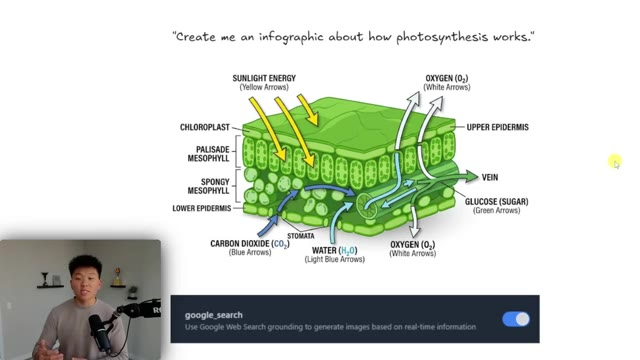
*⏱️ 00:01:41 — Exemple d'infographie générée sur la photosynthèse avec le prompt 'Create me an infographic about how photosynthesis works.' et une option de recherche Google en bas.*

---

### ⏱️ `[00:01:51 - 00:02:26]` | Segment #06

**🔊 Audio (Transcription Intégrale Mot pour Mot en Français) :**
> Peut-être aurais-je dû choisir un autre exemple. Donc nous allons simplement l'essayer très rapidement pour voir un autre texte. Vous pouvez aller dès maintenant sur Gemini et vous pouvez cliquer sur outils, créer une image, et vous pouvez vous amuser avec Nano Banana 2 dès maintenant, comme vous pouvez le voir. Vous pourriez aussi aller sur Google AI Studio si vous voulez utiliser ceci via l'API. Et c'est en fait Gemini 3.1 flash image preview, mais c'est Nano Banana 2, ce qui est bien plus amusant à dire Nano Banana 2. Mais très rapidement, prenez note du coût si vous utilisez ceci via l'API. Et plus tard, je vais vous montrer comment nous pouvons réellement l'utiliser pour moins cher. Mais cette image est revenue en environ 10 secondes. Et si je clique pour l'ouvrir, nous devrions voir que nous n'avons aucune faute d'orthographe. Elle a aussi tout en bas à droite une mention explicite indiquant que ceci a été fait avec l'IA.

**👁️ Analyse Visuelle d'Écran (gemini-3.5-flash-lite) :**
**Interface & Outils** : Gemini, Google AI Studio

**Contenu textuel & Code** : Texte de prompt descriptif pour la création d'une infographie LinkedIn et menu de sélection des modèles d'IA (Nano Banana 2).

**Action / Démonstration** : Saisie d'un prompt pour la génération d'image et navigation dans les options du modèle d'IA.

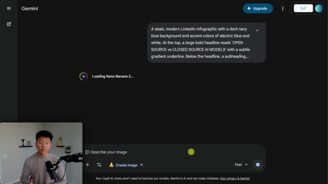
*⏱️ 00:02:00 — Interface de Gemini affichant un prompt textuel pour générer une infographie et montrant un message de chargement pour Nano Banana 2.*

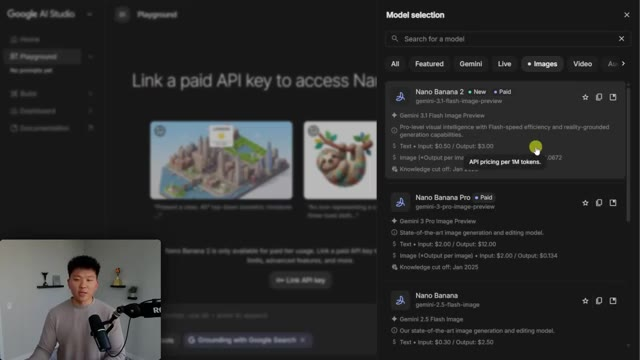
*⏱️ 00:02:08 — Interface de Google AI Studio montrant un panneau de sélection de modèles avec Nano Banana 2 et Nano Banana Pro.*

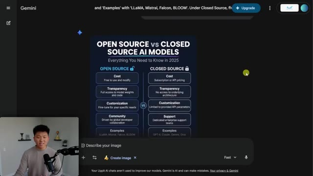
*⏱️ 00:02:17 — Interface de Gemini affichant le résultat final de la génération d'une infographie sur les modèles d'IA open source versus closed source.*

---

### ⏱️ `[00:02:26 - 00:02:53]` | Segment #07

**🔊 Audio (Transcription Intégrale Mot pour Mot en Français) :**
> Et donc oui, je crois vraiment que la plupart des modèles d'IA comprendraient comment fonctionne la photosynthèse, mais vous pouvez voir que nous pouvons également activer la recherche Google, qui dit d'utiliser l'ancrage de la recherche Web Google pour générer des images basées sur des informations en temps réel. Comme vous pouvez le voir ici même dans Google AI Studio, il est indiqué que Nano Banana 2 a une limite de connaissances fixée à janvier 2025. Donc, puisque nous pouvons activer la recherche Google lors de la génération d'images, c'est tout simplement super cool. Et juste pour donner un tout petit exemple amusant, j'ai dit : crée-moi une image du casting de The Office en train de pratiquer certains de leurs loisirs préférés.

**👁️ Analyse Visuelle d'Écran (gemini-3.5-flash-lite) :**
**Interface & Outils** : Google AI Studio, interface web de démonstration de modèles d'IA

**Contenu textuel & Code** : Schéma scientifique de la photosynthèse avec texte en anglais ('Create me an infographic about how photosynthesis works.'), et options de configuration 'google_search' avec sélection de modèles (Nano Banana 2, Nano Banana Pro).

**Action / Démonstration** : Activation de la recherche Google (Google Web Search grounding) pour générer des images basées sur des informations en temps réel dans Google AI Studio.

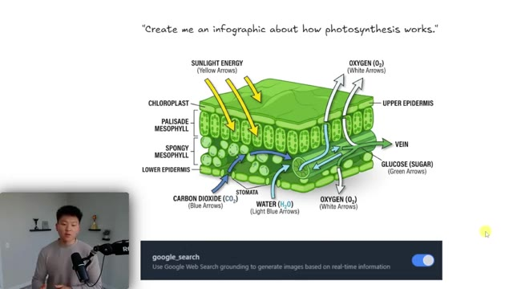
*⏱️ 00:02:33 — Infographie détaillée sur le fonctionnement de la photosynthèse, avec une option de recherche Google activée en bas de l'écran.*

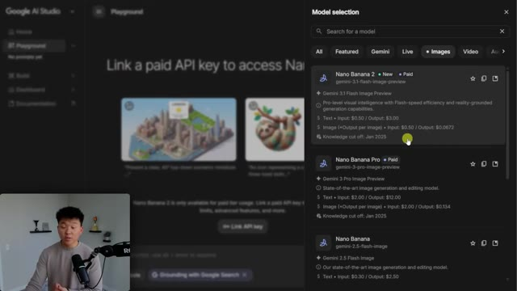
*⏱️ 00:02:40 — Interface de Google AI Studio montrant un panneau de sélection de modèles pour la génération d'images, avec les modèles Nano Banana 2 et Nano Banana Pro.*

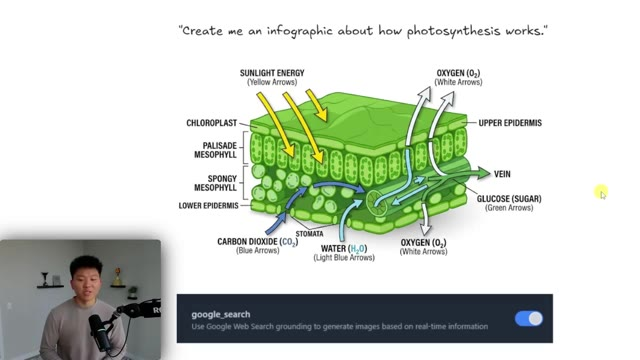
*⏱️ 00:02:47 — Même infographie sur la photosynthèse avec l'option google_search activée, illustrant l'ancrage de la recherche web.*

---

### ⏱️ `[00:02:53 - 00:03:19]` | Segment #08

**🔊 Audio (Transcription Intégrale Mot pour Mot en Français) :**
> Et j'ai exécuté ceci avec la recherche Google désactivée et avec la recherche Google activée. C'est quand même assez précis avec la recherche Google désactivée si vous voulez vraiment analyser cela. Mais une chose que j'ai remarquée, c'est juste ici, ça dit « les buveurs de whisky de Scranton ». Mais sur ce côté droit avec la recherche Google, ça disait Scrantonicity, ce qui, de mémoire, est correct. Et ensuite, j'en ai exécuté un autre avec Friends. Je sais que ces séries existent depuis longtemps, alors c'est peut-être dans les données d'entraînement du modèle, mais j'ai quand même trouvé ça cool parce que ça connaît aussi le décor de la série et ça sait à quoi ressemblent tous les personnages.

**👁️ Analyse Visuelle d'Écran (gemini-3.5-flash-lite) :**
**Interface & Outils** : Interface vidéo avec incrustation du présentateur et présentation de diapositives d'images générées par IA.

**Contenu textuel & Code** : Un prompt textuel : 'Create me an image of the cast of The Office doing some of their favorite hobbies.' et deux images comparatives étiquetées 'Google search OFF' et 'Google search ON'.

**Action / Démonstration** : Le présentateur compare les résultats d'une génération d'images avec et sans la recherche Google activée.

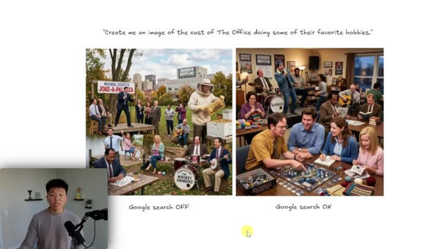
*⏱️ 00:03:00 — Comparaison de deux images générées par IA à partir d'un prompt sur 'The Office', l'une avec Google Search désactivé et l'autre activé, avec le présentateur en médaillon.*

---

### ⏱️ `[00:03:19 - 00:03:44]` | Segment #09

**🔊 Audio (Transcription Intégrale Mot pour Mot en Français) :**
> Donc on obtient une qualité professionnelle, on obtient une vitesse fulgurante dans Nano Banana. C'est net, c'est rapide, c'est intelligent. Donc voici un exemple où j'ai dit : crée une image hyper réaliste de Derek Jeter jouant du piano. À gauche, c'était Nano Banana Pro, et à droite, c'était Nano Banana 2. Maintenant, je dois dire que ces deux images ont l'air vraiment bien, n'est-ce pas ? Genre, celle-là a l'air très réaliste, et il joue du piano. Celle-ci a l'air bien aussi. Mais quand on pense au fait que celle-ci était plus lente et plus chère que Nano Banana 2, alors c'est un vainqueur évident à mon avis.

**👁️ Analyse Visuelle d'Écran (gemini-3.5-flash-lite) :**
**Interface & Outils** : Présentation vidéo avec comparatif visuel d'IA générative d'images.

**Contenu textuel & Code** : Texte du prompt : "Create a hyper realistic image of Derek Jeter playing the piano." et comparatif des temps de génération.

**Action / Démonstration** : Comparaison des performances et de la qualité visuelle entre Nano Pro et Nano 2.

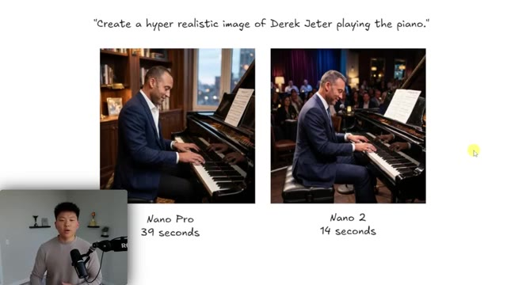
*⏱️ 00:03:25 — Comparaison d'images générées par IA montrant Derek Jeter jouant du piano, avec Nano Pro (gauche, 39 secondes) et Nano 2 (droite, 14 secondes).*

---

### ⏱️ `[00:03:44 - 00:04:06]` | Segment #10

**🔊 Audio (Transcription Intégrale Mot pour Mot en Français) :**
> Maintenant, voici deux exemples que j'ai vus sur Twitter et que je trouvais vraiment, vraiment bons. J'aurais probablement pensé qu'il s'agissait d'un vrai modèle. Et j'aurais probablement pensé qu'il s'agissait encore une fois d'un vrai modèle pour cette, vous savez, séance photo. Mais bien sûr, la clé de bons résultats, c'est le prompt. Et alors, pourquoi ces exemples sont-ils si, si bons ? Parce qu'ils utilisent une structure de prompt en JSON, ce qui signifie fondamentalement que nous avons tellement plus de contrôle sur ce qui se passe réellement.

**👁️ Analyse Visuelle d'Écran (gemini-3.5-flash-lite) :**
**Interface & Outils** : Navigateur web affichant des images et des comparaisons avant/après.

**Contenu textuel & Code** : Exemples visuels de mannequins et de retouches faciales présentés sur Twitter.
[DESC_IMAGE_3] Présentation d'exemples visuels par le conférencier.

**Action / Démonstration** : Explications face caméra et démonstration conceptuelle.

---

### ⏱️ `[00:04:06 - 00:04:32]` | Segment #11

**🔊 Audio (Transcription Intégrale Mot pour Mot en Français) :**
> Et nous pouvons communiquer tellement plus clairement avec Nano Banana 2. Les ordinateurs adorent le JSON. L'IA adore le JSON. C'est vraiment facile pour eux de le lire et de le comprendre parce qu'il y a des arguments spécifiques. Dans cette version, il sait exactement quel est le prompt. Il connaît le style. Il connaît l'éclairage, la caméra, la résolution et le format d'image, c'est pourquoi si vous configurez un jour manuellement une requête HTTP, vous envoyez ce corps sous forme de JSON parce que l'IA ou les ordinateurs peuvent traiter cela super rapidement et le comprendre.

**👁️ Analyse Visuelle d'Écran (gemini-3.5-flash-lite) :**
**Interface & Outils** : Document/Éditeur de texte affichant du code JSON et image générée

**Contenu textuel & Code** : Code JSON structuré : {"prompt": "Ultra-realistic portrait...", "style": "fashion photography...", "lighting": "direct on-camera flash...", "camera": "85mm lens...", "resolution": "4k", "aspect_ratio": "2:3"}

**Action / Démonstration** : Présentation d'un exemple de code JSON utilisé pour structurer les paramètres de prompt d'une IA d'image.

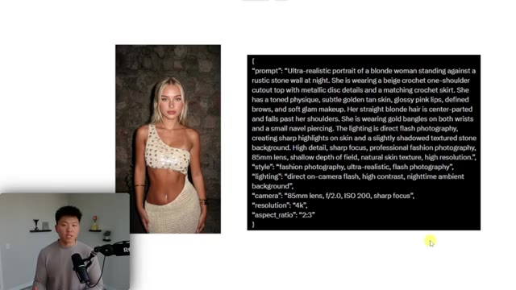
*⏱️ 00:04:12 — L'écran présente une image générée d'une femme blonde et, à côté, un bloc de code JSON structuré contenant les détails du prompt de génération. Le présentateur apparaît dans une petite incrustation vidéo en bas à gauche.*

---

### ⏱️ `[00:04:32 - 00:04:53]` | Segment #12

**🔊 Audio (Transcription Intégrale Mot pour Mot en Français) :**
> Voici l'exemple suivant. Celui-ci est un autre prompt JSON. Il est un peu différent. Il était beaucoup plus long et il a des arguments différents. Vous pouvez voir ici que nous avons le sujet. Nous avons la composition avec la disposition, l'angle de caméra, le cadrage, la hauteur de la caméra, l'objectif, la mise au point, la profondeur de champ. Nous pouvons donc être super, super précis ici. Et c'est vraiment la clé pour obtenir un résultat qui a l'air bien, mais généré par IA, ou tellement bon qu'on ne sait même pas que c'est généré par IA.

**👁️ Analyse Visuelle d'Écran (gemini-3.5-flash-lite) :**
**Interface & Outils** : Interface de présentation avec affichage de code JSON et images d'illustration avant/après.

**Contenu textuel & Code** : Code JSON structuré contenant des paramètres de génération d'image (sujet, composition, angle de caméra, cadrage, hauteur, personnage, états avant/après, éclairage, étalonnage des couleurs).

**Action / Démonstration** : Le présentateur explique les différents arguments et la structure détaillée du prompt JSON pour l'génération d'images par IA.

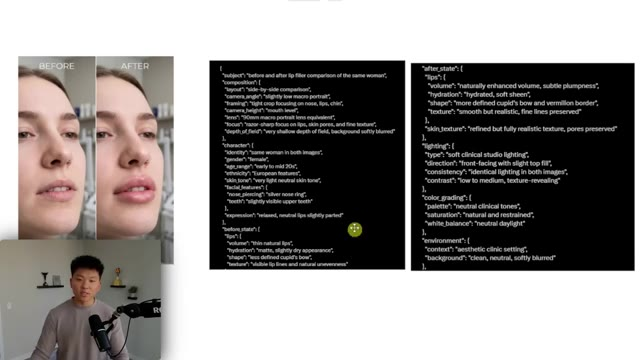
*⏱️ 00:04:37 — Vue d'ensemble montrant à gauche une comparaison visuelle avant/après de visage et de lèvres, et à droite un prompt structuré au format JSON détaillant les paramètres de composition et de personnage.*

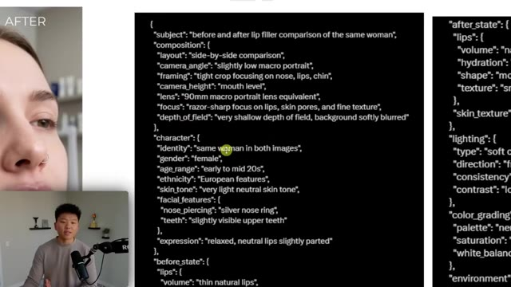
*⏱️ 00:04:42 — Gros plan sur le prompt au format JSON affiché à l'écran, avec des sections détaillant le sujet, la composition, le personnage et les états avant/après.*

---

### ⏱️ `[00:04:53 - 00:05:27]` | Segment #13

**🔊 Audio (Transcription Intégrale Mot pour Mot en Français) :**
> Nous avons le personnage. Nous avons l'expression, l'état des lèvres avant. Nous avons le volume, l'hydratation, l'éclairage, le type, la consistance, l'étalonnage des couleurs. Je pense que vous comprenez le point. Les invites d'image en texte brut sont plutôt vagues. Elles sont un peu plus aléatoires et n'offrent pas autant de contrôle, ce qui mènera fondamentalement à des résultats incohérents. Non pas qu'ils seraient mauvais, car les modèles d'image sont tellement, tellement bons maintenant, mais à chaque fois que vous balancez une invite là-dedans, c'est presque comme si vous tiriez sur le levier d'une machine à sous. Vous espérez juste obtenir ce que vous voulez, mais vous ne savez tout simplement pas. Mais avec une invite JSON, vous pouvez réellement savoir que vous allez obtenir tout ce que vous voulez parce que vous avez, comme je l'ai dit, ces arguments.

**👁️ Analyse Visuelle d'Écran (gemini-3.5-flash-lite) :**
**Interface & Outils** : Présentation vidéo avec illustration schématique et affichage de code JSON.

**Contenu textuel & Code** : Structure JSON (lighting, color_grading, environment) et schéma comparatif Plain Text vs JSON Prompt.

**Action / Démonstration** : Explication visuelle de la supériorité des prompts JSON par rapport au texte brut pour la génération d'images.

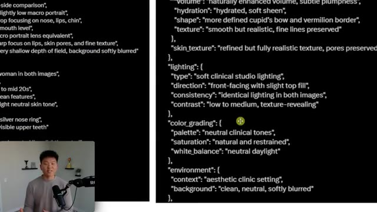
*⏱️ 00:05:02 — Extrait de code JSON structuré détaillant des paramètres d'éclairage et de rendu d'image, avec le présentateur en médaillon.*

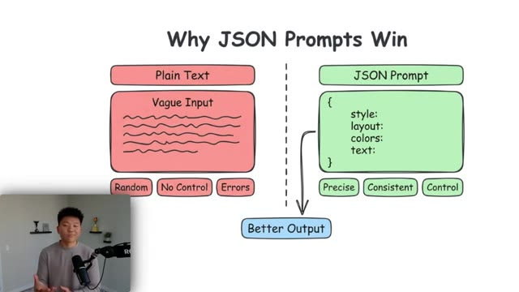
*⏱️ 00:05:10 — Schéma comparatif illustré intitulé 'Why JSON Prompts Win', opposant le texte brut aux prompts JSON structurés menant à un meilleur résultat.*

---

### ⏱️ `[00:05:27 - 00:05:49]` | Segment #14

**🔊 Audio (Transcription Intégrale Mot pour Mot en Français) :**
> Vous pouvez être précis et vous avez beaucoup plus de contrôle. Vous allez obtenir tellement plus de cohérence ici, et c'est exactement ce que je vais vous montrer les gars aujourd'hui. Maintenant, avant que vous ne couriez dans les commentaires pour dire "je ne vais pas écrire ce JSON moi-même" ou "il va nous facturer 500 dollars pour apprendre à prompter en JSON", patientez un peu. L'IA adore le JSON, ce qui signifie que l'IA peut écrire du très bon JSON. Laissez-moi donc vous guider à travers un exemple. J'ai envoyé ce prompt à Nano Banana 2.

**👁️ Analyse Visuelle d'Écran (gemini-3.5-flash-lite) :**
**Interface & Outils** : Présentation vidéo avec illustration graphique de type schéma explicatif.

**Contenu textuel & Code** : Schéma comparatif 'Why JSON Prompts Win' avec d'un côté 'Plain Text' (Random, No Control, Errors) et de l'autre 'JSON Prompt' (Precise, Consistent, Control).

**Action / Démonstration** : Le présentateur explique visuellement les avantages structurels d'utiliser des prompts au format JSON par rapport au texte brut.

*⏱️ 00:05:33 — Schéma explicatif comparant le texte brut ('Plain Text') au format JSON ('JSON Prompt'), illustrant les avantages du JSON en matière de contrôle et de cohérence pour de meilleurs résultats.*

---

### ⏱️ `[00:05:49 - 00:06:15]` | Segment #15

**🔊 Audio (Transcription Intégrale Mot pour Mot en Français) :**
> Crée une image en gros plan de la moitié droite du visage d'une femme. Et il est revenu avec ceci, ce qui est solide, n'est-ce pas ? Mais ça a encore l'air un peu artificiel. Donc ce que nous pouvons faire, c'est essentiellement prendre cette invite et l'envoyer à Gemini 3 Pro dans Antigravity. Et maintenant, Antigravity utilise ce cerveau super intelligent ici, combiné avec la compétence, qui est essentiellement une invite que nous lui avons donnée pour dire, hé, chaque fois que tu veux créer une image, fais ceci, ceci, ceci et ceci, et elles seront vraiment bonnes, et je vais vous donner cette compétence tout à fait gratuitement.

**👁️ Analyse Visuelle d'Écran (gemini-3.5-flash-lite) :**
**Interface & Outils** : Présentation vidéo avec illustrations schématiques.

**Contenu textuel & Code** : Texte du prompt "Create a close-up image of the right half of a woman's face" et mention "Gemini 3.1 Pro".

**Action / Démonstration** : Le présentateur explique le processus de traitement du prompt par Gemini 3.1 Pro.

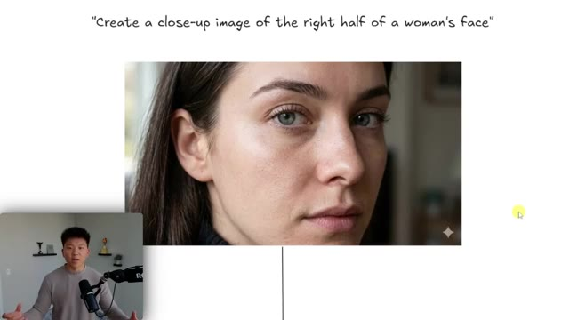
*⏱️ 00:05:56 — L'image montre le texte 'Create a close-up image of the right half of a woman's face' au-dessus d'une photo réaliste du visage d'une femme, avec le présentateur en métrage incrusté en bas à gauche.*

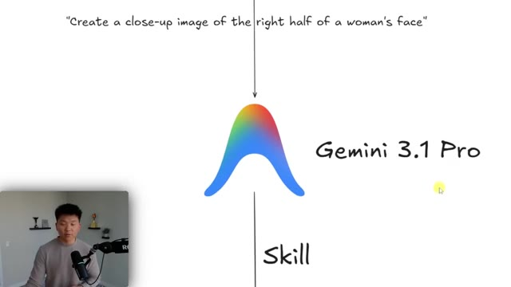
*⏱️ 00:06:02 — L'image montre un schéma avec un prompt en haut, le logo Gemini 3.1 Pro au centre et le mot 'Skill' en bas, illustrant le processus d'envoi du prompt vers le modèle.*

---

### ⏱️ `[00:06:15 - 00:06:38]` | Segment #16

**🔊 Audio (Transcription Intégrale Mot pour Mot en Français) :**
> Et maintenant, il prend cette requête super vague, il utilise sa compétence, et il la transforme en un prompt JSON. Nous avons le prompt, nous avons un négatif prompt, qui correspond aux éléments que nous ne voulons pas. Nous avons les paramètres avec la résolution, le style, l'éclairage, l'angle de caméra, des choses comme ça. Et ensuite, nous obtenons un résultat qui, je trouve, a l'air beaucoup, beaucoup mieux et bien plus réaliste. Je veux dire, regardez les pores et les imperfections, et il a réellement suivi ce que j'ai dit, à savoir, je veux juste la moitié droite du visage.

**👁️ Analyse Visuelle d'Écran (gemini-3.5-flash-lite) :**
**Interface & Outils** : Interface de tableau blanc ou de présentation visuelle intégrant du code JSON et des images générées.

**Contenu textuel & Code** : Code JSON structuré contenant les clés "prompt", "negative_prompt" et "settings" avec des paramètres techniques (résolution, style, éclairage, angle de caméra).

**Action / Démonstration** : Présentation et explication du résultat structuré obtenu à partir d'une requête initiale grâce au système d'automatisation.

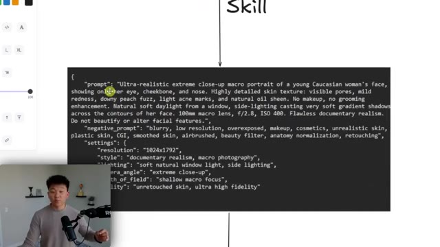
*⏱️ 00:06:21 — Un bloc de code JSON affichant un prompt structuré (prompt principal, negative_prompt, settings) pour la génération d'images, avec le présentateur en médaillon en bas à gauche.*

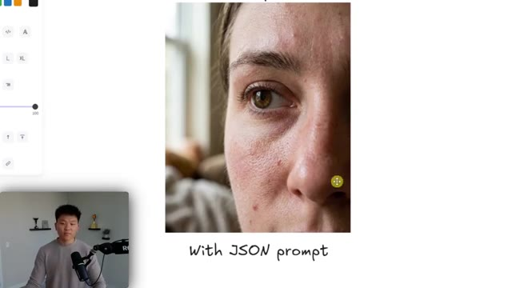
*⏱️ 00:06:33 — Une image générée ultra-réaliste en gros plan (macro) d'un visage de femme, avec la légende manuscrite "With JSON prompt" en dessous et le présentateur en médaillon.*

---

### ⏱️ `[00:06:39 - 00:07:01]` | Segment #17

**🔊 Audio (Transcription Intégrale Mot pour Mot en Français) :**
> Donc c'est ce que je m'apprête à vous montrer les gars, en utilisant Gemini 3 Pro pour nous écrire les prompts JSON afin de créer les images Nano Banana 2 et on obtient des résultats beaucoup plus cohérents. Et si vous ne me croyez pas déjà, absolument chacune de ces petites images a eu exactement le même style et c'est parce que je lui donne des prompts en JSON pour qu'elle le fasse. Bon, alors maintenant nous sommes dans anti-gravity, qui est fondamentalement juste un IDE. Si vous suivez ma chaîne depuis un moment, c'est essentiellement la même chose que VS Code.

**👁️ Analyse Visuelle d'Écran (gemini-3.5-flash-lite) :**
**Interface & Outils** : Schéma explicatif pour l'image 1 ; Visual Studio Code avec extensions d'agent IA pour l'image 2.

**Contenu textuel & Code** : Diagramme textuel du stack d'IA avec étapes (Design, Plan, Structure, Render, Text, 4K) ; arborescence du projet (images, prompts, scripts, skills, gemini.md) et interface de chat agent (Nano Banana 2).

**Action / Démonstration** : Présentation du flux d'automatisation et de l'environnement de développement du projet par le créateur.

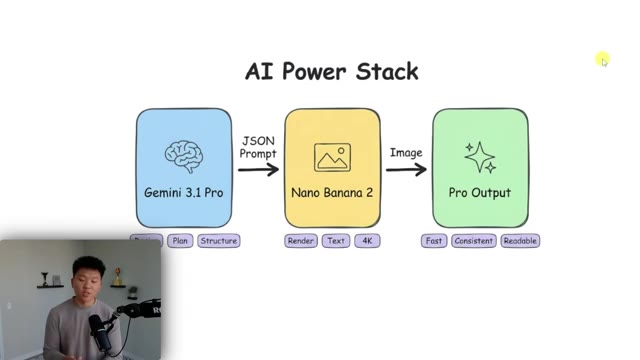
*⏱️ 00:06:44 — Schéma conceptuel du "AI Power Stack" montrant le flux de travail entre Gemini 3.1 Pro (génération de prompts JSON), Nano Banana 2 et le résultat final.*

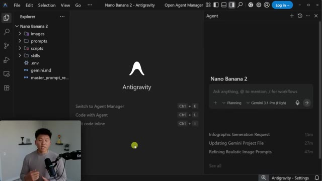
*⏱️ 00:06:55 — Interface de l'éditeur de code VS Code affichant le projet "Nano Banana 2 - Antigravity" avec l'arborescence des dossiers et le panneau latéral de l'agent IA.*

---

### ⏱️ `[00:07:01 - 00:07:21]` | Segment #18

**🔊 Audio (Transcription Intégrale Mot pour Mot en Français) :**
> Vous avez les extensions ici. Vous avez l'explorateur de fichiers. Vous avez vos fichiers. Et puis vous avez l'agent anti-gravity ici. Et vous pourriez même utiliser cloud code dans anti-gravity. Mais maintenant, nous allons utiliser l'agent anti-gravity parce que nous voulons utiliser Gemini 3.1 Pro. Parce que je pense que 3.1 Pro est probablement le meilleur en ce qui concerne l'esthétique et le design visuel. Si vous n'avez pas anti-gravity, il est tout à fait gratuit à télécharger.

**👁️ Analyse Visuelle d'Écran (gemini-3.5-flash-lite) :**
**Interface & Outils** : Éditeur de code Antigravity

**Contenu textuel & Code** : Explorateur de fichiers montrant les dossiers images, prompts, scripts, skills et le panneau de l'agent Antigravity avec le modèle sélectionné « Gemini 3.1 Pro (High) ».

**Action / Démonstration** : Le présentateur présente l'interface d'Antigravity et la sélection du modèle Gemini 3.1 Pro pour l'agent IA.

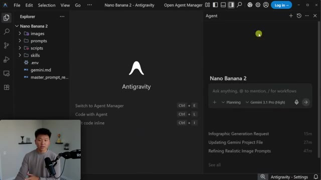
*⏱️ 00:07:06 — Interface de l'éditeur de code Antigravity avec l'explorateur de fichiers à gauche et le panneau de l'agent IA à droite configuré sur Gemini 3.1 Pro.*

---

### ⏱️ `[00:07:21 - 00:07:54]` | Segment #19

**🔊 Audio (Transcription Intégrale Mot pour Mot en Français) :**
> Allez simplement sur antigravity.google et téléchargez-le pour votre système d'exploitation. Maintenant, une fois que vous êtes ici, ce que vous allez faire, c'est cliquer sur fichier, vous allez ouvrir un dossier et en créer un nouveau n'importe où sur votre bureau, puis l'ouvrir. Il ne ressemblera pas au mien car il n'y aura aucun fichier ici, mais je vais vous mettre tous à niveau. Alors, qu'avons-nous ici sur ce côté gauche ? Eh bien, la première chose que nous avons est le Gemini.md, qui, si vous avez utilisé Claude Code, est essentiellement la même chose qu'un Claude.md. Cela indique à mon agent ici comment configurer ce projet et quoi faire. Je dis donc qu'il est essentiel de toujours garder les invites et les images organisées dans ce

**👁️ Analyse Visuelle d'Écran (gemini-3.5-flash-lite) :**
**Interface & Outils** : Antigravity (interface inspirée de VS Code)

**Contenu textuel & Code** : Arborescence de projet "Nano Banana 2" avec les dossiers images, prompts, scripts, skills, fichier .env, gemini.md et un panneau de chat Agent IA sur le côté droit.

**Action / Démonstration** : Navigation et présentation de l'interface de l'application Antigravity avec le panneau de l'agent IA ouvert.

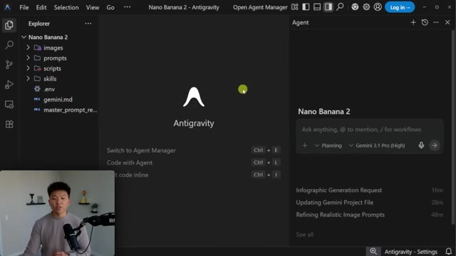
*⏱️ 00:07:29 — Interface de l'application Antigravity montrant l'explorateur de fichiers à gauche avec les dossiers images, prompts, scripts et skills, au centre l'écran d'accueil Antigravity et à droite le panneau de l'agent IA.*

---

### ⏱️ `[00:07:54 - 00:08:16]` | Segment #20

**🔊 Audio (Transcription Intégrale Mot pour Mot en Français) :**
> structure. Je lui parle du flux de travail de génération d'images en utilisant la compétence Nano Banana. Et j'explique fondamentalement juste les règles pour ce projet. Parce que la façon dont fonctionne le fichier Gemini.md, c'est qu'à chaque fois avant que l'agent ne lise réellement votre question que vous lui envoyez, il lit ceci en premier. C'est fondamentalement juste comme un prompt système principal. Donc vous posez une question, il lit Gemini.md, et ensuite il vous donne un résultat beaucoup plus prévisible. Honnêtement, c'est très similaire à une compétence.

**👁️ Analyse Visuelle d'Écran (gemini-3.5-flash-lite) :**
**Interface & Outils** : VS Code (éditeur de code) et diagramme explicatif illustré.

**Contenu textuel & Code** : Code Markdown du fichier `gemini.md` affichant les sections sur le workflow de génération d'images et les scripts log, ainsi qu'un diagramme schématique du fonctionnement de l'agent.

**Action / Démonstration** : Présentation de l'environnement de développement et explication visuelle du fonctionnement du fichier `gemini.md` pour structurer les requêtes de l'agent IA.

*⏱️ 00:07:59 — Vue de l'éditeur de code (VS Code) montrant le fichier `gemini.md` avec la configuration du flux de travail de génération d'images et un panneau latéral de chat avec l'agent IA "Nano Banana 2".*

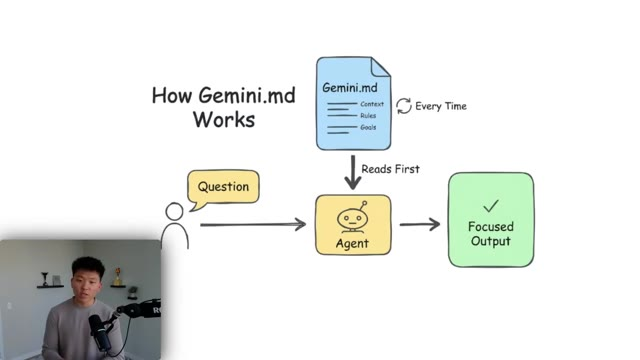
*⏱️ 00:08:05 — Schéma explicatif animé intitulé "How Gemini.md Works", montrant le rôle du fichier de configuration lu par l'agent avant de traiter les questions de l'utilisateur.*

---

### ⏱️ `[00:08:16 - 00:08:54]` | Segment #21

**🔊 Audio (Transcription Intégrale Mot pour Mot en Français) :**
> Maintenant, qu'est-ce d'autre avons-nous là-dedans sur quoi je veux attirer votre attention ? Vous pouvez voir, évidemment, que nous avons la compétence, qui est la génération d'images nano banana. Et si j'ouvre ceci, c'est à peu près exactement la même chose qu'une compétence de code cloud. Ces compétences sont juste des fichiers markdown et vous pouvez basculer entre différents modèles d'IA. Si vous voulez récupérer cette compétence, si vous voulez récupérer le Gemini.md, tout ce dont vous avez besoin pour cette vidéo spécifiquement, rendez-vous simplement dans ma communauté school gratuite. Le lien pour cela est dans la description. Allez dans la classe et vous pourrez alors accéder à cette classe de compétences d'agent, qui contient tout ce dont vous avez besoin. Donc je ne vais pas tout lire parce que vous pouvez l'obtenir, mais la compétence explique essentiellement comment faire un prompt JSON. Elle dit à Gemini 3 Pro comment faire tout cela. Je montre des trucs de schéma. Je montre quoi mettre dans quel

**👁️ Analyse Visuelle d'Écran (gemini-3.5-flash-lite) :**
**Interface & Outils** : Visual Studio Code

**Contenu textuel & Code** : Fichier Markdown (SKILL.md) décrivant une compétence d'intelligence artificielle pour la génération d'images hyper-réalistes via le modèle Nano Banana 2 (Gemini 3.1 Flash).

**Action / Démonstration** : Présentation et explication du contenu du fichier de configuration de la compétence d'IA dans l'éditeur de code.

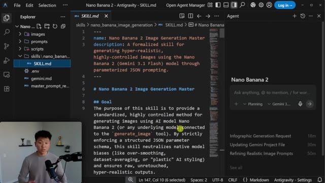
*⏱️ 00:08:26 — Un éditeur de code affichant un fichier Markdown nommé SKILL.md pour la génération d'images avec le modèle Nano Banana 2, avec le présentateur visible en incrustation dans le coin inférieur gauche.*

---

### ⏱️ `[00:08:54 - 00:09:27]` | Segment #22

**🔊 Audio (Transcription Intégrale Mot pour Mot en Français) :**
> arguments. Et ce que vous remarquerez ici, c'est que je dis aussi, si vous avez besoin d'en comprendre davantage et que vous voulez examiner différentes options, vous pouvez consulter le guide de référence principal, qui est juste ici. Et c'est fondamentalement la même chose, mais cela va beaucoup, beaucoup, beaucoup plus en profondeur. Donc vous aurez tous accès à tout cela. Donc fondamentalement, la façon dont les compétences fonctionnent, c'est que vous poserez une question à l'agent et il cherchera parmi toutes les compétences existantes. Donc si vous posiez une question sur le code, il parcourrait les compétences, il se dirait, ok, super, j'ai une compétence en code, laissez-moi l'utiliser pour avoir un meilleur résultat, un résultat plus prévisible. Et puis enfin, la dernière chose, c'est que nous avons deux dossiers que je voulais que vous examiniez. Nous avons des images et nous avons des prompts, et ces deux-là

**👁️ Analyse Visuelle d'Écran (gemini-3.5-flash-lite) :**
**Interface & Outils** : VS Code avec panneau latéral Agent IA et schéma explicatif illustré.

**Contenu textuel & Code** : Fichier Markdown (SKILL.md) contenant des instructions pour la génération d'images, liens vers le guide de référence principal et schéma de flux de travail d'agent IA.

**Action / Démonstration** : Le présentateur explique la structure des compétences d'agents IA et montre comment naviguer vers le guide de référence principal dans l'éditeur de code.

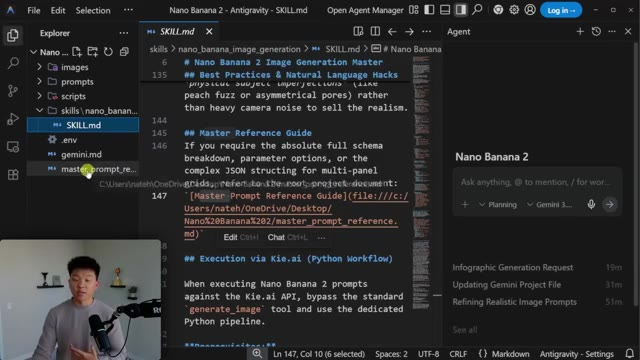
*⏱️ 00:09:02 — Vue de l'éditeur de code (VS Code) montrant le fichier SKILL.md avec le guide de référence et la section 'Master Prompt Reference Guide', ainsi qu'un panneau de chat d'agent IA sur la droite et la webcam du présentateur en bas à gauche.*

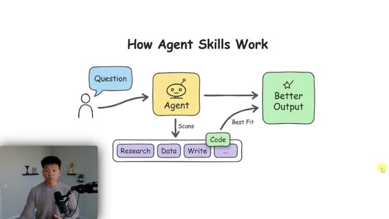
*⏱️ 00:09:10 — Schéma explicatif dessiné à la main montrant le fonctionnement des compétences d'agent IA ('How Agent Skills Work') avec un utilisateur, un agent, différentes compétences (Research, Data, Write, Code) et le résultat final ('Better Output').*

---

### ⏱️ `[00:09:27 - 00:09:45]` | Segment #23

**🔊 Audio (Transcription Intégrale Mot pour Mot en Français) :**
> ont été organisées en infographies, divers, personnes, photographie et produits. Donc, à chaque fois que nous générons une image, allons dans le dossier personnes, disons que nous faisons celle-ci, nous pouvons voir le prompt JSON réel qu'il a écrit pour nous. Et ensuite, si nous ouvrons cette même chose dans notre dossier d'images, nous pourrions l'ouvrir et nous verrions l'image réelle qui a été créée à partir de ce prompt.

**👁️ Analyse Visuelle d'Écran (gemini-3.5-flash-lite) :**
**Interface & Outils** : Visual Studio Code avec interface Antigravity et panneau Agent intégré

**Contenu textuel & Code** : Structure de dossiers de projets (images, prompts avec sous-dossiers infographics, miscellaneous, people, photography, products) et interface de chat/agent IA "Nano Banana 2"

**Action / Démonstration** : Navigation dans l'arborescence des fichiers du projet pour montrer l'organisation des prompts générés par l'IA

*⏱️ 00:09:32 — Capture d'écran montrant l'éditeur de code VS Code avec le panneau de l'explorateur de fichiers déployé sur la gauche, affichant une structure de dossiers organisée par catégories (infographics, miscellaneous, people, photography, products) sous le dossier prompts. Un panneau d'agent IA est visible sur la droite et le présentateur apparaît en incrustation vidéo dans le coin inférieur gauche.*

---

### ⏱️ `[00:09:46 - 00:10:08]` | Segment #24

**🔊 Audio (Transcription Intégrale Mot pour Mot en Français) :**
> Et comme vous pouvez le voir, celui-ci, encore une fois, a l'air incroyable. D'accord. Maintenant que vous comprenez un peu ce qui se passe dans le projet, faisons une démo. Je vais aller ici, sur l'agent, et envoyer un prompt. D'accord. Donc, comme vous pouvez le voir, j'ai dit : J'ai besoin que tu me génères trois images différentes avec des styles différents pour que je puisse voir celle que je préfère. Et tout ce que je lui ai donné comme prompt, c'était une jeune femme tenant un produit de beauté. Vous pouvez donc voir ce qu'il est en train de faire.

**👁️ Analyse Visuelle d'Écran (gemini-3.5-flash-lite) :**
**Interface & Outils** : Interface de développement Antigravity / Éditeur de code (type VS Code)

**Contenu textuel & Code** : Explorateur de fichiers avec les dossiers "images", "prompts", "scripts" et le panneau d'agent "Nano Banana 2" avec des options de chat et de planification.

**Action / Démonstration** : Présentation de l'interface de l'agent IA et préparation pour envoyer un prompt de démonstration.

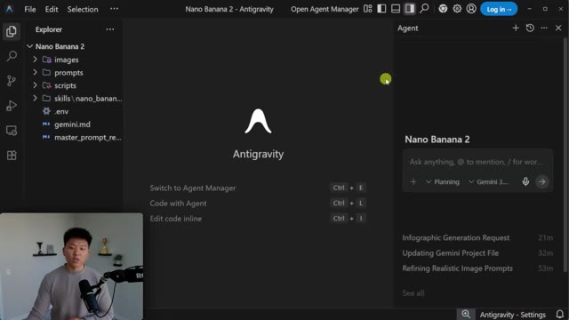
*⏱️ 00:09:51 — Vue de l'interface d'Antigravity dans un éditeur avec un panneau d'agent IA à droite et l'explorateur de fichiers du projet Nano Banana 2 à gauche.*

---

### ⏱️ `[00:10:08 - 00:10:29]` | Segment #25

**🔊 Audio (Transcription Intégrale Mot pour Mot en Français) :**
> Il a cherché différentes compétences. Et maintenant, il analyse la compétence d'image de nano banane. Ce que j'adore avec ces outils, c'est qu'on peut littéralement les voir réfléchir et on peut voir exactement ce qu'ils font. Alors regardez ça, il a en fait analysé un prompt JSON d'un peu plus tôt, peut-être parce qu'il veut récupérer certains de ces éléments pour rendre ce prompt encore meilleur. Et ce qu'il fait, c'est qu'il crée fondamentalement une liste de tâches pour qu'on puisse voir visuellement où il en est.

**👁️ Analyse Visuelle d'Écran (gemini-3.5-flash-lite) :**
**Interface & Outils** : IDE de type VS Code ou Cursor avec l'extension Antigravity, et incrustation vidéo du présentateur en bas à gauche.

**Contenu textuel & Code** : Explorateur de fichiers montrant les dossiers "images", "prompts", "scripts", "skills\nano_banana_image...", et panneau de discussion affichant les étapes : "Thought for 3s", "Searched *skill*.md", "Analyzed SKILL.md #L1-167", "Advancing toward Completion".

**Action / Démonstration** : L'agent IA analyse le fichier de compétence (SKILL.md) suite à une requête de génération d'images.

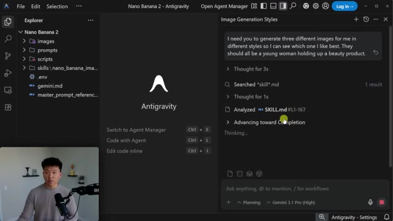
*⏱️ 00:10:13 — Interface d'un éditeur de code affichant l'explorateur de fichiers à gauche et un panneau de chat avec l'agent IA à droite montrant les étapes de réflexion et d'analyse d'un fichier de compétence.*

---

### ⏱️ `[00:10:29 - 00:10:47]` | Segment #26

**🔊 Audio (Transcription Intégrale Mot pour Mot en Français) :**
> Il va commencer à cocher ces éléments au fur et à mesure qu'il avance. Vous pouvez donc voir que le style un va être réalisme documentaire. Le style deux va être influenceur lifestyle. Et le style trois va être film vintage. Très bien, donc ça vient tout juste de se terminer. Nous avons nos trois nouvelles images et elles sont toutes dans le dossier personnes. Donc la première est le réalisme documentaire. D'accord, ça a l'air plutôt pas mal.

**👁️ Analyse Visuelle d'Écran (gemini-3.5-flash-lite) :**
**Interface & Outils** : Éditeur de code (type VS Code / Antigravity) avec volet latéral des tâches et panneau d'agent IA.

**Contenu textuel & Code** : Liste de tâches "Nano Banana Image Generation Task" listant trois styles : Style 1 (Documentary Realism), Style 2 (Lifestyle / Influencer) et Style 3 (Vintage Film).

**Action / Démonstration** : Le panneau latéral montre l'exécution des étapes de génération de prompts JSON et l'analyse par l'agent IA.

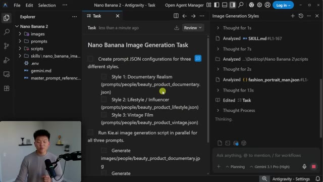
*⏱️ 00:10:33 — Vue de l'interface d'un éditeur de code présentant une liste de tâches pour la génération d'images, avec le présentateur en médaillon dans le coin inférieur gauche.*

---

### ⏱️ `[00:10:47 - 00:11:07]` | Segment #27

**🔊 Audio (Transcription Intégrale Mot pour Mot en Français) :**
> Tout ici a l'air très réaliste. Le produit a l'air bien aussi, tout est correctement orthographié. La deuxième était lifestyle. Donc vous pouvez voir que ça a l'air vraiment, vraiment bien, très réaliste. Et celle-ci, c'est juste comme si elle était dans sa salle de bain. Et puis nous avions celle-ci, qui était vintage, que je n'aime pas vraiment, honnêtement. Je veux dire, ça a quand même l'air bien. Ça ressemble toujours à une vraie photo, c'est sûr, mais ce n'est pas le style que je voudrais.

**👁️ Analyse Visuelle d'Écran (gemini-3.5-flash-lite) :**
**Interface & Outils** : Visual Studio Code (VS Code) avec explorateur de fichiers et panneau de prévisualisation d'images.

**Contenu textuel & Code** : Fichiers d'images générées par IA (beauty_product_lifestyle.jpg, beauty_product_vintage.jpg) et structure de dossiers.

**Action / Démonstration** : Présentation et examen visuel de différentes images générées par IA représentant des styles de produits de beauté.

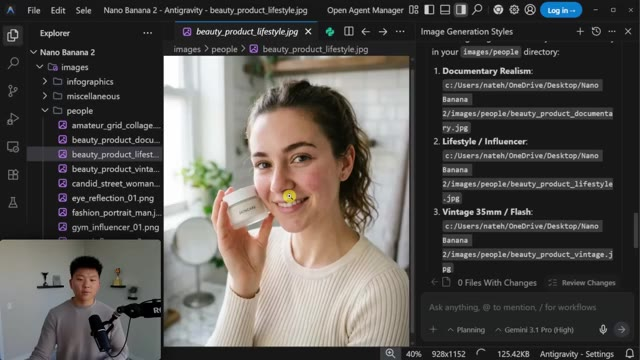
*⏱️ 00:10:52 — Visualisation d'une image lifestyle générée par IA montrant une femme tenant un pot de crème dans VS Code.*

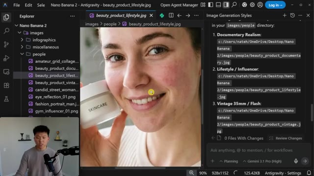
*⏱️ 00:10:57 — Zoom sur l'image lifestyle précédente, montrant le réalisme de la peau et du produit cosmétique.*

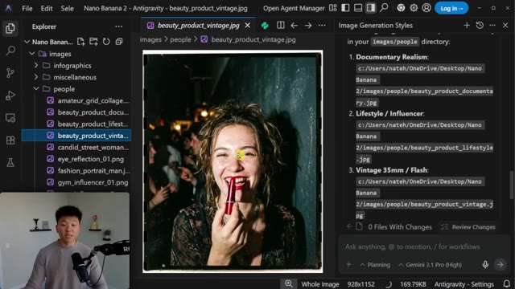
*⏱️ 00:11:02 — Affichage d'une autre image générée style vintage 35mm avec une femme tenant un rouge à lèvres dans l'éditeur.*

---

### ⏱️ `[00:11:07 - 00:11:27]` | Segment #28

**🔊 Audio (Transcription Intégrale Mot pour Mot en Français) :**
> Donc, maintenant que nous avons compris que nous aimons aussi ce style, nous pourrions continuer et en générer davantage dans ce style exact parce que ces prompts sont enregistrés juste ici. Prompts, personnes, et ensuite nous avons ces choses juste là. Maintenant, c'est aussi vraiment utile, pas seulement pour les personnes, mais aussi pour les produits. Disons donc que vous avez importé la photo d'un produit que vous avez. Nano Banana 2 peut non seulement transformer du texte en images, mais aussi des images en images.

**👁️ Analyse Visuelle d'Écran (gemini-3.5-flash-lite) :**
**Interface & Outils** : VS Code (éditeur de code) avec l'extension Open Agent Manager / Antigravity.

**Contenu textuel & Code** : Arborescence de fichiers montrant des dossiers d'images et de prompts (ex: `images/people/...`, `prompts/people/...`) et une tâche d'assistant listant des styles de génération d'images.

**Action / Démonstration** : L'utilisateur navigue dans l'arborescence des fichiers du projet pour montrer les configurations JSON des prompts enregistrés.

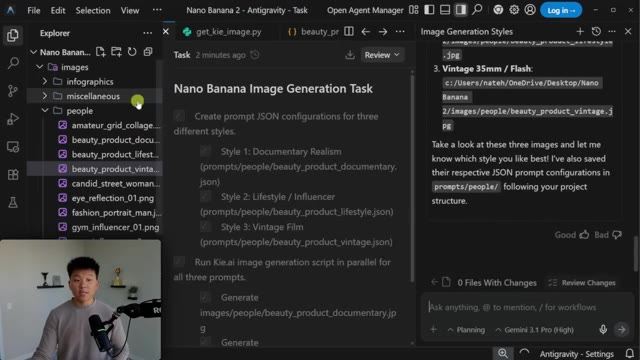
*⏱️ 00:11:12 — Vue de l'interface de VS Code avec un panneau latéral montrant la structure des dossiers et un assistant IA actif sur la droite.*

---

### ⏱️ `[00:11:27 - 00:11:46]` | Segment #29

**🔊 Audio (Transcription Intégrale Mot pour Mot en Français) :**
> Donc, j'ai simplement inséré une vieille photo d'un flacon de parfum aléatoire et j'ai dit : crée-moi deux photos publicitaires de produits différentes pour cette image d'un flacon de parfum. Très bien, alors il est dit : j'ai créé avec succès deux photos différentes. Nous avons "Fraîcheur Océanique" et nous avons "Élégance Studio Minimaliste". Voici le prompt pour la première. Voici le prompt pour la deuxième. Jetons un coup d'œil. D'accord, donc c'est la "Fraîcheur Océanique", je suppose.

**👁️ Analyse Visuelle d'Écran (gemini-3.5-flash-lite) :**
**Interface & Outils** : VS Code avec interface d'assistant IA (Nano Banana 2 - Antigravity) et panneau de chat/tâches.

**Contenu textuel & Code** : Tâches de génération d'images pour un flacon de parfum ("Create me two different product ad photos for this image of a cologne bottle"), affichage de l'image source et du statut "Generating".

**Action / Démonstration** : L'agent IA exécute la tâche de création de configurations JSON et lance la génération d'images publicitaires.

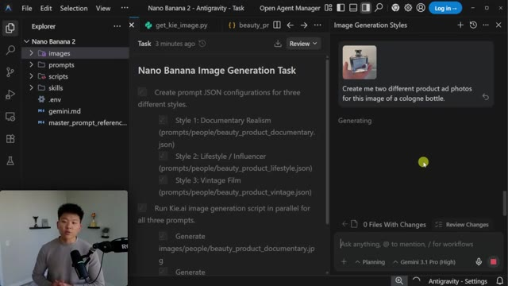
*⏱️ 00:11:32 — Interface de VS Code montrant le panneau d'un agent IA en cours de génération de photos publicitaires pour un flacon de parfum, avec la webcam du présentateur en bas à gauche.*

---

### ⏱️ `[00:11:47 - 00:12:10]` | Segment #30

**🔊 Audio (Transcription Intégrale Mot pour Mot en Français) :**
> Et si j'affiche très rapidement l'original, vous pouvez voir que nous avons la même forme de bouteille et la même police. Donc c'est super. Et maintenant, si j'affiche la deuxième, vous pouvez voir que celle-ci est juste beaucoup plus propre. On dirait qu'elle est dans un studio. Et encore une fois, même police et tout le reste. Celle-ci a même ajouté quelque chose. Elle a ajouté le texte en bas avec 3,4 onces liquides. Donc ce que cela me dit, c'est qu'elle a probablement fait quelques recherches sur Google avant de créer cette image réelle.

**👁️ Analyse Visuelle d'Écran (gemini-3.5-flash-lite) :**
**Interface & Outils** : VS Code (Visual Studio Code)

**Contenu textuel & Code** : Explorateur de fichiers avec les dossiers images, produits et affichage de l'image de parfum "nautica_voyage_studio.jpg" comparée à l'original.

**Action / Démonstration** : Le présentateur compare la forme de la bouteille et la police entre l'image originale et le rendu studio généré.

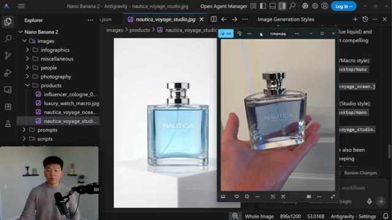
*⏱️ 00:11:52 — Comparaison visuelle entre l'image originale d'une bouteille de parfum tenue dans la main et la version studio générée par IA dans l'éditeur VS Code.*

---

### ⏱️ `[00:12:10 - 00:12:31]` | Segment #31

**🔊 Audio (Transcription Intégrale Mot pour Mot en Français) :**
> Maintenant, ce qui est génial avec ces compétences, c'est que plus vous les utilisez, et plus elles s'améliorent. Parce que ce que je pourrais faire maintenant, c'est pratiquement venir ici et dire, super. Donc pour la première image, j'ai adoré ça. Pour la deuxième image, j'ai détesté ça. Mettez vos compétences à jour pour qu'à l'avenir, cela se produise toujours. Et si vous êtes curieux, la façon dont j'ai réellement construit cette compétence, c'est que je lui ai fait extraire des tonnes d'informations sur le prompting en JSON, en trouvant des exemples et des choses de ce genre.

**👁️ Analyse Visuelle d'Écran (gemini-3.5-flash-lite) :**
**Interface & Outils** : VS Code avec une extension ou un panneau d'agent IA (Gemini 3.1 Pro) et le présentateur visible en incrustation vidéo en bas à gauche.

**Contenu textuel & Code** : Explorateur de fichiers ('Nano Banana 2'), aperçu d'une image nommée 'nautica_voyage_studio.jpg', et un message de l'IA avec des options de notation (pouce levé / pouce baissé).

**Action / Démonstration** : Le présentateur explique comment évaluer les images générées en utilisant le feedback pour améliorer les compétences de l'IA.

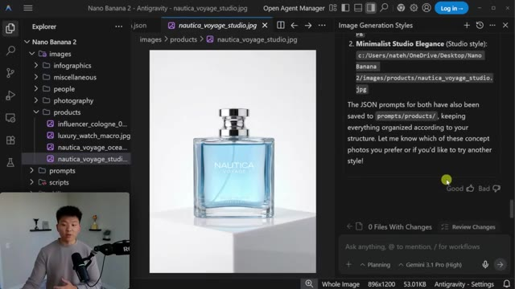
*⏱️ 00:12:16 — Capture d'écran de l'éditeur de code VS Code montrant l'arborescence des fichiers à gauche, un aperçu d'une image de flacon de parfum au centre, et une fenêtre de chat de l'assistant IA avec des boutons de feedback 'Good' et 'Bad' à droite.*

---

### ⏱️ `[00:12:31 - 00:12:58]` | Segment #32

**🔊 Audio (Transcription Intégrale Mot pour Mot en Français) :**
> Et ensuite, je lui ai juste fait créer environ 20 images pour moi. J'ai dit : voici ce que j'aime dans toutes ces images, voici ce que je n'aime pas, donne-m'en 20 de plus. Et après, j'ai juste fait ça en boucle et j'ai continué à donner des retours. Donc la dernière chose dont je voulais parler ici, c'est : comment est-ce qu'on exécute réellement ces images ? Eh bien, j'utilise des scripts, et j'utilise des scripts Python qui font un appel à key.ai. Maintenant, ce que vous pouvez faire, c'est que vous pouvez commencer dans anti-gravity, et il peut générer des images pour vous de manière native et gratuitement, mais vous allez probablement atteindre votre limite assez rapidement, mais c'est un bon moyen de tester.

**👁️ Analyse Visuelle d'Écran (gemini-3.5-flash-lite) :**
**Interface & Outils** : VS Code avec extension ou panneau d'agent IA intégré (Open Agent Manager, Gemini 3.1 Pro).

**Contenu textuel & Code** : Arborescence de projet (dossiers images, prompts, scripts, skills), affichage d'une image générée (nautica_voyage_studio.jpg) et texte dans le panneau latéral décrivant des styles de génération d'images ("Oceanic Freshness", "Minimalist Studio Elegance") et demandant quelle préférence retenir.

**Action / Démonstration** : Navigation dans l'éditeur de code et visualisation d'une image de produit générée par IA ainsi que des options textuelles associées.

*⏱️ 00:12:38 — Capture d'écran montrant l'éditeur de code VS Code avec une image générée d'un flacon de parfum Nautica Voyage au centre, l'arborescence des fichiers à gauche et un panneau de discussion d'assistant IA à droite proposant différents styles d'images et demandant des retours.*

---

### ⏱️ `[00:12:58 - 00:13:16]` | Segment #33

**🔊 Audio (Transcription Intégrale Mot pour Mot en Français) :**
> Et si vous vous souvenez du prix que nous avons vu sur Google AI Studio juste ici, si nous allons sur Key.ai, eh bien, vous remarquerez que c'est en fait beaucoup moins cher. C'est seulement 4 cents pour une image en résolution 1K. Et ensuite, à mesure que la résolution augmente, ça devient un peu plus cher, mais même pour la 4K, c'est seulement 9 cents, ce qui est environ 40 % moins cher que le prix officiel.

**👁️ Analyse Visuelle d'Écran (gemini-3.5-flash-lite) :**
**Interface & Outils** : Navigateur web (KIE API)

**Contenu textuel & Code** : Informations tarifaires (8 crédits pour 1K, 12 pour 2K, 18 pour 4K), description du modèle Nano Banana 2 (Google's Gemini 3.1 Flash Image model).

**Action / Démonstration** : Navigation et présentation des tarifs et fonctionnalités de l'API de génération d'images.

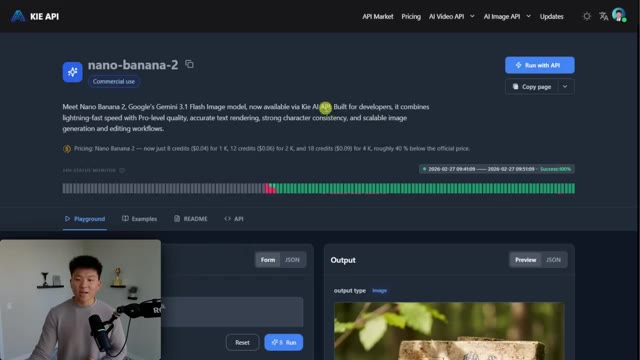
*⏱️ 00:13:02 — Interface du site KIE API présentant le modèle nano-banana-2 avec les détails tarifaires et de performance.*

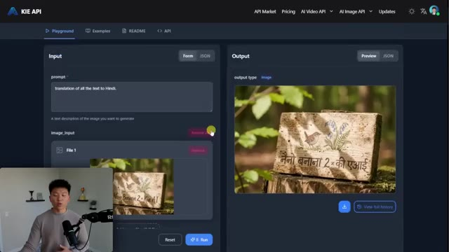
*⏱️ 00:13:07 — Interface de test (Playground) de KIE API montrant un champ de saisie de prompt et l'image générée en sortie.*

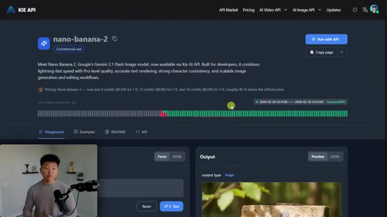
*⏱️ 00:13:12 — Retour à la vue d'ensemble du modèle nano-banana-2 sur la plateforme KIE API avec le moniteur de statut.*

---

### ⏱️ `[00:13:17 - 00:13:37]` | Segment #34

**🔊 Audio (Transcription Intégrale Mot pour Mot en Français) :**
> Maintenant, je voulais juste vous montrer rapidement un exemple qui n'était pas très bon, juste pour ne pas être là à prétendre que c'est la chose magique la plus incroyable au monde. Voici un exemple où j'ai dit, crée-moi une infographie sur la façon de faire un Old Fashioned. C'est celui que j'ai envoyé à Nano Banana 2 sans invite JSON. Et c'est celui pour lequel j'ai utilisé ma compétence pour l'invite JSON. Maintenant, à première vue, ça a l'air bien meilleur.

**👁️ Analyse Visuelle d'Écran (gemini-3.5-flash-lite) :**
**Interface & Outils** : Application de tableau blanc ou outil de présentation en ligne (Nano Banana Pro)

**Contenu textuel & Code** : Le prompt textuel « create me an infographic of how to make an old fasioned » et deux images illustrant des recettes de cocktails.

**Action / Démonstration** : Le présentateur montre un exemple d'infographie générée qu'il qualifie de moins réussie pour illustrer les limites de l'outil.

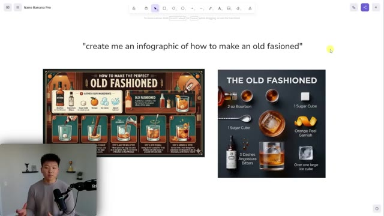
*⏱️ 00:13:22 — Une interface de présentation montrant le prompt textuel et deux infographies générées sur la préparation d'un cocktail Old Fashioned, avec la webcam du présentateur en bas à gauche.*

---

### ⏱️ `[00:13:37 - 00:14:00]` | Segment #35

**🔊 Audio (Transcription Intégrale Mot pour Mot en Français) :**
> C'est super, super esthétique. C'est comme une vue de haut. Mais ce que vous remarquerez, c'est qu'ici, nous avons ce texte qui dit un morceau de sucre, qui est par ici. Cela aurait sans doute dû dire, vous savez, cuillère à mélange ou peu importe comment vous voulez appeler ça. C'est donc de l'IA. Ça reste une boîte noire. Ça reste fondamentalement tirer le levier d'une machine à sous. mais avec des compétences et du prompting JSON, vous pouvez vraiment rendre vos résultats beaucoup plus cohérents et vous, l'humain, pouvez avoir beaucoup plus de contrôle.

**👁️ Analyse Visuelle d'Écran (gemini-3.5-flash-lite) :**
**Interface & Outils** : Interface de tableau blanc / application de canevas infographique (Nano Banana Pro)

**Contenu textuel & Code** : Texte du prompt : 'Make an infographic of how to make an old fashioned', et éléments graphiques d'ingrédients de cocktail.

**Action / Démonstration** : Le présentateur commente les hallucinations textuelles et erreurs de génération de l'IA sur l'image du cocktail.

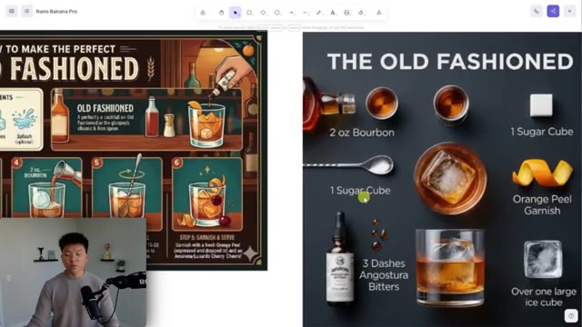
*⏱️ 00:13:43 — Vue d'ensemble sur le canevas d'une infographie générée par IA montrant les ingrédients d'un Old Fashioned, avec le présentateur en médaillon.*

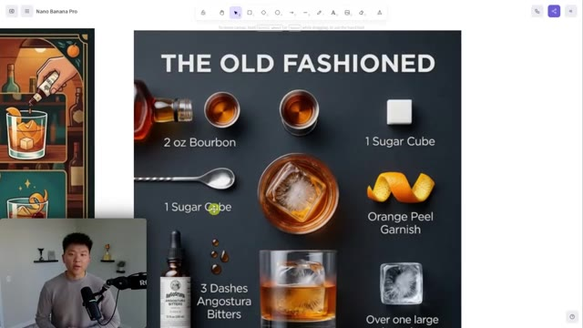
*⏱️ 00:13:49 — Gros plan sur l'infographie montrant l'erreur textuelle où '1 Sugar Cube' est associé à tort à une cuillère à mélange.*

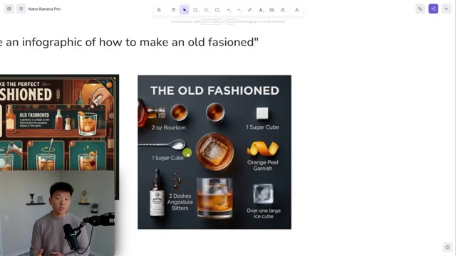
*⏱️ 00:13:55 — Dézoom du canevas révélant le prompt textuel initial utilisé pour générer l'infographie du cocktail.*

---

### ⏱️ `[00:14:01 - 00:14:22]` | Segment #36

**🔊 Audio (Transcription Intégrale Mot pour Mot en Français) :**
> Donc c'est tout pour celui-ci. N'oubliez pas que vous pouvez trouver tout ce dont vous avez besoin pour faire cela dans mon école gratuite, dans la section des compétences, le lien est dans la description. Et si vous aimez vous plonger dans ce genre de sujets de geeks, alors vous devriez absolument jeter un œil à ma communauté payante. Le lien pour celle-ci est également dans la description. Nous avons plus de 3000 membres ici qui construisent avec l'IA chaque jour et ils construisent tous des entreprises autour de l'automatisation par l'IA. Donc si c'est ça votre objectif, alors c'est un endroit formidable pour vous entourer de personnes partageant les mêmes idées.

**👁️ Analyse Visuelle d'Écran (gemini-3.5-flash-lite) :**
**Interface & Outils** : Plateforme web Skool (AI Automation Society)

**Contenu textuel & Code** : Menus de navigation de la communauté Skool, sections de cours (Classroom) et publications du flux d'actualités.

**Action / Démonstration** : Navigation sur la plateforme en ligne de la communauté pour montrer l'accès aux cours et aux compétences.

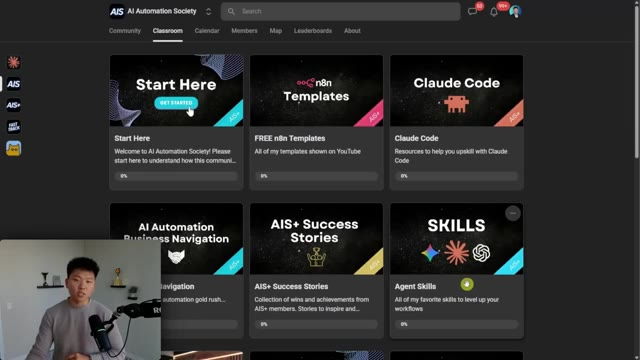
*⏱️ 00:14:06 — Capture d'écran montrant l'interface de la plateforme Skool "AI Automation Society" avec les différentes sections de cours (Classroom), incluant "Start Here", "n8n Templates", "Claude Code" et "Agent Skills".*

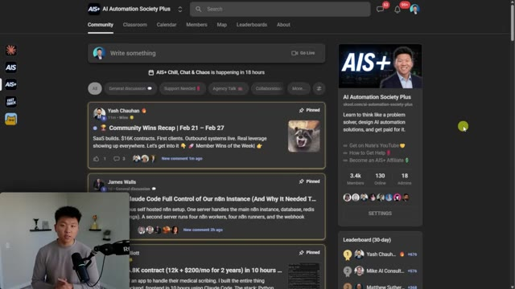
*⏱️ 00:14:11 — Capture d'écran montrant l'onglet "Community" de la plateforme Skool "AI Automation Society Plus" avec les fils de discussion et publications des membres.*

---

### ⏱️ `[00:14:22 - 00:14:32]` | Segment #37

**🔊 Audio (Transcription Intégrale Mot pour Mot en Français) :**
> mais c'est tout pour aujourd'hui donc si vous avez apprécié ou si vous avez appris quelque chose de nouveau, veuillez mettre un pouce bleu, ça m'aide vraiment énormément et comme toujours, je vous remercie d'être arrivés jusqu'à la fin de la vidéo, je vous vois dans la prochaine, merci tout le monde

**👁️ Analyse Visuelle d'Écran (gemini-3.5-flash-lite) :**
**Interface & Outils** : VS Code

**Contenu textuel & Code** : Explorateur de fichiers avec les dossiers images (infographics, miscellaneous, people, photography, products) et aperçu d'une image "chicago_skyline.jpg"

**Action / Démonstration** : Navigation dans l'arborescence du projet et visualisation d'une image générée.

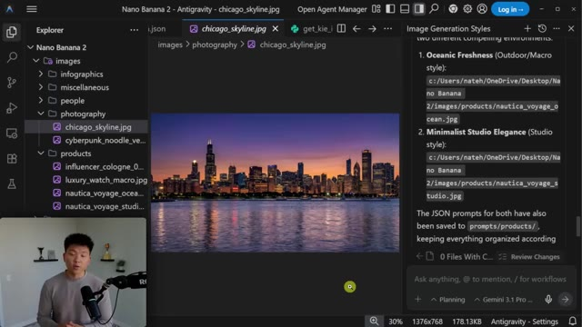
*⏱️ 00:14:24 — L'éditeur VS Code affichant un projet avec l'arborescence des dossiers à gauche, une image de paysage urbain au centre et du texte de style d'image à droite, avec la webcam du présentateur en bas à gauche.*

---

