# 🎬 Master 95% of Claude Code Skills in 28 Minutes

> **Chaîne** : [Nate Herk | AI Automation](https://www.youtube.com/@nateherk/featured)  
> **Lien YouTube** : [https://www.youtube.com/watch?v=zKBPwDpBfhs](https://www.youtube.com/watch?v=zKBPwDpBfhs)  
> **Date de publication** : 20260227  
> **Durée** : 00:27:18  
> **Identifiant vidéo** : `zKBPwDpBfhs`  
> **Transcription & Analyse** : `whisper-v3-large-turbo+gemini-3.5-flash-lite`  

---

## 📌 Synthèse Exécutive & Outils

### 💡 Résumé

Cette vidéo présentée par Nate Herk sur la chaîne *Nate Herk | AI Automation* démontre l'impact révolutionnaire des compétences d'agents (« agent skills ») au sein de **Claude Code**. En s'appuyant sur le concept fondamental du « levier », l'auteur montre comment il est possible de multiplier sa productivité personnelle et celle d'une équipe entière en faisant exécuter des flux de travail complexes en parallèle. Grâce à une démonstration en direct, il illustre l'exécution simultanée de quatre agents distincts capables de planifier une journée (intégration ClickUp et calendrier), de réaliser un point de situation global sur les projets, de générer des diagrammes techniques vectoriels précis (via Excalidraw) et d'analyser les commentaires YouTube pour orienter la stratégie de contenu. Le tout s'accomplit en quelques secondes, éliminant la fatigue décisionnelle et les coûts de changement de contexte.

Techniquement, une compétence d'agent se résume à une structure simple et modulaire : un dossier localisé (généralement dans `.claude/skills/`) contenant un fichier Markdown (`skill.md`) doté d'un en-tête de métadonnées en YAML et d'instructions étape par étape. Ces compétences agissent comme des Procédures Opérationnelles Standard (POS) pour l'IA. Contrairement aux simples prompts, elles sont réutilisables, déterministes et capables d'orchestrer des scripts, d'appeler des API ou de mobiliser des sous-agents. L'auteur souligne que cette approche permet d'atteindre en un jour l'équivalent d'une semaine de production, redéfinissant les standards de performance en ingénierie logicielle et en automatisation d'entreprise.

---

### 🛠️ Outils, Modèles & Logiciels Présentés

* **Claude Code** : L'environnement de développement et d'exécution principal utilisé pour piloter les agents IA via des commandes en langage naturel et des interfaces en ligne de commande.
* **Anthropic** : L'écosystème d'IA sous-jacent fournissant les modèles et l'infrastructure cognitive avancée pour propulser les agents.
* **Opus 5.5** : Mentionné comme jalon technologique de pointe pour la complexité des raisonnements et l'exécution des tâches d'ingénierie.
* **Excalidraw / Diagrammes Excalijaw** : Outil de visualisation et de création de diagrammes vectoriels manipulables générés automatiquement par les agents pour illustrer des concepts techniques sans friction graphique.
* **ClickUp** : Outil de gestion de projet interconnecté avec les agents pour auditer les tâches, les calendriers et suivre l'avancement des initiatives stratégiques.
* **Communauté School** : Plateforme communautaire gratuite de l'auteur hébergeant un nouveau cours dédié aux compétences d'agents et le partage de ressources prêtes à l'emploi.

---

### 🔑 Points Clés & Enseignements Stratégiques

* **Le levier comme multiplicateur de productivité** : L'utilisation d'agents IA dotés de compétences spécifiques permet d'exécuter plusieurs tâches complexes en parallèle, décuplant l'efficacité individuelle sans sacrifier la rigueur ni la qualité des livrables.
* **Les compétences d'agents comme Procédures Opérationnelles Standard (POS)** : De la même manière qu'un humain assimile un processus interne par la lecture d'une POS, un agent IA lit le fichier de compétences pour exécuter des flux de travail complexes de manière reproductible et cohérente.
* **Anatomie technique d'une compétence** : Une compétence est implémentée via un dossier structuré (`.claude/skills/[nom-de-la-competence]/`) contenant un fichier `skill.md` doté de métadonnées YAML (nom, description) et d'instructions procédurales étape par étape.
* **Parallélisation des flux de travail** : Il est possible de lancer simultanément plusieurs agents indépendants (planification matinale, audit de projets, génération de diagrammes, analyse de données de marché ou de retours clients) en quelques secondes.
* **Élimination de la fatigue décisionnelle et des coûts de contexte** : Automatiser les tâches récurrentes de pilotage et de synthèse libère l'esprit des créateurs et des ingénieurs, réduisant drastiquement le temps perdu en changements de contexte (« context switching »).
* **Au-delà du texte : des automatisations autonomes** : Les compétences ne se limitent pas à la génération textuelle ; elles peuvent exécuter des scripts, interroger des API, orchestrer des sous-agents et interagir dynamiquement avec l'écosystème logiciel de l'entreprise.
* **Standardisation et capitalisation des savoir-faire d'équipe** : Lorsqu'un collaborateur identifie la meilleure façon d'exécuter une tâche, il la transforme en compétence partageable, élevant instantanément le niveau de performance de toute l'organisation.
* **Avantage concurrentiel et impératif d'adaptation** : L'adoption généralisée de Claude Code et des compétences d'agents redéfinit les standards de l'industrie ; ne pas intégrer ces méthodes risque de rendre les professionnels et les entreprises structurellement trop lents et trop onéreux.
* **Amélioration continue des agents** : Plus une compétence est sollicitée et affinée au sein des projets, plus l'agent l'exécute avec précision, créant un cercle vertueux d'optimisation des performances opérationnelles.
* **Monétisation et économie des flux de travail** : L'émergence des compétences d'agents ouvre la voie à de nouveaux modèles de monétisation similaires à la vente de templates de montage ou de workflows spécialisés, bien que l'accent doive rester sur la valeur opérationnelle interne.

---

## ⏱️ Chronologie & Transcription Complète Audio & Visuelle (Mot pour Mot)

### ⏱️ `[00:00:00 - 00:00:27]` | Segment #01

**🔊 Audio (Transcription Intégrale Mot pour Mot en Français) :**
> Je n'ai vraiment jamais été aussi productif que je le suis en ce moment grâce aux compétences de Claude. Cette image résume vraiment bien la situation. J'ai l'impression de travailler sur plusieurs ordinateurs différents et sur plusieurs tâches différentes en même temps sans sacrifier la qualité. Cela se résume à un seul mot simple, et c'est le levier. Avec les compétences de Claude, ou n'quelles compétences d'agent d'ailleurs, vous avez beaucoup plus de levier que si vous faisiez cela par vous-même. Donc, dans cette vidéo, je vais décortiquer ce que sont les compétences, comment elles fonctionnent, et comment vous pouvez en construire de très, très bonnes, même si vous n'avez jamais entendu parler du concept ou n'avez jamais construit une seule compétence auparavant.

**👁️ Analyse Visuelle d'Écran (gemini-3.5-flash-lite) :**
**Interface & Outils** : Aucune interface logicielle technique pertinente (éditeur de code ou terminal).

**Contenu textuel & Code** : Aucun code source, commande ou prompt affiché.

**Action / Démonstration** : Aucune action technique ou manipulation d'agent IA montrée.

---

### ⏱️ `[00:00:27 - 00:00:48]` | Segment #02

**🔊 Audio (Transcription Intégrale Mot pour Mot en Français) :**
> Alors, passons rapidement à une démonstration en direct et commençons. Très bien, nous voici donc dans Cloud Code, dans mon projet Herc2, qui est en quelque sorte mon assistant personnel. Maintenant, si tout cela a l'air intimidant ici, ne vous en faites pas pour l'instant. Concentrez-vous simplement sur ce que je demande réellement à l'agent de faire. J'ai donc cette compétence que j'ai appelée Morning Coffee, qui m'aide à planifier ma journée chaque matin. Ce n'agit pas du matin en ce moment, mais je vais lancer ceci pour que vous puissiez voir comment cela fonctionne.

**👁️ Analyse Visuelle d'Écran (gemini-3.5-flash-lite) :**
**Interface & Outils** : Visual Studio Code avec l'interface Claude Code.

**Contenu textuel & Code** : Explorateur de fichiers du projet "HERK-2" (dossiers .claude, archives, brand-assets, context, decisions, projects, references, scripts, templates) et zone de chat Claude Code avec l'indication "ctrl esc to focus or unfocus Claude" et un fichier lié "2026-02-26-master-agent-skills.md".

**Action / Démonstration** : Navigation et présentation du projet Herc-2 et de l'interface de l'assistant Claude Code dans l'éditeur.

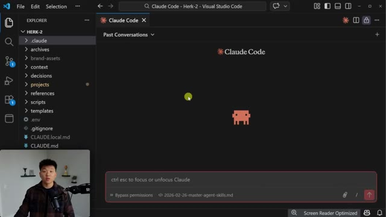
*⏱️ 00:00:32 — Interface de Visual Studio Code affichant l'extension Claude Code pour le projet herc-2, avec la webcam du présentateur incrustée en bas à gauche.*

---

### ⏱️ `[00:00:48 - 00:01:07]` | Segment #03

**🔊 Audio (Transcription Intégrale Mot pour Mot en Français) :**
> Alors que Cloud Code est en train de comprendre ça, ce que je vais faire, c'est ouvrir un autre agent. Et dans celui-ci, je lui demande d'effectuer un point de contrôle sur tous mes projets et engagements pour voir comment les choses se présentent. J'en ouvre un autre pour me créer un diagramme Excalibur sur la différence entre les modèles d'IA locaux et les modèles propriétaires. Et faisons-en juste un de plus qui va extraire les commentaires de mes vidéos YouTube récentes et me donner une analyse sur ce que je dois améliorer.

**👁️ Analyse Visuelle d'Écran (gemini-3.5-flash-lite) :**
**Interface & Outils** : Visual Studio Code, extension Claude Code, explorateur de fichiers du projet HERK-2.

**Contenu textuel & Code** : Prompt utilisateur : "Run a pulse check on all of our projets and weekly commitments to check in on how things are progressing and if there are any roadblocks."

**Action / Démonstration** : Saisie d'une instruction dans un nouvel agent Claude Code pour lancer une vérification de l'état des projets.

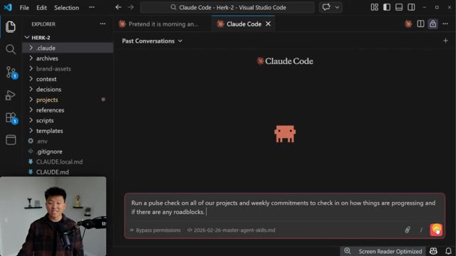
*⏱️ 00:00:53 — Interface de Visual Studio Code affichant l'extension Claude Code avec un prompt demandant d'effectuer un point de contrôle sur les projets.*

---

### ⏱️ `[00:01:07 - 00:01:26]` | Segment #04

**🔊 Audio (Transcription Intégrale Mot pour Mot en Français) :**
> Donc ce que vous regardez en ce moment, ce sont quatre agents différents qui s'exécutent en parallèle pour faire des choses pour moi. Et ça m'a pris probablement 30 secondes pour leur demander de faire ça. Et parce que j'ai développé toutes ces compétences, tous ces agents ont tout le contexte sur mon entreprise, ce qui se passe avec nos projets, ma chaîne YouTube. Ils ont littéralement tout ce dont ils ont besoin. Et maintenant, tous ces agents ont terminé. Voici mon café du matin du 26 février.

**👁️ Analyse Visuelle d'Écran (gemini-3.5-flash-lite) :**
**Interface & Outils** : Visual Studio Code (éditeur de code avec grille de quatre panneaux pour agents IA)

**Contenu textuel & Code** : Prompts et retours d'exécution de quatre agents distincts (gestion de calendrier, vérification de projets, diagramme Excalidraw, scraping de commentaires YouTube).

**Action / Démonstration** : Exécution simultanée et en parallèle de quatre agents IA effectuant différentes tâches.

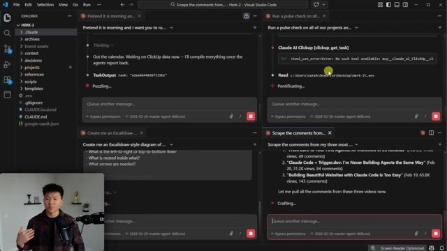
*⏱️ 00:01:12 — Capture d'écran de l'éditeur Visual Studio Code divisé en quatre fenêtres montrant quatre agents IA différents en train de s'exécuter en parallèle, avec le présentateur visible en incrustation vidéo dans le coin inférieur gauche.*

---

### ⏱️ `[00:01:26 - 00:02:02]` | Segment #05

**🔊 Audio (Transcription Intégrale Mot pour Mot en Français) :**
> J'avais trois choses sur le calendrier. Donc ce que ça va faire, c'est que ça va regarder mon ClickUp. Ça va voir ce que j'ai d'autre cette semaine et regarder mes tâches, puis m'aider à planifier le reste de ma journée. C'est donc le plan qu'il a suggéré. Tout ce que j'aurais à faire, c'est de dire, ouais. Et ça bloquerait tout pour moi. Et pour moi, c'est énorme parce que je n'ai plus de fatigue décisionnelle quant à ce sur quoi je dois travailler. Le deuxième agent est revenu avec un point de situation, deux jours avant la fin du mois. Voici où tout en est. Donc évidemment, je vais flouter tout ça, mais ça me met essentiellement au courant de toutes les différentes initiatives principales que nous faisons ce mois-ci et ce trimestre-ci, et ça s'assure que tout est sur la bonne voie. Et juste ici, vous pouvez voir qu'il y a quelques trucs que je dois suivre manuellement. Et ça aurait pu passer entre les mailles du filet parce que je suis tellement occupé à faire des vidéos YouTube si je n'avais pas cet assistant personnel

**👁️ Analyse Visuelle d'Écran (gemini-3.5-flash-lite) :**
**Interface & Outils** : Visual Studio Code (avec intégration de l'assistant Claude)

**Contenu textuel & Code** : Un tableau intitulé 'Suggested Day Plan' détaillant l'emploi du temps de la journée par blocs horaires, ainsi que le présentateur visible en incrustation vidéo en bas à gauche.

**Action / Démonstration** : L'éditeur affiche la proposition de planification générée par l'agent IA basée sur le calendrier et les tâches ClickUp.

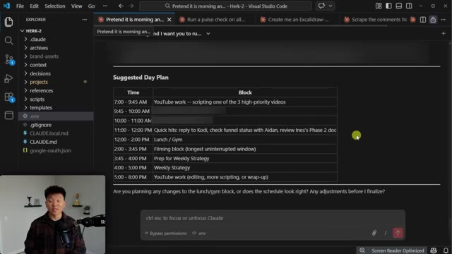
*⏱️ 00:01:35 — Capture d'écran de l'interface de Visual Studio Code montrant le plan de journée suggéré par l'assistant Claude sous forme de tableau.*

---

### ⏱️ `[00:02:02 - 00:02:36]` | Segment #06

**🔊 Audio (Transcription Intégrale Mot pour Mot en Français) :**
> assistant pour vérifier mon travail en utilisant la compétence. Le troisième agent est revenu et a terminé le diagramme XcaloJaw, je l'ai collé et ça donne ça. Donc si j'avais eu besoin de faire une vidéo à ce sujet, je n'aurais pas eu à prendre de mon temps pour créer cette visualisation. Donc pour l'analyse des commentaires, elle est revenue et nous pouvons voir tous les commentaires, toutes les vues et les choses que je dois aborder soit dans de futures vidéos, soit dans les commentaires. Nous avons un peu de confusion. Nous avons des questions de coût que je dois aborder. Nous devons arrêter de présenter des exemples factices pour les vidéos sur les outils. Il semble que vous vouliez vraiment voir des trucs anti-gravité. Je promets que ça arrivera bientôt. Et ensuite, nous avons le top trois des priorités. Donc j'enregistre cette vidéo depuis environ six minutes maintenant. Pensez juste si je

**👁️ Analyse Visuelle d'Écran (gemini-3.5-flash-lite) :**
**Interface & Outils** : Excalidraw, Visual Studio Code

**Contenu textuel & Code** : Diagramme comparatif "Local AI Models vs Closed-Source Models" et notes de projet de la chaîne.

**Action / Démonstration** : Présentation du diagramme généré automatiquement par l'agent IA et navigation dans l'éditeur de code.

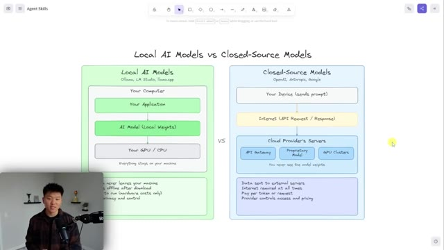
*⏱️ 00:02:10 — Un diagramme comparatif généré sur Excalidraw montrant les modèles d'IA locaux par rapport aux modèles fermés, avec le présentateur en médaillon.*

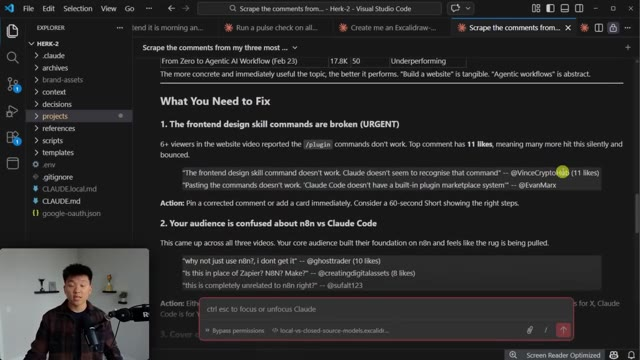
*⏱️ 00:02:19 — L'interface de Visual Studio Code affichant des notes de travail et un champ de saisie de l'assistant IA avec des références de fichiers Excalidraw.*

---

### ⏱️ `[00:02:36 - 00:03:10]` | Segment #07

**🔊 Audio (Transcription Intégrale Mot pour Mot en Français) :**
> j'aurais fait ces quatre choses moi-même, combien de changements de contexte j'aurais faits et combien de temps cela m'aurait pris. D'accord. Donc maintenant que vous avez vu une vraie démo et que vous êtes j'espère un peu enthousiastes à l'idée d'apprendre ce que sont les compétences cloud si vous ne les avez pas encore utilisées, qu'est-ce que c'est réellement ? Donc les compétences sont des instructions réutilisables. Vous les écrivez une seule fois, vous les enregistrez en tant que compétence, vous pouvez les déclencher à tout moment, et vous allez obtenir des résultats beaucoup plus cohérents parce que le système passe par le même processus à chaque fois. Donc ce visuel ici était en fait une image générée par IA que j'ai utilisée avec une compétence. C'était celle-ci juste ici dans mon code cloud appelée visuels Excalijaw. Mais parfois avec les images générées par IA, elles n'orthographient pas bien les mots. Comme vous pouvez le voir ici,

**👁️ Analyse Visuelle d'Écran (gemini-3.5-flash-lite) :**
**Interface & Outils** : Présentation vidéo avec diagramme explicatif dessiné à la main (style sketch/whiteboard) et incrustation de la webcam du présentateur.

**Contenu textuel & Code** : Texte du diagramme : 'Skills = Reusable instructions', 'Write Once', 'Save as Skill' (.claude/skills/), 'Trigger Anytime' (/carooss), 'Same Result', et 'Write it once, reuse it forever'.

**Action / Démonstration** : Le présentateur explique le concept des compétences et des instructions réutilisables à l'aide d'un schéma séquentiel en quatre étapes.

*⏱️ 00:02:44 — Schéma explicatif illustrant le concept des 'Skills' (compétences) comme des instructions réutilisables en quatre étapes : 'Write Once', 'Save as Skill' (.claude/skills/), 'Trigger Anytime' et 'Same Result', avec le présentateur visible en incrustation vidéo dans le coin inférieur gauche.*

---

### ⏱️ `[00:03:10 - 00:03:38]` | Segment #08

**🔊 Audio (Transcription Intégrale Mot pour Mot en Français) :**
> C'est du n'importe quoi. Tout ça c'est n'importe quoi. Donc j'en ai aussi une, comme vous l'avez vu dans la démo, pour créer des diagrammes Excalidraw. Et celle-ci crée le véritable Excalidraw que je peux déplacer et modifier, et les mots sont toujours parfaits parce que c'est en fait juste de la saisie. Et ces deux compétences à elles seules m'ont fait gagner tellement de temps. Et ce que je vais faire, d'ailleurs, pour vous tous, c'est que dans ma communauté School gratuite, le lien pour cela est dans la description. J'ai ajouté une nouvelle section de cours appelée compétences d'agent, où je vais simplement balancer une tonne de ces compétences que vous pourrez aller récupérer tout à fait gratuitement. Donc avant de plonger là-dedans aujourd'hui, juste rapidement, pourquoi devriez-vous vous en soucier ?

**👁️ Analyse Visuelle d'Écran (gemini-3.5-flash-lite) :**
**Interface & Outils** : Excalidraw / Interface Web (Plateforme de cours en ligne)

**Contenu textuel & Code** : Schéma en 4 étapes : 1. Write Once, 2. Save as Skill (SKILL.md), 3. Trigger Anytime (/carousel), 4. Same Result.

**Action / Démonstration** : Le présentateur explique comment fonctionnent les compétences réutilisables (Skills) pour l'automatisation avec Claude.

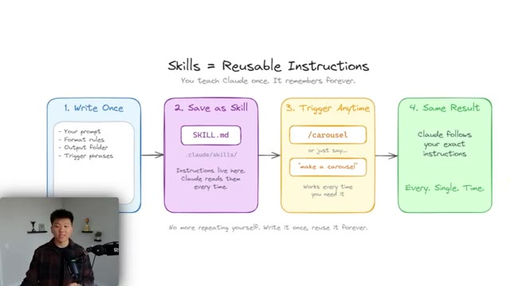
*⏱️ 00:03:17 — Un diagramme explicatif dessiné dans le style Excalidraw montrant le fonctionnement des 'Skills' avec Claude en 4 étapes, avec la vidéo du présentateur en bas à gauche.*

---

### ⏱️ `[00:03:38 - 00:04:13]` | Segment #09

**🔊 Audio (Transcription Intégrale Mot pour Mot en Français) :**
> Et il y a trois grandes raisons. Vous pouvez être beaucoup plus productif en tant que personne parce que vous pouvez automatiser des choses comme vous venez de me voir le faire. Et vous pouvez légitimement construire un assistant personnel qui peut faire presque n'importe quoi pour vous. La deuxième est le levier d'équipe. Vous pouvez donc transformer des procédures opérationnelles standard existantes en automatisations très, très facilement. Et si vous construisez quelque chose de nouveau, il n'y a pas que vous qui pouvez l'utiliser, mais toute votre organisation le peut aussi. Tout le monde en tant que groupe devient donc beaucoup plus productif, ce qui entraînera presque indubitablement la croissance de l'entreprise. Et aussi la monétisation. Nous entrons dans ce nouveau monde où les compétences ont un moment important et vous êtes capable de capitaliser sur beaucoup de ces choses. Maintenant, je ne dis pas que cela va être un modèle commercial viable pendant très, très longtemps, donc vous

**👁️ Analyse Visuelle d'Écran (gemini-3.5-flash-lite) :**
**Interface & Outils** : Présentation graphique / Schéma explicatif de type sketch-note.

**Contenu textuel & Code** : Texte et icônes : 1. Personal Productivity (Automate YOUR workflows), 2. Team Leverage (Build tools for your team), 3. Monetization (Sell skills & products), avec la formule « Skills = Leverage ».

**Action / Démonstration** : Le présentateur explique les trois grandes raisons de s'intéresser à l'automatisation et à l'IA en s'appuyant sur le diagramme affiché à l'écran.

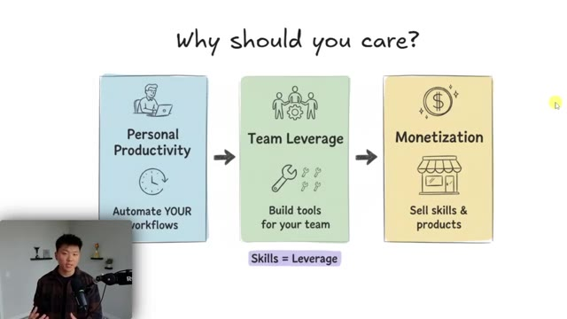
*⏱️ 00:03:47 — Schéma explicatif en trois étapes illustrant les raisons de s'intéresser à l'automatisation par l'IA (« Why should you care? ») : Productivité Personnelle, Effet de levier pour l'équipe, et Monétisation.*

---

### ⏱️ `[00:04:13 - 00:04:49]` | Segment #10

**🔊 Audio (Transcription Intégrale Mot pour Mot en Français) :**
> il ne faut pas trop compter dessus, mais c'est quelque chose à garder en tête. Tout comme à l'époque où les gens vendaient des modèles de montage et de flux de travail, des choses comme ça. Mais encore une fois, tout se résume à un seul mot, qui est le levier. Ce n'est pas seulement de la théorie. C'est quelque chose que nous voyons avec nos clients. C'est quelque chose que nous voyons en interne dans ma propre entreprise. Cette vitesse de travail que nous sommes capables d'atteindre en ce moment semble insensée, mais cela va devenir la norme. Et si vous ne pouvez pas faire cela, vous devenez instantanément beaucoup trop lent et beaucoup trop cher pour l'entreprise, et ils pourraient bien ne pas vous garder. Nous faisons d'ailleurs une priorité de nous assurer que tous nos employés utilisent Claude Code. Parce que maintenant j'ai toutes ces compétences différentes que je peux simplement exécuter avec une simple commande oblique ou une simple invite en langage naturel et obtenir en un jour l'équivalent d'une semaine de production. Parce que

**👁️ Analyse Visuelle d'Écran (gemini-3.5-flash-lite) :**
**Interface & Outils** : Présentation vidéo avec incrustation webcam.

**Contenu textuel & Code** : Texte affiché : "This speed of work will become normal. If you can't do it, you become too expensive to the business."

**Action / Démonstration** : Le présentateur parle à la caméra tandis que le texte s'affiche.

---

### ⏱️ `[00:04:49 - 00:05:22]` | Segment #11

**🔊 Audio (Transcription Intégrale Mot pour Mot en Français) :**
> une fois de plus, une seule personne peut trouver la meilleure façon de faire quelque chose et la transformer en une compétence que toute l'équipe peut utiliser. Mais ils ne génèrent pas seulement du texte. Ce sont fondamentalement des automatisations. Ils peuvent exécuter des scripts. Ils peuvent appeler des API. Ils peuvent créer des choses. Ils peuvent avoir des sous-agents. Et ils peuvent également être appelés par des agents. Il s'agit donc véritablement d'une automatisation par IA. Et pour vraiment enfoncer le clou, ce sont fondamentalement des procédures opérationnelles standard pour vos agents IA. De la même manière que vous formeriez un employé humain en lui laissant lire une procédure opérationnelle standard pour comprendre le processus, et qu'il serait ensuite capable de le faire, vous formez simplement un agent sur celle-ci. Vous leur donnez la compétence, ils la lisent, et ensuite ils le font. Et la partie la plus cool là-dedans, c'est que plus vous utilisez la compétence, plus elle devient de plus en plus performante. Donc nous avons

**👁️ Analyse Visuelle d'Écran (gemini-3.5-flash-lite) :**
**Interface & Outils** : Schéma visuel animé / Présentation vidéo

**Contenu textuel & Code** : Texte et diagrammes schématiques illustrant les fonctionnalités des 'Claude Skills' et le concept de SOP pour agents IA.

**Action / Démonstration** : Explication visuelle des capacités d'automatisation des compétences d'IA par le présentateur.

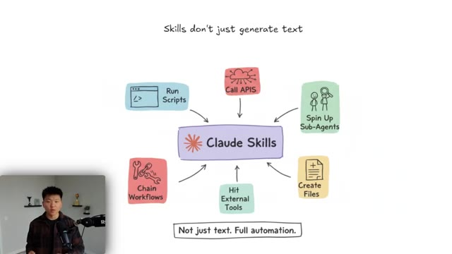
*⏱️ 00:04:57 — Schéma explicatif montrant que 'Claude Skills' ne se limite pas à générer du texte, avec des capacités comme exécuter des scripts, appeler des API, créer des fichiers et enchaîner des workflows.*

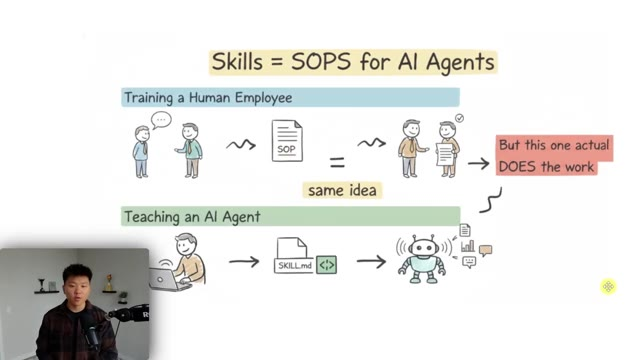
*⏱️ 00:05:06 — Schéma comparatif illustrant que les 'Skills' agissent comme des SOP (procédures opérationnelles standard) pour les agents IA, comparant la formation d'un employé humain à l'enseignement d'un agent IA.*

---

### ⏱️ `[00:05:22 - 00:05:41]` | Segment #12

**🔊 Audio (Transcription Intégrale Mot pour Mot en Français) :**
> on a parlé de beaucoup de ces avantages, n'est-ce pas ? Mais qu'est-ce que c'est réellement qu'une compétence ? Eh bien, c'est juste un dossier qui se trouve quelque part dans votre projet. L'exemple le plus courant sera probablement dans votre dossier point clawd, slash skills, slash nom de la compétence. Et ensuite, vous avez un fichier skill point MD ou un fichier markdown. Donc juste ici, dans mon projet Herc2, vous pouvez voir en haut, nous avons point cloud.

**👁️ Analyse Visuelle d'Écran (gemini-3.5-flash-lite) :**
**Interface & Outils** : Diapositive de présentation avec illustration graphique

**Contenu textuel & Code** : Texte affiché : "A skill is just a folder." et chemin de fichier ".claude/skills/skill-name/SKILL.md"

**Action / Démonstration** : Le présentateur explique la structure de fichiers sous-jacente d'une compétence (skill) dans un projet.

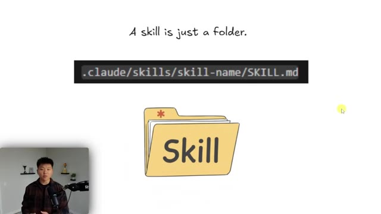
*⏱️ 00:05:27 — Une diapositive explicative montrant le texte 'A skill is just a folder' avec le chemin d'accès au fichier et une illustration de dossier étiqueté 'Skill', tandis que le présentateur apparaît en médaillon dans le coin inférieur gauche.*

---

### ⏱️ `[00:05:41 - 00:06:01]` | Segment #13

**🔊 Audio (Transcription Intégrale Mot pour Mot en Français) :**
> J'ouvre .cloud, nous avons des agents, des règles et des compétences. En ce moment, nous parlons juste de compétences. Si j'ouvre ça, nous pouvons voir toutes les différentes compétences que j'ai créées. Disons donc, par exemple, la compétence de diagramme Excalajaw. Si je clique dessus, nous avons un skill.md. Et quand j'ouvre ça, vous pouvez voir que nous avons le nom de la compétence, la description, et ensuite nous avons le flux de travail réel. Première étape, comprendre le concept.

**👁️ Analyse Visuelle d'Écran (gemini-3.5-flash-lite) :**
**Interface & Outils** : Visual Studio Code

**Contenu textuel & Code** : Arborescence de fichiers du dossier .claude (agents, rules, skills) et contenu Markdown du fichier SKILL.md définissant le workflow de la compétence excalidraw-diagram.

**Action / Démonstration** : Navigation dans l'explorateur de fichiers de VS Code pour ouvrir le dossier des compétences et sélectionner le fichier de configuration d'une compétence spécifique.

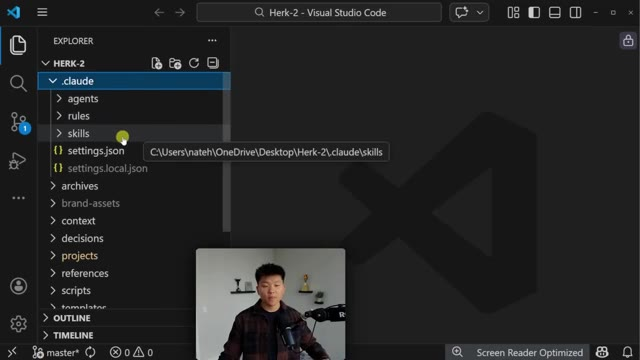
*⏱️ 00:05:46 — Visual Studio Code ouvert sur le projet HERK-2, montrant l'arborescence du dossier .claude avec les dossiers agents, rules et skills.*

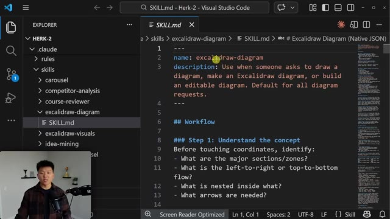
*⏱️ 00:05:56 — Visual Studio Code affichant le contenu du fichier SKILL.md pour la compétence 'excalidraw-diagram' dans l'explorateur de fichiers.*

---

### ⏱️ `[00:06:01 - 00:06:21]` | Segment #14

**🔊 Audio (Transcription Intégrale Mot pour Mot en Français) :**
> Deuxième étape, planifier la disposition. Troisième étape, générer les éléments. Et cette compétence entière apprend fondamentalement à mon agent comment construire ces diagrammes Excalajaw pour moi. Donc, comme je l'ai dit, c'est l'anatomie de la compétence. Nous avons les métadonnées, qui se trouvent en quelque sorte entre ces deux lignes en pointillés. Et c'est dans quelque chose appelé YAML, dont vous n'avez pas à vous soucier de ce que cela signifie. C'est juste la façon dont c'est en quelque sorte indiqué.

**👁️ Analyse Visuelle d'Écran (gemini-3.5-flash-lite) :**
**Interface & Outils** : Visual Studio Code, schéma explicatif graphique.

**Contenu textuel & Code** : Code Markdown/YAML d'un fichier de compétence (`SKILL.md`) détaillant le workflow, les étapes de planification de layout et les règles de contraste pour les diagrammes.

**Action / Démonstration** : Présentation de l'anatomie d'un fichier de compétence (`SKILL.md`) et de sa structure pour configurer un agent IA.

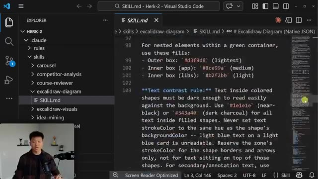
*⏱️ 00:06:06 — Vue de Visual Studio Code montrant le fichier SKILL.md avec des règles de design pour les diagrammes Excalidraw, notamment la gestion des couleurs de remplissage et du contraste du texte.*

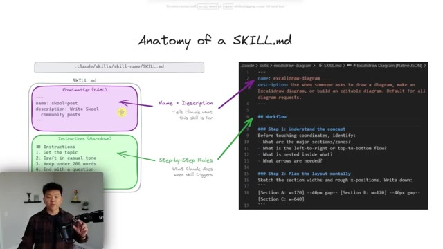
*⏱️ 00:06:11 — Schéma explicatif intitulé "Anatomy of a SKILL.md" comparant la structure conceptuelle d'une compétence (Frontmatter YAML et Instructions Markdown) avec son implémentation réelle dans le code.*

---

### ⏱️ `[00:06:22 - 00:06:51]` | Segment #15

**🔊 Audio (Transcription Intégrale Mot pour Mot en Français) :**
> Un peu comme votre Markdown, votre JSON ou Python. Maintenant, ici en haut, nous aurons un nom et une description, ce qui indique à Claude Code quel est le nom de la compétence et ce que fait la compétence. Donc, comme vous pouvez le voir, celle-ci s'appelle diagramme Excalajaw, et il y a une brève description de ce qu'elle fait réellement ou du moment où il faut l'utiliser. Et ensuite, nous avons les règles étape par étape, qui sont fondamentalement les instructions. Et c'est ce que Claude fait réellement une fois qu'il décide que c'est la bonne compétence pour la tâche. Maintenant, ce qui est intéressant avec les compétences, c'est que parfois vous avez besoin de beaucoup plus de données. Donc, par exemple, disons que nous rédigeons une publication LinkedIn.

**👁️ Analyse Visuelle d'Écran (gemini-3.5-flash-lite) :**
**Interface & Outils** : Éditeur de code (VS Code / interface de code) et diagramme explicatif illustratif.

**Contenu textuel & Code** : Code Markdown/YAML montrant le nom de la compétence (`excalidraw-diagram`), sa description et les étapes de workflow associées.

**Action / Démonstration** : Explication visuelle de la structure d'un fichier de compétence (`SKILL.md`) utilisé pour configurer Claude Code.

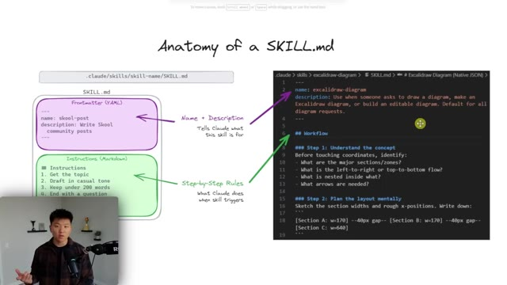
*⏱️ 00:06:29 — Schéma explicatif à gauche montrant l'anatomie d'un fichier SKILL.md (Frontmatter YAML et instructions Markdown) et un exemple de code source de compétence de diagramme Excalidraw à droite avec des flèches explicatives.*

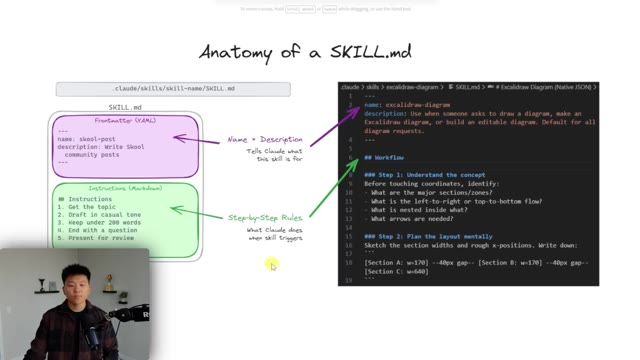
*⏱️ 00:06:36 — Vue similaire avec le présentateur en médaillon en bas à gauche, détaillant la structure d'un fichier de compétence pour Claude Code.*

---

### ⏱️ `[00:06:52 - 00:07:24]` | Segment #16

**🔊 Audio (Transcription Intégrale Mot pour Mot en Français) :**
> Nous avons une compétence pour ça, n'est-ce pas ? Mais ce qui doit aller dans la compétence, c'est parfois d'autres informations, comme le ton de la voix d'une entreprise, ou peut-être votre ton de voix sur LinkedIn, vous savez, un avatar cible, les priorités actuelles, un logo peut-être. Il y a d'autres choses que vous voulez mettre dans une compétence en plus des instructions étape par étape qui l'amélioreront. La question est donc de savoir où vont ces éléments. Eh bien, il y a généralement deux options, mais pour l'essentiel, tant que vous pointez vers le bon chemin dans le fichier skill.md, tout va bien. L'explication de ce que je veux dire, c'est donc... et ensuite je vais vous montrer ce que je veux dire par là. La première option est donc de faire en sorte qu'elle soit autonome. Donc, dans votre .cloud

**👁️ Analyse Visuelle d'Écran (gemini-3.5-flash-lite) :**
**Interface & Outils** : Schéma explicatif / Infographie dessinée à la main

**Contenu textuel & Code** : Texte sur l'organisation des fichiers de compétences (.claude/skills/infographic/, SKILL.md, scripts, references) et options de structuration.

**Action / Démonstration** : Explication visuelle de l'organisation des répertoires et des fichiers de support pour les compétences IA.

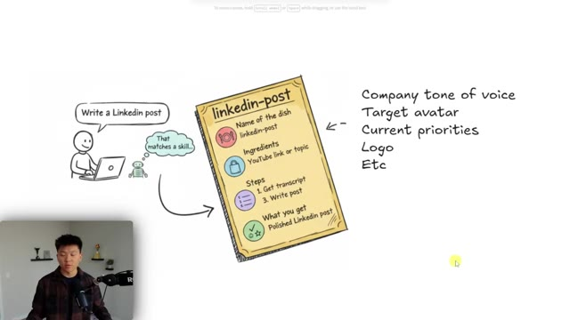
*⏱️ 00:07:00 — Schéma explicatif montrant la structure d'une compétence pour la rédaction de posts LinkedIn, avec les éléments additionnels comme le ton de la voix et l'avatar cible.*

*⏱️ 00:07:16 — Schéma comparatif des options de stockage des fichiers de support pour les compétences (Option A : Self-Contained, Option B : Stored Elsewhere).*

---

### ⏱️ `[00:07:24 - 00:07:46]` | Segment #17

**🔊 Audio (Transcription Intégrale Mot pour Mot en Français) :**
> slash skills slash nom de la compétence, vous pouvez avoir le skill.md, vous pouvez avoir vos scripts directement là, et vous pouvez avoir vos références directement là. Ou l'option B, c'est qu'ils ne sont pas directement imbriqués juste sous cette compétence. Donc ici, nous avons .cloud slash skills slash infographic et le skill MD, et nous avons toujours nos scripts et nos références dans le même projet, mais ce n'est tout simplement pas imbriqué directement sous cette compétence.

**👁️ Analyse Visuelle d'Écran (gemini-3.5-flash-lite) :**
**Interface & Outils** : Présentation vidéo avec schéma explicatif dessiné à la main.

**Contenu textuel & Code** : Arborescences de fichiers pour `.claude/skills/infographic/` (avec SKILL.md, scripts/, references/) et pour `my-project/`.

**Action / Démonstration** : Le présentateur explique les différentes structures de répertoires possibles pour stocker les scripts et les références des skills.

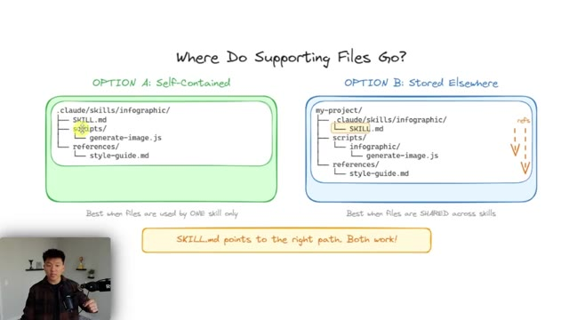
*⏱️ 00:07:30 — Une infographie explicative comparant deux options d'organisation de dossiers pour les fichiers de support des skills : Option A (Self-Contained) et Option B (Stored Elsewhere).*

---

### ⏱️ `[00:07:46 - 00:08:08]` | Segment #18

**🔊 Audio (Transcription Intégrale Mot pour Mot en Français) :**
> Et donc je sais que ça n'a peut-être aucun sens. Alors laissez-moi vous montrer exactement ce que je veux dire par là. D'accord, alors ici nous avons une compétence appelée exploration d'idées. Et donc ce qui se passe ici, c'est fondamentalement utilisé lorsque quelqu'un demande des idées de contenu, des idées de vidéos, quoi créer ensuite, ou pour lancer une exploration d'idées. Et donc ici, je lui ai donné un peu de contexte, n'est-ce pas ? Ma chaîne a autant d'abonnés. C'est à propos de l'automatisation par IA. Mes piliers de contenu sont les réseaux neuronaux, les agents RAG, Cloud Code, l'IA vocale.

**👁️ Analyse Visuelle d'Écran (gemini-3.5-flash-lite) :**
**Interface & Outils** : Visual Studio Code

**Contenu textuel & Code** : Fichier Markdown nommé SKILL.md définissant une compétence 'idea-mining' avec des métadonnées (nom, description), des phrases déclencheurs ('idea mining', 'content ideas', etc.) et le contexte de la chaîne de Nate Herk.

**Action / Démonstration** : Présentation du fichier de configuration d'une compétence d'IA dans l'éditeur de code.

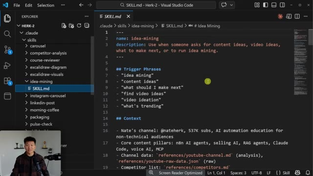
*⏱️ 00:07:52 — Vue de l'éditeur Visual Studio Code affichant le fichier SKILL.md pour la compétence 'idea-mining' avec les phrases déclencheurs et le contexte, et la webcam du présentateur en bas à gauche.*

---

### ⏱️ `[00:08:09 - 00:08:31]` | Segment #19

**🔊 Audio (Transcription Intégrale Mot pour Mot en Français) :**
> Et ensuite, ce que je lui ai donné, c'est un tas de références. Je lui ai donné des données de chaîne, qui sont youtube channel.md. Je lui ai aussi donné les données brutes, qui sont un fichier JSON. Je lui ai donné une liste de concurrents pour moi, et je lui ai donné un vrai script pour exécuter une analyse sur ma chaîne YouTube. Et donc dans ce cas, ce que vous pouvez voir, c'est que j'ai opté pour l'option B, où je stocke ces fichiers de référence et ces scripts, non pas directement imbriqués dans cette compétence.

**👁️ Analyse Visuelle d'Écran (gemini-3.5-flash-lite) :**
**Interface & Outils** : Visual Studio Code

**Contenu textuel & Code** : Fichier markdown SKILL.md affichant le contexte : liens vers 'references/youtube-channel.md', 'references/youtube-raw-data.json', 'references/competitors.md' et 'scripts/analyze_youtube.py'.

**Action / Démonstration** : Le présentateur survole et met en surbrillance les lignes de code dans VS Code pour montrer les fichiers de référence transmis à l'IA.

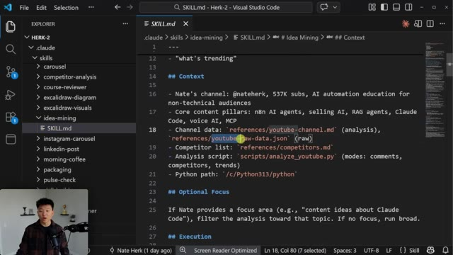
*⏱️ 00:08:14 — Vue de VS Code montrant le fichier SKILL.md avec les références aux données de la chaîne YouTube, aux concurrents et au script d'analyse.*

---

### ⏱️ `[00:08:32 - 00:08:53]` | Segment #20

**🔊 Audio (Transcription Intégrale Mot pour Mot en Français) :**
> Donc en gros, à quoi ça pourrait ressembler, c'est qu'à l'intérieur de la compétence elle-même, nous pourrions avoir un dossier appelé références. Nous pourrions aussi avoir un dossier ici appelé scripts. Et ensuite, à l'intérieur de ces deux sous-dossiers, nous pourrions avoir d'autres éléments comme, dans les références, je pourrais avoir des données de chaîne. Et dans les scripts, je pourrais avoir youtube-analysis.js ou .py, peu importe ce que c'est.

**👁️ Analyse Visuelle d'Écran (gemini-3.5-flash-lite) :**
**Interface & Outils** : Visual Studio Code

**Contenu textuel & Code** : Fichier Markdown (SKILL.md) contenant la configuration d'une compétence (sections Context, Channel data, scripts, Python path) et l'explorateur de fichiers montrant l'arborescence .claude/skills.

**Action / Démonstration** : Navigation dans l'arborescence de l'explorateur de fichiers pour illustrer la structure des dossiers de compétences.

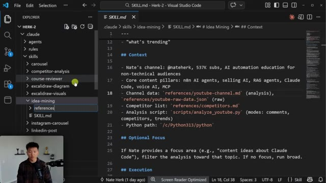
*⏱️ 00:08:37 — L'arborescence de fichiers dans Visual Studio Code montre la structure d'une compétence de l'agent IA, avec notamment le dossier 'idea-mining' et son sous-dossier 'references', tandis que le fichier 'SKILL.md' est ouvert à droite.*

---

### ⏱️ `[00:08:53 - 00:09:14]` | Segment #21

**🔊 Audio (Transcription Intégrale Mot pour Mot en Français) :**
> Fondamentalement, l'idée est qu'peu importe où résident ces fichiers de référence ou ces scripts réels, tant que vous pointez vers le bon endroit dans le fichier MD. Donc dans mon cas, là où ceux-ci résident réellement, c'est dans un dossier différent. Donc ici, pour les données de la chaîne, j'irais fondamentalement tout en bas jusqu'à références, puis je pourrais aller tout en bas jusqu'ici, youtubechannel.md. Donc Cloud Code lit la compétence et ensuite il est capable de trouver ceci s'il en a besoin.

**👁️ Analyse Visuelle d'Écran (gemini-3.5-flash-lite) :**
**Interface & Outils** : Visual Studio Code

**Contenu textuel & Code** : Fichier SKILL.md ouvert avec des sections de contexte, des chemins vers des fichiers de référence (comme `references/youtube-channel.md`), et une arborescence de dossiers `.claude/skills/idea-mining/`.

**Action / Démonstration** : Le présentateur explique comment structurer et lier les fichiers de référence et les scripts dans un fichier Markdown au sein de l'éditeur.

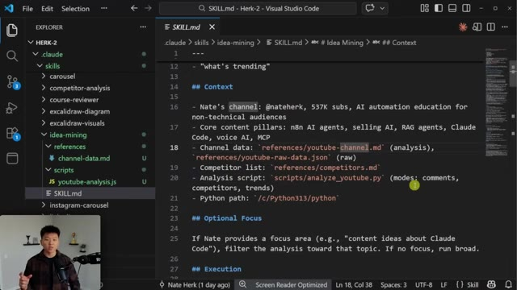
*⏱️ 00:08:58 — Vue de l'éditeur Visual Studio Code montrant l'arborescence des fichiers du projet sur la gauche et le contenu d'un fichier Markdown (SKILL.md) sur la droite, avec la mini-vidéo du présentateur incrustée en bas à gauche.*

---

### ⏱️ `[00:09:14 - 00:09:46]` | Segment #22

**🔊 Audio (Transcription Intégrale Mot pour Mot en Français) :**
> C'est la même chose pour les scripts. Ça descendrait ici dans scripts et ensuite ça trouverait analyze youtube.py et ça l'importerait simplement si nécessaire. Donc j'espère que vous me suivez. Peu importe comment vous voulez configurer ça, ça fonctionne. Et je pense que c'est la chose la plus déstabilisante avec Cloud Code en ce moment, c'est que tout le monde utilise une architecture de dossiers différente. Mais ne vous inquiétez pas les gars, je maîtrise totalement le sujet. J'ai créé une compétence appelée Skill Builder. Et celle-ci, je vais l'offrir gratuitement une fois de plus dans ma communauté FreeSchool juste ici. Et tout ce que vous auriez à faire, c'est de charger le Skill Builder et ensuite ça vous aidera à configurer tout ce dont vous avez besoin. Et je vais vous montrer une démonstration en direct de cela dans quelques minutes.

**👁️ Analyse Visuelle d'Écran (gemini-3.5-flash-lite) :**
**Interface & Outils** : Visual Studio Code, diagramme Excalidraw, interface web de communauté en ligne.

**Contenu textuel & Code** : Fichier Markdown `SKILL.md` avec sections Context, Optional Focus, Execution, et structure de répertoires de projet.

**Action / Démonstration** : Présentation comparative des structures de dossiers et des chemins de fichiers pour la configuration de skills d'IA.

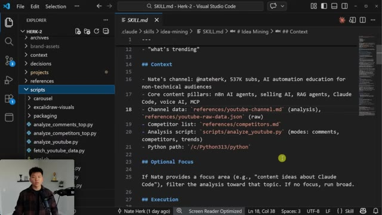
*⏱️ 00:09:22 — Vue de l'éditeur VS Code montrant l'arborescence des fichiers d'un projet et le contenu d'un fichier Markdown de compétences (SKILL.md) avec le contexte contextuel.*

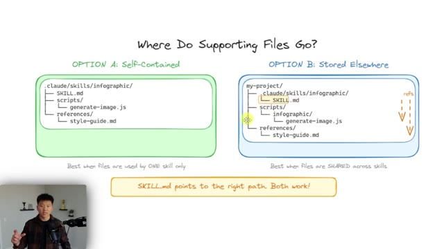
*⏱️ 00:09:30 — Schéma explicatif comparant deux options de structure de dossiers pour les fichiers de support (Option A : Self-Contained, Option B : Stored Elsewhere).*

---

### ⏱️ `[00:09:47 - 00:10:20]` | Segment #23

**🔊 Audio (Transcription Intégrale Mot pour Mot en Français) :**
> Donc, le fichier skill.md est le cerveau proprement dit, et les fichiers secondaires sont les outils qu'il peut utiliser. Cela ne signifie pas que chaque fois que la compétence est invoquée, tous ces fichiers de référence seront appelés. Et au cas où vous vous poseriez la question, si vous avez regardé certaines de mes vidéos précédentes sur Cloud Code où nous avons utilisé le framework WAT pour créer des automatisations, c'est très, très, très similaire. Dans ce framework, le W, les flux de travail, étaient les procédures opérationnelles standardisées sous forme de fichiers Markdown. C'est essentiellement la compétence. Les outils étaient les scripts Python réels. Et ce sont fondamentalement juste les scripts que vous pourriez écrire ou les références que vous ajouteriez. Donc, si vous avez déjà créé des éléments avec WAT, vous acquerrez ces compétences très, très rapidement. La chose cool avec les compétences

**👁️ Analyse Visuelle d'Écran (gemini-3.5-flash-lite) :**
**Interface & Outils** : Présentation vidéo avec texte à l'écran

**Contenu textuel & Code** : Texte affiché : "So a simple skill might just be a markdown file with five lines of instructions. But a powerful skill can have scripts that call APIs, templates that render images, and reference docs that keep Claude's output consistent. The SKILL.md is the brain. The supporting files are the tools it uses."

**Action / Démonstration** : Le présentateur explique les concepts théoriques concernant la structure des fichiers de compétences.

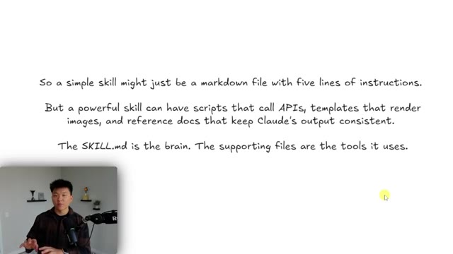
*⏱️ 00:09:55 — Un écran blanc affichant du texte explicatif manuscrit sur le fonctionnement des compétences, avec en incrustation (picture-in-picture) le présentateur dans le coin inférieur gauche.*

---

### ⏱️ `[00:10:20 - 00:10:54]` | Segment #24

**🔊 Audio (Transcription Intégrale Mot pour Mot en Français) :**
> c'est que vous n'avez pas à tous les construire. Évidemment, lorsque vous travaillez avec Cloud Code et que vous vous rendez compte que vous faites des choses de manière répétitive, vous pouvez aller de l'avant et créer une compétence pour cela. Mais il existe une bibliothèque officielle de compétences provenant d'Anthropic. Il y a une communauté de tout le monde qui met ses compétences en open source et les distribue. Et il y a un marché où vous pouvez partager et vendre ou, vous savez, télécharger des compétences de personnes. Et ensuite, vous prendriez cette compétence ou essentiellement un prompt et vous y ajouteriez votre propre touche. Une chose que je dirais, c'est de faire attention et de s'assurer que personne n'essaie, vous savez, de vous donner une compétence qui a des intentions malveillantes. Et toutes ces compétences peuvent fonctionner sur différents produits. Donc cursor,

**👁️ Analyse Visuelle d'Écran (gemini-3.5-flash-lite) :**
**Interface & Outils** : Présentation visuelle / Diagramme explicatif

**Contenu textuel & Code** : Texte du schéma : "You Don't Have to Build Them All", "Official Library", "Community", "Marketplaces", ".claude/skills/", "Works in 30+ tools (Claude Code, Cursor, Gemini CLI, Copilot...)"

**Action / Démonstration** : Présentation du concept d'écosystème de compétences et de leur intégration dans divers outils de développement.

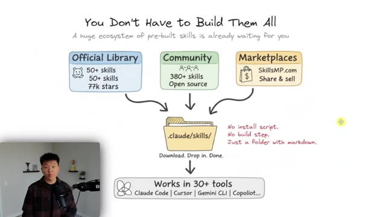
*⏱️ 00:10:29 — Schéma explicatif illustrant l'écosystème des compétences, montrant les différentes sources (bibliothèque officielle, communauté, marketplaces) alimentant un dossier '.claude/skills/'.*

---

### ⏱️ `[00:10:54 - 00:11:27]` | Segment #25

**🔊 Audio (Transcription Intégrale Mot pour Mot en Français) :**
> anti-gravité, codex, parce que c’est tellement basé sur Markdown et que c’est essentiellement juste un prompt, des tonnes de modèles d'IA différents peuvent les utiliser. D'accord. Alors, comment Claude sait-il quand utiliser une compétence ? Eh bien, il y a deux façons de les déclencher. La première, c'est d'être explicite, ce qui signifie en gros que vous pouvez utiliser une commande slash et dire le nom de la compétence, et cela va simplement lancer directement cette compétence, ou cela peut simplement être en langage naturel. Donc, si j'avais une compétence de publication school, je pourrais dire slash school tiret post. Ou je pourrais dire en langage naturel, hé, aide-moi à écrire une publication school à propos de X. Claude trouverait cette compétence et l'invoquerait ensuite. Donc, lorsque vous demandez à Claude de faire quelque chose, il va d'abord lire

**👁️ Analyse Visuelle d'Écran (gemini-3.5-flash-lite) :**
**Interface & Outils** : Présentation visuelle / Schéma graphique style tableau blanc

**Contenu textuel & Code** : Titre : "How Does Claude Know When to Use a Skill?". Méthode 1 (Explicit) : commande "/skool-post" menant directement à "Skill Fires". Méthode 2 (Natural Language) : bulle "write a Skool post about AI automation" passant par "Claude Matches Descriptions" avant "Skill Fires".

**Action / Démonstration** : Le présentateur explique les deux méthodes de déclenchement des compétences illustrées par le schéma.

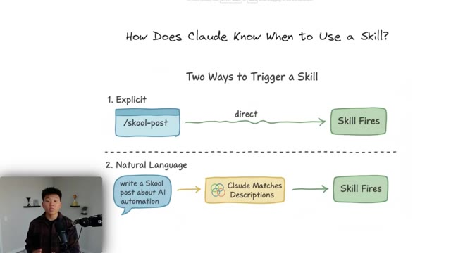
*⏱️ 00:11:02 — Schéma explicatif dessiné à la main montrant les deux façons de déclencher une compétence dans Claude : de manière explicite via une commande directe ou par langage naturel.*

---

### ⏱️ `[00:11:27 - 00:12:02]` | Segment #26

**🔊 Audio (Transcription Intégrale Mot pour Mot en Français) :**
> via le fichier Claude.md. Il analysera votre requête et il cherchera parmi les compétences et verra laquelle j'ai qui aide avec cette requête. S'il en trouve une, il l'invoquera. Mais s'il ne trouve rien, alors il utilisera essentiellement ses connaissances générales. Donc, ce n'est pas chaque requête que vous donnez à Claude Code qui invoquera une compétence. Maintenant, une partie vraiment importante de cela est de comprendre comment les compétences restent légères. Parce que si vous avez utilisé Claude Code, vous savez que la gestion du contexte est un énorme problème. Et si vous aviez toutes ces compétences à parcourir, et que toutes ces compétences font, je ne sais pas, des centaines et des centaines de lignes, alors si Claude Code cherchait parmi toutes celles-ci à chaque fois, cela consommerait à coup sûr une tonne de vos jetons. Donc, ce qui est utilisé, c'est quelque chose

**👁️ Analyse Visuelle d'Écran (gemini-3.5-flash-lite) :**
**Interface & Outils** : Visual Studio Code, Excalidraw diagram

**Contenu textuel & Code** : Fichiers Markdown de configuration de compétences (SKILL.md) avec des tableaux de spécification de couleurs et de règles de contraste de texte pour des éléments graphiques.

**Action / Démonstration** : Présentation du code source et des structures de fichiers Markdown définissant les compétences spécialisées pour l'assistant IA.

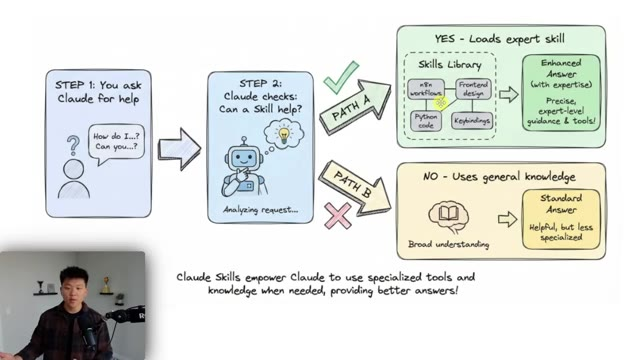
*⏱️ 00:11:36 — Schéma explicatif montrant le fonctionnement des compétences Claude, divisé en deux chemins (Path A avec chargement de compétence spécifique, Path B avec utilisation des connaissances générales).*

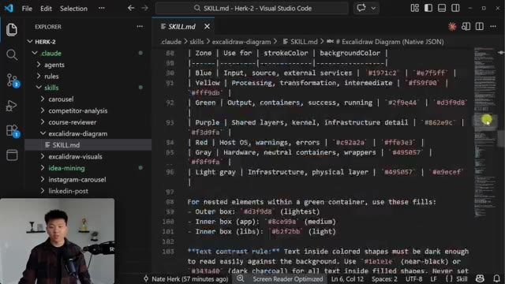
*⏱️ 00:11:53 — Éditeur Visual Studio Code affichant le contenu d'un fichier SKILL.md lié à la génération de diagrammes Excalidraw, avec des instructions tabulaires sur les couleurs.*

---

### ⏱️ `[00:12:02 - 00:12:34]` | Segment #27

**🔊 Audio (Transcription Intégrale Mot pour Mot en Français) :**
> appelé chargement de contexte progressif, ce qui signifie fondamentalement que nous avons trois niveaux. Le niveau un est la recherche initiale, où CloudCode regarde uniquement le nom et la description. Donc, ici même, vous pouvez voir, disons que nous demandons un diagramme ExcalJaw. Il effectuerait essentiellement une recherche dans toutes les compétences, mais il lirait seulement l'en-front YAML. Il lirait donc le nom et la description. Et typiquement, cet en-tête ne fera, vous savez, peut-être qu'environ une centaine de jetons. Il reste donc très léger. Et ensuite, en descendant au niveau deux, disons qu'il identifie, ok, super. C'est la bonne compétence pour la tâche. Il exécuterait alors le skill.md complet et il

**👁️ Analyse Visuelle d'Écran (gemini-3.5-flash-lite) :**
**Interface & Outils** : Éditeur de code (type VS Code ou interface web de documentation) et schéma visuel explicatif.

**Contenu textuel & Code** : `name: excalidraw-diagram`, `description: Use when someone asks to draw a diagram...`, structure de workflow en Markdown, et diagramme des 3 niveaux (Startup, Triggered, On Demand).

**Action / Démonstration** : Présentation et explication du fonctionnement du chargement de contexte progressif par le présentateur.

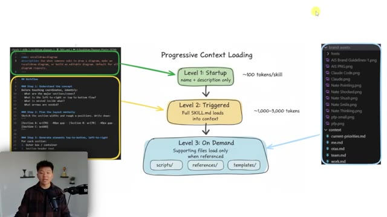
*⏱️ 00:12:10 — Schéma explicatif du chargement de contexte progressif (Progressive Context Loading) avec trois niveaux, un extrait de code Markdown et une arborescence de fichiers.*

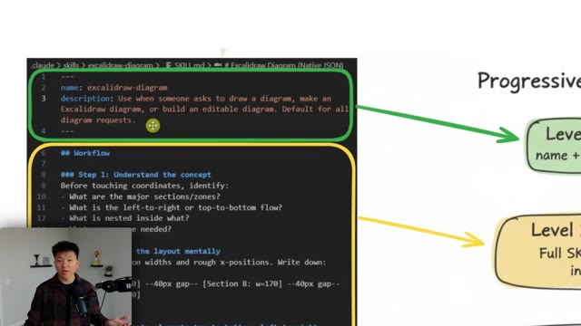
*⏱️ 00:12:18 — Gros plan sur l'extrait de code Markdown montrant les sections "name", "description" et le workflow de génération de diagrammes Excalidraw.*

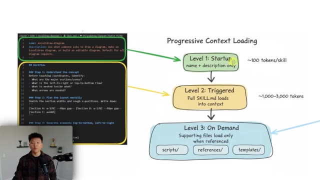
*⏱️ 00:12:26 — Vue centrée sur le schéma des trois niveaux du chargement de contexte progressif avec le curseur sur le niveau 1.*

---

### ⏱️ `[00:12:34 - 00:13:07]` | Segment #28

**🔊 Audio (Transcription Intégrale Mot pour Mot en Français) :**
> lire tout à travers. Et c'est donc à ce moment-là que ça commencerait à réellement comprendre ce qui se passe dans la compétence. Et cela pourrait aller de mille à quelques milliers de jetons. Et puis le niveau trois est encore une fois, une décision consistant à ne charger les fichiers supplémentaires que lorsque c'est nécessaire. Donc si j'ai besoin de regarder des scripts, des références ou des modèles, ou si j'ai besoin d'importer des éléments de marque ou plus de contexte, je ne vais le faire que si leur demande spécifique l'exige. Et donc j'espère que maintenant vous commencez à comprendre un peu mieux ce qui se passe réellement sous le capot lorsque vous demandez à Claude Code de faire quelque chose pour vous. Et vous pouvez toujours aller dans la documentation de Claude Code et aller sur

**👁️ Analyse Visuelle d'Écran (gemini-3.5-flash-lite) :**
**Interface & Outils** : Schéma explicatif graphique combiné avec un éditeur de code et un explorateur de fichiers.

**Contenu textuel & Code** : Diagramme à 3 niveaux (Level 1: Startup, Level 2: Triggered, Level 3: On Demand) avec estimation des tokens, associé à un fichier Markdown de compétence (SKILL.md) et une arborescence de dossiers/fichiers.

**Action / Démonstration** : Présentation visuelle et explication des différents niveaux de chargement de contexte pour les compétences d'IA.

*⏱️ 00:12:43 — Schéma explicatif du chargement progressif du contexte (Progressive Context Loading) avec 3 niveaux, illustré par un extrait de code à gauche et le présentateur en bas à gauche.*

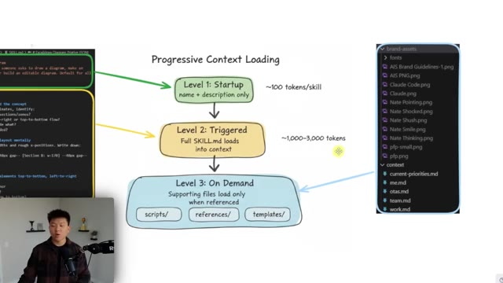
*⏱️ 00:12:51 — Le même schéma de chargement progressif avec l'apparition supplémentaire d'une arborescence de fichiers sur la droite montrant des dossiers brand-assets et context.*

---

### ⏱️ `[00:13:07 - 00:13:39]` | Segment #29

**🔊 Audio (Transcription Intégrale Mot pour Mot en Français) :**
> la section des compétences et lisez simplement sur la façon dont tout cela fonctionne. C'est vraiment, vraiment simple. Sur le document lui-même, il vous sera indiqué de veiller simplement à ce que le fichier skill.md fasse moins de 500 lignes, et de déplacer le matériel de référence détaillé vers des fichiers séparés. Et donc je sais que cela peut donner l'impression qu'on vous balance énormément d'informations. Alors laissez-moi juste contextualiser tout ça, ralentir un peu le rythme et vous rassurer. Vous n'allez jamais, au grand jamais, écrire une compétence parfaite du premier coup. La façon dont je conçois mes compétences, c'est que je demande à Cloud Code de faire quelque chose avec moi. Je le guide à travers les étapes, vous savez, à chaque fois. Et puis, quand nous avons terminé, si nous sommes allés du point A au point B, je dis, c'est super,

**👁️ Analyse Visuelle d'Écran (gemini-3.5-flash-lite) :**
**Interface & Outils** : Présentation vidéo avec diagrammes explicatifs dessinés à la main.

**Contenu textuel & Code** : Texte et schémas sur la structure des compétences Claude et le cycle de rétroaction.

**Action / Démonstration** : Explication de la structure des fichiers de compétences et du processus itératif de l'agent.

*⏱️ 00:13:15 — Schéma de l'arborescence du dossier `.claude/skills/skool-post/` montrant SKILL.md et les fichiers de référence associés.*

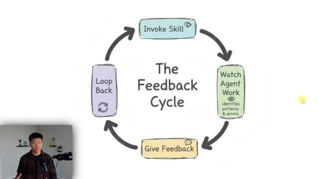
*⏱️ 00:13:23 — Schéma circulaire illustrant le cycle de rétroaction ("The Feedback Cycle") avec les étapes d'invocation, d'observation, de rétroaction et de boucle.*

---

### ⏱️ `[00:13:39 - 00:14:03]` | Segment #30

**🔊 Audio (Transcription Intégrale Mot pour Mot en Français) :**
> C'est quelque chose que je fais une fois par jour. Transformons cela en une compétence. Pose-moi d'autres questions pour que nous puissions nous assurer que tu as toutes les informations dont tu as besoin. Et encore une fois, je vais vous montrer, les gars, comment ouvrir un tout nouveau projet et configurer une compétence à partir de zéro afin que vous compreniez tout le processus. Mais je devais d'abord vous donner un peu de contexte. Maintenant, nous avons ce qu'on appelle le cycle de rétroaction, ce qui signifie fondamentalement que vous invoquez la compétence, vous regardez réellement l'agent travailler, vous donnez des commentaires, et ensuite il corrige la compétence et puis vous le faites à nouveau.

**👁️ Analyse Visuelle d'Écran (gemini-3.5-flash-lite) :**
**Interface & Outils** : Diagramme explicatif dessiné à la main (style esquisse) avec le présentateur en incrustation vidéo dans le coin inférieur gauche.

**Contenu textuel & Code** : Texte du diagramme : "The Feedback Cycle", "Invoke Skill", "Watch Agent Work (identifies patterns & errors)", "Give Feedback", "Loop Back".

**Action / Démonstration** : Le présentateur explique le cycle de rétroaction et d'amélioration des compétences des agents IA.

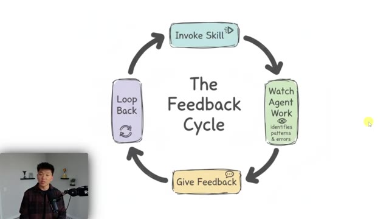
*⏱️ 00:13:45 — Schéma circulaire illustrant "The Feedback Cycle" avec quatre étapes : Invoke Skill, Watch Agent Work, Give Feedback et Loop Back.*

---

### ⏱️ `[00:14:03 - 00:14:24]` | Segment #31

**🔊 Audio (Transcription Intégrale Mot pour Mot en Français) :**
> Et donc les deux ou trois premières fois que vous exécutez une compétence, vous pouvez avoir l'impression, euh, que ça fait très généré par IA. Mais d'ici le moment où vous aurez exécuté cette compétence 10, 20, 30 fois, à chaque fois, elle s'améliore. Et c'est pourquoi il est en fait important de regarder l'agent travailler les deux ou trois premières fois, parce que c'est ainsi que vous êtes capable d'identifier des opportunités pour l'accélérer et économiser des jetons en faisant des choses comme ça. Voici donc un exemple de la compétence de point de situation que nous avons réellement exécutée plus tôt.

**👁️ Analyse Visuelle d'Écran (gemini-3.5-flash-lite) :**
**Interface & Outils** : Diagrammes conceptuels (schémas de flux de travail).

**Contenu textuel & Code** : Texte comparatif sur les méthodes d'accès aux données (API vs fichiers locaux), mentions de MCP, ClickUp, et consommation de tokens.

**Action / Démonstration** : Explication théorique sur l'optimisation des processus pour rendre les agents IA plus rapides et fiables.

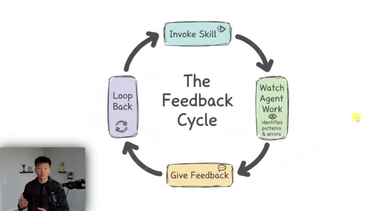
*⏱️ 00:14:08 — Schéma circulaire illustrant "The Feedback Cycle" (Le cycle de rétroaction) pour l'amélioration des compétences d'un agent IA, avec les étapes : Invoke Skill, Watch Agent Work, Give Feedback, Loop Back.*

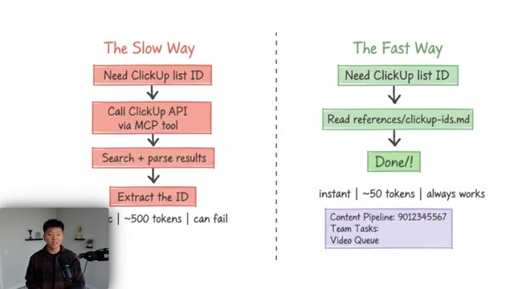
*⏱️ 00:14:19 — Diagramme comparatif entre "The Slow Way" (méthode lente utilisant l'API ClickUp via MCP) et "The Fast Way" (lecture de fichiers de référence locaux), illustrant l'efficacité de l'optimisation des flux de travail IA.*

---

### ⏱️ `[00:14:24 - 00:14:57]` | Segment #32

**🔊 Audio (Transcription Intégrale Mot pour Mot en Français) :**
> Maintenant, cette compétence est invoquée lorsque je demande un bilan de santé ou un suivi des engagements. Et ce qu'elle fait, c'est qu'elle lit un certain contexte sur la façon dont fonctionnent les OTA, ce qui est important pour qu'elle comprenne à chaque fois qu'elle lit cette compétence, c'est pourquoi je l'ai mise ici plutôt que dans un fichier de référence. Et ce qu'elle doit faire, c'est effectuer une recherche en direct sur mon ClickUp pour comprendre ce qui se passe. Donc ce que j'ai fait, c'est que j'ai codé en dur ces identifiants de liste parce qu'en l'observant, je me suis rendu compte qu'à chaque fois qu'elle faisait cela, elle appelait le MCP de ClickUp et elle rassemblait toutes ces listes et elle recherchait et analysait les résultats, puis elle extrayait l'identifiant. Et cela prenait tellement de temps et me coûtait une tonne de

**👁️ Analyse Visuelle d'Écran (gemini-3.5-flash-lite) :**
**Interface & Outils** : - Image 1 : Visual Studio Code
- Image 2 : Excalidraw (ou outil de dessin similaire)

**Contenu textuel & Code** : - Image 1 : Documentation technique au format Markdown définissant ce qu'est un OTA ("Quarterly initiatives"), les rôles des propriétaires de tâches, les sous-tâches et une liste d'identifiants de tâches (floutés).
- Image 2 : Schéma comparant un processus lent (appel API via MCP, parsing, ~500 tokens) à un processus rapide (lecture d'un fichier Markdown, ~50 tokens).

**Action / Démonstration** : - Image 1 : Présentation du fichier de configuration "skill" que l'agent lit pour comprendre le contexte opérationnel.
- Image 2 : Explication conceptuelle de l'optimisation des requêtes de l'agent pour économiser des tokens et augmenter la fiabilité.

*⏱️ 00:14:32 — Éditeur VS Code affichant un fichier Markdown (`SKILL.md`) contenant les instructions et le contexte métier sur le fonctionnement des "OTAs" pour un agent IA.*

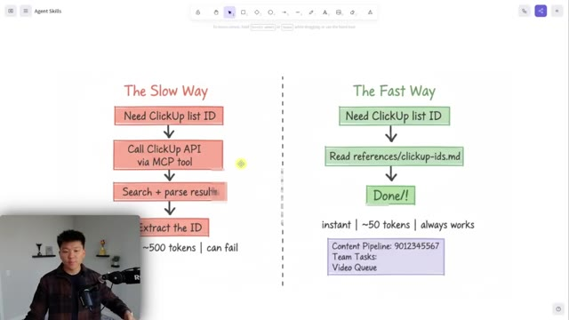
*⏱️ 00:14:49 — Diagramme de flux comparatif ("The Slow Way" vs "The Fast Way") réalisé sur une application de type tableau blanc (Excalidraw) illustrant l'optimisation de la récupération d'identifiants ClickUp.*

---

### ⏱️ `[00:14:57 - 00:15:28]` | Segment #33

**🔊 Audio (Transcription Intégrale Mot pour Mot en Français) :**
> tokens. Donc j'ai réalisé que ce sera toujours la même chose. Pourquoi est-ce que je ne lui donne pas directement dans le document de compétence, les ID de liste ? Et maintenant, il sait comment faire cela instantanément à chaque fois. Et il ne gaspille pas tous ces tokens. Et en plus de cela, je sais que faire des recherches dans ClickUp peut consommer beaucoup de temps et de tokens. J'ai donc créé un sous-agent spécialisé auquel, dans cette compétence, je dis : Hé, délègue au sous-agent de recherche ClickUp avec cette requête afin de faire toute cette recherche pour ne pas saturer ta propre fenêtre de contexte. Tout cela est géré de l'autre côté. Et ensuite, tu obtiens seulement l'information dont tu as besoin. Il y a donc beaucoup de choses avancées que vous pouvez faire pour gérer votre contexte.

**👁️ Analyse Visuelle d'Écran (gemini-3.5-flash-lite) :**
**Interface & Outils** : Excalidraw (Image 1) et Visual Studio Code (Image 2).

**Contenu textuel & Code** : Image 1 : Comparaison de flux de travail. Image 2 : Code source Markdown structurant des instructions pour un agent IA, incluant des ID de tâches spécifiques et des paramètres de filtrage de sous-tâches.

**Action / Démonstration** : Optimisation de l'exécution des agents IA par le remplacement d'appels API dynamiques par la lecture de fichiers de référence statiques pour réduire la consommation de tokens et améliorer la fiabilité.

*⏱️ 00:15:05 — Un schéma comparatif sur Excalidraw illustrant deux méthodes pour récupérer des identifiants ClickUp : "The Slow Way" (via API/MCP, coûteux en tokens) vs "The Fast Way" (lecture d'un fichier Markdown, rapide et efficace).*

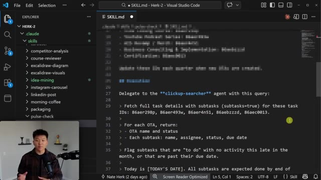
*⏱️ 00:15:12 — L'éditeur Visual Studio Code affichant un fichier Markdown nommé "SKILL.md", montrant la structure d'un prompt déléguant une tâche complexe à un agent nommé "clickup-searcher".*

---

### ⏱️ `[00:15:28 - 00:15:53]` | Segment #34

**🔊 Audio (Transcription Intégrale Mot pour Mot en Français) :**
> Je ne vais pas me plonger dans tout ça dès maintenant. On se concentre juste sur les skills, mais je voulais juste vous donner un petit aperçu de ce qui est possible dans les fichiers skill.md. Donc, un autre bon exemple du besoin d'un document de référence comme celui-là se trouve dans mon skill « skill builder ». Je l'utilise évidemment quand je crée de nouveaux skills, que j'optimise des skills, que j'audite la qualité des skills, des choses comme ça. Et une grande partie de l'inspiration que j'ai tirée de ça venait, bien sûr, directement de la documentation de Cloud Code elle-même sur la façon d'utiliser, de créer et d'optimiser réellement les skills.

**👁️ Analyse Visuelle d'Écran (gemini-3.5-flash-lite) :**
**Interface & Outils** : Visual Studio Code (VS Code).

**Contenu textuel & Code** : Un fichier Markdown contenant des instructions techniques : « Delegate to the clickup-searcher agent with this query: Fetch full task details with subtasks... », incluant des ID de tâches spécifiques et des critères de filtrage pour le suivi de projet.

**Action / Démonstration** : Le présentateur explique la structure et le contenu d'un fichier de compétence (skill) utilisé pour diriger l'exécution d'un agent IA dans son workflow.

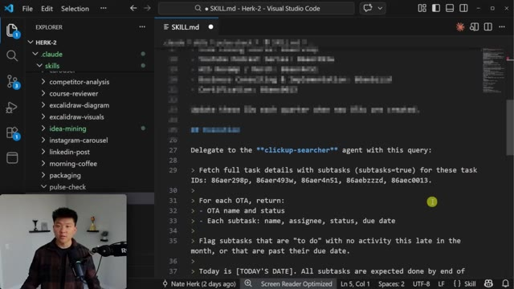
*⏱️ 00:15:34 — L'interface de Visual Studio Code affichant un fichier Markdown nommé « SKILL.md » dans le projet « HERK-2 ». Le document présente des instructions détaillées pour un agent IA nommé « clickup-searcher ».*

---

### ⏱️ `[00:15:54 - 00:16:17]` | Segment #35

**🔊 Audio (Transcription Intégrale Mot pour Mot en Français) :**
> Et donc, quand j'étais en train de construire ça, je regardais l'agent exécuter la compétence et je me suis rendu compte qu'il cherchait à chaque fois. Il fait une recherche web et il parcourt l'intégralité du document, même si j'ai juste besoin d'une petite information. Ce que j'ai donc décidé de faire, c'est que je lui ai dit en gros de tout scraper, puis je lui ai donné un fichier reference.md, qui est en fait la documentation. J'ai donc mon fichier skill.md et ce qu'il fait, c'est qu'il fait référence à ce fichier complet s'il en a besoin.

**👁️ Analyse Visuelle d'Écran (gemini-3.5-flash-lite) :**
**Interface & Outils** : Visual Studio Code

**Contenu textuel & Code** : Documentation Markdown décrivant les instructions d'une compétence Claude Code (What This Skill Does, Mode 1: Build a New Skill, Discovery Interview)

**Action / Démonstration** : Consultation ou modification de la documentation d'une compétence de l'agent IA dans l'éditeur de code.

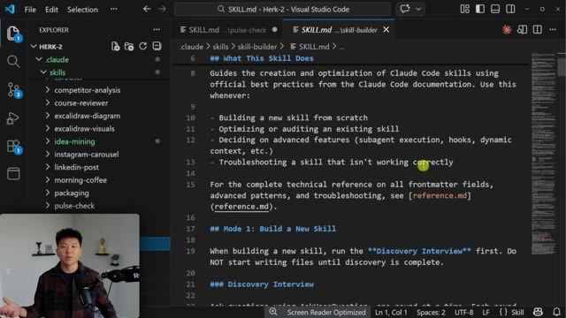
*⏱️ 00:15:59 — Vue de Visual Studio Code affichant le contenu d'un fichier SKILL.md pour la création et l'optimisation de compétences Claude Code, avec le présentateur incrusté en bas à gauche.*

---

### ⏱️ `[00:16:17 - 00:16:39]` | Segment #36

**🔊 Audio (Transcription Intégrale Mot pour Mot en Français) :**
> Mais en réalité, l'idée principale que j'essaie de faire passer ici, c'est que traiter des fichiers Markdown pour votre agent est tellement plus rapide et économique que d'effectuer des appels API ou des requêtes HTTP, d'exécuter des fonctions et de lire des tonnes et des tonnes de tokens. Donc l'objectif, c'est que vos compétences arrivent à un niveau où vous pouvez les invoquer, vous concentrer sur autre chose pendant 10, 15 minutes ou peu importe, puis revenir et obtenir un résultat fini qui soit vraiment, vraiment bon.

**👁️ Analyse Visuelle d'Écran (gemini-3.5-flash-lite) :**
**Interface & Outils** : Schémas explicatifs faits à la main (diagrammes de workflow).

**Contenu textuel & Code** : Comparaison textuelle des performances : ~5 sec, ~500 tokens, can fail vs instant, ~50 tokens, always works. Étapes du cycle de rétroaction.
[DESC_IMAGE_2] Le présentateur explique les concepts d'optimisation des performances des agents IA à l'aide de diagrammes illustrés.

**Action / Démonstration** : Explications face caméra et démonstration conceptuelle.

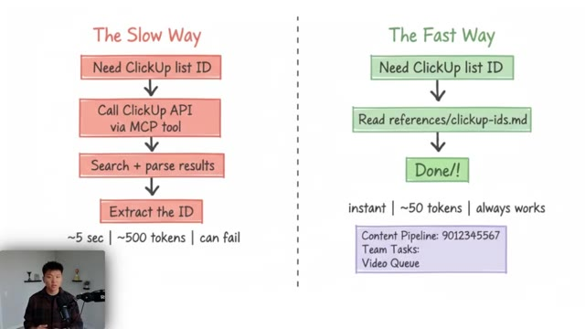
*⏱️ 00:16:22 — Diagramme comparatif en deux colonnes illustrant 'The Slow Way' (méthode lente par API) versus 'The Fast Way' (méthode rapide par fichier Markdown) pour récupérer des ID ClickUp.*

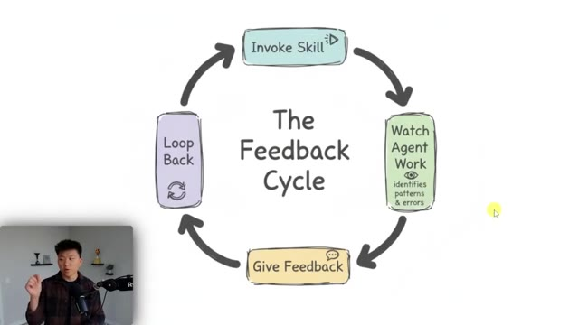
*⏱️ 00:16:34 — Schéma circulaire représentant 'The Feedback Cycle' avec les étapes : Invoke Skill, Watch Agent Work, Give Feedback, et Loop Back.*

---

### ⏱️ `[00:16:39 - 00:16:58]` | Segment #37

**🔊 Audio (Transcription Intégrale Mot pour Mot en Français) :**
> Mais les premières fois que vous testez une compétence, je pense que c'est une très bonne idée de simplement rester là, de la regarder et de voir ce qu'elle fait. Et beaucoup de gens m'ont demandé, genre, comment sait-on quand il faut créer une compétence ? Eh bien, en gros, faites simplement votre travail. Et si jamais vous vous rendez compte que vous avez déjà fait quelque chose ou que vous avez donné une instruction différente, comme moi quand je dis à mon Claude de ne pas utiliser de tirets cadratins.

**👁️ Analyse Visuelle d'Écran (gemini-3.5-flash-lite) :**
**Interface & Outils** : Schémas explicatifs illustrés (type diagramme dessiné à la main).

**Contenu textuel & Code** : Texte de schémas explicatifs sur le cycle de feedback et la création de compétences (skills) pour agents IA.
[DESC_IMAGE_1] Le présentateur explique le cycle d'évaluation et d'observation d'un agent IA.
[DESC_IMAGE_2] Le présentateur explique comment déterminer le moment opportun pour créer une compétence.

**Action / Démonstration** : Présentation visuelle de concepts méthodologiques pour l'automatisation par IA.

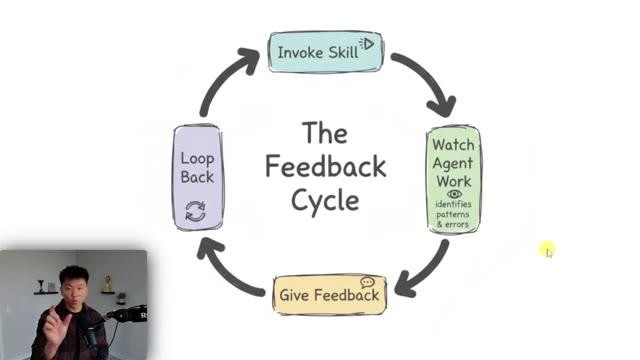
*⏱️ 00:16:44 — Schéma circulaire intitulé "The Feedback Cycle" illustrant les étapes : Invoke Skill, Watch Agent Work, Give Feedback, et Loop Back.*

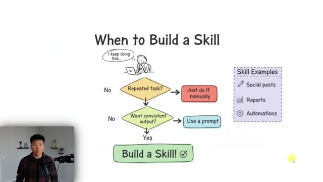
*⏱️ 00:16:49 — Arbre de décision intitulé "When to Build a Skill" avec des critères comme "Repeated task?" et "Want consistent output?".*

---

### ⏱️ `[00:16:58 - 00:17:19]` | Segment #38

**🔊 Audio (Transcription Intégrale Mot pour Mot en Français) :**
> D'accord, eh bien, c'est probablement une bonne idée de mettre ça dans le prompt, n'est-ce pas ? Donc si vous vous surprenez un jour à faire un processus ou à répéter des prompts, alors c'est probablement un bon cas d'usage pour créer une compétence autour de ça. Parce que les compétences n'ont pas besoin d'être complexes. Elles peuvent littéralement n'être qu'un fichier Markdown de 50 lignes. Très bien, nous sommes donc sur le point de passer à la création en direct d'une compétence à partir de zéro. Mais ce que je voulais faire rapidement, c'est passer en revue le cadre en six étapes pour la création de compétences.

**👁️ Analyse Visuelle d'Écran (gemini-3.5-flash-lite) :**
**Interface & Outils** : Présentation visuelle / Diagramme explicatif dessiné à la main

**Contenu textuel & Code** : Schéma de décision montrant les conditions pour créer une compétence ('Build a Skill!'), avec des exemples de compétences comme 'Social posts', 'Reports', et 'Automations'.

**Action / Démonstration** : Le présentateur explique les critères pour déterminer si une tâche répétitive justifie la création d'une compétence IA.

*⏱️ 00:17:04 — Schéma explicatif illustré intitulé 'When to Build a Skill' avec des étapes décisionnelles (Repeated task?, Want consistent output?) guidant vers la création d'une compétence.*

---

### ⏱️ `[00:17:20 - 00:17:41]` | Segment #39

**🔊 Audio (Transcription Intégrale Mot pour Mot en Français) :**
> Donc, numéro un, c’est le nom et le déclencheur. Comment ça s'appelle ? Et le langage naturel qui permettrait fondamentalement de le lancer. Numéro deux, c’est l’objectif. Donc, en une seule phrase, qu'est-ce que cette compétence va accomplir à la fin ? Quel sera le résultat ? Numéro trois, c’est le vif du sujet. C’est le processus étape par étape. Si vous deviez faire quelque chose manuellement, qu'est-ce que vous faites exactement et dans quel ordre, qu'est-ce que vous regardez et quelles décisions prenez-vous ?

**👁️ Analyse Visuelle d'Écran (gemini-3.5-flash-lite) :**
**Interface & Outils** : Présentation graphique / diagramme au style manuscrit

**Contenu textuel & Code** : 1. Name + Trigger, 2. Goal, 3. Step-by-Step Process, 4. Reference Files, 5. Rules, 6. Self-Improvement

**Action / Démonstration** : Le présentateur explique les différentes étapes du framework de construction de compétences IA.

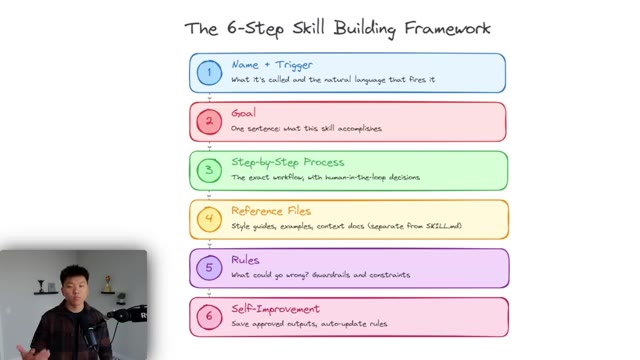
*⏱️ 00:17:25 — Schéma explicatif intitulé 'The 6-Step Skill Building Framework' détaillant les étapes de construction d'une compétence IA, de Name + Trigger à Self-Improvement.*

---

### ⏱️ `[00:17:41 - 00:18:15]` | Segment #40

**🔊 Audio (Transcription Intégrale Mot pour Mot en Français) :**
> Le numéro quatre, ce sont les fichiers de référence. De quel contexte avez-vous besoin ? Avez-vous besoin d'images ? Avez-vous besoin d'une compréhension des projets actuels, des priorités actuelles ? Avez-vous besoin de guides de style ? De quoi avez-vous besoin pour bien faire le travail ? Le numéro cinq, ce sont les règles. Pensez à ce qui pourrait mal tourner. Et ensuite, l'agent peut vous aider à mettre en place des balises de sécurité et des contraintes autour de cela. Et puis le numéro six, c'est un peu comme après l'avoir construit, c'est simplement la boucle d'auto-amélioration. Et après la construction en direct, je vais parler de la mise à l'épreuve, des itérations et de ce que vous devez faire pour qu'ils soient vraiment, vraiment bons. Mais pour l'instant, c'est le cadre de développement des compétences en six étapes. Passons à une construction en direct. D'accord. Nous voici donc dans Visual Studio Code, qui est l'endroit où j'aime utiliser Cloud Code. Si vous n'avez pas Visual Studio

**👁️ Analyse Visuelle d'Écran (gemini-3.5-flash-lite) :**
**Interface & Outils** : Présentation visuelle / Schéma graphique style tableau blanc

**Contenu textuel & Code** : Texte du schéma listant les 6 étapes : 1. Name + Trigger, 2. Goal, 3. Step-by-Step Process, 4. Reference Files, 5. Rules, 6. Self-Improvement.

**Action / Démonstration** : Le présentateur explique l'étape numéro 4 du framework relative aux fichiers de référence.

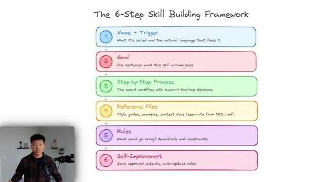
*⏱️ 00:17:50 — Schéma explicatif intitulé 'The 6-Step Skill Building Framework' détaillant 6 étapes pour construire une compétence, avec le présentateur incrusté en bas à gauche.*

---

### ⏱️ `[00:18:15 - 00:18:48]` | Segment #41

**🔊 Audio (Transcription Intégrale Mot pour Mot en Français) :**
> code, allez simplement sur un navigateur, tapez VS Code, et ensuite allez télécharger ceci. C'est à ça que ça ressemblera si c'est la première fois que vous utilisez Cloud Code ici. Vous devez juste aller dans les extensions sur ce côté gauche, taper Cloud Code, puis l'installer, et ensuite vous connecter avec votre abonnement payant Anthropic. Maintenant, après ça, vous allez cliquer sur ce bouton en haut à gauche, et ça va ouvrir ce petit truc qui indique que vous n'avez pas encore ouvert de dossier. Ce que vous devez faire, c'est ouvrir un projet dans lequel travailler. Donc vous pouvez soit en ouvrir un sur lequel vous travaillez déjà, soit aller créer un nouveau dossier puis ouvrir celui-là. Pour les besoins de la démo, je viens d'ouvrir un nouveau dossier vide appelé "a bunch of skills", et je vais vous montrer exactement ce à quoi

**👁️ Analyse Visuelle d'Écran (gemini-3.5-flash-lite) :**
**Interface & Outils** : Visual Studio Code (VS Code)

**Contenu textuel & Code** : Liste des extensions installées et recommandées (Claude Code for VS Code, Pixel Agents, Container Tools, etc.)

**Action / Démonstration** : Navigation dans le panneau latéral des extensions pour rechercher et installer un outil de développement.

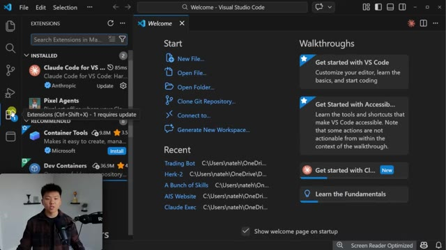
*⏱️ 00:18:23 — Interface de VS Code montrant le panneau des extensions ouvert sur la gauche avec notamment l'extension Claude Code installée, et la page d'accueil de bienvenue au centre.*

---

### ⏱️ `[00:18:48 - 00:19:23]` | Segment #42

**🔊 Audio (Transcription Intégrale Mot pour Mot en Français) :**
> Donc la première étape est d'aller dans ma communauté School gratuite, le lien est dans la description, d'aller dans la classe des compétences d'agent et de télécharger le dossier du constructeur de compétences. Une fois que vous avez ces fichiers prêts, la première chose que nous voulons faire est de configurer cet espace de travail très rapidement. Initialisez ce projet avec une simple structure de dossier point Claude slash skills. Cool. Donc comme vous pouvez le voir, ça a été configuré. Nous avons un point Claude, nous avons un dossier skills. Et ce que je vais faire, c'est que dans ce dossier skills, je vais créer un nouveau dossier appelé skill-builder et appuyer sur entrée. Et ensuite, je vais prendre ces deux fichiers de ma communauté School, le fichier de référence et le fichier markdown, et je vais les placer directement dedans.

**👁️ Analyse Visuelle d'Écran (gemini-3.5-flash-lite) :**
**Interface & Outils** : Visual Studio Code (éditeur de code)

**Contenu textuel & Code** : Interface utilisateur de Claude Code avec la mention "ctrl esc to focus or unfocus Claude", un bouton "Bypass permissions" et un fichier "SKILL.md".

**Action / Démonstration** : Présentation de l'interface de travail dans Visual Studio Code pour interagir avec l'assistant Claude Code.

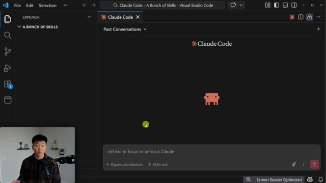
*⏱️ 00:18:57 — Interface de l'éditeur de code Visual Studio Code affichant l'extension ou l'interface de Claude Code avec un logo de petit monstre pixelisé et une zone de saisie en bas.*

---

### ⏱️ `[00:19:23 - 00:19:54]` | Segment #43

**🔊 Audio (Transcription Intégrale Mot pour Mot en Français) :**
> ici. Donc maintenant, nous avons ce créateur de compétences configuré avec le fichier de référence et la compétence markdown réelle. Je lui demande s'il peut voir cette nouvelle compétence que je viens d'ajouter. Il dit, oui, je peux la voir. Et je vais fondamentalement juste dire, cool, exécutons cette compétence pour en construire une nouvelle ensemble. Donc maintenant vous pouvez voir ce qu'il a fait, c'est qu'il est fondamentalement en train de lire la compétence en ce moment. Ce sont les instructions que nous avons vues juste ici. Comme vous le savez, puisque c'est ainsi que fonctionnent les compétences, il commence à lire ceci. C'est parti. J'ai construit cette compétence pour vous poser réellement des questions afin qu'il soit beaucoup plus facile pour vous de communiquer ce que vous voulez. La première chose est donc : quel problème essayez-vous de résoudre ?

**👁️ Analyse Visuelle d'Écran (gemini-3.5-flash-lite) :**
**Interface & Outils** : Visual Studio Code (éditeur de code) avec l'extension Claude Code.

**Contenu textuel & Code** : Fichiers Markdown (SKILL.md, reference.md), métadonnées YAML (nom, description) et code de définition de compétence.

**Action / Démonstration** : Interaction avec l'agent IA dans l'éditeur pour vérifier et consulter la nouvelle compétence configurée.

*⏱️ 00:19:31 — Interface de Visual Studio Code montrant l'explorateur de fichiers à gauche avec le dossier .claude/skills/skill-builder et le panneau de chat interactif posant la question « can you see the new skill-builder skill I added? ».*

*⏱️ 00:19:46 — Visual Studio Code affichant le contenu du fichier SKILL.md du skill-builder avec du texte sélectionné en bleu, décrivant les métadonnées et la structure de la compétence.*

---

### ⏱️ `[00:19:54 - 00:20:12]` | Segment #44

**🔊 Audio (Transcription Intégrale Mot pour Mot en Français) :**
> Ce qu'on veut faire, c'est de la création de contenu. Parce que dans cette compétence, ce que je veux faire, c'est créer des infographies personnalisées. Quel genre de contenu la compétence crée-t-elle ? Quel est le cas d'usage ou le flux de travail spécifique ? Et je vais en fait simplement choisir « autre » pour ceci. Et je vais dire des infographies éducatives. Maintenant, ça demande comment nous devrions déclencher cette compétence. Est-ce que ce doit être en langage naturel ou est-ce qu'on veut simplement utiliser des commandes obliques ?

**👁️ Analyse Visuelle d'Écran (gemini-3.5-flash-lite) :**
**Interface & Outils** : Visual Studio Code avec un panneau de discussion intégré pour le constructeur de compétences.

**Contenu textuel & Code** : "Do you already have a name in mind for this skill? (If not, I'll suggest one based on your description.)" avec les options "Yes, I have a name", "Suggest one for me", et "Other".

**Action / Démonstration** : Sélection de l'option pour nommer la nouvelle compétence de création d'infographies.

*⏱️ 00:19:58 — Interface de Visual Studio Code affichant un assistant de création de compétences avec une invite interactive demandant un nom pour la compétence.*

---

### ⏱️ `[00:20:12 - 00:20:32]` | Segment #45

**🔊 Audio (Transcription Intégrale Mot pour Mot en Français) :**
> Et je vais juste dire que les deux conviennent. Et maintenant, nous passons au processus étape par étape, ce qui est vraiment important parce qu'à ce stade, nous ne lui avons pas dit quelle pile technologique nous voulons réellement utiliser ni rien d'autre sur notre entreprise. Guide-moi donc à travers ce qui devrait se passer du déclencheur à la sortie. Et il a quelques bonnes suppositions, mais ce que je vais faire, c'est choisir « autre » et expliquer cela de la manière dont je veux que ce soit construit. Je vais vous dire sur quoi je veux une infographie.

**👁️ Analyse Visuelle d'Écran (gemini-3.5-flash-lite) :**
**Interface & Outils** : Visual Studio Code avec extension de chat IA / assistant de code

**Contenu textuel & Code** : Historique de discussion textuel interactif comprenant les sections 'Educational infographics', 'AskUserQuestion', 'Moving to Round 3: Step-by-Step Process' et le champ de saisie 'Queue another message...'

**Action / Démonstration** : Navigation et affichage des différentes étapes du processus guidé par l'assistant IA (Round 3) dans l'éditeur.

*⏱️ 00:20:17 — Vue de l'interface de VS Code montrant un échange de questions-réponses avec l'assistant IA concernant la création d'une nouvelle compétence (skill-builder).*

---

### ⏱️ `[00:20:32 - 00:21:04]` | Segment #46

**🔊 Audio (Transcription Intégrale Mot pour Mot en Français) :**
> Tu vas créer un concept. Tu vas faire une requête à key.ai pour utiliser nano banana afin de générer le plan. ou désolé, pour générer l'image. Et tu vas aussi regarder les directives de marque que je te donne pour que tout ce qui est créé suive mes couleurs de marque et ma typographie et des choses comme ça. Le format de sortie que je veux vraiment est un PNG, pas tout ce truc-là. Est-ce que cela doit être conversationnel ou « tire et oublie » ? Je vais simplement opter pour « tire et oublie ». Très bien. Alors, comment fonctionne l'intégration de key.ai avec nano banana ? Est-ce un appel API ? Ouais. On va juste faire un appel API.

**👁️ Analyse Visuelle d'Écran (gemini-3.5-flash-lite) :**
**Interface & Outils** : Visual Studio Code, Explorateur de fichiers, panneau interactif de saisie.

**Contenu textuel & Code** : Fichiers Markdown de compétences (.claude/skills/skill-builder/SKILL.md) et options de processus interactifs (Process, Output format, Interaction, Champ de saisie "Type your answer...").

**Action / Démonstration** : Navigation et configuration de compétences d'assistant IA (Claude) avec sélection de flux de travail.

*⏱️ 00:20:40 — Interface de Visual Studio Code affichant un panneau contextuel interactif avec des options de processus, d'autre part le présentateur dans un encadré vidéo en bas à gauche.*

---

### ⏱️ `[00:21:04 - 00:21:40]` | Segment #47

**🔊 Audio (Transcription Intégrale Mot pour Mot en Français) :**
> Et dans ces options, vous pourriez littéralement dire, je ne sais pas, essayons différentes choses. Vous savez, aidez-moi à déterminer ce qui est le mieux. Il demande où se trouvent ces actifs de marque. Je vais donc les mettre dans un dossier et où le fichier PNG de l'infographie générée doit-il être enregistré ? Oui, bien sûr. Créons un nouveau dossier appelé projets et nous y mettrons tous les éléments. Ainsi, cela va également garder notre projet organisé. Donc maintenant, il pose des questions sur les directives de la marque. J'ai créé ce dossier et j'y ai mis notre palette de couleurs ainsi que le logo AIS réel. J'ai inclus à la fois nos directives de marque AIS et le logo AIS. Je veux m'assurer qu'dans le coin supérieur gauche de chaque infographie créée, le logo AIS apparaît exactement tel que je vous l'ai donné. Mais je pense que vous avez compris l'idée.

**👁️ Analyse Visuelle d'Écran (gemini-3.5-flash-lite) :**
**Interface & Outils** : Visual Studio Code

**Contenu textuel & Code** : Dialogue interactif "Output path" demandant "Where should the generated PNG infographic be saved?" avec les options "projects/infographic-builder/", "A custom location", et "Other".

**Action / Démonstration** : Sélection de l'option de chemin de sortie pour l'infographie générée.

*⏱️ 00:21:13 — Interface de Visual Studio Code affichant un dialogue de configuration interactif (Skill-builder) posant une question sur le chemin de sortie des infographies générées.*

---

### ⏱️ `[00:21:40 - 00:22:12]` | Segment #48

**🔊 Audio (Transcription Intégrale Mot pour Mot en Français) :**
> ici. Je vais répondre à quelques questions de plus et ensuite je vais juste vous montrer quand nous aurons un résultat. Et maintenant que nous avons fait cela, ce que vous pouvez voir, c'est que ça va créer la compétence. Ça va créer la superposition de logo. Ça va créer un fichier markdown de référence de support pour tous les détails d'API dont il va avoir besoin. Donc c'est super. Ça va enregistrer la compétence dans claw.md et ça va consigner ses décisions. Très bien. Donc ça a entièrement construit la compétence. Ça a créé tous ces fichiers pour nous. Nous devons juste lui donner une clé, une clé d'API, pour que nous puissions réellement exécuter ceci. D'accord. Donc j'ai entré ma clé d'API et ensuite j'ai dit, testez-le avec une infographie sur les compétences de Claude. C'est tout.

**👁️ Analyse Visuelle d'Écran (gemini-3.5-flash-lite) :**
**Interface & Outils** : Visual Studio Code avec une extension ou un panneau d'agent conversationnel intégré (type Cline / Claude Dev).

**Contenu textuel & Code** : Liste de tâches (« Update Todos » : création de SKILL.md, script Python de superposition de logo, fichier de référence, etc.) et commande Bash listant les répertoires de compétences.

**Action / Démonstration** : L'agent IA exécute et suit les étapes de création et de configuration des compétences pour l'automatisation.

*⏱️ 00:21:48 — Capture d'écran de l'éditeur VS Code montrant l'arborescence des fichiers du projet et l'interface d'un agent IA en train de lister et de mettre à jour les tâches (« Update Todos ») avec l'arborescence des compétences Claude.*

---

### ⏱️ `[00:22:12 - 00:22:51]` | Segment #49

**🔊 Audio (Transcription Intégrale Mot pour Mot en Français) :**
> Aucun autre contexte. Elle a invoqué la compétence juste ici et nous allons voir ce qui se passe. D'accord. C'est vraiment intéressant. Donc ce qu'elle fait, c'est qu'elle génère l'image et ensuite elle va simplement superposer le logo. Ça va donc être beaucoup plus cohérent que de donner à l'générateur d'images par IA, Nano Banana, mon logo. Je ne lui avais même pas demandé de faire ça. Voyons à quoi ça ressemble. D'accord. Bon, je n'aime pas trop ça. Nous allons simplement revenir en arrière et lui demander de modifier certaines choses. Le logo en haut à gauche n'a pas l'air terrible. Je t'ai donné un logo avec un fond transparent, il devrait donc simplement être superposé par-dessus et nous devrions pouvoir voir l'arrière-plan derrière. L'infographie elle-même est pas mal, mais je veux en fait que celles-ci aient toujours un format carré un par un. D'accord, donc j'ai fait

**👁️ Analyse Visuelle d'Écran (gemini-3.5-flash-lite) :**
**Interface & Outils** : Visual Studio Code, extension Claude, interface de chat du terminal IA

**Contenu textuel & Code** : Commandes Bash visibles : téléchargement de l'image générée via cURL et exécution d'un script Python pour superposer le logo AIS sur l'infographie.

**Action / Démonstration** : Exécution de commandes Bash par l'assistant IA pour télécharger et modifier l'image générée.

*⏱️ 00:22:22 — Interface de Visual Studio Code affichant l'extension Claude exécutant des commandes Bash pour télécharger l'image générée et superposer le logo, avec la webcam du présentateur en bas à gauche.*

---

### ⏱️ `[00:22:51 - 00:23:25]` | Segment #50

**🔊 Audio (Transcription Intégrale Mot pour Mot en Français) :**
> quelques suggestions et il va réessayer et il va mettre à jour sa compétence. Donc nous allons voir si c'est mieux. Très bien, alors deuxième fois que nous exécutons la compétence, voyons si c'est un peu mieux. Très bien, voilà. Nous avons le logo en haut. Nous avons Cloud Code Skills, flux de travail IA personnalisé, déclencheur d'invite de commande, configuration front matter, déclencheurs, délégation d'agent IA, sortie de document. Donc gardez à l'esprit, tout ce que nous avons dit c'était construis une infographie sur Cloud Skills. Et c'était la deuxième exécution. Chaque fois que nous faisons ce cycle, rappelez-vous que nous avons parlé de la rétroaction, nous le regarderions essentiellement à nouveau, donnerions plus de rétroaction, et puis continuerions. Et après avoir exécuté ceci probablement cinq ou six fois de plus, cela serait vraiment, vraiment bien. Et puis chaque fois que je demande

**👁️ Analyse Visuelle d'Écran (gemini-3.5-flash-lite) :**
**Interface & Outils** : Visual Studio Code et outil de tableau blanc interactif

**Contenu textuel & Code** : Schéma d'architecture pour 'Claude Code Skills' et cycle de rétroaction (Feedback Cycle) pour l'exécution d'agents IA

**Action / Démonstration** : Présentation et explication visuelle des flux de travail et des boucles de rétroaction pour la création de compétences d'IA

*⏱️ 00:22:59 — VS Code affichant un diagramme de workflow 'Claude Code Skills: Custom AI Workflow' et l'arborescence des fichiers du projet.*

*⏱️ 00:23:17 — Interface d'un outil de tableau blanc montrant un diagramme circulaire intitulé 'The Feedback Cycle' avec les étapes Invoke Skill, Watch Agent Work, Give Feedback, Loop Back.*

---

### ⏱️ `[00:23:25 - 00:24:00]` | Segment #51

**🔊 Audio (Transcription Intégrale Mot pour Mot en Français) :**
> pour une infographie, ça va être cohérent. Et juste pour vous montrer les gars ce qui a réellement été construit. Si on ouvre la compétence de création d'infographies, on a la compétence elle-même en tant que telle. Donc on a les métadonnées juste ici, le nom, la description. On a ce que fait la compétence. On a le contexte. Donc c'est ici que ça renvoie vers les directives de la marque et les logos réels. On a le flux de travail étape par étape juste ici. Et on peut voir juste ici pour une référence d'API complète et les paramètres, il suffit de consulter le fichier Markdown pour ne pas avoir à chercher sur le Web et à parcourir un tas de jetons. Vous pouvez simplement lire ce fichier Markdown. Très bien. Donc on a parlé de beaucoup de choses sur les compétences aujourd'hui et on vient d'en créer une en direct. Donc ce dont je veux parler maintenant, c'est vraiment de savoir comment vous

**👁️ Analyse Visuelle d'Écran (gemini-3.5-flash-lite) :**
**Interface & Outils** : Visual Studio Code (VS Code)

**Contenu textuel & Code** : Fichier Markdown (`SKILL.md`) contenant les métadonnées (nom : `infographic-builder`, description) et la section "What This Skill Does" décrivant la génération d'infographies.

**Action / Démonstration** : Le présentateur montre l'arborescence des fichiers du projet et détaille le contenu du fichier SKILL.md dans l'éditeur.

*⏱️ 00:23:34 — L'éditeur de code VS Code affichant le fichier SKILL.md de la compétence infographic-builder, avec un incruste vidéo du présentateur en bas à gauche.*

---

### ⏱️ `[00:24:00 - 00:24:36]` | Segment #52

**🔊 Audio (Transcription Intégrale Mot pour Mot en Français) :**
> combler l'écart entre une compétence efficace à 90 % environ pour la rendre presque parfaite à 100 %. Il y a donc les phases de test, d'itération et de débogage. Il existe différents symptômes et différentes solutions. Parcourons donc cette liste un par un. Le premier symptôme pourrait être qu'il effectue les mauvaises étapes ou dans le mauvais ordre. Eh bien, vous lui diriez simplement de modifier les instructions du fichier skill.md. Vous pourriez obtenir un ton, un style ou un contexte manquant. Dans ce cas, vous allez ajouter des fichiers de référence. Et bien sûr, ceux-ci doivent être correctement pointés dans le fichier skill.md. Vous pourriez voir la même erreur se répéter sans cesse, auquel cas vous allez ajouter une règle. S'il a du mal avec un outil ou un protocole MCP, ou s'il continue à chercher les mêmes choses, créez alors une sorte de document de référence pour lui. S'il fonctionne bien, mais qu'il pourrait obtenir

**👁️ Analyse Visuelle d'Écran (gemini-3.5-flash-lite) :**
**Interface & Outils** : Document visuel / Schéma didactique de présentation

**Contenu textuel & Code** : Guide de débogage des compétences associant 7 paires de symptômes et de corrections, comprenant par exemple 'Wrong steps / wrong order' associé à 'Edit SKILL.md instructions' et 'Skill not triggering' associé à 'Check the YAML'.

**Action / Démonstration** : Présentation et explication des différentes étapes et méthodes pour déboguer et améliorer les compétences d'un agent IA.

*⏱️ 00:24:09 — Un schéma explicatif intitulé 'Skill Debugging Guide' listant différents symptômes de dysfonctionnement d'une compétence IA en rouge à gauche et leurs solutions correspondantes en vert à droite, avec le présentateur visible en incrustation vidéo dans le coin inférieur gauche.*

---

### ⏱️ `[00:24:36 - 00:25:08]` | Segment #53

**🔊 Audio (Transcription Intégrale Mot pour Mot en Français) :**
> mieux, alors cela signifie simplement que vous devez y aller en force. Vous devez juste l'exécuter encore et encore et encore et continuer à pinailler sur ce qu'il fait de mal, ou peut-être pas de mal, mais sur ce qu'il pourrait améliorer. Si la compétence ne s'active pas, alors vérifiez le YAML et assurez-vous qu'il est suffisamment spécifique. Si la compétence s'active trop souvent, alors essayez peut-être de désactiver l'appel de modèle. Et c'est quelque chose que vous pouvez voir dans la documentation de Claude, qui vous donne fondamentalement le contrôle pour savoir si la compétence ne peut être invoquée que par le langage naturel ou seulement par la commande oblique directement, ou les deux. Donc, comme je l'ai dit, si vous voulez regarder des choses plus avancées, rendez-vous définitivement ici sur la documentation réelle. Mais à ce stade, nous avons couvert presque tout concernant ces compétences.

**👁️ Analyse Visuelle d'Écran (gemini-3.5-flash-lite) :**
**Interface & Outils** : Présentation visuelle / schéma didactique.

**Contenu textuel & Code** : Tableau associant des problèmes (ex: 'Wrong steps', 'Skill not triggering') à des solutions (ex: 'Edit SKILL.md instructions', 'Check the YAML').

**Action / Démonstration** : Explication théorique des différentes méthodes de débogage et d'amélioration des compétences de l'agent.

*⏱️ 00:24:44 — Schéma explicatif intitulé 'Skill Debugging Guide' mettant en relation des symptômes et leurs corrections correspondantes.*

---

### ⏱️ `[00:25:09 - 00:25:27]` | Segment #54

**🔊 Audio (Transcription Intégrale Mot pour Mot en Français) :**
> Un élément sur lequel je voudrais attirer votre attention est la référence du front matter elle-même, parce que nous avons vu le nom et la description, ce qui est requis à chaque fois. Mais il y a beaucoup d'autres choses que vous pouvez y ajouter. Voici la désactivation de l'invocation du modèle comme nous venons de le voir. Mais vous pouvez également lui donner des outils autorisés. Vous pouvez également lui donner un indice d'argument. Vous pouvez lui donner un modèle spécifique à utiliser.

**👁️ Analyse Visuelle d'Écran (gemini-3.5-flash-lite) :**
**Interface & Outils** : Navigateur web affichant la documentation de Claude Code (Claude Code Docs)

**Contenu textuel & Code** : Un exemple de front matter YAML pour un fichier SKILL.md contenant les champs `name`, `description`, `disable-model-invocation: true`, et `allowed-tools: Read, Grep`, ainsi qu'un tableau explicatif des champs.

**Action / Démonstration** : Le présentateur présente la documentation et commente les options supplémentaires du front matter telles que la désactivation de l'invocation du modèle.

*⏱️ 00:25:13 — Capture d'écran de la documentation officielle de Claude Code montrant la page "Frontmatter reference" avec un exemple de configuration YAML et un tableau des champs disponibles.*

---

### ⏱️ `[00:25:27 - 00:25:48]` | Segment #55

**🔊 Audio (Transcription Intégrale Mot pour Mot en Français) :**
> Tu peux lui donner un contexte spécifique. Tu peux lui donner des accroches. Tu peux lui donner un agent spécifique. Et donc tout cela te permet d'être vraiment, vraiment très précis sur la compétence exacte et la façon dont tu veux qu'elle soit utilisée. Mais ne te sens pas submergé. Tu n'arrives vraiment à ce point-là qu'une fois que tu as exécuté la compétence un nombre incalculable de fois. Maintenant, une autre chose dont je dois parler rapidement, c'est : où résident réellement les compétences ? Parce que ce qu'on a vu jusqu'à présent, c'est juste de les créer directement dans notre dossier dot-cloud slash skills.

**👁️ Analyse Visuelle d'Écran (gemini-3.5-flash-lite) :**
**Interface & Outils** : Documentation technique web et schéma explicatif illustré.

**Contenu textuel & Code** : Paramètres de configuration des skills Claude Code et chemins de répertoires de stockage.

**Action / Démonstration** : Le présentateur explique la configuration détaillée des compétences et leur emplacement de stockage sur le disque.

*⏱️ 00:25:32 — Documentation web officielle montrant la configuration des compétences Claude Code avec les paramètres argument-hint, disable-model-invocation, user-invocable, allowed-tools, model, context, agent et hooks.*

*⏱️ 00:25:42 — Schéma explicatif illustrant l'emplacement des compétences (.claude/skills/ pour le projet ou ~/.claude/skills/ pour tous les projets).*

---

### ⏱️ `[00:25:48 - 00:26:07]` | Segment #56

**🔊 Audio (Transcription Intégrale Mot pour Mot en Français) :**
> Mais quand vous faites cela, ils n'existent que dans ce projet spécifique. Donc que ce soit mon heart two ou mon, vous savez, celui que nous venons de créer, si je me rendais dans un autre dossier, cette compétence ne pourrait plus être accédée par notre Cloud Code. Mais vous pouvez également créer des compétences qui sont en fait globales. Et vous faites cela en le faisant dans un répertoire différent, dans votre sorte de répertoire personnel général.

**👁️ Analyse Visuelle d'Écran (gemini-3.5-flash-lite) :**
**Interface & Outils** : Schéma explicatif / Tableau blanc numérique

**Contenu textuel & Code** : Texte du schéma comparant le dossier local (.claude/skills/ - « This project only ») et le dossier global (~/.claude/skills/ - « Every project »), avec une légende pour le répertoire personnel.

**Action / Démonstration** : Le présentateur explique la différence de portée entre les compétences enregistrées au niveau d'un projet spécifique et celles disponibles globalement.

*⏱️ 00:25:52 — Schéma explicatif illustrant l'emplacement des compétences (« Where Do Skills Live? ») : le dossier local .claude/skills/ spécifique au projet et le dossier global ~/.claude/skills/ pour tous les projets.*

---

### ⏱️ `[00:26:07 - 00:26:28]` | Segment #57

**🔊 Audio (Transcription Intégrale Mot pour Mot en Français) :**
> Et c'est essentiellement indiqué par le petit tilde juste ici. Et donc cela signifie que chaque produit que vous utilisez dans Cloud Code, peu importe où vous êtes, cette compétence existera. Donc par exemple, j'ai une compétence de design front-end qui est installée globalement. De sorte que peu importe où je suis, si j'ai besoin de faire du design front-end, il est simplement capable de l'utiliser. Et juste au cas où vous voudriez voir les choses d'une autre manière. En ce moment, ce que nous faisons, c'est que nous avons nos projets, n'est-ce pas ?

**👁️ Analyse Visuelle d'Écran (gemini-3.5-flash-lite) :**
**Interface & Outils** : Schéma/diagramme explicatif fait à la main (style Excalidraw) avec le présentateur en médaillon vidéo.

**Contenu textuel & Code** : Texte du schéma expliquant l'emplacement des compétences : PRJ (.claude/skills/ - This project only) et ALL (~/.claude/skills/ - Every project), avec une note sur le symbole tilde (~).

**Action / Démonstration** : Le présentateur explique les emplacements des compétences (locales au projet versus globales dans le répertoire utilisateur).

*⏱️ 00:26:12 — Schéma explicatif illustrant l'emplacement des compétences (« Where Do Skills Live? »), avec une distinction entre le dossier de projet (.claude/skills/) et le répertoire utilisateur global (~/.claude/skills/).*

---

### ⏱️ `[00:26:28 - 00:26:56]` | Segment #58

**🔊 Audio (Transcription Intégrale Mot pour Mot en Français) :**
> Donc Herc 2. Et ensuite nous avons .cloud. Et ensuite, à l'intérieur de .cloud, nous avons skills. Et ensuite votre skill. Et ensuite votre MD, vos références, peu importe. Et ensuite peut-être un autre skill. Mais si c'était global, vous ne leisseriez peut-être pas vraiment voir dans votre projet. Il serait simplement dans votre répertoire personnel global. La raison pour laquelle vous pourriez vouloir faire cela est que s'il y a quelque chose de très spécifique à vous, votre entreprise, vos flux de travail, que vous voulez appliquer à chaque projet, peu importe quoi, peut-être le contexte de votre entreprise, vos projets d'entreprise, votre ton, peu importe, alors vous pouvez l'installer globalement à la place.

**👁️ Analyse Visuelle d'Écran (gemini-3.5-flash-lite) :**
**Interface & Outils** : Présentation visuelle / Schéma explicatif

**Contenu textuel & Code** : Arborescence de fichiers montrant d'un côté la structure d'un projet local avec .claude/skills/my-skill/SKILL.md et de l'autre le répertoire global ~/.claude/skills/my-skill/SKILL.md

**Action / Démonstration** : Le présentateur explique l'emplacement des fichiers de compétences pour Claude Code, en comparant la portée locale et globale.

*⏱️ 00:26:35 — Schéma comparatif illustrant la différence entre les compétences (skills) de projet (dans le dossier .claude/skills/) et les compétences globales (dans le répertoire home ~/.claude/skills/).*

---

### ⏱️ `[00:26:56 - 00:27:15]` | Segment #59

**🔊 Audio (Transcription Intégrale Mot pour Mot en Français) :**
> Si vous aimez vous prendre la tête sur ce genre de trucs, alors allez absolument voir ma communauté payante. Le lien pour ça est également en bas dans la description. On a une super communauté, plus de 3 000 membres ici qui créent avec l'IA chaque jour et bâtissent des entreprises avec l'IA. Donc j'adorerais vous voir dans cette communauté. Mais c'est tout pour cette fois. Alors si vous avez appris quelque chose de nouveau, n'hésitez pas à lâcher un pouce bleu. Ça m'aide vraiment énormément. Et comme toujours, je vous remercie d'être arrivés jusqu'à la fin de la vidéo.

**👁️ Analyse Visuelle d'Écran (gemini-3.5-flash-lite) :**
**Interface & Outils** : Navigateur web affichant la plateforme communautaire Skool.

**Contenu textuel & Code** : Publications de membres, compteur de 3.4k membres, discussions sur l'automatisation et l'IA.

**Action / Démonstration** : Navigation et présentation de la communauté payante par le créateur.

*⏱️ 00:27:01 — Capture d'écran montrant l'interface de la communauté payante "AI Automation Society Plus" sur Skool, avec le présentateur incrusté en bas à gauche.*

---

### ⏱️ `[00:27:16 - 00:27:48]` | Segment #60

**🔊 Audio (Transcription Intégrale Mot pour Mot en Français) :**
> Je vous vois sur la prochaine. Merci tout le monde. Merci.

**👁️ Analyse Visuelle d'Écran (gemini-3.5-flash-lite) :**
**Interface & Outils** : Présentation ou face-caméra explicatif sans interface logicielle partagée.

**Contenu textuel & Code** : Explications orales et mise en contexte méthodologique.

**Action / Démonstration** : Explications face caméra et démonstration conceptuelle.

---

