# 🎬 The NEW Nano Banana 2 + Claude Code = $10k Websites

> **Chaîne** : [Nate Herk | AI Automation](https://www.youtube.com/@nateherk/featured)  
> **Lien YouTube** : [https://www.youtube.com/watch?v=q0TgUtj6vIs](https://www.youtube.com/watch?v=q0TgUtj6vIs)  
> **Date de publication** : 20260303  
> **Durée** : 00:20:15  
> **Identifiant vidéo** : `q0TgUtj6vIs`  
> **Transcription & Analyse** : `whisper-v3-large-turbo+gemini-3.5-flash-lite`  

---

## 📌 Synthèse Exécutive & Outils

### 💡 Résumé

Cette vidéo, présentée par la chaîne *Nate Herk | AI Automation*, explore l'intersection de l'ingénierie IA, du développement front-end et de l'automatisation avancée à travers la création de pages de destination ultra-professionnelles d'une valeur perçue de 10 000 $. En combinant des outils de pointe comme **Claude Code** et **Nano Banana 2**, le créateur démontre comment transformer de simples concepts visuels en sites web immersifs et dynamiques de type "Apple" en seulement 30 minutes, sans code manuel et de manière entièrement automatisée.

Le cœur de la démonstration repose sur un workflow de génération itérative : la création d'images de synthèse via IA, leur animation vidéo, puis le traitement par **Claude Code** à l'aide de compétences personnalisées (*skills*). En extrayant les images clés d'une vidéo à l'aide de **FFMPEG**, Claude Code associe chaque photogramme à une position de défilement (*scroll*), créant ainsi une animation fluide image par image contrôlée par l'utilisateur. Le résultat est une page de destination au design irréprochable, dotée d'un mode sombre parfaitement intégré et d'une fluidité visuelle digne des plus grandes marques technologiques.

### 🛠️ Outils, Modèles & Logiciels Présentés

* **Claude Code** : Agent de développement IA d'Anthropic fonctionnant directement dans VS Code, utilisé ici pour orchestrer la création complète du site web et générer le code front-end.
* **VS Code (Visual Studio Code)** : Environnement de développement intégré gratuit servant d'interface hôte pour exécuter Claude Code et gérer la structure des dossiers du projet.
* **Nano Banana 2** : Modèle de génération d'images de pointe utilisé pour concevoir les visuels de produits haut de gamme au format studio.
* **Key.ai** : Plateforme d'inférence et d'API rapide et économique permettant d'accéder à Nano Banana 2 et Kling 3.0.
* **Kling 3.0** : Modèle de génération vidéo par IA de pointe utilisé pour transformer l'image de début et l'image de fin en une animation vidéo fluide.
* **FFMPEG** : Outil logiciel open-source indispensable pour le traitement multimédia, utilisé ici pour extraire automatiquement les images individuelles d'une vidéo.
* **FreeSchool (Communauté)** : Espace communautaire en ligne proposant gratuitement les fichiers de compétences (*skills*) Markdown requis pour configurer Claude Code.

### 🔑 Points Clés & Enseignements Stratégiques

* **Exploitation des agents de codage** : L'utilisation de Claude Code (nécessitant un forfait payant Pro ou Max d'Anthropic) permet d'automatiser l'intégralité du développement front-end sans nécessiter de compétences en programmation traditionnelle.
* **Architecture par compétences (*Skills*)** : L'injection de fichiers Markdown personnalisés dans un dossier `.claude/skills` permet de guider l'agent IA sur les meilleures pratiques de design et les cas d'usage spécifiques (comme le rendu 3D scrollé).
* **Workflow visuel inversé** : Le processus consiste à partir d'une vision créative (une vidéo de produit) pour laisser l'IA déduire la structure, le design, le code et l'ergonomie du site web d'accompagnement.
* **Génération d'actifs visuels par étapes** : La création d'une vidéo réaliste passe par une méthodologie rigoureuse : génération d'une image de départ, d'une image de fin (via Nano Banana 2), puis interpolation vidéo via un modèle d'IA (Kling 3.0).
* **Animation au défilement (*Scroll-driven animation*)** : La technique d'extraction d'images fixes (WebP) à partir d'une vidéo permet de synchroniser le défilement de la page web avec la lecture de l'animation, imitant le rendu de composants 3D complexes.
* **Mode plan pour un meilleur contrôle** : Activer le mode plan (*plan mode*) de l'agent avant de lancer la génération permet d'obtenir un site web de meilleure qualité du premier coup en structurant les exigences en amont.
* **Autonomie de l'agent face aux dépendances** : Les outils d'automatisation modernes comme Claude Code sont capables de détecter l'absence d'outils système requis (comme FFMPEG) et d'aider à leur installation de manière autonome.
* **Branding génératif et fictionnel** : Même en l'absence de copies publicitaires ou de chartes graphiques fournies, l'IA est capable de concevoir une identité de marque cohérente et professionnelle adaptée au produit présenté.
* **Immersion et continuité visuelle** : L'utilisation d'arrière-plans sombres et uniformes (mode sombre) permet de fondre l'intégration vidéo dans la page web pour offrir une expérience utilisateur fluide et sans rupture visuelle.
* **Abaissement de la barrière technique** : Ce type de workflow démontre que l'ingénierie logicielle se déplace de l'écriture manuelle de code vers l'orchestration de prompts, de compétences et de pipelines multimédias pilotés par des agents IA.

---

## ⏱️ Chronologie & Transcription Complète Audio & Visuelle (Mot pour Mot)

### ⏱️ `[00:00:00 - 00:00:33]` | Segment #01

**🔊 Audio (Transcription Intégrale Mot pour Mot en Français) :**
> Donc vous savez comment sur le site d'Apple on a le produit, on a des citations qui arrivent, on a des éléments dynamiques comme celui-ci. On peut voir en quelque sorte la déconstruction du produit lui-même et toutes ces fonctionnalités sur le site web lui donnent une impression super professionnelle et de marque. Et je suis sûr que certains d'entre vous ont réalisé maintenant que ce site web n'est pas celui d'Apple. C'est un que j'ai construit avec Cloud Code en utilisant cette nouvelle compétence en environ 30 minutes. Je vais donc vous montrer aujourd'hui le processus exact pour construire des sites juste comme ça qui sont super professionnels, qui ont ces vraiment chouettes animations qui se produisent et qui procurent juste une sensation géniale. Je vais également vous offrir la compétence et tout ce dont vous avez besoin pour faire cela de manière complètement gratuite. De sorte que même si vous n'avez jamais

**👁️ Analyse Visuelle d'Écran (gemini-3.5-flash-lite) :**
**Interface & Outils** : Navigateur web affichant des sites de présentation de produits haut de gamme.

**Contenu textuel & Code** : Pages web interactives avec animations de produits, textes promotionnels et citations clients.

**Action / Démonstration** : Navigation et défilement sur les sites web pour illustrer le design dynamique et professionnel des interfaces.

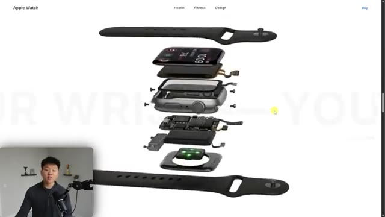
*⏱️ 00:00:08 — Capture d'écran du site d'Apple montrant une vue éclatée (déconstruction) d'une Apple Watch avec ses composants internes.*

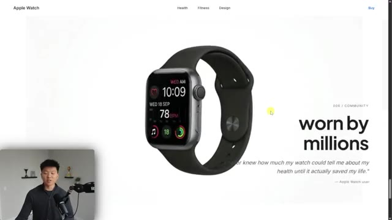
*⏱️ 00:00:16 — Capture d'écran du site d'Apple présentant une Apple Watch assemblée accompagnée d'une citation textuelle dynamique ("worn by millions").*

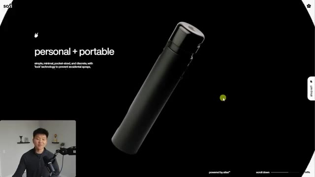
*⏱️ 00:00:24 — Capture d'écran d'un site web au design sombre minimaliste présentant un produit cylindrique avec du texte descriptif ("personal + portable").*

---

### ⏱️ `[00:00:33 - 00:01:05]` | Segment #02

**🔊 Audio (Transcription Intégrale Mot pour Mot en Français) :**
> ouvert Cloud Code ou, tu sais, construit un site Web auparavant, vous serez capable de faire exactement ce que vous voyez à l'écran. Ne perdons donc pas de temps et entrons directement dans le video. Bon, alors nous utilisons Cloud Code dans Visual Studio Code. Donc si vous n'avez pas ça, allez simplement dans le navigateur, tapez VS Code et téléchargez ceci pour votre système d'exploitation. C'est complètement gratuit. Une fois que vous êtes ici, vous allez aller sur la gauche, qui est le bouton des extensions. Vous allez taper Cloud Code et installer celui-ci. Il vous invitera alors à vous connecter avec votre abonnement Anthropic. Et au fait, vous devez être sur le forfait payant, soit le pro ou le max, afin d'utiliser cloud code. Maintenant, une fois que vous avez installé ça, vous allez cliquer sur ce bouton en haut ici, qui est l'explorateur, et vous

**👁️ Analyse Visuelle d'Écran (gemini-3.5-flash-lite) :**
**Interface & Outils** : Visual Studio Code (éditeur de code).

**Contenu textuel & Code** : Menus et options de démarrage de VS Code, ainsi que la page d'extension de Claude Code.

**Action / Démonstration** : Navigation dans l'éditeur de code et recherche d'une extension pour intégrer Claude Code.

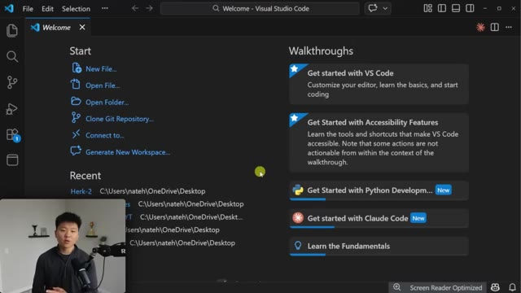
*⏱️ 00:00:41 — Page d'accueil de Visual Studio Code avec le présentateur en médaillon dans le coin inférieur gauche.*

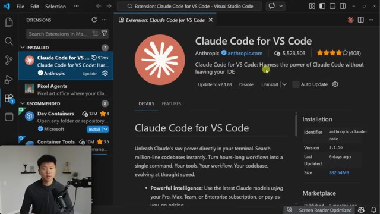
*⏱️ 00:00:57 — Panneau des extensions de Visual Studio Code affichant l'extension "Claude Code for Service".*

---

### ⏱️ `[00:01:05 - 00:01:30]` | Segment #03

**🔊 Audio (Transcription Intégrale Mot pour Mot en Français) :**
> il faut ouvrir un dossier donc allez simplement sur votre bureau allez dans vos documents ouvrez un tout nouveau dossier appelez-le vous savez test de site web 3D et puis ouvrez-le juste ici donc ici vous pouvez voir c'est le projet sur lequel j'ai travaillé je l'ai simplement appelé sites web animés et ce que je vais faire c'est vous donner à tous ici toutes les compétences dont vous avez besoin afin de simplement reproduire ce que je fais je vous donne tout ça gratuitement bien sûr de sorte qu'une fois que vous avez tout ça tout ce que vous avez à faire c'est de donner à Cloud Code une vidéo. Par exemple, ici nous avons une vidéo d'une caméra.

**👁️ Analyse Visuelle d'Écran (gemini-3.5-flash-lite) :**
**Interface & Outils** : Visual Studio Code, extension Claude Code for VS Code

**Contenu textuel & Code** : Page de description de l'extension Claude Code sur l'image 1, et arborescence de fichiers d'un projet web animé avec l'interface de discussion Claude Code sur l'image 2.

**Action / Démonstration** : Navigation et présentation de l'extension Claude Code dans l'éditeur VS Code et ouverture d'un dossier de projet de site web animé.

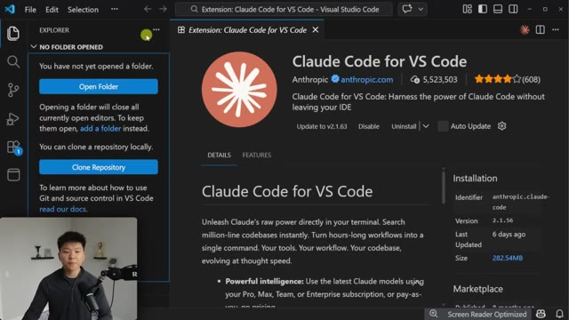
*⏱️ 00:01:11 — Vue de l'interface de VS Code montrant l'extension Claude Code installée avec ses détails.*

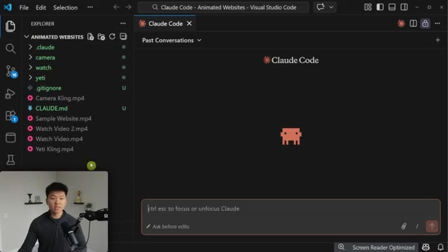
*⏱️ 00:01:18 — Vue de l'explorateur de VS Code avec un dossier de projet ouvert ("Animated Websites") contenant divers fichiers et l'interface de l'extension Claude Code.*

---

### ⏱️ `[00:01:30 - 00:02:05]` | Segment #04

**🔊 Audio (Transcription Intégrale Mot pour Mot en Français) :**
> Tu peux voir ce qui se passe, c'est que ça tourne tout simplement en rond, et ensuite ça passe en quelque sorte en mode rayons X et on peut voir à l'intérieur de la caméra. Et maintenant que Cloud Code fait ça, tu dis juste construis-moi un site web pour cette vidéo. Et ce que tu obtiens, c'est quelque chose comme ça où nous avons Vanta 1, tu peux voir que ça ressemble à une page de destination de produit. Alors qu'on commence à faire défiler vers le bas, la caméra est révélée et alors qu'on continue à faire défiler davantage, on obtient du texte dynamique qui apparaît ainsi que l'animation réelle de la caméra qui commence. Et le truc fou, c'est que je ne lui ai donné aucun texte publicitaire. Je ne lui ai donné aucune palette de couleurs. Je ne lui ai donné aucune information sur le produit. Évidemment, tu pourrais le faire, mais ce qu'il va faire, c'est tout simplement créer ça pour toi. Et ensuite, tu peux aller de l'avant et faire les ajustements que tu

**👁️ Analyse Visuelle d'Écran (gemini-3.5-flash-lite) :**
**Interface & Outils** : VS Code et navigateur web (site web généré "Vanta")

**Contenu textuel & Code** : Fichiers du projet dans l'explorateur VS Code incluant des composants et scripts (.claude, skills, vidéo source), et interface web interactive de présentation produit.

**Action / Démonstration** : Navigation et démonstration du site web animé généré à partir de la vidéo de la caméra.

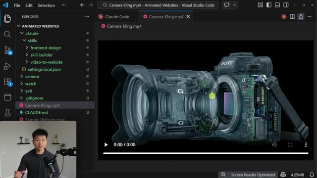
*⏱️ 00:01:39 — Vue dans l'éditeur VS Code montrant un fichier vidéo "Camera Kling.mp4" avec une animation de caméra en coupe (vue interne).*

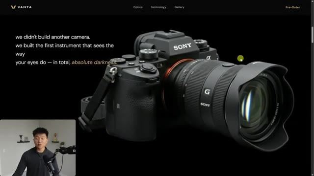
*⏱️ 00:01:48 — Aperçu du site web généré "Vanta" affichant la caméra sous un angle professionnel avec du texte descriptif.*

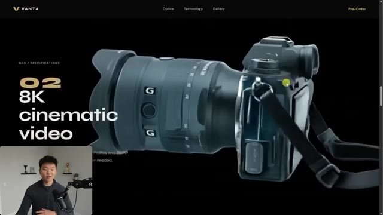
*⏱️ 00:01:57 — Aperçu du site web interactif de la caméra montrant une vue semi-transparente avec les spécifications techniques "02 8K cinematic video".*

---

### ⏱️ `[00:02:05 - 00:02:37]` | Segment #05

**🔊 Audio (Transcription Intégrale Mot pour Mot en Français) :**
> besoin. Donc les deux compétences que vous allez devoir aller chercher sont la compétence de design front-end, qui est celle que j'ai récupérée auprès d'Anthropic. C'était une compétence officielle, mais je l'ai un peu modifiée. C'est donc un peu ma version de la compétence de design front-end pour ce cas d'usage spécifique. Et ensuite, vous allez aussi devoir aller chercher la compétence vidéo vers site web. Donc ces deux compétences sont littéralement juste des fichiers Markdown. Ce sont des fichiers Markdown sur lesquels j'ai travaillé et qui indiquent à Claude Code les meilleures pratiques pour créer ces sites web 3D animés. Et vous pouvez obtenir ces compétences de manière entièrement gratuite en allant dans ma communauté FreeSchool. Le lien pour cela se trouve dans la description. Vous irez dans la salle de classe, vous irez dans la section des compétences, et vous pourrez trouver

**👁️ Analyse Visuelle d'Écran (gemini-3.5-flash-lite) :**
**Interface & Outils** : Visual Studio Code / Extension Claude Code

**Contenu textuel & Code** : Arborescence du projet dans le volet de gauche montrant le dossier `.claude/skills/frontend-design/SKILL.md` et interface de chat Claude Code à droite.

**Action / Démonstration** : Navigation dans l'explorateur de fichiers de l'éditeur pour afficher la structure des compétences (skills) d'Anthropic.

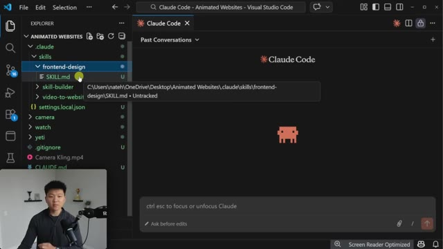
*⏱️ 00:02:13 — Vue de l'éditeur Visual Studio Code montrant l'arborescence des dossiers avec le fichier SKILL.md de la compétence frontend-design, ainsi qu'une interface Claude Code intégrée sur le panneau de droite.*

---

### ⏱️ `[00:02:37 - 00:03:12]` | Segment #06

**🔊 Audio (Transcription Intégrale Mot pour Mot en Français) :**
> tous directement là-dedans. Et littéralement, tout ce que vous auriez à faire, c'est de les prendre depuis votre dossier de téléchargements, de les glisser ici sur le côté gauche, et ensuite, de dire simplement à Claude : « Hé, configure ce dossier pour que j'aie mon .Claude. À l'intérieur de ce .Claude, j'ai un dossier skills. Et ensuite, à l'intérieur de ce dossier skills, voici mes deux compétences que je veux que tu utilises. » Et ça devrait ressembler à peu près à ça sur le côté gauche. Maintenant, avant de vous sentir trop submergés, si vous n'avez jamais utilisé Claude Code auparavant, c'est super simple. Juste ici, nous avons notre agent réel avec lequel nous parlons et avons des conversations. Et ici, nous avons juste des dossiers. Je viens donc de vous montrer où vivent les compétences, c'est-à-dire dans un dossier dot cloud à l'intérieur d'un dossier skills. Mais le reste des éléments ici

**👁️ Analyse Visuelle d'Écran (gemini-3.5-flash-lite) :**
**Interface & Outils** : Visual Studio Code avec l'extension Claude Code.

**Contenu textuel & Code** : Arborescence du dossier `.claude` contenant des sous-dossiers et fichiers `SKILL.md` (frontend-design, skill-builder, video-to-website).

**Action / Démonstration** : Navigation dans l'arborescence des fichiers du projet pour montrer la structure de configuration du dossier `.claude`.

*⏱️ 00:02:46 — Vue de l'éditeur Visual Studio Code montrant l'explorateur de fichiers à gauche avec un dossier `.claude` et ses compétences associées, et l'interface de Claude Code sur le panneau de droite.*

---

### ⏱️ `[00:03:12 - 00:03:31]` | Segment #07

**🔊 Audio (Transcription Intégrale Mot pour Mot en Français) :**
> est super simple. Voici tous les fichiers vidéo que j'ai utilisés pour créer les sites web précédents. Et ensuite, pour chaque site web, il a créé son propre dossier. Donc pour le site web de la caméra, il a toutes ces informations. Pour le site web de la montre, il a toutes ces informations. Et pour le site web du Yeti, il a toutes ces informations également. Mais de toute façon, si vous suivez simplement les étapes que je fais dans cette vidéo, tout cela aura du sens et vous obtiendrez un bon résultat.

**👁️ Analyse Visuelle d'Écran (gemini-3.5-flash-lite) :**
**Interface & Outils** : Visual Studio Code / Extension Claude Code

**Contenu textuel & Code** : Explorateur de fichiers avec les répertoires et fichiers vidéo (Camera Kling.mp4, Watch Video.mp4, Yeti Kling.mp4), et l'interface de chat Claude Code sur le panneau de droite.

**Action / Démonstration** : Navigation dans l'arborescence des fichiers du projet pour montrer l'organisation des dossiers par produit (caméra, montre, yeti).

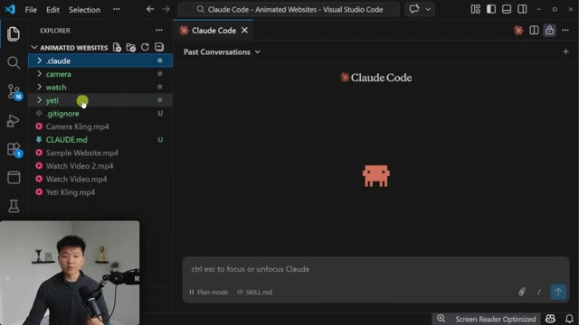
*⏱️ 00:03:16 — Capture d'écran de l'éditeur Visual Studio Code montrant l'arborescence du projet "ANIMATED WEBSITES" avec les dossiers .claude, camera, watch, yeti, et l'interface de Claude Code intégrée.*

---

### ⏱️ `[00:03:31 - 00:03:51]` | Segment #08

**🔊 Audio (Transcription Intégrale Mot pour Mot en Français) :**
> Et d'ailleurs, si c'est un peu confus, allez absolument voir ma vidéo sur les compétences, que je vais taguer juste ici. Et ensuite, une fois que vous aurez compris ça, revenez directement ici. Très bien, alors je vais vous guider à travers ce processus étape par étape. Pour que vous puissiez voir exactement ce que j'ai fait pour créer ces animations vraiment superbes. Et ce qu'il faut comprendre, c'est que toutes ces animations que vous voyez sur les sites et toutes les autres que j'of montrées, ce sont juste des vidéos.

**👁️ Analyse Visuelle d'Écran (gemini-3.5-flash-lite) :**
**Interface & Outils** : Visual Studio Code (avec extension ou panneau Claude Code)

**Contenu textuel & Code** : Arborescence de fichiers avec ".claude/skills/frontend-design/SKILL.md", "skill-builder", "video-to-website/SKILL.md", et l'interface de chat Claude Code avec le champ de saisie « Ask before edits » et « SKILL.md ».

**Action / Démonstration** : Navigation dans l'explorateur de fichiers de VS Code pour montrer l'organisation des compétences (skills) de Claude Code.

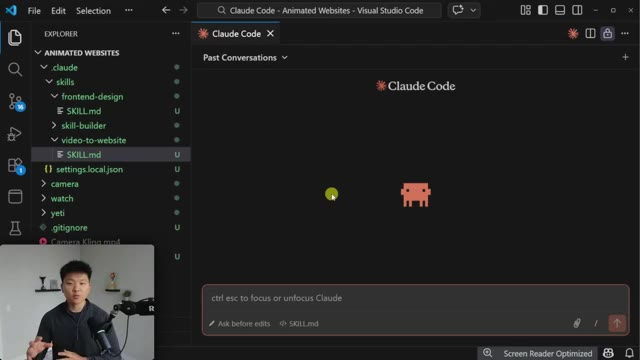
*⏱️ 00:03:36 — Vue de l'éditeur Visual Studio Code montrant l'arborescence des dossiers avec le dossier ".claude/skills" et une interface d'assistant Claude Code intégrée à droite, ainsi que le présentateur en médaillon en bas à gauche.*

---

### ⏱️ `[00:03:51 - 00:04:13]` | Segment #09

**🔊 Audio (Transcription Intégrale Mot pour Mot en Français) :**
> Et donc tout ce que j'ai fait ici, c'est de demander à Nano Banana de me générer deux images différentes, puis de les transformer en vidéo. Donc par exemple, la première avec l'Apple Watch, c'est juste l'Apple Watch qui s'ouvre en quelque sorte et expose toutes ses couches. Et puis quand je voulais qu'elle se referme, je lui ai juste demandé de faire le contraire. Et maintenant nous avons la seconde où elle part de cette image finale et se replie en quelque sorte sur elle-même pour révéler l'Apple Watch.

**👁️ Analyse Visuelle d'Écran (gemini-3.5-flash-lite) :**
**Interface & Outils** : Visual Studio Code

**Contenu textuel & Code** : Explorateur de fichiers avec les dossiers .claude, camera, watch, yeti et des fichiers vidéo mp4.

**Action / Démonstration** : Lecture d'une vidéo générée montrant une Apple Watch qui s'ouvre pour exposer ses composants internes.

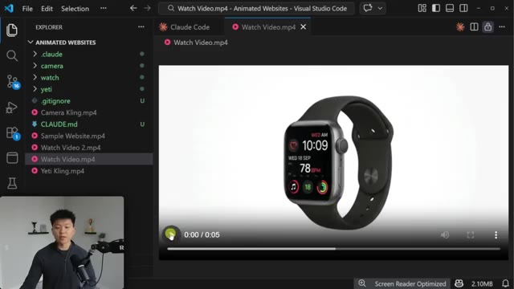
*⏱️ 00:03:57 — Aperçu dans l'éditeur VS Code d'une vidéo montrant une Apple Watch fermée.*

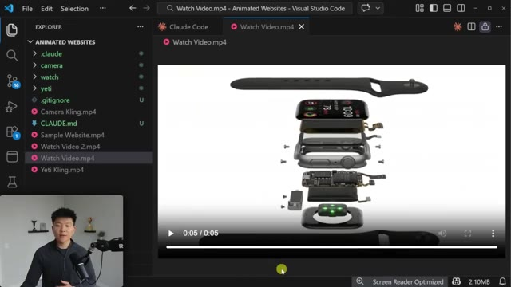
*⏱️ 00:04:02 — Aperçu dans VS Code de la même vidéo montrant les différentes couches de l'Apple Watch démontée.*

---

### ⏱️ `[00:04:13 - 00:04:37]` | Segment #10

**🔊 Audio (Transcription Intégrale Mot pour Mot en Français) :**
> Maintenant que vous comprenez à quel point c'est réellement simple, allons sur Nano Banana et commençons à créer des images. D'accord, donc la façon dont j'aime utiliser Nano Banana, que ce soit dans un espace de test comme celui-ci ou via une API, c'est avec Key.ai parce que j'ai trouvé que c'est vraiment rapide et que c'est vraiment bon marché. Donc je suis allé sur Nano Banana 2, la nouvelle version de Nano Banana, et je suis venu ici pour faire une image au format 16 par 9 et j'ai dit : j'ai besoin d'une image de qualité studio professionnel représentant un blender.

**👁️ Analyse Visuelle d'Écran (gemini-3.5-flash-lite) :**
**Interface & Outils** : Navigateur web affichant la plateforme KIE API (site web et espace Playground).

**Contenu textuel & Code** : Texte de la page d'accueil et prompt de génération d'image pour un blender ("A professional studio-grade image of a Blender...").

**Action / Démonstration** : Navigation sur le site web de KIE API puis présentation de l'interface de test (Playground) pour générer des images.

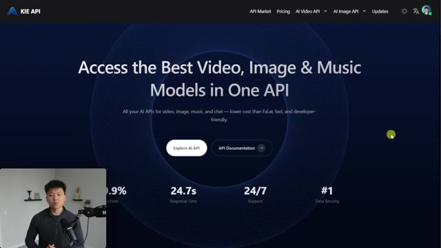
*⏱️ 00:04:19 — Page d'accueil de la plateforme KIE API montrant le slogan "Access the Best Video, Image & Music Models in One API".*

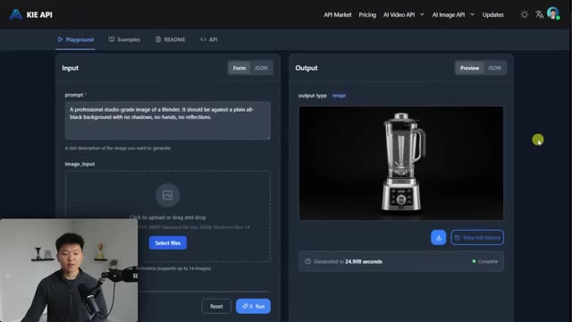
*⏱️ 00:04:31 — Interface de test (Playground) de KIE API avec un panneau de saisie de prompt à gauche et un résultat généré (un blender) à droite.*

---

### ⏱️ `[00:04:37 - 00:05:02]` | Segment #11

**🔊 Audio (Transcription Intégrale Mot pour Mot en Français) :**
> Il doit être sur un fond uni entièrement noir sans ombres, sans mains, sans reflets. Et ce sera essentiellement notre image de départ lorsque nous ferons cette vraie vidéo. J'ai donc enregistré cette sortie, je l'ai déposée ici comme entrée d'image et j'ai juste dit exactement le même prompt mais cette fois-ci, il doit être rempli de fruits et de jus. Nous avons donc notre image de départ ici et notre image de fin et il ne nous reste plus qu'à l'animer pour qu'on ait vraiment l'impression que des fruits et du jus sont en train d'être lâchés et versés.

**👁️ Analyse Visuelle d'Écran (gemini-3.5-flash-lite) :**
**Interface & Outils** : KIE API (Interface web de playground de génération d'images)

**Contenu textuel & Code** : Prompt : "A professional studio-grade image of a Blender. It should be against a plain all-black background with no shadows, no hands, no reflections."

**Action / Démonstration** : Visualisation du résultat d'une génération d'image basée sur un prompt textuel et une image de référence.

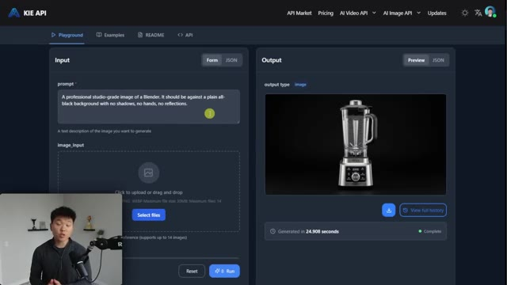
*⏱️ 00:04:43 — Interface web de KIE API montrant un espace de jeu (Playground) avec un panneau d'entrée (Input) contenant un prompt textuel pour générer une image de mixeur, et un panneau de sortie (Output) affichant le résultat généré.*

---

### ⏱️ `[00:05:02 - 00:05:23]` | Segment #12

**🔊 Audio (Transcription Intégrale Mot pour Mot en Français) :**
> J'ai donc obtenu les meilleurs résultats en utilisant Kling 3.0 auquel, encore une fois, vous pouvez également accéder sur cette key.ai. Nous lui donnons donc l'image de début, nous lui donnons l'image de fin et voici ce que j'ai fait pour mon prompt. Je suis en fait allé sur Claude et je lui ai donné l'image de début et de fin en lui disant : aide-moi à créer un prompt de vidéo par IA où je veux que le couvercle s'enlève en flottant, je veux que des fruits et du jus soient versés dedans, puis je veux que le couvercle soit remis en place.

**👁️ Analyse Visuelle d'Écran (gemini-3.5-flash-lite) :**
**Interface & Outils** : KIE API Playground, Interface web de Claude.

**Contenu textuel & Code** : Formulaire de saisie d'images (Start Frame, End Frame), champ de prompt textuel décrivant les mouvements de caméra et les effets, et réponse détaillée générée par l'IA Claude.

**Action / Démonstration** : Configuration des images de début/fin et utilisation d'un prompt généré par Claude pour animer un mixeur sur une plateforme d'IA vidéo.

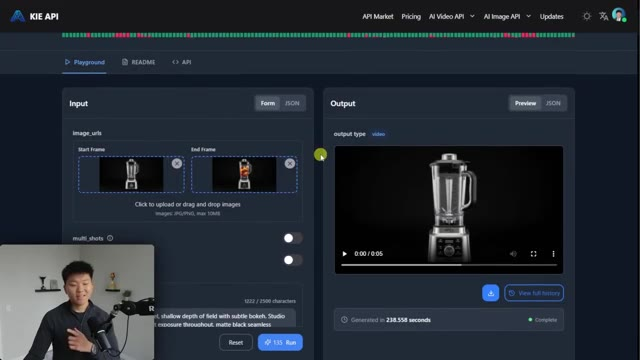
*⏱️ 00:05:07 — Interface web de KIE API montrant l'entrée des images de début et de fin pour la génération vidéo avec Kling 3.0.*

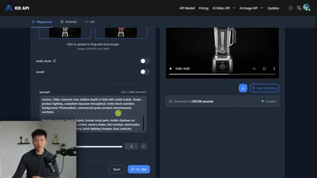
*⏱️ 00:05:13 — Suite de l'interface de KIE API affichant la zone de saisie du prompt textuel et le lecteur vidéo de prévisualisation du résultat.*

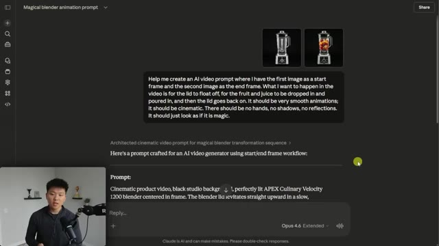
*⏱️ 00:05:18 — Interface de l'assistant IA Claude affichant une conversation avec un prompt pour concevoir une vidéo de mixeur magique.*

---

### ⏱️ `[00:05:23 - 00:05:44]` | Segment #13

**🔊 Audio (Transcription Intégrale Mot pour Mot en Français) :**
> Pas d'ombres, pas de mains, pas de reflets. Il crache ce prompt. Je mets ça dans Cling et voici le résultat. Je n'ai pas encore regardé ça, alors j'espère que c'est bon. D'accord, intéressant. Je veux dire, évidemment on veut peut-être corriger ça un tout petit peu, mais ça me va pour les besoins de la démo. Les fruits et le jus apparaissent comme par magie de nulle part.

**👁️ Analyse Visuelle d'Écran (gemini-3.5-flash-lite) :**
**Interface & Outils** : KIE API (Plateforme Web de génération vidéo par IA)

**Contenu textuel & Code** : Prompt textuel détaillé décrivant une vidéo produit cinématique pour un mixeur, avec images de départ (Start Frame) et de fin (End Frame).

**Action / Démonstration** : Génération et lecture d'une vidéo publicitaire par IA à partir d'un prompt textuel et d'images clés.

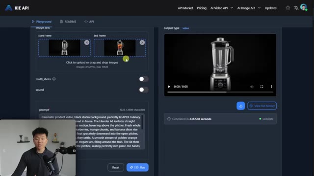
*⏱️ 00:05:28 — Interface KIE API affichant le générateur de vidéo avec le prompt textuel et le lecteur vidéo en cours de lecture.*

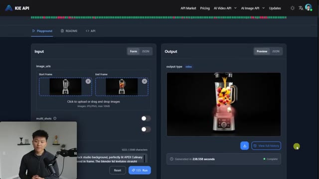
*⏱️ 00:05:33 — Interface KIE API montrant le résultat de la génération vidéo avec le mixeur et les fruits en mouvement.*

---

### ⏱️ `[00:05:44 - 00:06:03]` | Segment #14

**🔊 Audio (Transcription Intégrale Mot pour Mot en Français) :**
> et maintenant ils sont dans le mixeur. D'accord, donc j'ai téléchargé cette vidéo. Je vais simplement la glisser ici sur le côté gauche. Et vous pouvez voir en ce moment que cette vidéo que Cloud Code regarde est exactement celle que nous venons de générer ensemble. Donc c'est ce qu'il va utiliser. Il va essentiellement prendre cette vidéo, en extraire environ 120 images ou le nombre d'images qui composent cette vidéo. Et ensuite, il va toutes les sauvegarder.

**👁️ Analyse Visuelle d'Écran (gemini-3.5-flash-lite) :**
**Interface & Outils** : Visual Studio Code avec l'extension Claude Code et lecteur vidéo intégré.

**Contenu textuel & Code** : Fichiers vidéo dans l'explorateur (Blender Kling.mp4, Camera Kling.mp4, etc.) et interface de chat Claude Code.

**Action / Démonstration** : Glisser-déposer et lecture d'un fichier vidéo de démonstration dans l'éditeur.

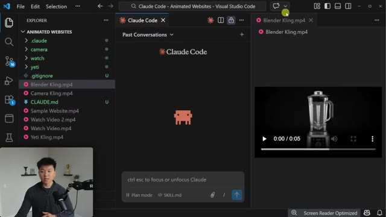
*⏱️ 00:05:48 — Vue de l'interface de Visual Studio Code avec le volet de l'explorateur à gauche, Claude Code au centre et un aperçu vidéo « Blender Kling.mp4 » sur le côté droit.*

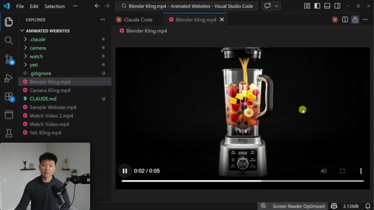
*⏱️ 00:05:53 — Visual Studio Code affichant en plein écran la lecture de la vidéo « Blender Kling.mp4 » montrant un mixeur avec des fruits et du liquide.*

---

### ⏱️ `[00:06:03 - 00:06:22]` | Segment #15

**🔊 Audio (Transcription Intégrale Mot pour Mot en Français) :**
> Donc, juste à titre d'exemple, si je vais dans les images de la montre, vous pouvez voir qu'elle a créé plus d'une centaine d'images WebP à partir de cette vidéo réelle. Et c'est un peu comme de l'animation image par image où chacune change juste un tout petit peu. Et au fur et à mesure que vous avancez, la vidéo réelle commence à se former. Elle associe donc essentiellement chacune de ces images à une position de défilement.

**👁️ Analyse Visuelle d'Écran (gemini-3.5-flash-lite) :**
**Interface & Outils** : Visual Studio Code, Claude Code extension/interface

**Contenu textuel & Code** : Arborescence de fichiers avec des images WebP (frame_0043.webp à frame_0095.webp), interface de chat Claude Code (« ctrl esc to focus or unfocus Claude »), et aperçu d'images de montre éclatée.

**Action / Démonstration** : Navigation dans l'arborescence des fichiers de VS Code pour montrer les images WebP générées image par image pour l'animation.

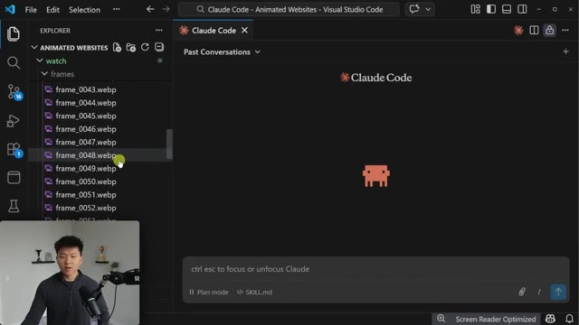
*⏱️ 00:06:08 — Vue de l'explorateur de VS Code montrant une liste d'images WebP séquentielles (frames) pour une animation, avec l'interface de Claude Code au centre et la webcam du présentateur en bas à gauche.*

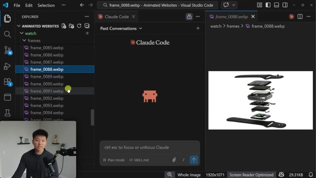
*⏱️ 00:06:12 — VS Code avec l'explorateur affichant les images WebP de l'animation, un panneau Claude Code au centre, et l'affichage de l'image 'frame_0088.webp' montrant une montre démontée sur un nouveau panneau à droite.*

---

### ⏱️ `[00:06:22 - 00:06:42]` | Segment #16

**🔊 Audio (Transcription Intégrale Mot pour Mot en Français) :**
> Donc, au fur et à mesure que vous faites défiler vers le bas, ça se révèle en quelque sorte ou si vous faites défiler vers l'arrière, ça va dans l'autre sens. Donc maintenant, je vais m'assurer que mon agent est en mode plan, ce qui signifie fondamentalement qu'il ne fera rien en réalité. Il va simplement lire des choses et il aidera à créer un plan, ce qui va donner des sites Web bien meilleurs du premier coup. Très bien, donc j'ai commencé par dire : je viens de déposer une vidéo appelée blenderkling.mp4.

**👁️ Analyse Visuelle d'Écran (gemini-3.5-flash-lite) :**
**Interface & Outils** : Visual Studio Code, extension ou interface intégrée Claude Code.

**Contenu textuel & Code** : Explorateur de fichiers du projet 'ANIMATED WEBSITES' avec des dossiers de frames d'animation, et interface de discussion Claude Code affichant 'ctrl esc to focus or unfocus Claude' et 'Plan mode'.
[DESC_ACTION] Le présentateur configure et vérifie que l'agent IA (Claude Code) est bien réglé en mode plan ('Plan mode') avant d'exécuter des actions.

**Action / Démonstration** : Explications face caméra et démonstration conceptuelle.

*⏱️ 00:06:27 — Capture d'écran montrant l'éditeur Visual Studio Code avec l'arborescence des fichiers du projet sur la gauche, l'interface de l'outil Claude Code au centre affichant l'indicateur 'Plan mode', et un aperçu d'image d'une montre démontée sur la droite. La webcam du présentateur apparaît en bas à gauche.*

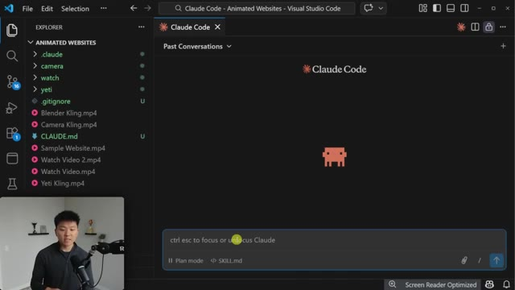
*⏱️ 00:06:32 — Capture d'écran similaire de VS Code avec l'interface Claude Code active au centre, mettant en évidence le mode plan ('Plan mode') dans la barre de saisie en bas de la fenêtre de discussion.*

---

### ⏱️ `[00:06:42 - 00:07:06]` | Segment #17

**🔊 Audio (Transcription Intégrale Mot pour Mot en Français) :**
> aide-moi à créer une page de destination d'une seule page pour ce produit. Elle doit être moderne, elle doit paraître très professionnelle, elle doit comporter des animations fluides et un design soigné de bout en bout. Tout le texte doit être facile à lire et l'arrière-plan du site Web doit être complètement noir, ce doit être un mode sombre, et il doit se fondre dans l'arrière-plan de l'image de film Blender pour donner l'impression qu'il s'agit d'une seule page Web fluide.

**👁️ Analyse Visuelle d'Écran (gemini-3.5-flash-lite) :**
**Interface & Outils** : Visual Studio Code, extension Claude Code

**Contenu textuel & Code** : Un prompt dans la zone de texte : "I just dropped in a video called Blender Kling.mp4." et l'explorateur de fichiers montrant le projet "ANIMATED WEBSITES" avec des fichiers multimédias et de configuration.

**Action / Démonstration** : Interaction avec l'agent d'IA Claude Code dans l'éditeur de code pour intégrer et analyser des fichiers vidéo de démonstration.

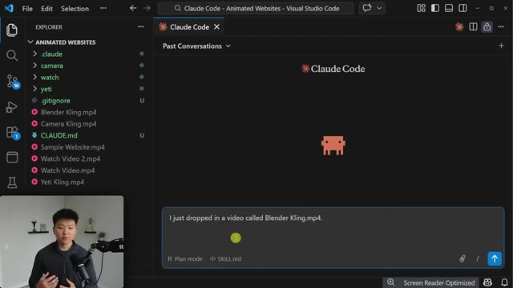
*⏱️ 00:06:48 — Interface de Visual Studio Code affichant l'extension Claude Code avec un panneau de discussion, ainsi que l'explorateur de fichiers listant plusieurs dossiers et vidéos, avec la webcam du présentateur en bas à gauche.*

---

### ⏱️ `[00:07:06 - 00:07:30]` | Segment #18

**🔊 Audio (Transcription Intégrale Mot pour Mot en Français) :**
> Donc si vous faisiez vraiment cela pour un produit ou pour une entreprise, vous voudriez probablement l'alimenter avec un peu plus d'informations, mais je vais juste vous montrer pour l'instant comment cela fonctionne. Je vais lancer ça en mode plan et vous verrez que cela revient naturellement et me pose quelques questions. Maintenant, si vous vous demandez comment j'ai pu parler directement dans mon Cloud Code, alors consultez la description pour mon outil. Et une chose que vous remarquerez une fois que vous aurez lu la façon dont cela fonctionne, c'est que vous devrez avoir FFMPEG, qui extrait essentiellement des images de vidéos.

**👁️ Analyse Visuelle d'Écran (gemini-3.5-flash-lite) :**
**Interface & Outils** : Visual Studio Code (extension Claude Code)

**Contenu textuel & Code** : Un prompt demandant de créer une landing page de produit d'une page basée sur une vidéo nommée 'Blender Kling.mp4', avec un design moderne, des animations fluides et un fond entièrement noir en mode sombre.

**Action / Démonstration** : Le présentateur discute de la configuration d'un mode plan pour l'agent IA.

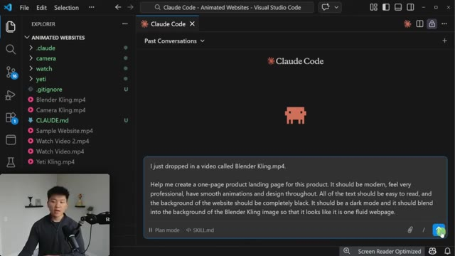
*⏱️ 00:07:12 — L'éditeur Visual Studio Code affichant l'interface de l'extension Claude Code avec le panneau de chat et l'arborescence des fichiers du projet.*

---

### ⏱️ `[00:07:30 - 00:07:49]` | Segment #19

**🔊 Audio (Transcription Intégrale Mot pour Mot en Français) :**
> C'est un outil gratuit et si vous ne l'avez pas installé, Cloud Code vous aidera à l'installer. Il va simplement le faire pour vous, donc ne vous inquiétez pas pour ça. Mais maintenant, vous pouvez voir qu'il nous pose quelques questions. La première est donc : quel est le nom du produit et la marque pour ce blender ? Et je vais simplement dire, créez une image de marque fictive, tout comme il l'a fait pour le Vanta 1, qui était le site web de l'appareil photo. Ensuite, il est dit : quel genre de sections de contenu voulez-vous ?

**👁️ Analyse Visuelle d'Écran (gemini-3.5-flash-lite) :**
**Interface & Outils** : VS Code (Visual Studio Code)

**Contenu textuel & Code** : Question interactive : "What is the product name and brand for this blender? (e.g., is it a specific brand, or should I create fictional branding like the other projects?)" avec les options "Create fictional branding", "Use a specific name", et "Other".

**Action / Démonstration** : L'assistant interactif de l'IA pose des questions à l'utilisateur pour configurer le projet et définir le branding du produit avant de poursuivre.

*⏱️ 00:07:35 — L'éditeur de code VS Code affichant un assistant ou un chat interactif posant une question à choix multiples sur le nom du produit et la marque ("What is the product name and brand for this blender?"), avec une option de création de marque fictive sélectionnée. Le présentateur apparaît en médaillon vidéo en bas à gauche.*

---

### ⏱️ `[00:07:49 - 00:08:07]` | Segment #20

**🔊 Audio (Transcription Intégrale Mot pour Mot en Français) :**
> Je vais simplement opter pour la version entièrement premium, ce que nous avons fait pour les autres sites d'exemple. Mais bien sûr, c'est ici que vous pourriez la personnaliser un petit peu pour l'adapter à vos besoins. Et si vous n'avez jamais utilisé Cloud Code auparavant, ce qui se passe ici, c'est que vous êtes fondamentalement capable de voir tout ce que Cloud Code est en train de penser et de faire. Vous pouvez voir une tâche, vous pouvez voir un glob, vous pouvez voir ce qu'il est en train de lire.

**👁️ Analyse Visuelle d'Écran (gemini-3.5-flash-lite) :**
**Interface & Outils** : Visual Studio Code

**Contenu textuel & Code** : Menu de sélection avec les options : Full premium, Minimal, Let me specify, Other, et un bouton 'Submit answers'.

**Action / Démonstration** : Sélection de l'option 'Full premium' dans un assistant de configuration interactif à l'intérieur de VS Code.

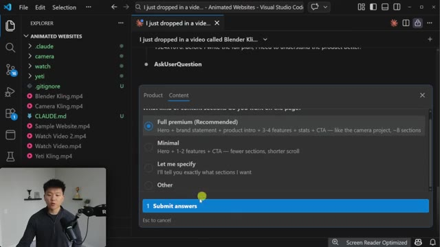
*⏱️ 00:07:53 — Capture d'écran de l'éditeur Visual Studio Code montrant une boîte de dialogue contextuelle avec des options de configuration pour le contenu d'un site web, incluant l'option sélectionnée 'Full premium (Recommended)'.*

---

### ⏱️ `[00:08:08 - 00:08:26]` | Segment #21

**🔊 Audio (Transcription Intégrale Mot pour Mot en Français) :**
> Et vous verrez plus tard, quand il commence réellement à implémenter les choses, qu'il se crée une liste de tâches ou une liste de choses à faire, et vous pouvez réellement le voir accomplir ces tâches. Donc c'est vraiment génial. D'accord, donc maintenant nous en sommes au point où le plan est terminé. Nous avons Obsidian Vortex, Premium Blender, Page de destination. Nous avons l'identité de marque ici. Donc Obsidian, Obsidian Vortex, le slogan est anéantissez tout.

**👁️ Analyse Visuelle d'Écran (gemini-3.5-flash-lite) :**
**Interface & Outils** : Visual Studio Code (éditeur de code) avec l'extension Claude / terminal intégré

**Contenu textuel & Code** : Texte montrant "Task: Design blender landing page", des instructions de prompt, et l'état "Cogitating..." avec un champ de saisie "Queue another message..." et "Plan mode".

**Action / Démonstration** : L'assistant génère un plan d'implémentation et une liste de tâches pour créer une page d'atterrissage animée.

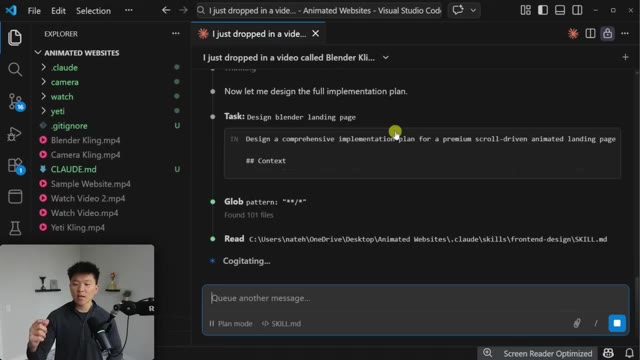
*⏱️ 00:08:12 — Capture d'écran de l'éditeur Visual Studio Code montrant une interface de chat Claude avec la création d'une liste de tâches et le statut "Cogitating...", avec la webcam du présentateur en bas à gauche.*

---

### ⏱️ `[00:08:27 - 00:08:47]` | Segment #22

**🔊 Audio (Transcription Intégrale Mot pour Mot en Français) :**
> La couleur d'accentuation est rouge sang. Et nous avons des polices, nous avons les détails de la vidéo, les étapes de mise en œuvre. Voici donc la chose FFmpeg dont je parlais qui va extraire les images réelles. Ensuite, elle va construire le HTML. Ensuite, elle va créer toutes ces différentes sections. Elle va construire le CSS, elle va construire le JS, et puis elle va tester localement. Donc, avant que cela n'aille réellement n'importe où sur le web, nous allons le tester ici même.

**👁️ Analyse Visuelle d'Écran (gemini-3.5-flash-lite) :**
**Interface & Outils** : Visual Studio Code

**Contenu textuel & Code** : Fichier Markdown affichant "Implementation Steps", "Step 1: Extract Frames" avec la commande ffmpeg, et en bas une boîte de dialogue "Accept this plan?".

**Action / Démonstration** : Présentation du plan de mise en œuvre et de la commande FFmpeg pour l'extraction d'images.

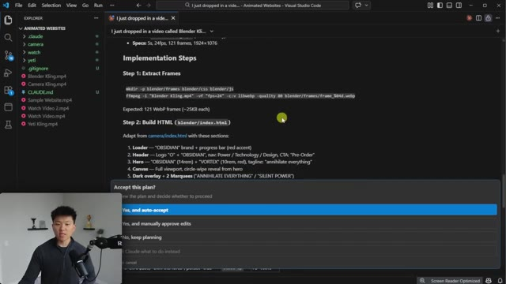
*⏱️ 00:08:32 — Capture d'écran de l'éditeur VS Code montrant un fichier Markdown avec les étapes de mise en œuvre, incluant une commande FFmpeg et un menu de validation pour accepter le plan.*

---

### ⏱️ `[00:08:47 - 00:09:07]` | Segment #23

**🔊 Audio (Transcription Intégrale Mot pour Mot en Français) :**
> Et ensuite, si ça nous convient, on peut le publier sur le web. Et je vais vous montrer ça à la fin de la vidéo. Donc, je vais en fait juste faire une dernière suggestion et ensuite on va le laisser commencer à se construire. Je veux dire, ça a l'air plutôt pas mal comme ça. Il y a une chose que j'ai oublié de mentionner, c'est que je veux que la vidéo du produit soit en quelque sorte alignée à droite. Donc je veux qu'elle soit sur les deux tiers droits de la page et tout le texte peut être aligné à gauche.

**👁️ Analyse Visuelle d'Écran (gemini-3.5-flash-lite) :**
**Interface & Outils** : Visual Studio Code / Claude AI Extension

**Contenu textuel & Code** : Plan du projet avec des consignes d'intégration (Marquees, CTA, Lenis scroll, responsive, etc.) et options de validation (Yes and auto-accept, Yes and manually approve, No, keep planning).

**Action / Démonstration** : Le présentateur examine le plan proposé par Claude avant de valider et de lancer la construction du projet.

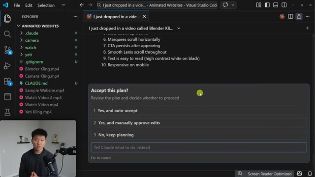
*⏱️ 00:08:52 — L'éditeur Visual Studio Code affichant un plan d'action d'un agent IA (Claude) avec une liste de points et des options de validation (Accept this plan). Le présentateur apparaît dans une petite fenêtre en bas à gauche.*

---

### ⏱️ `[00:09:07 - 00:09:26]` | Segment #24

**🔊 Audio (Transcription Intégrale Mot pour Mot en Français) :**
> Et c'est juste pour vous montrer que vous avez bien le contrôle sur son apparence. Donc je vais lancer ceci. Ça va revenir avec un autre plan et je vais l'accepter. Et ensuite, je ferai le point avec vous lorsque nous aurons notre première version de ce site web terminée. Et soit dit en passant, maintenant que j'ai accepté le plan, je l'ai mis en mode de contournement des permissions afin de pouvoir simplement continuer à tourner sans m'arrêter tout le temps pour me poser des questions.

**👁️ Analyse Visuelle d'Écran (gemini-3.5-flash-lite) :**
**Interface & Outils** : Visual Studio Code avec une extension ou un panneau d'assistant IA intégré.

**Contenu textuel & Code** : Une liste de contrôle textuelle numérotée de 1 à 10 concernant le chargement des images, les animations et la responsivité, ainsi qu'un champ de saisie de message « Queue another message... ».

**Action / Démonstration** : L'assistant est en mode plan (Plan mode) et affiche les étapes de vérification en cours d'exécution.

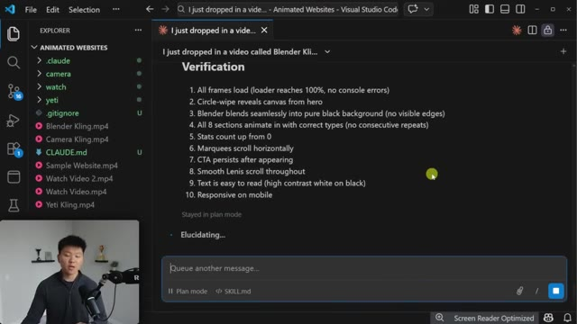
*⏱️ 00:09:12 — Vue de l'éditeur Visual Studio Code montrant une liste de vérifications (Verification) dans l'interface d'un assistant de code, avec la webcam du présentateur en bas à gauche.*

---

### ⏱️ `[00:09:26 - 00:09:44]` | Segment #25

**🔊 Audio (Transcription Intégrale Mot pour Mot en Français) :**
> Voici la liste de tâches dont je vous ai parlé. Il va vérifier et s'assurer que tout est prêt. Très bien, donc en quelques minutes, c'est revenu et ça dit, comme vous pouvez le voir, le site est en ligne sur localhost, ouvrez-le dans votre navigateur et allez voir. Donc, je vais l'ouvrir et nous allons voir ce que nous avons. Vous venez de voir le chargement d'Obsidian. Nous avons Obsidian Vortex. Ça a l'air vraiment très propre jusqu'ici.

**👁️ Analyse Visuelle d'Écran (gemini-3.5-flash-lite) :**
**Interface & Outils** : Visual Studio Code et navigateur web

**Contenu textuel & Code** : URL localhost:51006, rapport de Claude sur les fonctionnalités du site généré, interface du site OBSIDIAN

**Action / Démonstration** : L'éditeur montre le rapport de fin de tâche de l'IA et le site web généré est ouvert dans le navigateur.

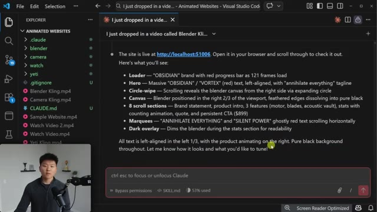
*⏱️ 00:09:30 — Vue de Visual Studio Code montrant le message de Claude indiquant que le site est en ligne sur localhost:51006.*

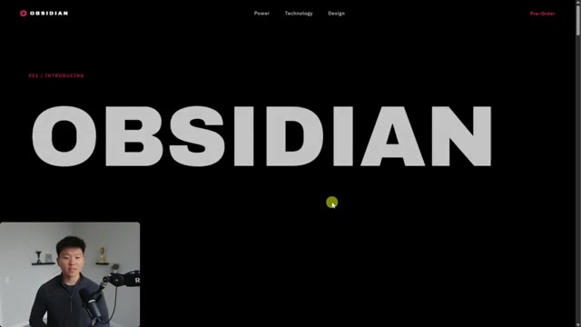
*⏱️ 00:09:40 — Aperçu du site web généré "OBSIDIAN" affiché dans le navigateur en plein écran avec un design sombre et minimaliste.*

---

### ⏱️ `[00:09:44 - 00:10:05]` | Segment #26

**🔊 Audio (Transcription Intégrale Mot pour Mot en Français) :**
> Maintenant, voyons ce qui se passe quand je commence à faire défiler vers le bas. Donc on voit le mixeur qui commence à apparaître, super. Et au fur et à mesure que je continue à faire défiler, nous avons, nous n'avons pas construit un autre mixeur. Nous avons conçu une force de la nature qui réduit tout à néant dans un silence absolu. Au fur et à mesure que je fais défiler, nous pouvons voir que le fruit commence à apparaître. Donc nous avons voici l'Obsidian Vortex, une machine en acier inoxydable de qualité aérospatiale, blabla, blabla.

**👁️ Analyse Visuelle d'Écran (gemini-3.5-flash-lite) :**
**Interface & Outils** : Navigateur web affichant une page d'atterrissage produit.

**Contenu textuel & Code** : Texte marketing en anglais vantant les mérites d'un mixeur, une image grand format d'un mixeur sur fond noir, et un bouton 'Pre-Order' dans l'en-tête.

**Action / Démonstration** : Défilement sur la page web pour révéler l'animation et le texte du produit.

*⏱️ 00:09:49 — Capture d'écran montrant une page web au design sombre (marque OBSIDIAN) présentant un mixeur haut de gamme avec le texte promotionnel 'we didn't build another blender. we engineered a force of nature...', et le présentateur visible en incrustation vidéo dans le coin inférieur gauche.*

---

### ⏱️ `[00:10:05 - 00:10:24]` | Segment #27

**🔊 Audio (Transcription Intégrale Mot pour Mot en Français) :**
> Il y a aussi du texte en arrière-plan, comme vous pouvez le voir, qui dit, je crois que ça dit tout oblitérer. Donc c'est plutôt cool. On a un moteur sans balais, on a un réseau de lames en titane. Donc ça apparaît en fait un peu tard, comme vous pouvez le voir, pendant que je fais défiler, ça apparaît un peu tard. Celui-ci arrive et ensuite on a ces statistiques qui apparaissent vraiment bien.

**👁️ Analyse Visuelle d'Écran (gemini-3.5-flash-lite) :**
**Interface & Outils** : Navigateur web affichant une landing page interactive.

**Contenu textuel & Code** : Interface produit 'OBSIDIAN' présentant un blender, avec des éléments textuels et graphiques de design.

**Action / Démonstration** : Présentation et navigation sur le site web du produit généré.

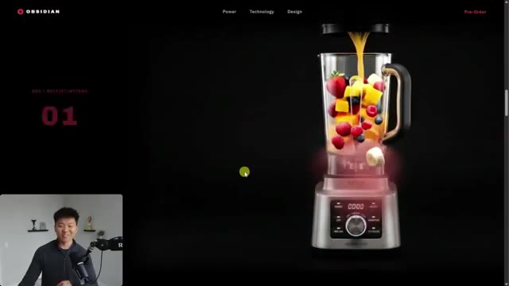
*⏱️ 00:10:09 — Capture d'écran montrant la page web d'un produit (un blender de la marque OBSIDIAN) avec une animation dynamique, et la vidéo incrustée du présentateur en bas à gauche.*

---

### ⏱️ `[00:10:24 - 00:10:45]` | Segment #28

**🔊 Audio (Transcription Intégrale Mot pour Mot en Français) :**
> Et ensuite, nous avons le dernier blender que vous posséderez jamais. Et puis je devrais avoir l'appel à l'action juste ici, qui est possédez la force, précommandez l'obsidian vortex. Alors réfléchissons-y vraiment. J'ai déposé une invite qui disait, voici une vidéo, créez une page de destination d'une seule page. C'était fondamentalement tout. Il a utilisé la compétence et il a créé un plan pour nous. Et puis nous avons eu réellement un site web où à peu près tout est parfait.

**👁️ Analyse Visuelle d'Écran (gemini-3.5-flash-lite) :**
**Interface & Outils** : Visual Studio Code, extension ou interface d'assistant IA intégré (Claude), navigateur web affichant la page de destination.

**Contenu textuel & Code** : Invite textuelle : "I just dropped in a video called Blender Kling.mp4. Help me create a one-page product landing page for this product..."

**Action / Démonstration** : Présentation du résultat visuel de la landing page générée et du prompt initial utilisé dans l'éditeur de code.

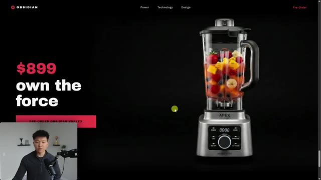
*⏱️ 00:10:29 — Aperçu de la page de destination générée présentant un mixeur sur fond noir avec le texte "own the force" et un prix de 899$.*

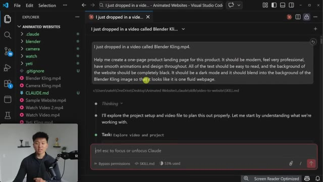
*⏱️ 00:10:35 — Interface de l'éditeur VS Code avec une conversation d'assistant IA montrant une invite pour créer une page de destination à partir d'une vidéo.*

---

### ⏱️ `[00:10:45 - 00:11:05]` | Segment #29

**🔊 Audio (Transcription Intégrale Mot pour Mot en Français) :**
> Évidemment, il y a quelques éléments sur lesquels nous devons faire des itérations, mais c'est super, super propre. Et je trouve que l'animation rend vraiment bien. Mais le plus gros problème que je remarque est juste ici, lorsque nous faisons défiler jusqu'à la deuxième fonctionnalité, nous ne pouvons vraiment pas la voir à moins de faire défiler vers le bas. Donc ce que je vais faire maintenant, c'est que je vais effacer tout ça parce que nous sommes à 53 % du contexte. Je ne veux donc pas perturber cela avec la dégradation du contexte.

**👁️ Analyse Visuelle d'Écran (gemini-3.5-flash-lite) :**
**Interface & Outils** : Visual Studio Code, navigateur web, interface de l'assistant Claude.

**Contenu textuel & Code** : Documentation du projet web ("The site is live at http://localhost:51006", éléments du loader, hero, animations au défilement).

**Action / Démonstration** : Présentation du rendu visuel du site web généré et revue du code dans VS Code.

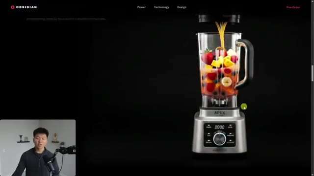
*⏱️ 00:10:50 — Aperçu du site web en cours de développement montrant un blender animé sur fond noir (Obsidian Apex).*

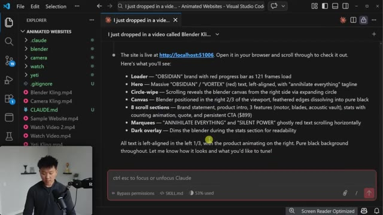
*⏱️ 00:11:00 — Interface de Visual Studio Code affichant un panneau de discussion avec Claude listant les spécifications du site web.*

---

### ⏱️ `[00:11:05 - 00:11:25]` | Segment #30

**🔊 Audio (Transcription Intégrale Mot pour Mot en Français) :**
> Et je vais une fois de plus retourner en mode plan. Très bien, je viens donc de tester le site web de Blender et il a l'air vraiment bien. J'ai cependant une remarque à faire. Lorsque nous faisons défiler la page vers le bas et que nous voyons les fonctionnalités, la fonctionnalité numéro deux n'apparaît en réalité que lorsqu'elle est pratiquement hors de l'écran. Nous devons donc faire en sorte qu'elle apparaisse un peu plus tôt à l'écran.

**👁️ Analyse Visuelle d'Écran (gemini-3.5-flash-lite) :**
**Interface & Outils** : Visual Studio Code (VS Code) avec l'extension Claude Code

**Contenu textuel & Code** : Explorateur de fichiers avec les dossiers .claude, blender, camera, watch, yeti, et une invite de commande Claude Code affichant "Plan mode" et "Ctrl esc to focus".

**Action / Démonstration** : Le présentateur discute et utilise Claude Code en mode plan pour analyser le projet Blender.

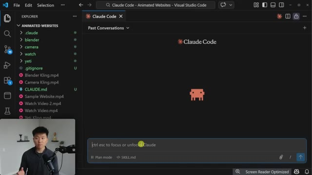
*⏱️ 00:11:10 — Vue de l'interface de l'éditeur de code VS Code affichant l'extension Claude Code avec un avatar de style pixel art et le mode plan activé, avec la webcam du présentateur en bas à gauche.*

---

### ⏱️ `[00:11:25 - 00:11:45]` | Segment #31

**🔊 Audio (Transcription Intégrale Mot pour Mot en Français) :**
> Mais à part ça, toutes les autres fonctionnalités, les fonctionnalités un, trois et quatre fonctionnent bien. Donc je vais lancer ça. Et pendant qu'il élabore un plan, je veux juste m'assurer que c'était exact. La fonctionnalité trois a l'air bien et nous n'avons même pas la fonctionnalité quatre. Donc j'espère qu'il pourra comprendre, lire le code et voir ce qui se passe. Donc pendant qu'il crée un plan, je me suis dit que j'allais rapidement expliquer la différence entre localhost et le fait d'avoir réellement quelque chose sur le web.

**👁️ Analyse Visuelle d'Écran (gemini-3.5-flash-lite) :**
**Interface & Outils** : Visual Studio Code, extension ou terminal d'IA Claude Code, navigateur web (aperçu du site).

**Contenu textuel & Code** : Prompt utilisateur évaluant les fonctionnalités du site web du mixeur, et plan d'exécution de l'agent IA avec commandes find.

**Action / Démonstration** : L'utilisateur soumet ses retours sur les fonctionnalités du site, et l'assistant IA génère un plan de correction et explore le code source.

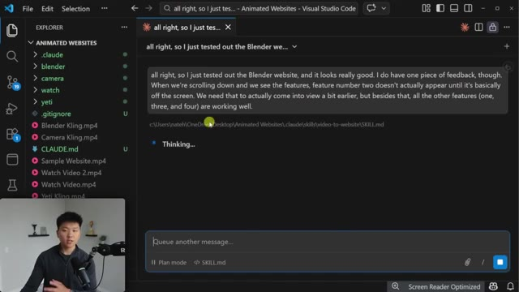
*⏱️ 00:11:30 — Interface de Visual Studio Code affichant un assistant IA (Claude Code) qui analyse un retour d'utilisateur sur un site web de mixeur.*

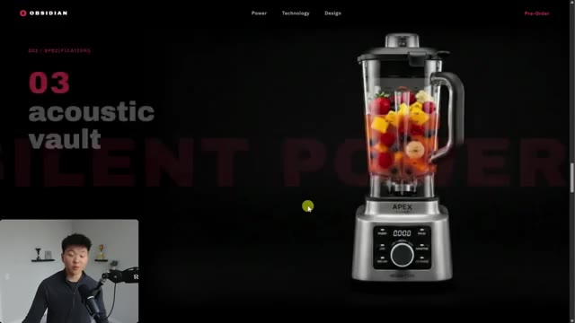
*⏱️ 00:11:35 — Aperçu du site web généré (marqué "Obsidian") montrant une section de présentation d'un mixeur avec la fonctionnalité "03 acoustic vault".*

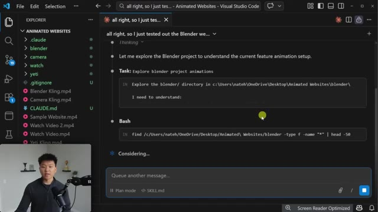
*⏱️ 00:11:40 — Visual Studio Code montrant l'agent IA en train d'élaborer un plan d'exploration et d'exécuter des commandes Bash sur le répertoire du projet.*

---

### ⏱️ `[00:11:45 - 00:12:22]` | Segment #32

**🔊 Audio (Transcription Intégrale Mot pour Mot en Français) :**
> Parce que si vous n'avez jamais créé de site web auparavant sur Cloud Code, cette partie ne fera peut-être pas encore tilt. Donc ce qui se passe, c'est que nous avons en quelque sorte deux environnements différents. Nous avons notre ordinateur local et ensuite nous avons le cloud réel. Donc, rappelez-vous quand Cloud Code a dit, hé, super, votre site web est en ligne. Vous pouvez aller de l'avant et le tester sur localhost port 51006. Si dès maintenant vous tapez ceci dans votre navigateur, vous n'obtiendrez probablement rien. Mais je peux le taper parce qu'il réside sur ma machine localement. Parce que ce qui se passe, c'est que Cloud Code nous aide à écrire tout le code réel, car c'est vraiment ce qu'est un site web. C'est un tas de code. Qu'il s'agisse de HTML, de JS, de CSS ou de n'importe quoi d'autre, c'est du code. Et donc ce que nous faisons en ce moment, c'est que nous utilisons

**👁️ Analyse Visuelle d'Écran (gemini-3.5-flash-lite) :**
**Interface & Outils** : Diagramme explicatif dessiné à la main (style Excalidraw) avec le présentateur incrusté en bas à gauche.

**Contenu textuel & Code** : Texte et boîtes représentant "Your Computer" (Claude Code, Localhost) et "The Cloud" (GitHub, Vercel, yoursite.com) reliés par des flèches et des commandes comme "run dev", "git push", "auto deploy", et "live URL".

**Action / Démonstration** : Le présentateur explique le flux de déploiement entre l'environnement local et le cloud à l'aide du schéma.

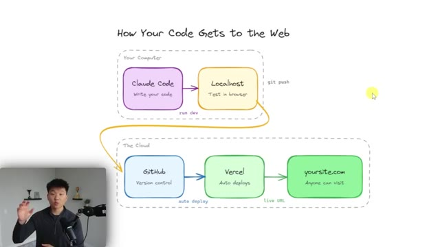
*⏱️ 00:11:54 — Schéma explicatif illustrant comment le code passe de l'ordinateur local au web à travers différents environnements et services.*

---

### ⏱️ `[00:12:22 - 00:12:43]` | Segment #33

**🔊 Audio (Transcription Intégrale Mot pour Mot en Français) :**
> il pour écrire du code et ensuite nous le testons. Et ensuite, nous faisons des allers-retours sur notre ordinateur jusqu'à ce que nous soyons satisfaits. Et puis, une fois que nous aimons vraiment le code, nous le déployons quelque part sur le cloud afin qu'il puisse réellement être vu par d'autres personnes. Je couvrirai donc ce pipeline une fois que nous serons arrivés à cette étape dans la vidéo, mais je me suis dit que j'allais aborder cette sorte de truc local d'abord très rapidement. Très bien, vous pouvez voir qu'il est revenu avec un plan pour corriger l'apparition tardive de la fonctionnalité Blender numéro deux.

**👁️ Analyse Visuelle d'Écran (gemini-3.5-flash-lite) :**
**Interface & Outils** : Schéma/diagramme pédagogique illustré.

**Contenu textuel & Code** : Texte et boîtes du schéma : "Your Computer" (Claude Code -> Localhost), "git push", "The Cloud" (GitHub -> Vercel -> yursite.com).

**Action / Démonstration** : Explication visuelle du processus de développement local et du déploiement vers le cloud.

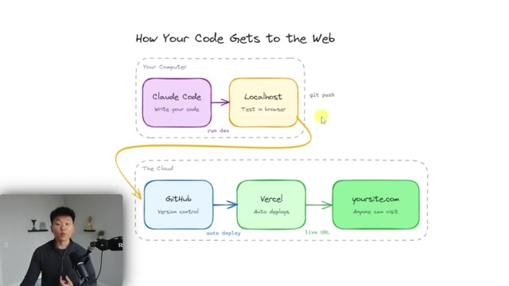
*⏱️ 00:12:27 — Schéma explicatif intitulé "How Your Code Gets to the Web" montrant le flux entre l'ordinateur local (Claude Code, Localhost) et le cloud (GitHub, Vercel, site en ligne).*

---

### ⏱️ `[00:12:43 - 00:13:03]` | Segment #34

**🔊 Audio (Transcription Intégrale Mot pour Mot en Français) :**
> Je vais simplement aller de l'avant et accepter ceci. D'accord, alors j'ai fait ça très vite. Je vais cliquer sur ce site web et nous allons voir si cette correction a réellement été modifiée. Nous avons la fonctionnalité un, nous avons la fonctionnalité deux, voilà. Et nous avons la fonctionnalité trois et tout le reste a toujours l'air intact sur le site. Donc toute la magie qui se produit ici se trouve encore une fois, à l'intérieur de la compétence que j'ai construite. C'est donc la compétence de la vidéo au site web.

**👁️ Analyse Visuelle d'Écran (gemini-3.5-flash-lite) :**
**Interface & Outils** : Visual Studio Code (avec extension Claude Code/Chat).

**Contenu textuel & Code** : Journal de tâches (TaskOutput) indiquant des ajustements de paramètres d'animation : déclencheur à 31%, remplacement de "power4.inOut" par "power3.out", et réduction de la durée à 0.9s.

**Action / Démonstration** : Revue des modifications apportées au code source pour optimiser l'animation de la fonctionnalité n°2 (Titanium Blade Array).

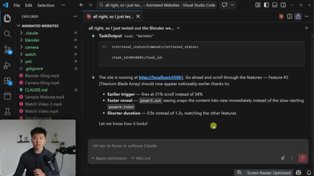
*⏱️ 00:12:58 — Interface de VS Code avec le chat Claude affichant le rapport de modification du code concernant les déclencheurs de défilement (scroll triggers).*

---

### ⏱️ `[00:13:03 - 00:13:23]` | Segment #35

**🔊 Audio (Transcription Intégrale Mot pour Mot en Français) :**
> Si j'ouvre ceci, c'est fondamentalement juste un fichier Markdown. Et il est écrit : transformer une vidéo en un site Web animé haut de gamme piloté par le défilement. C'est donc ici que se trouve vraiment toute la sauce secrète sur la façon dont il fait réellement cela. Je sais que c'est une compétence assez costaude, mais bon, je veux dire, ça a l'air de plutôt bien marcher. Et ce que vous pouvez faire maintenant, c'est qu'à chaque fois que vous utilisez la compétence pour créer des sites Web, vous diriez simplement, génial.

**👁️ Analyse Visuelle d'Écran (gemini-3.5-flash-lite) :**
**Interface & Outils** : Visual Studio Code

**Contenu textuel & Code** : Fichier Markdown nommé SKILL.md décrivant le processus pour transformer une vidéo en site web animé haut de gamme avec GSAP, le rendu par trames de canvas et la chorégraphie d'animations en couches.

**Action / Démonstration** : Le présentateur survole ou sélectionne du texte dans le fichier Markdown pour montrer la configuration technique de la compétence.

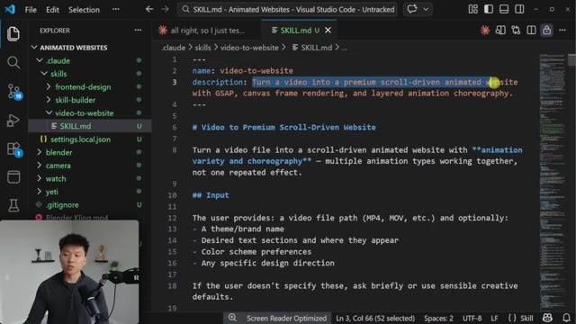
*⏱️ 00:13:08 — Un éditeur de code affichant un fichier Markdown de configuration de compétence (SKILL.md) avec le présentateur visible en incrustation.*

---

### ⏱️ `[00:13:24 - 00:13:58]` | Segment #36

**🔊 Audio (Transcription Intégrale Mot pour Mot en Français) :**
> Voici ce que je vous ai dit de corriger. Voici ce que j'aime. Voici ce que je n'aime pas. Assurez-vous que tout cela soit reflété dans le skill.md. Donc essentiellement, à chaque fois que vous construisez un site web avec cette compétence, la compétence s'améliore encore et encore et encore. Maintenant, nous avons notre code que nous aimons et il est temps de le transférer ici. Donc ce que nous devons faire, c'est que nous allons utiliser une combinaison de GitHub et Vercel. GitHub vous permet simplement de stocker du code. Donc fondamentalement, de la même manière que vous auriez peut-être un fichier Word localement sur votre ordinateur, si vous vouliez que d'autres personnes puissent l'utiliser, vous devriez le mettre sur OneDrive ou, vous savez, Google Docs pour que d'autres personnes puissent voir les différentes versions et collaborer dessus.

**👁️ Analyse Visuelle d'Écran (gemini-3.5-flash-lite) :**
**Interface & Outils** : Visual Studio Code / Editeur de code / Schéma Excalidraw ou similaire

**Contenu textuel & Code** : Fichier SKILL.md, instructions de test sur localhost:55061, et schéma de flux "How Your Code Gets to the Web"

**Action / Démonstration** : Présentation du processus de développement et de mise à jour itérative d'une compétence IA via le fichier SKILL.md et explication du pipeline de déploiement.

*⏱️ 00:13:32 — Interface VS Code affichant un fichier de configuration SKILL.md et le panneau de discussion de Claude Code.*

*⏱️ 00:13:41 — Schéma explicatif dessiné à la main montrant le flux de déploiement d'un site web de l'ordinateur local (Claude Code, Localhost) vers le cloud (GitHub, Vercel).*

---

### ⏱️ `[00:13:58 - 00:14:19]` | Segment #37

**🔊 Audio (Transcription Intégrale Mot pour Mot en Français) :**
> Et ensuite, ce qui se passe, c'est qu'on synchronise Vercel avec notre GitHub pour pouvoir réellement déployer ce code sur une vraie URL afin que ce ne soit plus juste une URL localhost. La première chose que vous voulez faire, c'est aller sur GitHub et créer un compte. C'est complètement gratuit et ça existe depuis des tonnes et des tonnes d'années. C'est un standard de l'industrie pour le code. Et ensuite, la deuxième chose que vous allez faire, c'est aller sur Vercel et créer un compte ici aussi.

**👁️ Analyse Visuelle d'Écran (gemini-3.5-flash-lite) :**
**Interface & Outils** : Schéma explicatif illustré / Interface web de GitHub

**Contenu textuel & Code** : Diagramme de flux de code (Claude Code -> Localhost -> GitHub -> Vercel -> URL en ligne) / Interface de navigation GitHub (Top repositories, fil d'actualité).

**Action / Démonstration** : Explication schématique du processus de déploiement web et présentation de l'interface utilisateur de GitHub.

*⏱️ 00:14:03 — Schéma explicatif intitulé 'How Your Code Gets to the Web' montrant le flux de déploiement entre l'ordinateur, GitHub et Vercel.*

*⏱️ 00:14:08 — Capture d'écran du tableau de bord (Dashboard) de GitHub sur fond sombre avec la liste des dépôts et le fil d'actualité.*

---

### ⏱️ `[00:14:19 - 00:14:47]` | Segment #38

**🔊 Audio (Transcription Intégrale Mot pour Mot en Français) :**
> Donc ce qui est cool, c'est qu'on peut pratiquement demander à CloudCode de faire toute cette pipeline pour nous. C'est super, super simple. Donc si vous n'avez pas encore connecté votre CloudCode à votre GitHub, vous auriez juste à venir ici, peut-être effacer la conversation et dire : aide-moi à me connecter à GitHub pour que je puisse pousser cette base de code vers mon dépôt GitHub. Et ce qu'il peut faire, c'est qu'il peut vous aider à utiliser essentiellement la CLI pour vous authentifier, ce qui signifie qu'il va tout simplement afficher une fenêtre pop-up pour vous et tout ce que vous avez à faire, c'est de vous connecter. C'est super simple. Donc ici, vous pouvez voir qu'il est écrit que vous êtes déjà authentifié avec GitHub en tant que NateHerk AI. Sympa.

**👁️ Analyse Visuelle d'Écran (gemini-3.5-flash-lite) :**
**Interface & Outils** : Visual Studio Code avec l'extension Claude Code.

**Contenu textuel & Code** : Historique de discussion de Claude Code détaillant des ajustements de paramètres d'animation (scroll, easing, duration) et une barre de saisie de prompt en bas ("ctrl esc to focus or unfocus Claude").

**Action / Démonstration** : Le présentateur consulte les résultats générés par Claude Code suite à une demande d'optimisation d'animation sur le projet en cours.

*⏱️ 00:14:26 — Une capture d'écran de l'interface VS Code montrant une interaction avec Claude Code. Le panneau de chat affiche un résumé des modifications techniques apportées au site web (optimisations de déclenchement et de durée d'animation) et confirme que le serveur local est actif.*

---

### ⏱️ `[00:14:47 - 00:15:07]` | Segment #39

**🔊 Audio (Transcription Intégrale Mot pour Mot en Français) :**
> Maintenant, l'étape suivante consiste à dire : super, allons de l'avant et créons un nouveau dépôt GitHub pour moi. Tu peux simplement l'appeler blender-website et pousser la base de code du site web Blender dans ce dépôt. Maintenant, étant donné que nous poussons quelque chose sur GitHub et que ça va aller sur le web, c'est là que tu voudrais faire attention si tu avais des clés d'API ou quoi que ce soit de sensible là-dedans.

**👁️ Analyse Visuelle d'Écran (gemini-3.5-flash-lite) :**
**Interface & Outils** : Visual Studio Code, extension Claude (chat), explorateur de fichiers.

**Contenu textuel & Code** : Texte du chat montrant les informations d'authentification GitHub (nateherkai), l'absence de remotes configurés et le statut "Tool interrupted".

**Action / Démonstration** : L'assistant Claude analyse l'état du projet et interagit avec l'utilisateur concernant la configuration du dépôt distant GitHub.

*⏱️ 00:14:52 — Interface de Visual Studio Code affichant un panneau de chat Claude avec l'état de la connexion GitHub et une webcam du présentateur en bas à gauche.*

---

### ⏱️ `[00:15:07 - 00:15:26]` | Segment #40

**🔊 Audio (Transcription Intégrale Mot pour Mot en Français) :**
> Dans ce cas, nous n'avons littéralement rien à craindre, mais c'est juste quelque chose à garder à l'esprit. Très bien, super. Votre site web de blender est donc maintenant en ligne sur GitHub. Voici tout ce qu'il a fait. Et il est également indiqué que si vous voulez connecter ceci à Vercel pour des déploiements automatiques, vous pouvez importer le dépôt depuis le tableau de bord Vercel. Donc d'abord, allons simplement jeter un œil à ce dépôt GitHub. Nous pouvons voir que cela a été configuré.

**👁️ Analyse Visuelle d'Écran (gemini-3.5-flash-lite) :**
**Interface & Outils** : Visual Studio Code, extension Claude / assistant IA intégré.

**Contenu textuel & Code** : Texte de l'assistant IA détaillant les étapes réalisées : initialisation du dépôt Git, ajout du .gitignore, commit des fichiers, création du dépôt public 'blender-website' sur GitHub et publication sur la branche main, avec mention de Vercel.

**Action / Démonstration** : L'assistant IA confirme la publication réussie du projet sur GitHub et propose des instructions pour la connexion à Vercel.

*⏱️ 00:15:12 — Vue de l'interface de VS Code montrant le panneau de l'assistant Claude intégré avec le message de confirmation que le site web Blender est en ligne sur GitHub.*

---

### ⏱️ `[00:15:26 - 00:15:44]` | Segment #41

**🔊 Audio (Transcription Intégrale Mot pour Mot en Français) :**
> Nous avons un commit, qui est celui que nous venons de faire. Et c'est important parce qu'à chaque fois que nous faisons une modification, nous pouvons voir exactement ce qui est arrivé au code ici. Maintenant, ce que vous remarquerez, c'est qu'il s'agit d'un dépôt public. Vous pourriez aller dans les paramètres et le rendre privé, et il serait toujours capable de s'auto-déployer sur Vercel, sans aucun problème. Et maintenant que nous sommes dans Vercel, tout ce que j'ai à faire, c'est de venir ici dans projets et de cliquer sur ajouter un nouveau.

**👁️ Analyse Visuelle d'Écran (gemini-3.5-flash-lite) :**
**Interface & Outils** : Navigateur web affichant l'interface GitHub

**Contenu textuel & Code** : Dépôt GitHub « nateherkai/blender-website », affichant le commit initial « Initial commit: Blender scroll-driven animated website » et la structure des dossiers et fichiers du projet.

**Action / Démonstration** : Le présentateur montre et commente l'historique des commits et le dépôt public sur GitHub.

*⏱️ 00:15:31 — Capture d'écran montrant le dépôt GitHub du projet « blender-website » avec l'historique des commits, les dossiers css, js et les fichiers index.html, ainsi qu'une petite vignette du présentateur en bas à gauche.*

---

### ⏱️ `[00:15:45 - 00:16:05]` | Segment #42

**🔊 Audio (Transcription Intégrale Mot pour Mot en Français) :**
> Et ensuite ce que vous remarquerez, c'est qu'ici, comme je me suis connecté à Vercel avec mon GitHub, il est écrit "importer le dépôt GitHub", et tout ce que je peux faire, c'est choisir ici, "blender-website", cliquer sur "importer", et cela va automatiquement construire ce site pour nous. Donc je vais cliquer sur "déployer" et ensuite nous allons laisser cela se lancer et je vais vous montrer que c'est maintenant accessible sur le web. Génial, vous venez donc de déployer un nouveau projet sur Nate Herd Projects.

**👁️ Analyse Visuelle d'Écran (gemini-3.5-flash-lite) :**
**Interface & Outils** : Vercel (interface web de déploiement) et GitHub.

**Contenu textuel & Code** : Noms des dépôts GitHub connectés : 'blender-website', 'Herk-2.0', 'claude-workflow-builder', et options de configuration de projet Vercel.

**Action / Démonstration** : Sélection du dépôt GitHub 'blender-website' et préparation de son importation pour le déploiement sur Vercel.

*⏱️ 00:15:50 — L'interface de Vercel montrant la section 'Import Git Repository' avec la liste des dépôts GitHub (notamment 'blender-website') et un bouton 'Import', avec la webcam du présentateur en bas à gauche.*

*⏱️ 00:15:55 — L'écran de configuration du nouveau projet sur Vercel après avoir cliqué sur 'Import' pour le dépôt 'blender-website', avec les champs pour nommer le projet et configurer les paramètres de déploiement.*

---

### ⏱️ `[00:16:05 - 00:16:23]` | Segment #43

**🔊 Audio (Transcription Intégrale Mot pour Mot en Français) :**
> Continuons directement dans le tableau de bord ici. Très bien, alors quelque chose d'intéressant vient de se produire et j'en suis glad — et je suis content que ce soit le cas pour pouvoir vous montrer comment le réparer. Donc notre projet est maintenant ici sur Vercel et quand je clique sur le domaine, tout semble se charger correctement, n'est-ce pas ? Nous avons Obsidian Vortex. Nous voyons les animations s'afficher, mais alors que je commence à faire défiler, où est notre blender ?

**👁️ Analyse Visuelle d'Écran (gemini-3.5-flash-lite) :**
**Interface & Outils** : Navigateur web affichant le tableau de bord Vercel et le site web déployé.

**Contenu textuel & Code** : URL de déploiement Vercel, logs de compilation, et interface de la page web Obsidian Vortex.
[DESC_IMAGE_1] Navigation dans le tableau de bord Vercel pour examiner les déploiements.

**Action / Démonstration** : Explications face caméra et démonstration conceptuelle.

*⏱️ 00:16:10 — Le tableau de bord Vercel affichant les détails du déploiement du projet "blender-website" avec le statut Ready.*

*⏱️ 00:16:19 — La page web en direct du site "Obsidian Vortex" généré par le projet.*

---

### ⏱️ `[00:16:23 - 00:16:47]` | Segment #44

**🔊 Audio (Transcription Intégrale Mot pour Mot en Français) :**
> Nous recevons toujours le texte. Nous obtenons toujours toutes ces animations que nous recherchions, mais notre mixeur n'est pas là. Donc ce qui s'est passé, c'est que lorsqu'il a poussé ce dépôt GitHub, il a exclu les images. Donc si je viens sur le côté gauche et que nous allons dans notre projet Blender et que nous ouvrons les images, vous pouvez voir que tout cela était grisé, ce qui signifie essentiellement que tout a été poussé vers GitHub dans ce dossier, à l'exception des images, ce qui signifie que lorsque le site essaie de le rendre, il n'y a pas d'images à rendre réellement.

**👁️ Analyse Visuelle d'Écran (gemini-3.5-flash-lite) :**
**Interface & Outils** : Visual Studio Code, panneau Claude (extension/chat)

**Contenu textuel & Code** : Arborescence de fichiers incluant les dossiers .claude, skills, blender, camera, watch, yeti, et le chat avec Claude montrant l'initialisation du dépôt Git, l'exclusion du dossier frames, et les fichiers index.html, style.css, app.js.

**Action / Démonstration** : Le présentateur explique que le dépôt GitHub a exclu les images et montre le projet dans l'éditeur de code.

*⏱️ 00:16:29 — Vue de l'éditeur Visual Studio Code montrant l'arborescence des fichiers du projet sur la gauche et le panneau de discussion de Claude sur la droite avec un récapitulatif du dépôt GitHub.*

---

### ⏱️ `[00:16:47 - 00:17:06]` | Segment #45

**🔊 Audio (Transcription Intégrale Mot pour Mot en Français) :**
> Donc ce que j'ai fait, c'est que j'ai dit, d'accord, ça n'a pas fonctionné. Tu dois avoir les images dans la base de code pour qu'il puisse réellement l'utiliser. Sinon, l'animation disparaît tout simplement. Je lui ai donc dit de mettre à jour ces modifications, de faire un autre push, et il a corrigé cela. Et ensuite, en gros, il est revenu et a dit, d'accord, j'ai fait ça maintenant, les images sont dans le dépôt GitHub. Si je vais sur le dépôt GitHub, tu peux voir que nous avons maintenant deux commits.

**👁️ Analyse Visuelle d'Écran (gemini-3.5-flash-lite) :**
**Interface & Outils** : VS Code avec extension de chat Claude.

**Contenu textuel & Code** : On peut voir une conversation où l'utilisateur explique à Claude que le déploiement Vercel a échoué car le répertoire "frames" était exclu, empêchant l'animation de fonctionner. L'assistant confirme le problème et exécute une commande Bash `ls "c:/Users/nateh/OneDrive/Desktop/Animated Websites/blender/frames/" | head -5; echo "..."; ls` pour vérifier le contenu du dossier.

**Action / Démonstration** : L'utilisateur instruit l'IA de corriger les fichiers CLAUDE.md et .gitignore pour inclure les images nécessaires au bon fonctionnement des animations lors des futurs déploiements.

*⏱️ 00:16:52 — Une capture d'écran de l'interface de l'éditeur VS Code montrant une interaction avec l'assistant Claude dans le panneau latéral droit.*

---

### ⏱️ `[00:17:06 - 00:17:25]` | Segment #46

**🔊 Audio (Transcription Intégrale Mot pour Mot en Français) :**
> Si je clique dans les commits, vous pouvez voir, c'est super. Le deuxième a ajouté des images d'animation pour le déploiement sur Vercel. Et ensuite dans Vercel, si je vais dans les déploiements, vous pouvez voir que nous en avions deux. Nous avions celui actuel vers lequel je suis revenu en arrière afin de pouvoir vous montrer. Et ensuite nous avons celui de production principal, sur lequel je pourrais aller et nous pourrions en fait remonter vers celui-ci. Je pourrais donc cliquer sur ces trois points puis cliquer sur redéployer.

**👁️ Analyse Visuelle d'Écran (gemini-3.5-flash-lite) :**
**Interface & Outils** : GitHub (commits) et Vercel (deployments dashboard).

**Contenu textuel & Code** : Noms des commits, identifiants de commit (SHA), statuts de déploiement (Ready, Current, Rolled Back).

**Action / Démonstration** : Visualisation de l'historique de versioning et du statut actuel des déploiements après un rollback.

*⏱️ 00:17:11 — Interface GitHub affichant la liste des commits pour le dépôt "blender-website", avec notamment le commit "Add animation frames for Vercel deployment".*

*⏱️ 00:17:16 — Interface de gestion des déploiements Vercel montrant l'historique des versions, avec une version marquée "Rolled Back" et une version "Current".*

---

### ⏱️ `[00:17:26 - 00:18:01]` | Segment #47

**🔊 Audio (Transcription Intégrale Mot pour Mot en Français) :**
> Et maintenant que j'ai redéployé, si j'ouvre ce site web Blender une fois de plus, qu'on descend et qu'on commence à faire défiler, on peut maintenant voir que les images sont en train d'être rendues et qu'on a toujours toutes les animations que nous avions créées. Et maintenant, le site est vraiment prêt à fonctionner. Et juste pour vous prouver les gars que c'est vraiment sur le cloud, vous pouvez voir sur mon téléphone qu'on a le site web Blender avec les animations. Alors évidemment, cela n'a pas encore été optimisé pour mobile, ce qui serait en quelque sorte la prochaine étape, mais vous pouvez voir que les animations sont toujours là. Et si ce n'est pas encore tout à fait clair pour vous, voici l'avantage de faire comme ça. Maintenant que nous avons notre site sur le web, que des clients pourraient regarder et avec lequel ils pourraient interagir, et si nous voulions changer

**👁️ Analyse Visuelle d'Écran (gemini-3.5-flash-lite) :**
**Interface & Outils** : Navigateur web, site vitrine e-commerce.

**Contenu textuel & Code** : Interface utilisateur de présentation d'un mixeur (Apex, Obsidian) avec des visuels animés et spécifications techniques.
[DESC_IMAGE_1] Le présentateur fait défiler le site web pour montrer le rendu et les animations des produits.

**Action / Démonstration** : Explications face caméra et démonstration conceptuelle.

*⏱️ 00:17:34 — Page web de démonstration présentant un mixeur Blender avec des animations de fruits.*

*⏱️ 00:17:43 — Page web de démonstration du site Blender avec le présentateur montrant l'application mobile en parallèle.*

---

### ⏱️ `[00:18:01 - 00:18:34]` | Segment #48

**🔊 Audio (Transcription Intégrale Mot pour Mot en Français) :**
> quelque chose comme les couleurs ou peut-être même changer l'animation ? Nous ne voulons pas modifier ce qui est réellement en production en temps réel. Donc nous pouvons changer le code, nous pouvons tester sur un hôte local, et ensuite, une fois que nous en sommes enfin satisfaits, nous l'envoyons sur GitHub et cela se synchronise automatiquement avec notre vrai domaine. De cette façon, nous avons fondamentalement un environnement de test, un environnement de staging, et ensuite nous avons notre site web de production réel. Et ce que vous avez vu, c'est que cela m'a pris littéralement environ 30 minutes. Et évidemment, si je passe encore 30 minutes, le site pourrait être cinq fois mieux. Et c'est fou parce qu'il y a tellement d'entreprises là-hors, qu'elles soient locales dans votre région ou, vous savez, que vous regardez en ligne, qui ont des sites web horribles parce qu'elles

**👁️ Analyse Visuelle d'Écran (gemini-3.5-flash-lite) :**
**Interface & Outils** : Diagramme de flux (logiciel de dessin type Excalidraw)

**Contenu textuel & Code** : Texte du diagramme : « How Your Code Gets to the Web », incluant les étapes : Claude Code, Localhost, GitHub, Vercel, yoursite.com, avec des commandes comme « run dev », « git push », « auto deploy », « live URL ».

**Action / Démonstration** : Présentation visuelle du processus de développement et de mise en production, illustrant le passage de l'environnement local vers le déploiement cloud.

*⏱️ 00:18:09 — Un schéma illustrant le flux de travail de déploiement de code, divisé en deux sections : « Your Computer » (Claude Code vers Localhost) et « The Cloud » (GitHub vers Vercel vers yoursite.com).*

---

### ⏱️ `[00:18:34 - 00:18:55]` | Segment #49

**🔊 Audio (Transcription Intégrale Mot pour Mot en Français) :**
> ne veulent pas en faire une priorité ou ils ne veulent pas payer des dizaines de milliers de dollars à une agence de web design pour un nouveau site web qui pourrait aussi prendre potentiellement des mois. Alors que ce que vous pourriez faire, c'est que vous pourriez trouver des prospects, vous pourriez trouver une sorte de niche. Donc, disons que vous voulez concevoir des sites web pour des entreprises de blenders. Vous pourriez créer un site de démonstration similaire à celui-ci, n'est-ce pas ? Genre, vous pourriez créer quelque chose comme ça en une journée si vous vous posiez et que vous vouliez le faire vraiment, vraiment bien.

**👁️ Analyse Visuelle d'Écran (gemini-3.5-flash-lite) :**
**Interface & Outils** : Logiciel de présentation / Schéma visuel (Excalidraw ou similaire) et site web vitrine.

**Contenu textuel & Code** : Étapes du processus : 1. Find Prospects, 2. Build Demo Site, 3. Show the Site, 4. Close & Deliver, 5. Monthly Hosting.

**Action / Démonstration** : Présentation du plan stratégique et illustration visuelle d'un site web de démonstration moderne.

*⏱️ 00:18:39 — Schéma en 5 étapes pour la prospection et la création de sites web de démonstration, avec le présentateur en incrustation.*

*⏱️ 00:18:50 — Capture d'écran d'un site web de démonstration moderne (Obsidian) présentant un mixeur de haute technologie, avec le présentateur en bas à gauche.*

---

### ⏱️ `[00:18:55 - 00:19:28]` | Segment #50

**🔊 Audio (Transcription Intégrale Mot pour Mot en Français) :**
> Et ensuite, vous leur envoyez le lien par e-mail ou vous entrez en personne et vous leur montrez en disant : je peux construire ceci pour vous avec vos produits, avec vos textes, et je peux vous livrer cela en deux jours et je peux facturer, vous savez, cinq à dix mille dollars, ce qui est beaucoup moins cher que ce qu'ils pourraient obtenir auprès d'autres prestataires. Et puis bien sûr, en plus de cela, vous pourriez faire de l'hébergement mensuel, vous pourriez assurer la maintenance, ce qui représente un revenu récurrent, mais cela leur garantit aussi que s'ils ont besoin de fonctionnalités différentes, vous pouvez corriger cette base de code et vous pouvez tout déployer là-haut parce que vous comprenez comment tout cela fonctionne maintenant. Donc peut-être que vous n'aimez pas le style de la façon dont je fais cela avec les différents, vous savez, textes qui apparaissent et peut-être que vous aimez ce truc de superposition d'animation, alors mettez simplement à jour la compétence pour que

**👁️ Analyse Visuelle d'Écran (gemini-3.5-flash-lite) :**
**Interface & Outils** : Logiciel de tableau blanc ou diagramme numérique (type Excalidraw)

**Contenu textuel & Code** : Étapes du processus : 1. Find Prospects, 2. Build Demo Site, 3. Show the Site, 4. Close & Deliver, 5. Monthly Hosting ($100-200/mo recurring)

**Action / Démonstration** : Le présentateur explique les différentes étapes du processus commercial pour vendre des sites web aux clients.

*⏱️ 00:19:03 — Un diagramme de workflow étape par étape tracé à la main montrant les phases de prospection, de création de site de démonstration, de présentation, de clôture et d'hébergement mensuel.*

---

### ⏱️ `[00:19:28 - 00:19:50]` | Segment #51

**🔊 Audio (Transcription Intégrale Mot pour Mot en Français) :**
> votre code cloud ne fait pas vraiment ça. Et une fois que vous comprenez maintenant vraiment que tout ce que nous faisons, c'est que nous transformons des vidéos en un tas d'images et qu'ensuite nous les faisons défiler, vous serez capable de faire tellement plus, parce que ça ne doit pas seulement être des produits qui tournent ou, vous savez, une vision aux rayons X. Ça peut être des mots. Ça peut être comme de la marche. Ça peut être tout ce que vous voulez. Vous pouvez aussi, vous pouvez aller sur ce site web, awards avec trois W pour un peu d'inspiration sur les animations.

**👁️ Analyse Visuelle d'Écran (gemini-3.5-flash-lite) :**
**Interface & Outils** : Navigateur web présentant des sites internet (Apple Watch et Awwwards).

**Contenu textuel & Code** : Pages web démontrant des effets visuels et des animations déclenchées par le défilement (scroll-triggered animations).

**Action / Démonstration** : Navigation et défilement sur les sites web pour illustrer la conversion de vidéos en séquences d'images.

*⏱️ 00:19:34 — Capture montrant un site web interactif de présentation d'une Apple Watch avec vue éclatée en 3D liée au défilement, avec la webcam du présentateur en bas à gauche.*

*⏱️ 00:19:39 — Capture montrant la plateforme web Awwwards présentant des exemples d'animations CSS et JS, avec la webcam du présentateur en bas à gauche.*

---

### ⏱️ `[00:19:50 - 00:20:14]` | Segment #52

**🔊 Audio (Transcription Intégrale Mot pour Mot en Français) :**
> C'est super, super cool ce que les gens font ici, mais c'est tout pour aujourd'hui. Si vous aimez vous plonger dans ce genre de trucs de geeks, alors consultez absolument ma communauté plus. Le lien pour cela se trouve dans la description. J'ai une super communauté de plus de 3000 membres qui construisent avec l'IA chaque jour, qui bâtissent des entreprises avec l'IA. Et si vous avez des objectifs similaires, c'est un super endroit où être. Mais bref, si vous avez apprécié la vidéo ou si vous avez appris quelque chose de nouveau, veuillez mettre un pouce bleu. Ça m'aide vraiment énormément. Et comme toujours, je vous remercie d'être arrivés jusqu'à la fin de la vidéo. Je vous vois sur la prochaine. Merci tout le monde.

**👁️ Analyse Visuelle d'Écran (gemini-3.5-flash-lite) :**
**Interface & Outils** : Navigateur web affichant la plateforme Skool (AI Automation Society Plus).

**Contenu textuel & Code** : Publications de membres, statistiques de la communauté (3,3k membres, 132 en ligne), fil d'actualité et classement.

**Action / Démonstration** : Navigation et présentation de la communauté en ligne par le créateur.

*⏱️ 00:19:56 — Capture d'écran montrant l'interface de la communauté en ligne "AI Automation Society Plus" sur Skool, avec le présentateur en médaillon vidéo dans le coin inférieur gauche.*

---

