# 🎬 Turn Claude Code Into Your Executive Assistant in 27 Mins

> **Chaîne** : [Nate Herk | AI Automation](https://www.youtube.com/@nateherk/featured)  
> **Lien YouTube** : [https://www.youtube.com/watch?v=mi4hcipESKQ](https://www.youtube.com/watch?v=mi4hcipESKQ)  
> **Date de publication** : 20260305  
> **Durée** : 00:27:13  
> **Identifiant vidéo** : `mi4hcipESKQ`  
> **Transcription & Analyse** : `whisper-v3-large-turbo+gemini-3.5-flash-lite`  

---

## 📌 Synthèse Exécutive & Outils

### 💡 Résubo

La vidéo de la chaîne *Nate Herk | AI Automation* démontre comment transformer l'outil de développement **Claude Code** en un assistant de direction (exécutif) ultra-performant et personnalisé en seulement 27 minutes. L'animateur y réalise une démonstration bluffante en exécutant simultanément quatre agents en arrière-plan : la planification matinale via la compétence « café du matin », la recherche approfondie sur les fonctionnalités vocales couplée à la génération d'une publication LinkedIn et d'un carrousel Twitter en sept diapositives, un point de santé hebdomadaire et trimestriel de l'équipe, ainsi que la conception d'une visualisation graphique pour une vidéo YouTube. Ces actions en parallèle s'exécutent en une à deux minutes, là où une exécution humaine manuelle aurait nécessité au moins 25 minutes.

Au-delà d'une simple démo, la méthode repose sur une rupture paradigmatique par rapport aux LLM traditionnels ou aux GPTs personnalisés. Plutôt que de subir une fatigue décisionnelle et de devoir répéter constamment le contexte, l'assistant exécutif intègre une base de connaissances exhaustive — comprenant les priorités de l'entrepreneur, l'organigramme de l'équipe, les projets en cours, les objectifs trimestriels et le pipeline de contenu. Il dispose ainsi d'un accès global à l'écosystème opérationnel de l'entreprise, lui permettant de planifier proactivement les journées, de rédiger des contenus sur mesure respectant le ton de la voix, de générer des assets visuels et d'auditer l'avancement des initiatives stratégiques.

La mise en œuvre technique s'articule autour d'une architecture de projet structurée en quatre phases majeures : donner un foyer à l'agent (via l'installation de l'EDI Visual Studio Code et de l'extension Claude Code), lui donner vie en le dotant de règles strictes et de fichiers de contexte initiaux (`CLAUDE.md`), lui donner des mains à travers la création de compétences modulaires et de sous-agents, et enfin assurer sa croissance et son amélioration continue. Cette approche méthodique permet non seulement de décupler la productivité personnelle et de libérer un temps précieux, mais elle constitue également un tremplin formateur pour progresser considérablement en ingénierie logicielle et en automatisation pilotée par l'IA.

### 🛠️ Outils, Modèles & Logiciels Présentés

* **Claude Code** : Agent de codage et d'ingénierie d'Anthropic, détourné ici de son usage purement technique pour orchestrer un assistant exécutif polyvalent capable de gérer des tâches complexes en parallèle.
* **Anthropic** : Entreprise conceptrice des modèles de pointe et de l'écosystème Claude, dont l'abonnement payant est requis pour alimenter l'agent de manière stable et à coût fixe.
* **Visual Studio Code (VS Code)** : Environnement de développement intégré (IDE) gratuit et multiplateforme (Windows/Mac) servant de foyer central et d'interface pour exécuter Claude Code.
* **Extension Claude Code pour VS Code** : Module d'intégration officiel permettant d'interagir directement avec l'agent conversationnel et d'exécuter des commandes au sein de l'espace de travail.
* **Fichier `CLAUDE.md`** : Fichier de configuration et de consignes système lu automatiquement par l'agent à chaque requête pour structurer son comportement, ses règles et l'accès au contexte du projet.
* **Sous-agents IA** : Instances d'agents spécialisées et lancées en parallèle par l'assistant principal pour déléguer des micro-tâches spécifiques (recherches documentaires, génération de contenus, audits de projets).

### 🔑 Points Clés & Enseignements Stratégiques

* **Dépassement des assistants conversationnels classiques** : Contrairement aux LLM traditionnels ou aux GPTs personnalisés qui exigent des répétitions constantes et ne résolvent que 50 % d'une tâche, l'assistant exécutif basé sur Claude Code connaît l'identité, l'entreprise, l'équipe et les priorités de l'utilisateur, permettant d'atteindre un niveau d'automatisation de l'ordre de 90 %.
* **Exécution parallèle multi-agents** : La capacité à lancer simultanément plusieurs flux de travail (planification, recherche, veille d'équipe, création visuelle) démontre la puissance d'industrialisation des tâches administratives et créatives sans friction temporelle.
* **Réduction drastique de la fatigue décisionnelle** : En déléguant le tri des priorités et le blocage intelligent du calendrier à l'IA, l'utilisateur s'affranchit des micro-décisions quotidiennes (« que faire des 15 prochaines minutes ? »), ce qui se traduit par un gain de productivité immédiat et mesurable (2 minutes d'exécution contre 25 minutes manuelles).
* **Architecture de projet rigoureuse (Phase 1)** : La mise en place d'un dossier dédié (ex: `EA Demo`) au sein d'un IDE comme Visual Studio Code est indispensable pour structurer l'espace de travail et offrir un point d'ancrage clair et permanent à l'agent.
* **Le rôle central du fichier `CLAUDE.md` (Phase 2)** : Ce fichier de directives fait office de prompt système persistant ; il est lu par l'agent avant chaque interaction pour charger les règles critiques, l'arborescence des dossiers et le contexte métier sans surcharger inutilement la mémoire à court terme.
* **Modularité et évolutivité contextuelle** : L'utilisation de sous-dossiers et de structures hiérarchisées permet d'intégrer des informations variées (objectifs trimestriels, gestion de projet, pipelines de contenu, décisions prises) que l'agent peut parcourir dynamiquement à la volée.
* **Génération de contenu alignée sur l'identité de marque** : En combinant le contexte de l'entreprise et les compétences personnalisées, l'assistant est capable de produire des publications LinkedIn et des carrousels Twitter/médias sociaux rigoureusement conformes au ton de voix spécifique de l'auteur.
* **Auditabilité et suivi de projets en temps réel** : La compétence de « bilan de santé » permet à l'agent d'inspecter l'ensemble des initiatives en cours, d'évaluer le statut de chaque tâche par rapport aux objectifs globaux et de générer des rapports de suivi exploitables pour le management des équipes.
* **Optimisation des coûts et de la stabilité** : L'utilisation d'un abonnement payant Anthropic pour Claude Code offre un modèle à coût fixe, évitant ainsi l'anxiété liée à l'accumulation de jetons via l'utilisation directe de clés API.
* **Montée en compétences en ingénierie IA** : Le processus de conception, de configuration et d'optimisation de son propre assistant exécutif constitue une opportunité majeure pour se perfectionner dans la programmation, la gestion de contexte et l'automatisation avancée avec Claude.

---

## ⏱️ Chronologie & Transcription Complète Audio & Visuelle (Mot pour Mot)

### ⏱️ `[00:00:00 - 00:00:32]` | Segment #01

**🔊 Audio (Transcription Intégrale Mot pour Mot en Français) :**
> Ceci juste ici est mon assistant exécutif Cloud Code. Laissez-moi vous montrer quelques-unes des choses qu'il peut faire. D'accord, alors je vais commencer par dire de faire comme s'il était le matin parce que ce n'est pas le cas actuellement et d'utiliser la compétence café du matin pour m'aider à planifier ma journée. Donc je vais lancer ça. Maintenant, pendant que ça tourne, je vais ouvrir un nouvel onglet et je vais envoyer ce message qui dit de lancer un sous-agent pour faire des recherches sur la nouvelle fonctionnalité vocale de Cloud Code, puis de me créer à la fois une publication LinkedIn et un carrousel de style Twitter. Il a créé une liste de tâches et il s'y met. J'ouvre une autre fenêtre et je dis de faire un point sur l'équipe pour voir si nous sommes sur la bonne voie pour la semaine et pour le trimestre. Et enfin, encore un juste pour le plaisir,

**👁️ Analyse Visuelle d'Écran (gemini-3.5-flash-lite) :**
**Interface & Outils** : VS Code / Claude Code

**Contenu textuel & Code** : Texte du prompt dans la zone de saisie : "Pretend it's morning, and use the morning coffee skill to help me plan my day."

**Action / Démonstration** : L'utilisateur tape un prompt pour lancer l'assistant Claude Code et planifier sa journée.

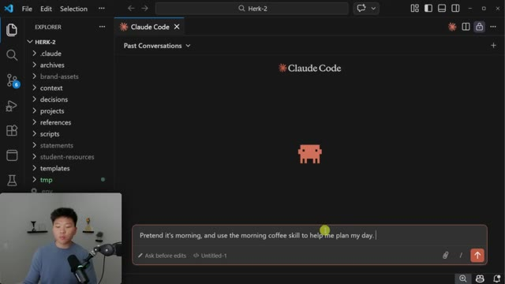
*⏱️ 00:00:08 — Interface de VS Code avec une extension Claude Code ouverte au centre, montrant l'explorateur de fichiers à gauche et une zone de saisie de texte en bas où l'utilisateur tape un prompt.*

---

### ⏱️ `[00:00:32 - 00:01:07]` | Segment #02

**🔊 Audio (Transcription Intégrale Mot pour Mot en Français) :**
> crée-moi une visualisation pour une vidéo YouTube où je veux expliquer pourquoi avoir Claude comme assistant de direction est génial et maintenant il utilise une compétence de visualisation. Donc ce que vous regardez en ce moment, ce sont quatre agents différents, un, deux, trois, quatre, qui font tous des choses pour moi en parallèle. Et pas seulement pour une super démo, mais ce sont en fait des choses que je fais tous les jours ou un jour sur deux. Donc le premier agent a terminé, qui est notre café du matin. Et nous pouvons voir ce qui est sur le calendrier pour aujourd'hui. C'est fou qu'il ait dit le 5 mars, c'est en fait le 4, mais quand même tout cela est correct. Il a donc regardé dans mon calendrier, il a regardé dans ma gestion de projet et nos objectifs trimestriels, et il a extrait les actions urgentes. Il a également extrait ma vidéo

**👁️ Analyse Visuelle d'Écran (gemini-3.5-flash-lite) :**
**Interface & Outils** : VS Code avec une disposition multi-fenêtres (quatre instances d'agents IA) et webcam du présentateur incrustée.

**Contenu textuel & Code** : Sessions de chat et exécutions de commandes de quatre agents IA distincts (récupération de calendrier ClickUp, requêtes API, recherche web et génération de scripts de visualisation).

**Action / Démonstration** : Exécution simultanée et en parallèle de quatre agents IA effectuant différentes tâches opérationnelles.

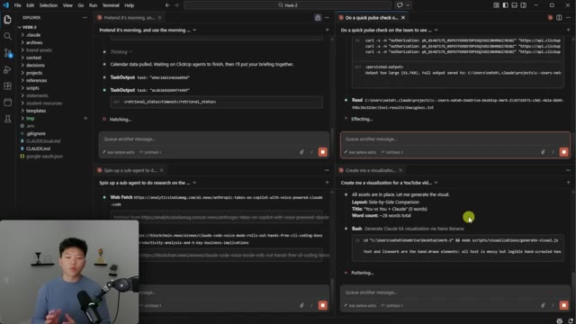
*⏱️ 00:00:41 — Vue d'un éditeur de code avec une interface divisée en quatre panneaux (quadrants) montrant l'exécution simultanée de quatre agents IA différents, avec la vidéo du présentateur en bas à gauche.*

---

### ⏱️ `[00:01:07 - 00:01:42]` | Segment #03

**🔊 Audio (Transcription Intégrale Mot pour Mot en Français) :**
> pipeline donc il voit ce que je suis en train de rédiger et ce qui est dans le carnet de commandes. Et il utilise tout ce contexte ainsi que tout ce qui se trouve sur ce côté gauche, qui sont, vous savez, les priorités actuelles, moi, les agences de voyage en ligne, mon équipe, le travail. Nous avons des projets, nous avons des décisions, nous avons tout un tas de choses ici qu'il est capable de parcourir. Donc nous lui avons pour ainsi dire donné accès à tout ce qui se passe dans mon entreprise. Et maintenant, il est capable de planifier toute ma journée et je peux aller de l'avant et dire oui, et il va simplement bloquer tout mon calendrier. Et j'aime vraiment faire cela parce que si je n'ai pas à subir cette fatigue décisionnelle de savoir ce que je devrais faire de mes 15 prochaines minutes, de ma prochaine heure, et que c'est tout simplement fait pour moi, je suis tellement plus productif. Le deuxième est fait. Nous avions donc un sous-agent qui faisait des recherches. Nous avons une publication LinkedIn et nous avons notre carrousel. Donc juste ici, c'est la publication LinkedIn,

**👁️ Analyse Visuelle d'Écran (gemini-3.5-flash-lite) :**
**Interface & Outils** : Visual Studio Code avec extension Claude/IA intégrée.

**Contenu textuel & Code** : Arborescence de dossiers sous 'context' (current-priorities.md, me.md, otas.md, team.md, work.md) et un document affichant un plan de journée ('Suggested Day Plan').

**Action / Démonstration** : Le présentateur survole le fichier 'work.md' dans l'explorateur de fichiers de l'éditeur.

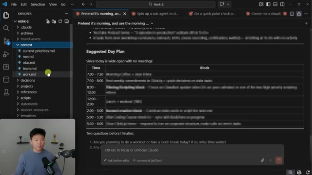
*⏱️ 00:01:16 — Capture d'écran de l'éditeur VS Code montrant l'arborescence des fichiers contextuels d'un projet et un document Markdown de planification journalière.*

---

### ⏱️ `[00:01:42 - 00:02:04]` | Segment #04

**🔊 Audio (Transcription Intégrale Mot pour Mot en Français) :**
> qui est dans mon ton de voix, comme vous pouvez le voir. Et ensuite, si je vais ici dans nos projets et que je vais dans carrousels et que je vais au 4 mars, nous pouvons voir que nous avons sept diapositives. Nous avons la diapositive une, qui est vous pouvez désormais parler à votre éditeur de code. Diapositive deux, le mode vocal de Claude Code est en direct. Diapositive trois, diapositive quatre. Je pense que vous avez compris. Et puis voici la diapositive sept, qui est l'appel à l'action. Maintenant, nous avons le bilan de santé, qui est une plongée encore plus profonde que cette compétence de café du matin.

**👁️ Analyse Visuelle d'Écran (gemini-3.5-flash-lite) :**
**Interface & Outils** : VS Code

**Contenu textuel & Code** : Arborescence de projet avec les dossiers .claude, projects/carrousels, et affichage du contenu du dossier de carrousel du 4 mars.

**Action / Démonstration** : Navigation dans l'arborescence des fichiers de VS Code pour montrer les slides générées du carrousel.

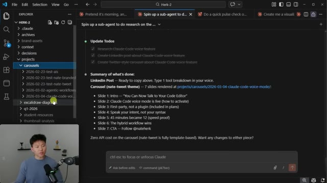
*⏱️ 00:01:48 — L'éditeur de code VS Code montrant l'arborescence du projet et un fichier markdown listant le contenu de 7 diapositives de carrousel.*

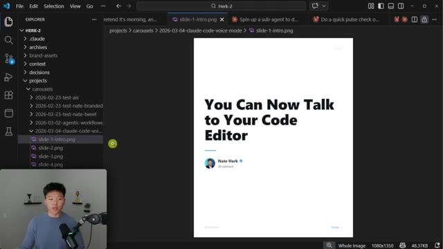
*⏱️ 00:01:54 — L'éditeur de code VS Code affichant l'aperçu de la première diapositive d'un carrousel intitulée 'You Can Now Talk to Your Code Editor'.*

---

### ⏱️ `[00:02:05 - 00:02:27]` | Segment #05

**🔊 Audio (Transcription Intégrale Mot pour Mot en Français) :**
> Il examine toutes les initiatives que nous avons actuellement en cours, et je peux voir chaque tâche et le statut actuel. Et sur la base de toutes ces informations et de nos objectifs, il me donne des suivis. Je peux donc très facilement faire le point avec l'équipe et m'assurer que tout progresse réellement. Et le dernier est notre visualisation proprement dite pour un assistant exécutif. Je devrais donc simplement aller dans les projets. J'irais dans les visualisations et nous devrions voir qu'au 4 mars, nous avons le PNG de l'assistant exécutif Claude.

**👁️ Analyse Visuelle d'Écran (gemini-3.5-flash-lite) :**
**Interface & Outils** : VS Code avec une vue de document/note ouverte et un panneau d'interaction Claude.

**Contenu textuel & Code** : Un rapport intitulé « Follow-ups Needed » détaillant les tâches en retard pour Nate, Aidan, Ednan et Kodi, ainsi qu'une invite de chat « Ask before edits / command (pk7ber) ».

**Action / Démonstration** : Consultation du tableau de suivi des tâches et des actions requises généré par l'IA pour l'équipe.

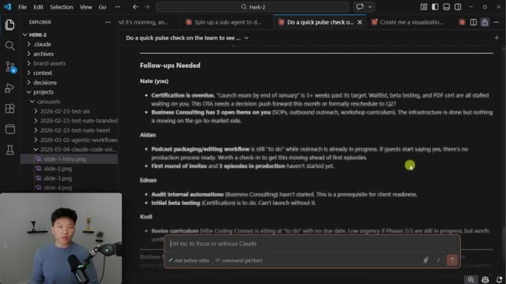
*⏱️ 00:02:10 — Un éditeur de code affichant un document de synthèse avec des suivis par membre de l'équipe, ainsi qu'une incitation de commande Claude en bas à droite.*

---

### ⏱️ `[00:02:27 - 00:02:50]` | Segment #06

**🔊 Audio (Transcription Intégrale Mot pour Mot en Français) :**
> Voici ce qu'on a. On a, sur le côté gauche, vous qui êtes submergé par le travail. Et sur le côté droit, on a avec l'assistant exécutif Claude. Et je vais en fait utiliser ceci dans la vidéo. C'était donc une petite démo rapide. Vous avez eu un petit aperçu de ce que cet assistant exécutif peut faire pour moi. Maintenant, ne soyez pas submergés par tous ces fichiers ici. J'ai construit tout ça en l'utilisant chaque jour, mais je vais vous montrer exactement comment vous pouvez suivre cette structure pour avoir en gros votre propre Herc 2, qui est ce que j'ai juste ici, mais ce serait pour vous.

**👁️ Analyse Visuelle d'Écran (gemini-3.5-flash-lite) :**
**Interface & Outils** : VS Code

**Contenu textuel & Code** : Schéma visuel comparatif 'You vs You + Claude' et interface de discussion avec l'agent Claude.

**Action / Démonstration** : Présentation du schéma conceptuel illustrant l'efficacité de l'assistant exécutif Claude.

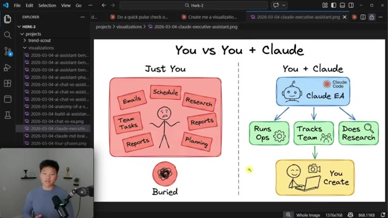
*⏱️ 00:02:33 — Un schéma comparatif dessiné à la main montrant 'Just You' (submergé par les tâches) face à 'You + Claude' (l'assistant exécutif gérant les opérations).*

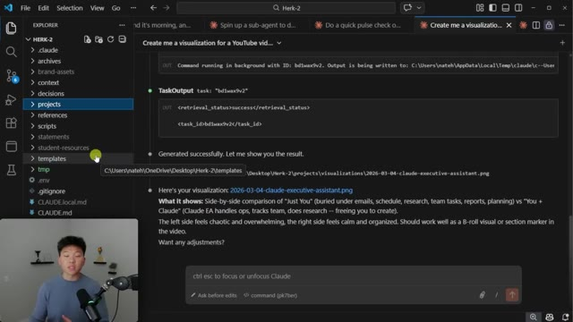
*⏱️ 00:02:38 — L'éditeur VS Code affichant le résultat de la génération de l'image comparative et les explications textuelles de l'assistant.*

---

### ⏱️ `[00:02:50 - 00:03:17]` | Segment #07

**🔊 Audio (Transcription Intégrale Mot pour Mot en Français) :**
> Et donc, ces quatre choses qui viennent de se passer m'ont probablement pris une minute ou deux. Et si j'avais dû faire chacune d'elles manuellement, cela m'aurait pris au moins 25 minutes. Donc si vous voulez savoir comment vous pouvez construire cela pour vous-même, entrons dans le vif du sujet. Donc aujourd'hui, vous allez construire votre propre assistant exécutif avec CloudCode, mais je voulais commencer très rapidement en parlant simplement de ce que la plupart des font et pourquoi ce n'est pas vraiment la même chose. Donc avec quelque chose comme Cloud ou ChatGPT, nous avons été bien plus productifs parce que nous avons pu sauvegarder des mémoires, nous avons pu sauvegarder, vous savez, peut-être des compétences personnalisées ou des invites personnalisées.

**👁️ Analyse Visuelle d'Écran (gemini-3.5-flash-lite) :**
**Interface & Outils** : VS Code / Interface de développement et schéma explicatif

**Contenu textuel & Code** : Console avec des logs de tâches, résultats de génération d'images, et illustration comparative entre un chat classique et un assistant IA structuré.

**Action / Démonstration** : Génération et affichage d'une image de visualisation comparative par l'assistant IA.

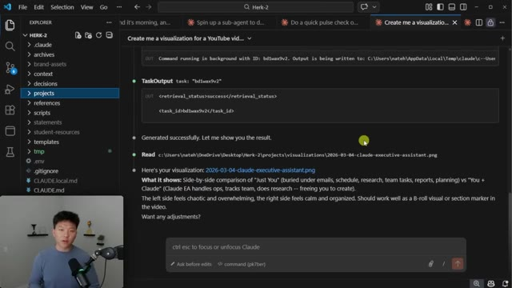
*⏱️ 00:02:57 — Interface VS Code affichant un terminal ou un assistant IA (Claude) générant une image de visualisation.*

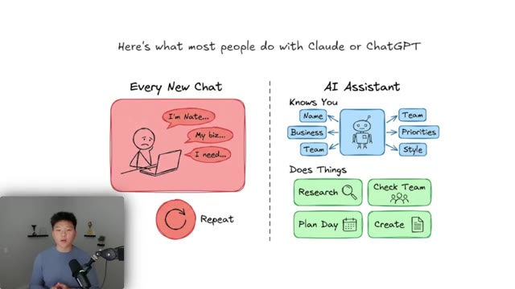
*⏱️ 00:03:03 — Schéma comparatif dessiné à la main montrant la différence entre 'Every New Chat' et un 'AI Assistant'.*

---

### ⏱️ `[00:03:17 - 00:03:38]` | Segment #08

**🔊 Audio (Transcription Intégrale Mot pour Mot en Français) :**
> Il y a encore tellement de moments où vous avez probablement pensé : « Mon Dieu, j'aimerais tellement que ce truc sache absolument tout de ce qui se passe. » Ainsi, avec cette ancienne méthode, vous avez un peu l'impression de vous répéter sans cesse, ou de lui donner du contexte supplémentaire, ou alors il vous aide à faire peut-être la moitié du chemin, c'est-à-dire 50 %, au lieu de faire 90 % du chemin. Mais avec un assistant IA, il connaît votre nom, votre entreprise, vos priorités, votre équipe, vos projets en cours. Il connaît les décisions que vous avez prises et il peut aussi faire des choses pour vous, comme prendre des nouvelles d'une équipe.

**👁️ Analyse Visuelle d'Écran (gemini-3.5-flash-lite) :**
**Interface & Outils** : Schéma/dessin explicatif (style tableau blanc)

**Contenu textuel & Code** : Texte : "Here's what most people do with Claude or ChatGPT", "Every New Chat", "I'm Nate...", "My biz...", "I need...", "Repeat", "AI Assistant", "Knows You" (Name, Business, Team, Priorities, Style), "Does Things" (Research, Check Team, Plan Day, Create).

**Action / Démonstration** : Présentation visuelle comparative illustrant le besoin de répéter le contexte à chaque nouveau chat face à un assistant global.

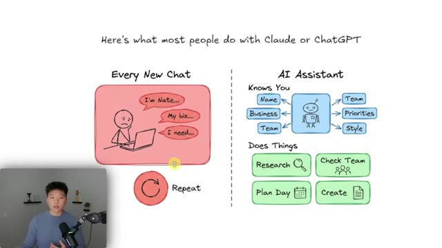
*⏱️ 00:03:22 — Schéma explicatif comparant les anciennes méthodes de chat (gauche) et un assistant IA intelligent (droite), avec le présentateur en bas à gauche.*

---

### ⏱️ `[00:03:38 - 00:04:11]` | Segment #09

**🔊 Audio (Transcription Intégrale Mot pour Mot en Français) :**
> Il peut créer des choses. Il peut faire des recherches. Il peut planifier votre journée. Et voici le visuel que nous venons de générer ensemble. Et en fait, j'aime encore plus celui-ci parce qu'il montre que je suis capable de créer plus de vidéos YouTube grâce à cet assistant. Les avantages sont donc assez évidents ici. Vous pouvez gagner beaucoup de temps. Vous n'avez vraiment plus besoin de vous répéter. Vous faites évoluer votre équipe et vous pourriez potentiellement vendre cette compétence puisque vous savez désormais comment configurer ces structures avec la gestion du contexte et, vous savez, la mémoire. Et dans ce processus de création de votre propre assistant, vous allez vous améliorer considérablement en programmation avec Claude, ce qui est une compétence vraiment très utile à avoir. Donc, comme je le disais, aujourd'hui, je vais vous montrer exactement comment j'ai construit cet outil. Et il y a quatre phases principales. Donc, phase une

**👁️ Analyse Visuelle d'Écran (gemini-3.5-flash-lite) :**
**Interface & Outils** : Présentation visuelle sous forme de diagrammes explicatifs dessinés à la main.

**Contenu textuel & Code** : Texte et icônes illustrant la comparaison entre l'utilisation d'un assistant IA et le travail en solo, ainsi que les bénéfices clés (gain de temps, automatisation, passage à l'échelle, monétisation).

**Action / Démonstration** : Le présentateur explique les avantages visuels affichés à l'écran concernant l'utilisation de Claude et l'automatisation.

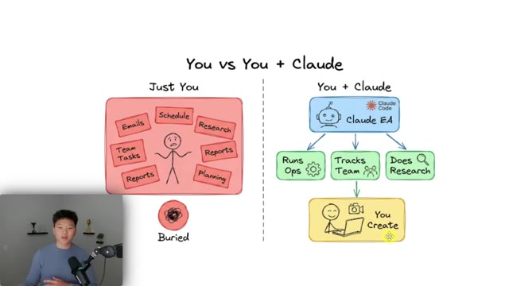
*⏱️ 00:03:46 — Schéma comparatif dessiné à la main intitulé "You vs You + Claude", illustrant d'un côté la surcharge de travail ("Buried") et de l'autre l'efficacité permise par l'assistant IA ("You Create").*

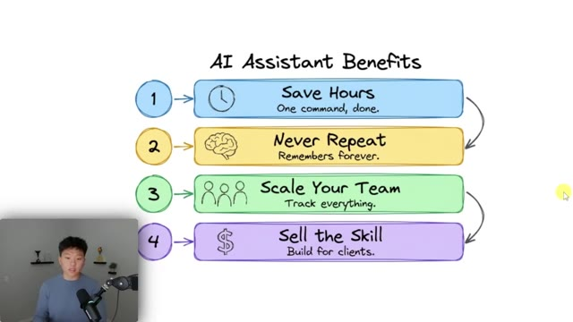
*⏱️ 00:03:54 — Schéma de type infographie dessiné à la main listant les quatre principaux avantages des assistants IA ("AI Assistant Benefits"), numérotés de 1 à 4 (Save Hours, Never Repeat, Scale Your Team, Sell the Skill).*

---

### ⏱️ `[00:04:11 - 00:04:38]` | Segment #10

**🔊 Audio (Transcription Intégrale Mot pour Mot en Français) :**
> c'est que nous devons lui donner un foyer. C'est donc un peu la structure de notre projet, ce qui est, je pense, la chose la plus difficile ou la plus déroutante au départ. Car comme vous avez pu le voir dans mon projet, il y a beaucoup de dossiers et dans chacun de ces dossiers, il y a beaucoup de sous-dossiers. Il se passe donc beaucoup de choses. Il est donc très important de s'assurer que vous savez où se trouvent les choses, mais aussi que Claude sache où se trouve tout. Car au fur et à mesure que vous évoluez, de plus en plus de fichiers seront créés, de plus en plus de compétences, de plus en plus de processus. Après lui avoir donné un foyer, nous devons lui donner vie. Nous devons donc lui donner des règles. Nous devons lui donner un contexte sur vous.

**👁️ Analyse Visuelle d'Écran (gemini-3.5-flash-lite) :**
**Interface & Outils** : Visual Studio Code avec extension Claude/Chat et arborescence de fichiers.

**Contenu textuel & Code** : Arborescence des dossiers (archives, brand-assets, context, decisions, projects, references, scripts, statements, student-resources, templates, tmp) et interface de chat montrant une tâche générée avec succès et une image de visualisation.

**Action / Démonstration** : Navigation et présentation de la structure des dossiers du projet par le présentateur.

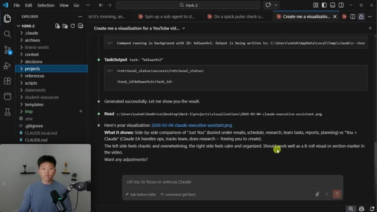
*⏱️ 00:04:18 — Vue de l'éditeur de code VS Code montrant l'arborescence des dossiers du projet HERK-2 sur le panneau latéral gauche, et une discussion avec une IA dans le panneau principal.*

---

### ⏱️ `[00:04:38 - 00:05:11]` | Segment #11

**🔊 Audio (Transcription Intégrale Mot pour Mot en Français) :**
> Il doit tout apprendre sur vous et sur ce que vous faites actuellement. Après cela, nous devons lui donner des mains. Nous allons donc construire une première compétence ensemble, puis nous allons voir comment nous pouvons créer de plus en plus de compétences, de sous-agents et de choses de ce genre, de sorte qu'il devienne réellement plus utile pour faire des choses pour vous plutôt que de simplement vous aider à réfléchir. Et enfin, nous verrons comment nous permettons réellement à cette chose de grandir. Comment l'améliorons-nous ? Comment la faisons-nous vraiment évoluer ? Et comment nous assurons-nous que cet assistant devient réellement plus intelligent au fil du temps et constitue véritablement un levier pour nous ? Très bien. Alors, phase une, donnons un foyer à cette chose. Donc, si vous avez regardé des vidéos sur ma chaîne avec Claude Code, vous avez alors remarqué que j'utilise Visual Studio Code, qui est

**👁️ Analyse Visuelle d'Écran (gemini-3.5-flash-lite) :**
**Interface & Outils** : Logiciel de présentation ou tableau blanc numérique avec des illustrations dessinées à la main.

**Contenu textuel & Code** : Texte du diagramme : "Build Your AI Assistant" avec les 4 étapes numérotées et fléchées, ainsi que la mention "Your assistant gets smarter over time".

**Action / Démonstration** : Présentation du plan global en quatre étapes pour construire et faire évoluer un assistant IA personnel.

*⏱️ 00:04:47 — Schéma explicatif en quatre étapes illustrant la création d'un assistant IA : 1. Give It a Home (Project structure), 2. Give It Life (Context + Rules), 3. Give It Hands (Your first skill), 4. Let It Grow (Skills + Memory). Le présentateur apparaît en incrustation dans le coin inférieur gauche.*

---

### ⏱️ `[00:05:11 - 00:05:44]` | Segment #12

**🔊 Audio (Transcription Intégrale Mot pour Mot en Français) :**
> juste un IDE, un environnement de développement intégré. Il est entièrement gratuit à télécharger pour Windows ou Mac. Donc allez-y et téléchargez-le. Et ensuite, une fois que vous y êtes, voilà à quoi cela devrait ressembler lorsque vous l'ouvrez. Maintenant, ce que vous devez faire, c'est venir sur le côté gauche, cliquer sur extensions, et vous taperez Claude Code et ça ressemblera à ceci. Et tout ce que vous avez à faire, c'est d'installer ceci. Lorsque vous faites cela, cela vous invitera à vous connecter avec votre abonnement Anthropic, car vous devez effectivement être sur un forfait payant pour Claude Code. Vous pourriez utiliser votre clé API, mais il vaut mieux avoir un coût fixe plutôt que de vous inquiéter du nombre de jetons que vous accumulez. Très bien, donc une fois que Claude Code

**👁️ Analyse Visuelle d'Écran (gemini-3.5-flash-lite) :**
**Interface & Outils** : Visual Studio Code (VS Code)

**Contenu textuel & Code** : Menu de bienvenue avec options "New File", "Open File", "Open Folder", et listes de projets récents, ainsi que des liens "Walkthroughs" comme "Get started with VS Code" et "Get started with Claude Code".

**Action / Démonstration** : Présentation de l'interface initiale de l'IDE après son premier lancement.

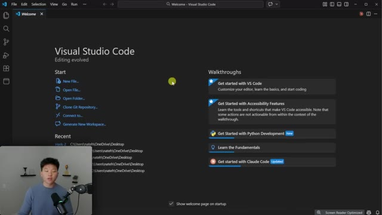
*⏱️ 00:05:19 — Page d'accueil de l'éditeur de code Visual Studio Code montrant les options de démarrage et les tutoriels de prise en main, avec la vidéo du présentateur incrustée dans le coin inférieur gauche.*

---

### ⏱️ `[00:05:44 - 00:06:17]` | Segment #13

**🔊 Audio (Transcription Intégrale Mot pour Mot en Français) :**
> est installé, vous remarquerez en haut à droite qu'il y a un petit bouton orange. Si vous cliquez dessus, c'est là que vous avez le véritable agent Cloud Code avec lequel vous pouvez commencer à discuter. Mais avant de commencer à discuter avec lui, nous ne lui avons toujours pas vraiment donné de foyer. Nous devons donc configurer un dossier, ce qui signifie que vous devez ouvrir votre Explorateur de fichiers ou votre Finder ou peu importe comment ça s'appelle et créer un nouveau dossier. Donc pour cela, je vais simplement être sur mon bureau. Je crée un nouveau dossier et je vais simplement appeler ça EA Demo, EA pour Assistant Exécutif. Et maintenant ce que je dois faire, c'est ouvrir ce dossier dans Visual Studio Code. Je vais donc aller sur le côté gauche et cliquer sur l'Explorateur. Et il est écrit, vous n'avez pas encore ouvert de dossier. Ce sera essentiellement votre

**👁️ Analyse Visuelle d'Écran (gemini-3.5-flash-lite) :**
**Interface & Outils** : VS Code (Visual Studio Code), Extension Claude Code

**Contenu textuel & Code** : Interface de chat Claude Code avec l'indication "Use Claude Code in the terminal to configure MCP servers. They'll work here, too!" et la zone de saisie en bas.

**Action / Démonstration** : Navigation et présentation de l'interface de l'extension Claude Code dans l'éditeur de code.

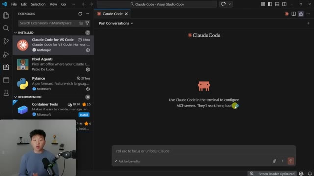
*⏱️ 00:05:52 — Vue de l'interface de VS Code avec l'extension Claude Code ouverte dans le panneau principal et la liste des extensions installées sur la gauche.*

---

### ⏱️ `[00:06:17 - 00:06:43]` | Segment #14

**🔊 Audio (Transcription Intégrale Mot pour Mot en Français) :**
> projet. Et je vais cliquer sur ouvrir le dossier et ouvrir celui que je viens de créer. Donc voici mon EA demo, sélectionner le dossier. Et maintenant nous sommes effectivement dans notre projet. C'est le foyer de notre agent Cloud Code, car ce que je peux faire, c'est ouvrir ce petit bouton, fermer tout le reste. Et maintenant nous avons notre dossier sur le côté gauche. Il n'y a pas encore de fichiers dedans. Et puis nous avons notre agent Cloud Code juste ici au milieu à qui nous pouvons parler. Donc maintenant, la deuxième partie pour donner un foyer à tout cela est de comprendre comment fonctionne cloud.md et de créer notre fichier cloud.md.

**👁️ Analyse Visuelle d'Écran (gemini-3.5-flash-lite) :**
**Interface & Outils** : Visual Studio Code

**Contenu textuel & Code** : Boîte de dialogue "Do you trust the authors of the files in this folder?" affichant le chemin d'accès au dossier "EA Demo" et les boutons de validation.

**Action / Démonstration** : Ouverture du dossier de projet dans l'éditeur de code et validation de la confiance du dossier.

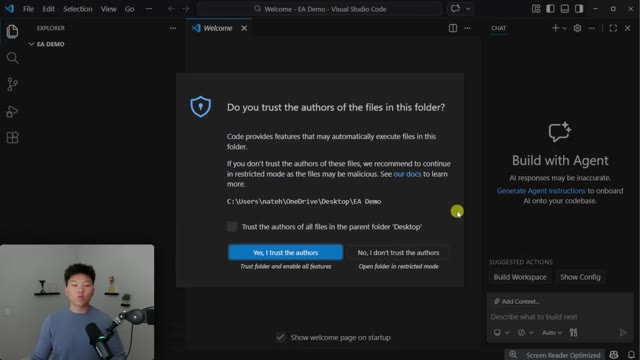
*⏱️ 00:06:23 — VS Code ouvert avec une invite de sécurité demandant si l'utilisateur fait confiance aux auteurs du dossier "EA Demo" récemment ouvert, avec le présentateur visible en incrustation vidéo dans le coin inférieur gauche.*

---

### ⏱️ `[00:06:44 - 00:07:07]` | Segment #15

**🔊 Audio (Transcription Intégrale Mot pour Mot en Français) :**
> Donc si vous avez construit un agent dans NNN ou si vous avez construit un GPT personnalisé avec ChatGPT, vous comprenez que lorsque vous faites quelque chose comme ça, vous devez lui donner un prompt système. Vous devez lui donner des instructions. C'est donc exactement ce que nous devons faire ici. Et nous faisons cela avec un fichier cloud.md. Donc la façon dont cela fonctionne, c'est que vous envoyez quelque chose à Claude Code. Et avant qu'il ne lise réellement votre message, il va charger le fichier cloud.md et lire la totalité de celui-ci. Et il va faire ça à chaque fois.

**👁️ Analyse Visuelle d'Écran (gemini-3.5-flash-lite) :**
**Interface & Outils** : Schéma graphique explicatif de type dessin animé (whiteboard) avec le présentateur en médaillon dans le coin inférieur gauche.

**Contenu textuel & Code** : Texte du schéma : "How CLAUDE.md Works", "Loaded first Every conversation", "System Prompt", "Your Message", "Rules", "Context", "Skills".

**Action / Démonstration** : Le présentateur explique visuellement à l'aide d'un schéma comment le fichier CLAUDE.md sert de prompt système initial pour Claude Code.

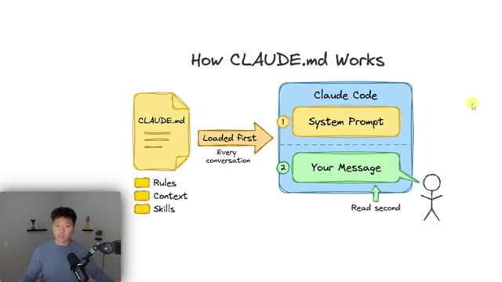
*⏱️ 00:06:50 — Schéma explicatif illustrant le fonctionnement de CLAUDE.md montrant comment le fichier charge d'abord le prompt système, les règles, le contexte et les compétences avant les messages de l'utilisateur.*

---

### ⏱️ `[00:07:07 - 00:07:40]` | Segment #16

**🔊 Audio (Transcription Intégrale Mot pour Mot en Français) :**
> Le fichier cloud.md ne doit donc contenir que les règles les plus importantes indiquant : voici ce que fait le projet, c'est ici qu'il faut chercher vos règles, c'est ici qu'il faut chercher le contexte, ce genre de choses. Parce que si vous le remplissez super, super abondamment d'informations aléatoires, vous allez alors consommer vos jetons et votre fenêtre de contexte plus rapidement. Donc, ce qui va finalement se passer d'ici la fin de cette vidéo, c'est que vous n'aurez pas seulement un fichier cloud.md, mais vous aurez un fichier .cloud, vous aurez des projets, vous aurez du contexte, vous aurez des décisions, vous aurez tout un tas de dossiers différents ici. Mais le cerveau, c'est-à-dire claude.md, indique à Claude Code où se trouve réellement chaque chose. C'est donc ainsi que nous restons vraiment

**👁️ Analyse Visuelle d'Écran (gemini-3.5-flash-lite) :**
**Interface & Outils** : Schéma graphique explicatif de type dessin animé / diagramme conceptuel.

**Contenu textuel & Code** : Schéma montrant le fichier CLAUDE.md chargé en premier dans le System Prompt de Claude Code, avec les notions de Rules, Context et Skills.

**Action / Démonstration** : Explication visuelle du chargement prioritaire du fichier de configuration dans chaque conversation.

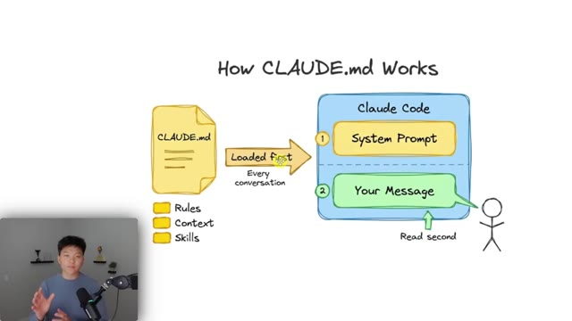
*⏱️ 00:07:15 — Schéma explicatif illustrant le fonctionnement de CLAUDE.md et son intégration dans Claude Code.*

---

### ⏱️ `[00:07:40 - 00:08:14]` | Segment #17

**🔊 Audio (Transcription Intégrale Mot pour Mot en Français) :**
> organisé. Donc tout ce que nous allons faire ici pour commencer, c'est que nous allons aller sur le côté gauche. Je vais cliquer sur nouveau fichier et je vais simplement l'appeler en majuscules, claude puis point md. Et md signifie simplement markdown. Et donc ce qui se passe, c'est que le fichier claude.md apparaît juste ici et vous pouvez voir qu'il n'y a actuellement rien dedans. Je vais donc simplement dire à claude, Hé, Claude code, ce dossier est pour que tu sois mon assistant de direction. Alors mets juste un petit mot rapide à ce sujet dans le fichier claude.md. J'envoie ça. Il va essentiellement parcourir le projet, voir ce qu'il y a ici, puis il va modifier ce fichier afin que nous en ayons un petit

**👁️ Analyse Visuelle d'Écran (gemini-3.5-flash-lite) :**
**Interface & Outils** : Visual Studio Code (extension Claude Code)

**Contenu textuel & Code** : Nom de fichier en cours de saisie : "CLA" dans le dossier "EA DEMO", interface de Claude Code active avec le message "Use planning mode to talk through big changes before a commit".

**Action / Démonstration** : Création d'un nouveau fichier dans l'explorateur de fichiers de l'éditeur de code.

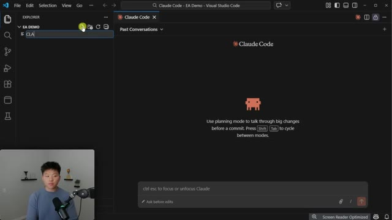
*⏱️ 00:07:49 — Capture d'écran de l'éditeur Visual Studio Code montrant l'explorateur de fichiers à gauche avec la création en cours d'un fichier nommé "CLA" et l'extension "Claude Code" ouverte dans le panneau principal à droite.*

---

### ⏱️ `[00:08:14 - 00:08:48]` | Segment #18

**🔊 Audio (Transcription Intégrale Mot pour Mot en Français) :**
> un petit mot dedans. Et à moins d'être en mode de permissions de contournement, il va vous demander la permission ici. Donc maintenant, il est écrit terminé. Cloud.md contient une brève description de votre dossier en tant qu'espace de travail d'assistant de direction. Si je clique sur Cloud.md, vous pouvez voir ce que nous avons là. Ce dossier est l'espace de travail de Claude Code pour agir en tant qu'assistant de direction. Utilisez-le pour aider l'utilisateur dans la planification, la gestion des tâches, la recherche, la rédaction, les communications et tout autre travail lié à un assistant de direction dont il a besoin. Donc cela va évoluer tout au long de la vidéo. Vous verrez qu'une fois que nous commencerons à lui donner un peu plus de vie, ce qui, comme vous le savez, est la phase deux. Donc comme je l'ai dit, Claude.md est le cerveau et il va dire à Claude Code où chercher des informations sur nous,

**👁️ Analyse Visuelle d'Écran (gemini-3.5-flash-lite) :**
**Interface & Outils** : Visual Studio Code avec extension Claude Code et webcam du présentateur

**Contenu textuel & Code** : Prompt utilisateur "hey Claude Code! This folder is for you to be my executive assistant..." et réponse de Claude écrivant dans le fichier CLAUDE.md "# EA Demo - Executive Assistant Workspace".

**Action / Démonstration** : Exécution d'une commande Claude Code pour créer et remplir automatiquement un fichier de configuration d'espace de travail.

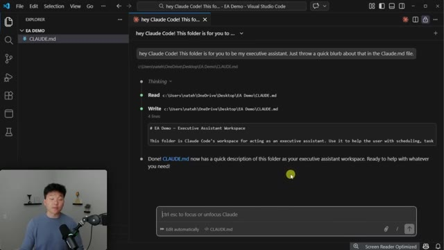
*⏱️ 00:08:22 — Interface de VS Code montrant l'extension Claude Code en action avec le fichier CLAUDE.md et le présentateur dans un coin.*

---

### ⏱️ `[00:08:48 - 00:09:22]` | Segment #19

**🔊 Audio (Transcription Intégrale Mot pour Mot en Français) :**
> qui va se trouver dans un fichier "me", des informations sur votre entreprise, qui seront dans "work", des informations sur votre équipe, qui seront dans "team", et ensuite des informations sur ce sur quoi vous vous concentrez actuellement, qui seront dans "priorities". Et il va également comprendre toutes vos règles, comme la façon dont vous aimez parler, votre style, le formatage, des choses comme ça. D'accord. Donc je vais coller ce prompt, auquel vous pourrez accéder gratuitement dans ma communauté School gratuite. J'aurai une publication là-bas associée à cette vidéo. Et ensuite, vous avez juste besoin pour l'essentiel de prendre ce fichier Markdown, de le copier et de le coller ici. Vous pouvez voir que ce prompt est plutôt costaud et qu'il va essentiellement vous guider et faire en sorte que Claude Code extrait tout

**👁️ Analyse Visuelle d'Écran (gemini-3.5-flash-lite) :**
**Interface & Outils** : Visual Studio Code, extension Claude Code

**Contenu textuel & Code** : Fichier CLAUDE.md en cours d'édition avec des instructions pour l'assistant exécutif et la lecture/écriture de fichiers de configuration.

**Action / Démonstration** : Initialisation du dossier de travail et écriture automatique d'une description dans le fichier CLAUDE.md par l'assistant IA.

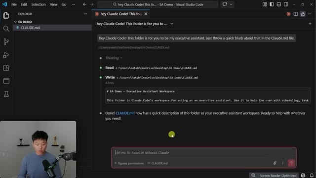
*⏱️ 00:09:05 — Interface de Visual Studio Code affichant l'éditeur de code et une fenêtre d'interaction avec l'extension Claude Code en train d'écrire dans CLAUDE.md.*

---

### ⏱️ `[00:09:22 - 00:09:45]` | Segment #20

**🔊 Audio (Transcription Intégrale Mot pour Mot en Français) :**
> les informations nécessaires de votre part pour lancer ce projet. Je vais donc lancer ceci et nous allons voir qu'il va commencer à nous poser des questions sur nous. La phase, la phase un consiste à créer la structure des dossiers et à initialiser un dépôt git. Et maintenant, vous pouvez voir que tous ces dossiers et fichiers sont apparus sur le côté gauche, ce qui est très similaire à la façon dont mon projet Herc2 était configuré. Nous avons des modèles, des références, des projets, des décisions, du contexte, des archives et le point clod.

**👁️ Analyse Visuelle d'Écran (gemini-3.5-flash-lite) :**
**Interface & Outils** : Visual Studio Code, extension/interface de chat Claude Code

**Contenu textuel & Code** : Un prompt demandant de configurer le dossier en assistant exécutif en 3 phases, commençant par la phase 1 (création de la structure des dossiers et initialisation du dépôt git), avec un message "Perusing..." indiquant que l'agent analyse le projet.

**Action / Démonstration** : L'assistant IA analyse le prompt et commence l'initialisation de la structure des dossiers et du dépôt Git.

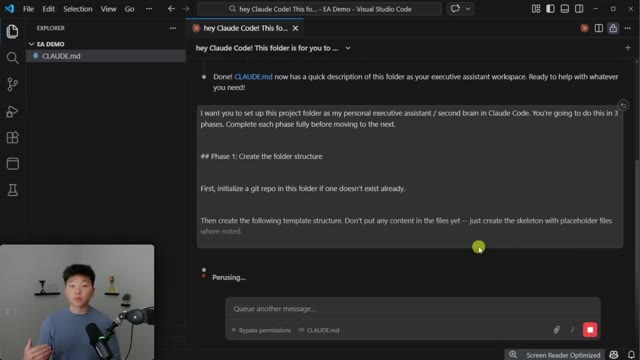
*⏱️ 00:09:28 — Capture d'écran montrant l'interface de Visual Studio Code avec un panneau latéral affichant le fichier CLAUDE.md et une interface de chat active intégrant Claude Code qui exécute la phase 1 du projet.*

---

### ⏱️ `[00:09:45 - 00:10:16]` | Segment #21

**🔊 Audio (Transcription Intégrale Mot pour Mot en Français) :**
> Donc tout ça va commencer à se remplir un petit peu. Et croyez-moi, au fur et à mesure que vous commencerez à utiliser ceci, cela aura beaucoup plus de sens. Donc maintenant nous sommes à la phase deux, qui est la section de l'entrevue. Donc première partie, quel est votre nom ? Quel est votre rôle ? Quel est votre fuseau horaire ? Blabla, blabla. Donc je vais juste lui donner de fausses informations ici. D'accord, donc j'ai envoyé mes réponses initiales et maintenant il nous en demande plus sur notre entreprise et notre travail. Donc évidemment, je suis juste en train de lui donner de fausses informations pour vous montrer comment il va configurer ces dossiers, mais c'est là que vous devriez vraiment prendre un peu de temps ici et le laisser faire votre connaissance et lui donner autant de détails que vous le voulez, parce qu'en fin de compte, vous allez vouloir qu'il sache tout cela de toute façon.

**👁️ Analyse Visuelle d'Écran (gemini-3.5-flash-lite) :**
**Interface & Outils** : Visual Studio Code (éditeur de code).

**Contenu textuel & Code** : Texte affichant les étapes du projet (Phase 1 cochée, Phase 2 en cours) et les questions de la section 1 : "1. What's your name? 2. What's your role/title? 3. What's your timezone? 4. In one sentence, what do you do? 5. What's your #1 priority?".

**Action / Démonstration** : Présentation de la phase 2 de l'entrevue d'intégration (onboarding interview) par l'intervenant.

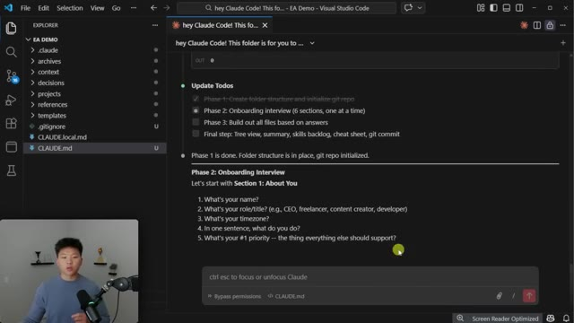
*⏱️ 00:09:52 — Capture d'écran de l'éditeur Visual Studio Code montrant le projet EA DEMO et le fichier CLAUDE.md avec l'affichage de la phase 2 de l'entrevue d'intégration (Onboarding Interview - Section 1: About You).*

---

### ⏱️ `[00:10:16 - 00:10:48]` | Segment #22

**🔊 Audio (Transcription Intégrale Mot pour Mot en Français) :**
> Alors prenez votre temps ici, donnez-lui vraiment des informations. S'il vous demande quelque chose et que vous ne connaissez pas la réponse, dites peut-être simplement que vous ne savez pas et voyez s'il peut vous aider à faire du brainstorming sur certaines choses. Mais vous pouvez aussi simplement dire, passez, vous savez, je configurerai ça plus tard. Et vous pouvez voir qu'il pourrait ne pas passer à la section suivante tant qu'il n'a pas l'impression d'avoir assez d'informations. Donc juste ici, il demande si j'avais une personne clé. J'ai dit, oui, j'ai une autre personne et je n'ai pas dit le nom. Donc il demande, quel est le nom ? Et maintenant il passe aux priorités, aux objectifs et aux projets. Rappelez-vous que vous pourrez l'intégrer en temps réel dans ClickUp ou, vous savez, Asana ou Notion ou peu importe ce que vous utilisez pour votre gestion de projet et vos objectifs. Parce qu'une grande partie de cela consiste à s'assurer que

**👁️ Analyse Visuelle d'Écran (gemini-3.5-flash-lite) :**
**Interface & Outils** : Visual Studio Code (avec une extension de chat IA, probablement Claude Code).

**Contenu textuel & Code** : Un échange textuel sous forme de questions-réponses : l'IA interroge l'utilisateur sur son entreprise, ses outils (ClickUp) et son équipe. L'utilisateur répond en détaillant ses points de douleur liés au manque de communication et à la gestion de projet.

**Action / Démonstration** : L'utilisateur est en train de remplir un formulaire ou de répondre à un questionnaire structuré pour fournir du contexte à l'assistant IA afin qu'il puisse proposer des automatisations personnalisées.

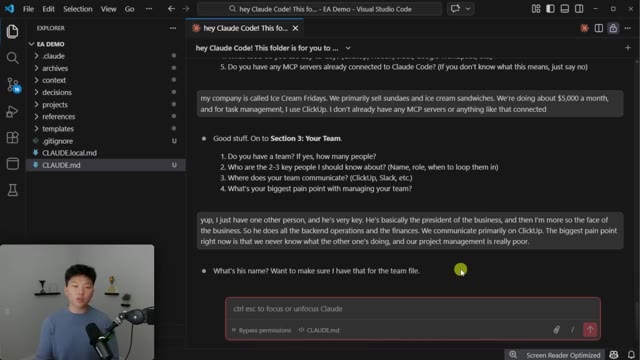
*⏱️ 00:10:24 — Une capture d'écran de l'éditeur Visual Studio Code affichant un fichier Markdown interactif où l'utilisateur dialogue avec une IA pour configurer son entreprise ("Ice Cream Fridays") et ses besoins en automatisation.*

---

### ⏱️ `[00:10:48 - 00:11:06]` | Segment #23

**🔊 Audio (Transcription Intégrale Mot pour Mot en Français) :**
> tout ce qu'il regarde est en fait actuel. Il s'agit simplement en quelque sorte de l'intégration initiale pour le familiariser avec votre entreprise. La section cinq pose des questions sur les préférences de communication. Alors, comment aimez-vous réellement interagir avec quelque chose ? Parce que cela peut vraiment être personnalisé selon vos goûts. Et rappelez-vous, rien de tout cela n'est permanent. Vous pouvez toujours le modifier plus tard. Et la dernière section concerne ce avec quoi vous voulez de l'aide.

**👁️ Analyse Visuelle d'Écran (gemini-3.5-flash-lite) :**
**Interface & Outils** : Visual Studio Code (éditeur de code avec extension pour assistant IA)

**Contenu textuel & Code** : Un échange de questions-réponses sur les préférences de communication et la gestion d'équipe, incluant la mention de la 'Section 4: Priorities, Goals & Projects' et une zone de saisie pour l'assistant Claude.

**Action / Démonstration** : Navigation et lecture d'un fichier Markdown contenant un questionnaire d'intégration contextuelle pour l'assistant IA.

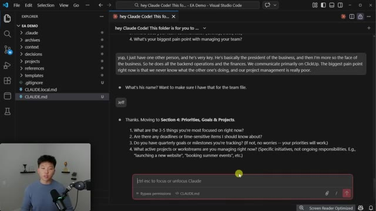
*⏱️ 00:10:53 — Une capture d'écran montrant l'interface de Visual Studio Code avec le panneau latéral gauche explorant les dossiers du projet EA DEMO et, dans la zone principale, une conversation textuelle interactive avec un assistant IA.*

---

### ⏱️ `[00:11:06 - 00:11:25]` | Segment #24

**🔊 Audio (Transcription Intégrale Mot pour Mot en Français) :**
> Donc, quelles sont les tâches récurrentes qui vous prennent du temps ? Qu'est-ce que vous confieriez à un assistant en premier si vous le pouviez ? Y a-t-il des flux de travail spécifiques que vous voulez automatiser ou modéliser ? Maintenant, si vous ne savez pas pour l'instant, ce n'est pas grave. Dites simplement passer. Parce que ce qui va se passer, c'est que je vais vous mettre au défi d'utiliser ceci autant que vous le pouvez. N'utilisez pas vos GPTs personnalisés. N'utilisez pas vos projets. Essayez de tout migrer ici et d'utiliser juste ceci.

**👁️ Analyse Visuelle d'Écran (gemini-3.5-flash-lite) :**
**Interface & Outils** : Visual Studio Code

**Contenu textuel & Code** : Le fichier contient des directives de communication : "everything I like to read should be: concise, Bullet points, No sugarcoating...", ainsi que la question affichée à l'écran : "Section 6: What Do You Want Help With?". Un champ de saisie de chat Claude est visible en bas de l'éditeur.

**Action / Démonstration** : Le présentateur illustre la configuration d'un agent IA en éditant un fichier de contexte (CLAUDE.md) pour définir les préférences de travail et les besoins en automatisation de l'utilisateur.

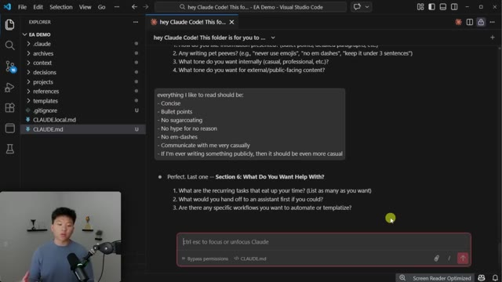
*⏱️ 00:11:11 — Une capture d'écran de l'éditeur Visual Studio Code montrant un fichier Markdown nommé "CLAUDE.md" ouvert dans l'éditeur. Le document contient une liste de questions et de préférences de style pour configurer le comportement d'un assistant IA.*

---

### ⏱️ `[00:11:25 - 00:11:45]` | Segment #25

**🔊 Audio (Transcription Intégrale Mot pour Mot en Français) :**
> Et avec le temps, vous réaliserez ce qui est récurrent et quels sont les processus que vous pouvez réellement utiliser dans Cloud Code. Je lui ai donc simplement dit, passons cela pour l'instant. Et continuons à avancer dans cette configuration. Ainsi, maintenant qu'il a toutes nos informations, il va élaborer les fichiers en fonction de nos réponses. Et nous allons pouvoir voir que, en ce moment, il écrit le fichier me. Et maintenant il écrit le fichier work. Et maintenant il écrit le fichier team et les priorités actuelles.

**👁️ Analyse Visuelle d'Écran (gemini-3.5-flash-lite) :**
**Interface & Outils** : Visual Studio Code (éditeur de code).

**Contenu textuel & Code** : Fichier Markdown ouvert (`CLAUDE.md`) contenant des questions et réponses de configuration de l'assistant (préférences de lecture, format de texte, ton), ainsi qu'une invite de commande de l'assistant en bas.

**Action / Démonstration** : Consultation et édition du fichier de configuration contextuelle de l'assistant IA dans l'arborescence du projet.

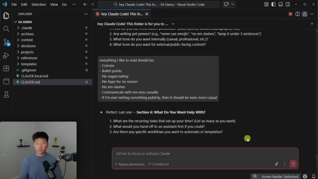
*⏱️ 00:11:30 — Capture d'écran de l'éditeur de code Visual Studio Code montrant une interaction avec un assistant IA, avec la vidéo du présentateur incrustée en bas à gauche.*

---

### ⏱️ `[00:11:46 - 00:12:19]` | Segment #26

**🔊 Audio (Transcription Intégrale Mot pour Mot en Français) :**
> Et tout cela va être bouclé ensemble. Très bien. Donc tout ceci est configuré. Nous avons notre vue arborescente de la structure de nos dossiers, de sorte que nous pouvons vraiment creuser là-dedans si nous voulons voir ce qu'il y a dans le dossier point cloud ou ce qui est dans les archives, le contexte, tout ce genre de choses. Nous obtenons un résumé de la façon dont tout fonctionne. Donc si vous êtes confus au sujet de l'un de ces éléments, vous obtiendrez un résumé et vous pourrez également demander, hé, genre, que fait ce fichier de contexte ou que fait le dossier des archives ? Et il sera capable de vous l'expliquer. Mais vous pouvez voir qu'il a rempli ces éléments avec des informations me concernant. Les compétences que nous devons développer sont sur le carnet de commandes. Sinon, si vous en aviez listé, il dirait, ok, super, commençons juste à développer ces compétences dès maintenant. Et en ce qui concerne le maintien de l'assistant à jour chaque semaine,

**👁️ Analyse Visuelle d'Écran (gemini-3.5-flash-lite) :**
**Interface & Outils** : Visual Studio Code

**Contenu textuel & Code** : Arborescence de dossiers incluant les répertoires .claude, archives, context, decisions, projects, references, templates, ainsi que des fichiers de configuration et de documentation comme CLAUDE.md.

**Action / Démonstration** : Le présentateur montre l'arborescence des dossiers et explique la structure du projet mise en place pour l'assistant IA.

*⏱️ 00:11:54 — Capture d'écran de l'éditeur Visual Studio Code montrant l'arborescence des dossiers d'un projet nommé "EA Demo" dans le panneau latéral gauche, ainsi qu'une vue textuelle arborescente détaillée dans l'éditeur principal, avec la vidéo du présentateur incrustée en bas à gauche.*

---

### ⏱️ `[00:12:19 - 00:12:52]` | Segment #27

**🔊 Audio (Transcription Intégrale Mot pour Mot en Français) :**
> rien n'est requis pour l'instant. Nous avons une mémoire automatique pour les apprentissages quotidiens. Chaque mois, nous mettrons à jour ces éléments. Chaque trimestre, nous mettrons à jour ces éléments. Et selon les besoins, nous enregistrerons les décisions dans le journal des décisions. Et un conseil de pro, si vous voulez que votre assistant se souvienne de quelque chose de façon permanente, dites-lui simplement, rappelle-toi que je préfère toujours X, et il l'enregistrera pour toutes les futures conversations. Et ensuite, la dernière chose qu'il va faire est un commit git initial. Et c'est uniquement local. Il ne va pas créer de véritable dépôt GitHub dans le cloud. Donc, cela va simplement stocker ces fichiers localement afin que vous puissiez bénéficier d'un certain contrôle de version. Mais si vous le souhaitez, vous pourriez simplement dire, hé, au lieu de faire ça ici, faisons-le directement sur GitHub. Et ensuite, vous lui donneriez simplement votre e-mail,

**👁️ Analyse Visuelle d'Écran (gemini-3.5-flash-lite) :**
**Interface & Outils** : Visual Studio Code avec extension Claude Code, explorateur de fichiers à gauche et éditeur markdown au centre.

**Contenu textuel & Code** : Fichier CLAUDE.md avec la section "4. Keeping Your Assistant Sharp" (Weekly, Monthly, Quarterly, As needed, Pro tip) et une commande bash exécutée.

**Action / Démonstration** : Le présentateur explique la structure du fichier de configuration et l'utilisation de Claude Code dans Visual Studio Code.

*⏱️ 00:12:27 — Visual Studio Code affichant un fichier Markdown (CLAUDE.md) avec des instructions pour l'assistant IA, et en bas une boîte de dialogue de Claude Code montrant une commande bash (`git status`).*

---

### ⏱️ `[00:12:53 - 00:13:25]` | Segment #28

**🔊 Audio (Transcription Intégrale Mot pour Mot en Français) :**
> il serait capable de vous aider à vous connecter, et ensuite il peut en fait simplement créer le dépôt pour vous, et il peut gérer tous ces futurs commits et pushes. Donc les avantages de cela sont que dans GitHub, cela stocke fondamentalement tous ces dossiers, tous ces fichiers, ce qui signifie que depuis n'importe quel appareil, vous pouvez fondamentalement importer ce dépôt dans Cloud Code, et vous pouvez toujours avoir votre assistant exécutif prêt. Vous avez des sauvegardes dans le cloud, vous avez des retours en arrière, vous avez la collaboration, et vous avez le branching. Donc c'est tout simplement la meilleure pratique de mettre vos projets basés sur du code dans GitHub. Donc jetons juste un coup d'œil rapide à ce qui s'est réellement passé. Donc la première chose que je veux regarder, c'est le point clawed. Vous pouvez voir ici en ce moment nous avons des règles avec un style de communication. Donc si j'ouvre ceci,

**👁️ Analyse Visuelle d'Écran (gemini-3.5-flash-lite) :**
**Interface & Outils** : Visual Studio Code / Claude Code

**Contenu textuel & Code** : Explorateur de fichiers montrant les dossiers .claude, archives, context, decisions, projects, references, templates, et les fichiers .gitignore, CLAUDE.local.md, CLAUDE.md.

**Action / Démonstration** : Navigation dans l'arborescence des fichiers du projet au sein de l'éditeur de code VS Code.

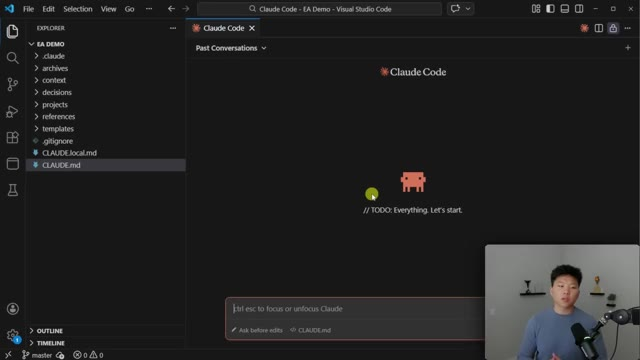
*⏱️ 00:13:17 — Interface de Visual Studio Code affichant l'explorateur de fichiers d'un projet nommé "EA DEMO" avec l'extension Claude Code active.*

---

### ⏱️ `[00:13:26 - 00:13:51]` | Segment #29

**🔊 Audio (Transcription Intégrale Mot pour Mot en Français) :**
> nous pouvons voir qu'il a ajouté des informations sur notre façon de parler. Donc des puces, tout est concis, pas de tirets cadratins, le langage interne est décontracté, et le langage externe est encore plus décontracté. Si nous allons dans les compétences, nous pouvons voir qu'il n'y a actuellement rien dedans. Il n'y a rien dans le dossier des archives. Dans le dossier de contexte, nous avons les priorités actuelles. C'est tout ce dont je viens de parler lors de notre configuration. Il indique également quand cela a été mis à jour pour la dernière fois, ce qui est bien. Nous avons nos objectifs et nos jalons, pour lesquels il est écrit de mettre à jour ce fichier au début de chaque trimestre. Donc c'est bien.

**👁️ Analyse Visuelle d'Écran (gemini-3.5-flash-lite) :**
**Interface & Outils** : Visual Studio Code

**Contenu textuel & Code** : Fichier `communication-style.md` définissant le style de communication, incluant les sections Formatting, Tone (avec Internal et External) et Pet Peeves.

**Action / Démonstration** : Le présentateur explique les règles de style de communication et de ton configurées pour l'assistant IA.

*⏱️ 00:13:32 — L'éditeur Visual Studio Code affichant le fichier de règles Markdown `communication-style.md` dans un projet Claude Code, avec une webcam du présentateur en bas à droite.*

---

### ⏱️ `[00:13:51 - 00:14:27]` | Segment #30

**🔊 Audio (Transcription Intégrale Mot pour Mot en Français) :**
> Nous avons l'objectif annuel 2026, le premier trimestre 2026, le deuxième trimestre 2026, des jalons informels. Nous avons le fichier "moi", qui va beaucoup évoluer avec le temps. Vous pouvez même lui donner des informations sur vos antécédents, où vous avez grandi, tout ce genre de choses. Et il peut utiliser tout cela pour l'adapter encore plus. Nous avons le fichier markdown de l'équipe. Donc tout ce que vous devez savoir sur certaines des personnes clés de votre organisation. Et puis nous avons le fichier work.md, qui contient des informations sur l'entreprise et la société. Dans le dossier des décisions, nous avons un journal. Donc tout événement majeur qui se produit sera enregistré ici avec la date, la décision, le raisonnement et le contexte. Nous avons nos projets, pour lesquels il a créé un dossier pour chacun d'eux. Nous avons donc la saveur chocolat pistache. Nous avons le lancement de site web.

**👁️ Analyse Visuelle d'Écran (gemini-3.5-flash-lite) :**
**Interface & Outils** : Visual Studio Code (éditeur de code).

**Contenu textuel & Code** : Fichier Markdown nommé 'me.md' contenant des détails sur l'utilisateur : nom (Jack), rôle (Freelancer), localisation (Vermont), et priorités personnelles.

**Action / Démonstration** : Consultation et présentation du fichier contextuel 'me.md' dans l'éditeur de code.

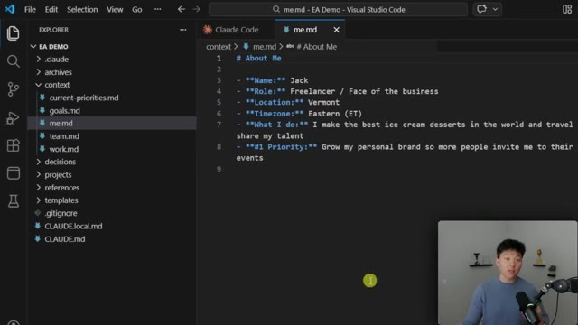
*⏱️ 00:14:00 — Visual Studio Code ouvert sur un projet avec un dossier 'context' contenant le fichier 'me.md' affichant des informations biographiques (nom, rôle, localisation, etc.).*

---

### ⏱️ `[00:14:27 - 00:15:00]` | Segment #31

**🔊 Audio (Transcription Intégrale Mot pour Mot en Français) :**
> Nous avons l'expansion sur la Côte Ouest. Nous avons les événements d'hiver. Et chacun d'eux a un fichier readme, qui est fondamentalement juste une brève description de ce que ce projet signifie réellement et du statut ou de toute autre information le concernant. Nous avons un dossier de références où nous pourrons déposer des exemples et des SOP. Il n'y a encore rien dedans. Et puis pour les modèles, nous avons aussi, vous savez, nous sommes capables d'y déposer des éléments qu'il peut référencer. Et ceci est juste un exemple de résumé de session. Il n'y a encore rien dedans pour cette session. Et puis la dernière chose à regarder ici serait le fichier claw.md. Donc plus tôt, c'était juste comme quelques lignes et c'était très basique, mais maintenant c'est adapté pour nous. Donc tu es l'assistant de direction de Jack, sois direct, concis,

**👁️ Analyse Visuelle d'Écran (gemini-3.5-flash-lite) :**
**Interface & Outils** : Visual Studio Code (éditeur de code).

**Contenu textuel & Code** : Structure de projets dans l'explorateur de fichiers, fichiers Markdown (README.md et CLAUDE.md) contenant des descriptions de projets et des instructions pour l'assistant IA.

**Action / Démonstration** : Navigation dans l'arborescence des dossiers de VS Code et consultation de fichiers Markdown de documentation et de configuration.

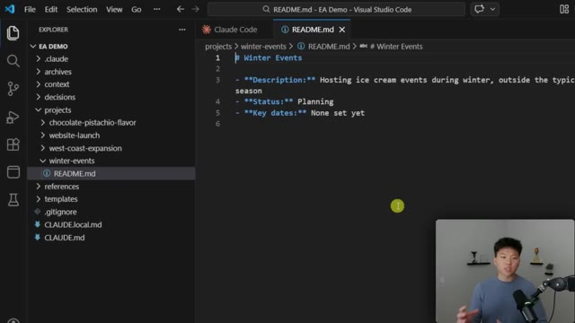
*⏱️ 00:14:35 — Visual Studio Code affichant l'explorateur de fichiers avec les dossiers projects (winter-events) et le fichier README.md ouvert.*

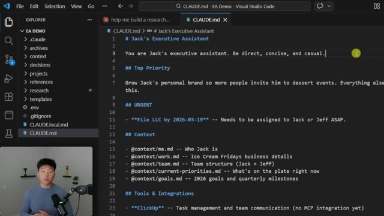
*⏱️ 00:14:51 — Visual Studio Code affichant le fichier de configuration CLAUDE.md avec des instructions pour l'assistant exécutif et le contexte des projets.*

---

### ⏱️ `[00:15:00 - 00:15:30]` | Segment #32

**🔊 Audio (Transcription Intégrale Mot pour Mot en Français) :**
> et décontracté. Voici la priorité absolue de Jack. Voici ce qui est très urgent. Cela doit être fait le plus rapidement possible. Et donc, ceci est lu à chaque fois afin de pouvoir essentiellement continuer à vérifier. Hé, est-ce que c'est fait ? est-ce que c'est fait ? Maintenant, voici quelque chose de vraiment génial, c'est que le fichier claw.md peut pointer vers les bons fichiers. Rappelez-vous donc comment j'ai dit que cela était chargé à chaque fois que vous parlez à ClaudeCode. Cela signifie que si nous y mettions toutes nos informations commerciales, toutes les informations vous concernant, vos priorités, cela ferait beaucoup de jetons. Rappelez-vous donc que tout ce que claw.md doit faire, c'est dire à ClaudeCode : hé, si tu as besoin d'informations sur les objectifs actuels, va lire ce fichier.

**👁️ Analyse Visuelle d'Écran (gemini-3.5-flash-lite) :**
**Interface & Outils** : Visual Studio Code, schéma explicatif dessiné (style tableau blanc)

**Contenu textuel & Code** : Fichier Markdown (`CLAUDE.md`) contenant le prompt système de l'assistant (« Be direct, concise, and casual », « Top Priority », « URGENT », « Context ») et schéma illustrant le chargement prioritaire.

**Action / Démonstration** : Présentation du code source et explication schématique du fonctionnement du chargement contextuel de CLAUDE.md.

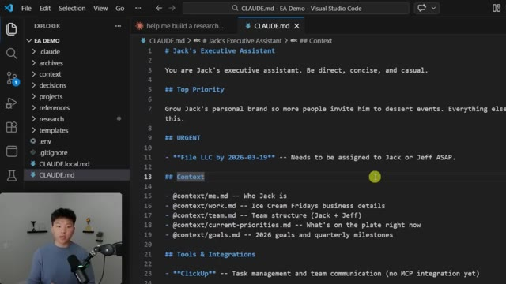
*⏱️ 00:15:07 — Visual Studio Code affichant le fichier de configuration CLAUDE.md avec des directives contextuelles pour l'assistant exécutif.*

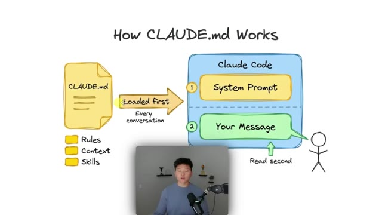
*⏱️ 00:15:15 — Schéma explicatif montrant comment le fichier CLAUDE.md est chargé en premier comme prompt système dans Claude Code.*

---

### ⏱️ `[00:15:30 - 00:15:49]` | Segment #33

**🔊 Audio (Transcription Intégrale Mot pour Mot en Français) :**
> C'est donc exactement ce que vous voyez ici. Il est dit : hé, si vous voulez comprendre qui est Jack, allez lire ceci. Si vous voulez comprendre, vous savez, les détails de l'entreprise, allez lire ceci, et ainsi de suite. C'est donc de cette façon que nous parvenons à économiser des jetons ici, tout en donnant à CloudCode toutes les informations dont il a besoin. Il indiquera également à CloudCode quels outils il a à sa disposition et comment les utiliser. Pour l'instant, nous n'avons pas vraiment configuré grand-chose.

**👁️ Analyse Visuelle d'Écran (gemini-3.5-flash-lite) :**
**Interface & Outils** : Visual Studio Code

**Contenu textuel & Code** : Fichier CLAUDE.md montrant des sections de contexte avec des liens vers d'autres fichiers comme '@context/me.md -- Who Jack is' et '@context/work.md'.

**Action / Démonstration** : Présentation de la structure des fichiers de contexte permettant d'économiser des jetons pour l'assistant IA.

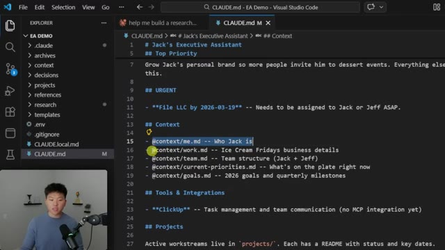
*⏱️ 00:15:35 — Vue de l'éditeur de code Visual Studio Code affichant un fichier Markdown de contexte pour un assistant exécutif, avec le présentateur en bas à gauche de l'écran.*

---

### ⏱️ `[00:15:49 - 00:16:10]` | Segment #34

**🔊 Audio (Transcription Intégrale Mot pour Mot en Français) :**
> Et des concepts similaires ici avec nos projets. Ça dit, hé, si vous voulez regarder ce projet, allez ici, ce projet, allez ici. Vous remarquerez qu'en ce moment nous en sommes à environ 87 lignes, ce qui est plutôt bien. J'essaie toujours de les garder en dessous d'environ 150, peut-être 200 maximum. C'est simplement une bonne pratique. Avec le temps, elles vont devenir de plus en plus grandes. Vous devriez donc régulièrement les condenser un peu et pointer vers d'autres fichiers lorsque c'est possible.

**👁️ Analyse Visuelle d'Écran (gemini-3.5-flash-lite) :**
**Interface & Outils** : Visual Studio Code

**Contenu textuel & Code** : Fichier Markdown (`CLAUDE.md`) affichant des sections sur le contexte, les outils et les projets en cours (comme `projects/chocolate-pistachio-flavor/`, `projects/west-coast-expansion/`, etc.).

**Action / Démonstration** : Le présentateur survole ou pointe le curseur sur une ligne du fichier Markdown pour illustrer la structure des projets.

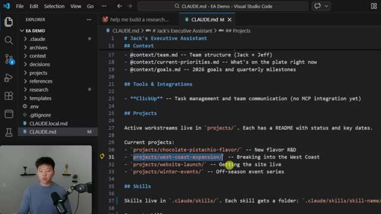
*⏱️ 00:15:54 — Capture d'écran de l'éditeur de code Visual Studio Code montrant le fichier CLAUDE.md avec une liste de projets et de liens vers différents répertoires.*

---

### ⏱️ `[00:16:10 - 00:16:37]` | Segment #35

**🔊 Audio (Transcription Intégrale Mot pour Mot en Français) :**
> Maintenant, c'est un excellent point de départ, mais à un moment donné, vous voudrez probablement ajouter d'autres fichiers par vous-même. Donc, voici ce que vous avez pour l'instant. Ce que vous pouvez voir, c'est que dans ma version Herc 2, j'en ai quelques autres. Et l'un de ceux que j'ai ajoutés et que vous voudrez probablement ajouter est celui des actifs de marque. Donc, ici, j'ai des polices, et j'ai aussi quelques images, des logos, des directives de marque, des choses comme ça. Donc, tout ce que vous auriez à faire si vous vouliez ajouter un nouveau dossier ou de nouveaux fichiers, c'est simplement de venir ici, d'ajouter un nouveau dossier, de le nommer comme vous voulez, puis de commencer une conversation avec Claude Code et de dire : hé, j'ai ajouté un dossier appelé brand-assets.

**👁️ Analyse Visuelle d'Écran (gemini-3.5-flash-lite) :**
**Interface & Outils** : Visual Studio Code (VS Code) avec l'extension ou l'interface de Claude.

**Contenu textuel & Code** : Arborescence du projet HERK-2 (dossiers .claude, archives, brand-assets, context, decisions, etc.) et une conversation avec Claude affichant des résultats de génération de visualisation, avec un champ de saisie en bas ("Ask before edits").

**Action / Démonstration** : Le présentateur montre l'arborescence personnalisée de sa version Herc 2 de l'espace de travail avec les différents dossiers de configuration et de contexte.

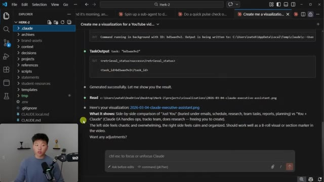
*⏱️ 00:16:17 — Vue de l'éditeur de code VS Code affichant un panneau d'interaction avec l'assistant Claude dans le volet principal et l'arborescence du projet HERK-2 dans la barre latérale gauche, avec la vidéo incrustée du présentateur en bas à gauche.*

---

### ⏱️ `[00:16:37 - 00:16:59]` | Segment #36

**🔊 Audio (Transcription Intégrale Mot pour Mot en Français) :**
> Mettez simplement à jour vos documents de compétences ou mettez à jour le fichier claw.md pour qu'il sache qu'il est là. Et ce que je vais y déposer, ce sont des logos, des portraits ou des choses de ce genre. Donc tout cela peut évidemment être personnalisé tant que le fichier claw.md le comprend. C'est donc essentiellement ainsi que notre projet est configuré. Il a maintenant une maison. Il a un peu de vie. Et passons à la phase trois, qui consiste à lui donner des mains, à le laisser réellement faire quelque chose pour nous.

**👁️ Analyse Visuelle d'Écran (gemini-3.5-flash-lite) :**
**Interface & Outils** : VS Code (éditeur de code)

**Contenu textuel & Code** : Explorateur de fichiers avec les dossiers .claude, archives, brand-assets, context, etc., et panneau de discussion montrant le résultat d'une commande et une description de visualisation.

**Action / Démonstration** : Navigation dans l'arborescence des fichiers du projet et affichage des résultats générés par l'assistant IA dans l'éditeur.

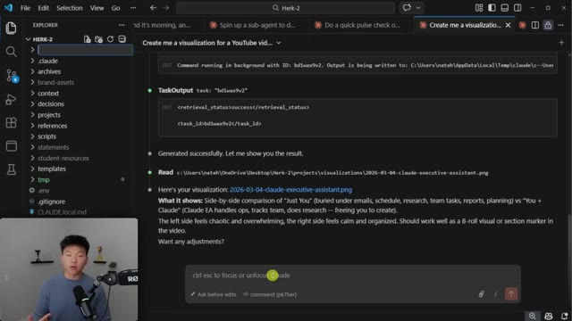
*⏱️ 00:16:42 — L'éditeur de code VS Code affichant l'explorateur de fichiers à gauche et une discussion d'assistant IA à droite avec la sortie d'une tâche et une suggestion de visualisation.*

---

### ⏱️ `[00:16:59 - 00:17:18]` | Segment #37

**🔊 Audio (Transcription Intégrale Mot pour Mot en Français) :**
> D'accord. Donc, si j'étais à votre place en train de configurer cet assistant exécutif, la première compétence que je construirais probablement est de le connecter à ClickUp ou Notion ou peu importe où vous avez votre véritable gestion de projet ou gestion des tâches. Et je ne vais pas passer par là maintenant parce que j'utilise ClickUp et je ne veux pas passer par cette configuration devant vous parce que cela pourrait ne pas s'appliquer spécifiquement à vous si vous n'utilisez pas ClickUp. Mais fondamentalement, c'est super facile.

**👁️ Analyse Visuelle d'Écran (gemini-3.5-flash-lite) :**
**Interface & Outils** : Visual Studio Code avec l'extension Claude Code

**Contenu textuel & Code** : Interface Claude Code avec le logo et la zone de saisie pour interagir avec l'assistant.

**Action / Démonstration** : Présentation de l'interface de développement de l'assistant exécutif dans VS Code.

*⏱️ 00:17:04 — Interface de VS Code affichant l'extension Claude Code avec un terminal de discussion et le présentateur en médaillon.*

---

### ⏱️ `[00:17:19 - 00:17:37]` | Segment #38

**🔊 Audio (Transcription Intégrale Mot pour Mot en Français) :**
> Vous expliquez en langage naturel exactement ce que vous voulez faire. Vous lui faites faire des recherches sur les points de terminaison ou peut-être même sur un serveur MCP. Et ensuite, tout ce que vous aurez à faire, c'est d'aller chercher une clé API et de la placer dans un fichier .env, que vous remarquerez ici, nous n'avons pas encore pour l'instant. Voici donc ce que vous feriez. Je vais passer en mode plan et je vais dire : aide-moi à créer une compétence de recherche.

**👁️ Analyse Visuelle d'Écran (gemini-3.5-flash-lite) :**
**Interface & Outils** : Visual Studio Code avec l'extension Claude Code et l'explorateur de fichiers.

**Contenu textuel & Code** : Arborescence du projet avec les dossiers .claude, archives, context, decisions, projects, references, templates, et les fichiers .gitignore, CLAUDE.local.md, CLAUDE.md. Fenêtre Claude Code active affichant le logo et un champ de saisie avec le texte « ctrl esc to focus or unfocus Claude ».

**Action / Démonstration** : Le présentateur présente l'interface de l'assistant Claude Code intégré dans l'éditeur de code pour la gestion du projet.

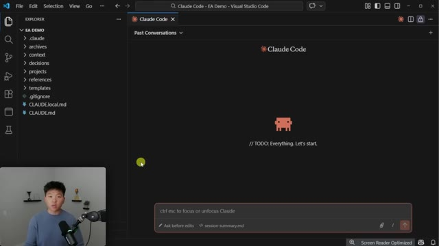
*⏱️ 00:17:23 — Interface de VS Code montrant une extension Claude Code avec une zone de discussion et l'arborescence du projet EA DEMO.*

---

### ⏱️ `[00:17:38 - 00:18:11]` | Segment #39

**🔊 Audio (Transcription Intégrale Mot pour Mot en Français) :**
> Cette compétence va utiliser Perplexity. Je dois donc vous donner ma clé API dans un fichier .env. Allez-y, créez ce fichier pour moi. Et ce que je veux que la compétence fasse, c'est m'aider à faire des recherches. C'est plus qu'une simple paire, vous savez, de recherches web et de récupérations web que vous êtes peut-être déjà capable de faire. C'est une recherche qui est un peu plus approfondie. Et elle est également adaptée à moi et à mon entreprise parce qu'elle comprend le contexte de, vous savez, ce qui se passe et de nos projets et priorités actuels. Je vais donc lancer cela en mode plan. Claude Code va y réfléchir. Il va peut-être faire un peu de recherche pour nous aider à élaborer ce plan, et ensuite il va revenir avec quelque chose. Et ce qui est plutôt cool, c'est qu'on peut voir que, tout d'abord, il explore le projet pour voir

**👁️ Analyse Visuelle d'Écran (gemini-3.5-flash-lite) :**
**Interface & Outils** : Visual Studio Code, extension ou interface Claude Code, explorateur de fichiers (dossiers .claude, archives, context, etc.)

**Contenu textuel & Code** : Zone de texte pour interagir avec Claude Code avec les options « Plan mode », « session-summary.md », et le message « // TODO: Everything. Let's start. » avec le logo de l'assistant.

**Action / Démonstration** : Le présentateur présente l'interface de travail de Claude Code dans VS Code avant de lui donner des instructions pour configurer la clé API Perplexity et créer un fichier .env.

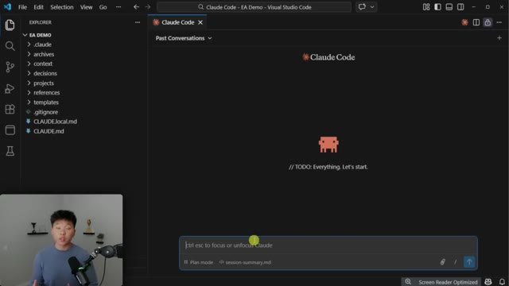
*⏱️ 00:17:46 — Interface de Claude Code intégrée dans Visual Studio Code, affichant l'explorateur de fichiers à gauche et l'onglet de discussion de l'assistant IA au centre.*

---

### ⏱️ `[00:18:11 - 00:18:46]` | Segment #40

**🔊 Audio (Transcription Intégrale Mot pour Mot en Français) :**
> comment les choses fonctionnent, et il a même lancé un sous-agent pour explorer la structure de notre projet juste ici. Et les sous-agents sont vraiment géniaux parce qu'ils ont leur propre fenêtre de contexte, et ils pourraient même être capables d'utiliser leur propre modèle si vous, vous savez, en configurez un pour le faire. Donc je vais aborder cela un peu plus en détail après avoir créé la compétence. Donc je pourrais revenir et vous poser quelques questions, ce qui est possible. Donc ici, il est dit pour Perplexity, quel modèle voulez-vous utiliser ? Et je vais simplement choisir Sonar pour l'instant et valider cela. Et maintenant, il pense que c'est bon et il est revenu avec un plan et nous pouvons voir que nous avons créer une compétence de recherche avec Perplexity. Jack veut une compétence de recherche réutilisable qui va au-delà de la recherche web basique. Il va créer le fichier .env pour notre clé API. Maintenant, la raison pour laquelle

**👁️ Analyse Visuelle d'Écran (gemini-3.5-flash-lite) :**
**Interface & Outils** : Visual Studio Code avec panneau d'extension d'assistant IA et caméra intégrée.

**Contenu textuel & Code** : Texte de prompt concernant la création d'une compétence de recherche, journal de réflexion de l'agent (« Thinking »), action du sous-agent (« Agent: Explore skill structure and env ») et commande Bash (« ls -la »).

**Action / Démonstration** : L'assistant IA analyse la structure du projet et lance un sous-agent pour explorer les fichiers et répertoires de la base de code.

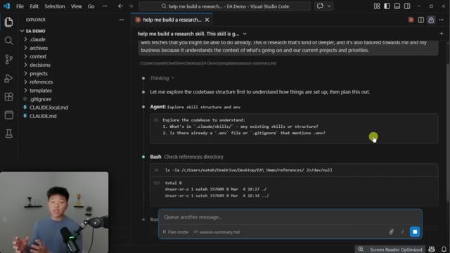
*⏱️ 00:18:20 — Interface de Visual Studio Code affichant un assistant IA en cours d'exécution avec un sous-agent explorant la structure du projet, et la webcam du présentateur en bas à gauche.*

---

### ⏱️ `[00:18:46 - 00:19:13]` | Segment #41

**🔊 Audio (Transcription Intégrale Mot pour Mot en Français) :**
> il doit faire ça, c'est parce que si vous finissez par pousser ceci vers un dépôt GitHub ou par le mettre n'importe où sur le web, la meilleure pratique est d'avoir un fichier .env, qui est l'endroit où vous avez toutes vos clés API et vous ne les donnez pas à Claude dans l'historique de conversation ici même. Il va construire la compétence elle-même. Donc nous verrons cela une fois qu'elle sera créée. Et la compétence demande à Claude de comprendre la question, de charger le contexte, donc de lire à travers moi, mon travail, mon équipe, mes priorités actuelles, mes objectifs, et tout le reste, de formuler des requêtes, d'appeler l'API Perplexity, de synthétiser, de sauvegarder le rapport, et ensuite de présenter le résumé.

**👁️ Analyse Visuelle d'Écran (gemini-3.5-flash-lite) :**
**Interface & Outils** : Visual Studio Code avec superposition d'une invite de validation de plan (Claude Code / Assistant).

**Contenu textuel & Code** : Un document Markdown décrivant les fichiers à créer, notamment un fichier `.env` pour la clé API Perplexity et la structure des dossiers de compétences (`.claude/skills/research/SKILL.md`). Un menu contextuel propose d'accepter le plan avec des options comme "Yes, and auto-accept".

**Action / Démonstration** : Le présentateur explique la structure du plan de création et la nécessité d'utiliser un fichier .env pour sécuriser les clés API avant de valider le plan.

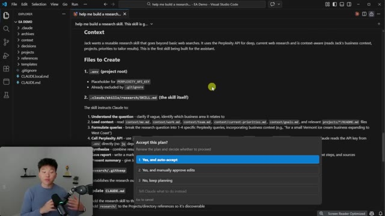
*⏱️ 00:18:53 — Capture d'écran de l'éditeur de code VS Code montrant le plan de création d'une compétence de recherche pour l'assistant, avec une boîte de dialogue proposant d'accepter le plan.*

---

### ⏱️ `[00:19:14 - 00:19:34]` | Segment #42

**🔊 Audio (Transcription Intégrale Mot pour Mot en Français) :**
> Une autre chose qui vaut la peine d'être notée, c'est que ça va également mettre à jour le Claude.md pour qu'il connaisse maintenant la compétence et sache qu'elle existe. Bref, il a regardé la documentation de l'API. Il nous a donné un format de rapport de recherche. Je vais simplement accepter automatiquement ce plan et il va commencer à le construire pour nous. Très bien, donc l'agent vient de terminer. Il a dit, voici ce que nous avons créé. Nous avons le .env, dans lequel vous pouvez aller déposer votre clé API.

**👁️ Analyse Visuelle d'Écran (gemini-3.5-flash-lite) :**
**Interface & Outils** : Visual Studio Code

**Contenu textuel & Code** : Documentation Markdown ("API Call Approach", "Research Report Format") et menu contextuel de validation d'un plan d'action ("Accept this plan?").

**Action / Démonstration** : Sélection de l'option "Yes, and auto-accept" pour valider la mise à jour de la documentation et du fichier CLAUDE.md.

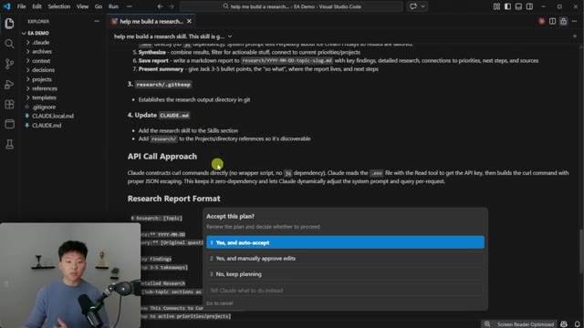
*⏱️ 00:19:19 — Vue de l'éditeur Visual Studio Code affichant un document Markdown détaillant le plan d'une compétence de recherche, avec une boîte de dialogue proposant d'accepter le plan.*

---

### ⏱️ `[00:19:34 - 00:19:54]` | Segment #43

**🔊 Audio (Transcription Intégrale Mot pour Mot en Français) :**
> Nous avons créé la compétence de recherche. Donc si je vais dans .clawd, si j'ouvre les compétences, nous pouvons voir que nous avons un dossier de recherche. Et ici, nous avons un fichier skill.md pour la recherche. Donc je ne vais pas tout lire, mais vous pouvez voir maintenant que nous avons cette compétence réelle. Et comme vous pouvez le voir, cela indique simplement, quand utiliser la compétence et comment exécuter réellement le processus, vous savez, d'appel de l'API et de création du rapport pour Jack.

**👁️ Analyse Visuelle d'Écran (gemini-3.5-flash-lite) :**
**Interface & Outils** : Éditeur de code Visual Studio Code (VS Code)

**Contenu textuel & Code** : Fichier Markdown `SKILL.md` contenant la documentation et les instructions de la compétence de recherche pour l'assistant IA.

**Action / Démonstration** : Navigation dans l'arborescence du projet et sélection du fichier `SKILL.md` pour présenter la structure de la compétence de recherche.

*⏱️ 00:19:39 — Image #1 montre l'explorateur de fichiers de VS Code avec le dossier `.claude/skills/research` développé, affichant le fichier `SKILL.md` et le récapitulatif des tâches de création de la compétence.*

*⏱️ 00:19:49 — Image #2 montre l'éditeur VS Code avec le contenu du fichier `SKILL.md` de la compétence de recherche ouvert et partiellement sélectionné, détaillant les instructions et étapes de traitement.*

---

### ⏱️ `[00:19:54 - 00:20:16]` | Segment #44

**🔊 Audio (Transcription Intégrale Mot pour Mot en Français) :**
> Et il a mis à jour le fichier Claude.md pour montrer à Claude que cette compétence existe désormais. Donc je vais aller récupérer ma clé API sur Perplexity et la coller dans le fichier .env. Comme vous pouvez le voir, je vais juste la déposer ici et ensuite l'enregistrer. D'accord, j'ai mis la clé API dedans et nous allons tester tout ça. J'ai dit : recherche des événements sur la crème glacée à Portland en utilisant la nouvelle compétence de recherche. Et ce qu'on cherche à voir ici, c'est s'il est réellement capable d'appeler cette compétence.

**👁️ Analyse Visuelle d'Écran (gemini-3.5-flash-lite) :**
**Interface & Outils** : Visual Studio Code

**Contenu textuel & Code** : Arborescence du projet avec le dossier `.claude`, `skills/research/SKILL.md`, et affichage de la liste des tâches terminées (Todos) dans l'éditeur.

**Action / Démonstration** : Visualisation des fichiers créés et des étapes validées pour la configuration de la compétence de recherche.

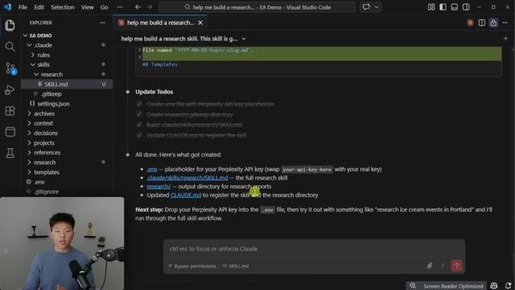
*⏱️ 00:20:00 — Capture d'écran de l'éditeur Visual Studio Code montrant l'arborescence du projet et un fichier markdown récapitulant les tâches accomplies (Update Todos) ainsi qu'un encart vidéo du présentateur en bas à gauche.*

---

### ⏱️ `[00:20:17 - 00:20:37]` | Segment #45

**🔊 Audio (Transcription Intégrale Mot pour Mot en Français) :**
> Donc il dit, OK, laissez-moi charger le contexte de projet pertinent et ensuite je vais lancer la recherche. Le contenu a été chargé. Maintenant, je vais diviser ceci et je vais appeler Perplexity. Donc ici, vous pouvez voir qu'il a fait trois recherches différentes. Il a cherché des événements de desserts glacés à Portland. Et ensuite, il a cherché le processus de candidature pour les vendeurs à Portland. Et enfin, il a cherché la scène des desserts et les connexions à Portland.

**👁️ Analyse Visuelle d'Écran (gemini-3.5-flash-lite) :**
**Interface & Outils** : Visual Studio Code, interface de chat d'assistant IA intégrée (Claude Code).

**Contenu textuel & Code** : Prompt : "research ice cream events in Portland using the new research skill", fichiers lus : `SKILL.md`, `README.md`, `.env`, message de statut : "Context loaded. Breaking this into 3 queries and hitting Perplexity."

**Action / Démonstration** : L'agent IA lit les fichiers du répertoire `.claude/skills` et charge le contexte du projet pour décomposer la recherche en trois requêtes Perplexity.

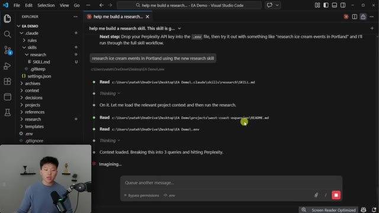
*⏱️ 00:20:22 — L'éditeur VS Code montre une session d'agent IA traitant une requête de recherche en lisant les fichiers de règles du projet avant de consulter l'API Perplexity.*

---

### ⏱️ `[00:20:37 - 00:20:57]` | Segment #46

**🔊 Audio (Transcription Intégrale Mot pour Mot en Français) :**
> Donc, il renvoie un résultat très concis, ce qui est exactement ce que nous lui avons demandé de faire selon notre façon de communiquer. Nous avons obtenu cette information, n'est-ce pas ? Mais ensuite, il indique également que j'ai enregistré le rapport complet dans ce dossier. Donc, si je vais dans « recherche », dossier qu'il vient de créer juste ici, nous pouvons voir que nous avons le rapport du 3 mars sur les événements de crèmerie à Portland.

**👁️ Analyse Visuelle d'Écran (gemini-3.5-flash-lite) :**
**Interface & Outils** : Visual Studio Code avec l'extension ou l'intégration de Claude.

**Contenu textuel & Code** : Résultat de recherche structuré avec des points clés sur les festivals à Portland, les frais de stand, les permis nécessaires, et la mention du chemin du rapport complet (`research/2026-03-04-portland-ice-cream-events.md`).

**Action / Démonstration** : Affichage de la réponse concise et structurée de l'agent IA suite au prompt de recherche.

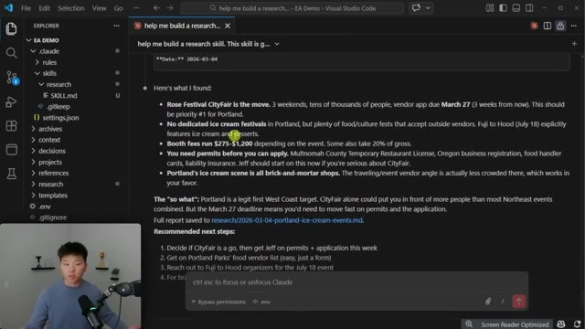
*⏱️ 00:20:42 — Vue de l'interface de VS Code montrant une conversation avec l'assistant Claude dans l'éditeur, affichant les résultats de recherche sur Portland et un lien vers un rapport complet enregistré dans un fichier Markdown.*

---

### ⏱️ `[00:20:57 - 00:21:29]` | Segment #47

**🔊 Audio (Transcription Intégrale Mot pour Mot en Français) :**
> Et c'est un fichier markdown qui contient beaucoup plus de détails sur ce qu'il a réellement trouvé en ce qui concerne ces différents événements et ces différentes choses de fournisseurs, vous savez, qui pourraient nous intéresser. Et il inclut tous les liens vers toutes les sources qu'il a réellement extraites ici. Et ce qui est génial avec ça et pourquoi vous comprenez probablement maintenant que la gestion des dossiers est si importante, c'毎回, parce que chaque fois que vous faites des recherches, chaque fois que vous générez du contenu, chaque fois que vous faites des mises à jour sur des projets, tout cela réside toujours dans ce projet, ce qui explique pourquoi il devient de plus en plus intelligent quant à ce que vous faites plus vous l'utilisez, car je pourrais fondamentalement effacer ce contexte et je pourrais reprendre exactement là où je m'étais arrêté.

**👁️ Analyse Visuelle d'Écran (gemini-3.5-flash-lite) :**
**Interface & Outils** : Visual Studio Code, extension Claude, éditeur de fichiers Markdown.

**Contenu textuel & Code** : Fichier Markdown contenant des recommandations, des étapes suivantes et une liste complète de liens URL vers des sources web de festivals à Portland.

**Action / Démonstration** : Le présentateur commente le contenu du rapport de recherche généré automatiquement par l'agent IA et visible dans l'éditeur.

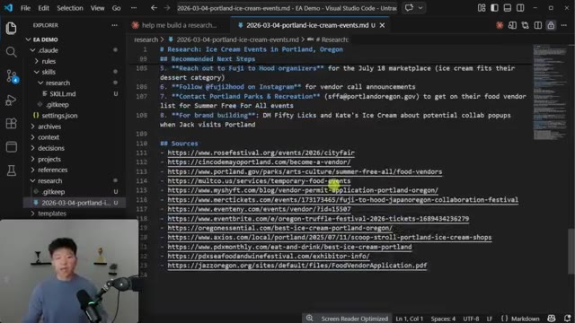
*⏱️ 00:21:05 — Visual Studio Code affichant un fichier Markdown de recherche sur les événements de crème glacée à Portland, montrant des listes de sources et de liens web.*

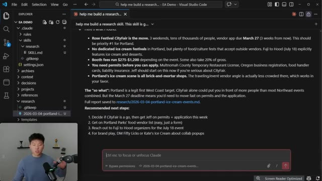
*⏱️ 00:21:13 — Visual Studio Code affichant le panneau latéral de l'assistant Claude avec le résumé du rapport de recherche et les prochaines étapes recommandées.*

---

### ⏱️ `[00:21:29 - 00:22:05]` | Segment #48

**🔊 Audio (Transcription Intégrale Mot pour Mot en Français) :**
> parce qu'il est capable d'aller lire ce fichier, ce rapport de recherche. C'était donc un rapide aperçu d'une compétence. Maintenant, il va y avoir des moments où vous pourriez réellement vouloir utiliser un sous-agent au lieu d'une compétence. Maintenant, comme vous venez de le voir dans la démo, lorsque vous parlez à l'agent et que vous appelez une compétence, il utilise fondamentalement la compétence juste ici dans cette fenêtre de contexte, avec ce modèle, avec cette conscience de la conversation. Mais un sous-agent est fondamentalement appelé par ce travailleur principal ici, et il a une mémoire fraîche, un contexte frais, et vous pouvez même utiliser un modèle différent. Donc parfois, si vous voulez faire des recherches, mais que vous voulez que ce soit moins cher, vous pourriez simplement lui dire de déléguer cela à un sous-agent, et cette recherche ou ce sous-agent pourrait peut-être utiliser Haiku au lieu d'Opus 4.6. C'est donc en quelque sorte l'avantage d'un sous-agent.

**👁️ Analyse Visuelle d'Écran (gemini-3.5-flash-lite) :**
**Interface & Outils** : Visual Studio Code (VS Code) avec l'extension Claude Code.

**Contenu textuel & Code** : Explorateur de fichiers du projet EA DEMO incluant les dossiers .claude, rules, skills, settings.json, archives, context, decisions, projects, references, research, templates, .env, .gitignore, CLAUDE.local.md, CLAUDE.md.

**Action / Démonstration** : Navigation dans l'arborescence des fichiers du projet pour montrer la structure de configuration de Claude Code et le dossier des compétences (skills).

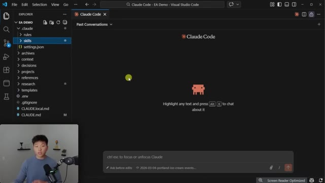
*⏱️ 00:21:38 — Interface de Visual Studio Code affichant une extension Claude Code avec un explorateur de fichiers sur le gauche montrant un dossier 'skills'.*

---

### ⏱️ `[00:22:09 - 00:22:43]` | Segment #49

**🔊 Audio (Transcription Intégrale Mot pour Mot en Français) :**
> Donc, laissez-moi vous montrer très rapidement comment cela fonctionnerait réellement. Je vais repasser en mode plan et je vais dire que j'ai besoin de créer cette compétence de recherche. Donc, en gros, tout ce que vous venez de faire avec la compétence de recherche, mais je veux créer cela en tant que sous-agent et je veux que cela utilise Haiku au lieu d'Opus, au cas où j'aurais besoin de faire des recherches moins chères. Donc, créez ce sous-agent pour moi, placez-le dans le dossier .clawed dans un dossier appelé agents. Nous avons donc maintenant le plan pour créer ce sous-agent de recherche et vous pouvez voir qu'il va utiliser model égale HiQ, et je vais simplement accepter ces changements. Donc, ce qu'il a fait, c'est qu'il a créé le

**👁️ Analyse Visuelle d'Écran (gemini-3.5-flash-lite) :**
**Interface & Outils** : Visual Studio Code / Claude Code extension

**Contenu textuel & Code** : Explorateur de fichiers avec les dossiers `.claude`, `skills`, `research`, fichiers de configuration et zone de texte pour interagir avec Claude en mode plan (Plan mode).

**Action / Démonstration** : Le présentateur se prépare à interagir avec Claude Code pour créer une compétence de recherche en mode plan.

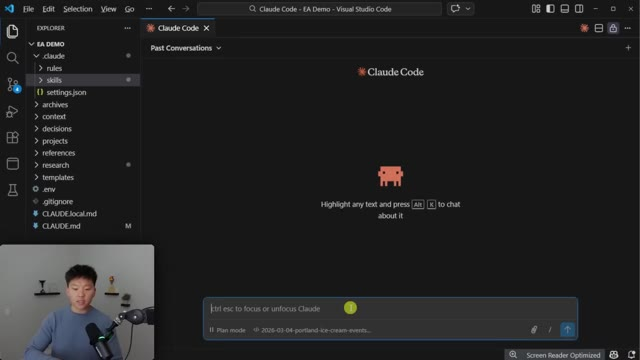
*⏱️ 00:22:17 — Interface de Visual Studio Code affichant l'extension Claude Code avec un dossier de projet EA DEMO et un champ de saisie en mode plan.*

---

### ⏱️ `[00:22:43 - 00:23:19]` | Segment #50

**🔊 Audio (Transcription Intégrale Mot pour Mot en Français) :**
> agent.md, que nous allons examiner. Et je crois qu'il a également mis à jour la compétence de recherche de sorte que si je dis que je veux que ce soit moins cher ou d'utiliser un sous-agent, la compétence de recherche va réellement invoquer le sous-agent, ce qui est plutôt cool. Et ensuite, il a également ajouté une mise à jour au fichier cloud.md, qui devrait maintenant avoir une section sur les agents. Vous pouvez voir qu'un nouveau dossier a été créé. Nous avons des agents sous notre dossier .cloud. Et ici, nous avons un agent de recherche. Donc si j'ouvre ceci, vous verrez que nous avons, tu es un agent de recherche pour Ice Cream Fridays. Tu reçois une requête de recherche, tu appelles l'API Perplexity et tu enregistres un rapport structuré. Donc j'essaie de garder cela aussi simple que possible, mais il y a quelque chose que je veux que vous remarquiez à propos de l'agent

**👁️ Analyse Visuelle d'Écran (gemini-3.5-flash-lite) :**
**Interface & Outils** : Visual Studio Code avec interface de chat Claude intégrée et caméra du présentateur.

**Contenu textuel & Code** : Fichiers listés : AGENT.md, SKILL.md, CLAUDE.md. Texte explicatif sur la création d'un sous-agent Haiku pour la recherche avec Perplexity.

**Action / Démonstration** : Visualisation de la structure des fichiers de configuration des agents et compétences pour Claude dans l'éditeur de code.

*⏱️ 00:22:52 — Capture d'écran de l'éditeur VS Code montrant l'explorateur de fichiers à gauche avec les dossiers .claude (agents, rules, skills), et dans l'éditeur principal une interface de chat Claude affichant les fichiers créés (AGENT.md, SKILL.md, CLAUDE.md) ainsi que le présentateur en bas à gauche.*

---

### ⏱️ `[00:23:19 - 00:23:42]` | Segment #51

**🔊 Audio (Transcription Intégrale Mot pour Mot en Français) :**
> et la compétence qui vient d'être créée ici. Donc celles-ci ont été créées sous forme de fichiers Markdown complets, ce qui est très bien. Mais en réalité, la façon dont nous devons configurer les deux, c'est en utilisant un en-tête YAML, parce que c'est là que nous pouvons réellement avoir la configuration. Je ne vais donc pas entrer très en détail pour l'instant sur les raisons exactes, mais de manière générale, cela permet à CloudCode de mieux comprendre ce que fait cette compétence ou cet agent, quand l'utiliser, et cela va également vous faire économiser des jetons.

**👁️ Analyse Visuelle d'Écran (gemini-3.5-flash-lite) :**
**Interface & Outils** : Navigateur web affichant la documentation de Claude Code.

**Contenu textuel & Code** : Documentation sur l'écriture de fichiers de sous-agents (Write subagent files) montrant un extrait de code YAML (`name: code-reviewer`, `description`, `tools`, `model: sonnet`) suivi d'un prompt système.

**Action / Démonstration** : Le présentateur explique la structure et la configuration des sous-agents en utilisant un en-tête YAML dans la documentation.

*⏱️ 00:23:25 — Documentation officielle de Claude Code affichant un exemple de fichier de sous-agent avec un en-tête YAML et un prompt Markdown, avec la vidéo du présentateur en incrustation en bas à gauche.*

---

### ⏱️ `[00:23:43 - 00:24:17]` | Segment #52

**🔊 Audio (Transcription Intégrale Mot pour Mot en Français) :**
> Donc, pour l'instant, je vais construire manuellement ce front matter YAML en faisant littéralement comme ça, en retournant dans notre VS Code. Et ensuite, pour la compétence, je vais simplement coller ça ici, puis changer le nom et changer la description moi-même. Et je vais faire exactement la même chose ensuite avec l'agent. Mais ce que je vous recommanderais réellement de faire dans votre projet, c'est de donner ce document à CloudCode. Vous savez, de lui donner l'exemple, de lui donner même l'URL et de dire : hé, regarde sur cette page quelle est la meilleure pratique pour créer des fichiers de sous-agents ou pour créer des fichiers de compétences, afin que chaque fois qu'il me construit un nouveau sous-agent ou qu'il me construit une nouvelle compétence, il le fasse selon les meilleures pratiques. Donc

**👁️ Analyse Visuelle d'Écran (gemini-3.5-flash-lite) :**
**Interface & Outils** : Visual Studio Code, Navigateur web (Documentation Claude Code)

**Contenu textuel & Code** : Fichiers Markdown avec configuration d'agent et de compétences pour Claude Code (fichiers AGENT.md et SKILL.md), et documentation sur les sous-agents.

**Action / Démonstration** : Le créateur montre la structure des fichiers de configuration pour les sous-agents et compétences dans un projet d'automatisation IA.

*⏱️ 00:23:51 — VS Code ouvert avec deux fenêtres en parallèle affichant les fichiers AGENT.md et SKILL.md pour un agent de recherche.*

*⏱️ 00:24:00 — Documentation officielle de Claude Code affichant une page sur la création de sous-agents avec un exemple de frontmatter YAML.*

---

### ⏱️ `[00:24:17 - 00:24:50]` | Segment #53

**🔊 Audio (Transcription Intégrale Mot pour Mot en Français) :**
> vraiment la raison pour laquelle je vous ai montré ça et le point que j'essaye de faire valoir ici, c'est que CloudCode est intelligent, mais il est beaucoup plus intelligent si vous le laissez faire ses propres recherches et ensuite sauvegarder ces recherches afin qu'à l'avenir tout s'améliore de plus en plus. Donc maintenant vous pouvez voir que j'ai mis à jour à la fois l'agent et la compétence avec le front matter YAML. Et maintenant ça va fonctionner beaucoup mieux. Ça fonctionnerait quand même de l'autre côté, mais croyez-moi, ça va juste vous faire économiser des jetons et vous obtiendrez probablement des résultats plus cohérents. Très bien. Donc maintenant allons-y et testons cela. Je vais effacer cette conversation. Et je vais dire, j'ai besoin que tu fasses quelques recherches très rapides pour moi. Je veux garder celle-ci bon marché. Alors utilise simplement l'agent de recherche et découvre, tu sais,

**👁️ Analyse Visuelle d'Écran (gemini-3.5-flash-lite) :**
**Interface & Outils** : Visual Studio Code (VS Code).

**Contenu textuel & Code** : Fichiers Markdown avec du code/prompts système : "Research Agent" (instructions pour utiliser Perplexity API) et "Research Skill" (méthode d'exécution, conditions d'utilisation et délégation à un sous-agent Haiku).

**Action / Démonstration** : Édition de la configuration des agents et des compétences (skills) du projet pour structurer la recherche automatisée par l'IA.

*⏱️ 00:24:26 — Capture d'écran de l'éditeur VS Code montrant deux fichiers Markdown ouverts côte à côte : "AGENT.md" définissant le comportement d'un agent de recherche et "SKILL.md" détaillant les conventions API et l'utilisation de la compétence de recherche.*

---

### ⏱️ `[00:24:50 - 00:25:13]` | Segment #54

**🔊 Audio (Transcription Intégrale Mot pour Mot en Français) :**
> Comment se passent les événements de crème glacée à Los Angeles. Très bien. Donc c'est plutôt cool. Il a lu grâce à la compétence de recherche. Il a lu grâce à l'agent de recherche, et ensuite il a aussi lu à travers mes plans. Donc il a dit, hé, Jack veut une recherche rapide et bon marché sur LA. Cela se lie directement à la priorité d'expansion sur la côte Ouest. Donc maintenant il a tout ce contexte. Il appelle l'agent de recherche avec le modèle Haiku, et maintenant il va aller de l'avant et faire cette recherche pour nous.

**👁️ Analyse Visuelle d'Écran (gemini-3.5-flash-lite) :**
**Interface & Outils** : Visual Studio Code (éditeur de code avec extension de chat IA)

**Contenu textuel & Code** : Prompt utilisateur demandant une recherche rapide et bon marché sur les événements de crème glacée à Los Angeles, ainsi que les étapes de lecture de compétences ('Read SKILL.md') et de création de plan.

**Action / Démonstration** : L'assistant lit les fichiers de compétences et de plans pour formuler une stratégie de recherche.

*⏱️ 00:24:55 — Interface de Visual Studio Code affichant un panneau de chat avec Claude exécutant une requête sur les événements de crème glacée à Los Angeles, avec la vidéo du présentateur en bas à gauche.*

---

### ⏱️ `[00:25:13 - 00:25:46]` | Segment #55

**🔊 Audio (Transcription Intégrale Mot pour Mot en Français) :**
> Très bien, super, cette recherche est faite. Si j'ouvre le dossier de recherche, vous pouvez voir que juste ici, nous avons notre rapport de Los Angeles sur des trucs de crème glacée. Donc gardez à l'esprit que le rapport de recherche est toujours vraiment bon. Il a toujours beaucoup de sources. Il a toujours beaucoup de détails. Ce n'était pas la recherche qui était moins bonne, c'était juste que lorsque toutes ces données brutes ont été renvoyées à Claude Code, il utilisait Haiku pour les résumer et pour rédiger ce fichier MD au lieu de laisser faire Opus. D'accord, nous avons donc configuré notre assistant de direction, nous avons donné des informations sur nous et notre entreprise, nous l'avons connecté à une compétence et à un agent, et maintenant la phase quatre consiste essentiellement à le laisser grandir. Maintenant, je pourrais

**👁️ Analyse Visuelle d'Écran (gemini-3.5-flash-lite) :**
**Interface & Outils** : Visual Studio Code

**Contenu textuel & Code** : Fichier Markdown (`2026-03-04-los-angeles-ice-cream-scene.md`) affichant une liste de sources web (liens URL vers des articles et rapports sur l'événementiel et le marché de la crème glacée à Los Angeles).

**Action / Démonstration** : Présentation du dossier de recherche et des sources collectées dans l'éditeur de code.

*⏱️ 00:25:21 — Vue de l'éditeur Visual Studio Code montrant un fichier Markdown contenant des sources de recherche sur la crème glacée à Los Angeles, avec la webcam du présentateur en bas à gauche.*

---

### ⏱️ `[00:25:46 - 00:26:05]` | Segment #56

**🔊 Audio (Transcription Intégrale Mot pour Mot en Français) :**
> passer par d'autres exemples étape par étape avec vous les gars, mais en réalité, il s'agit de le personnaliser pour votre pile technique, votre système de gestion de projet, votre équipe et votre façon de travailler. Donc avec mon assistant Cloud Code ici, parce que j'ai tous ces agents différents maintenant et ces règles différentes et ces compétences différentes, c'est simplement parce que j'utilise ceci tous les jours au lieu d'utiliser genre Cloud ou ChatGPT sur le web.

**👁️ Analyse Visuelle d'Écran (gemini-3.5-flash-lite) :**
**Interface & Outils** : Visual Studio Code (VS Code) avec une extension ou un panneau d'assistant IA intégré.

**Contenu textuel & Code** : Texte de dialogue avec l'assistant IA, affichage de sorties de tâches (TaskOutput), liens vers des fichiers image générés ("2026-03-04-claude-executive-assistant.png") et champ de saisie de prompt.

**Action / Démonstration** : L'assistant IA a exécuté une commande en arrière-plan, généré une visualisation graphique (comparaison "Just You" vs "You + Claude") et affiche le résultat textuel et visuel dans l'éditeur.

*⏱️ 00:25:55 — Capture d'écran de l'éditeur VS Code montrant l'interface d'un assistant IA (Claude Code / extension) affichant des résultats de génération de tâches et une invite de commande en bas.*

---

### ⏱️ `[00:26:05 - 00:26:25]` | Segment #57

**🔊 Audio (Transcription Intégrale Mot pour Mot en Français) :**
> Ça devient de plus en plus intelligent avec le temps. Donc là, vous êtes au premier jour et si vous utilisez ça tous les jours, d'ici un mois, ce truc va être radicalement différent. Il va y avoir beaucoup plus de documents, beaucoup plus de décisions, beaucoup plus de compétences, et ça va juste devenir de plus en plus intelligent et vous allez genre vivre là-dedans. Donc vraiment ce que je vous mettrais au défi de faire à partir de maintenant, c'est d'utiliser seulement ça. Genre juste pendant la semaine prochaine, essayez d'utiliser uniquement ça.

**👁️ Analyse Visuelle d'Écran (gemini-3.5-flash-lite) :**
**Interface & Outils** : Présentation visuelle / Schéma explicatif animé

**Contenu textuel & Code** : Texte du diagramme : "It Gets Smarter Over Time" avec les étapes Decisions, References, More Skills, et le flux en 5 étapes "Keep Building".

**Action / Démonstration** : Le présentateur explique la progression et l'évolution de l'intelligence de l'agent au fil des utilisations quotidiennes.

*⏱️ 00:26:10 — Schéma explicatif montrant l'évolution d'un assistant IA au fil du temps, passant du jour 1 (Day 1) à la semaine 4 (Week 4) en intégrant des décisions, des références et de nouvelles compétences.*

*⏱️ 00:26:20 — Diagramme en 5 étapes (Keep Building) décrivant le processus d'amélioration continue de l'assistant IA, depuis l'importation des projets jusqu'à l'intégration globale des compétences.*

---

### ⏱️ `[00:26:25 - 00:26:46]` | Segment #58

**🔊 Audio (Transcription Intégrale Mot pour Mot en Français) :**
> Prenez tous vos projets cloud, prenez tous vos GPTs personnalisés ou, vous savez, vos gems, peu importe ce que c'est, prenez ces instructions, mettez-les dans ce projet et dites, hé, transformez ceci en une compétence pour moi. Utilisez cette compétence, utilisez de nouvelles compétences. Et chaque fois que vous utilisez la compétence, dites, hé, voilà ce que je n'ai pas aimé. Voilà ce que j'ai aimé. Mettez-la à jour, vous savez, continuons simplement à l'améliorer de plus en plus. Et cette même théorie exacte s'applique à l'ensemble du système.

**👁️ Analyse Visuelle d'Écran (gemini-3.5-flash-lite) :**
**Interface & Outils** : Graphique informatif / Diapositive de présentation.

**Contenu textuel & Code** : Le schéma détaille 5 étapes : 1) Move GPTs + Projects In, 2) Start Using It, 3) Try It Here First, 4) Build Skills, 5) Force Everything In, avec une flèche de boucle « REPEAT » revenant vers l'étape 2.

**Action / Démonstration** : Présentation conceptuelle du workflow d'automatisation pour former un assistant IA aux besoins spécifiques d'une entreprise.

*⏱️ 00:26:31 — Un schéma illustré étape par étape intitulé « Keep Building » montrant le processus d'amélioration continue d'un assistant IA.*

---

### ⏱️ `[00:26:46 - 00:27:13]` | Segment #59

**🔊 Audio (Transcription Intégrale Mot pour Mot en Français) :**
> Les fichiers cloud, les fichiers de référence, les fichiers de projet, tout. Et puis comme nous l'avons mentionné tout à l'heure, mettez ceci sur GitHub, ayez un contrôle de version et assurez-vous que si vous passez à un autre ordinateur portable pour une raison quelconque, vous pouvez toujours utiliser votre assistant exécutif. Mais de toute façon, c'est tout ce que j'ai pour celui-ci. Maintenant, je suis sûr que vous êtes tous enthousiastes à l'idée de continuer à construire sur cet assistant exécutif. Donc, la suite consiste vraiment à aller maîtriser les compétences. J'ai déjà fait une vidéo complète décrivant tout cela et expliquant comment vous pouvez développer des compétences de plus en plus performantes. Alors allez regarder cette vidéo juste ici et continuez à utiliser votre assistant exécutif.

**👁️ Analyse Visuelle d'Écran (gemini-3.5-flash-lite) :**
**Interface & Outils** : Diagrammes explicatifs de type "mind map" et "process flow".

**Contenu textuel & Code** : - Image 1 : Texte "Why GitHub?" avec des blocs pour "Rollback", "Any Device", "Cloud Backup", "Branching", "Collaborate", "Portable Code".
- Image 2 : Texte "It Gets Smarter Over Time" montrant l'évolution d'un agent avec des étapes : Decisions, References, More Skills.

**Action / Démonstration** : Présentation théorique illustrée par des diagrammes pour expliquer la gestion de projet et l'évolution de l'automatisation IA.

*⏱️ 00:26:53 — Un schéma explicatif illustrant les avantages de l'utilisation de GitHub, tels que le contrôle de version, la portabilité du code, la sauvegarde cloud et la collaboration.*

*⏱️ 00:26:59 — Un schéma illustrant la progression de l'intelligence d'un agent IA au fil du temps (du jour 1 à la semaine 4) en intégrant des décisions, des références et de nouvelles compétences.*

---

