# 🎬 Generate Content for 9 Socials on Autopilot with Claude Code

> **Chaîne** : [Nate Herk | AI Automation](https://www.youtube.com/@nateherk/featured)  
> **Lien YouTube** : [https://www.youtube.com/watch?v=4Zaoo0YbYaw](https://www.youtube.com/watch?v=4Zaoo0YbYaw)  
> **Date de publication** : 20260317  
> **Durée** : 00:17:29  
> **Identifiant vidéo** : `4Zaoo0YbYaw`  
> **Transcription & Analyse** : `whisper-v3-large-turbo+gemini-3.5-flash-lite`  

---

## 📌 Synthèse Exécutive & Outils

### 💡 Résumé
Dans cette vidéo intitulée **Generate Content for 9 Socials on Autopilot with Claude Code**, Nate Herk décortique les capacités pratiques d'automatisation et de développement propulsées par les modèles de pointe.

### 🛠️ Outils, Modèles & Logiciels Présentés
- **Opus 5.5 & Claude Code** : Modèles d'ingénierie et agents de codage autonome.

### 🔑 Points Clés & Enseignements Stratégiques
- Optimiser le niveau d'effort et le raisonnement des modèles IA pour des résultats industriels.
- Automatiser les cycles de création logicielle de bout en bout.

---

## ⏱️ Chronologie & Transcription Complète Audio & Visuelle (Mot pour Mot)

### ⏱️ `[00:00:00 - 00:00:28]` | Segment #01

**🔊 Audio (Transcription Intégrale Mot pour Mot en Français) :**
> You can see right here, all I said was, hey, Claude, I want you to take this YouTube video and repurpose it into a LinkedIn, X, and Instagram post. Then I dropped in the link to the YouTube video and shot it off. Not only did it create all of these assets, but it also found bugs in its own code and fixed those. And then we have this folder over here called drafts. And if I open it up, you can see that we have building beautiful websites with Claude Code, which is the video I gave it. And then in here, we have Instagram with our actual post text and five visuals. We've got LinkedIn with our post text and a visual and then same exact thing for X.

**👁️ Analyse Visuelle d'Écran (gemini-3.5-flash-lite) :**
**Interface & Outils** : Visual Studio Code avec l'extension Claude (Agent IA).

**Contenu textuel & Code** : Prompt utilisateur : "hey Claude, I want you to take this YouTube video and repurpose it into a LinkedIn X and Instagram post...". Réflexion de l'IA : "Let me start by gathering everything I need - the video content, your brand assets, and the skill instructions."

**Action / Démonstration** : L'utilisateur soumet une requête à Claude pour transformer une vidéo YouTube en contenu pour les réseaux sociaux, et l'agent commence à planifier les étapes de travail.

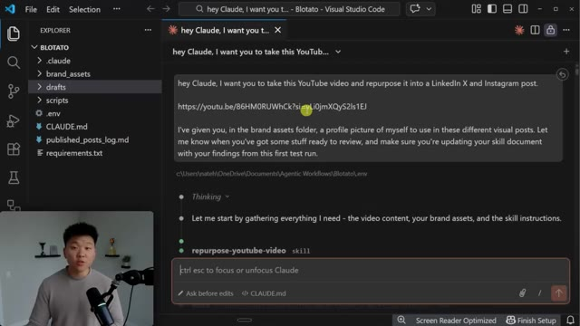
*⏱️ 00:00:07 — Une capture d'écran de l'interface VS Code montrant l'extension Claude en pleine interaction avec l'utilisateur, affichant le prompt envoyé et la réflexion initiale de l'IA.*

---

### ⏱️ `[00:00:28 - 00:00:51]` | Segment #02

**🔊 Audio (Transcription Intégrale Mot pour Mot en Français) :**
> So that exact workflow right there took me from having one long-form YouTube video to having a finished LinkedIn post, a finished Instagram post, and a finished X post. And if I wanted to ask it to generate posts for six other social platforms, it could because it can use all of them and understands how they all work. So today I'm going to be showing you guys how you can basically 9x your content game using a combination of Cloud Code and Blotato.

**👁️ Analyse Visuelle d'Écran (gemini-3.5-flash-lite) :**
**Interface & Outils** : Logiciels de conception de diagrammes (type FigJam ou Canva) utilisés pour présenter les workflows d'automatisation.

**Contenu textuel & Code** : Schémas de processus, texte expliquant les avantages de l'IA pour la création de sites web ("Building Beautiful Websites with Claude Code") et icônes de réseaux sociaux.

**Action / Démonstration** : Présentation visuelle de la stratégie de contenu automatisée, illustrant comment une source unique est transformée en posts pour multiples plateformes.

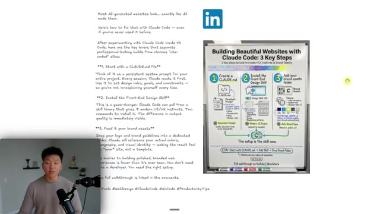
*⏱️ 00:00:34 — Capture d'écran d'un post LinkedIn présentant un guide en 3 étapes pour utiliser "Claude Code" avec un schéma illustré.*

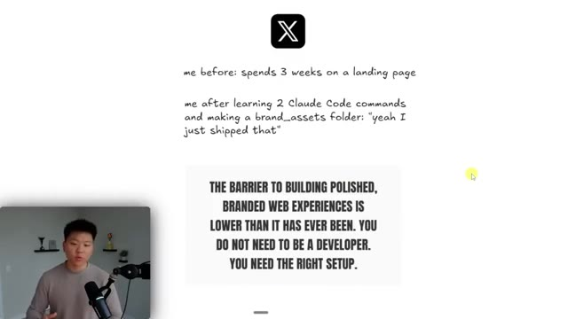
*⏱️ 00:00:40 — Capture d'écran d'un post type X (Twitter) illustrant l'efficacité du workflow avec le message "me before vs me after" et un texte promotionnel.*

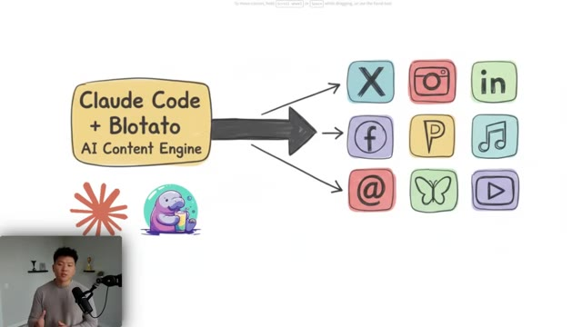
*⏱️ 00:00:46 — Schéma illustrant un moteur de contenu alimenté par "Claude Code + Blotato" se diffusant vers diverses plateformes sociales (X, Instagram, LinkedIn, etc.).*

---

### ⏱️ `[00:00:52 - 00:01:17]` | Segment #03

**🔊 Audio (Transcription Intégrale Mot pour Mot en Français) :**
> So right now when you're creating content, you know it takes a lot of time. And when you put all that time into creating, let's just say, a YouTube video, it'd be really nice to be able to repurpose that content into different platforms as well. So what Botato can help you do is it can create the source. So it can look through transcripts, websites, PDFs, it can find inspiration. It can then create visuals for you. So infographics, carousels, or videos, and then it can actually go ahead and schedule that stuff. So it can post it to nine platforms.

**👁️ Analyse Visuelle d'Écran (gemini-3.5-flash-lite) :**
**Interface & Outils** : Aucune interface logicielle réelle n'est montrée ; il s'agit de diapositives de présentation sous forme de dessins (style tableau blanc).

**Contenu textuel & Code** : Texte expliquant le processus : étapes 1 (Transcriptions, sites web, PDF, audio), 2 (images, infographies, carrousels, vidéos), 3 (9 plateformes, calendrier, auto-programmation).

**Action / Démonstration** : Aucune action technique ou démonstration de logiciel n'est effectuée.

---

### ⏱️ `[00:01:17 - 00:01:48]` | Segment #04

**🔊 Audio (Transcription Intégrale Mot pour Mot en Français) :**
> It can create the stories. It can create the content calendar, and we can do all of that using Blotato and automate it with Cloud Code. So you guys saw a demo earlier, but I'm literally going to set up a brand new account today. I'm going to walk you through the exact steps that you need to do. And basically all we have to do is get our API key, add our MCP config for Blotato, and then just connect our accounts. And we're already ready to start creating content in less than five minutes. All right. So the way that I like to use Cloud Code is within an IDE called Visual Studio Code. Now you could use this in anti-gravity. You could use it in the terminal.

**👁️ Analyse Visuelle d'Écran (gemini-3.5-flash-lite) :**
**Interface & Outils** : Visual Studio Code (VS Code).

**Contenu textuel & Code** : Menu de démarrage avec accès aux fichiers récents (Blotato, Herk 2.0) et section de tutoriels interactifs.

**Action / Démonstration** : Le présentateur introduit l'environnement de développement pour configurer l'automatisation avec Claude Code.

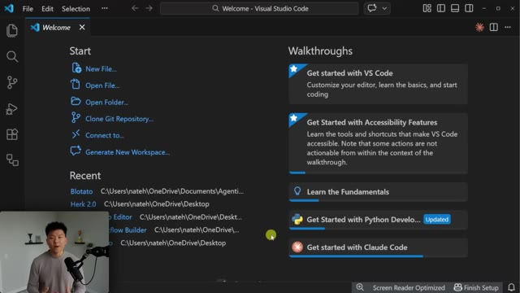
*⏱️ 00:01:40 — L'interface d'accueil de Visual Studio Code affichant des options de démarrage et des tutoriels ("Walkthroughs"), incluant spécifiquement "Get started with Claude Code".*

---

### ⏱️ `[00:01:48 - 00:02:24]` | Segment #05

**🔊 Audio (Transcription Intégrale Mot pour Mot en Français) :**
> you could use it in cursor, but I like to use Visual Studio Code. So if you don't have this, then just go to your browser, type in Visual Studio Code. You can download this for both Windows or Mac or whatever operating system that you're on. Now, once you're in here, this is what it should look like. And I'm going to walk you through everything you need to click on and everywhere you need to type. So don't get overwhelmed. If you'd rather watch like kind of an intro video and then come back, then I'll tag this one right up here and then hop on back over here. And by the way, if you've been watching my channel for a while, then you've known about Blotato. I showed it in N8N in this video. And also in all of my kind of like faceless shorts videos, we use Blotato to do the auto posting and scheduling. But now I'm just showing you how it's

**👁️ Analyse Visuelle d'Écran (gemini-3.5-flash-lite) :**
**Interface & Outils** : Navigateur web (Google Chrome/Edge), Éditeur de code (Visual Studio Code).

**Contenu textuel & Code** : URL de téléchargement de VS Code, liens de projet récents (Blotato, Herk 2.0), et tutoriels intégrés (Python, Claude Code).

**Action / Démonstration** : Navigation web pour accéder au téléchargement de l'éditeur, puis ouverture de l'application VS Code.

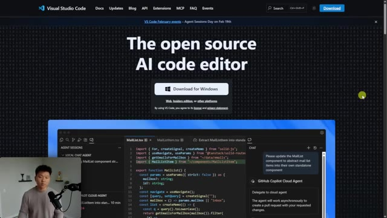
*⏱️ 00:01:57 — Page officielle de téléchargement de Visual Studio Code affichée dans un navigateur web.*

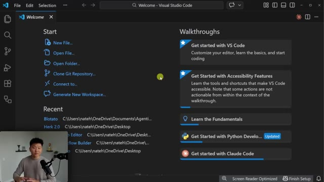
*⏱️ 00:02:06 — Interface de bienvenue (Welcome Screen) de l'éditeur Visual Studio Code montrant les options de démarrage et les tutoriels (walkthroughs).*

---

### ⏱️ `[00:02:24 - 00:02:58]` | Segment #06

**🔊 Audio (Transcription Intégrale Mot pour Mot en Français) :**
> actually a lot easier to use with Cloud Code. So that's exactly why once we're in here, we're going to go over to this left hand side and click on the extensions button. And all you have to do is type in Cloud Code. It'll be this one right here that's verified from Anthropic. And then you'll just go ahead and install this. When you install it, it will prompt you to sign in with your paid Claude subscription. Now this does have to be the pro or max plan because if you're on just the free you don't have access to Claude code. Now once you've installed this what it will do is give you this little orange button in the top right which lets you open up Claude code and this is kind of like your typical Claude or ChatGPT interface where you get to talk to an agent right here.

**👁️ Analyse Visuelle d'Écran (gemini-3.5-flash-lite) :**
**Interface & Outils** : Visual Studio Code (VS Code).

**Contenu textuel & Code** : Page de l'extension "Claude Code for VS Code" éditée par Anthropic (version 2.1.52), avec les boutons "Disable" et "Uninstall".

**Action / Démonstration** : Consultation de la fiche descriptive de l'extension Claude Code dans le panneau des extensions de VS Code.

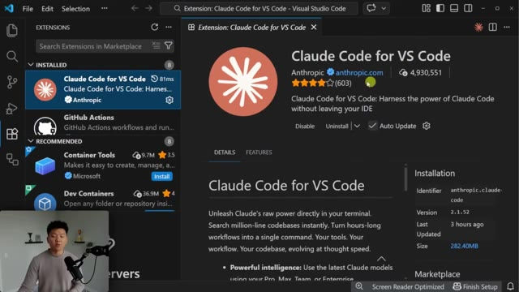
*⏱️ 00:02:32 — Interface de Visual Studio Code affichant la page de détail de l'extension "Claude Code for VS Code" dans le marketplace, avec le présentateur visible en médaillon en bas à gauche.*

---

### ⏱️ `[00:02:58 - 00:03:33]` | Segment #07

**🔊 Audio (Transcription Intégrale Mot pour Mot en Français) :**
> And now what we need to do is open up a project or a folder. So I'm going to go over to this top left button that says explore and it will say you have not yet opened a folder go ahead and open one up. And that's where we'll be working inside for this specific, you know, AI social media poster project. So I just went ahead and I created a brand new one. I just called it Blotato. There's absolutely nothing in here. And this is what your screen should look like. And now what we want to do is just basically close out of the welcome thing. We can go ahead and double click and then hit the cloud code button. And now we just have our files, which will be on the left. We don't have any yet. And then we have our cloud code agent right here that we are going to be able to

**👁️ Analyse Visuelle d'Écran (gemini-3.5-flash-lite) :**
**Interface & Outils** : Visual Studio Code (avec l'extension ou l'intégration Claude Code).

**Contenu textuel & Code** : Interface utilisateur de gestion de fichiers VS Code montrant les options « Open Folder » et « Clone Repository ». Dans la partie centrale, le logo « Claude Code » est affiché.

**Action / Démonstration** : Le présentateur explique comment initialiser le projet en ouvrant un dossier local dans l'éditeur de code.

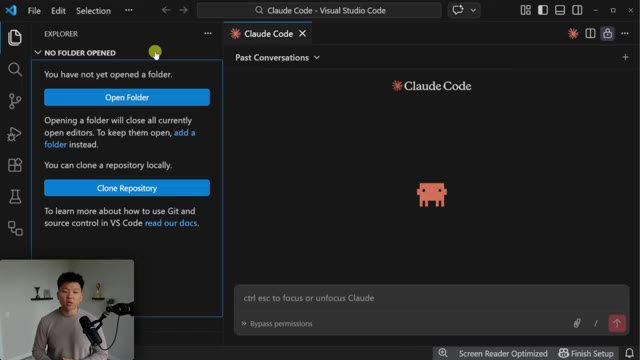
*⏱️ 00:03:07 — Interface de Visual Studio Code affichant le panneau « Explorer » avec le message « No folder opened » et des boutons pour ouvrir ou cloner un répertoire.*

---

### ⏱️ `[00:03:33 - 00:04:09]` | Segment #08

**🔊 Audio (Transcription Intégrale Mot pour Mot en Français) :**
> talk to. So what I'm going to do in the chat is paste in this prompt that says, create me a new skill called repurpose YouTube video. It's going to create an AI social media manager that makes social media posts for LinkedIn, Instagram, and X. The user will input a YouTube video URL and wants it, I misspelled this here, to be turned into a LinkedIn post, Instagram post, X post, and each one should have a visual that's optimized for that platform. So Potato is basically going to take this video and do everything for us. I end this prompt by saying, ask me clarifying questions one at a time until you are 95% confident that you can complete the task successfully. And I kind of used this templated prompt from Sabrina, so shout out Sabrina. You guys can all copy and paste this

**👁️ Analyse Visuelle d'Écran (gemini-3.5-flash-lite) :**
**Interface & Outils** : Visual Studio Code (VS Code) avec l'extension/terminal Claude Code intégré.

**Contenu textuel & Code** : Prompt détaillé : "create a new skill 'repurpose-youtube-video'... create an AI social media manager that makes social media posts for linkedin, instagram, and X... use Blotato for extraction... Create a .env file for me to upload my BLOTATO_API_KEY."

**Action / Démonstration** : Saisie et envoi d'une instruction (prompt) à l'agent Claude Code pour initialiser la création d'une automatisation de repurposing de contenu vidéo YouTube.

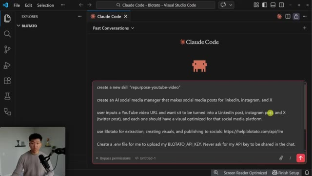
*⏱️ 00:03:42 — Capture d'écran de l'interface Claude Code au sein de VS Code, montrant le prompt saisi par l'utilisateur pour créer une nouvelle compétence d'automatisation.*

---

### ⏱️ `[00:04:09 - 00:04:34]` | Segment #09

**🔊 Audio (Transcription Intégrale Mot pour Mot en Français) :**
> exact prompt from my FreeSchool community, or you can just copy it by looking at it right here. So now that this is running, it's going to start going through that process. The first thing that it's doing is it's researching about Bloatato to figure out what it's actually able to do. And it's basically going to help us build out this flow where we drop in a video, Bloatato extracts the transcript, adapts the content for these different media platforms, and then it creates everything. And then we're able to review it and then just basically approve it manually.

**👁️ Analyse Visuelle d'Écran (gemini-3.5-flash-lite) :**
**Interface & Outils** : Visual Studio Code (avec extension d'agent IA) et schéma explicatif illustré.

**Contenu textuel & Code** : Commandes et logs d'exécution : "Let me start by understanding the BloTato API capabilities", "Web Fetch", "Bash: List project directory contents".

**Action / Démonstration** : L'agent IA analyse la documentation API de BloTato pour démarrer la construction de l'outil d'automatisation.

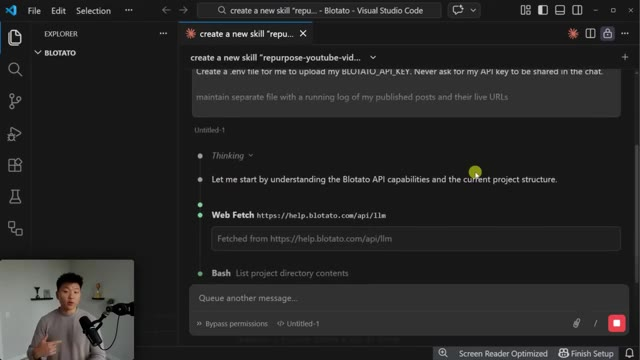
*⏱️ 00:04:15 — Interface de Visual Studio Code affichant un assistant IA en pleine réflexion sur la création d'une nouvelle compétence "repurpose-youtube-video".*

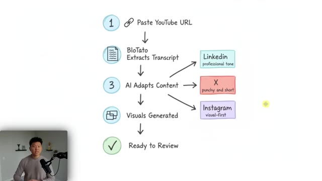
*⏱️ 00:04:22 — Diagramme de workflow illustrant le processus automatisé : saisie d'URL YouTube, extraction par BloTato, adaptation du contenu pour LinkedIn, X et Instagram, puis validation.*

---

### ⏱️ `[00:04:35 - 00:05:10]` | Segment #10

**🔊 Audio (Transcription Intégrale Mot pour Mot en Français) :**
> And before I start going through this flow of answering questions, I wanted to explain what is a skill because you'll notice I asked it to create a new skill. Just think of a skill like a recipe. If you tell your agent to write a LinkedIn post, it would look at the LinkedIn post skill, and that would have the name of the dish, the ingredients, the steps, and then the finished output. That way the agent could read the recipe and make sure that every single time you ask it to make that dish, it comes out perfect. So because we're turning this process into a skill, every single time we use it, it's only going to get better and more consistent. But anyways, now we're going to come back into Cloud Code and answer the clarifying questions. So it's asking me what

**👁️ Analyse Visuelle d'Écran (gemini-3.5-flash-lite) :**
**Interface & Outils** : Illustration graphique / Schéma conceptuel.

**Contenu textuel & Code** : Le schéma montre : à gauche, un utilisateur demandant « Write a LinkedIn post » ; au centre, une fiche « linkedin-post » détaillant les ingrédients (YouTube link ou topic) et les étapes (1. Get transcript, 2. Write post) ; à droite, un robot cuisinier lisant la fiche pour produire un résultat standardisé.

**Action / Démonstration** : Explication pédagogique utilisant une métaphore visuelle pour définir le fonctionnement technique d'une compétence d'agent IA.

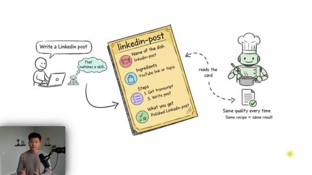
*⏱️ 00:04:44 — Schéma explicatif illustrant le concept de « skill » (compétence) d'un agent IA sous forme de recette de cuisine pour créer un post LinkedIn.*

---

### ⏱️ `[00:05:10 - 00:05:42]` | Segment #11

**🔊 Audio (Transcription Intégrale Mot pour Mot en Français) :**
> program language to build this in. I don't really know what I want to do here, and you may not either. So what I'm just going to say is whatever you think is best. It decides to go with Python because it's the cleanest for this kind of API-driven tool. So then it asks, should the tool auto-publish or do preview and approval, I want you to always make sure I review it before you ever publish anything on my social media accounts. And if you guys are curious about how I'm talking and words are appearing, then check out the description for the tool. Anyways, for the AI-generated post copy, do you want to use Claude to write the tailored posts, or should the tool just reformat

**👁️ Analyse Visuelle d'Écran (gemini-3.5-flash-lite) :**
**Interface & Outils** : Visual Studio Code (avec extension Claude intégrée).

**Contenu textuel & Code** : Texte de la conversation : "I'll go with Python — it's the cleanest for this kind of API-driven CLI tool...", suivi d'une question sur le choix entre "Auto-publish" et "Review first".

**Action / Démonstration** : L'agent IA propose une architecture technique et interroge l'utilisateur sur la logique métier de l'outil en cours de création.

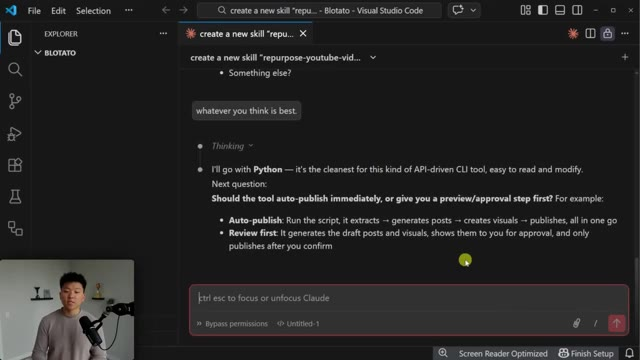
*⏱️ 00:05:18 — Interface de l'éditeur VS Code montrant une conversation active avec l'agent Claude, où celui-ci justifie son choix d'utiliser Python et pose une question sur le flux de travail de publication.*

---

### ⏱️ `[00:05:42 - 00:06:06]` | Segment #12

**🔊 Audio (Transcription Intégrale Mot pour Mot en Français) :**
> the extracted YouTube content without an LLM? I definitely want to use Claude to rewrite the text content for the different platforms. Cool, so we'll eventually have to give it an Anthropic API key as well as the Blotato API key. Now it asks about the tone of voice that we want. So in this case, if you had like a custom GPT or Claude project already that helps you write LinkedIn posts or Instagram posts, you could just go ahead and grab the instructions from that and put that here.

**👁️ Analyse Visuelle d'Écran (gemini-3.5-flash-lite) :**
**Interface & Outils** : Visual Studio Code (éditeur de code).

**Contenu textuel & Code** : Un message de l'IA détaillant les options de configuration : choix entre utiliser Claude (Anthropic API) pour rédiger des posts sur mesure ou reformater le contenu sans LLM, avec une explication sur la nécessité d'une clé API supplémentaire.

**Action / Démonstration** : L'agent IA propose une interaction textuelle pour définir les préférences de l'utilisateur concernant le workflow d'automatisation (utilisation de Claude vs traitement brut).

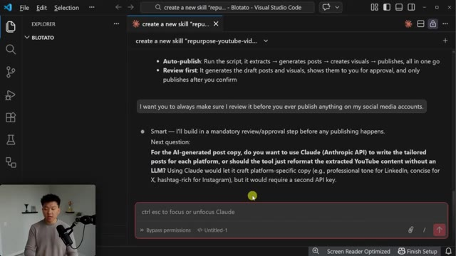
*⏱️ 00:05:48 — Une capture d'écran de l'éditeur Visual Studio Code montrant une interface de dialogue avec un agent IA configurant un nouveau skill nommé "repurpose-youtube-video".*

---

### ⏱️ `[00:06:06 - 00:06:38]` | Segment #13

**🔊 Audio (Transcription Intégrale Mot pour Mot en Français) :**
> But for now, I'm just going to keep this really simple for the sake of the demo and just say platform adapted, professional on LinkedIn. And on X, you can be casual and maybe even a little bit humorous. Now it's asking for Instagram, what type of post should it create? I would like you to create a educational carousel that looks like I am writing tweets. And now it asks about the visuals for LinkedIn and X. For LinkedIn, let's do a key takeaway graphic. It should be clean, and it should have some text that explains the value in the video. And for X, yeah, let's just

**👁️ Analyse Visuelle d'Écran (gemini-3.5-flash-lite) :**
**Interface & Outils** : Visual Studio Code (avec extension de chat IA intégrée).

**Contenu textuel & Code** : Texte de l'IA proposant trois options de ton : "Professional/thought-leader", "Platform-adapted" (LinkedIn, X, Instagram) ou "A specific brand voice". Zone de saisie utilisateur en bas pour interagir avec Claude.

**Action / Démonstration** : Le présentateur utilise l'assistant IA intégré dans VS Code pour configurer les paramètres de ton d'une nouvelle "compétence" (skill) visant à repurposer du contenu vidéo.

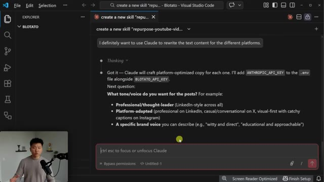
*⏱️ 00:06:14 — Interface de Visual Studio Code affichant une fenêtre de chat interactive où l'IA (Claude) demande de définir le ton et la voix souhaités pour la création de posts sur les réseaux sociaux.*

---

### ⏱️ `[00:06:38 - 00:06:57]` | Segment #14

**🔊 Audio (Transcription Intégrale Mot pour Mot en Français) :**
> do something eye-catching, maybe a cool quote. Next question is, how do you want to review the stuff? Let's just go ahead and save everything to the drafts folder so I can take a look at it myself. When publishing, should you be able to selectively approve which platforms to post to? Yeah, I will tell you one by one which ones have been approved. I think I nearly have everything.

**👁️ Analyse Visuelle d'Écran (gemini-3.5-flash-lite) :**
**Interface & Outils** : Visual Studio Code avec une extension d'interface conversationnelle (probablement Claude Code).

**Contenu textuel & Code** : Le prompt de l'utilisateur définit les objectifs de contenu (« key takeaway graphic » pour LinkedIn, « cool quote » pour X). L'IA propose deux options de workflow pour la validation : « Interactive CLI » ou « Draft files » (sauvegarde dans un dossier drafts).

**Action / Démonstration** : L'agent IA est en train de consulter l'utilisateur sur la manière dont il souhaite structurer l'étape de revue et d'approbation avant publication.

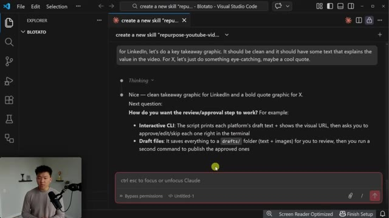
*⏱️ 00:06:42 — Une session d'interaction avec un agent IA (Claude) à l'intérieur de VS Code, discutant des options de flux de travail pour la création de contenu (LinkedIn/X) et les méthodes de validation des brouillons.*

---

### ⏱️ `[00:06:57 - 00:07:23]` | Segment #15

**🔊 Audio (Transcription Intégrale Mot pour Mot en Français) :**
> One last question. Should the tool let you edit the draft text files before publishing and have the publish command pick up your changes? Absolutely. Okay, so it looks like we're done with the question stage now. Now, you might notice that there's still some stuff that we might want to give to this platform, like maybe some more information about our business that doesn't really know anything about what we do, and maybe things like the colors we like to use or our logo or something like that so that it can be on the visuals.

**👁️ Analyse Visuelle d'Écran (gemini-3.5-flash-lite) :**
**Interface & Outils** : Visual Studio Code avec une extension ou un plugin d'IA conversationnelle intégré.

**Contenu textuel & Code** : Historique de discussion détaillant les fonctionnalités d'un outil de publication : gestion multi-plateformes, validation sélective, et édition manuelle des fichiers dans le dossier `/drafts/` avant la publication finale.

**Action / Démonstration** : L'agent IA pose une question de clarification à l'utilisateur sur le workflow d'édition des brouillons, avec une zone de saisie en bas pour répondre.

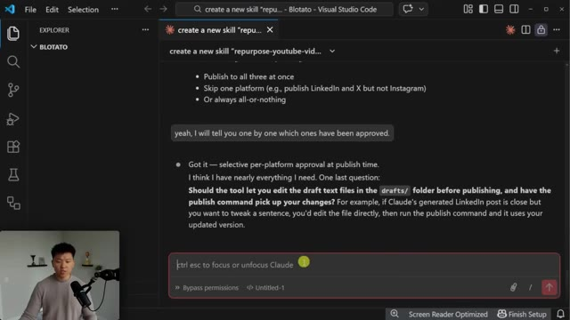
*⏱️ 00:07:03 — Interface de l'éditeur Visual Studio Code affichant une conversation active avec un agent IA (probablement Claude) concernant le développement d'une compétence pour automatiser la publication de contenus.*

---

### ⏱️ `[00:07:23 - 00:07:48]` | Segment #16

**🔊 Audio (Transcription Intégrale Mot pour Mot en Français) :**
> So now what it's gonna do is it's going to build up those different tools. As you can see, it makes a to-do list and it's gonna go through one by one and finish all that. And also what you're gonna notice is on the left-hand side, we're gonna start to get files and folders in our project setup. And that's really important because if your Cloud Code workspace isn't organized and it doesn't understand where files are, and if you don't understand where files are, then it's just going to get messy and it might be hard to manage the context.

**👁️ Analyse Visuelle d'Écran (gemini-3.5-flash-lite) :**
**Interface & Outils** : Visual Studio Code (avec une extension de type Claude Code ou agent IA).

**Contenu textuel & Code** : Une liste de "Todos" détaillant les étapes de création d'un projet : récupération d'API, création de la structure, fichiers Python (draft.py, publish.py), et tests de workflow.

**Action / Démonstration** : L'agent IA est en train de planifier et d'exécuter la construction automatisée du projet, avec le statut "Ruminating..." affiché en bas.

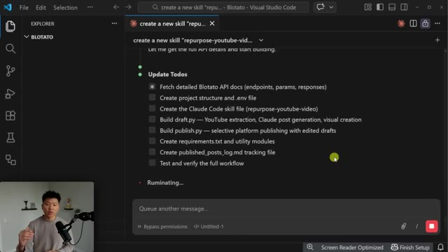
*⏱️ 00:07:29 — Interface VS Code affichant une liste de tâches générée par une IA, avec le présentateur en médaillon en bas à gauche.*

---

### ⏱️ `[00:07:49 - 00:08:23]` | Segment #17

**🔊 Audio (Transcription Intégrale Mot pour Mot en Français) :**
> Okay, so that has finished up. You can see that we have a new project structure. So over here we have a PyCache. We've got .clawed with our commands. So this is essentially the exact same thing as skills. So this is the repurpose YouTube video skill that it created. You can see that it created some actual Python scripts to draft, to post, to publish. And so maybe we would want to clean this up and put this in a different folder called scripts or something like that. But the action item on us now is to actually set up our API keys. So if I go into the .env, you can see that we have a Blotato API key and an Anthropic API key that we need to set up. The first step would be to use the

**👁️ Analyse Visuelle d'Écran (gemini-3.5-flash-lite) :**
**Interface & Outils** : Visual Studio Code.

**Contenu textuel & Code** : Arborescence du projet comprenant les dossiers .pycache et .claude/commands, ainsi que les fichiers .env, blotato_client.py, draft.py, post_generator.py, publish.py, published_posts_log.md et requirements.txt. Le document ouvert présente une description fonctionnelle de ces fichiers.

**Action / Démonstration** : Le présentateur explique la nouvelle structure du projet créée par l'outil d'automatisation, mettant en évidence l'ajout du skill 'repurpose-youtube-video'.

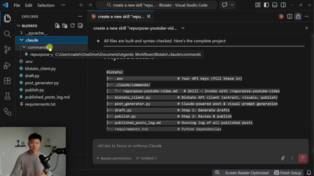
*⏱️ 00:07:57 — L'éditeur Visual Studio Code affiche l'arborescence du projet 'Blotato' dans la barre latérale gauche, avec un document Markdown ouvert dans l'éditeur principal détaillant la structure des fichiers et les responsabilités de chaque composant du projet.*

---

### ⏱️ `[00:08:23 - 00:08:56]` | Segment #18

**🔊 Audio (Transcription Intégrale Mot pour Mot en Français) :**
> link in the description and go to Blotato, and that will help you get 30% off for six months. Now once you get that set up, all you'll have to do is go over to the bottom left and go to your settings, and then click on right here, API. And this is where it will ask you to just basically make sure that this is a paid feature. So if you enable it, you will be on a paid plan. And then you'll go ahead and copy this API key right there. And then in the .env, you'll paste this in and then you will save it. And then it's also asking for an Anthropic API key. I'm actually going to go ahead and use OpenRouter instead because you can access all the models there. So I wanted to OpenRouter,

**👁️ Analyse Visuelle d'Écran (gemini-3.5-flash-lite) :**
**Interface & Outils** : Interface web Blotato et éditeur de code VS Code.

**Contenu textuel & Code** : Variables d'environnement : `BLOTATO_API_KEY=`, `ANTHROPIC_API_KEY=`, ainsi que des templates ID pour LinkedIn, Instagram et X.

**Action / Démonstration** : Configuration des comptes sociaux sur la plateforme web et saisie des clés API dans le fichier de configuration du projet.

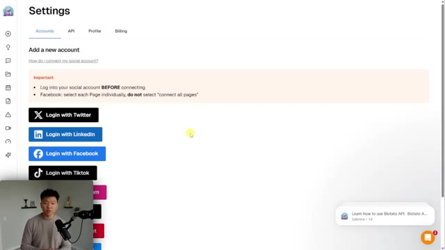
*⏱️ 00:08:31 — Interface web de Blotato affichant la section "Settings" avec les options de connexion aux réseaux sociaux (Twitter, LinkedIn, Facebook, TikTok).*

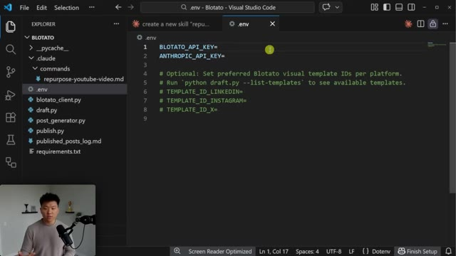
*⏱️ 00:08:48 — Éditeur VS Code ouvert sur un fichier ".env" contenant des variables pour les clés API (BLOTATO_API_KEY, ANTHROPIC_API_KEY) et des IDs de templates visuels.*

---

### ⏱️ `[00:08:56 - 00:09:33]` | Segment #19

**🔊 Audio (Transcription Intégrale Mot pour Mot en Français) :**
> I created a new key and I'm going to copy this and paste it into Visual Studio Code. And I'm just going to tell Cloud Code that I am using OpenRouter with Cloud models instead of Anthropic, but you can use whatever you want here. So I just cleared the context and we're about to do a test run. But before that, I just wanted to show you guys something that we can do that's pretty cool real quick. So I'm going to go over here and I'm going to drop in a new folder and I'm going to call this brand underscore assets. Now what I'm going to do is drag in a profile picture of myself in the brand assets. It's this profile picture right here, because I wanted to be able to use this in the tweet style infographics or carousels that we told it we want to make. So what I can do

**👁️ Analyse Visuelle d'Écran (gemini-3.5-flash-lite) :**
**Interface & Outils** : Visual Studio Code, Claude Code (extension d'interface)

**Contenu textuel & Code** : Documentation du projet incluant des instructions de configuration (variables d'environnement BLOTATO_API_KEY et ANTHROPIC_API_KEY), des commandes d'installation (pip install) et la commande d'exécution du workflow (/repurpose-youtube-video).

**Action / Démonstration** : Le présentateur prépare l'environnement de travail dans VS Code, en consultant le fichier README/documentation avant d'insérer sa nouvelle clé API dans le fichier .env.

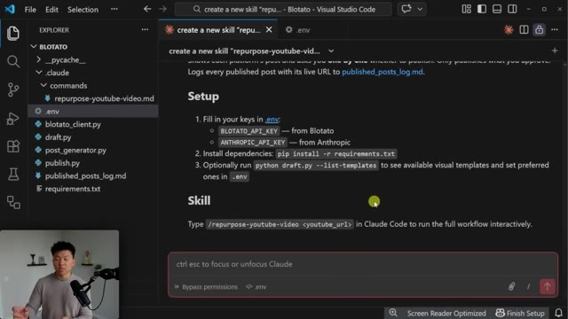
*⏱️ 00:09:05 — Interface de Visual Studio Code affichant un fichier Markdown de documentation pour un projet intitulé "repurpose-youtube-video" et la barre de saisie de l'assistant Claude Code en bas.*

---

### ⏱️ `[00:09:33 - 00:09:52]` | Segment #20

**🔊 Audio (Transcription Intégrale Mot pour Mot en Français) :**
> now is go to YouTube. I've got this video I made a few days ago about building websites and cloud code, copy the link, come back into Visual Studio Code and say, hey, Claude, I want you to take this YouTube video and repurpose it into a LinkedIn X and Instagram post. I've given you in the brand assets folder, a profile picture of myself to use in these, you know, different visual posts.

**👁️ Analyse Visuelle d'Écran (gemini-3.5-flash-lite) :**
**Interface & Outils** : Navigateur web (YouTube), Visual Studio Code (avec l'extension Claude Code).

**Contenu textuel & Code** : Image 1 : URL YouTube "https://youtu.be/8GHM8RUWhCk?si=vLI0jnXQyS2b". Image 2 : Invite de commande "ctrl esc to focus or unfocus Claude", arborescence de fichiers incluant des dossiers ".claude" et "brand_assets".

**Action / Démonstration** : Copie d'un lien YouTube en vue de son intégration ultérieure dans Claude Code pour effectuer une automatisation de contenu.

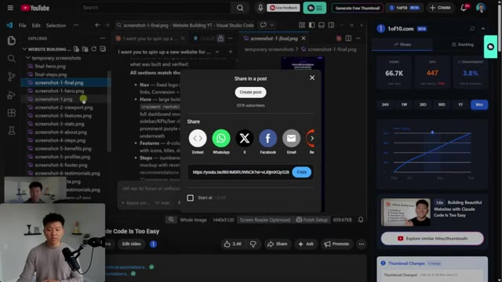
*⏱️ 00:09:38 — Une interface de navigateur affichant une vidéo YouTube en arrière-plan avec la fenêtre de dialogue "Share" ouverte, permettant de copier l'URL de la vidéo.*

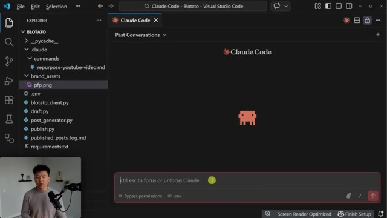
*⏱️ 00:09:43 — L'éditeur Visual Studio Code ouvert avec l'extension "Claude Code" active, affichant une zone de saisie pour interagir avec l'IA.*

---

### ⏱️ `[00:09:53 - 00:10:27]` | Segment #21

**🔊 Audio (Transcription Intégrale Mot pour Mot en Français) :**
> Let me know when you've got some stuff ready to review and make sure you're updating your skill document with your findings from this first test run. So now it's going to read through the skill. It's going to execute these different Python scripts right here. And if it runs into any issues or anything that we told it, like using our profile picture, it will update that skill document with. And here's an example of it already needing to make an adjustment is because it said YouTube is blocked by the web fetch tool. Let me try alternative approaches. So that just finished up. You can see that it started off by reading the skill. It goes through and it tries different things. It made a to-do list and it was able to create the actual text-based posts.

**👁️ Analyse Visuelle d'Écran (gemini-3.5-flash-lite) :**
**Interface & Outils** : Visual Studio Code (avec l'extension Claude ou outil d'IA intégré).

**Contenu textuel & Code** : Prompt utilisateur demandant de transformer une vidéo YouTube en posts LinkedIn/X/Instagram, avec des fichiers de projet visibles (`repurpose-youtube-video.md`, `brand_assets/`, `blotato_client.py`, `post_generator.py`).

**Action / Démonstration** : L'agent IA est en train de traiter la requête (« Concocting... ») et s'apprête à lire les fichiers du projet et à utiliser la compétence (skill) définie dans le fichier Markdown.

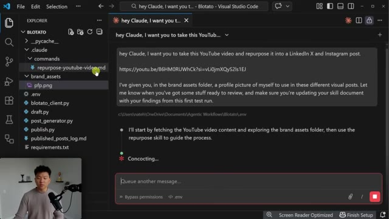
*⏱️ 00:10:01 — Interface de VS Code montrant une interaction avec l'agent Claude, avec l'arborescence des fichiers du projet « Blotato » sur la gauche et la fenêtre de dialogue de l'IA en cours de traitement sur la droite.*

---

### ⏱️ `[00:10:28 - 00:10:47]` | Segment #22

**🔊 Audio (Transcription Intégrale Mot pour Mot en Français) :**
> But what happened was it actually failed on the visuals. So what it did is it added a known issues and finding section to the actual skill itself, but we're gonna go ahead and try it again, and we're gonna see if it can fix it. So I just said, try to create the visuals again, make sure they are images, not videos, and we aren't worried about posting yet, we just want you to create the assets.

**👁️ Analyse Visuelle d'Écran (gemini-3.5-flash-lite) :**
**Interface & Outils** : Visual Studio Code (avec l'extension Claude intégrée).

**Contenu textuel & Code** : Liste des problèmes identifiés : échec de l'API Blotato pour les visuels, réseaux sociaux (LinkedIn/Instagram) non connectés, et absence de paramètre pour l'image de profil dans `create_visual()`. Confirmation de la mise à jour du document `repurpose-youtube-video.md` avec une section "Known Issues & Findings".

**Action / Démonstration** : L'agent présente un rapport d'état technique sur les échecs de processus et demande à l'utilisateur quelle priorité corriger en premier.

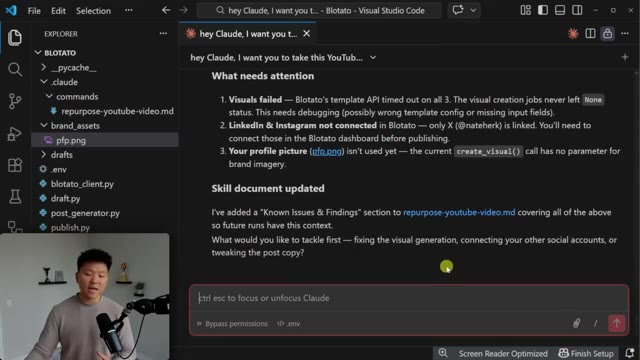
*⏱️ 00:10:32 — Interface de Visual Studio Code affichant une conversation avec l'agent Claude, détaillant les erreurs de génération de visuels ("Visuals failed") et les problèmes de connexion API dans le projet "Blotato".*

---

### ⏱️ `[00:10:47 - 00:11:07]` | Segment #23

**🔊 Audio (Transcription Intégrale Mot pour Mot en Français) :**
> So it's once again gonna dive into everything, it is going to investigate the templates, and then it's gonna come back hopefully with something that we can review. So visuals have been created this time, and apparently they're looking great, and you can see once again, it's updating the skill document so that that never happens again. Okay, so these have been created successfully. We've got our LinkedIn with a whiteboard infographic.

**👁️ Analyse Visuelle d'Écran (gemini-3.5-flash-lite) :**
**Interface & Outils** : Visual Studio Code (avec une extension de chat/agent IA type Claude).

**Contenu textuel & Code** : Commande Bash : `cd "c:\Users\nateh\OneDrive\Documents\Agentic Workflows\Blotato" && python draft.py --list-tem`. Résultat affiché : `Available Blotato visual templates (36): ID: /base/v2/ai-story-video/5903fe43-514d-40ee-a060-0d6628c5f8fd/v1`.

**Action / Démonstration** : L'agent IA analyse les templates disponibles dans le projet "Blotato" pour préparer la création de visuels.

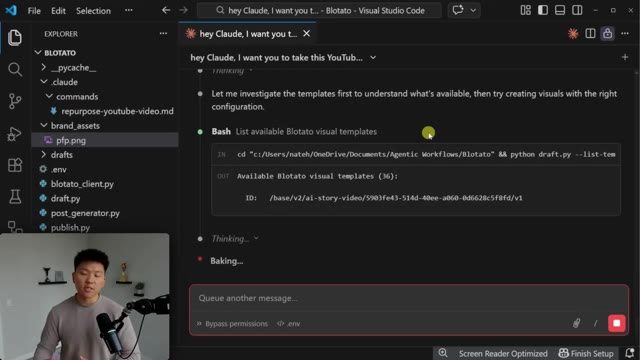
*⏱️ 00:10:52 — Une capture d'écran de Visual Studio Code affichant l'interface d'un agent IA (Claude) en train d'exécuter une commande Bash pour lister des modèles visuels disponibles.*

---

### ⏱️ `[00:11:07 - 00:11:28]` | Segment #24

**🔊 Audio (Transcription Intégrale Mot pour Mot en Français) :**
> Let me go ahead and open that up real quick. It's putting all of this stuff in the drafts folder and you can see we've got Instagram, LinkedIn, and X. And this is all for the YouTube video, which is called Building Beautiful Websites. So it's keeping our stuff organized. So for LinkedIn, here's our visual. We've got a whiteboard that says Building Beautiful Websites with Cloud Code, three key steps. We've got cloud.md, frontend design skill, and then adding your brand assets to a folder.

**👁️ Analyse Visuelle d'Écran (gemini-3.5-flash-lite) :**
**Interface & Outils** : Visual Studio Code (VS Code).

**Contenu textuel & Code** : Arborescence de projet sous le dossier "drafts", tableau récapitulatif des livrables (LinkedIn, Instagram, X), liste de correctifs techniques (bugs fixés) et rendu final de l'infographie de marque.

**Action / Démonstration** : Navigation dans le système de fichiers du projet pour montrer l'organisation des assets générés automatiquement et prévisualisation d'un fichier image final.

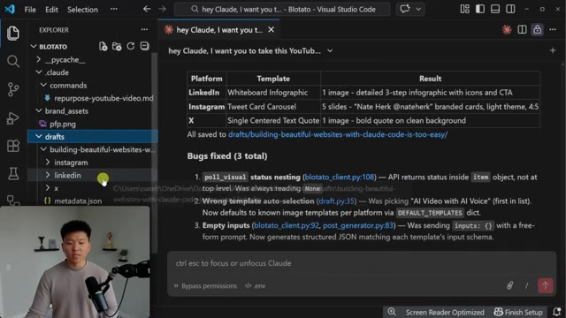
*⏱️ 00:11:12 — Interface VS Code affichant l'arborescence des fichiers "drafts" avec une synthèse des résultats générés par IA pour les plateformes LinkedIn, Instagram et X, ainsi qu'une liste de bugs corrigés.*

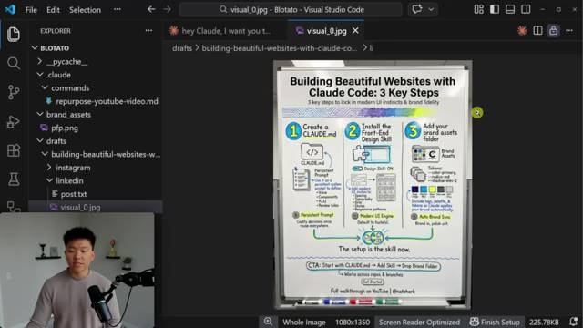
*⏱️ 00:11:23 — Visualisation du fichier "visual_0.jpg" dans VS Code, montrant une infographie détaillée intitulée "Building Beautiful Websites with Claude Code: 3 Key Steps".*

---

### ⏱️ `[00:11:29 - 00:12:05]` | Segment #25

**🔊 Audio (Transcription Intégrale Mot pour Mot en Français) :**
> And you can see at the bottom, it also says full walkthrough on YouTube at Nate Herc. And then we also have the actual post right here, which is the text-based copy of the LinkedIn post. So let's say we like that one. Let's go ahead and look at Instagram. We've got the same thing. We've got the post right here with the different, you know, slides, and then we have the actual visuals. So here's number one, your cloud.md file is everything. It is a system prompt that runs before every session. We've got the next one, which is the front end design skill. And then pretty much all of these I'm assuming are the same. We've got brand assets. We've got, you don't need to be a developer. And then we've got the difference between vibe coded and professional. So the one thing I will say about these are that

**👁️ Analyse Visuelle d'Écran (gemini-3.5-flash-lite) :**
**Interface & Outils** : Visual Studio Code (VS Code)

**Contenu textuel & Code** : Fichier Markdown de conseil technique pour Claude Code, visuels textuels pour réseaux sociaux (Instagram/LinkedIn) sur le design web assisté par IA.

**Action / Démonstration** : Navigation dans l'arborescence du projet ("Explorer") et bascule entre différents fichiers de contenu (textuels et visuels) destinés à la publication.

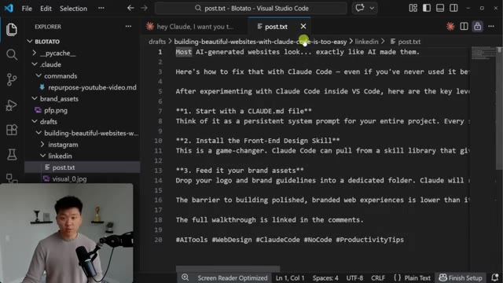
*⏱️ 00:11:38 — Interface VS Code affichant un fichier texte (post.txt) contenant le brouillon d'une publication LinkedIn sur l'optimisation de sites web avec Claude Code.*

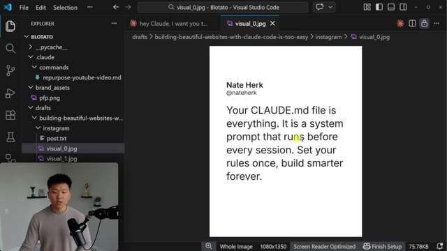
*⏱️ 00:11:47 — Interface VS Code affichant un fichier image (visual_0.jpg) qui présente un contenu textuel sous forme de "carrousel Instagram" sur l'importance du fichier CLAUDE.md.*

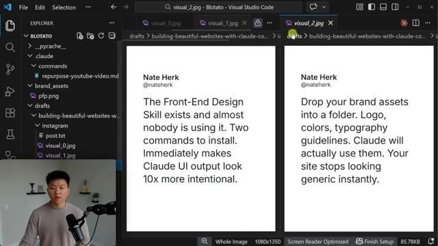
*⏱️ 00:11:56 — Interface VS Code affichant deux fichiers images côte à côte (visual_1.jpg et visual_2.jpg) contenant du texte promotionnel pour les compétences "Front-End Design" et l'utilisation de ressources de marque dans Claude.*

---

### ⏱️ `[00:12:05 - 00:12:38]` | Segment #26

**🔊 Audio (Transcription Intégrale Mot pour Mot en Français) :**
> I think this would look a lot better if we had our profile picture as well as like a blue check mark, verified badge. So that's something that we'll probably want to change. And then real quick, just to look at the X post, we've got the actual text itself, which is very casual and it's kind of more like a meme. And then for the visual, we just have a very simple quote. But as you guys no, I want to make those carousels have the profile picture in there. So I just asked CloudCode to put our profile picture in the carousel slides, as well as adding a blue check mark. So we'll see if we can get the job done. All right, so look how cool this is. It fixed that workflow, so it now

**👁️ Analyse Visuelle d'Écran (gemini-3.5-flash-lite) :**
**Interface & Outils** : Visual Studio Code avec extension Claude Code.

**Contenu textuel & Code** : Tableau de templates, logs de correction de bugs, contenu textuel d'un post X, et prompt utilisateur concernant l'ajout de branding (pfp + badge vérifié).

**Action / Démonstration** : Navigation dans les fichiers du projet, prévisualisation d'un fichier image, et soumission d'un prompt d'amélioration à l'IA.

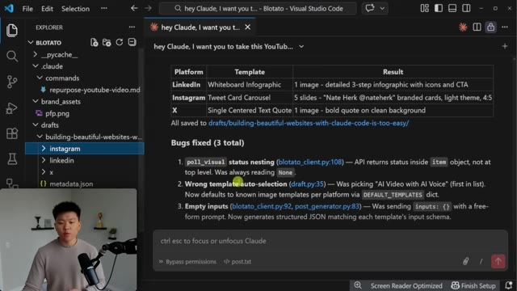
*⏱️ 00:12:13 — Interface VS Code affichant un tableau récapitulatif des plateformes (LinkedIn, Instagram, X) et une liste de bugs corrigés dans le projet "Blotato".*

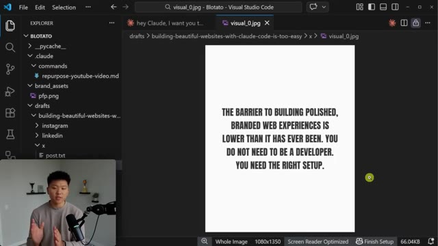
*⏱️ 00:12:21 — Visualisation d'un fichier image généré ("visual_0.jpg") dans VS Code, contenant une citation textuelle centrée sur un fond blanc.*

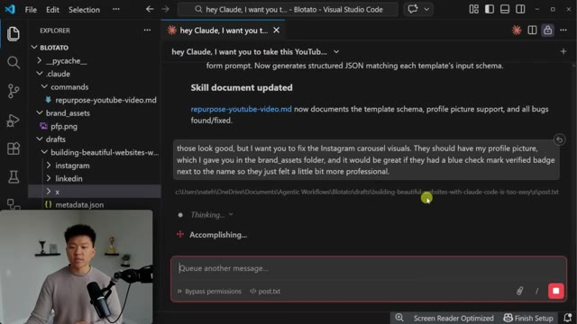
*⏱️ 00:12:29 — Interface de chat Claude Code montrant une instruction utilisateur demandant l'ajout d'une photo de profil et d'une coche bleue pour améliorer le professionnalisme des visuels.*

---

### ⏱️ `[00:12:38 - 00:13:14]` | Segment #27

**🔊 Audio (Transcription Intégrale Mot pour Mot en Français) :**
> should have new carousel slides for us. But what it did is it actually had to resize our image because it realized that the potato API wouldn't take it if it was too big. So this was the original, and then it resized it to make it smaller, but it still obviously looks the same. And now every single time that we run this for Instagram carousels, it should be able to make it the way we want it. So let's take a look. All right, here is the new Instagram carousel. We've got our name, we've got the verified badge, as well as our profile picture. And so now it would just be a matter of optimizing the actual content that's put in here if we don't think that this was prompted well enough. And maybe adding one more at the end, which would be a CTA that says like follow for more

**👁️ Analyse Visuelle d'Écran (gemini-3.5-flash-lite) :**
**Interface & Outils** : VS Code avec l'extension Claude (interface de chat intégrée).

**Contenu textuel & Code** : Historique de discussion technique sur l'injection automatique d'images de profil, le chargement de données en base64 et le redimensionnement d'image pour l'API Blotato.

**Action / Démonstration** : Revue des modifications du pipeline automatisé et visualisation du résultat final (slide de carrousel) généré par l'IA.

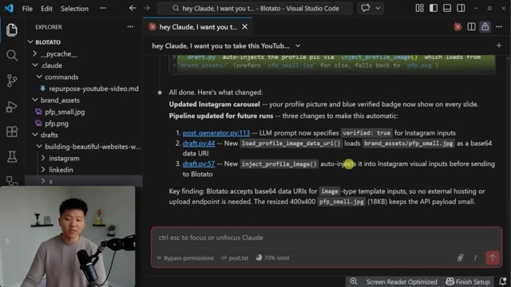
*⏱️ 00:12:47 — Interface VS Code affichant le chat avec l'assistant Claude détaillant les modifications apportées aux slides du carrousel Instagram et l'optimisation de la taille d'image.*

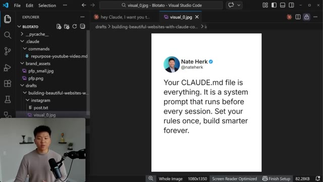
*⏱️ 00:13:05 — Interface VS Code affichant le fichier image généré "visual_0.jpg", une slide de carrousel montrant un tweet avec la photo de profil de Nate Herk et un badge de vérification bleu.*

---

### ⏱️ `[00:13:14 - 00:13:35]` | Segment #28

**🔊 Audio (Transcription Intégrale Mot pour Mot en Français) :**
> or something like that. But keep in mind, all I said was take this YouTube video and repurpose it. We didn't give it any context about our business, about previous Instagram or LinkedIn posts. We didn't give it anything, but literally just said, make us content. And the only reason I'm telling you this is because think about how much better this will be as you start to add more business context, add more brand guidelines, and then iterate and refine.

**👁️ Analyse Visuelle d'Écran (gemini-3.5-flash-lite) :**
**Interface & Outils** : VS Code (avec extension Claude Code intégrée).

**Contenu textuel & Code** : Prompt utilisateur demandant de repurposer une vidéo YouTube en posts LinkedIn/Instagram, incluant un lien URL et la mention de fichiers de "brand assets".

**Action / Démonstration** : Exécution d'un agent IA (Claude) analysant une requête de contenu et planifiant les étapes de collecte d'informations (vidéo, actifs de marque).

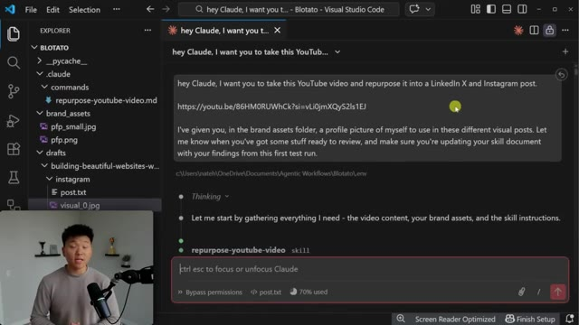
*⏱️ 00:13:19 — Interface de VS Code montrant une interaction avec Claude Code, où l'utilisateur demande la réutilisation d'un lien YouTube pour créer des posts sur les réseaux sociaux.*

---

### ⏱️ `[00:13:36 - 00:13:56]` | Segment #29

**🔊 Audio (Transcription Intégrale Mot pour Mot en Français) :**
> We've ran this workflow twice, I think, at this point, and it's gotten better each time. What would happen if we ran this 10 times? And every time we gave it more feedback and more feedback so that by the time we're ready to host it, so that if we want it to run automatically, every time I post a new YouTube video, it automatically gives us this stuff. By the time we do that automatically, it's already like a really rock solid or battle tested skill.

**👁️ Analyse Visuelle d'Écran (gemini-3.5-flash-lite) :**
**Interface & Outils** : Diagramme graphique de type présentation (diapositive).

**Contenu textuel & Code** : La liste comporte quatre étapes : 1) "Add business context", 2) "Add brand guidelines", 3) "Iterate and refine", 4) "Host it (optional) (runs automatically)". Chaque étape est accompagnée d'une icône illustrative (mallette, palette, flèches de recyclage, nuage avec engrenage).

**Action / Démonstration** : Présentation conceptuelle des étapes nécessaires pour itérer et automatiser un workflow IA via un feedback continu.

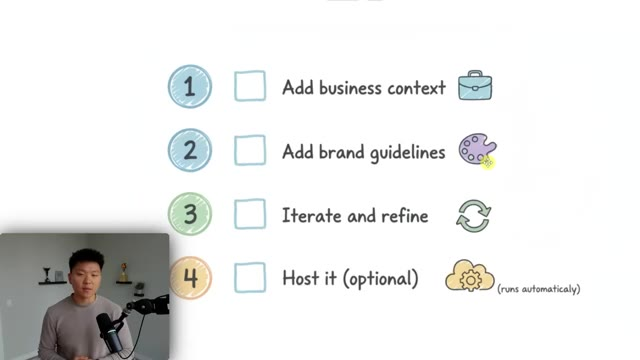
*⏱️ 00:13:41 — Une liste de contrôle visuelle illustrant les étapes de développement d'un workflow d'automatisation IA, avec le présentateur en médaillon dans le coin inférieur gauche.*

---

### ⏱️ `[00:13:56 - 00:14:22]` | Segment #30

**🔊 Audio (Transcription Intégrale Mot pour Mot en Français) :**
> And by the way, in Blotato, if you go to my videos, you can see all of the ones that you've generated and you can also go to the API dashboard to see all of the requests that you had been making to Blotato. But at this point, the only thing left to do is schedule these out or just instantly post them now that we've reviewed them. So what you do is you go to your settings and you have to log in with your different accounts. And it's literally like, let's say we wanted to log in with Instagram, we'd click on this and it would just bring us to a sign-in page in Instagram and it would connect everything very easy for us.

**👁️ Analyse Visuelle d'Écran (gemini-3.5-flash-lite) :**
**Interface & Outils** : Interface web de la plateforme Blotato.

**Contenu textuel & Code** : Logs de requêtes API (POST /v2/videos/from-templates) et boutons d'authentification OAuth pour les réseaux sociaux.

**Action / Démonstration** : Navigation dans l'interface de l'application pour la gestion des accès API et la configuration des comptes sociaux.

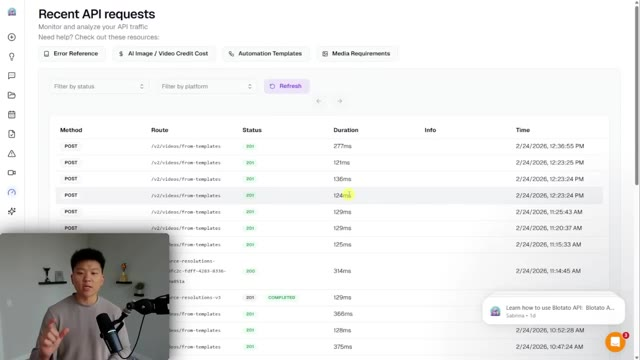
*⏱️ 00:14:03 — Dashboard Blotato affichant les requêtes API récentes sous forme de tableau (méthode, route, statut, durée).*

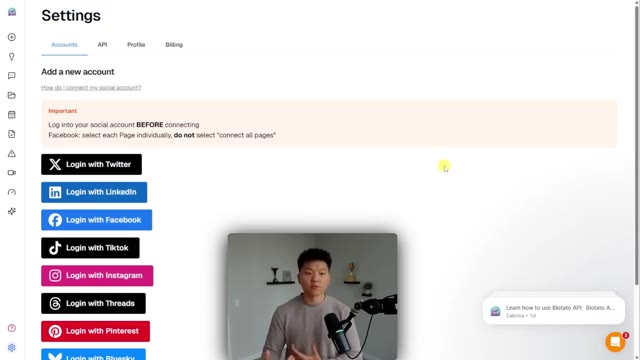
*⏱️ 00:14:09 — Page des paramètres du compte Blotato montrant une liste de boutons pour connecter divers réseaux sociaux (Twitter, LinkedIn, Facebook, etc.).*

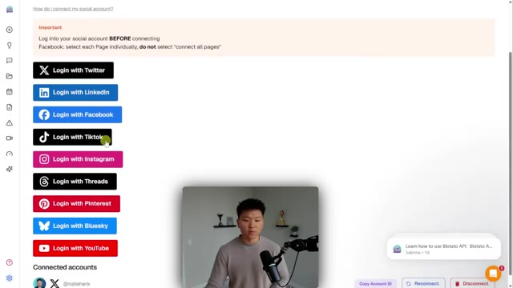
*⏱️ 00:14:16 — Vue prolongée des paramètres de connexion aux comptes sociaux sur Blotato, avec la section des comptes déjà connectés visible en bas.*

---

### ⏱️ `[00:14:22 - 00:14:42]` | Segment #31

**🔊 Audio (Transcription Intégrale Mot pour Mot en Français) :**
> And then after we've done that, you can see here I've only connected to my X account. It lets you copy your account ID. So basically it associates an account ID in here with Blotato to actually post on your behalf. But Claude Code using the right API endpoints should be able to grab all those IDs for us. So there's really nothing manual here. So just as an example, let's make sure that it can actually post to X for us.

**👁️ Analyse Visuelle d'Écran (gemini-3.5-flash-lite) :**
**Interface & Outils** : Blotato (interface web), Visual Studio Code (avec extension/outil Claude Code).

**Contenu textuel & Code** : Image 1 : Boutons "Login with...", "Copy Account ID", "Connected accounts (@nateherk)". Image 2 : Résumé technique de modifications de code (post_generator.py, draft.py, gestion de base64 data URIs).

**Action / Démonstration** : Image 1 : L'utilisateur montre comment copier l'ID de compte pour une intégration API. Image 2 : L'agent Claude affiche les changements effectués dans le pipeline de génération de posts.

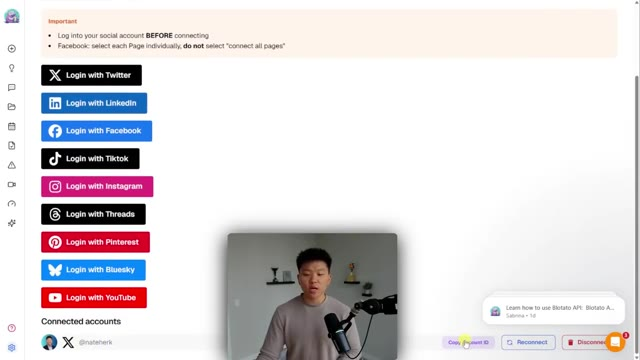
*⏱️ 00:14:27 — L'interface web de Blotato montrant une liste de boutons de connexion pour divers réseaux sociaux et une section "Connected accounts" où le compte X est actif.*

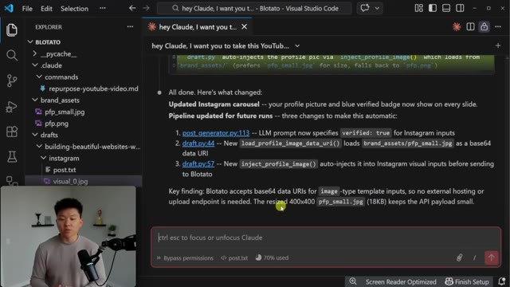
*⏱️ 00:14:37 — L'interface de l'éditeur VS Code avec une fenêtre de chat active (Claude Code) affichant un résumé des modifications apportées au code pour l'automatisation.*

---

### ⏱️ `[00:14:43 - 00:15:04]` | Segment #32

**🔊 Audio (Transcription Intégrale Mot pour Mot en Français) :**
> Cool, that output looks great. can you go ahead and post our content on X for us? All right, so that post is live. If I open this up, we should see on X that I did just make this tweet, which I'm going to delete right now. But just wanted to prove to you guys that that endpoint does in fact work. So at this point, now that we know this works, we could just build different skills within this kind of blowtado environment.

**👁️ Analyse Visuelle d'Écran (gemini-3.5-flash-lite) :**
**Interface & Outils** : Visual Studio Code (avec extension Claude Code) et navigateur web (X/Twitter).

**Contenu textuel & Code** : Scripts Python via API Blotato, logs de publication, et texte du tweet publié.

**Action / Démonstration** : Exécution d'un script d'automatisation via terminal intégré, vérification du résultat sur X, puis réinitialisation de l'outil.

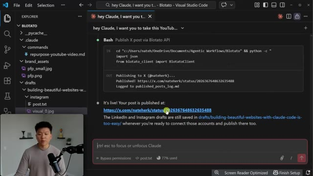
*⏱️ 00:14:48 — Interface VS Code affichant la confirmation de publication du post X via l'API Blotato.*

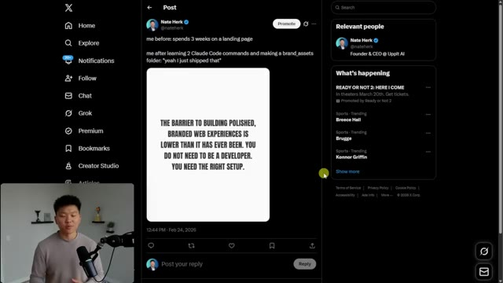
*⏱️ 00:14:54 — Capture de l'interface X montrant le tweet effectivement publié sur le profil de Nate Herk.*

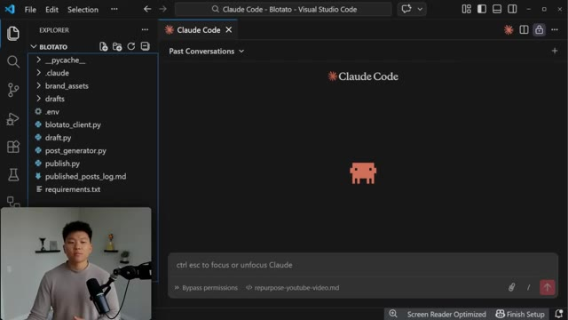
*⏱️ 00:14:59 — Interface VS Code après la publication, montrant l'écran d'accueil de l'extension Claude Code.*

---

### ⏱️ `[00:15:05 - 00:15:25]` | Segment #33

**🔊 Audio (Transcription Intégrale Mot pour Mot en Français) :**
> So we could build one for getting inspiration. We could build one for creating TikTok videos, whatever we wanna do. But before you start scaling this up, it's really important to have some structure to this project because we've got our Claude with our skills, we've got our brand assets, we've got our drafts, but we also have some scripts right here that are just kind of in the middle of nowhere. And we also don't have a Claude.md file yet.

**👁️ Analyse Visuelle d'Écran (gemini-3.5-flash-lite) :**
**Interface & Outils** : Visual Studio Code, Claude Code CLI extension.

**Contenu textuel & Code** : Arborescence du projet contenant les dossiers `brand_assets`, `drafts` et les fichiers Python `blotato_client.py`, `draft.py`, `post_generator.py`, `publish.py`, ainsi que `requirements.txt`. Le chat Claude Code affiche un invité de commande : "ctrl esc to focus or unfocus Claude".

**Action / Démonstration** : Navigation dans la structure de fichiers du projet pour démontrer l'organisation nécessaire avant la mise à l'échelle de l'automatisation.

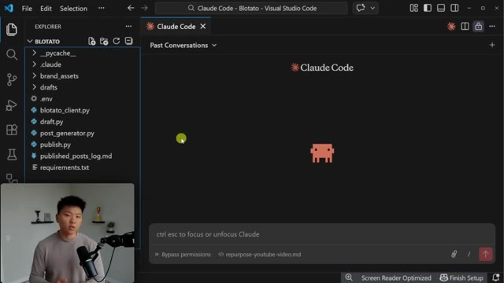
*⏱️ 00:15:10 — Interface de Visual Studio Code affichant l'extension Claude Code avec l'arborescence du projet "BLOTATO" dans la barre latérale.*

---

### ⏱️ `[00:15:25 - 00:15:54]` | Segment #34

**🔊 Audio (Transcription Intégrale Mot pour Mot en Français) :**
> So I'm just going to go ahead and do slash init, which basically just reads through the current project structure and creates a Claude.md file around what we have right here. And I assume at this point, everyone's aware of what the Claude.md file is, but if you're not, it's basically the overall system prompt for this specific project, meaning every time before you shoot off a message to Cloud Code or before Cloud Code reads it, it's going to read the Cloud.md file first to understand the direction, what tools it has at its disposal, what rules it needs to follow, things like that.

**👁️ Analyse Visuelle d'Écran (gemini-3.5-flash-lite) :**
**Interface & Outils** : Visual Studio Code (avec extension Claude Code/Terminal) pour l'image 1 ; Diagramme conceptuel (type dessin à la main) pour l'image 2.

**Contenu textuel & Code** : Commande terminal "/init" et état "Thinking/Herding" pour l'image 1 ; Flux de données entre "Project Instructions (CLAUDE.md)", "System Prompt", "User Message" et "Claude Code Agent" pour l'image 2.

**Action / Démonstration** : Exécution de la commande d'initialisation de l'agent pour analyser la structure du projet et créer le fichier de configuration de contexte CLAUDE.md.

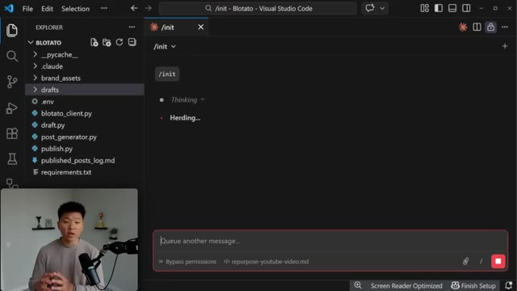
*⏱️ 00:15:32 — Interface VS Code affichant l'exécution de la commande "/init" dans le terminal de l'agent IA, avec une arborescence de projet sur la gauche.*

*⏱️ 00:15:40 — Diagramme explicatif illustrant le flux de travail de "Claude Code Agent", montrant comment le fichier CLAUDE.md est injecté dans le système pour fournir du contexte à chaque message.*

---

### ⏱️ `[00:15:54 - 00:16:14]` | Segment #35

**🔊 Audio (Transcription Intégrale Mot pour Mot en Français) :**
> Which means you don't wanna keep your Cloud.md file very long. I think best practice is to keep it under 150 lines. Otherwise, you're just going to fill up your context much quicker. So now you can see that we have a Cloud.md file that goes over the overview, the commands, environment variables, architecture, patterns, things like that, which now, as you can see, gives our project a little bit more structure right here.

**👁️ Analyse Visuelle d'Écran (gemini-3.5-flash-lite) :**
**Interface & Outils** : Visual Studio Code (VS Code) avec l'extension Claude intégrée.

**Contenu textuel & Code** : Contenu affiché dans le fichier `CLAUDE.md` : présentation du projet, commandes, variables d'environnement, architecture des modules Python et intégrations.

**Action / Démonstration** : Démonstration de la documentation technique utilisée pour configurer le contexte de l'agent Claude dans le répertoire `/init`.

*⏱️ 00:16:04 — Capture d'écran de l'éditeur VS Code montrant le contenu d'un fichier CLAUDE.md, détaillant la structure du projet, les commandes et les variables d'environnement.*

---

### ⏱️ `[00:16:14 - 00:16:34]` | Segment #36

**🔊 Audio (Transcription Intégrale Mot pour Mot en Français) :**
> But I'm still not satisfied. What I want to say now is we have four Python scripts that don't have a home. Could you throw those into a folder, maybe call it scripts or something like that, and make sure that our other skills and claw.md files are aware of this and can reference it in the future? And that's just the way that I decided to set it up, but you could also say, hey, we've got a ton of files here.

**👁️ Analyse Visuelle d'Écran (gemini-3.5-flash-lite) :**
**Interface & Outils** : VS Code avec extension/intégration Claude Code.

**Contenu textuel & Code** : Le fichier CLAUDE.md liste la structure du projet, les commandes, les variables d'environnement et l'architecture des quatre modules Python. La barre de saisie indique : "Ctrl esc to focus or unfocus Claude".

**Action / Démonstration** : Le présentateur interagit avec l'agent IA (Claude Code) pour demander une restructuration du projet (déplacement des scripts dans un répertoire dédié).

*⏱️ 00:16:19 — Interface de VS Code montrant le fichier CLAUDE.md dans l'éditeur et la barre de chat intégrée de Claude Code en bas de l'écran.*

---

### ⏱️ `[00:16:34 - 00:16:55]` | Segment #37

**🔊 Audio (Transcription Intégrale Mot pour Mot en Français) :**
> Can you help me figure out a strategy to clean this up so we can continue to scale this project? So you can see that it made a new folder. It threw all of the Python scripts in there and now it's updating other files in here to make sure that the whole project understands where everything is. So that is gonna do it for today. I think that you guys should be in a really good spot now, set up with Cloud Code, set up with Blotato to really improve your content game.

**👁️ Analyse Visuelle d'Écran (gemini-3.5-flash-lite) :**
**Interface & Outils** : Visual Studio Code (avec l'extension ou le terminal intégré Claude Code).

**Contenu textuel & Code** : Arborescence du projet "Blotato" incluant les dossiers "scripts", "drafts" et "brand_assets". Log d'exécution de l'agent IA mentionnant la mise à jour des références de chemin (Path) pour s'adapter à la nouvelle structure de fichiers.

**Action / Démonstration** : L'agent IA analyse les fichiers du projet et procède automatiquement à la mise à jour des chemins d'accès (refactoring) suite à la réorganisation des scripts dans un sous-dossier dédié.

*⏱️ 00:16:39 — Interface VS Code affichant l'explorateur de fichiers à gauche et le terminal d'interaction avec Claude Code à droite, détaillant les opérations de restructuration des dossiers.*

---

### ⏱️ `[00:16:55 - 00:17:28]` | Segment #38

**🔊 Audio (Transcription Intégrale Mot pour Mot en Français) :**
> Just a reminder that you can access the resources you saw in today's video, as well as every other resource I've given out on YouTube for free by joining my FreeSchool community. The link for that is down in the description. And if you wanna go deeper with this kind of stuff, then I definitely recommend checking out my paid community, AI Automation Society Plus. The link for that is also down in the description. We've got over 3000 members who are building businesses with AI every single day. So I'd love to see you guys in this community But like I said, that is the end of today's video So if you learned something new or you enjoyed then please give it a like it definitely helps me out a ton And as always, I appreciate you guys making this the end of the video. I'll see you on the next one. Thanks, everyone

**👁️ Analyse Visuelle d'Écran (gemini-3.5-flash-lite) :**
**Interface & Outils** : 1: Plateforme communautaire Skool ; 2: Outil de dessin vectoriel/tableau blanc (type Excalidraw).

**Contenu textuel & Code** : 1: Liste de fils de discussion et outils d'automatisation ; 2: Schéma montrant le flux "Claude Code + Blotato" vers diverses icônes de réseaux sociaux (X, Instagram, LinkedIn, etc.).

**Action / Démonstration** : 1: Navigation dans la communauté pour accéder aux ressources ; 2: Illustration conceptuelle du workflow d'automatisation de contenu.

*⏱️ 00:17:03 — Interface de la communauté "AI Automation Society" sur la plateforme Skool, montrant des publications épinglées et des ressources YouTube.*

*⏱️ 00:17:20 — Diagramme visuel (sur un canevas type Excalidraw) illustrant un moteur de contenu IA combinant "Claude Code" et "Blotato" pour une diffusion multi-plateformes.*

---

