# 🎬 Stop Learning n8n in 2026...Learn THIS Instead

> **Chaîne** : [Nate Herk | AI Automation](https://www.youtube.com/@nateherk/featured)  
> **Lien YouTube** : [https://www.youtube.com/watch?v=ZeJXI2MAhj0](https://www.youtube.com/watch?v=ZeJXI2MAhj0)  
> **Date de publication** : 20260321  
> **Durée** : 00:18:37  
> **Identifiant vidéo** : `ZeJXI2MAhj0`  
> **Transcription & Analyse** : `whisper-v3-large-turbo+gemini-3.5-flash-lite`  

---

## 📌 Synthèse Exécutive & Outils

### 💡 Résumé
Dans cette vidéo intitulée **Stop Learning n8n in 2026...Learn THIS Instead**, Nate Herk décortique les capacités pratiques d'automatisation et de développement propulsées par les modèles de pointe.

### 🛠️ Outils, Modèles & Logiciels Présentés
- **Opus 5.5 & Claude Code** : Modèles d'ingénierie et agents de codage autonome.

### 🔑 Points Clés & Enseignements Stratégiques
- Optimiser le niveau d'effort et le raisonnement des modèles IA pour des résultats industriels.
- Automatiser les cycles de création logicielle de bout en bout.

---

## ⏱️ Chronologie & Transcription Complète Audio & Visuelle (Mot pour Mot)

### ⏱️ `[00:00:00 - 00:00:34]` | Segment #01

**🔊 Audio (Transcription Intégrale Mot pour Mot en Français) :**
> A new phase for AI automations has begun. For the past few years, we've all been using the same approach, drag-and-drop platforms. NNN, Make.com, and Zapier allowed anyone to create automations in a matter of days that used to take weeks. But now, with software like CloudCode and Antigravity, anyone can build those same automations in just hours, just by describing what they want in natural language. Drag-and-drop platforms are becoming the old way of building, and it's happening faster than anyone expected. It's even estimated that 50% of enterprises will have deployed these systems by 2027. So if you're not learning how to build agentic workflows right now, in a few years, you'll be left behind. That's why today I'll tell you why this is happening,

**👁️ Analyse Visuelle d'Écran (gemini-3.5-flash-lite) :**
**Interface & Outils** : Document texte / rapport d'analyse de marché (source : CMR Berkeley).

**Contenu textuel & Code** : Texte informatif sur l'adoption de l'IA agentique ("The progression from generative to agentic AI accelerates...").

**Action / Démonstration** : Aucune, il s'agit d'une illustration textuelle statique utilisée comme référence visuelle dans la vidéo.

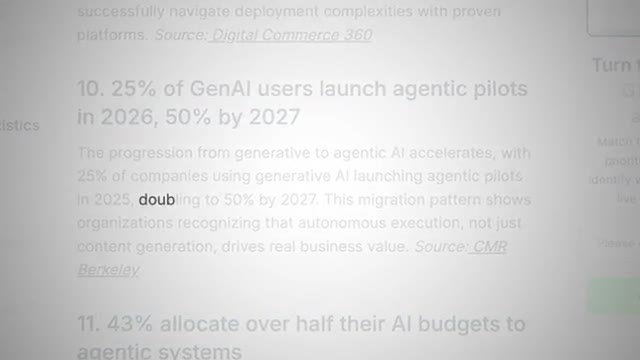
*⏱️ 00:00:25 — Une capture d'écran d'un rapport ou d'un article de recherche sur l'IA, mettant en évidence le point 10 : "25% of GenAI users launch agentic pilots in 2026, 50% by 2027".*

---

### ⏱️ `[00:00:34 - 00:01:08]` | Segment #02

**🔊 Audio (Transcription Intégrale Mot pour Mot en Français) :**
> why you should be learning how to build agentic workflows, and how to actually build one in minutes using cloud code. So let's get into it. So what exactly is changing? Well, for the past couple of years, if you wanted to build an AI automation, you'd open up something like NNN or make and you'd drag a node onto a canvas, configure it, you connect it to the next one, you pass the right variables, you'd set up your API calls, if you hit an error, you'd read the error, you'd figure out what went wrong, you'd fix it, you test it, and you would repeat that cycle until everything worked. And don't get me wrong, that was a massive leap forward. Before these tools existed, you needed to be a developer to automate pretty much anything. Tools like NNN made it possible for anyone to build real automations without writing code, and that was massive. But now Agentsic Workflows kind of

**👁️ Analyse Visuelle d'Écran (gemini-3.5-flash-lite) :**
**Interface & Outils** : n8n (outil d'automatisation de workflows).

**Contenu textuel & Code** : Schéma visuel d'automatisation incluant : "AI Agent", "Edit Fields", "OpenAI Chat Model", "Gmail", et des étapes de processus ("Connect", "Pass variables", "API call", "Error").

**Action / Démonstration** : Représentation conceptuelle du fonctionnement d'un agent IA au sein d'un workflow automatisé dans l'éditeur n8n.

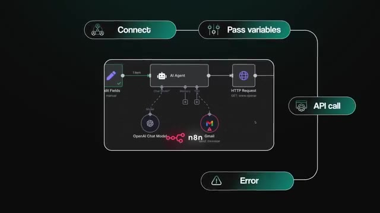
*⏱️ 00:00:51 — Capture d'écran montrant l'interface de travail n8n avec un nœud "AI Agent" connecté à divers composants comme "OpenAI Chat Model" et "Gmail". Des encadrés textuels explicatifs ("Connect", "Pass variables", "API call", "Error") entourent le workflow.*

---

### ⏱️ `[00:01:08 - 00:01:37]` | Segment #03

**🔊 Audio (Transcription Intégrale Mot pour Mot en Français) :**
> flipped that process, because instead of telling the system how to do something step by step, you're just telling it what you want. You explain where the data is coming from, what needs to happen to it, and where it should end up. And this is all natural language, because all of us are really good at explaining what we want to be taken off our plate. We just don't know exactly how to do that. Just think about it like this. If you hired a talented developer to build something for you, you wouldn't sit there dictating every line of his or her code. You'd explain the problem, you'd describe the outcome, and then you'd just say, what do you need from me? And that's exactly how agentic workflows work. You describe the destination and the system figures out the route.

**👁️ Analyse Visuelle d'Écran (gemini-3.5-flash-lite) :**
**Interface & Outils** : Logiciel de présentation graphique (Image 1) et interface de tableau de bord IA non identifiée (Image 3).

**Contenu textuel & Code** : Schéma de flux de travail "Agentic Way" (Data Source -> Process) et interface visuelle de monitoring de données.

**Action / Démonstration** : Explication théorique du flux de travail agentique dans l'image 1 ; illustration de collaboration sur une interface IA dans l'image 3.

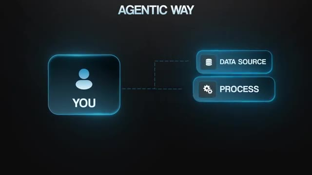
*⏱️ 00:01:15 — Un schéma conceptuel intitulé "AGENTIC WAY" montrant une icône utilisateur ("YOU") connectée à deux blocs intitulés "DATA SOURCE" et "PROCESS".*

*⏱️ 00:01:29 — Une scène générée par IA montrant deux hommes observant un écran d'ordinateur affichant une interface de tableau de bord technologique complexe.*

---

### ⏱️ `[00:01:37 - 00:01:55]` | Segment #04

**🔊 Audio (Transcription Intégrale Mot pour Mot en Français) :**
> And I'm not just speculating about something that might happen. The shift is actually here. The agentic AI market was valued at just over $5 billion in 2024. And by 2034, it's projected to hit nearly $200 billion. 96% of enterprises plan to expand their agentic AI usage this year. And by By 2028, a third of all enterprise software is expected to have agentic AI built into it.

**👁️ Analyse Visuelle d'Écran (gemini-3.5-flash-lite) :**
**Interface & Outils** : Page web d'un rapport de tendances/marché (probablement un blog d'analyse d'IA ou une étude de marché).

**Contenu textuel & Code** : Texte informatif concernant les projections du marché de l'IA agentique ("Global agentic AI market reaches $199.05 billion by 2034") et statistiques d'adoption ("96% plan to expand agentic AI usage in 2026").

**Action / Démonstration** : Lecture d'un rapport d'étude de marché sur l'IA agentique, avec mise en avant de données chiffrées pour soutenir l'argumentaire.

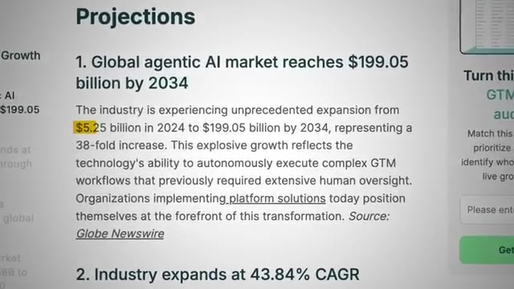
*⏱️ 00:01:41 — Capture d'écran montrant une section de rapport de marché sur la croissance projetée du marché de l'IA agentique d'ici 2034.*

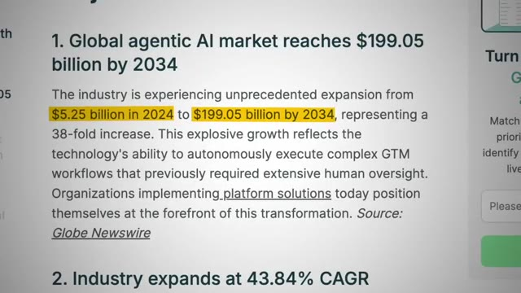
*⏱️ 00:01:46 — Capture d'écran identique à la précédente, mettant en évidence les projections financières de 5,25 milliards à 199,05 milliards de dollars.*

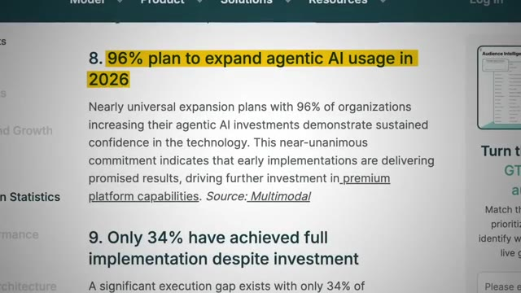
*⏱️ 00:01:51 — Capture d'écran affichant des statistiques sur l'adoption de l'IA agentique, soulignant que 96 % des organisations prévoient d'étendre leur usage.*

---

### ⏱️ `[00:01:55 - 00:02:15]` | Segment #05

**🔊 Audio (Transcription Intégrale Mot pour Mot en Français) :**
> So these aren't predictions from some random blog. This is where the money is going. And when you see numbers like that, it tells you one thing. This is the direction the entire industry is moving in. Now, if this feels sudden, it's really not. We've actually seen this pattern play out before. Think about how AI automation has evolved in waves. The first major wave was back in November of 2022 or 2023, ChatGPT. AI chatbots hit the scene and blew everybody's mind.

**👁️ Analyse Visuelle d'Écran (gemini-3.5-flash-lite) :**
**Interface & Outils** : Infographie de présentation (type diaporama).

**Contenu textuel & Code** : Texte "EVOLUTION WAVE", logo OpenAI, numérotation (1, 2) et étiquette temporelle "Nov".

**Action / Démonstration** : Présentation visuelle d'une frise chronologique illustrant l'évolution technologique dans l'industrie.

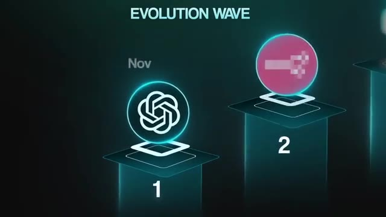
*⏱️ 00:02:10 — Une infographie animée intitulée "EVOLUTION WAVE" montrant une chronologie avec des icônes numérotées, incluant le logo OpenAI.*

---

### ⏱️ `[00:02:15 - 00:02:34]` | Segment #06

**🔊 Audio (Transcription Intégrale Mot pour Mot en Français) :**
> Suddenly, anyone could have conversation with AI. They could generate content, write poems, brainstorm ideas. and people started bolting chatbots onto everything. Websites, customer support, you name it. It was super exciting, but it was mostly conversational. It wasn't really doing work for you. The second wave was when people started combining that AI brain with automation platforms like NNN, and this wasn't just simple stuff.

**👁️ Analyse Visuelle d'Écran (gemini-3.5-flash-lite) :**
**Interface & Outils** : Interface utilisateur de type "AI Agent builder" ou bibliothèque de services.

**Contenu textuel & Code** : Liste de services/outils (non textuellement lisibles en détail à cause du flou) dans une interface de configuration.

**Action / Démonstration** : Sélection ou configuration d'un module parmi une liste de services disponibles dans l'interface.

*⏱️ 00:02:20 — Une capture d'écran d'une interface de sélection de modèles ou d'outils, organisée en colonnes avec des options listées sous forme de cartes.*

---

### ⏱️ `[00:02:34 - 00:02:53]` | Segment #07

**🔊 Audio (Transcription Intégrale Mot pour Mot en Français) :**
> This was plugging in real tools, real APIs into real workflows to classify tickets, to personalize emails, to summarize documents, take action for you. Because you could also build full AI agents inside these platforms that made decisions, referenced memory, used tools, and handled complex multi-step logic. And this was huge for the whole space. It's where most of the real value has been delivered so far.

**👁️ Analyse Visuelle d'Écran (gemini-3.5-flash-lite) :**
**Interface & Outils** : Plateforme d'automatisation de workflow (type n8n ou similaire), application de messagerie (Telegram).

**Contenu textuel & Code** : Diagrammes nodaux d'agents IA ("Ultimate Media Agent", "Posting Agent", "Email Agent"), intégrations d'API (GPT-4, Gmail, Google Drive, TikTok, Instagram, X), et historique de conversation textuelle.

**Action / Démonstration** : Démonstration visuelle de l'exécution d'un workflow complexe où l'agent traite des requêtes, accède à la mémoire, utilise des modèles LLM et interagit avec des plateformes tierces via des nœuds automatisés.

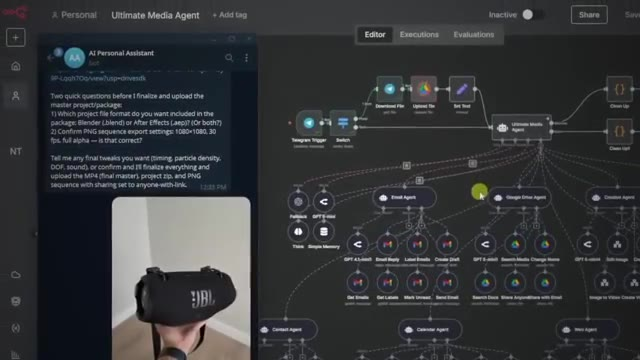
*⏱️ 00:02:44 — Interface de conception de workflow complexe montrant des agents IA interconnectés, incluant une fenêtre de chat Telegram et une arborescence d'outils (Google Drive, Email, etc.).*

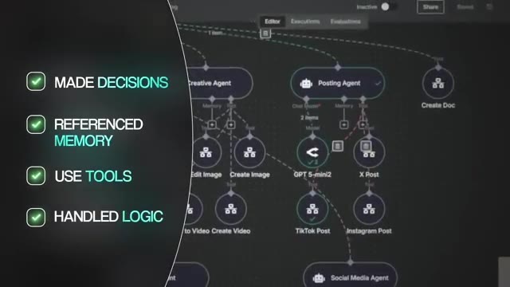
*⏱️ 00:02:48 — Zoom sur le diagramme de workflow mettant en avant les capacités de l'agent : "Made decisions", "Referenced memory", "Use tools", "Handled logic" appliquées à la gestion des réseaux sociaux.*

---

### ⏱️ `[00:02:53 - 00:03:13]` | Segment #08

**🔊 Audio (Transcription Intégrale Mot pour Mot en Français) :**
> And it's when I really got obsessed with AI automation. And that is still incredibly powerful today. But here's the thing. No matter how advanced the automation was, you were still the one building all of those advanced features. You were still dragging nodes. You were configuring API calls. You were mapping variables. You were debugging errors. And you were wiring everything together by hand. The ceiling wasn't what these systems could do, but the ceiling was how long it took you to build them.

**👁️ Analyse Visuelle d'Écran (gemini-3.5-flash-lite) :**
**Interface & Outils** : Plateforme de workflow automatisé (type n8n ou similaire).

**Contenu textuel & Code** : Nœuds de workflow : "Sales Data Agent", "GPT-4o mini", "All Rows", "Product Name Query", "Data Query", "Product ID Query", "Calculator1".

**Action / Démonstration** : Exécution d'un workflow automatisé ("Executing workflow") impliquant l'interaction d'un agent de données avec une base de données SQL.

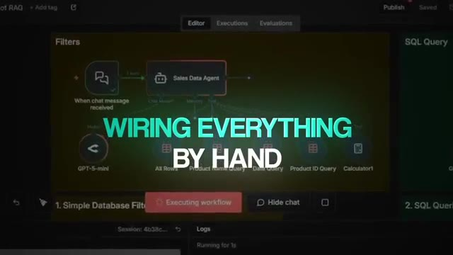
*⏱️ 00:03:08 — Interface de workflow visuel (type plateforme d'automatisation) montrant des nœuds connectés : un "Sales Data Agent", des entrées de type "Chat message", des modèles (GPT-4o mini) et des requêtes SQL, avec un texte superposé "WIRING EVERYTHING BY HAND".*

---

### ⏱️ `[00:03:13 - 00:03:36]` | Segment #09

**🔊 Audio (Transcription Intégrale Mot pour Mot en Français) :**
> And that's exactly what this third change really is. Agentic tools like CloudCode don't change exactly what you build, but they significantly change how you build it. Natural language becomes the interface. The agent handles the implementation. It connects to your tools. It writes the code. It fixes its own errors. And you focus on just clearly describing the outcome that you want. The same automation that used to take a full day to build an NNN, you can now describe in pretty much just plain English and have running in minutes.

**👁️ Analyse Visuelle d'Écran (gemini-3.5-flash-lite) :**
**Interface & Outils** : Interface graphique de présentation animée (schéma de flux de travail de l'agent IA).

**Contenu textuel & Code** : Texte affiché : "Agent", "Implementation", "Connects your tools", "Write / fix the code", "Natural language...".

**Action / Démonstration** : Représentation visuelle des capacités d'un agent IA dans le développement logiciel.

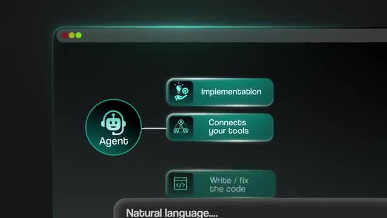
*⏱️ 00:03:24 — Un schéma animé illustrant le rôle d'un agent IA : une icône centrale connectée à trois blocs fonctionnels : "Implementation", "Connects your tools" et "Write/fix the code".*

---

### ⏱️ `[00:03:36 - 00:04:00]` | Segment #10

**🔊 Audio (Transcription Intégrale Mot pour Mot en Français) :**
> So it's one of those things where each wave didn't kill the previous wave. It was just a stepping stone. Chatbots are still alive. They still work. They still provide value. I still build traditional AI workflows. and traditional AI agents, but each wave made you way more productive. So we're seeing this massive shift right now. But here's the question. Why are people actually making the switch? Well, to explain that, I thought that it would just be easiest for me to show you the process of if I was building something in NNN or building something using this kind of new method.

**👁️ Analyse Visuelle d'Écran (gemini-3.5-flash-lite) :**
**Interface & Outils** : Interface de gestion de chatbot (type plateforme no-code), application de diagramme (type Excalidraw ou Miro).

**Contenu textuel & Code** : Instructions système : "Style: Your communication style should be friendly and professional...", Workflow : "Every 8 hours -> Checks AI News YT Channel -> New Video? -> (no: Nothing / yes: Key Highlights)".

**Action / Démonstration** : Configuration des paramètres de comportement d'un agent IA et présentation d'une logique conditionnelle d'automatisation.

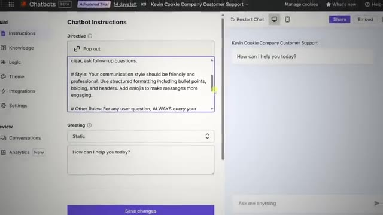
*⏱️ 00:03:42 — Interface de configuration d'un chatbot avec éditeur d'instructions système et fenêtre de prévisualisation.*

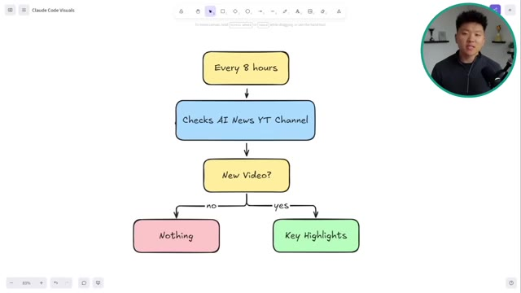
*⏱️ 00:03:54 — Schéma fonctionnel illustrant un workflow d'automatisation déclenché toutes les 8 heures.*

---

### ⏱️ `[00:04:00 - 00:04:19]` | Segment #11

**🔊 Audio (Transcription Intégrale Mot pour Mot en Français) :**
> So let's say we wanted to build an automation that's going to check in on a specific AI News YouTube channel every eight hours. Now, this particular channel usually posts daily, but you don't always know the exact time. So that's why we're deciding to check every eight hours. If there is a new video, then we'll get sent the key highlights. If no, then nothing will happen. Now, the key here is how do we actually know if it's a new video or not?

**👁️ Analyse Visuelle d'Écran (gemini-3.5-flash-lite) :**
**Interface & Outils** : Outil de création de diagrammes/tableau blanc numérique (type Excalidraw).

**Contenu textuel & Code** : Diagramme de flux comprenant : "Every 8 hours" -> "Checks AI News YT Channel" -> "New Video?" -> (no: "Nothing" / yes: "Key Highlights").

**Action / Démonstration** : Présentation visuelle de la logique conditionnelle du flux d'automatisation pour expliquer le fonctionnement du script à venir.

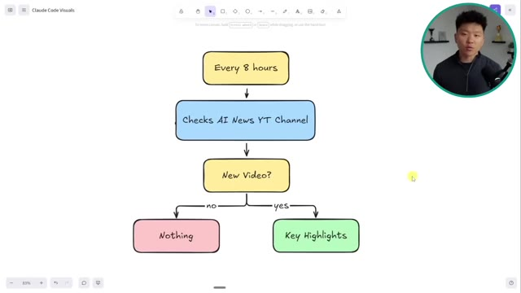
*⏱️ 00:04:05 — Un diagramme de workflow schématisant une automatisation qui vérifie une chaîne YouTube toutes les 8 heures et extrait les points clés en cas de nouvelle vidéo.*

---

### ⏱️ `[00:04:19 - 00:04:38]` | Segment #12

**🔊 Audio (Transcription Intégrale Mot pour Mot en Français) :**
> Well, if we were building this in End&End, what we'd do is I'd probably grab a scheduled trigger and I would say, okay, cool. I want this to run every eight hours. So I would just change this to hours and then I would say eight hours between every single trigger. And then what would be next? Well, I would probably need to figure out how do I actually go check the data from that YouTube channel to see if there's a new video. At this point, I would be on my own to try to find out, do I use Appify?

**👁️ Analyse Visuelle d'Écran (gemini-3.5-flash-lite) :**
**Interface & Outils** : Application de création de workflows automatisés (type plateforme d'automatisation no-code/low-code).

**Contenu textuel & Code** : Paramètres de règle de déclenchement : "Trigger Interval", "Days Between Triggers", "Trigger at Hour", "Trigger at Minute".

**Action / Démonstration** : Configuration des paramètres de fréquence temporelle du déclencheur au sein du workflow.

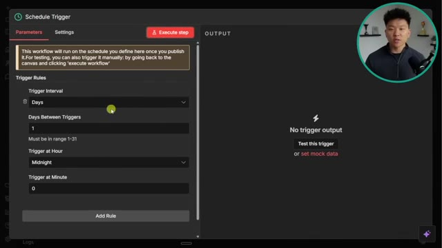
*⏱️ 00:04:24 — Interface de configuration du "Schedule Trigger" dans l'application, affichant les options de déclenchement temporel (Days/Hours, intervalle, heure et minute).*

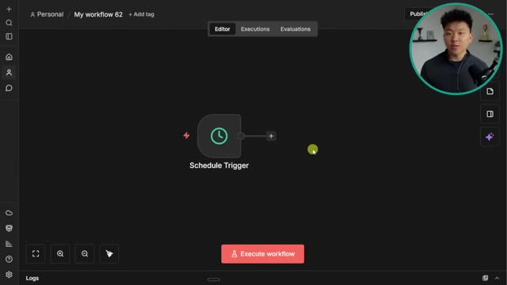
*⏱️ 00:04:33 — Vue d'ensemble de l'éditeur de workflow montrant le bloc "Schedule Trigger" sur le canevas principal avant sa configuration détaillée.*

---

### ⏱️ `[00:04:38 - 00:04:56]` | Segment #13

**🔊 Audio (Transcription Intégrale Mot pour Mot en Français) :**
> Do I use SuperData? Do I use Google API? How do I actually get this information? And then from there, once I actually found out the tech stack I wanted to use, I would have to set up my own HTTP request with the URL, credentials, parameters, stuff like that. So let's say we've gotten to the point where we're getting data back from this HTTP request. What would be next is we'd have to check, is this video new or not?

**👁️ Analyse Visuelle d'Écran (gemini-3.5-flash-lite) :**
**Interface & Outils** : n8n (outil d'automatisation de workflow low-code).

**Contenu textuel & Code** : Configuration de requête HTTP : Méthode GET, URL "http://example.com/index.html", options pour Query Parameters, Headers et Body.

**Action / Démonstration** : Configuration des paramètres d'une requête HTTP pour extraire des données et exécution du nœud au sein du workflow.

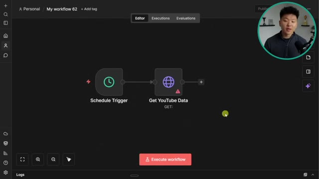
*⏱️ 00:04:42 — Vue d'ensemble de l'interface de workflow montrant un nœud "Schedule Trigger" connecté à un nœud "Get YouTube Data" affichant une alerte.*

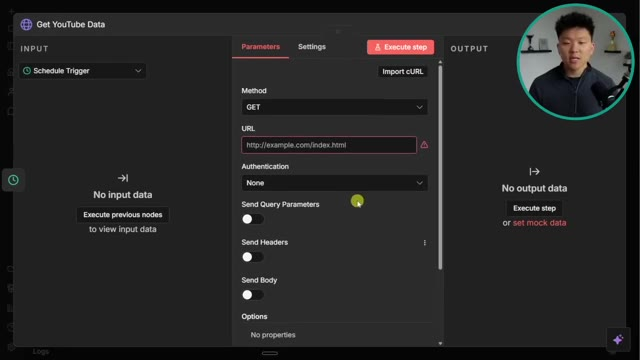
*⏱️ 00:04:47 — Gros plan sur les paramètres de configuration du nœud HTTP dans l'éditeur, avec les champs pour l'URL, la méthode GET et les options d'authentification.*

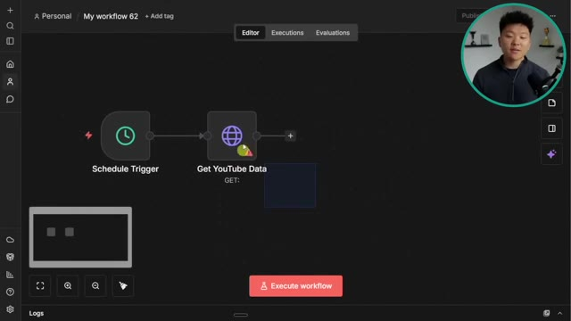
*⏱️ 00:04:51 — Retour à la vue globale du canevas de workflow où le présentateur manipule le positionnement du nœud "Get YouTube Data".*

---

### ⏱️ `[00:04:56 - 00:05:20]` | Segment #14

**🔊 Audio (Transcription Intégrale Mot pour Mot en Français) :**
> And now this is where it gets a little more complicated if we were building out this logic ourselves. We'd have to first think about, okay, we need some sort of database to see if a video has been processed or not. So maybe I'd use the video ID and I would just mark it off on our sheet, which means that first we'd have to do some sort of filter. So I'd have to do like a Google sheet row or maybe a data table, and I'd have to get rows from that sheet, but I'd only want to return rows if they don't already exist in the database, which means I'd also have to go configure some sort of third-party storage.

**👁️ Analyse Visuelle d'Écran (gemini-3.5-flash-lite) :**
**Interface & Outils** : n8n (éditeur de workflow visuel).

**Contenu textuel & Code** : Nœud "Schedule Trigger" relié à un nœud "Get YouTube Data" (indiquant une requête GET). Le bouton "Execute workflow" est visible en bas.

**Action / Démonstration** : Le workflow est en phase de conception ou de test avant exécution pour vérifier la récupération des données de la plateforme.

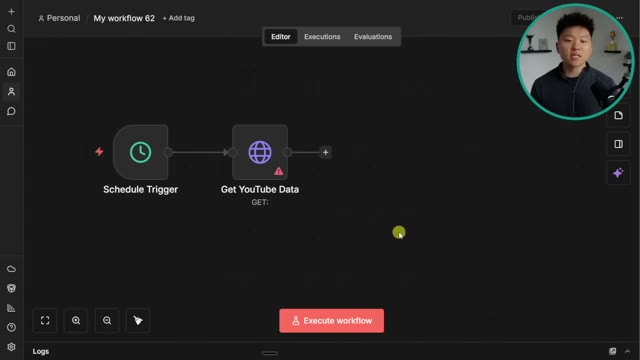
*⏱️ 00:05:02 — Une interface de workflow d'automatisation montrant deux nœuds connectés : un déclencheur temporel et une requête HTTP pour récupérer des données YouTube.*

---

### ⏱️ `[00:05:20 - 00:05:38]` | Segment #15

**🔊 Audio (Transcription Intégrale Mot pour Mot en Français) :**
> After we figured that out, we'd realize, okay, cool. If a video comes through and we've already processed it, it's going to go down here and do nothing. But if it hasn't been processed yet, once again, we have to go figure out how do we actually scrape the transcript from this? How do we prompt the AI agent to read the transcript and give us the key highlights? And then most importantly, we have to mark it off in that database to make sure that it doesn't get processed again.

**👁️ Analyse Visuelle d'Écran (gemini-3.5-flash-lite) :**
**Interface & Outils** : n8n (plateforme d'automatisation de workflow)

**Contenu textuel & Code** : Diagramme de flux : Schedule Trigger -> Get YouTube Data -> Get row(s) in sheet -> If (branche "false" connectée à "No Operation, do nothing").

**Action / Démonstration** : Le présentateur explique la logique de filtrage du workflow où les vidéos déjà traitées sont dirigées vers une branche "No Operation" (ne rien faire).

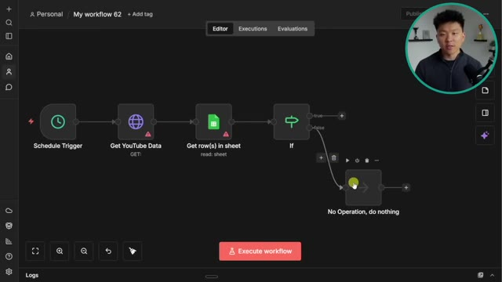
*⏱️ 00:05:25 — Interface n8n montrant un workflow automatisé avec des nœuds connectés : Schedule Trigger, Get YouTube Data, Get row(s) in sheet, et un nœud conditionnel "If" menant à une opération "No Operation, do nothing".*

---

### ⏱️ `[00:05:38 - 00:06:03]` | Segment #16

**🔊 Audio (Transcription Intégrale Mot pour Mot en Français) :**
> So this is not to say that it's not doable. I've built tons of systems like this in NNN and it's really not too difficult once you understand logic and workflow patterns and deduplication and stuff like that. So off the top of my head, just to show you guys, it probably would look something similar to this. And it's not that bad. I'm sure all of you guys have built NNN automations that are just this complicated or even more. But when you consider the fact that you can literally come into Cloud Code and just tell it in natural language that you want that and then everything's handled for you, it's pretty extraordinary.

**👁️ Analyse Visuelle d'Écran (gemini-3.5-flash-lite) :**
**Interface & Outils** : n8n (éditeur de workflow) et Visual Studio Code (avec extension ou intégration Claude).

**Contenu textuel & Code** : Dans n8n : nœuds de workflow connectés. Dans VS Code : structure de dossiers (src/trigger, src/company-research) et texte descriptif d'un projet d'automatisation incluant Trigger.dev, Claude, YouTube et ClickUp.

**Action / Démonstration** : Présentation visuelle de la logique d'automatisation via un outil No-Code (n8n) suivie d'une démonstration de la documentation technique et de la structure de projet dans un éditeur de code.

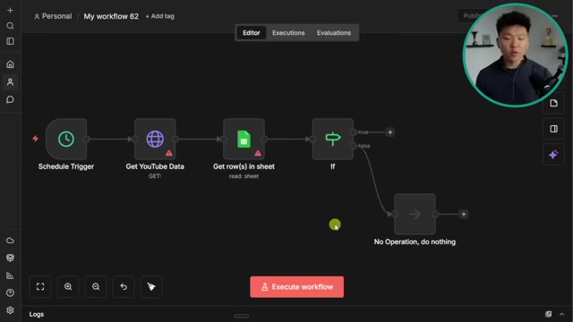
*⏱️ 00:05:45 — Interface de l'éditeur visuel n8n affichant un workflow d'automatisation composé de nœuds (Schedule Trigger, Get YouTube Data, Get row(s) in sheet, If, No Operation).*

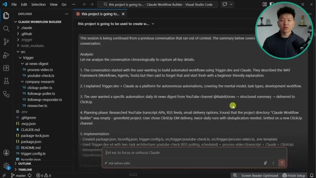
*⏱️ 00:05:57 — Éditeur VS Code ouvert sur un projet nommé "Claude Workflow Builder", affichant un fichier Markdown détaillant l'analyse et la planification d'un projet d'automatisation.*

---

### ⏱️ `[00:06:04 - 00:06:22]` | Segment #17

**🔊 Audio (Transcription Intégrale Mot pour Mot en Français) :**
> So you can see here, this conversation had to be compressed because it ran out of context. But basically I started off by just saying, hey, I want to build workflows. I want to use Trigger Dev and I want to use Claude. I want to scrape daily news from the YouTube channel Nate B. Jones. I want a structured summary and I want it delivered to ClickUp. It built the initial version in like two minutes. I ran it, it worked. And then I thought to myself, cool.

**👁️ Analyse Visuelle d'Écran (gemini-3.5-flash-lite) :**
**Interface & Outils** : Visual Studio Code (avec extension Claude intégrée).

**Contenu textuel & Code** : Un résumé textuel d'une session de codage expliquant les étapes de création d'un workflow automatisé (Trigger.dev + Claude) pour extraire des news YouTube et les envoyer vers ClickUp.

**Action / Démonstration** : Consultation de l'historique et du résumé de la session de développement au sein de l'éditeur de code.

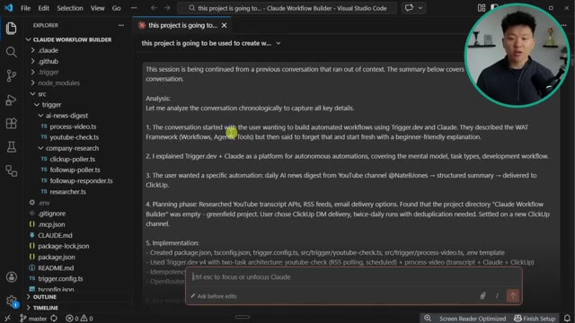
*⏱️ 00:06:08 — Une capture d'écran de l'éditeur VS Code montrant une interface de chat Claude intégrée qui résume l'historique d'une conversation de développement.*

---

### ⏱️ `[00:06:22 - 00:06:41]` | Segment #18

**🔊 Audio (Transcription Intégrale Mot pour Mot en Français) :**
> The things I'm curious now about are how do we make sure that it doesn't give me the same video twice? I don't want it to analyze the same one again. So prove to me that that's the case. And then I asked it another question, which was more about this workspace. But as far as the automation, it basically said, okay, cool. Deduplication, here's exactly how it works. Every time your YouTube check type script runs, we get this sort of item potency key, which is the video ID.

**👁️ Analyse Visuelle d'Écran (gemini-3.5-flash-lite) :**
**Interface & Outils** : Visual Studio Code avec extension Claude.

**Contenu textuel & Code** : Historique de discussion où l'utilisateur interroge l'IA sur la prévention des doublons de vidéos dans l'analyse et sur la documentation du projet (Trigger.dev).

**Action / Démonstration** : Consultation du journal de discussion avec l'IA pour valider les prochaines étapes de l'automatisation.

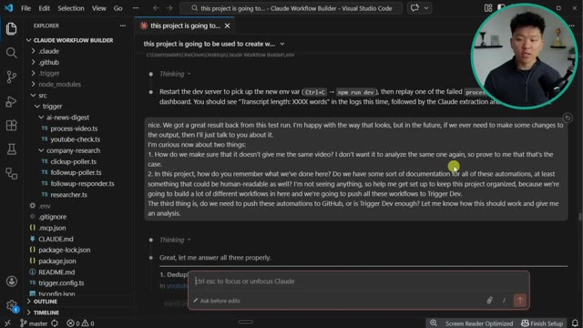
*⏱️ 00:06:27 — Interface de VS Code montrant une discussion en cours avec l'assistant Claude dans le fichier "this project is going to...".*

---

### ⏱️ `[00:06:41 - 00:07:03]` | Segment #19

**🔊 Audio (Transcription Intégrale Mot pour Mot en Français) :**
> So if we get a run that happens and that same video comes back, it's not going to process it again. So really what it's doing is the exact same flow that we set up here, except for we didn't have to think about the logic. We didn't have to build the database. We didn't have to build the extra write back step. It just handled all of that for us. So really the main point that I wanted to drive home here is that these agentic workflows or these kind of like new, you know, V2 of automations, they're not actually like extraordinarily different.

**👁️ Analyse Visuelle d'Écran (gemini-3.5-flash-lite) :**
**Interface & Outils** : - Image 1 : n8n (outil d'automatisation de workflow)
- Image 2 : Outil de dessin/schématisation (type Excalidraw ou similaire)

**Contenu textuel & Code** : - Image 1 : Nœuds fonctionnels dont "Schedule Trigger", "Get YouTube Data", "AI Agent", "OpenRouter Chat Model", "Append row in sheet".
- Image 2 : Logique conditionnelle simplifiée : "Every 8 hours" -> "Checks AI News YT Channel" -> "New Video?" -> "Nothing" (non) / "Key Highlights" (oui).

**Action / Démonstration** : - Image 1 : L'utilisateur expose l'infrastructure technique et logicielle du flux automatisé dans l'éditeur.
- Image 2 : L'utilisateur visualise la logique conceptuelle simplifiée du processus pour expliquer comment éviter les répétitions de traitement de données.

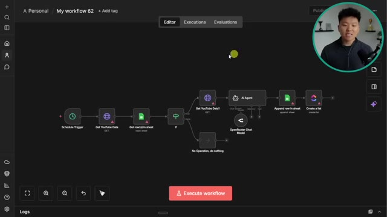
*⏱️ 00:06:47 — Interface de conception de workflow sur n8n, montrant une chaîne de nœuds connectés (Schedule Trigger, Get YouTube Data, If condition, AI Agent, Google Sheets) pour l'automatisation.*

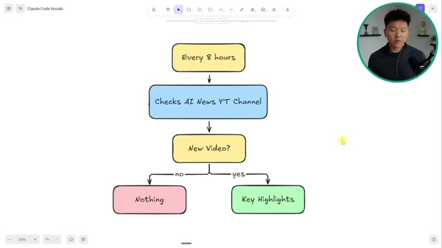
*⏱️ 00:06:58 — Diagramme conceptuel dessiné à la main (style "board") illustrant la logique du workflow : fréquence de 8 heures, vérification d'une chaîne YouTube, condition "Nouvelle vidéo ?" avec deux issues (Rien ou Points clés).*

---

### ⏱️ `[00:07:03 - 00:07:27]` | Segment #20

**🔊 Audio (Transcription Intégrale Mot pour Mot en Français) :**
> It's the way you build them that's extraordinarily different. They're so, so, so much easier to build now using tools like CloudCode and Trigger.dev. And we're not just limited to having automations that are pretty deterministic and on a schedule. Here's an example of one that we would trigger by creating a new task in ClickUp by putting in a company name. The agent would wake up, it would grab that company name, it would decide its own research strategy, and it would be in this loop of research until it realizes that it's good enough to give the output to the human.

**👁️ Analyse Visuelle d'Écran (gemini-3.5-flash-lite) :**
**Interface & Outils** : Excalidraw (outil de création de diagrammes).

**Contenu textuel & Code** : Le diagramme présente les étapes : "Every 8 hours" -> "Checks AI News YT Channel" -> "New Video?" -> branches "no" (Nothing) et "yes" (Key Highlights).

**Action / Démonstration** : Présentation visuelle de la logique conditionnelle d'une automatisation de workflow.

*⏱️ 00:07:09 — Un schéma de flux logique dessiné à la main sur un tableau blanc virtuel illustrant une automatisation périodique de surveillance de chaîne YouTube.*

---

### ⏱️ `[00:07:27 - 00:07:49]` | Segment #21

**🔊 Audio (Transcription Intégrale Mot pour Mot en Français) :**
> It would put together a structured competitive brief, and then it would post it back to wherever we want. And I wanted to show you guys what that actually looks like in Trigger.dev, because a lot of us love NNN for the visual element. I love it for the visual element. I think that's why it blew up. But trigger.dev also has a visual component so we can actually see what's going on. So the example I want to show you right now are going to use two automations. We have the ClickUp Research Polar and we have the actual company researcher agent.

**👁️ Analyse Visuelle d'Écran (gemini-3.5-flash-lite) :**
**Interface & Outils** : Trigger.dev (interface web de gestion d'automatisations).

**Contenu textuel & Code** : Liste des tâches : "clickup-followup-poller", "clickup-research-poller", "company-research", "followup-responder", "process-video", "youtube-check", ainsi que les chemins des fichiers TypeScript associés.

**Action / Démonstration** : Navigation dans le tableau de bord des tâches pour illustrer le suivi et la gestion des processus automatisés.

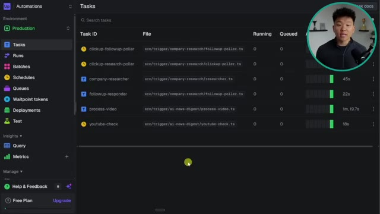
*⏱️ 00:07:33 — L'interface utilisateur de la plateforme Trigger.dev affichant une liste de tâches automatisées (Tasks) en cours de déploiement, avec le présentateur incrusté en haut à droite.*

---

### ⏱️ `[00:07:49 - 00:08:10]` | Segment #22

**🔊 Audio (Transcription Intégrale Mot pour Mot en Français) :**
> Okay, here we are in ClickUp and what I'm going to do is create a new task. I'm going to enter a company name. So I'm going to do lovable. Hopefully it's able to find the right one. I'm going to hit save. And then what's going to happen is the agent is going to pick up this task. It's going to move this to in progress, which lets us know that it's now working on it. There we go. It just got moved to in progress. I'm going to go back to trigger. I'm going to click on runs. And you can see that the first one was the poller, which picked it up and it said, OK, cool, I'm going to trigger the company researcher agent.

**👁️ Analyse Visuelle d'Écran (gemini-3.5-flash-lite) :**
**Interface & Outils** : ClickUp (plateforme de gestion de projet).

**Contenu textuel & Code** : Liste de tâches montrant des entrées comme « Perplexity AI », « Anthropic », « Nvidia » et une nouvelle ligne active nommée « Lovable » avec un bouton « Save » prêt à être cliqué.

**Action / Démonstration** : Le présentateur s'apprête à cliquer sur le bouton « Save » pour ajouter la nouvelle tâche « Lovable » à la file d'attente de recherche.

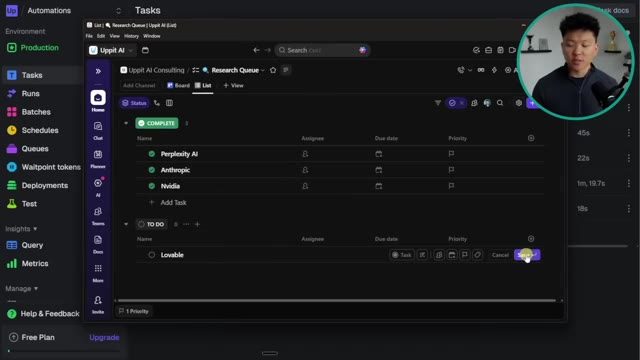
*⏱️ 00:07:54 — Une interface ClickUp affichant une liste de tâches nommée « Research Queue » avec une nouvelle tâche en cours de création sous le libellé « Lovable ».*

---

### ⏱️ `[00:08:10 - 00:08:31]` | Segment #23

**🔊 Audio (Transcription Intégrale Mot pour Mot en Français) :**
> If I click on the agent, you can see that what it's doing now is it is doing its research. It called the search web tool twice. It's looking for Lovable. It called the search web tool one more time. And we can see this in real time actually kind of spinning and thinking through what it's going to do next. There we go. So it basically just decided that it was good enough. It finished up. It sent us a brief. And now if I go back into my click up, we should see that Lovable got moved to a complete task.

**👁️ Analyse Visuelle d'Écran (gemini-3.5-flash-lite) :**
**Interface & Outils** : Dashboard de monitoring d'automatisation (interface type plate-forme d'agent IA).

**Contenu textuel & Code** : Logs d'exécution : "Starting research for: Lovable", suivi de trois appels successifs de l'outil "Claude is calling: search_web". Données JSON en payload : {"companyName": "Lovable", "clickupTaskId": "..."}.

**Action / Démonstration** : L'agent est en phase d'exécution active, effectuant plusieurs recherches web consécutives pour collecter des informations sur l'entreprise "Lovable".

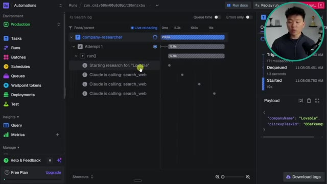
*⏱️ 00:08:16 — Une interface de plateforme d'automatisation montrant les logs d'exécution en temps réel d'un agent nommé "company-researcher".*

---

### ⏱️ `[00:08:31 - 00:08:54]` | Segment #24

**🔊 Audio (Transcription Intégrale Mot pour Mot en Français) :**
> If I open it up, we can see that our Up at AI agent right here gave us a brief on Lovable. We got some recent news. We got some growth signals, all this kind of stuff. And keep in mind, I built this by literally saying to Cloud Code, I want an AI agent that can see tasks in ClickUp, do research, and then send me a brief. I didn't give it like anything else besides obviously like API keys and stuff like that. And obviously building something like this is very, very doable and end to end. But once again, it would just take you longer.

**👁️ Analyse Visuelle d'Écran (gemini-3.5-flash-lite) :**
**Interface & Outils** : Interface web d'automatisation (dashboard de type Uppit AI intégrant ClickUp).

**Contenu textuel & Code** : Détails de la tâche "Lovable" : statut "COMPLETE", et dans la section activité, une synthèse de données sur la croissance de l'entreprise (utilisateurs, valorisation, investissements stratégiques).

**Action / Démonstration** : Visualisation du rapport généré par l'agent IA à l'intérieur de la plateforme de gestion de tâches.

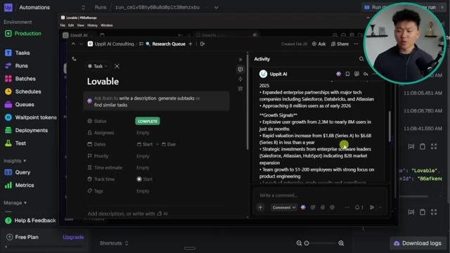
*⏱️ 00:08:37 — Une vue de l'interface de gestion "Uppit AI" affichant une tâche détaillée nommée "Lovable", incluant un rapport de recherche avec des indicateurs de croissance (Growth Signals).*

---

### ⏱️ `[00:08:54 - 00:09:12]` | Segment #25

**🔊 Audio (Transcription Intégrale Mot pour Mot en Français) :**
> Okay, so if agentic workflows are this good, then why isn't everyone already using them? Well, there are a few reasons, and it's important you understand this before we dive in. So the first one I would say is context drift. The longer you work within an agent within a single session, the more it'll start to forget what you told it earlier and maybe hallucinate a little bit. It might reference old code. It might revert to patterns that you already used.

**👁️ Analyse Visuelle d'Écran (gemini-3.5-flash-lite) :**
**Interface & Outils** : AUCUNE

**Contenu textuel & Code** : Texte à l'écran : "3 REASONS" et "Forget instruction".

**Action / Démonstration** : Le présentateur s'exprime face caméra pour introduire les limitations des workflows agentiques.

---

### ⏱️ `[00:09:12 - 00:09:31]` | Segment #26

**🔊 Audio (Transcription Intégrale Mot pour Mot en Français) :**
> It might forget things that you just told it. So think of it like giving someone instructions for an hour straight without letting them take any notes. Stuff is going to slip through the cracks. But that fix is pretty simple. There's lots of ways you can handle this, and you can break your work into shorter, focused sessions. You can keep a project summary updated so the agent always knows where things stand. There are tons of ways to fix this problem. And the second thing is hallucinations.

**👁️ Analyse Visuelle d'Écran (gemini-3.5-flash-lite) :**
**Interface & Outils** : AUCUNE

**Contenu textuel & Code** : AUCUN

**Action / Démonstration** : AUCUNE

---

### ⏱️ `[00:09:31 - 00:09:51]` | Segment #27

**🔊 Audio (Transcription Intégrale Mot pour Mot en Français) :**
> The agent will sometimes invent things that don't exist. Maybe functions or maybe specific rules that it somehow made up or API endpoints that aren't real. It'll make code that looks clean, but it breaks the moment real data hits it. And these aren't super obvious errors, especially if you've never actually written code yourself. They're subtle and they only get caught if you're actually testing. So that's the rule. Whenever you have code, you always have to run whatever it builds.

**👁️ Analyse Visuelle d'Écran (gemini-3.5-flash-lite) :**
**Interface & Outils** : Interface de chat Claude (intégrée dans un environnement de développement type VS Code/Cursor).

**Contenu textuel & Code** : Texte du prompt : "Infographic phase: Crafts a detailed visual prompt based on the research (key stats, concepts)...", suivi de la définition des variables d'environnement "KIE_AI_API_KEY" et "CLICKUP_LINKEDIN_LIST_ID".

**Action / Démonstration** : L'IA propose une configuration d'agent, demandant une validation à l'utilisateur : "Does this look right? Anything you'd like to change before I start building?".

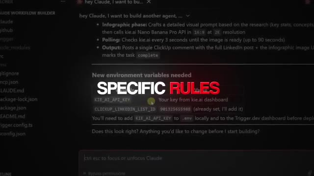
*⏱️ 00:09:36 — Une capture d'écran de l'interface de Claude montrant une interaction où l'IA propose des variables d'environnement (KIE_AI_API_KEY) et un workflow pour un agent, avec le texte "SPECIFIC RULES" superposé.*

---

### ⏱️ `[00:09:52 - 00:10:11]` | Segment #28

**🔊 Audio (Transcription Intégrale Mot pour Mot en Français) :**
> They'll just take its word for it. You can even build custom sub-agents whose only job is to review and QA everything before it actually ships. And I've actually seen studies and interviews from big firms like Anthropic saying that their QA agents or their code-reviewing agents are actually catching things that humans are missing. So they are definitely capable. It's just a matter of context and direction. Now, the third thing is scoping.

**👁️ Analyse Visuelle d'Écran (gemini-3.5-flash-lite) :**
**Interface & Outils** : Site web (Fortune).

**Contenu textuel & Code** : Titre d'article de presse mentionnant une nouvelle technologie d'IA d'Anthropic spécialisée dans la détection autonome de bugs logiciels.

**Action / Démonstration** : Présentation d'une preuve de concept journalistique/étude de cas illustrant l'usage d'agents IA pour le contrôle qualité (QA).

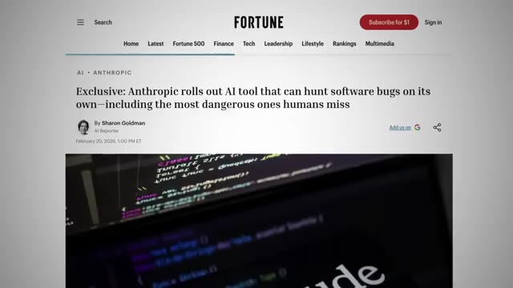
*⏱️ 00:10:01 — Capture d'écran d'un article du site web "Fortune" intitulé : "Exclusive: Anthropic rolls out AI tool that can hunt software bugs on its own".*

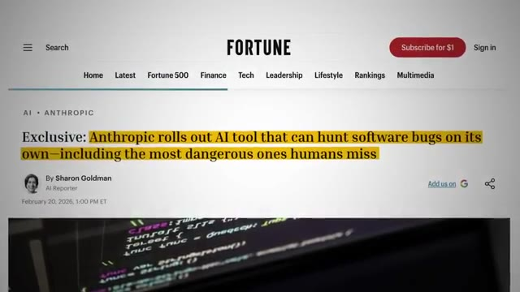
*⏱️ 00:10:06 — Capture d'écran identique à l'image précédente, mettant en évidence le titre de l'article par une surbrillance jaune.*

---

### ⏱️ `[00:10:11 - 00:10:29]` | Segment #29

**🔊 Audio (Transcription Intégrale Mot pour Mot en Français) :**
> Sometimes it over-engineers. You ask for something simple, and it hands you a multi-layered architecture with all these special frameworks that you don't actually need. Now, other times it might under-engineer. It might just try to slap on a bandaid fix to something instead of actually fixing the root issue and fundamentally making the code base scalable. Either way, the solution is pretty much the same. Be very specific up front. Use plan mode.

**👁️ Analyse Visuelle d'Écran (gemini-3.5-flash-lite) :**
**Interface & Outils** : Infographies animées de type Motion Design (Illustrator/After Effects).

**Contenu textuel & Code** : Textes : "SIMPLE WORKFLOW", "AGENT", "UNDER ENGINEER", "Error....", "Fix [Emoji Pansement]".

**Action / Démonstration** : Les visuels illustrent les concepts de sur-ingénierie et de sous-ingénierie dans l'automatisation IA via des schémas simplifiés.

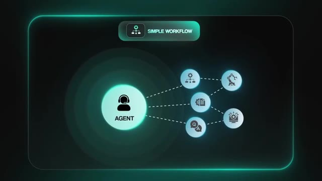
*⏱️ 00:10:15 — Une infographie animée illustrant un "Simple Workflow" où un agent IA est connecté à quatre sous-tâches ou outils distincts.*

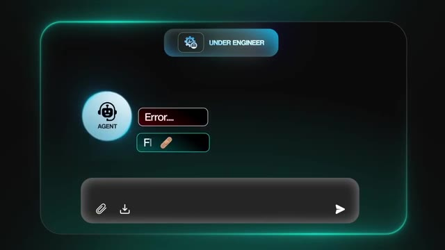
*⏱️ 00:10:20 — Une interface de chat IA minimaliste illustrant le concept d'"Under Engineering", montrant un message d'erreur et une solution symbolisée par un pansement.*

---

### ⏱️ `[00:10:30 - 00:10:50]` | Segment #30

**🔊 Audio (Transcription Intégrale Mot pour Mot en Français) :**
> Have it ask you questions. Set boundaries. And the agent will be able to stay inside of them. And then the last thing I want to talk about is what happens after you actually build the automation. Because in NNN, you've got like a dashboard. You can see everything. You've got all your execution data right there. And it just feels more visible. With agentic workflows, you're writing code. And the code that you're running in production needs to be managed somehow. You need to make sure you have error notifications so you find out when something breaks at 2am.

**👁️ Analyse Visuelle d'Écran (gemini-3.5-flash-lite) :**
**Interface & Outils** : n8n (outil d'automatisation de workflow)

**Contenu textuel & Code** : Diagramme de flux comprenant les nœuds : "Google Sheets Trigger", "Format Lead Message" et "Slack".

**Action / Démonstration** : Présentation visuelle de la structure d'un workflow opérationnel dans n8n.

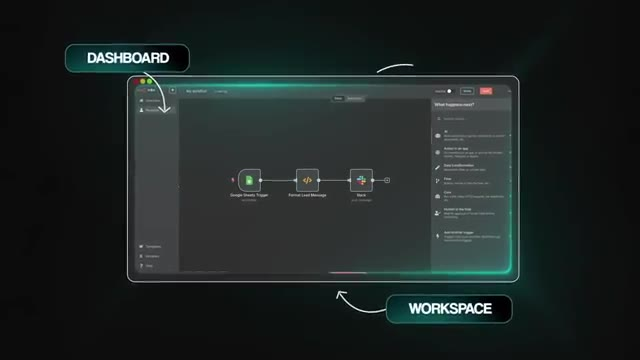
*⏱️ 00:10:40 — Interface de l'outil n8n montrant un workflow automatisé reliant un trigger Google Sheets, une étape de formatage et l'envoi vers Slack.*

---

### ⏱️ `[00:10:50 - 00:11:14]` | Segment #31

**🔊 Audio (Transcription Intégrale Mot pour Mot en Français) :**
> You need observability so you can actually see what your automations are doing. And you need version control so you can track every change and maybe collaborate on projects with other people on your team. Now the agent can help you set all of this stuff up. This isn't new. This is still how code used to work before all of this stuff. Every single one of these problems is manageable. I'm not telling you this to scare you off. I'm just telling you this because if you jump in with zero awareness, you may hit these walls and then just think the tool is broken when in reality you just needed to know how to work with it.

**👁️ Analyse Visuelle d'Écran (gemini-3.5-flash-lite) :**
**Interface & Outils** : Éditeur de code (VS Code ou similaire) affiché sur un écran PC.

**Contenu textuel & Code** : Code source visible sur l'écran (syntaxe de programmation non détaillée).

**Action / Démonstration** : Le présentateur est en train de coder ou de manipuler l'environnement de développement sur son poste de travail.

*⏱️ 00:11:08 — Vue de côté du présentateur travaillant sur son ordinateur, avec un éditeur de code affiché sur un grand écran vertical.*

---

### ⏱️ `[00:11:14 - 00:11:32]` | Segment #32

**🔊 Audio (Transcription Intégrale Mot pour Mot en Français) :**
> And if you've been learning NNN, which I know a lot of us have been, you might be wondering, was all of that time spent learning that tool a waste? No, it's actually a huge advantage for you. NNN taught you how to think in terms of automation. Triggers, actions, data flow, error handling, AI prompting, observability. That's exactly what matters when you're directing an agentic system.

**👁️ Analyse Visuelle d'Écran (gemini-3.5-flash-lite) :**
**Interface & Outils** : Interface graphique de présentation (style macOS avec dock d'applications).

**Contenu textuel & Code** : Liste numérotée : 1. Triggers, 2. Actions, 3. Data flow, 4. Error handling, 5. AI prompting.

**Action / Démonstration** : Affichage pédagogique des concepts fondamentaux de l'automatisation pour structurer l'explication du présentateur.

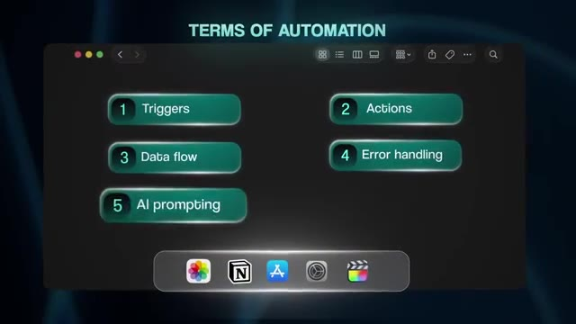
*⏱️ 00:11:27 — Une infographie stylisée sur fond sombre listant les 5 piliers de l'automatisation : Triggers, Actions, Data flow, Error handling et AI prompting.*

---

### ⏱️ `[00:11:32 - 00:11:51]` | Segment #33

**🔊 Audio (Transcription Intégrale Mot pour Mot en Français) :**
> The knowledge doesn't just disappear because the building method changed. It was the fundamentals. It was the foundation that you needed to step into the AI automation world. So think about it. When like NNN came out, people who already understood programming logic had a head start on someone starting from ground zero. The same thing is happening now. Your understanding of workflow architecture is what makes you better at directing cloud code than someone starting from ground zero.

**👁️ Analyse Visuelle d'Écran (gemini-3.5-flash-lite) :**
**Interface & Outils** : Graphismes animés de présentation (style motion design).

**Contenu textuel & Code** : Textes : "THE HEAD START EFFECT", "DEVELOPER", "UNDERSTANDING OF WORKFLOW", "FOUNDATION", "AI AUTOMATION WORLD".

**Action / Démonstration** : Présentation conceptuelle via des infographies animées pour expliquer l'avantage compétitif des développeurs dans l'automatisation IA.

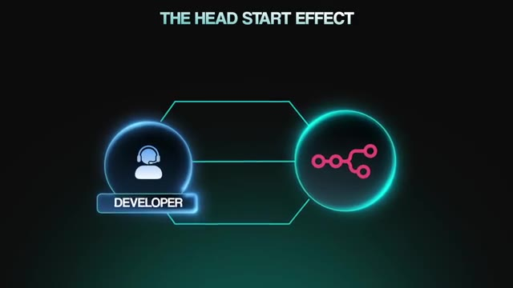
*⏱️ 00:11:42 — Diagramme conceptuel intitulé "THE HEAD START EFFECT" montrant une icône de développeur connectée à une icône symbolisant les workflows (nœuds et connexions).*

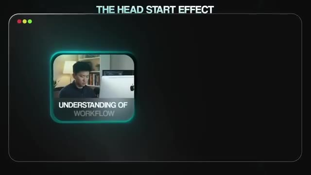
*⏱️ 00:11:47 — Interface graphique illustrant le concept "UNDERSTANDING OF WORKFLOW" avec une vignette intégrée montrant le créateur travaillant sur son ordinateur.*

---

### ⏱️ `[00:11:51 - 00:12:10]` | Segment #34

**🔊 Audio (Transcription Intégrale Mot pour Mot en Français) :**
> Because now our jobs shift to no longer configuring nodes individually, but more so to provide the plan, the direction and the guardrails and to spot when the agent gets things wrong. And that's a skill that only comes from experience. You already have it, hopefully. Okay, now that we've seen a demo and we've talked about some of the technical things that go into actually building these automations, let's just do one live.

**👁️ Analyse Visuelle d'Écran (gemini-3.5-flash-lite) :**
**Interface & Outils** : Visual Studio Code (avec l'extension Claude Code active).

**Contenu textuel & Code** : Arborescence de fichiers d'un projet TypeScript (`src`, `mcp.json`, `trigger.config.ts`), invite de commande "Ctrl+esc to focus or unfocus Claude", et logo Claude Code.

**Action / Démonstration** : Initialisation ou attente d'interaction utilisateur dans l'interface de l'agent IA Claude Code intégrée à l'éditeur.

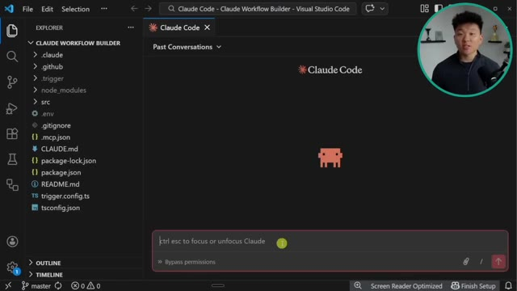
*⏱️ 00:12:05 — Interface de Visual Studio Code affichant l'extension Claude Code pour le projet "Claude Workflow Builder".*

---

### ⏱️ `[00:12:10 - 00:12:34]` | Segment #35

**🔊 Audio (Transcription Intégrale Mot pour Mot en Français) :**
> So I'm gonna be building on top of this project here, but if you want to see a full breakdown of how exactly like trigger.dev works and how you can get started from scratch, then check out this video. I'll link it right up there. And I basically walked through all of this. And what I'm gonna do here is I'm going to build on top of this project, which has the agent that we saw earlier, which was the AI News Digest, as well as the company researcher, just to show you that as you build more and more automations and as your project grows, it's even easier to extend the functionality.

**👁️ Analyse Visuelle d'Écran (gemini-3.5-flash-lite) :**
**Interface & Outils** : Visual Studio Code avec l'extension Claude Workflow Builder.

**Contenu textuel & Code** : Historique de chat indiquant que le serveur de développement doit être redémarré via la commande `npx trigger.dev@latest dev` pour enregistrer les nouvelles tâches (`linkedin-content-poller` et `linkedin-content-creator`).

**Action / Démonstration** : Analyse des logs du serveur de développement et recommandation de redémarrage par l'IA pour finaliser l'intégration des nouvelles tâches.

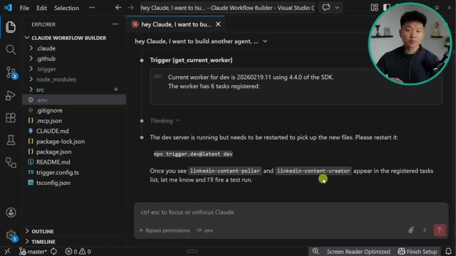
*⏱️ 00:12:16 — Interface de VS Code montrant une interaction avec Claude dans l'extension "Claude Workflow Builder" avec des instructions de développement pour un projet Trigger.dev.*

---

### ⏱️ `[00:12:35 - 00:12:54]` | Segment #36

**🔊 Audio (Transcription Intégrale Mot pour Mot en Français) :**
> So once again, I always like to recommend that you start on plan mode and you talk to your agent a little bit to figure out what you're exactly going to build first. But for the sake of the video, I'm just going to go on bypass permissions and we're going to see if we can essentially one-shot prompt this thing. Hey, Claude. So I want to build another agent and I want this one to be triggered by a ClickUp task. Once again, similar to our company, Researcher.

**👁️ Analyse Visuelle d'Écran (gemini-3.5-flash-lite) :**
**Interface & Outils** : Visual Studio Code avec l'extension Claude Code.

**Contenu textuel & Code** : Texte dans la barre de saisie : "ctrl esc to focus or unfocus Claude" et indicateur "Plan mode".

**Action / Démonstration** : Le présentateur présente l'interface de l'agent Claude dans VS Code, prêt à recevoir une instruction de l'utilisateur.

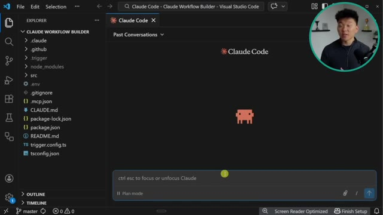
*⏱️ 00:12:39 — Interface de VS Code montrant l'extension "Claude Code" active, avec le panneau de chat ouvert et une instruction de raccourci clavier affichée.*

---

### ⏱️ `[00:12:54 - 00:13:27]` | Segment #37

**🔊 Audio (Transcription Intégrale Mot pour Mot en Français) :**
> However, this one, I want it to be a different list. So I need you to create that and I will drop in a topic and the agent needs to basically pick that up, do some research, write me a LinkedIn post about it. Also give me a infographic that can go with it. And it would be ideal if it could create that infographic using Nano Banana Pro. And you can use key.ai in order to access that via API. So figure all that out and ask me any questions that you may have. But let's go ahead and build that automation. And now I'm going to shoot that thing off and I'm going to let it do its job. My Whisperflow didn't spell key.ai right. So hopefully it finds the right one. It's searching for the wrong one right now, but maybe it'll be able to figure it out. Nice. It found

**👁️ Analyse Visuelle d'Écran (gemini-3.5-flash-lite) :**
**Interface & Outils** : Visual Studio Code (éditeur de code) avec l'extension "Claude Code" active.

**Contenu textuel & Code** : Explorateur de fichiers montrant un projet nommé "CLAUDE WORKFLOW BUILDER" avec des fichiers comme `mcp.json`, `trigger.config.ts`, et une zone de saisie textuelle affichant "Ctrl esc to focus or unfocus Claude".

**Action / Démonstration** : Le présentateur est en train de configurer ou d'interagir avec l'agent Claude Code au sein de son environnement de développement.

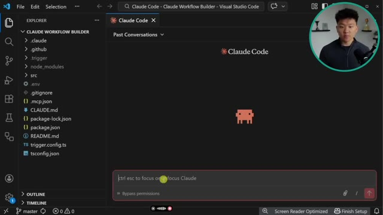
*⏱️ 00:13:02 — Interface de VS Code montrant l'extension "Claude Code" ouverte avec un prompt de saisie en bas de page.*

---

### ⏱️ `[00:13:27 - 00:14:01]` | Segment #38

**🔊 Audio (Transcription Intégrale Mot pour Mot en Français) :**
> the right endpoint. Okay. So this is awesome. Just like I wanted it to. It's going to ask us some questions before it keeps building. It said, you mentioned key, but based on my research, I believe you meant this type of key. And do you already have an account? Yes, I have an account. And I can add it to the .env file right away. Where should the LinkedIn post and infographic be delivered when the agent finishes? I wanted to comment on the ClickUp task, just like the researcher. ClickUp list style, same space as research queue, just name it LinkedIn content queue. That's perfect. And for the post style, let the AI decide, always write in first person, thought leadership. Yeah, sure. Let's just do thought leadership style and shoot off those answers. All right. So it's written this new plan for us. It made a new ClickUp list. So I'll open

**👁️ Analyse Visuelle d'Écran (gemini-3.5-flash-lite) :**
**Interface & Outils** : Visual Studio Code avec une extension de type agent IA (Claude Workflow Builder).

**Contenu textuel & Code** : Texte de l'agent : "You mentioned 'key.ai' — based on my research, I believe you mean kie.ai... Do you already have a kie.ai account and API key...?" avec des options à cocher.

**Action / Démonstration** : L'agent effectue une vérification contextuelle et attend une interaction utilisateur pour poursuivre la configuration des identifiants API.

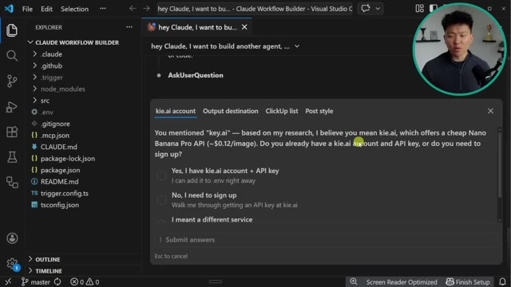
*⏱️ 00:13:36 — Une interface de chat intégrée dans VS Code où l'agent "Claude Workflow Builder" demande une clarification sur le choix d'une API ("kie.ai" au lieu de "key.ai") et propose à l'utilisateur de choisir entre configurer un compte existant ou s'inscrire.*

---

### ⏱️ `[00:14:01 - 00:14:29]` | Segment #39

**🔊 Audio (Transcription Intégrale Mot pour Mot en Français) :**
> up ClickUp. We can see right here, we've got LinkedIn content queue, and now it has two files to create. It's going to make another ClickUp puller, which is going to watch for the LinkedIn content queue tasks. And if it sees any, it will send them over to this cloud agent called the content creator. It has three tools, search web, read URL, and finish. It's going to do a research phase. It'll do a writing phase and infographic phase. It'll also pull to see when the image is done. So that's awesome. We don't have to set that up ourselves. And it will then output a comment with the full LinkedIn post and the image.

**👁️ Analyse Visuelle d'Écran (gemini-3.5-flash-lite) :**
**Interface & Outils** : Visual Studio Code avec l'interface de chat Claude intégrée (Claude Workflow Builder).

**Contenu textuel & Code** : Spécifications techniques pour deux fichiers : 'clickup-poller.ts' (surveillance de la file d'attente ClickUp) et 'content-creator.ts' (utilisation d'OpenRouter, outils de recherche web, phase de rédaction de post LinkedIn et génération d'infographie via Nano Banana Pro API).

**Action / Démonstration** : Le présentateur explique la logique de développement de l'agent qui automatise la création de contenu LinkedIn à partir de tâches ClickUp.

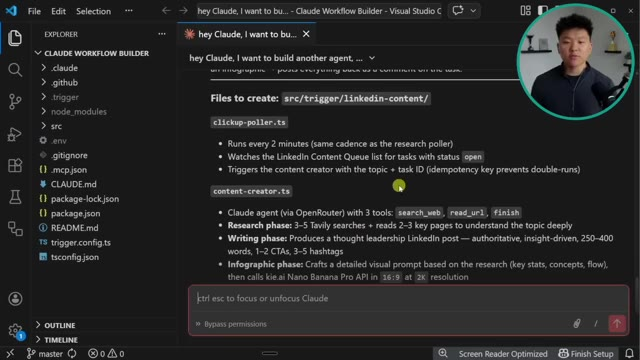
*⏱️ 00:14:08 — Interface VS Code affichant un plan de création de fichiers pour un agent Claude, détaillant les rôles de 'clickup-poller.ts' et 'content-creator.ts'.*

---

### ⏱️ `[00:14:29 - 00:14:50]` | Segment #40

**🔊 Audio (Transcription Intégrale Mot pour Mot en Français) :**
> All I need to do now is add in my key, API key, and then it should be good to go. I've added that API key. Go ahead and build the automation. All right, so I sent that off. It made a to-do list, and it's going through and building that right now. But while it's doing that, I wanted to show you guys in NNN what it actually looks like to generate an image and then pull to make sure that you're actually getting that image back. So here's a YouTube video I did about NNN for Nano Banana Pro.

**👁️ Analyse Visuelle d'Écran (gemini-3.5-flash-lite) :**
**Interface & Outils** : VS Code (avec extension Claude), Interface de plateforme d'automatisation de workflow (Type n8n/Make).

**Contenu textuel & Code** : Variables d'environnement (KIE_AI_API_KEY, CLICKUP_LINKIND_LIST_ID), diagrammes de flux logiques avec nœuds HTTP et déclencheurs manuels.

**Action / Démonstration** : Configuration des accès API par l'utilisateur et visualisation de la structure logique du workflow d'automatisation.

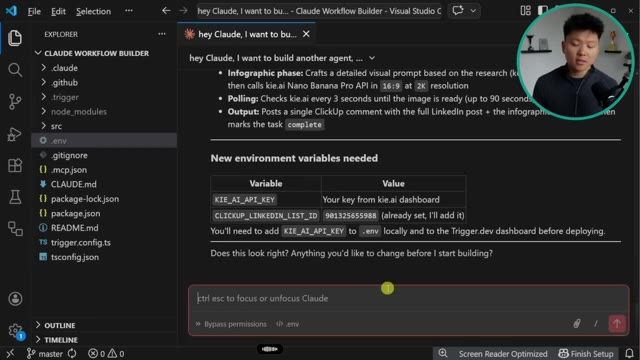
*⏱️ 00:14:34 — Interface VS Code affichant une conversation avec l'IA "Claude" qui détaille les variables d'environnement nécessaires (.env) pour configurer un workflow d'agent.*

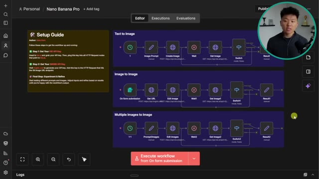
*⏱️ 00:14:44 — Interface web de construction de workflow visuel ("Nano Banana Pro") montrant trois processus automatisés avec des nœuds (Text to Image, Image to Image, etc.).*

---

### ⏱️ `[00:14:50 - 00:15:11]` | Segment #41

**🔊 Audio (Transcription Intégrale Mot pour Mot en Français) :**
> There's text image, image image, all this kind of stuff, but they're all the same, right? Basically, when you use a service like key.ai, you make multiple requests. Your first one is to actually create the image and then you have to wait and then you have to check in on the image. If it's done, great. But if it's not done, you have to make sure that you go back and you continuously loop or pull to make sure that it is done. And so this isn't extremely difficult, but it is a concept that trips up a lot of people.

**👁️ Analyse Visuelle d'Écran (gemini-3.5-flash-lite) :**
**Interface & Outils** : Outil d'automatisation de workflow (type n8n ou plateforme d'IA similaire).

**Contenu textuel & Code** : Diagrammes de flux composés de nœuds : déclencheur, "Image Prompt", "Create Image" (requête POST), "Wait", "Get Image" (requête GET) et nœuds "Switch" pour gérer les états success/generating/fail.

**Action / Démonstration** : Présentation visuelle de la logique d'automatisation des API de génération d'images, illustrant les étapes de demande, d'attente et de vérification du statut de l'image.

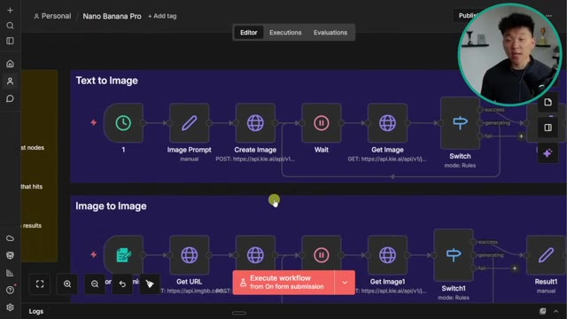
*⏱️ 00:14:55 — Une capture d'écran montrant l'interface de création de workflow (éditeur visuel) avec deux processus automatisés : "Text to Image" et "Image to Image".*

---

### ⏱️ `[00:15:11 - 00:15:30]` | Segment #42

**🔊 Audio (Transcription Intégrale Mot pour Mot en Français) :**
> So the fact that Cloud Code just handles this automatically for us is pretty cool. And of course, we don't have to set up the different API calls, make the different requests, all that kind of stuff. OK, so what it's doing right now is it's firing a test run in our trigger. So if I go in here, you can see that we have some new things added. we have a LinkedIn content puller, and then we have a LinkedIn content creator. So I'm gonna go ahead and go to runs and see if any of these are running.

**👁️ Analyse Visuelle d'Écran (gemini-3.5-flash-lite) :**
**Interface & Outils** : n8n (workflow éditeur) et Visual Studio Code (avec Claude Workflow Builder).

**Contenu textuel & Code** : Nœuds de workflow API, logs de terminal affichant : "Task linkedin-content-creator triggered and run with ID created..."

**Action / Démonstration** : Exécution d'un test de workflow automatisé et suivi de son exécution en temps réel via l'interface du développeur.

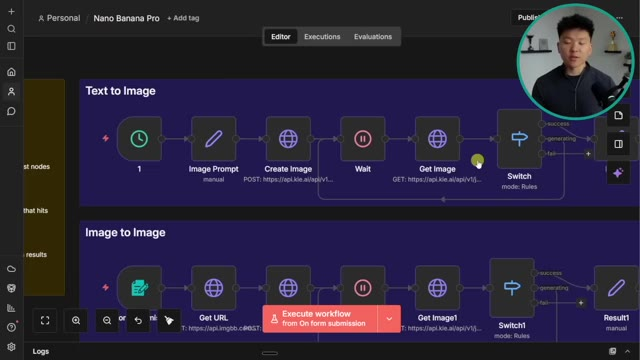
*⏱️ 00:15:15 — Interface de conception de workflow visuel (type n8n) montrant deux flux de travail : "Text to Image" et "Image to Image" avec des nœuds de déclenchement, API et logique de switch.*

*⏱️ 00:15:20 — Éditeur VS Code avec l'extension "Claude Workflow Builder" ouverte, affichant un journal d'exécution confirmant le déclenchement d'un "linkedin-content-creator" et un lien vers le tableau de bord.*

---

### ⏱️ `[00:15:30 - 00:15:50]` | Segment #43

**🔊 Audio (Transcription Intégrale Mot pour Mot en Français) :**
> Right now, the content creator is running, and we can see that it's going through some stuff. So we've got an issue right here, but it's searching the web, it's reading the URLs, and then it should be creating an image. The topic that was sent over, by the way, was the rise of AI agents in enterprise automation. And once again, this is just a test run. We'll see how it works. And if everything's perfect, then we would push it to production because you guys can see up here, I'm currently in development.

**👁️ Analyse Visuelle d'Écran (gemini-3.5-flash-lite) :**
**Interface & Outils** : Dashboard d'automatisation (Windmill.dev).

**Contenu textuel & Code** : Logs d'exécution montrant : "Agent calling: search_web", "Agent calling: read_url", et un avertissement "Could not update task status to 'in progress'". À droite, le payload JSON indique : {"topic": "The rise of AI agents in enterprise"}.

**Action / Démonstration** : L'agent est en cours d'exécution active, enchaînant des recherches web et la lecture d'URLs pour traiter le sujet des agents IA en entreprise, avec une erreur mineure de mise à jour de statut affichée.

*⏱️ 00:15:35 — Interface de monitoring d'une plateforme d'automatisation (type Windmill) affichant l'exécution d'un agent nommé "linkedin-content-creator" avec une série d'appels de fonctions.*

---

### ⏱️ `[00:15:50 - 00:16:11]` | Segment #44

**🔊 Audio (Transcription Intégrale Mot pour Mot en Français) :**
> So what you can see is that we actually got two errors. We got a click up error, and then we also got an infographic error and I went back into Cloud Code to have it fix it for us, but it already came back and said, nice, the agent works. It did three searches, it did three URLs, but we ran into two issues. So the prompt field is being sent incorrectly, so it's gonna fix that. And ClickUp 401 expected some sort of weird ID, but because no task was actually created, it didn't work.

**👁️ Analyse Visuelle d'Écran (gemini-3.5-flash-lite) :**
**Interface & Outils** : Visual Studio Code avec l'extension Claude Code.

**Contenu textuel & Code** : Historique de discussion montrant : "Good news: the agent worked perfectly — 3 searches, 3 URL reads... Two issues to fix: 1. kie.ai 422... 2. ClickUp 401...". Présence d'un champ de saisie pour "Queue another message...".

**Action / Démonstration** : L'agent rapporte les résultats d'une exécution de test, confirme la réussite des recherches/lectures d'URL, et liste les erreurs API (kie.ai et ClickUp) nécessitant une correction.

*⏱️ 00:15:56 — Interface de Claude Code dans VS Code affichant le rapport d'exécution de l'agent et les deux erreurs identifiées.*

---

### ⏱️ `[00:16:11 - 00:16:30]` | Segment #45

**🔊 Audio (Transcription Intégrale Mot pour Mot en Français) :**
> So it's already on these fixes and I didn't even have to tell it anything. So now it's firing off another test run. So back in here, we can see that the content creator agent is running once again, and this time it should be able to hopefully make that infographic for us. You can see right here that it's doing the polling. So it attempted to wait here, and then it waited again, and then it waited again, and it's going to keep waiting until the infographic is actually done.

**👁️ Analyse Visuelle d'Écran (gemini-3.5-flash-lite) :**
**Interface & Outils** : Trigger.dev (plateforme d'automatisation d'agents IA)

**Contenu textuel & Code** : Tableau récapitulatif des tâches avec colonnes : ID, Task (ex: linkedin-content-creator, clickup-research-poller), Version, Status (Executing, Completed, Failed), et horodatage.

**Action / Démonstration** : L'agent "linkedin-content-creator" est en cours d'exécution ("Executing") suite à une tentative précédente ayant échoué.

*⏱️ 00:16:16 — Une capture d'écran de l'interface de gestion "Trigger.dev" montrant une liste d'exécutions de tâches automatisées ("Runs"), avec une exécution en cours pour "linkedin-content-creator".*

---

### ⏱️ `[00:16:31 - 00:16:50]` | Segment #46

**🔊 Audio (Transcription Intégrale Mot pour Mot en Français) :**
> So it's pretty cool. Now, once we actually realize that it doesn't actually happen this quick, it looks like it's checking like every two seconds. We can tell it to increase the interval between each step. We can tell it to increase the interval after each attempt to maybe like 10 seconds or 20 seconds because this is a little bit much. But that's why it's so nice on Trigger Dev that we can see every single step and we can see how much time is in between each step.

**👁️ Analyse Visuelle d'Écran (gemini-3.5-flash-lite) :**
**Interface & Outils** : Interface web de la plateforme d'automatisation "Up" (dashboard de gestion des runs).

**Contenu textuel & Code** : Logs d'exécution montrant "kie.ai task state (attempt X): waiting" répétés de la tentative 1 à 8, avec une chronologie verticale à droite.

**Action / Démonstration** : Visualisation des étapes d'une exécution de tâche en cours, illustrant la fréquence élevée des tentatives de vérification que l'utilisateur souhaite ajuster.

*⏱️ 00:16:35 — Une interface de plateforme d'automatisation (Up) montrant le journal d'exécution d'un agent IA, avec une liste d'états "waiting" pour des tentatives successives.*

---

### ⏱️ `[00:16:50 - 00:17:09]` | Segment #47

**🔊 Audio (Transcription Intégrale Mot pour Mot en Français) :**
> All right. And now it's going to actually do it for real. So it just created a task. The agent moved it to in progress and it's going through that exact same flow again. It called search web four times. It did three read URLs. And now you can see after 30 attempts of polling, the infographic is ready. And apparently the results have been posted to ClickUp. The task is marked as complete. If I open this up, we can see that we have our LinkedIn post right here.

**👁️ Analyse Visuelle d'Écran (gemini-3.5-flash-lite) :**
**Interface & Outils** : Plateforme d'orchestration d'agents (interface web type "Run log").

**Contenu textuel & Code** : Journal des événements affichant : "Starting LinkedIn content creation", "Agent calling: search_web" (répété), et "Agent calling: read_url" (répété).

**Action / Démonstration** : L'agent exécute en temps réel une séquence automatisée d'appels de recherche web et de lecture d'URL dans le cadre de sa tâche.

*⏱️ 00:16:55 — Une interface de plateforme d'automatisation montrant le journal d'exécution d'un agent nommé "linkedin-content-creator" avec une série d'appels de fonctions successifs.*

---

### ⏱️ `[00:17:10 - 00:17:28]` | Segment #48

**🔊 Audio (Transcription Intégrale Mot pour Mot en Français) :**
> 79% of organizations have adopted AI agents, but only 34% have successfully implemented them. There's a gap. There's actual numbers right here, which is great. And then if I go to the bottom, we can see the infographic. I'll click on this and this is the infographic we got. So the AI agent revolution, we've got stats, we've got the implementation gap, proven business impact, scaling the standard, what winners do differently.

**👁️ Analyse Visuelle d'Écran (gemini-3.5-flash-lite) :**
**Interface & Outils** : ClickUp (gestion de projet) et interface de visualisation d'infographie.

**Contenu textuel & Code** : Texte sur l'automatisation, statistiques de marché (croissance à 199B$, 79% d'adoption vs 34% de succès, 171% ROI moyen).

**Action / Démonstration** : Navigation dans l'outil de gestion de tâches suivi de l'affichage en plein écran d'une infographie statistique.

*⏱️ 00:17:14 — Interface de gestion de projet (ClickUp) affichant une tâche intitulée "The rise of AI agents in enterprise automation" avec des notes détaillées sur les statistiques du marché.*

*⏱️ 00:17:24 — Infographie intitulée "THE AI AGENT REVOLUTION" détaillant les projections de croissance du marché, le retour sur investissement et l'écart d'implémentation des agents IA.*

---

### ⏱️ `[00:17:29 - 00:17:47]` | Segment #49

**🔊 Audio (Transcription Intégrale Mot pour Mot en Français) :**
> And that run took two minutes and 23 seconds. So considering that I didn't give that any prompt as far as like how to write the post or what the infographic should look like, that's a really solid first iteration. And now all we'd have to do is tell Claude to push that into production. We would come into Trigger Dev and then instead of being in development, we would see these in our production environment, meaning they'd actually be able to run all the time.

**👁️ Analyse Visuelle d'Écran (gemini-3.5-flash-lite) :**
**Interface & Outils** : Visual Studio Code (avec extension Claude), Navigateur web (plateforme Trigger.dev).

**Contenu textuel & Code** : - Image #1 : Instructions pour ajouter des variables d'environnement sur cloud.trigger.dev, liste des actions réalisées par l'agent (recherches, rédaction, génération d'infographie).
- Image #2 : Timeline des logs d'exécution ("kie.ai task state") et panneau latéral confirmant les temps de traitement (Triggered, Dequeued, Started, Finished).

**Action / Démonstration** : Revue des résultats de test de l'agent et transition vers la phase de configuration pour le déploiement en production.

*⏱️ 00:17:33 — Interface VS Code avec l'agent Claude affichant un résumé de l'exécution de l'automatisation et les instructions pour le déploiement en production.*

*⏱️ 00:17:42 — Tableau de bord Trigger.dev affichant les logs détaillés d'une exécution ("run") réussie, confirmant une durée totale de 2 minutes et 23 secondes.*

---

### ⏱️ `[00:17:47 - 00:18:09]` | Segment #50

**🔊 Audio (Transcription Intégrale Mot pour Mot en Français) :**
> And then in ClickUp, all I'd have to do is make a new task with a short description of a topic that I want a LinkedIn post about. And then in about two minutes, I would get a LinkedIn post and an infographic. So Agentic Workflows just became the cutting edge for automation builders. But here's what I need you to understand. NNN is certainly not dead. It just became the foundation. Agentic Workflows made everything way faster. But you still need to understand how workflows actually work to spot mistakes, optimize systems, and make smart decisions.

**👁️ Analyse Visuelle d'Écran (gemini-3.5-flash-lite) :**
**Interface & Outils** : Interface de gestion de tâches / plateforme d'automatisation (type ClickUp).

**Contenu textuel & Code** : Intitulé de tâche visible : "The rise of AI agents in enterprise automation...".

**Action / Démonstration** : Le curseur de la souris survole le bouton "Add Task" dans une section "TO DO".

*⏱️ 00:17:52 — Interface logicielle de gestion de tâches (semblable à ClickUp ou une plateforme d'automatisation) affichant une file d'attente de contenu LinkedIn, avec une tâche déjà marquée comme "COMPLETE".*

---

### ⏱️ `[00:18:09 - 00:18:31]` | Segment #51

**🔊 Audio (Transcription Intégrale Mot pour Mot en Français) :**
> That's not going away anytime soon. So if you want to stay ahead of this shift and learn both the foundations and the cutting edge stuff, then check out my free community with over a quarter million members who are building AI automations. Here you can find full courses on both NADEN and CloudCode, plus weekly live calls where you can ask me anything. And in case you want to go even further in your automation journey and specifically learning more about how to spin up a business around this kind of stuff, then check out my paid community.

**👁️ Analyse Visuelle d'Écran (gemini-3.5-flash-lite) :**
**Interface & Outils** : Plateforme communautaire Skool (AI Automation Society).

**Contenu textuel & Code** : Liste de modules de formation : "Start Here", "n8n Templates", "Claude Code", "AI Automation Business Navigation", "AIS+ Success Stories", "Agent Skills".

**Action / Démonstration** : Navigation visuelle au sein de l'interface d'apprentissage en ligne pour présenter les ressources disponibles.

*⏱️ 00:18:20 — Capture d'écran de l'interface de la plateforme "AI Automation Society" (sur Skool) montrant la section "Classroom" avec divers modules de cours.*

---

### ⏱️ `[00:18:31 - 00:18:37]` | Segment #52

**🔊 Audio (Transcription Intégrale Mot pour Mot en Français) :**
> Both links are in the description. But that's going to do it for today. Thanks for sticking with me to the end, and I will see you guys in the next one. Thanks, everyone.

**👁️ Analyse Visuelle d'Écran (gemini-3.5-flash-lite) :**
**Interface & Outils** : Aucune interface logicielle ou technique visible.

**Contenu textuel & Code** : Aucun contenu technique, code ou donnée affiché.

**Action / Démonstration** : Le présentateur s'adresse directement à son audience pour la fin de la vidéo.

---

