# 🎬 This $100M AI App Just Changed Software Forever

> **Chaîne** : [Nate Herk | AI Automation](https://www.youtube.com/@nateherk/featured)  
> **Lien YouTube** : [https://www.youtube.com/watch?v=T6_Ges4j1qY](https://www.youtube.com/watch?v=T6_Ges4j1qY)  
> **Date de publication** : 20260323  
> **Durée** : 00:09:08  
> **Identifiant vidéo** : `T6_Ges4j1qY`  
> **Transcription & Analyse** : `whisper-v3-large-turbo+gemini-3.5-flash-lite`  

---

## 📌 Synthèse Exécutive & Outils

### 💡 Résumé
Dans cette vidéo intitulée **This $100M AI App Just Changed Software Forever**, Nate Herk décortique les capacités pratiques d'automatisation et de développement propulsées par les modèles de pointe.

### 🛠️ Outils, Modèles & Logiciels Présentés
- **Opus 5.5 & Claude Code** : Modèles d'ingénierie et agents de codage autonome.

### 🔑 Points Clés & Enseignements Stratégiques
- Optimiser le niveau d'effort et le raisonnement des modèles IA pour des résultats industriels.
- Automatiser les cycles de création logicielle de bout en bout.

---

## ⏱️ Chronologie & Transcription Complète Audio & Visuelle (Mot pour Mot)

### ⏱️ `[00:00:00 - 00:00:19]` | Segment #01

**🔊 Audio (Transcription Intégrale Mot pour Mot en Français) :**
> It's also one of the top health and fitness apps in Apple's App Store and is projected to generate more than $30 million in revenue this year. We had just finished 2025 having done $30 million in that year. In December 2025, an 18-year-old sold his AI app for what experts say could be over $100 million, changing what we thought about software forever.

**👁️ Analyse Visuelle d'Écran (gemini-3.5-flash-lite) :**
**Interface & Outils** : Application mobile (interface utilisateur fitness), interface de publication web (type blog/article).

**Contenu textuel & Code** : Texte affiché : "Fast, Simple, Accurate!", "TEEN BUILDS $30M APP, GETS REJECTED BY 15 COLLEGES", "18-Year-Old Builds a $1.4M/Month AI App".

**Action / Démonstration** : Aucune action technique (codage ou automatisation) n'est réalisée ; il s'agit d'une revue de presse montrant l'interface finale de l'application et des gros titres d'actualité.

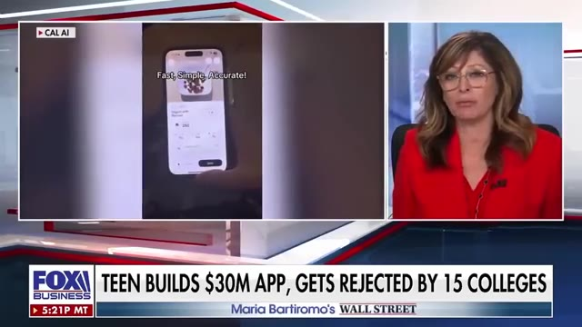
*⏱️ 00:00:05 — Extrait d'une émission Fox Business montrant une capture d'écran sur smartphone de l'application de fitness avec le texte "Fast, Simple, Accurate!" et un bandeau d'actualité en bas de l'écran.*

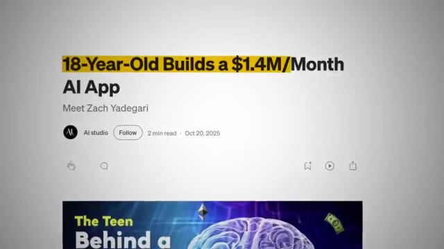
*⏱️ 00:00:15 — Capture d'écran d'un article en ligne intitulé "18-Year-Old Builds a $1.4M/Month AI App" publié sur Medium/Ai studio.*

---

### ⏱️ `[00:00:20 - 00:00:40]` | Segment #02

**🔊 Audio (Transcription Intégrale Mot pour Mot en Français) :**
> Before, most startups needed to have a highly trained team of developers and raised thousands with investors just to start. But this 18-year-old built this app with his high school friends, and within a year, they scaled it to over $30 million a year in revenue. So today, I'm going to break down exactly how this simple app became a $100 million company, the three strategies that actually got it there, and how, right now, anyone watching this can do the exact same thing.

**👁️ Analyse Visuelle d'Écran (gemini-3.5-flash-lite) :**
**Interface & Outils** : Aucune interface logicielle de développement ou d'automatisation n'est présente dans ces captures.

**Contenu textuel & Code** : Chiffres financiers (investissements et revenus) et titres de présentation.

**Action / Démonstration** : Aucune action technique, démonstration d'outil ou exécution de flux de travail n'est montrée.

---

### ⏱️ `[00:00:40 - 00:00:58]` | Segment #03

**🔊 Audio (Transcription Intégrale Mot pour Mot en Français) :**
> So let's get into it. So Zach started coding when he was 7 years old because he was obsessed with video games and wanted to make his own. His mom put him in a coding camp, and from that point on, he spent years building stuff. Little games and projects here and there that went nowhere. But it gave Zach the knowledge he needed to make the right idea work. And the idea came when he wanted to bulk up for the gym and he started tracking calories on MyFitnessPal.

**👁️ Analyse Visuelle d'Écran (gemini-3.5-flash-lite) :**
**Interface & Outils** : AUCUNE

**Contenu textuel & Code** : AUCUN

**Action / Démonstration** : AUCUNE

---

### ⏱️ `[00:00:58 - 00:01:22]` | Segment #04

**🔊 Audio (Transcription Intégrale Mot pour Mot en Français) :**
> But after just three days, he quit because of how annoying it was to weigh every meal on a scale and manually type out every single ingredient. To him, every fitness app sucked. And when AI models like ChachiPT started dropping, he saw the opportunity to make something better. And the idea is actually really simple. What if you could just take a picture of your food and get the calories instantly without typing or weighing anything? So he teamed up with a friend he met at coding camp and a 23-year-old founder who had already grown two other apps to millions of downloads.

**👁️ Analyse Visuelle d'Écran (gemini-3.5-flash-lite) :**
**Interface & Outils** : Interface utilisateur d'application mobile (Image 1) ; Infographie animée (Image 3).

**Contenu textuel & Code** : Interface de saisie manuelle (Image 1) ; Texte "Typing", "Weighing" et "1000 cal" (Image 3).

**Action / Démonstration** : Démonstration de la saisie manuelle fastidieuse (Image 1) ; Illustration graphique du remplacement des méthodes traditionnelles par une approche assistée par caméra (Image 3).

*⏱️ 00:01:04 — Gros plan sur une application mobile de suivi nutritionnel montrant une interface de saisie manuelle pour l'ajout d'eau avec des options de volume (8 oz, 12 oz, 24 oz).*

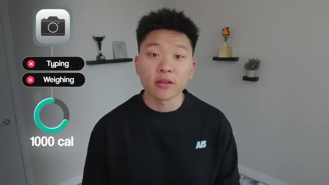
*⏱️ 00:01:16 — Infographie animée montrant une icône de caméra reliée à des croix rouges sur les mots "Typing" et "Weighing", illustrant la simplification du suivi nutritionnel via IA.*

---

### ⏱️ `[00:01:22 - 00:01:41]` | Segment #05

**🔊 Audio (Transcription Intégrale Mot pour Mot en Français) :**
> Together, they built the first version of Cal.ai in about a month and launched it around May of 2024. That first version of the app was dead simple, but incredibly useful. You basically just had to press one button to take a picture of your food, and a prompt was sent to an AI model to calculate the calories. And within three to four months, they hit a million downloads. Then, after six months, they were generating over a million dollars a month in revenue.

**👁️ Analyse Visuelle d'Écran (gemini-3.5-flash-lite) :**
**Interface & Outils** : Apple App Store, interface mobile Cal AI, Google Play Store.

**Contenu textuel & Code** : Noms des applications, notes (4.7/4.5), nombre de téléchargements (591k), bouton d'action "Open" ou "Install".

**Action / Démonstration** : Navigation dans les boutiques d'applications et démonstration de la fonction de capture photo pour le suivi alimentaire.

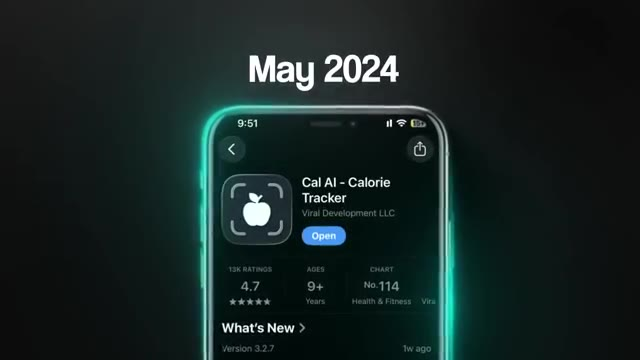
*⏱️ 00:01:26 — Capture d'écran de l'App Store présentant la fiche de l'application "Cal AI - Calorie Tracker".*

*⏱️ 00:01:31 — Capture montrant l'interface utilisateur de l'application en cours d'utilisation, avec un flux vidéo pour photographier un repas.*

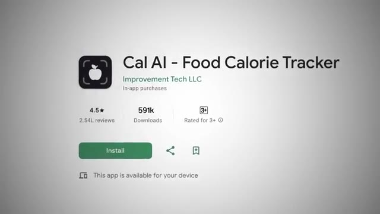
*⏱️ 00:01:36 — Capture d'écran du Google Play Store présentant la fiche de l'application "Cal AI - Food Calorie Tracker".*

---

### ⏱️ `[00:01:41 - 00:02:01]` | Segment #06

**🔊 Audio (Transcription Intégrale Mot pour Mot en Français) :**
> And just from the beginning of the year, they sold the app to their biggest competitor for multi-millions. Some even say over $100 million. Now here's what this means to the AI apps and software space. What Zach did is impressive, but the landscape has completely changed since he started. When Zach built Cal AI, he already knew how to code and that gave him a real advantage. But the advantage you have right now is that the barrier to building an app is basically gone.

**👁️ Analyse Visuelle d'Écran (gemini-3.5-flash-lite) :**
**Interface & Outils** : Éditeur de code (probablement VS Code) et tableur (type Excel/Google Sheets).

**Contenu textuel & Code** : Code source structuré dans le panneau de gauche et colonnes de données dans le panneau de droite de l'écran de l'utilisateur.

**Action / Démonstration** : Travail de développement logiciel ou d'analyse de données sur un poste de travail.

*⏱️ 00:01:56 — Une personne assise devant un grand écran d'ordinateur affichant un environnement de développement intégré (IDE) avec du code et un tableur.*

---

### ⏱️ `[00:02:01 - 00:02:20]` | Segment #07

**🔊 Audio (Transcription Intégrale Mot pour Mot en Français) :**
> When Cal AI launched in 2024, tools like Cursor and Lovable were already making it easier to build software. But now in 2026, we have Vibe Coding Tools where you can literally describe what you want and AI builds the app for you. Even Zach said this. My friend actually that I went to high school with, he built an app on Roark. It's called Wrestle AI or Fight AI.

**👁️ Analyse Visuelle d'Écran (gemini-3.5-flash-lite) :**
**Interface & Outils** : Lovable, Windsurf/Open Editor.

**Contenu textuel & Code** : Prompt utilisateur : "Build me a flight lookup nextjs web app where the user can put in a flight number...".

**Action / Démonstration** : Saisie d'une instruction en langage naturel pour la création complète d'une application web de suivi de vols.

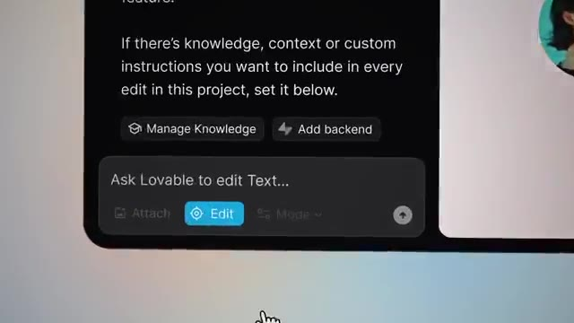
*⏱️ 00:02:06 — Interface de l'outil Lovable montrant une barre de saisie pour éditer du texte, avec des options pour gérer les connaissances et ajouter un backend.*

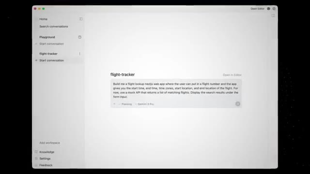
*⏱️ 00:02:10 — Interface de l'éditeur Windsurf (ou outil similaire) affichant un projet nommé "flight-tracker" avec une invite de commande générant une application Next.js.*

---

### ⏱️ `[00:02:20 - 00:02:42]` | Segment #08

**🔊 Audio (Transcription Intégrale Mot pour Mot en Français) :**
> He released two. And it's now doing $30,000 a month. And he's also just like a normal kid in college. So you don't need to be a developer to build a million dollar app anymore because you can use tools like Cloud Code, Cursor, or Replit without knowing how to code. But here's what hasn't changed. The business side is still the hardest part to make this work and is still 80% of your success.

**👁️ Analyse Visuelle d'Écran (gemini-3.5-flash-lite) :**
**Interface & Outils** : Aucune interface logicielle, éditeur de code ou outil technique n'est visible.

**Contenu textuel & Code** : Aucun contenu technique, code ou donnée n'est affiché.

**Action / Démonstration** : Aucune action de démonstration technique n'est effectuée ; il s'agit uniquement de séquences d'interview.

---

### ⏱️ `[00:02:42 - 00:03:05]` | Segment #09

**🔊 Audio (Transcription Intégrale Mot pour Mot en Français) :**
> The good news is that we can actually study what made Cal AI a $100 million company and break it down into three steps that you can follow. So step one, find your idea. This first step is the one that most people get wrong before they even start building. And it's something that Zach had said before. It's really just about identifying something that you can derive value from or you can see someone around you driving value from.

**👁️ Analyse Visuelle d'Écran (gemini-3.5-flash-lite) :**
**Interface & Outils** : Graphique de présentation (UI personnalisée).

**Contenu textuel & Code** : Texte affiché : "1. Find your idea" et "2. [Texte flouté]".

**Action / Démonstration** : Affichage pédagogique des étapes clés pour lancer une entreprise basée sur le modèle de Cal AI.

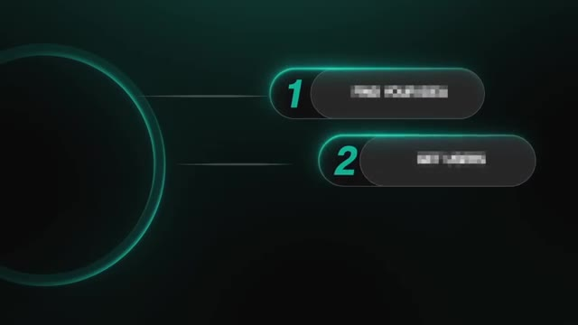
*⏱️ 00:02:48 — Une infographie stylisée sur fond sombre montrant une liste numérotée en deux points, le point "1" étant mis en avant comme "Find your idea".*

---

### ⏱️ `[00:03:05 - 00:03:25]` | Segment #10

**🔊 Audio (Transcription Intégrale Mot pour Mot en Français) :**
> I think that's the best way to come up with an idea and build it out because if you are your ideal user, you'll know exactly what to build. That is such an important mindset shift because most people think you start with a product, you build something cool, and then you figure out how to sell it. But Zach did the opposite, and he started with the problem. And then he built a simple version of the solution.

**👁️ Analyse Visuelle d'Écran (gemini-3.5-flash-lite) :**
**Interface & Outils** : Présentation ou face-caméra explicatif sans interface logicielle partagée.

**Contenu textuel & Code** : Explications orales et mise en contexte méthodologique.

**Action / Démonstration** : Explications face caméra et démonstration conceptuelle.

---

### ⏱️ `[00:03:25 - 00:03:46]` | Segment #11

**🔊 Audio (Transcription Intégrale Mot pour Mot en Français) :**
> And this is the right way to start building an app. People don't download apps because they look good or because they have extra space on their phone. They download apps because the app solves a very specific problem in their lives. For example, Uber solved the problem of getting a ride without calling a cab and waiting 30 minutes. Duolingo solved the problem of language courses being too expensive and too boring. And Cal AI solved the problem of tedious calorie weighing and tracking.

**👁️ Analyse Visuelle d'Écran (gemini-3.5-flash-lite) :**
**Interface & Outils** : Apple App Store, interface mobile Duolingo.

**Contenu textuel & Code** : Fiche produit Uber avec notes et catégories, interface de cours de langue avec icônes (Basics, Phrases, Animals, etc.).

**Action / Démonstration** : Démonstration visuelle d'applications populaires pour appuyer l'argument sur l'utilité des applications.

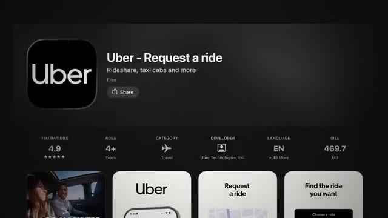
*⏱️ 00:03:35 — Capture d'écran de la fiche de l'application Uber sur l'App Store, illustrant un exemple de résolution de problème concret.*

*⏱️ 00:03:40 — Interface utilisateur de l'application Duolingo montrant des modules d'apprentissage linguistique ludiques.*

---

### ⏱️ `[00:03:46 - 00:04:05]` | Segment #12

**🔊 Audio (Transcription Intégrale Mot pour Mot en Français) :**
> Every successful app starts with one core feature that makes someone say, I need that. So if you're watching this and thinking about building something, here's exactly what I'd do. First, think about your own life. What's a problem that you've run into that frustrates you, and how could you solve it? Then, look at what's already out there and find outdated solutions. For example, MyFitnessPal had been around for over a decade. It was bloated, complicated, and hadn't innovated in years.

**👁️ Analyse Visuelle d'Écran (gemini-3.5-flash-lite) :**
**Interface & Outils** : Présentation ou face-caméra explicatif sans interface logicielle partagée.

**Contenu textuel & Code** : Explications orales et mise en contexte méthodologique.

**Action / Démonstration** : Explications face caméra et démonstration conceptuelle.

---

### ⏱️ `[00:04:06 - 00:04:26]` | Segment #13

**🔊 Audio (Transcription Intégrale Mot pour Mot en Français) :**
> And that created the opportunity to make something simpler and faster with AI. You can start to look at the top apps in different categories and try them out to see which ones feel old or which ones are doing something that AI could make 10 times easier for the actual user. And then once you have that idea, build the simplest possible version that you can using AI tools like Cloud Code or Antigravity or Base44, and that way you can move really fast.

**👁️ Analyse Visuelle d'Écran (gemini-3.5-flash-lite) :**
**Interface & Outils** : Apple App Store (interface utilisateur).

**Contenu textuel & Code** : Liste d'applications populaires (ex: Mail+ for Gmail, Notion Web Clipper, Urban VPN, etc.) avec leurs boutons de téléchargement associés.

**Action / Démonstration** : Présentation visuelle de la méthode consistant à identifier des applications existantes dans les classements pour y déceler des opportunités d'amélioration via l'IA.

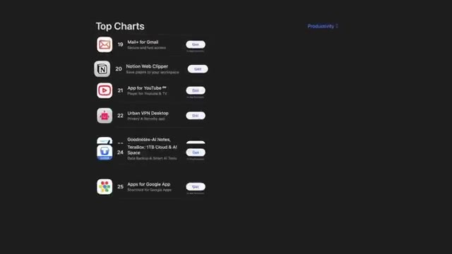
*⏱️ 00:04:11 — Capture d'écran de l'interface "Top Charts" de l'App Store montrant une liste d'applications dans la catégorie Productivité.*

---

### ⏱️ `[00:04:26 - 00:04:46]` | Segment #14

**🔊 Audio (Transcription Intégrale Mot pour Mot en Français) :**
> And moving fast is really important because just how you got that idea, other people can get it to. Cal AI has a ton of copycats, but the reason why Cal AI won is because they got into the market faster and they capitalized on that. So don't spend six months perfecting something that nobody has used yet. Get it out there, get real feedback, and iterate. Because just having a great product that solves a real problem, that's only the first piece of the puzzle.

**👁️ Analyse Visuelle d'Écran (gemini-3.5-flash-lite) :**
**Interface & Outils** : Interface graphique de type présentation/slide illustrant des données de marché.

**Contenu textuel & Code** : Noms d'applications (Cal AI, SnapCal, YAZIO, FoodScan) et métriques de performance ("9M+ Downloads").

**Action / Démonstration** : Présentation visuelle de la stratégie de mise sur le marché et de la nécessité de lancer rapidement un produit.

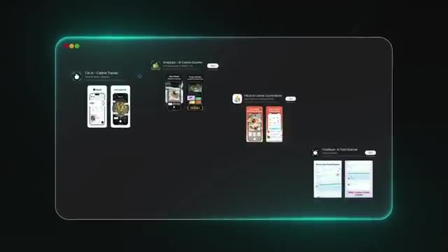
*⏱️ 00:04:31 — Une comparaison visuelle montrant "Cal AI" entouré de multiples applications concurrentes ("copycats").*

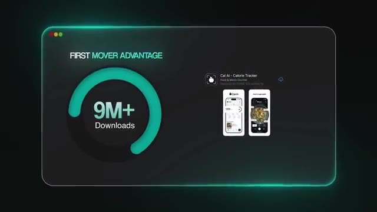
*⏱️ 00:04:36 — Un graphique montrant l'avantage du "First Mover" pour Cal AI avec une statistique de "9M+ Downloads".*

---

### ⏱️ `[00:04:46 - 00:05:08]` | Segment #15

**🔊 Audio (Transcription Intégrale Mot pour Mot en Français) :**
> Without getting anyone in front of it and getting people to actually use it, nobody will obviously know that your app exists. And that brings me into step two, which is the thing that made Cal AI grow so fast. If you had a perfect app, but the worst marketing, you would get no downloads. If you had the worst app, but amazing marketing, you would still get downloads and you'd make some money from those people, even though it's probably like very small conversion rate.

**👁️ Analyse Visuelle d'Écran (gemini-3.5-flash-lite) :**
**Interface & Outils** : Aucun logiciel, éditeur de code ou terminal n'est affiché. Il s'agit d'éléments graphiques de montage (overlay).

**Contenu textuel & Code** : Textes mentionnés : "FIND YOUR IDEA", "PERFECT APP", "BAD MARKETING".

**Action / Démonstration** : Aucune action technique ou manipulation d'outil n'est montrée, il s'agit d'une discussion illustrée par des éléments graphiques.

---

### ⏱️ `[00:05:09 - 00:05:44]` | Segment #16

**🔊 Audio (Transcription Intégrale Mot pour Mot en Français) :**
> So marketing, it's just building. What Zach did to grow in a highly competitive market like fitness was reinvest almost all of the money that they made back into making sure that people knew about the app. So Zach sent hundreds of DMs each day to fitness creators on TikTok and Instagram. At first, almost nobody responded, but he kept going until he found creators willing to work with him and create some ads for the app. But they didn't ask influencers to do any hard selling like, hey guys, this video is sponsored by Cal AI. Instead, they told the creator to make their regular content and somewhere in the first 15 seconds, they'll show themselves using Cal AI. They simply had to add a section where they snap a picture of food and let the calories pop up on the screen. And because the concept of

**👁️ Analyse Visuelle d'Écran (gemini-3.5-flash-lite) :**
**Interface & Outils** : Application de messagerie (DM) sur interface desktop et interface mobile de réseau social.

**Contenu textuel & Code** : Messages type : "This app fits your niche perfectly, worth a look", "Hi! We built a fitness app want to try it & promote if you like it?".

**Action / Démonstration** : Démonstration de la méthode de prospection directe (Cold DM) utilisée pour promouvoir l'application auprès des créateurs de contenu.

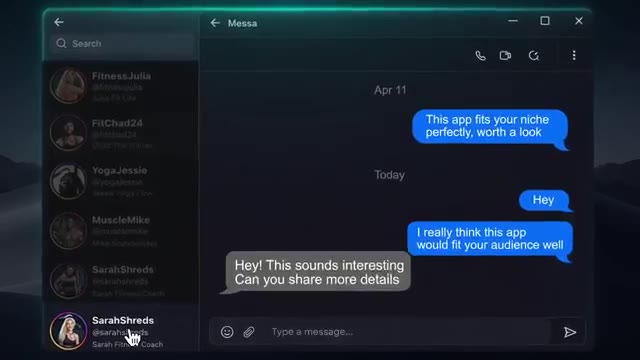
*⏱️ 00:05:26 — Interface de messagerie type "DM" sur ordinateur montrant une série de conversations avec divers créateurs de fitness.*

*⏱️ 00:05:35 — Gros plan sur un smartphone tenu en main montrant une application de messagerie ou de réseau social où des messages promotionnels sont envoyés à un influenceur.*

---

### ⏱️ `[00:05:44 - 00:06:09]` | Segment #17

**🔊 Audio (Transcription Intégrale Mot pour Mot en Français) :**
> scanning your food and instantly seeing calories is so visual, people watching would immediately notice it and flood into the comments asking, what app is that? And this works so well because if you see a traditional ad that says, download Cal AI, your brain immediately just kind of tells you to ignore it. But when you see a fitness creator you've been following for years, scanning their lunch, your brain won't even think that it's an ad. It feels more like getting a recommendation from a friend. You don't trust a billboard, but when your friend says, yo, try this app, you download it that night. So here's what you can do to get your app in front of people.

**👁️ Analyse Visuelle d'Écran (gemini-3.5-flash-lite) :**
**Interface & Outils** : Interface de type application mobile de tracking nutritionnel intégrée à une fenêtre de navigateur ou de bureau stylisée.

**Contenu textuel & Code** : Visuel d'une application montrant une assiette de nourriture et une interface de scan/analyse calorique.

**Action / Démonstration** : Démonstration visuelle du cas d'usage de l'application (scanning de nourriture) pour illustrer l'engagement utilisateur.

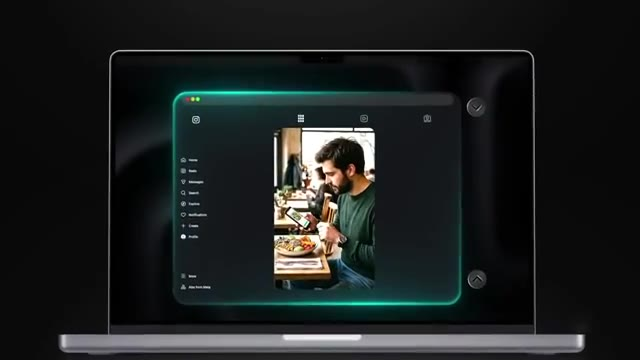
*⏱️ 00:05:56 — Interface de démonstration montrant un utilisateur sur son téléphone en train de scanner de la nourriture dans un restaurant, intégrée dans un design de bureau épuré avec un contour lumineux.*

---

### ⏱️ `[00:06:09 - 00:06:29]` | Segment #18

**🔊 Audio (Transcription Intégrale Mot pour Mot en Français) :**
> First, find 20 to 30 creators in whatever market your app is. They don't need to be huge. Even someone with a few thousand followers works. Then, DM them. Tell them what your app does and show them why their audience would care about it. And offer a flat rate for a bundle of videos. But most importantly, give them complete creator freedom. They know what works with their audience, so just give them the app and tell them to show it in the first 15 seconds of the video.

**👁️ Analyse Visuelle d'Écran (gemini-3.5-flash-lite) :**
**Interface & Outils** : AUCUNE

**Contenu textuel & Code** : AUCUN

**Action / Démonstration** : AUCUNE

---

### ⏱️ `[00:06:29 - 00:06:48]` | Segment #19

**🔊 Audio (Transcription Intégrale Mot pour Mot en Français) :**
> The less that it looks like an ad, the better it will work. And the fourth step is to track everything. So look at when the video was posted, how many views it got, and what your downloads and revenue looked like on that same day. This is how you figure out which influencers and types of content work best. And from there, it's just a matter of doing more of what's working, signing more creators, and getting more users. Okay, step three is to build predictable income.

**👁️ Analyse Visuelle d'Écran (gemini-3.5-flash-lite) :**
**Interface & Outils** : Aucune interface logicielle pertinente ou professionnelle n'est clairement présentée en démonstration.

**Contenu textuel & Code** : Aucun code, aucune donnée analytique ou workflow n'est visible.

**Action / Démonstration** : Aucune manipulation technique ou démonstration d'outil n'est effectuée.

---

### ⏱️ `[00:06:48 - 00:07:07]` | Segment #20

**🔊 Audio (Transcription Intégrale Mot pour Mot en Français) :**
> So a lot of people think that once someone downloads your app, the deal is done. But it's actually just starting. Cal AI has a lot of copycats trying to do the same thing, so they know that convincing someone to download their app is going to be hard. Some months, they could add thousands of new users, but other months, they could only add maybe a couple hundred. So to build predictable revenue, they need to make sure that every single user they already had keeps using Cal AI.

**👁️ Analyse Visuelle d'Écran (gemini-3.5-flash-lite) :**
**Interface & Outils** : Application web (landing page), Graphique statistique personnalisé.

**Contenu textuel & Code** : NutriScan App (UI), statistiques mensuelles d'utilisateurs ("Signed users").

**Action / Démonstration** : Présentation visuelle d'une application suivie d'une illustration de la fluctuation du taux d'acquisition d'utilisateurs.

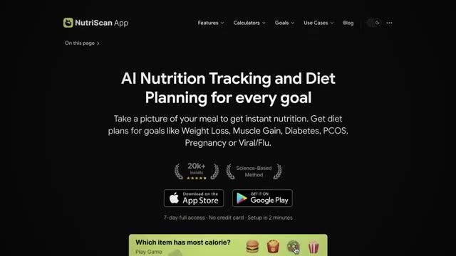
*⏱️ 00:06:53 — Interface web de l'application NutriScan, présentant des fonctionnalités de suivi nutritionnel par IA et des boutons de téléchargement.*

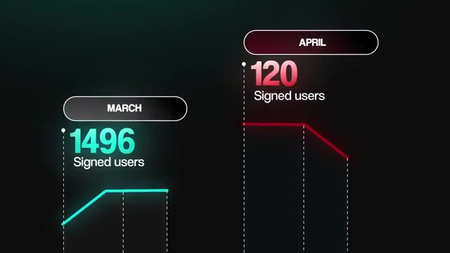
*⏱️ 00:07:03 — Graphique comparatif montrant le nombre d'utilisateurs inscrits entre les mois de mars (1496) et avril (120).*

---

### ⏱️ `[00:07:07 - 00:07:25]` | Segment #21

**🔊 Audio (Transcription Intégrale Mot pour Mot en Français) :**
> If users downloaded the app, used it for a week, and then went with the competition, the whole business model falls apart. So how did Kalii do it? Well, it comes down to three strategies, and the first one starts before users even start snapping pictures. When you first open the app, it asks you a series of questions. What's your weight? What's your goal weight? Why are you trying to lose or gain weight? How is this going to improve your life?

**👁️ Analyse Visuelle d'Écran (gemini-3.5-flash-lite) :**
**Interface & Outils** : Interface d'application mobile (application de fitness/santé).

**Contenu textuel & Code** : Formulaire de saisie "Height & weight" avec sélecteurs de mesures (Imperial/Metric), taille et poids.

**Action / Démonstration** : Processus d'onboarding utilisateur : collecte de données biométriques pour la personnalisation du service avant l'utilisation principale.

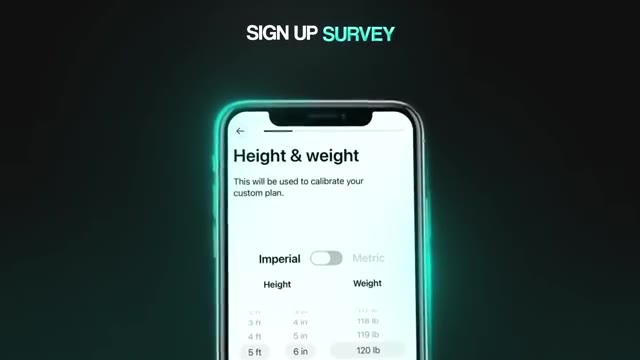
*⏱️ 00:07:21 — Une interface mobile est présentée, montrant un écran de configuration "SIGN UP SURVEY" demandant à l'utilisateur d'entrer sa taille et son poids pour calibrer un plan personnalisé.*

---

### ⏱️ `[00:07:25 - 00:07:46]` | Segment #22

**🔊 Audio (Transcription Intégrale Mot pour Mot en Français) :**
> And the reason is that when you ask more personal questions about goals and motivations, it turns into a higher conversion rate. Because by the time someone has answered 10 questions about why they want to get healthier, they've already invested time and emotional energy. So when the subscription page pops up, paying 30 bucks for the year feels like the obvious next step. The second strategy comes back to that core product decision that we talked about earlier. They made the app so simple that using it was basically effortless.

**👁️ Analyse Visuelle d'Écran (gemini-3.5-flash-lite) :**
**Interface & Outils** : Aucune interface logicielle ou de démonstration technique n'est présente.

**Contenu textuel & Code** : Texte informatif uniquement.

**Action / Démonstration** : Aucune action technique ou démonstration logicielle effectuée.

---

### ⏱️ `[00:07:46 - 00:08:05]` | Segment #23

**🔊 Audio (Transcription Intégrale Mot pour Mot en Français) :**
> You take a picture, you get your calories, and it's done. The whole interaction takes maybe five seconds. Compare that to a generic fitness app where you're scrolling through databases, searching for your food, putting it on scale, and manually adjusting portions. Cal AI was able to remove that friction. And that's the key insight here. The less effort that it takes to use your app every day, the more likely people are to keep using it.

**👁️ Analyse Visuelle d'Écran (gemini-3.5-flash-lite) :**
**Interface & Outils** : Aucune interface logicielle montrée (contexte matériel physique).

**Contenu textuel & Code** : Aucun code ou texte affiché.

**Action / Démonstration** : Pesée manuelle d'un complément alimentaire sur une balance de cuisine.

*⏱️ 00:07:56 — Une personne utilise une balance de cuisine électronique pour peser de la poudre protéinée versée dans un shaker, illustrant le processus manuel fastidieux.*

---

### ⏱️ `[00:08:05 - 00:08:28]` | Segment #24

**🔊 Audio (Transcription Intégrale Mot pour Mot en Français) :**
> They also added small features that reinforced the habit like daily streaks, simple dashboards showing your progress, and a health score that told you how well you were eating. Now, these aren't groundbreaking features, but they give users a reason to come back and check in every single day. And if you're using something every single day, then it's hard to justify using something else. And here's why this matters for the long run. When your monthly revenue is solid and predictable, that's when your app becomes attractive to bigger companies and when the acquisition offers actually start to come in.

**👁️ Analyse Visuelle d'Écran (gemini-3.5-flash-lite) :**
**Interface & Outils** : Application mobile (interface utilisateur de type dashboard de santé).

**Contenu textuel & Code** : Données chiffrées : 9 845 pas sur 10 000, 332 calories brûlées, suivi d'hydratation (24 fl oz).

**Action / Démonstration** : Visualisation des fonctionnalités de rétention utilisateur (streaks, score de santé, tableau de bord).

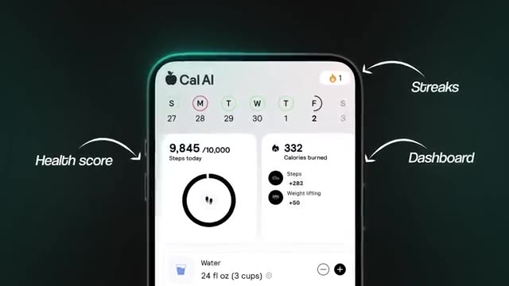
*⏱️ 00:08:10 — Interface mobile de l'application "Cal AI" affichant des données de suivi de santé : calendrier hebdomadaire, compteur de pas journalier, calories brûlées et consommation d'eau.*

---

### ⏱️ `[00:08:28 - 00:08:49]` | Segment #25

**🔊 Audio (Transcription Intégrale Mot pour Mot en Français) :**
> So CalAI, selling for millions, proved that the opportunity right now is real. A teenager with no investors or fancy office built an AI app into a company worth hundreds of millions of dollars. And the tools available today are even better than what he had when he started. So you can do what Zach did in less time. But this window is not going to stay open forever. The AI space is moving insanely fast, so you need to act with speed and not waste time.

**👁️ Analyse Visuelle d'Écran (gemini-3.5-flash-lite) :**
**Interface & Outils** : Aucune interface logicielle, éditeur de code ou outil d'automatisation n'est présent dans ces images.

**Contenu textuel & Code** : Aucun code, aucune ligne de commande ni aucune donnée technique n'est affichée.

**Action / Démonstration** : Aucune action technique, démonstration logicielle ou manipulation d'agent IA n'est effectuée.

---

### ⏱️ `[00:08:49 - 00:09:07]` | Segment #26

**🔊 Audio (Transcription Intégrale Mot pour Mot en Français) :**
> That's why I created a roadmap file based on Cal AI success to help give you clarity on the steps that you need to follow. You can download this for completely free. It's inside of my free school community where you can get more information about how to use AI tools like Cloud Code to build a business from scratch. You can join for free with the link in the description. Anyways, that's going to do it for today's video. As always, thanks for staying until the end, and I'll see you guys in the next one.

**👁️ Analyse Visuelle d'Écran (gemini-3.5-flash-lite) :**
**Interface & Outils** : Plateforme communautaire School (AI Automation Society).

**Contenu textuel & Code** : Noms des cours : "Start Here", "FREE n8n Templates", "Claude Code".

**Action / Démonstration** : Navigation dans l'interface de la salle de classe virtuelle pour accéder aux ressources pédagogiques.

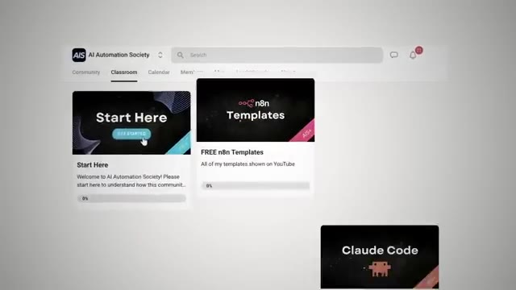
*⏱️ 00:08:58 — Interface de la plateforme "AI Automation Society" (School) montrant l'onglet "Classroom" avec divers modules de formation : "Start Here", "FREE n8n Templates" et "Claude Code".*

---

### ⏱️ `[00:09:08 - 00:09:08]` | Segment #27

**🔊 Audio (Transcription Intégrale Mot pour Mot en Français) :**
> Thanks everyone.

**👁️ Analyse Visuelle d'Écran (gemini-3.5-flash-lite) :**
**Interface & Outils** : Aucune

**Contenu textuel & Code** : Aucun

**Action / Démonstration** : Le présentateur conclut la vidéo en faisant un geste de la main.

---

