# 🎬 How to Build Claude Agent Teams Better Than 99% of People

> **Chaîne** : [Nate Herk | AI Automation](https://www.youtube.com/@nateherk/featured)  
> **Lien YouTube** : [https://www.youtube.com/watch?v=vDVSGVpB2vc](https://www.youtube.com/watch?v=vDVSGVpB2vc)  
> **Date de publication** : 20260323  
> **Durée** : 00:16:29  
> **Identifiant vidéo** : `vDVSGVpB2vc`  
> **Transcription & Analyse** : `whisper-v3-large-turbo+gemini-3.5-flash-lite`  

---

## 📌 Synthèse Exécutive & Outils

### 💡 Résumé
Dans cette vidéo intitulée **Comment créer des équipes d'agents Claude mieux que 99 % des gens**, Nate Herk décortique les capacités pratiques d'automatisation et de développement propulsées par les modèles de pointe.

### 🛠️ Outils, Modèles & Logiciels Présentés
- **Opus 5.5 & Claude Code** : Modèles d'ingénierie et agents de codage autonome.

### 🔑 Points Clés & Enseignements Stratégiques
- Optimiser le niveau d'effort et le raisonnement des modèles IA pour des résultats industriels.
- Automatiser les cycles de création logicielle de bout en bout.

---

## ⏱️ Chronologie & Transcription Complète Audio & Visuelle (Mot pour Mot)

### ⏱️ `[00:00:00 - 00:00:20]` | Segment #01

**🔊 Audio (Transcription Intégrale Mot pour Mot en Français) :**
> I just pasted in this message and I'm shooting it off to Claude and it says, create a team called Neuroflow of three teammates using Sonnet. The first one is a front-end developer, the second one is a back-end developer, and the third one is a QA agent. So this now invoked a tool called TeamCreate. And you can see that what it's doing is now that it's created this team, it's spawning up three teammates in parallel, and these are all individual agents.

**👁️ Analyse Visuelle d'Écran (gemini-3.5-flash-lite) :**
**Interface & Outils** : VS Code avec une extension d'agent IA (type Claude Code / Agent Teams).

**Contenu textuel & Code** : Le prompt détaillé pour la création de trois agents (Front-end dev, Back-end dev, QA agent) pour le projet "NeuralFlow", incluant des instructions techniques spécifiques pour le développement d'une landing page et d'une API Express.js.

**Action / Démonstration** : Envoi d'une instruction à l'agent pour initialiser la création d'une équipe de travail automatisée (outil "TeamCreate").

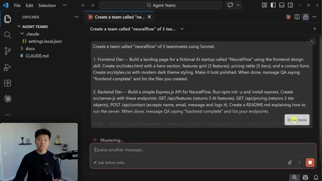
*⏱️ 00:00:05 — Une vue de l'interface de l'éditeur VS Code montrant une fenêtre de chat d'agent IA où une requête complexe pour créer une équipe de développement nommée "Neuralflow" a été soumise.*

---

### ⏱️ `[00:00:21 - 00:00:57]` | Segment #02

**🔊 Audio (Transcription Intégrale Mot pour Mot en Français) :**
> So right now we can see we have our front-end developer, we have our back-end developer, and we have our QA agent. So what's happening is right now we have these three agents working together with our main session. They all share a task list. They can talk to each other. And I'm going to check back with you guys once this is done. Okay, so this is really interesting. The front end and back end developer sent work over to the QA agent. And then the QA agent found three critical issues. So the main agent said that it's going to send all of this work right back to those first two agents to take another pass at it. So here's where you can see it sent off those messages to the front end developer, the back end dev and the QA. And now they're all back to work once again. And there we go. The second time the QA agent gives it a pass. All three of those

**👁️ Analyse Visuelle d'Écran (gemini-3.5-flash-lite) :**
**Interface & Outils** : VS Code avec extension de chat/agent IA.

**Contenu textuel & Code** : Tableau listant trois agents (frontend-dev, backend-dev, qa) avec leurs tâches respectives (Build landing page, Build Express.js API, Test plan) et leur statut "Running", ainsi que le workflow détaillé.

**Action / Démonstration** : Initialisation d'une équipe d'agents IA via une interface de chat intégrée à l'éditeur de code.

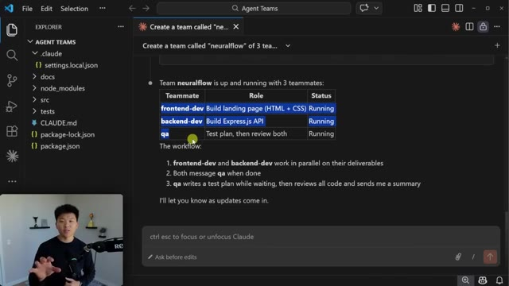
*⏱️ 00:00:30 — Interface VS Code affichant un tableau récapitulatif des rôles et statuts d'une équipe d'agents IA baptisée "neuralflow".*

---

### ⏱️ `[00:00:57 - 00:01:33]` | Segment #03

**🔊 Audio (Transcription Intégrale Mot pour Mot en Français) :**
> critical issues have been resolved. And then it was able to basically one shot this website. Now, obviously there are some things that aren't perfect about this and we'd want to go back and iterate, but considering in the prompt, all I said was to build me a landing page for a fictional AI startup. And we get all of this text, we get these animations, we get all of this stuff to come in dynamically, and it feels pretty polished. It came up with all the copy, the color scheme, all of it. This is truly one of the most powerful AI agent features I've ever used, but you have to know how to use it right. Which is why in today's video, I'm going to explain everything you need to know, what they are, how to set them up, how to use them, when not to use them, everything that you need. So let's not waste any time and get straight into the video. So agent

**👁️ Analyse Visuelle d'Écran (gemini-3.5-flash-lite) :**
**Interface & Outils** : Navigateur web (landing page), Diagramme système.

**Contenu textuel & Code** : Interface utilisateur de NeuralFlow, architecture de workflow multi-agents (Agent A, B, C, D).

**Action / Démonstration** : Présentation du résultat généré par l'IA (le site web) et explication théorique du fonctionnement collaboratif des agents.

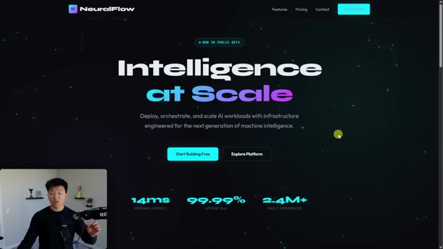
*⏱️ 00:01:06 — Page d'accueil de la startup fictive "NeuralFlow" avec un titre "Intelligence at Scale" et des statistiques de performance.*

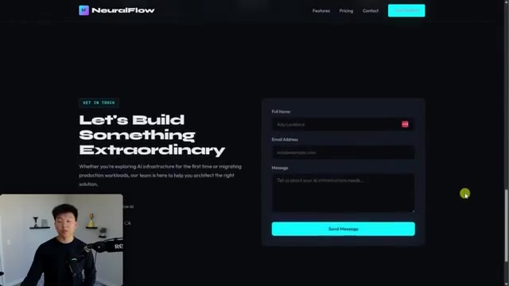
*⏱️ 00:01:15 — Section "Contact" de la landing page avec un formulaire interactif nommé "Let's Build Something Extraordinary".*

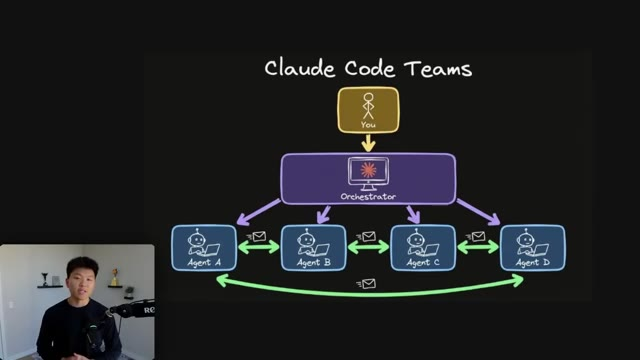
*⏱️ 00:01:24 — Schéma conceptuel illustrant l'architecture "Claude Code Teams" avec un orchestrateur central et plusieurs agents communicants.*

---

### ⏱️ `[00:01:33 - 00:01:53]` | Segment #04

**🔊 Audio (Transcription Intégrale Mot pour Mot en Français) :**
> teams, as you guys saw in the demo, we had one get spun up called Neuroflow. And in that team, we had three agents. We had the front end dev, the backend dev, and the QA. So what happens is the main orchestrator, the cloud code session you're talking to creates these different agents and manages them, but not in the same way that we do sub agents because sub agents work independently. and then they send their individual result back to the main agent.

**👁️ Analyse Visuelle d'Écran (gemini-3.5-flash-lite) :**
**Interface & Outils** : VS Code (avec extension Claude Code), Présentation graphique (diagrammes d'architecture).

**Contenu textuel & Code** : Logs d'exécution : "Create a team called 'neuralflow'", "Spawning the 3 teammates in parallel", définitions de rôles (Frontend Dev, Backend Dev).

**Action / Démonstration** : Initialisation et orchestration d'une équipe d'agents IA pour le développement logiciel.

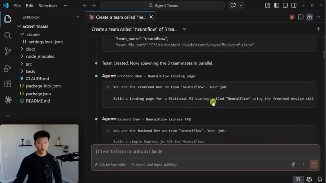
*⏱️ 00:01:38 — Interface VS Code affichant la configuration et le déploiement en parallèle d'agents IA (Frontend, Backend).*

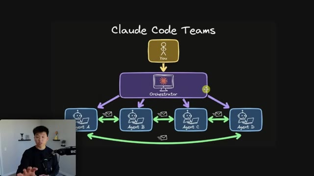
*⏱️ 00:01:43 — Diagramme illustrant l'architecture "Claude Code Teams" avec un orchestrateur central communiquant avec plusieurs agents.*

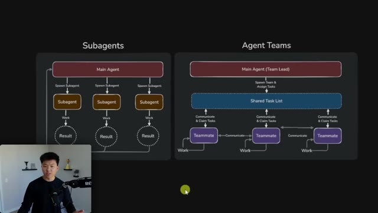
*⏱️ 00:01:48 — Schéma comparatif entre une architecture de "Subagents" classiques et le système "Agent Teams" avec une liste de tâches partagée.*

---

### ⏱️ `[00:01:54 - 00:02:16]` | Segment #05

**🔊 Audio (Transcription Intégrale Mot pour Mot en Français) :**
> Agent teams have a team lead, maybe like a project manager, and it creates all of these different agents and a shared task list. So the huge unlock here is that individual teammates can talk to each other. So sometimes there's a dependency. Teammate one needs something from teammate two and they can just talk. And you can get in these really cool loops, especially when you have the QA agent like we just saw in the demo, where one of the teammates will basically say, hey, this isn't good enough and send the work back.

**👁️ Analyse Visuelle d'Écran (gemini-3.5-flash-lite) :**
**Interface & Outils** : Schéma conceptuel/diagramme de flux (non spécifique à un logiciel).

**Contenu textuel & Code** : Texte : "Subagents" (Main Agent, Subagent, Result) vs "Agent Teams" (Main Agent/Team Lead, Shared Task List, Teammate). Flèches indiquant la communication bidirectionnelle entre les coéquipiers.

**Action / Démonstration** : Visualisation théorique pour expliquer le concept de délégation de tâches et de communication inter-agents au sein d'une équipe IA.

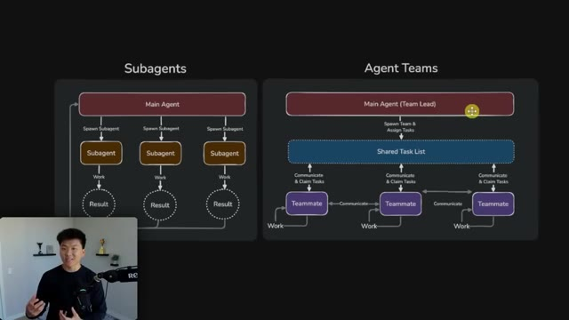
*⏱️ 00:01:59 — Schéma comparatif illustrant la différence structurelle entre une architecture de "Subagents" (hiérarchie verticale simple) et une architecture de "Agent Teams" (collaboration horizontale via une liste de tâches partagée).*

---

### ⏱️ `[00:02:16 - 00:02:37]` | Segment #06

**🔊 Audio (Transcription Intégrale Mot pour Mot en Français) :**
> And then the main agent, like I said, is just making sure that the tasks are getting done and that they're all high quality. So that's the big difference between sub-agents and agent teams. And I had to clear that up because I know that's probably where there's some confusion. So I am gonna break more stuff down, but what I wanted to do first is just show you guys how to set this up because I think the best way to learn is just to be able to play around with stuff. And all you have to do to set this up is add one environment variable into your project setting.

**👁️ Analyse Visuelle d'Écran (gemini-3.5-flash-lite) :**
**Interface & Outils** : Diagrammes conceptuels (schémas illustratifs).

**Contenu textuel & Code** : Texte affiché : "Subagents", "Agent Teams", "Main Agent", "Shared Task List", "settings.json", "env: AGENT_TEAMS = 1".

**Action / Démonstration** : Explication théorique des différences structurelles entre deux approches de gestion d'agents IA, suivie de l'instruction de configuration technique.

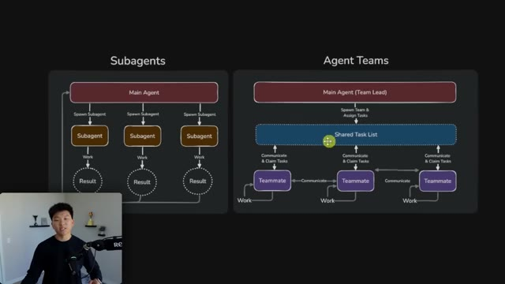
*⏱️ 00:02:21 — Schéma comparatif illustrant la différence entre une architecture à "Subagents" (gérée de manière descendante) et une structure en "Agent Teams" (avec une liste de tâches partagée et une communication horizontale entre les agents).*

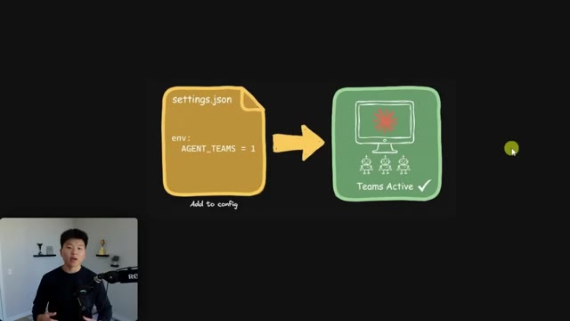
*⏱️ 00:02:27 — Schéma montrant la configuration nécessaire pour activer les équipes d'agents, avec une modification dans un fichier 'settings.json' pour définir la variable 'AGENT_TEAMS = 1'.*

---

### ⏱️ `[00:02:37 - 00:02:56]` | Segment #07

**🔊 Audio (Transcription Intégrale Mot pour Mot en Français) :**
> So let me show you how that works right now. All right, here I am in Cloud Code. I like to use it in VS Code, but you can use the agent teams feature wherever you decide to use Cloud Code. You can see that I am in a brand new project with nothing in it. So this is exactly what one of your guys' setups should look like if you wanna follow along. So like I said, we need to enable the feature and I'm gonna do that in this demo on the project level.

**👁️ Analyse Visuelle d'Écran (gemini-3.5-flash-lite) :**
**Interface & Outils** : Visual Studio Code avec l'extension Claude Code active.

**Contenu textuel & Code** : Zone de saisie de prompt "ctrl esc to focus or unfocus Claude" et logo Claude Code au centre.

**Action / Démonstration** : Le présentateur introduit l'environnement de développement vide avant de commencer la démonstration de l'agent.

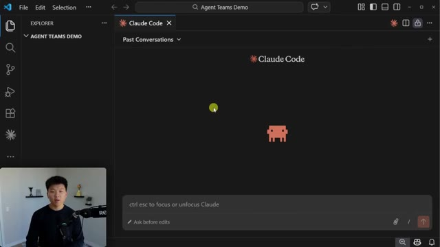
*⏱️ 00:02:42 — Interface de VS Code montrant l'extension Claude Code ouverte dans un projet vide nommé "Agent Teams Demo".*

---

### ⏱️ `[00:02:57 - 00:03:17]` | Segment #08

**🔊 Audio (Transcription Intégrale Mot pour Mot en Français) :**
> So what I'm gonna do is go to the official Cloud Code documentation for Agent Teams and you can see right here that it says they are disabled by default because it's an experimental feature. So you have to enable them by adding this variable into your settings.json. So what I'm gonna do is literally just copy this JSON right here and come into Cloud Code and say, hey, I need you to put this in our local settings in this project.

**👁️ Analyse Visuelle d'Écran (gemini-3.5-flash-lite) :**
**Interface & Outils** : Documentation web officielle (Claude Code Docs) et éditeur de code (VS Code).

**Contenu textuel & Code** : Texte de documentation mentionnant "CLAUDE_CODE_EXPERIMENTAL_AGENT_TEAMS" et variable "settings.json" ; interface d'interaction Claude Code dans VS Code.

**Action / Démonstration** : Consultation de la documentation pour identifier la configuration nécessaire, puis basculement vers l'environnement de développement VS Code.

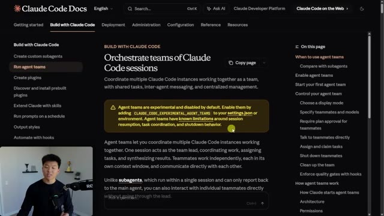
*⏱️ 00:03:02 — Documentation officielle de "Claude Code" expliquant la configuration des "Agent Teams" avec une mise en évidence sur l'activation de la variable expérimentale.*

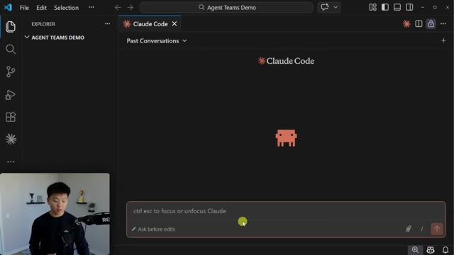
*⏱️ 00:03:12 — Interface de l'éditeur VS Code affichant l'extension Claude Code dans la barre latérale, avec la fenêtre de chat active au centre.*

---

### ⏱️ `[00:03:17 - 00:03:38]` | Segment #09

**🔊 Audio (Transcription Intégrale Mot pour Mot en Français) :**
> and then just paste in that JSON prompt. And I'm gonna go ahead and shoot that off. And that should basically be able to create that file for us. So you can see that it set everything up. We now have a .cloud folder. If I click into here, we have a settings.local.json and it has put that command in there. And now our project should be set up to actually be able to use Agent Teams. Now, before we dive in and I start showing you guys how to do that, there is one thing that I recommend doing first.

**👁️ Analyse Visuelle d'Écran (gemini-3.5-flash-lite) :**
**Interface & Outils** : Visual Studio Code (avec extension ou interface de chat Claude intégrée).

**Contenu textuel & Code** : Bloc de code JSON : {"env": {"CLAUDE_CODE_EXPERIMENTAL_AGENT_TEAMS": "1"}}. L'agent affiche l'état "Thinking..." et "Spelunkin...".

**Action / Démonstration** : L'utilisateur a soumis un prompt demandant à l'agent d'ajouter une configuration spécifique au projet, l'agent est en phase d'exécution et d'exploration.

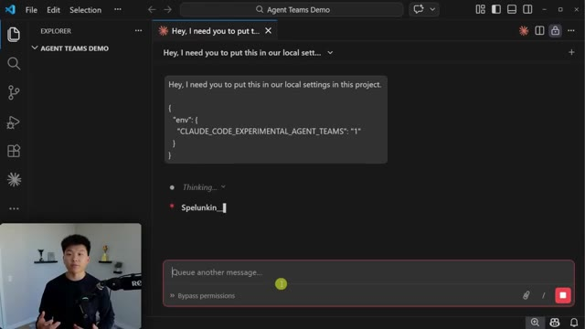
*⏱️ 00:03:22 — Interface de VS Code montrant une fenêtre de discussion avec un agent IA intégré (Claude Code) en train de traiter une instruction JSON.*

---

### ⏱️ `[00:03:39 - 00:03:58]` | Segment #10

**🔊 Audio (Transcription Intégrale Mot pour Mot en Français) :**
> And that's basically training your Cloud Code project on how Agent Teams work so that they can actually be used as effectively as possible. So the easiest way to do this is you go to the documentation on agent teams, you take the URL and you copy it. And then I said, hey, create me a master reference guide for agent teams in a folder called docs. This will be used to help you build better and more effective agents in the future.

**👁️ Analyse Visuelle d'Écran (gemini-3.5-flash-lite) :**
**Interface & Outils** : VS Code (extension Claude Code), Navigateur Web (Claude Code Documentation).

**Contenu textuel & Code** : URL de documentation : "https://code.claude.com/docs/en/agent-teams#enable-agent-teams" ; Prompt : "Create a master reference guide for agent teams in a folder called docs".

**Action / Démonstration** : Copie d'URL depuis la documentation, saisie d'un prompt dans l'interface Claude Code pour initier la création d'une documentation locale.

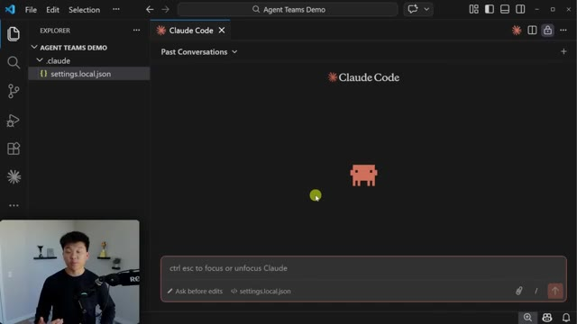
*⏱️ 00:03:43 — Interface de l'éditeur VS Code avec le panneau "Claude Code" ouvert, affichant une invite vide en attente d'interaction utilisateur.*

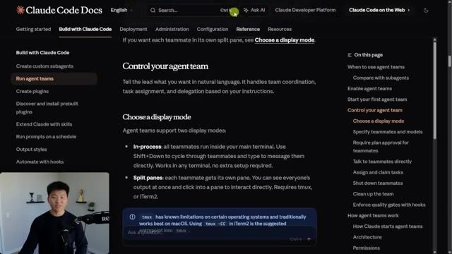
*⏱️ 00:03:48 — Capture de la documentation officielle "Claude Code Docs" sur le web, montrant les instructions pour configurer et contrôler des équipes d'agents.*

*⏱️ 00:03:53 — L'éditeur VS Code où l'agent Claude Code est en train de traiter une requête utilisateur portant sur la création d'un guide de référence pour les "agent teams".*

---

### ⏱️ `[00:03:58 - 00:04:22]` | Segment #11

**🔊 Audio (Transcription Intégrale Mot pour Mot en Français) :**
> And now it's gonna read through that documentation. And now if you ever have questions about agent teams or if it ever needs to look up something while it is building them, it already has that locally here stored as markdown. So it's gonna be much quicker. And it just created this documentation about enabling them, when to use them, display modes, task management, hooks, best practices, tons of stuff like that. And that can be found in the docs folder in this section, which is a full markdown file with hundreds of lines.

**👁️ Analyse Visuelle d'Écran (gemini-3.5-flash-lite) :**
**Interface & Outils** : VS Code avec l'extension ou l'interface de Claude (Agent Teams).

**Contenu textuel & Code** : Log des actions : "Thinking", "Web Fetch" (vers la documentation agent-teams), commande bash "ls" pour lister le répertoire du projet, et lecture du fichier "MEMORY.md". Un champ de saisie "Queue another message..." est visible en bas.

**Action / Démonstration** : L'agent automatise la récupération de la documentation et l'exploration de la structure des fichiers locaux pour construire une base de connaissances.

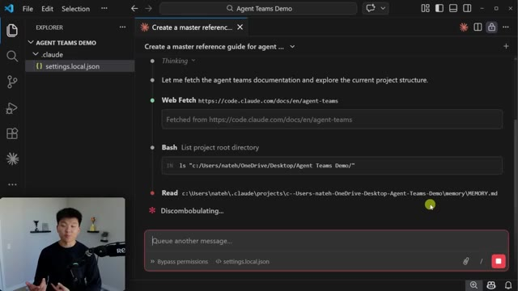
*⏱️ 00:04:04 — Interface de l'éditeur VS Code montrant un flux de travail d'agent IA en cours d'exécution avec des étapes de réflexion, de lecture web et de manipulation de fichiers.*

---

### ⏱️ `[00:04:23 - 00:04:46]` | Segment #12

**🔊 Audio (Transcription Intégrale Mot pour Mot en Français) :**
> And that's just a little tip. That's something that I like to do whenever I have like maybe a big MCP server or certain documentation that I know it might need to look at constantly. So now that we're pretty much set up and ready to start building, let's talk about prompting. How do we actually tell CloudCode to build us agent teams, but not just to build them, but to actually make them really good to give you what you want? Because the truth about agent teams is that they are more expensive and they're a bit slower, but you do get much higher quality if you use them right.

**👁️ Analyse Visuelle d'Écran (gemini-3.5-flash-lite) :**
**Interface & Outils** : VS Code (avec extension Claude/Cursor probablement), Logiciel de présentation de diagrammes.

**Contenu textuel & Code** : Liste de points techniques sur les "Agent teams" dans le fichier markdown ; Schéma conceptuel de "Team Prompting" avec des rôles définis (API Designer, DB Engineer, Test Writer).

**Action / Démonstration** : Le présentateur explique comment utiliser un document de référence centralisé pour configurer des agents, puis passe à une présentation visuelle pour expliquer la logique du prompting d'équipe.

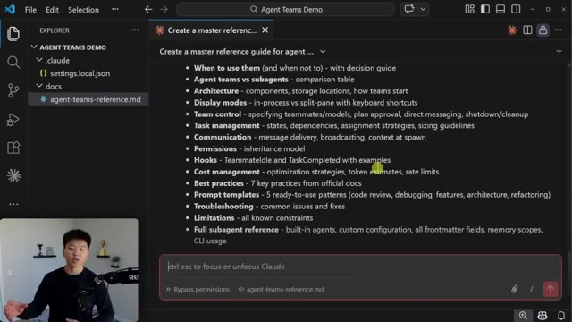
*⏱️ 00:04:29 — Interface VS Code avec le fichier 'agent-teams-reference.md' ouvert, présentant une liste structurée des capacités et composants d'une équipe d'agents IA (architecture, hooks, gestion des coûts, etc.).*

*⏱️ 00:04:34 — Diagramme visuel illustrant le concept de "Team Prompting", montrant comment structurer des rôles d'agents IA (API Designer, DB Engineer, Test Writer) pour des tâches spécifiques.*

---

### ⏱️ `[00:04:47 - 00:05:06]` | Segment #13

**🔊 Audio (Transcription Intégrale Mot pour Mot en Français) :**
> Now, the good news is you can pretty much invoke them just using natural language. So I kind of follow this pattern. Create a team of X number of agents using X model. So Haiku, Sonnet, or Opus. And then you basically just say the agents that you want. You would say, the first agent is X role. This agent should be doing this, and it should produce me this.

**👁️ Analyse Visuelle d'Écran (gemini-3.5-flash-lite) :**
**Interface & Outils** : Schéma conceptuel/diagramme personnalisé.

**Contenu textuel & Code** : Texte affichant la structure du prompt : "Create a team of [N] using [model]..." suivi des rôles : "API Designer (routes/ -> spec)", "DB Engineer (migrations/ -> schema)", et "Test Writer (tests/ -> suite)".

**Action / Démonstration** : Présentation visuelle de la méthodologie de création d'agents via langage naturel.

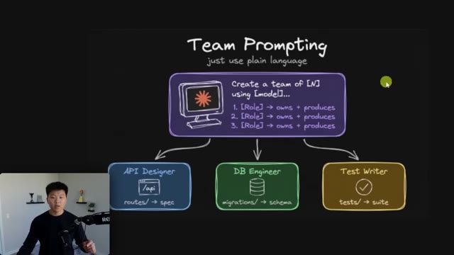
*⏱️ 00:04:51 — Un schéma illustrant le concept de "Team Prompting", montrant comment structurer une équipe d'agents IA avec des rôles spécifiques (API Designer, DB Engineer, Test Writer) et leurs responsabilités respectives.*

---

### ⏱️ `[00:05:07 - 00:05:32]` | Segment #14

**🔊 Audio (Transcription Intégrale Mot pour Mot en Français) :**
> It can talk to the other agents to do X, Y, and Z. And so pretty much just listing that out in natural language. whether that be an API designer, a database engineer, and or a test writer. So let's take a real quick look at an example prompt. So I'm going to read this full one out. Now what you'll notice is I start off by establishing a goal. The reason I do this is because when the agents wake up, they have no context. They basically only get the prompt that the main session feeds into them.

**👁️ Analyse Visuelle d'Écran (gemini-3.5-flash-lite) :**
**Interface & Outils** : Présentation visuelle (type tableau blanc/diagramme).

**Contenu textuel & Code** : - Image 1 : Structure de prompt avec rôles (API Designer, DB Engineer, Test Writer) et leurs responsabilités (routes, migrations, tests).
- Image 2 : Prompt détaillé définissant un objectif de développement full-stack (React + REST API), les rôles des 3 agents, et les livrables attendus (application, rapports de tests, documentation).

**Action / Démonstration** : Le présentateur explique visuellement la méthodologie de délégation de tâches par le langage naturel à des agents IA spécialisés.

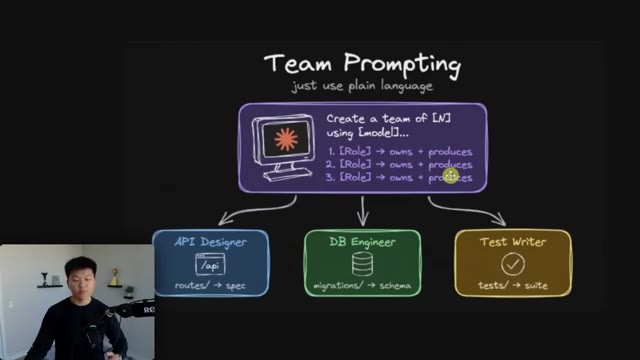
*⏱️ 00:05:13 — Schéma conceptuel illustrant le "Team Prompting", montrant comment structurer une équipe d'agents IA (API Designer, DB Engineer, Test Writer) avec leurs rôles respectifs.*

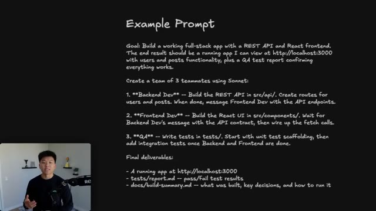
*⏱️ 00:05:19 — Texte affichant un exemple concret de prompt pour automatiser la création d'une application full-stack via une équipe d'agents IA (Backend, Frontend, QA).*

---

### ⏱️ `[00:05:32 - 00:05:59]` | Segment #15

**🔊 Audio (Transcription Intégrale Mot pour Mot en Français) :**
> So if we tell the main agent a goal to give to these sub agents, they understand a little bit better, you know, like what they're working towards, but also why they have their teammates next to them. So the goal here is to build a working full stack app with a REST API and a React front end. The end result should be a running app that I can view on a local host. It should have users and post functionality plus a QA test report confirming that everything works. So then I said, hey, create me a team of three teammates using Sonnet. The first one's a backend dev. It should be doing this.

**👁️ Analyse Visuelle d'Écran (gemini-3.5-flash-lite) :**
**Interface & Outils** : Diapositive de présentation (style tableau noir).

**Contenu textuel & Code** : Le prompt détaille un objectif de construction d'une application full-stack (REST API + React) et définit trois rôles d'agents : Backend Dev, Frontend Dev, et QA, avec leurs responsabilités respectives et les livrables finaux attendus.

**Action / Démonstration** : Présentation théorique du workflow de collaboration entre agents IA pour structurer une équipe de développement automatisée.

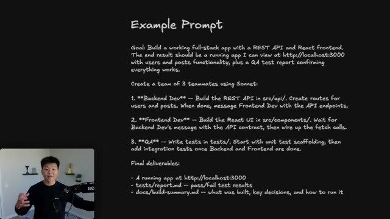
*⏱️ 00:05:39 — Une diapositive textuelle présentant un exemple de prompt pour configurer une équipe d'agents IA spécialisés dans le développement logiciel.*

---

### ⏱️ `[00:05:59 - 00:06:21]` | Segment #16

**🔊 Audio (Transcription Intégrale Mot pour Mot en Français) :**
> The second one is a front end dev and it should be doing this. And the third one is a QA agent that should be doing this. You can see that in the descriptions I said, when you're done, message the front-end dev. And then in this one, I said, wait for the back-end dev's message. And then you will send all this stuff to the QA. And then I'm saying what the final deliverables should be, because the main agent spins these three up, and then it's going to get a bunch of information back.

**👁️ Analyse Visuelle d'Écran (gemini-3.5-flash-lite) :**
**Interface & Outils** : Logiciel de présentation (type diapositive textuelle)

**Contenu textuel & Code** : Le prompt définit une structure de développement full-stack : 1. Backend Dev (API REST), 2. Frontend Dev (React), 3. QA (Tests). Sont également précisés les livrables finaux, incluant une application sur localhost, un rapport de tests et un résumé de construction.

**Action / Démonstration** : Le présentateur explique la répartition des rôles et la logique de communication entre les agents au sein du système.

*⏱️ 00:06:05 — Une diapositive de présentation affiche un exemple de prompt détaillé pour configurer une équipe de 3 agents IA spécialisés.*

---

### ⏱️ `[00:06:21 - 00:06:52]` | Segment #17

**🔊 Audio (Transcription Intégrale Mot pour Mot en Français) :**
> So what do I actually want at the end of the day? I want a running app. I want a report about pass and fail tests. And then I want a doc, which is basically what was built, key decisions, and how we run this moving forward. So we're about to hop right back into Cloud Code and live prompt an agent. But real quick, let's talk about some do's and don'ts. So do have each agent own specific files. Because if you don't do this and agents are sharing files, they might overwrite each other's work, which is not good. Do define the output. Don't use vague deliverables. Do name recipients.

**👁️ Analyse Visuelle d'Écran (gemini-3.5-flash-lite) :**
**Interface & Outils** : Diapositive de présentation (format texte sur fond noir).

**Contenu textuel & Code** : Prompt détaillé avec objectif (app full-stack, REST API, React), définition des rôles des agents (Sonnet), et livrables finaux attendus (URL localhost, rapport de tests, documentation de build).

**Action / Démonstration** : Le présentateur explique la structure du prompt qu'il va utiliser pour piloter l'agent IA.

*⏱️ 00:06:29 — Une diapositive de présentation illustrant un "Example Prompt" détaillant la stratégie de création d'une application full-stack avec une équipe d'agents IA (Backend, Frontend, QA).*

---

### ⏱️ `[00:06:52 - 00:07:27]` | Segment #18

**🔊 Audio (Transcription Intégrale Mot pour Mot en Français) :**
> Don't just assume that they're going to understand who to talk to and why. Do have about three to five teammates. Don't go for massive agent swarms of 10 plus. That'll also be 10 times more expensive. And do give full context because of the fact that no history is given beforehand. Now, of course, they can still read everything in the project. They can still look through all of those files, but no context is fed in initially. And I will show you exactly what I mean by that when we go in here and spin up a new agent team. Okay. So I'm in that project that we set up together. I'm in a fresh session and I'm going to send off this prompt. I said that the goal is to help me clean up the workspace. We have three agents called research team. We're using Sonnet. We've

**👁️ Analyse Visuelle d'Écran (gemini-3.5-flash-lite) :**
**Interface & Outils** : VS Code avec l'extension/interface Claude Code.

**Contenu textuel & Code** : - Image 1 : Liste de recommandations : "Own specific files", "Define output", "Name recipients", "3-5 teammates", "Give full context" vs "Share same file", "Vague deliverables", "Assume the plan", "10+ teammates", "No history given".
- Image 2 : Prompt système pour Claude Code : création d'une "research-team" avec 3 agents (Researcher, etc.) utilisant le modèle Sonnet pour nettoyer un espace de travail et inventorier les configurations.

**Action / Démonstration** : Démonstration de la structuration d'un prompt pour définir une équipe d'agents IA dans un environnement de développement.

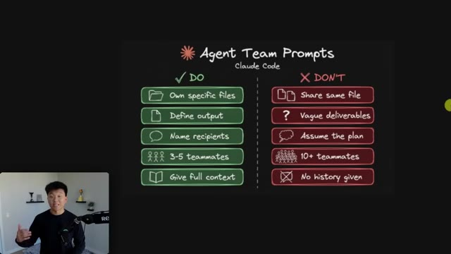
*⏱️ 00:07:01 — Un tableau comparatif sous forme de liste à puces "DO" (en vert) vs "DON'T" (en rouge) concernant les bonnes pratiques pour les prompts d'équipes d'agents.*

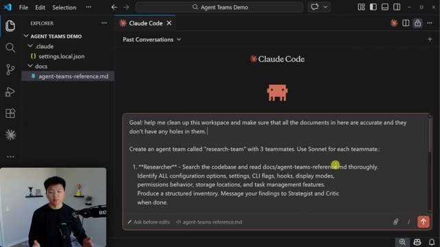
*⏱️ 00:07:19 — Interface de Claude Code dans VS Code montrant un prompt détaillé pour créer une équipe d'agents spécialisés ("research-team") avec des rôles définis.*

---

### ⏱️ `[00:07:27 - 00:08:01]` | Segment #19

**🔊 Audio (Transcription Intégrale Mot pour Mot en Français) :**
> got a researcher, a strategist, and a critic, and they're basically just going to read through this project and make sure that everything's accurate and make sure that we're set up good. Let's take a look at what's going on. It's creating the research team, right? So it's created the team, and now we have a to-do list. Now what it's doing is it's going to spawn the three teammates in parallel. And when it spawns these, I'm going to actually show you how. So the first one is a researcher. If I click into this, you can see that this says in. So this is basically saying, this is what the main agent sent to the agent. You are the researcher on the research team. Here is what your job is, and you have to be thorough and include anything that might be helpful. So this

**👁️ Analyse Visuelle d'Écran (gemini-3.5-flash-lite) :**
**Interface & Outils** : Visual Studio Code (avec extension d'agent IA intégrée).

**Contenu textuel & Code** : Log d'exécution affichant "TeamCreate" avec un objet JSON définissant `team_name: "research-team"` et une description visant à "Research, strategize, and critique the agent-teams-reference.md documentation".

**Action / Démonstration** : L'agent IA est en train de configurer une équipe spécialisée (chercheur, stratège, critique) pour traiter et valider les fichiers du projet.

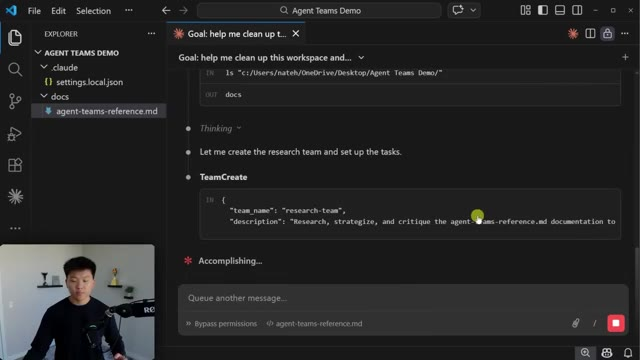
*⏱️ 00:07:36 — Interface de VS Code montrant l'exécution d'un agent IA en train de créer une équipe de recherche pour analyser de la documentation.*

---

### ⏱️ `[00:08:01 - 00:08:24]` | Segment #20

**🔊 Audio (Transcription Intégrale Mot pour Mot en Français) :**
> is basically the prompt that spun up that agent. You can see same exact thing happened for the strategist and for the critic. And if I clicked in, we could once again read exactly what they were prompted to do and the step-by-step instructions, including stuff like when you're done, send your five use cases to the critic teammate using the send message tool, which once again validates that these agents are able to talk to each other and send messages to each other.

**👁️ Analyse Visuelle d'Écran (gemini-3.5-flash-lite) :**
**Interface & Outils** : Éditeur de code (VS Code ou environnement Cursor intégrant Claude).

**Contenu textuel & Code** : Prompts détaillés : "You are the Strategist on the research-team", listes numérotées d'instructions (attendre un message du Researcher, lire le fichier markdown, générer 5 cas d'usage, envoyer les résultats au Critic).

**Action / Démonstration** : Navigation et consultation des instructions de configuration (system prompts) des différents agents au sein de l'espace de travail.

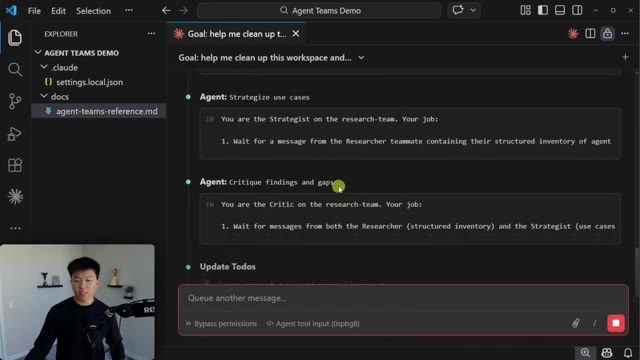
*⏱️ 00:08:07 — Vue d'ensemble de l'interface de travail montrant les rôles "Strategist" et "Critic" avec leurs instructions de mission respectives.*

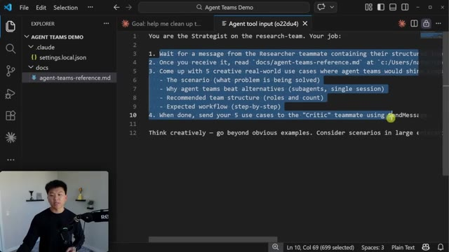
*⏱️ 00:08:12 — Gros plan sur une fenêtre d'éditeur affichant les instructions détaillées pour le rôle "Strategist", incluant les étapes de travail et l'objectif de générer 5 cas d'usage.*

---

### ⏱️ `[00:08:24 - 00:08:45]` | Segment #21

**🔊 Audio (Transcription Intégrale Mot pour Mot en Français) :**
> So now we can see that all three of our agents are running and they are all basically just waiting for their turn. And you'll notice what it does is pretty much every time there's a new update, it updates me. So here comes another live update. Let's see if the researcher is finally done. There we go. It's done. So now what happens is we sent a message off to the researcher and let's go ahead and see what that message actually said. So this is the main agent talking to the researcher.

**👁️ Analyse Visuelle d'Écran (gemini-3.5-flash-lite) :**
**Interface & Outils** : VS Code (avec extension ou interface de chat Claude intégrée).

**Contenu textuel & Code** : Texte affichant les rôles des agents : "Researcher - Reading and inventorying", "Strategist - Waiting for the Researcher’s findings", "Critic - Waiting for both teammates’ findings". Le prompt indique également un objectif de nettoyage d'espace de travail.

**Action / Démonstration** : Les agents IA sont en cours d'exécution simultanée et mettent à jour le statut de leurs tâches respectives dans l'éditeur.

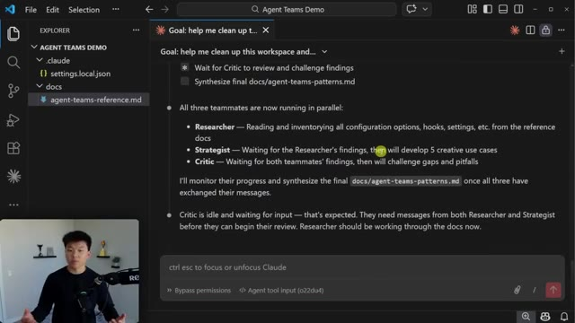
*⏱️ 00:08:29 — Une vue de l'interface de VS Code montrant une fenêtre de discussion avec un agent IA nommé "Claude", détaillant le statut d'une équipe composée de trois agents (Researcher, Strategist, Critic) travaillant en parallèle sur un projet.*

---

### ⏱️ `[00:08:46 - 00:09:20]` | Segment #22

**🔊 Audio (Transcription Intégrale Mot pour Mot en Français) :**
> It said, did you send your structured inventory to both the strategist and the critic? Please make sure the strategist also received it. You were asked to message both teammates. And then we can see that the researcher confirmed that both teammates received the inventory and now the critic is running. All right, so everything just finished up. All the reports are here, but real quick, I wanted to draw your attention to this. The main agent said, cool, let me shut down the teammates and finalize. And I'll touch on this a little bit later, but now the main agent has sent a message to each of them, the researcher, the strategist, and the critic, and basically said, you're done, save your work. So anyways, we'll come back to that in a little bit, but we now have

**👁️ Analyse Visuelle d'Écran (gemini-3.5-flash-lite) :**
**Interface & Outils** : VS Code (Visual Studio Code).

**Contenu textuel & Code** : Un bloc JSON représentant une entrée d'outil "SendMessage" envoyée au "Researcher", demandant de confirmer l'envoi de l'inventaire structuré au "Strategist" et au "Critic".

**Action / Démonstration** : L'agent IA exécute une commande de communication pour coordonner les tâches entre les membres de l'équipe d'agents.

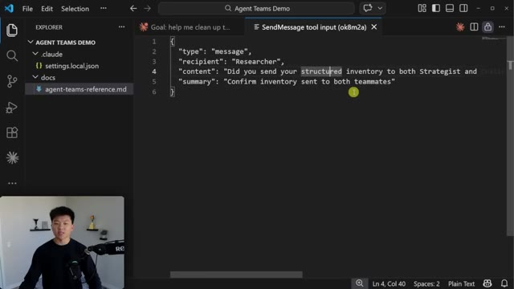
*⏱️ 00:08:55 — Une capture d'écran de l'éditeur VS Code montrant l'utilisation d'un outil de messagerie entre agents IA au sein d'un flux de travail nommé "Agent Teams Demo".*

---

### ⏱️ `[00:09:20 - 00:09:54]` | Segment #23

**🔊 Audio (Transcription Intégrale Mot pour Mot en Français) :**
> output, which is a new document over here, agent teams patterns, and it found a ton of stuff. There were 11 documentation gaps identified that are worth reviewing against your reference doc. So anyways, let's just click into the doc real quick. We're not going to read this whole thing because I'm assuming it is super long, but this is the actual output that we just got from this agent team. And you can see that this thing is insanely thorough. So if you wanted to really, really understand how agent teams work, then spin up an agent team to help you explain agent teams. Now, what you'll notice here is we were kind of able to see what was going on, but not really under the hood. We couldn't actually tell what the agents were thinking or doing. And that's because we're

**👁️ Analyse Visuelle d'Écran (gemini-3.5-flash-lite) :**
**Interface & Outils** : VS Code (avec une extension Claude/Agent intégrée).

**Contenu textuel & Code** : Texte Markdown détaillant 11 lacunes de documentation identifiées, des recommandations, et confirmant l'arrêt des agents (Researcher, Strategist, Critic).

**Action / Démonstration** : Visualisation du résultat (output) de l'analyse produite par les agents dans l'éditeur de code.

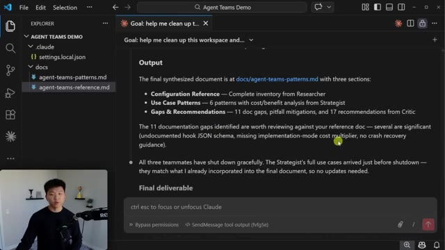
*⏱️ 00:09:29 — Interface VS Code affichant un document Markdown généré par un agent IA, récapitulant les résultats d'une analyse de documentation avec trois sections principales (Configuration Reference, Use Case Patterns, Gaps & Recommendations).*

---

### ⏱️ `[00:09:54 - 00:10:15]` | Segment #24

**🔊 Audio (Transcription Intégrale Mot pour Mot en Français) :**
> doing this in the Cloud Code extension. If you do this in your terminal, and specifically if you have Tmux installed, you can actually see the different agents working and thinking, and you can individually send messages to them. Because right here, we're kind of only communicating through the main session and the main session sends messages to the other ones. But one of the value props of agent teams is that I could individually message a sub agent if I wanted to.

**👁️ Analyse Visuelle d'Écran (gemini-3.5-flash-lite) :**
**Interface & Outils** : Visual Studio Code (avec l'extension Claude Code).

**Contenu textuel & Code** : Rapport textuel détaillant les livrables d'une équipe d'agents IA : "Configuration Reference", "Use Case Patterns", et "Gaps & Recommendations". Mention de l'arrêt gracieux des agents.

**Action / Démonstration** : L'interface affiche le message final de l'agent après la complétion de la tâche de documentation dans le répertoire "docs/".

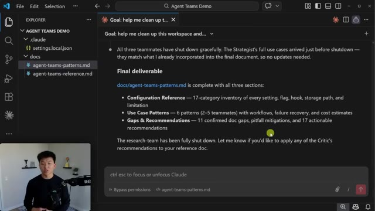
*⏱️ 00:09:59 — Une capture d'écran de l'interface VS Code montrant l'extension Claude Code en pleine discussion, avec un compte-rendu de fin de mission d'une équipe d'agents IA (Strategist, Critic).*

---

### ⏱️ `[00:10:15 - 00:10:47]` | Segment #25

**🔊 Audio (Transcription Intégrale Mot pour Mot en Français) :**
> So let me show you what that looks like. All right. So right now I'm running Cloud Code in a TMux terminal. Now, if you're on Windows, you have to take a little bit of a workaround, but you just have to be in a TMux terminal. So I'm not going to do a full setup video on it right now, but I literally just had Cloud Code walk me through it and it was super simple. But anyways, what I did here is I just pasted in this prompt, which obviously is like we talked about, we have the goal, we say create me an agent team, and then we have our front-end dev, our back-end dev, and our QA. This is basically the same exact prompt that I ran in the demo. So this isn't to show you the actual deliverable. What I want to show you guys here is the way that we can visually see this.

**👁️ Analyse Visuelle d'Écran (gemini-3.5-flash-lite) :**
**Interface & Outils** : Terminal (TMux/CLI) exécutant Claude Code v2.1.71.

**Contenu textuel & Code** : Image 1 : Message de bienvenue "Welcome back Nate!", version de l'outil et statut "bypass permissions on". Image 2 : Prompt détaillé demandant la création d'une startup "NeuralFlow" avec 3 agents (Frontend, Backend, QA) et les livrables attendus.

**Action / Démonstration** : Exécution d'une commande d'initialisation et soumission d'un prompt complexe à l'agent Claude pour démarrer le développement d'un projet.

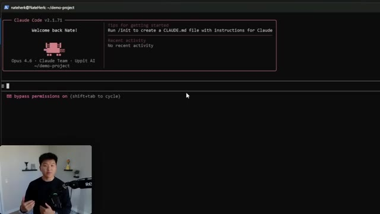
*⏱️ 00:10:23 — Interface du terminal affichant l'initialisation de Claude Code v2.1.71 avec une option de permission activée.*

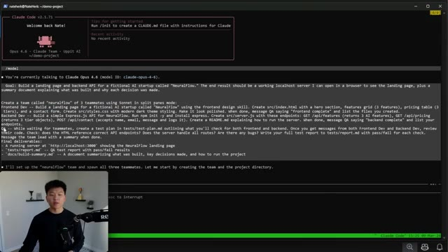
*⏱️ 00:10:39 — Interface de ligne de commande où une requête complexe (prompt) est saisie pour construire une application web complète (landing page et API) avec une équipe d'agents IA.*

---

### ⏱️ `[00:10:47 - 00:11:06]` | Segment #26

**🔊 Audio (Transcription Intégrale Mot pour Mot en Français) :**
> So right here what it's going to do is it's going to spin up that agent team for us, right? It's setting up the task dependencies and it's assigning owners. And now it's spawning those agents. And there we go. We just got our front end dev created right here. And this is the blue agent. We have another one right here, which is the back end dev. And this is the green agent. And there we go. We just got our QA agent, which is the yellow one.

**👁️ Analyse Visuelle d'Écran (gemini-3.5-flash-lite) :**
**Interface & Outils** : Terminal de ligne de commande (Claude Code CLI).

**Contenu textuel & Code** : Scripts de création de répertoires (mkdir), définitions de tâches pour le développement Frontend/Backend/QA, et logs système montrant l'assignation de l'agent "frontend-dev".

**Action / Démonstration** : Initialisation d'un workflow multi-agents et attribution des rôles spécifiques pour le projet de développement logiciel "NeuralFlow".

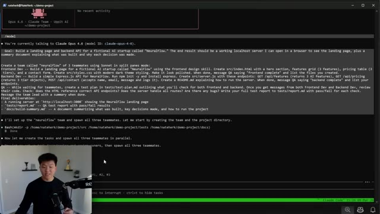
*⏱️ 00:10:52 — L'interface de "Claude Code" affiche le prompt initial demandant la création d'une équipe IA ("NeuralFlow") composée de trois agents pour développer une landing page et une API backend.*

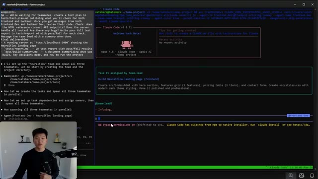
*⏱️ 00:10:57 — L'interface montre la phase d'exécution où le système initialise les tâches et commence à assigner les agents, avec l'agent "frontend-dev" (codé en bleu) en cours d'initialisation.*

---

### ⏱️ `[00:11:06 - 00:11:39]` | Segment #27

**🔊 Audio (Transcription Intégrale Mot pour Mot en Français) :**
> So now I very clearly can see what each of these agents is doing, which is super cool. And now if I wanted to, I could come over here and I could check on the team status with the main session. I could come up here and I could talk to the front-end dev. I could approve things or I could give it more info Same exact thing with the QA or same exact thing with the back-end dev So now I literally have an agent team that I can watch and I can interact with any of them And I can also watch them do research create things talk to each other. It's super super cool So like I said, i'm not going to run this whole thing out. I just wanted to show you guys that this is possible Okay, now that we've seen some cool demos

**👁️ Analyse Visuelle d'Écran (gemini-3.5-flash-lite) :**
**Interface & Outils** : Terminal de commande / Interface de gestion d'agents (Claude Code).

**Contenu textuel & Code** : Liste des tâches des agents (frontend-dev, backend-dev, qa), état d'exécution des tâches (HTML structure, README.md), et logs de processus d'agents.

**Action / Démonstration** : Supervision active du travail simultané des agents IA sur un projet de développement web, avec gestion des permissions et vérification de l'avancement des tâches.

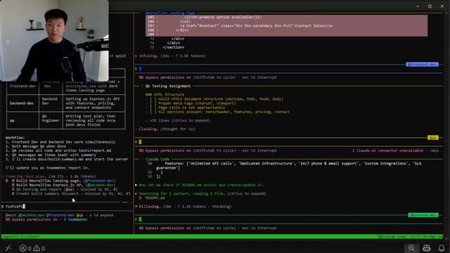
*⏱️ 00:11:15 — Interface d'un tableau de bord de gestion d'agents IA montrant une vue divisée avec plusieurs fenêtres de terminaux actifs (frontend-dev, qa, backend-dev) et un résumé du flux de travail des agents.*

---

### ⏱️ `[00:11:39 - 00:11:58]` | Segment #28

**🔊 Audio (Transcription Intégrale Mot pour Mot en Français) :**
> Let's talk about how do we actually make these things better and better and understand a little bit more about what's going on So here are three key rules. The first one is that each of these agents has their own territory. So they should have their own file and they should be working on their own deliverables. They can send them across and they can communicate, but they should only really all be editing their own thing.

**👁️ Analyse Visuelle d'Écran (gemini-3.5-flash-lite) :**
**Interface & Outils** : Diapositive de présentation illustrée.

**Contenu textuel & Code** : Texte explicatif des trois règles fondamentales : "Own Territory - One file, one owner", "Direct Messages - Skip the lead", et "Start Parallel - All start now" (comparaison entre séquentiel avec une croix rouge et parallèle avec une coche verte).

**Action / Démonstration** : Présentation théorique illustrant les bonnes pratiques d'architecture multi-agents.

*⏱️ 00:11:44 — Une infographie stylisée présentant "The 3 Rules" pour la gestion d'agents IA : 1) Own Territory (chaque agent possède son propre fichier), 2) Direct Messages (communication directe entre agents, pas de chef), 3) Start Parallel (exécution parallèle plutôt que séquentielle).*

---

### ⏱️ `[00:11:58 - 00:12:17]` | Segment #29

**🔊 Audio (Transcription Intégrale Mot pour Mot en Français) :**
> The second thing is once again, direct messaging. They can talk to each other. They don't have to use the middleman of the main session. And then the third piece is that they can be working at the same time. It doesn't have to be agent one hands off to agent two and then agent two hands off to agent three because that honestly might not even call for an agent team. Agent teams work together in parallel and need to communicate throughout the whole process.

**👁️ Analyse Visuelle d'Écran (gemini-3.5-flash-lite) :**
**Interface & Outils** : Diapositive de présentation de type schéma conceptuel (style dessin à la main).

**Contenu textuel & Code** : Texte : "The 3 Rules", "1. Own Territory (One file, one owner)", "2. Direct Messages (Skip the lead, API shape)", "3. Start Parallel (All start now)". Schémas comparatifs montrant des interactions entre agents sous forme de personnages stylisés.

**Action / Démonstration** : Illustration conceptuelle utilisée par le présentateur pour expliquer la structure de collaboration entre agents IA.

*⏱️ 00:12:03 — Une diapositive explicative intitulée "The 3 Rules" illustrant les principes de fonctionnement d'un système multi-agents : 1. Own Territory (un fichier, un propriétaire), 2. Direct Messages (communication directe entre agents sans intermédiaire), et 3. Start Parallel (exécution simultanée plutôt que séquentielle).*

---

### ⏱️ `[00:12:17 - 00:12:43]` | Segment #30

**🔊 Audio (Transcription Intégrale Mot pour Mot en Français) :**
> So what do teammates instantly know when they wake up? Because we know that they don't have any context from the jump. What they do have is they inherit the permissions from the main session. So if you're on bypass permissions, then all of your agents are going to be on bypass permissions. If you allow all bash commands, then those same permissions will once again be inherited by the teammates. But the other thing to know that's very important is that any of your files, any of your MCP servers, any of your skills, all of the teammates can use and access those things.

**👁️ Analyse Visuelle d'Écran (gemini-3.5-flash-lite) :**
**Interface & Outils** : Présentation graphique / Diagramme conceptuel.

**Contenu textuel & Code** : Texte : "What Teammates Know", "Chat history blocked", "Permissions Pass", "Same permissions", "Auto-Carries: CLAUDE.md, MCP Servers, Skills".

**Action / Démonstration** : Illustration visuelle du concept de transfert de contexte et de droits d'accès entre une session principale et des agents secondaires.

*⏱️ 00:12:24 — Schéma explicatif sur fond noir illustrant le fonctionnement des permissions et du contexte pour les agents IA (teammates). Le diagramme compare "No Context" (historique bloqué) à "Permissions Pass" (héritage des droits Bash/Edit/Write) et liste les éléments "Auto-Carries" (CLAUDE.md, MCP Servers, Skills).*

---

### ⏱️ `[00:12:43 - 00:13:03]` | Segment #31

**🔊 Audio (Transcription Intégrale Mot pour Mot en Français) :**
> We also have a really cool ability to use something called plan approval mode. So you guys know how I've told you always start in plan mode. If you plan with your main session before anything actually happens, it's way better. What we can do is we can have all of those agent teammates plan first, and they have to basically get their plan approved by the main agent before they're actually allowed to go execute.

**👁️ Analyse Visuelle d'Écran (gemini-3.5-flash-lite) :**
**Interface & Outils** : Diagramme explicatif de workflow affiché à l'écran.

**Contenu textuel & Code** : Texte : "Plan Approval Mode", "Read Only", "Submit Plan", "Lead Reviews", "Revise", "Approved!", "Execute", "Full Access" et note en bas "UI lead reviews -- tell lead to ask you for extra safety".

**Action / Démonstration** : Présentation théorique du processus de validation des plans par un agent superviseur avant l'exécution des tâches.

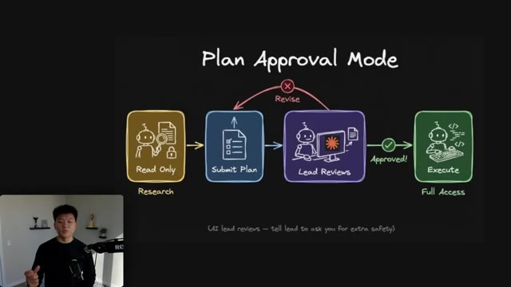
*⏱️ 00:12:48 — Schéma illustrant le workflow du "Plan Approval Mode" avec quatre étapes séquentielles : Read Only (Research), Submit Plan, Lead Reviews, et Execute (Full Access), incluant une boucle de révision.*

---

### ⏱️ `[00:13:04 - 00:13:28]` | Segment #32

**🔊 Audio (Transcription Intégrale Mot pour Mot en Français) :**
> So it's really cool. You could also set it up where you're actually the one who has to approve every single plan, but I think it's probably better to just have the main session do that. Or maybe even one of the teammates is just the plan reviewer and approver. So I wanted to talk about some common pitfalls or mistakes that you might be making and what the fix could be for that. So the first one is if the agents keep asking permissions and they keep stopping for that, you can pre-approve certain tools.

**👁️ Analyse Visuelle d'Écran (gemini-3.5-flash-lite) :**
**Interface & Outils** : Présentation graphique sous forme de diagrammes de flux et tableaux didactiques.

**Contenu textuel & Code** : Textes explicatifs sur les processus d'approbation et les meilleures pratiques pour éviter les erreurs lors de la gestion d'équipes d'agents IA.

**Action / Démonstration** : Le présentateur explique la structure théorique et les protocoles de sécurité pour la supervision humaine des agents IA.

*⏱️ 00:13:10 — Schéma illustrant un "Plan Approval Mode" montrant le flux de travail des agents : Recherche (lecture seule), Soumission du plan, Revue par un "Lead" avec option de révision, puis Exécution (accès complet).*

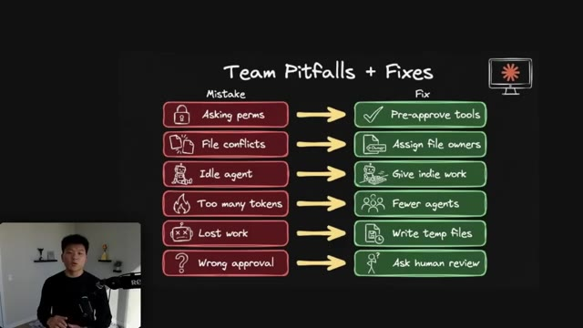
*⏱️ 00:13:16 — Tableau comparatif "Team Pitfalls + Fixes" listant des erreurs courantes dans la gestion d'agents IA (demandes de permissions, conflits de fichiers, inactivité) et leurs solutions respectives.*

---

### ⏱️ `[00:13:28 - 00:13:53]` | Segment #33

**🔊 Audio (Transcription Intégrale Mot pour Mot en Français) :**
> So that would be in your project settings or your local settings. You can allow certain commands and that way they won't stop to ask you something every couple seconds. If the deliverables aren't coming out feeling holistic, maybe they're being overwritten. So make sure that you assign file owners. If you spin up an agent team and you realize that one of the agents isn't really doing much or is just sitting around, then maybe you want to specifically make sure you're assigning each agent work or some sort of dependency in your plan, in your prompt.

**👁️ Analyse Visuelle d'Écran (gemini-3.5-flash-lite) :**
**Interface & Outils** : Graphique de présentation (diapositive pédagogique).

**Contenu textuel & Code** : Liste de 6 points : "Asking perms" vs "Pre-approve tools", "File conflicts" vs "Assign file owners", "Idle agent" vs "Give indie work", "Too many tokens" vs "Fewer agents", "Lost work" vs "Write temp files", "Wrong approval" vs "Ask human review".

**Action / Démonstration** : Présentation théorique des meilleures pratiques pour optimiser le travail collaboratif avec des agents IA et éviter les interruptions ou pertes de données.

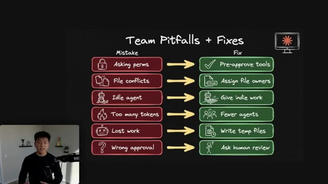
*⏱️ 00:13:34 — Une infographie stylisée intitulée "Team Pitfalls + Fixes" présentant un tableau comparatif entre les erreurs courantes lors de l'utilisation d'agents IA (en rouge) et leurs solutions correspondantes (en vert).*

---

### ⏱️ `[00:13:53 - 00:14:27]` | Segment #34

**🔊 Audio (Transcription Intégrale Mot pour Mot en Français) :**
> If you're burning through way too many tokens, just use fewer agents. If it seems like your agents are losing work, then tell them to basically store everything as a temporary file that they can then call on later. And if you're getting the wrong approval and it just seems like it's off, then maybe just try to have you be the one who approves things to start until you understand the flow of how these teams work a little better. All right, so next I wanted to talk about when to use agent teams, because like I said earlier, they can be slow and expensive. So you really just want to use them when you need something pretty complex done and you need lots of different specialized agents. So think about using them if your specific process or project has multiple different areas. And that way you can have one

**👁️ Analyse Visuelle d'Écran (gemini-3.5-flash-lite) :**
**Interface & Outils** : Diagramme didactique / Infographie synthétique sur la gestion d'agents IA.

**Contenu textuel & Code** : Texte structuré : "Mistakes" (Asking perms, File conflicts, Idle agent, Too many tokens, Lost work, Wrong approval) vs "Fixes" (Pre-approve tools, Assign file owners, Give indie work, Fewer agents, Write temp files, Ask human review). Texte secondaire : "Use Teams" (3+ Areas, Parallel Research, React to Each Other, Quality Gates) vs "Skip Teams" (Sequential, One Context, Same Files, Simple Task) vs "Subagents" (Focused Result, No Cross-talk, Save Tokens).

**Action / Démonstration** : Présentation théorique illustrée servant de support visuel à la recommandation de bonnes pratiques pour optimiser les workflows d'agents IA et réduire la consommation de tokens.

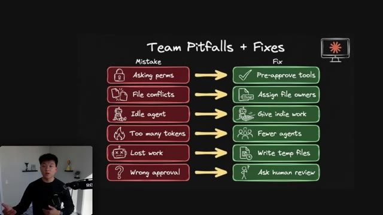
*⏱️ 00:14:02 — Un tableau comparatif intitulé « Team Pitfalls + Fixes » listant des problèmes courants (erreurs) associés à leurs solutions concrètes pour la gestion d'agents IA.*

*⏱️ 00:14:10 — Un schéma décisionnel intitulé « When to Use Teams » détaillant les critères pour utiliser des équipes d'agents, les situations où il faut les éviter et les avantages des sous-agents.*

---

### ⏱️ `[00:14:27 - 00:14:59]` | Segment #35

**🔊 Audio (Transcription Intégrale Mot pour Mot en Français) :**
> specialized in each of those. If you need those things to be done in parallel, if you need them to be able to react to each other, assign tasks to each other, communicate with each other. And if something needs to be done at a really high quality and you want tons of different steps to make sure, then an agent team is probably a decent idea. Now, if you have a process that could be done sequentially, meaning every time it basically goes one, two, three, and those steps are dependent on each other, then maybe an agent team isn't the right call. Maybe that's just sub-agents. If you need everything in one specific conversation history or one context window, then don't use teams. If you're just kind of working on the same files, don't use teams. And if it's a very simple

**👁️ Analyse Visuelle d'Écran (gemini-3.5-flash-lite) :**
**Interface & Outils** : Graphique de présentation (diapositive style dessin à la main).

**Contenu textuel & Code** : Le tableau détaille les critères de décision pour l'utilisation d'équipes d'agents IA. La colonne "Use Teams" inclut des critères comme "3+ Areas", "Parallel Research", "React to Each Other" et "Quality Gates". La colonne "Skip Teams" liste "1->2->3 Sequential", "One Context", "Same Files" et "Simple Task". La colonne "Subagents" mentionne "Focused Result", "No Cross-talk" et "Save Tokens".

**Action / Démonstration** : Le présentateur utilise ce visuel comme support pédagogique pour illustrer quand privilégier une architecture multi-agents par rapport à une exécution séquentielle simple.

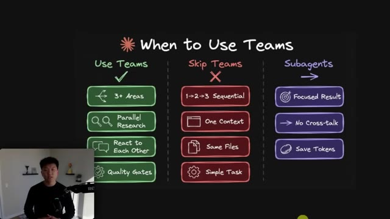
*⏱️ 00:14:35 — Un schéma explicatif présentant un comparatif visuel intitulé "When to Use Teams", divisé en trois colonnes : "Use Teams" (vert), "Skip Teams" (rouge) et "Subagents" (bleu).*

---

### ⏱️ `[00:14:59 - 00:15:20]` | Segment #36

**🔊 Audio (Transcription Intégrale Mot pour Mot en Français) :**
> task, then agent teams would be overkill. There might be a lot of times where you'd be able to use sub-agents instead, like I said, with sequential, or if you need a very focused result, if you don't need the agents to communicate, and if you wanna save some tokens. Because once again, if you have three sessions running, that's basically gonna be three times the cost. So if you have five, it'll be five times the cost, which means I like to stay around maybe two to five agents max.

**👁️ Analyse Visuelle d'Écran (gemini-3.5-flash-lite) :**
**Interface & Outils** : Graphiques informatifs (slides de présentation stylisés).

**Contenu textuel & Code** : - Image 1 : Colonnes "Use Teams" (3+ zones, recherche parallèle, interaction), "Skip Teams" (séquentiel, contexte unique, tâches simples) et "Subagents" (résultat ciblé, pas d'interaction, économie de tokens).
- Image 2 : Visualisation de l'augmentation des coûts de 1 à 5 agents ("Cost Awareness") et bonnes pratiques (2-3 max, rester en parallèle, utiliser des sous-agents, arrêter tôt).

**Action / Démonstration** : Présentation pédagogique visant à guider le choix entre architecture multi-agents et sous-agents pour optimiser l'efficacité et les coûts.

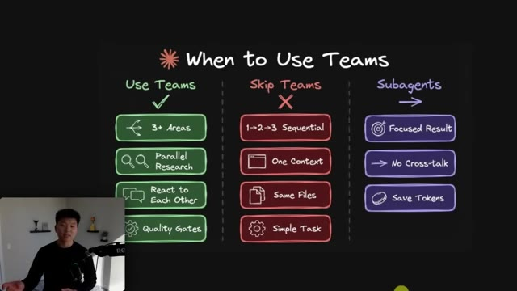
*⏱️ 00:15:04 — Un tableau comparatif illustré détaillant les scénarios d'utilisation des "Teams" (équipes d'agents) par rapport aux "Subagents".*

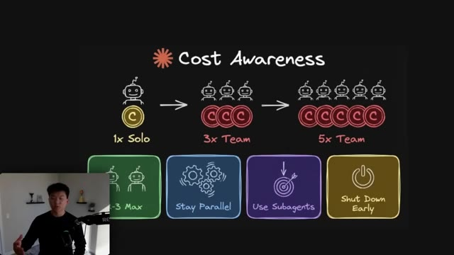
*⏱️ 00:15:15 — Un schéma illustrant la relation entre le nombre d'agents et le coût, avec des conseils pour optimiser la consommation de tokens.*

---

### ⏱️ `[00:15:21 - 00:15:49]` | Segment #37

**🔊 Audio (Transcription Intégrale Mot pour Mot en Français) :**
> You can keep them running parallel. Otherwise, you can use sub-agents and make sure that you are shutting them down if you see them early on going off down the wrong path, which is another reason why I think it's helpful to use the Tmux version so you can actually see them in that split pane view. And when I say shutdown, which is kind of what we saw earlier, I just mean basically at the end of every session, saving your work. Because remember right here, how we saw the main session say, Hey, this is a shutdown request. The researcher agent here could have said, I'm not done yet.

**👁️ Analyse Visuelle d'Écran (gemini-3.5-flash-lite) :**
**Interface & Outils** : Visual Studio Code (avec extension Claude Code).

**Contenu textuel & Code** : JSON de requête système : `{"type": "shutdown_request", "recipient": "Researcher"}` et message de confirmation de succès : `"success": true`.

**Action / Démonstration** : Envoi d'une commande système pour arrêter un agent spécifique ("Researcher") afin de clore une tâche et optimiser les coûts.

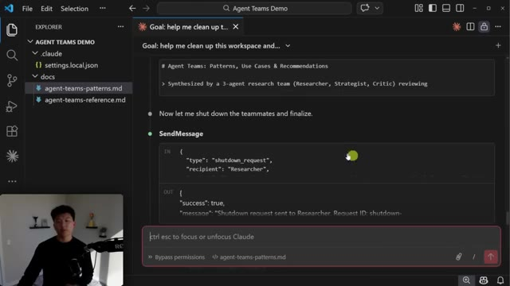
*⏱️ 00:15:42 — Interface de l'éditeur VS Code montrant une interaction avec Claude Code pour arrêter un agent ("Shutdown request") dans le cadre d'un projet de démonstration d'équipes d'agents.*

---

### ⏱️ `[00:15:49 - 00:16:08]` | Segment #38

**🔊 Audio (Transcription Intégrale Mot pour Mot en Français) :**
> Let me save stuff. Don't shut me down yet. So when the teammates actually confirm that they're ready to be shut down, that means that everything's good. And we can essentially cleanly save that work. So everything gets cleaned up and then we're good to close the session and shut down that agent team rather than just force killing it right away, where things might be all out of control and not cleaned up yet. Well, all right, that is agent teams.

**👁️ Analyse Visuelle d'Écran (gemini-3.5-flash-lite) :**
**Interface & Outils** : VS Code (extension Claude), outil de présentation visuelle (schéma).

**Contenu textuel & Code** : JSON de communication entre agents : {"type": "shutdown_request", "recipient": "Researcher"}. Schéma comparant les flux de travail ("Teammates Save" vs "Half-written files").

**Action / Démonstration** : Démonstration technique de la procédure de clôture sécurisée ("Graceful Shutdown") d'une équipe d'agents IA dans un environnement de développement.

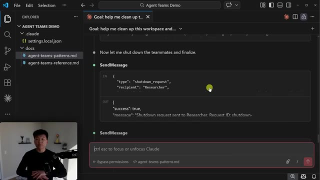
*⏱️ 00:15:54 — Interface VS Code affichant un journal d'exécution d'agents IA, avec des requêtes de fermeture ("shutdown_request") envoyées à un agent nommé "Researcher".*

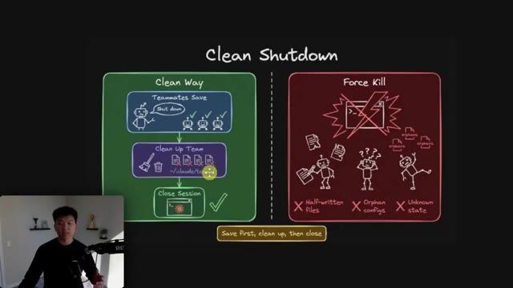
*⏱️ 00:15:59 — Diagramme illustrant la différence entre un "Clean Shutdown" (procédure propre) et un "Force Kill" (interruption brutale) lors de la gestion d'agents.*

---

### ⏱️ `[00:16:09 - 00:16:28]` | Segment #39

**🔊 Audio (Transcription Intégrale Mot pour Mot en Français) :**
> I hope by now you are excited to hop into CloudCode and start building with some agent teams. And if you wanna check out other CloudCode stuff that I've been doing to expand your learning, then definitely check out this video right up here. Hopefully I'll see you guys over there, but that is gonna be the end of the video. So if you enjoyed or you learned something new, please give it a like, it definitely helps me out a ton. And as always, I appreciate you guys making it to the end of the video. I'll see you on the next one.

**👁️ Analyse Visuelle d'Écran (gemini-3.5-flash-lite) :**
**Interface & Outils** : Présentation visuelle / Diagramme d'architecture système.

**Contenu textuel & Code** : Schéma avec "You" (l'utilisateur) pointant vers un "Orchestrator", qui distribue les tâches vers "Agent A", "Agent B", "Agent C" et "Agent D" avec des flèches bidirectionnelles symbolisant la collaboration.

**Action / Démonstration** : Explication théorique de la structure de travail des agents IA collaboratifs au sein de l'écosystème CloudCode.

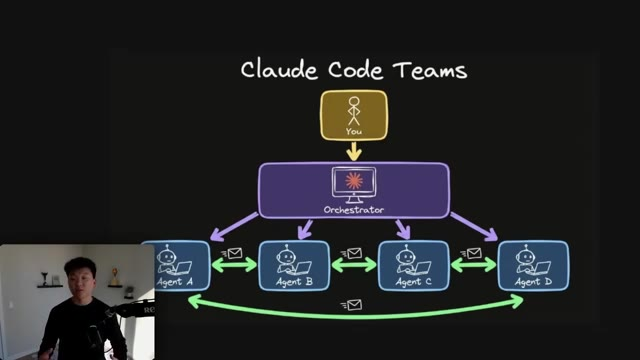
*⏱️ 00:16:13 — Schéma conceptuel illustrant une architecture "Claude Code Teams" avec un utilisateur central, un orchestrateur et plusieurs agents communiquant entre eux.*

---

### ⏱️ `[00:16:28 - 00:16:29]` | Segment #40

**🔊 Audio (Transcription Intégrale Mot pour Mot en Français) :**
> Thanks everyone.

**👁️ Analyse Visuelle d'Écran (gemini-3.5-flash-lite) :**
**Interface & Outils** : Présentation graphique (diagramme de workflow).

**Contenu textuel & Code** : Diagramme montrant l'utilisateur ("You") interagissant avec un "Orchestrator", qui gère une équipe de quatre agents (Agent A, B, C, D) échangeant des messages.

**Action / Démonstration** : Illustration théorique du fonctionnement d'un système multi-agents géré par un orchestrateur.

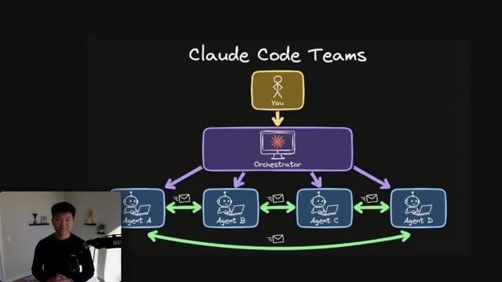
*⏱️ 00:16:28 — Schéma conceptuel illustrant l'architecture de "Claude Code Teams" avec un orchestrateur central distribuant des tâches à plusieurs agents (A, B, C, D) communiquant entre eux.*

---

