# 🎬 Claude Code Just Dropped Memory 2.0

> **Chaîne** : [Nate Herk | AI Automation](https://www.youtube.com/@nateherk/featured)  
> **Lien YouTube** : [https://www.youtube.com/watch?v=LrgfmZkl3nc](https://www.youtube.com/watch?v=LrgfmZkl3nc)  
> **Date de publication** : 20260324  
> **Durée** : 00:08:30  
> **Identifiant vidéo** : `LrgfmZkl3nc`  
> **Transcription & Analyse** : `whisper-v3-large-turbo+gemini-3.5-flash-lite`  

---

## 📌 Synthèse Exécutive & Outils

### 💡 Résumé
Dans cette vidéo intitulée **Claude Code Just Dropped Memory 2.0**, Nate Herk décortique les capacités pratiques d'automatisation et de développement propulsées par les modèles de pointe.

### 🛠️ Outils, Modèles & Logiciels Présentés
- **Opus 5.5 & Claude Code** : Modèles d'ingénierie et agents de codage autonome.

### 🔑 Points Clés & Enseignements Stratégiques
- Optimiser le niveau d'effort et le raisonnement des modèles IA pour des résultats industriels.
- Automatiser les cycles de création logicielle de bout en bout.

---

## ⏱️ Chronologie & Transcription Complète Audio & Visuelle (Mot pour Mot)

### ⏱️ `[00:00:00 - 00:00:20]` | Segment #01

**🔊 Audio (Transcription Intégrale Mot pour Mot en Français) :**
> So Anthropic just silently released this feature called AutoDream. And based on people's discussions, it basically runs a sub-agent periodically that consolidates Claude's memory files for better long-term storage. And I saw this tweet from Anthony here that said, it's pretty crazy because that's basically how humans actually store long-term memories, is by sleeping. So you can see right here in this project, I was playing around with the AutoDream.

**👁️ Analyse Visuelle d'Écran (gemini-3.5-flash-lite) :**
**Interface & Outils** : Plateforme X (anciennement Twitter) et interface terminal (CLI) de Claude Code.

**Contenu textuel & Code** : Le tweet mentionne la fonctionnalité "Auto-dream" pour la consolidation de la mémoire. L'interface CLI affiche : "Auto-memory: on", "Auto-dream: off", et les chemins des fichiers "User memory" (~/.claude/CLAUDE.md) et "Project memory".

**Action / Démonstration** : Visualisation d'une démonstration technique via une capture de réseau social illustrant les réglages internes de l'agent Claude Code.

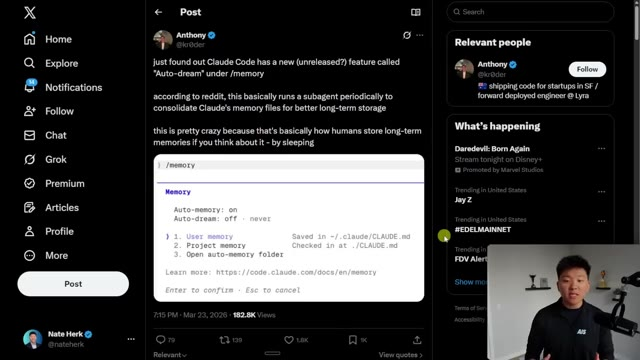
*⏱️ 00:00:05 — Capture d'écran montrant un post X (Twitter) présentant une interface en ligne de commande de Claude Code affichant les paramètres de gestion de mémoire "/memory".*

---

### ⏱️ `[00:00:21 - 00:00:41]` | Segment #02

**🔊 Audio (Transcription Intégrale Mot pour Mot en Français) :**
> And so because this is still being rolled out and it's like an experimental feature, I tried running this right here in my project. And it is working, as you can see, it's dreaming. because right here in my status line, you can see that it says dreaming. And then I basically go down and I enter it to view the tasks and you can see what it's doing. It starts off by saying, let me search for more user feedback, preferences and new project relevant information across recent sessions.

**👁️ Analyse Visuelle d'Écran (gemini-3.5-flash-lite) :**
**Interface & Outils** : Terminal de ligne de commande (CLI) type Claude Code.

**Contenu textuel & Code** : Texte affichant "Memory consolidation", "Status: running", et plusieurs lignes de réflexion de l'agent comme "Let me search for more user feedback" ou "The issue is likely the quote escaping".

**Action / Démonstration** : L'agent IA est en cours d'exécution active, effectuant une consolidation de mémoire et analysant des sessions précédentes pour résoudre un problème de code lié à l'échappement de guillemets.

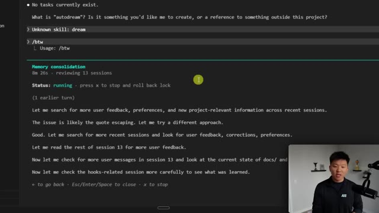
*⏱️ 00:00:26 — Une interface de terminal affichant l'exécution d'un processus d'agent IA appelé "Memory consolidation", avec des logs détaillant ses étapes de recherche et d'analyse.*

---

### ⏱️ `[00:00:41 - 00:01:01]` | Segment #03

**🔊 Audio (Transcription Intégrale Mot pour Mot en Français) :**
> And it's basically looked through all of our messages and all of our different things that we've asked it to do. And then it gets to phase three where it's consolidating stuff. So here are all of the key findings that it needs to update the memory files with since the last time it ran. And you can see that this is a pretty comprehensive task. It's running for almost 10 minutes now. It's reviewed 13 sessions and it's touching different memory files.

**👁️ Analyse Visuelle d'Écran (gemini-3.5-flash-lite) :**
**Interface & Outils** : Terminal de ligne de commande (CLI) d'un agent IA (probablement Claude Code ou outil similaire).

**Contenu textuel & Code** : Journal d'exécution affichant « Phase 3 - Consolidate » et une liste de 5 conclusions (« Key findings ») basées sur l'analyse de fichiers de mémoire et de sessions utilisateur.

**Action / Démonstration** : L'agent IA analyse les logs des sessions passées et prépare la mise à jour des fichiers de mémoire du projet.

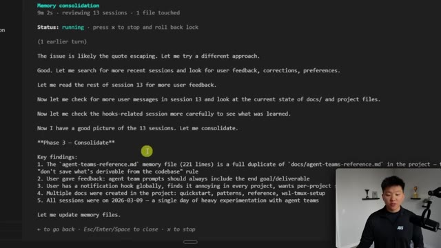
*⏱️ 00:00:46 — Une interface de terminal affichant le processus d'un agent IA en phase de consolidation de mémoire, avec une liste de conclusions extraites de sessions précédentes.*

---

### ⏱️ `[00:01:02 - 00:01:21]` | Segment #04

**🔊 Audio (Transcription Intégrale Mot pour Mot en Français) :**
> And basically the whole point of this is to be an automatic background cleanup and organization system for your Cloud memories so that each time you start up a new session, it feels sharp instead of kind of fuzzy or cluttered. Now Cloud Code does already have auto memory, which lets it remember things about your project in a memory.md file. And that usually gets injected at the beginning of your sessions and your conversations.

**👁️ Analyse Visuelle d'Écran (gemini-3.5-flash-lite) :**
**Interface & Outils** : Présentation graphique (diapositive style tutoriel).

**Contenu textuel & Code** : Texte expliquant le système 'Autodream' de Claude Code et un diagramme illustrant les interactions entre le fichier 'MEMORY.md' et les sessions de travail de l'IA (représentées par des icônes de sommeil, de projet, et d'utilisateur).

**Action / Démonstration** : Présentation conceptuelle du workflow de nettoyage automatique des mémoires contextuelles de l'agent.

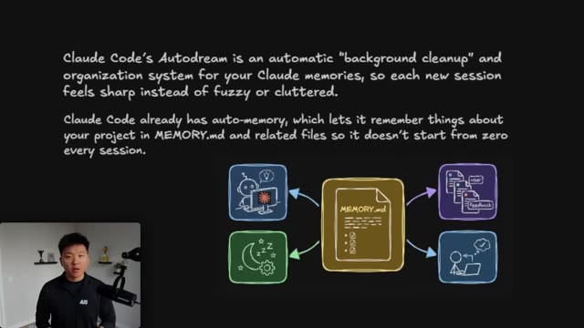
*⏱️ 00:01:07 — Une diapositive explicative montrant un schéma conceptuel sur le fonctionnement de la mémoire dans Claude Code, avec le fichier 'MEMORY.md' au centre.*

---

### ⏱️ `[00:01:21 - 00:01:55]` | Segment #05

**🔊 Audio (Transcription Intégrale Mot pour Mot en Français) :**
> And that's what allows Cloud Code currently to feel like it understands a little bit more contextually about what's going on. But the Autodream is a little bit different because rather than just kind of like flooding in some information, it's consistently compacting and pruning and making that file better and better. It's keeping everything feeling a lot more fresh because it basically takes all of this different information that goes into your memory.md file. When it does its Autodream, it merges them, it prunes them, it refreshes them, and it compacts things. And then all of the different memory files are a lot cleaner. So if I switch back into this project, you can see that it improved five memories that took about 10 minutes.

**👁️ Analyse Visuelle d'Écran (gemini-3.5-flash-lite) :**
**Interface & Outils** : Diagramme de workflow personnalisé (style dessin à la main).

**Contenu textuel & Code** : Le schéma décompose le flux : "Raw Notes" (entrées brutes) → "Auto Dream" (processus de merge, prune, refresh) → "Clean Index" (données structurées). Une ligne temporelle en bas montre la progression entre Session 1, 2 et 3. Un texte explicatif en bas à droite détaille le rôle du "sub-agent" Claude.

**Action / Démonstration** : Illustration conceptuelle du mécanisme de "pruning" (élagage) et de "compaction" des fichiers de contexte mémoire utilisés par l'IA.

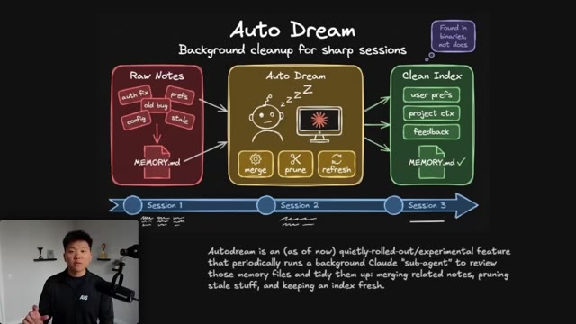
*⏱️ 00:01:30 — Schéma explicatif intitulé "Auto Dream" illustrant le processus de nettoyage de données en arrière-plan pour les sessions de codage.*

---

### ⏱️ `[00:01:55 - 00:02:14]` | Segment #06

**🔊 Audio (Transcription Intégrale Mot pour Mot en Français) :**
> It improved all of these different MD files, which the project will now be able to use and they're a lot more clean and up to date. And so the way that you get here is you go to slash memory. You can see right here, we have edit Claude memory files. And when you open that up, you'll notice right here, we see auto dream on. This was last ran 11 minutes ago, as you guys just saw, and we can use slash dream to run it.

**👁️ Analyse Visuelle d'Écran (gemini-3.5-flash-lite) :**
**Interface & Outils** : Terminal de ligne de commande (Claude Code/CLI).

**Contenu textuel & Code** : Liste des fichiers "Improved 5 memories" : feedback_prompt_deliverables.md, feedback_notification_hooks.md, user_profile.md, agent-teams-reference.md, MEMORY.md ; et invite de commande active.

**Action / Démonstration** : L'agent affiche le résultat d'une opération de mise à jour sur les fichiers de mémoire du projet.

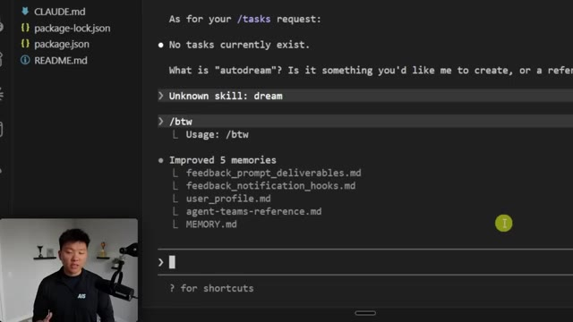
*⏱️ 00:02:00 — Interface de terminal (Claude Code) affichant une liste de fichiers Markdown récemment mis à jour et une invite de commande interactive.*

---

### ⏱️ `[00:02:14 - 00:02:34]` | Segment #07

**🔊 Audio (Transcription Intégrale Mot pour Mot en Français) :**
> Now, when you open this up, this will be off. All you have to do is hover over it, hit enter and it will change to being on. And by default, your auto memory for your Claude will probably already be on as well. And what you'll notice about the memory is that it's turned on globally across all of your different projects, but each AutoDream has its own files that it plays with. So in this other session, you can see that AutoDream is on.

**👁️ Analyse Visuelle d'Écran (gemini-3.5-flash-lite) :**
**Interface & Outils** : Terminal interactif au sein de l'éditeur VS Code (Claude Code CLI).

**Contenu textuel & Code** : Paramètres de mémoire : 'Auto-memory: on', 'Auto-dream: off', ainsi que les emplacements de stockage des fichiers 'Project memory' et 'User memory'.

**Action / Démonstration** : Navigation et configuration des options de mémoire de l'agent IA via l'interface de commande.

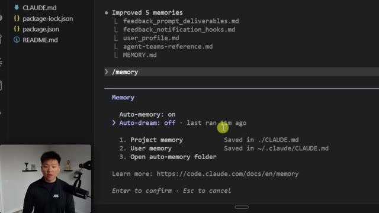
*⏱️ 00:02:19 — Interface de configuration du module 'memory' dans l'environnement Claude Code, affichant les réglages 'Auto-memory' et 'Auto-dream'.*

---

### ⏱️ `[00:02:34 - 00:02:59]` | Segment #08

**🔊 Audio (Transcription Intégrale Mot pour Mot en Français) :**
> It last ran 11 minutes ago. And now if I go over to my Herc 2 project, which I've never turned on the AutoDream feature, and I go ahead and do memory, the AutoDream feature is already turned on, but you can see that it says that it has never been ran yet. And of course, the memory files are different because in here I've got all these different files. And then back in this other project, which was kind of more of a demo, you can see that we only have these main three, which are project, user, and the auto memory folder.

**👁️ Analyse Visuelle d'Écran (gemini-3.5-flash-lite) :**
**Interface & Outils** : Visual Studio Code avec le terminal intégré Claude Code (version 2.1.81).

**Contenu textuel & Code** : Commandes terminal : `/memory`. Texte affiché : "Auto-memory: on", "Auto-dream: on - last ran 11m ago", "Project memory Saved in ./.CLAUDE.md".

**Action / Démonstration** : Exécution de la commande '/memory' pour vérifier l'état et l'historique d'exécution de la fonctionnalité Auto-dream au sein du projet.

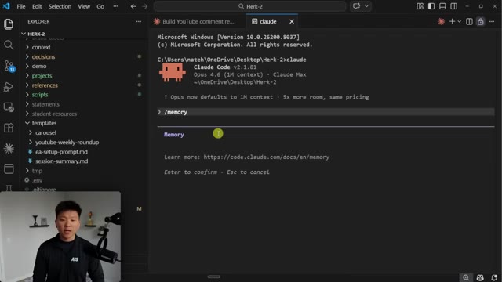
*⏱️ 00:02:40 — Interface VS Code affichant un terminal Claude Code dans lequel l'utilisateur a saisi la commande '/memory'.*

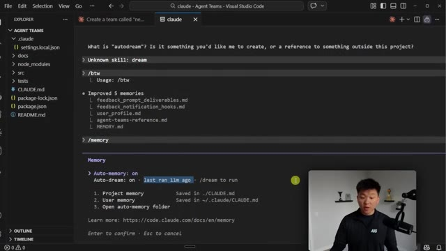
*⏱️ 00:02:53 — Interface VS Code montrant le résultat de la commande '/memory', avec l'état 'Auto-dream: on' et la mention 'last ran 11m ago'.*

---

### ⏱️ `[00:02:59 - 00:03:17]` | Segment #09

**🔊 Audio (Transcription Intégrale Mot pour Mot en Français) :**
> So now if I'm in my Herc2 project and I know that my auto dream has been turned on, it says that I can use slash dream to run. So if I come in here and I do slash dream, what's gonna happen? It basically just says unknown skill and we don't see anything going on. So right now you can kind of invoke this using natural language, even though Claude code itself might be a little confused about what you're trying to do.

**👁️ Analyse Visuelle d'Écran (gemini-3.5-flash-lite) :**
**Interface & Outils** : VS Code (éditeur) intégrant le terminal Claude Code (CLI).

**Contenu textuel & Code** : Commandes terminal affichant : "Auto-memory: on", "Auto-dream: on - never - /dream to run", et une liste de fichiers contextuels (me.md, work.md, team.md, current-priorities.md).

**Action / Démonstration** : Le présentateur vérifie l'état de la configuration de l'agent dans le terminal avant d'essayer de lancer la commande "/dream".

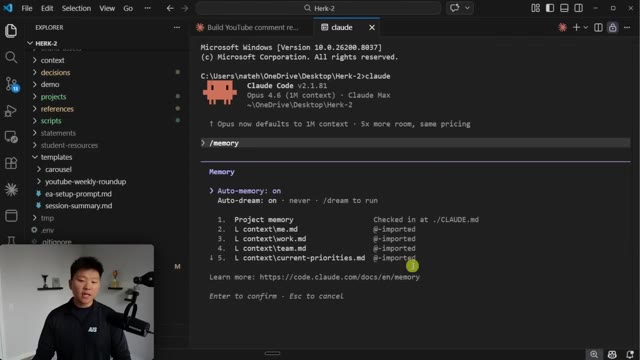
*⏱️ 00:03:03 — Interface VS Code affichant un terminal Claude Code actif, montrant les paramètres de configuration "Auto-memory" et "Auto-dream" ainsi que les fichiers de contexte importés.*

---

### ⏱️ `[00:03:17 - 00:03:39]` | Segment #10

**🔊 Audio (Transcription Intégrale Mot pour Mot en Français) :**
> So I'm just gonna say, run your auto dream and we'll see what it does with that information. So right now it says I don't have the Autodream skill and it's kind of confused, but right here you can see in the status line, we do see that it's streaming. And if I go down here and I enter the tasks, we can see that it's running this stream consolidation. It's gonna orient itself with the environment. And then we're gonna see the list of, I'm grabbing this file, I'm looking at these sessions.

**👁️ Analyse Visuelle d'Écran (gemini-3.5-flash-lite) :**
**Interface & Outils** : VS Code (éditeur de code) avec le terminal intégré Claude Code.

**Contenu textuel & Code** : Historique du terminal : "/memory" (Cancelled memory editing), "Unknown skill: dream", commande saisie "run your autodream", réponse de l'agent : "I don't have an 'autodream' skill or script set up...". En bas, l'indicateur de statut affiche "dreaming".

**Action / Démonstration** : L'agent Claude Code traite une commande non reconnue et indique un état de "dreaming" dans la barre de statut du terminal.

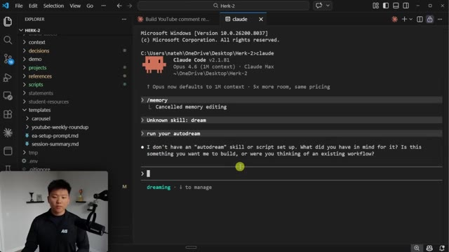
*⏱️ 00:03:23 — Interface VS Code affichant un terminal Claude Code dans lequel l'utilisateur a envoyé la commande "run your autodream" et reçoit une réponse d'erreur de l'agent.*

---

### ⏱️ `[00:03:39 - 00:03:57]` | Segment #11

**🔊 Audio (Transcription Intégrale Mot pour Mot en Français) :**
> And right now, because this is a bigger project for me, you can see that it's reviewing 285 sessions. So this will probably take longer than eight to 10 minutes. So while we're letting this run, let's talk a little bit more about why this matters. So obviously this just came out and I haven't had time to really, really test it and see if it's worth it or not. But based on what I'm seeing, I definitely think it is.

**👁️ Analyse Visuelle d'Écran (gemini-3.5-flash-lite) :**
**Interface & Outils** : Terminal de ligne de commande (Claude Code) et présentation visuelle (diapositive/diagramme).

**Contenu textuel & Code** : - Image 1 : "Memory consolidation", "Status: running", "reviewing 285 sessions", "Starting dream consolidation".
- Image 2 : Schéma expliquant le fonctionnement de "Auto Dream" comme un "Nightly Brain Cleanup", comparant un état "BEFORE" (notes éparpillées) à un état "AFTER" (notes consolidées).

**Action / Démonstration** : Exécution d'un processus automatisé de consolidation de mémoire ("Auto Dream") par l'agent IA, suivi d'une explication conceptuelle de la fonctionnalité.

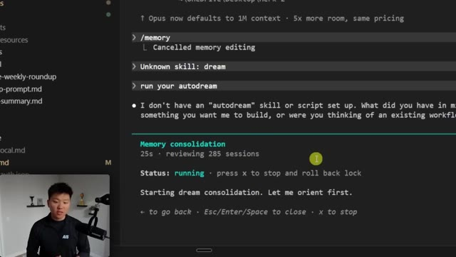
*⏱️ 00:03:44 — Interface en ligne de commande affichant le processus "Memory consolidation" avec une progression en cours (reviewing 285 sessions).*

*⏱️ 00:03:53 — Diagramme conceptuel intitulé "Why Auto Dream?" illustrant les bénéfices du nettoyage de mémoire pour "Claude Code" (Less Repetition, Less Bloat, Better Recall, Like sleep).*

---

### ⏱️ `[00:03:57 - 00:04:22]` | Segment #12

**🔊 Audio (Transcription Intégrale Mot pour Mot en Français) :**
> And let's talk about why that is. So the first big point is that you have less repetition. Even with auto memory, I still feel like sometimes I'm re-explaining things or I'm trying to carry over context from one session to another and less repetition is obviously a good thing. Another thing that we have that kind of floats behind the scenes is less bloat because part of the system is that it's compacting and pruning stuff, pruning basically just meaning like eliminating things that are unnecessary, trimming the fat.

**👁️ Analyse Visuelle d'Écran (gemini-3.5-flash-lite) :**
**Interface & Outils** : Présentation graphique (diagramme conceptuel).

**Contenu textuel & Code** : Texte du diagramme : "Why Auto Dream?", "Nightly Brain Cleanup for Claude Code", listant les bénéfices (Less Repetition, Less Bloat, Better Recall, Like Sleep) et comparant le processus de mémoire avant et après l'activation.

**Action / Démonstration** : Illustration pédagogique visant à montrer comment l'outil synthétise et nettoie les données contextuelles pour éviter la redondance.

*⏱️ 00:04:03 — Un schéma explicatif présentant les avantages de la fonctionnalité "Auto Dream" pour Claude Code, illustrant la transition d'un état encombré ("Before") vers un état optimisé et structuré ("After").*

---

### ⏱️ `[00:04:22 - 00:04:41]` | Segment #13

**🔊 Audio (Transcription Intégrale Mot pour Mot en Français) :**
> And when we're getting rid of all of that excess fat and excess tokens, it obviously helps us with our bloat and helps us with our context management. We also have better recall. Because it's getting rid of things that we don't actually need, it's easier to find things. So just picture an example of like, you know, you've got a hundred different balls in a ball pit and you're looking for one pink one out of all the blue. Well, what if we take away half of the blue?

**👁️ Analyse Visuelle d'Écran (gemini-3.5-flash-lite) :**
**Interface & Outils** : Schéma graphique (infographie de présentation).

**Contenu textuel & Code** : Textes explicatifs : "Why Auto Dream?", "Nightly Brain Cleanup for Claude Code", listes des avantages, et comparaison visuelle "BEFORE" (post-its confus) vs "AFTER" (information consolidée).

**Action / Démonstration** : Présentation conceptuelle des avantages techniques d'un système de nettoyage automatique de la mémoire pour un agent IA.

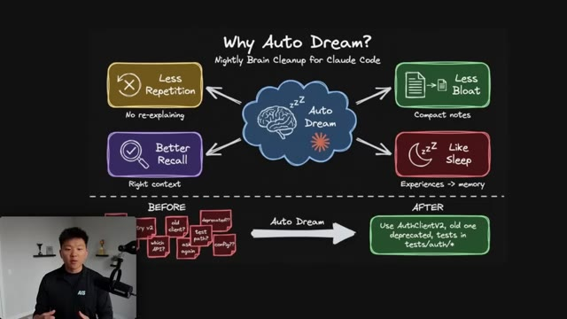
*⏱️ 00:04:27 — Un schéma explicatif illustrant le concept "Auto Dream" pour Claude Code, montrant les bénéfices du nettoyage de contexte (moins de répétition, moins de bloat, meilleur rappel, effet "sommeil") et une comparaison avant/après de la gestion de l'information.*

---

### ⏱️ `[00:04:41 - 00:05:18]` | Segment #14

**🔊 Audio (Transcription Intégrale Mot pour Mot en Français) :**
> It's gonna be easier to find that pink. And then what I think is really cool is it's basically just like sleep. So whatever cadence that this runs on, which we'll talk about a little bit later, when it hits that point, it basically just resets. So it's like a checkpoint. Every time you get to a new checkpoint, you're basically saving yourself. So before it would have all of these different files, right? You'd have these huge bloated context files, MD files, but now Autodream takes all of that and just keeps the important information that you need, which may only be, you know, a couple of different bullet points rather than having hundreds of lines. So the way that it actually works is step one, once it's activated, it will gather session info. After that, it will read the current existing memory files,

**👁️ Analyse Visuelle d'Écran (gemini-3.5-flash-lite) :**
**Interface & Outils** : Schéma conceptuel/diagramme de workflow.

**Contenu textuel & Code** : Diagramme avec des cases colorées : "Less Repetition", "Less Bloat", "Better Recall", "Like Sleep". Section "BEFORE" montrant des notes éparses et "AFTER" montrant une synthèse structurée.

**Action / Démonstration** : Le présentateur illustre visuellement le fonctionnement théorique du mécanisme de "nettoyage nocturne" de l'IA (Auto Dream).

*⏱️ 00:04:51 — Un schéma explicatif illustrant le concept "Why Auto Dream?" pour Claude Code, montrant une centralisation des bénéfices (mémoire, réduction du bruit) et une comparaison "Before/After" du traitement de l'information.*

---

### ⏱️ `[00:05:18 - 00:05:54]` | Segment #15

**🔊 Audio (Transcription Intégrale Mot pour Mot en Français) :**
> and then it will load it into a sub-agent, which does the actual dream prompt. So I don't know for certain, but I'm imagining that the dream prompt is something like this. You are performing a dream, a reflective pass over your memory files. Synthesize what you've learned recently into durable, well-organized memories so future sessions can orient quickly. Keep memory.md under a line limit. It's an index, not a dump. Link to memory files with one-line descriptions do not copy full memory into it. After it's ran that prompt, it goes through the consolidation and pruning, which like I said, is just cleaning things up. And then it goes ahead and it stores all of the results. And then whenever it wakes up the next time to do a dream, it

**👁️ Analyse Visuelle d'Écran (gemini-3.5-flash-lite) :**
**Interface & Outils** : Présentation visuelle (slide) sur fond noir.

**Contenu textuel & Code** : Texte du prompt : "You are performing a dream, a reflective pass over your memory files." suivi de "Synthesize what you've learned recently into durable, well-organized memories so future sessions can orient quickly." et "Keep MEMORY.md under a line limit; it's an index, not a dump. Link to memory files with one-line descriptions; do not copy full memory into it."

**Action / Démonstration** : Le présentateur illustre le contenu conceptuel du prompt système envoyé au sous-agent responsable de la gestion et de la synthèse des mémoires de l'IA.

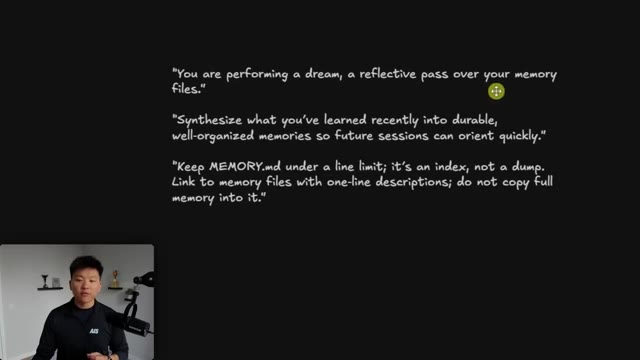
*⏱️ 00:05:27 — Une diapositive sur fond noir affichant un prompt système structuré en trois parties, utilisé pour diriger le processus de "rêve" (auto-réflexion) d'un agent IA.*

---

### ⏱️ `[00:05:54 - 00:06:26]` | Segment #16

**🔊 Audio (Transcription Intégrale Mot pour Mot en Français) :**
> basically just repeats that process every time. So once you have auto memory turned on and auto dream turned on, how does the auto dreaming actually take place besides you invoking it with slash dream or telling it to? Well, basically two different types of triggers or both. It could be based on hours, which means like, hey, every 12 hours, I'm just going to do my auto dream, or it could be based off of sessions. So maybe once you hit 300 sessions, it automatically does a dream. Now, this isn't confirmed with official documentation. This is just basically what it seems like after some X discussions and some Reddit discussions. But just keep that in mind.

**👁️ Analyse Visuelle d'Écran (gemini-3.5-flash-lite) :**
**Interface & Outils** : Diagramme logique (schéma conceptuel).

**Contenu textuel & Code** : Texte structuré : "Prerequisites" (Auto-memory ON, Auto-dream ON), "Triggers" (minHours, minSessions), "Safety" (Memory files only, No code touched, Line limit) et "Status" (running, never, last ran, idle /dream).

**Action / Démonstration** : Présentation visuelle et pédagogique des conditions logiques régissant le déclenchement automatique du mode "dream" de l'agent.

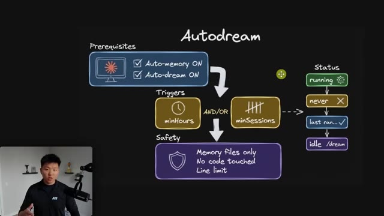
*⏱️ 00:06:02 — Schéma explicatif sur fond noir détaillant le fonctionnement de la fonctionnalité "Autodream" pour un agent IA, incluant les prérequis, les déclencheurs (triggers) et les paramètres de sécurité.*

---

### ⏱️ `[00:06:26 - 00:06:45]` | Segment #17

**🔊 Audio (Transcription Intégrale Mot pour Mot en Français) :**
> That is likely how this works, but I don't know for certain. Now, once that's running, you'll basically be able to see a couple different statuses. You can either see that it's running, you can see that it's never ran before, you can see when it was last ran, or you can see basically just nothing and it will be idle. And what's important to know here is that it's only going to touch memory files. As you guys saw in that first example, it said I'd updated five files.

**👁️ Analyse Visuelle d'Écran (gemini-3.5-flash-lite) :**
**Interface & Outils** : Présentation ou face-caméra explicatif sans interface logicielle partagée.

**Contenu textuel & Code** : Explications orales et mise en contexte méthodologique.

**Action / Démonstration** : Explications face caméra et démonstration conceptuelle.

---

### ⏱️ `[00:06:46 - 00:07:05]` | Segment #18

**🔊 Audio (Transcription Intégrale Mot pour Mot en Français) :**
> Those were all context files. So all of these right here that said I improved five memories, all of these are MDs. None of these are code or scripts or anything like that. So how do we think about the different layers between these different types of systems within cloud code? So for normal sessions, we basically just have the ability to code, to debug, to refactor, to talk to cloud code.

**👁️ Analyse Visuelle d'Écran (gemini-3.5-flash-lite) :**
**Interface & Outils** : Terminal de commande (probablement Claude Code) et présentation graphique (slide de cours).

**Contenu textuel & Code** : - Image 1 : Liste de fichiers Markdown (`feedback_prompt_deliverables.md`, `user_profile.md`, etc.), commandes `/btw` et `/memory`, état de configuration (`auto-memory: on`, `auto-dream: on`).
- Image 2 : Schéma montrant le flux entre "Normal Sessions" (code, debug), "Auto-Memory" (décisions et patterns) et "Autodream" (nettoyage et indexation).

**Action / Démonstration** : Le présentateur illustre les fichiers de contexte (Markdown) générés par le système d'IA, puis explique théoriquement la structure hiérarchique des couches de mémoire de l'agent.

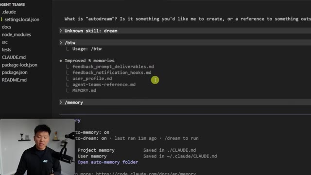
*⏱️ 00:06:50 — Interface de terminal (Claude Code) affichant une liste de fichiers Markdown (.md) mis à jour sous la section "Improved 5 memories".*

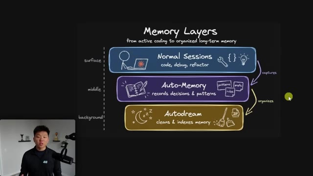
*⏱️ 00:06:55 — Diagramme explicatif intitulé "Memory Layers" illustrant trois niveaux de gestion de la mémoire : Normal Sessions, Auto-Memory et Autodream.*

---

### ⏱️ `[00:07:05 - 00:07:38]` | Segment #19

**🔊 Audio (Transcription Intégrale Mot pour Mot en Français) :**
> Then in the middle we have that auto memory which records decisions patterns important things about the actual project or about you But there's not a great method for cleaning that up consistently unless you frankenstein your own solution to do that So basically what autodream does is in the background without you having to manually go in there and prompt it to Looks through everything cleans everything up and fixes a lot of stuff And so that's why having these three layers work together It creates a really powerful system that likely is going to help you scale better and keep all of your sessions feeling cleaner and way more like a human who can remember things about you

**👁️ Analyse Visuelle d'Écran (gemini-3.5-flash-lite) :**
**Interface & Outils** : Logiciel de présentation/schéma (style tableau blanc type Excalidraw).

**Contenu textuel & Code** : Texte et icônes décrivant les couches : 1. Normal Sessions (code, debug, refactor), 2. Auto-Memory (records decisions & patterns), 3. Autodream (cleans & indexes memory). Flèches indiquant le processus de "captures" et "organizes".

**Action / Démonstration** : Présentation conceptuelle et visuelle de l'architecture du système de mémoire pour automatisation par IA.

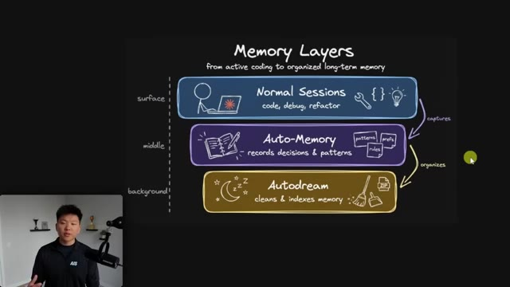
*⏱️ 00:07:13 — Schéma explicatif intitulé "Memory Layers" illustrant trois niveaux de gestion de mémoire pour les agents IA : "Normal Sessions" (surface), "Auto-Memory" (middle) et "Autodream" (background), montrant le flux de capture et d'organisation des données.*

---

### ⏱️ `[00:07:38 - 00:07:56]` | Segment #20

**🔊 Audio (Transcription Intégrale Mot pour Mot en Français) :**
> rather than a chat bot. So this has been running now for over six minutes. I'll just check with you guys when this is done and we can see what memory files it went ahead and updated. So this one actually only took eight minutes, which was interesting, even though it had to look through way more sessions, 285 compared to about 13, but it was able to update these three different memory files.

**👁️ Analyse Visuelle d'Écran (gemini-3.5-flash-lite) :**
**Interface & Outils** : VS Code (avec une extension de type terminal/agent Claude).

**Contenu textuel & Code** : Historique des logs de l'agent : "Memory consolidation", "reviewing 285 sessions", statut "running", et liste des tâches en cours (recherche de corrections utilisateur, analyse des logs de décisions, validation des mémoires).

**Action / Démonstration** : L'agent exécute un processus automatisé de consolidation de mémoire en analysant 285 sessions, tâche qui dure depuis 6 minutes et 32 secondes.

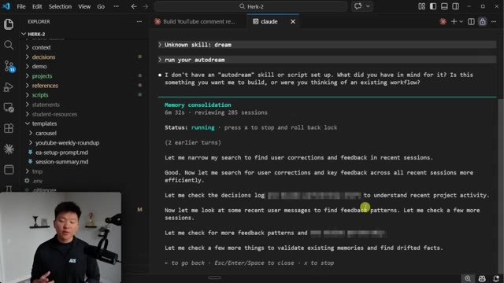
*⏱️ 00:07:42 — Une capture d'écran de l'interface VS Code montrant un agent IA en train d'effectuer une tâche de "Memory consolidation" avec une barre de progression temporelle et l'historique des actions entreprises.*

---

### ⏱️ `[00:07:56 - 00:08:20]` | Segment #21

**🔊 Audio (Transcription Intégrale Mot pour Mot en Français) :**
> And you can now see that there are no background tasks currently running. And if you want a little bit more visibility, you can see what it actually did explicitly. So it added these couple entries and it removed these sections. And now if I wanted to restore those or add some more insights, I could. And I could also go view the file, of course, if I wanted to make sure that it was all accurate. And the cool thing about this is as you use the AutoDream more and more, it's going to get better and better at understanding what type of context is important to you and what is not.

**👁️ Analyse Visuelle d'Écran (gemini-3.5-flash-lite) :**
**Interface & Outils** : VS Code avec l'interface de terminal/chat Claude intégrée.

**Contenu textuel & Code** : Historique de discussion affichant une liste d'entrées ajoutées (projets, contexte d'équipe) et d'entrées supprimées (sections sur ClickUp, Google Workspace, règles de sécurité) dans le fichier 'memory.md', avec une question de l'agent proposant une restauration.

**Action / Démonstration** : L'utilisateur a demandé à l'agent d'expliciter les changements effectués dans la mémoire du projet, et l'agent répond avec un résumé clair des modifications textuelles.

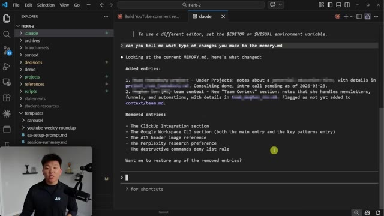
*⏱️ 00:08:02 — Une capture d'écran de l'éditeur VS Code montrant l'interaction avec l'agent Claude, détaillant les modifications apportées au fichier 'memory.md'.*

---

### ⏱️ `[00:08:20 - 00:08:30]` | Segment #22

**🔊 Audio (Transcription Intégrale Mot pour Mot en Français) :**
> But anyways, that is going to do it for today. So if you guys enjoyed the video or learned something new, please give it a like. Helps me out a ton. And as always, I appreciate you guys making it to the end of the video. I'll see you on the next one. Thanks, everyone.

**👁️ Analyse Visuelle d'Écran (gemini-3.5-flash-lite) :**
**Interface & Outils** : Excalidraw (tableau blanc collaboratif).

**Contenu textuel & Code** : Le diagramme détaille les étapes : 1. Gather Sessions, 2. Read Memory, 3. Dream Prompt, 4. Consolidate & Prune, 5. Store Results, avec une boucle de répétition.

**Action / Démonstration** : Présentation statique du workflow architectural du système "Autodream".

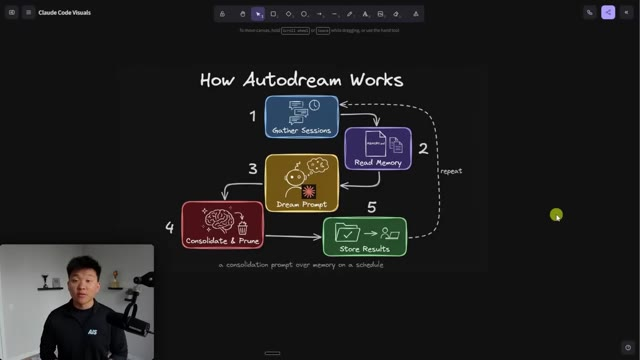
*⏱️ 00:08:22 — Un schéma explicatif intitulé "How Autodream Works" présenté sur un tableau blanc numérique, illustrant un processus cyclique en 5 étapes pour la gestion de la mémoire et des prompts d'un agent IA.*

---

