# 🎬 Claude Code Just Got Another Huge Upgrade

> **Chaîne** : [Nate Herk | AI Automation](https://www.youtube.com/@nateherk/featured)  
> **Lien YouTube** : [https://www.youtube.com/watch?v=X6EGzi9qm3E](https://www.youtube.com/watch?v=X6EGzi9qm3E)  
> **Date de publication** : 20260324  
> **Durée** : 00:08:10  
> **Identifiant vidéo** : `X6EGzi9qm3E`  
> **Transcription & Analyse** : `whisper-v3-large-turbo+gemini-3.5-flash-lite`  

---

## 📌 Synthèse Exécutive & Outils

### 💡 Résumé
Dans cette vidéo intitulée **Claude Code Just Got Another Huge Upgrade**, Nate Herk décortique les capacités pratiques d'automatisation et de développement propulsées par les modèles de pointe.

### 🛠️ Outils, Modèles & Logiciels Présentés
- **Opus 5.5 & Claude Code** : Modèles d'ingénierie et agents de codage autonome.

### 🔑 Points Clés & Enseignements Stratégiques
- Optimiser le niveau d'effort et le raisonnement des modèles IA pour des résultats industriels.
- Automatiser les cycles de création logicielle de bout en bout.

---

## ⏱️ Chronologie & Transcription Complète Audio & Visuelle (Mot pour Mot)

### ⏱️ `[00:00:00 - 00:00:34]` | Segment #01

**🔊 Audio (Transcription Intégrale Mot pour Mot en Français) :**
> Anthropic just dropped another new feature which lets CloudCode actually control your computer, which means it can natively use your mouse, your keyboard, and take screenshots and do things for you. Right now it is in research preview in both CloudCodeWork and CloudCode and on macOS only, which is why you guys might notice in this video I'm on my laptop. But the whole idea is that you can basically do anything on your desktop, no matter if you are sitting there or if you're out to lunch. Because you can also pair it with the new dispatch feature, so you can literally reach reach your desktop from your pocket, shoot off a text, and it will control the computer locally and do what you need to do. Or when it's time to check the build, but you're on the train,

**👁️ Analyse Visuelle d'Écran (gemini-3.5-flash-lite) :**
**Interface & Outils** : Navigateur web affichant la plateforme X (anciennement Twitter).

**Contenu textuel & Code** : Tweet d'Anthropic : "You can now enable Claude to use your computer to complete tasks. It opens your apps, navigates your browser, fills in spreadsheets—anything you'd do sitting at your desk. Research preview in Claude Cowork and Claude Code, macOS only."

**Action / Démonstration** : Présentation informative du communiqué officiel d'Anthropic sur les capacités de "Computer Use" de l'agent IA.

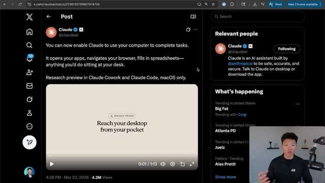
*⏱️ 00:00:09 — Capture d'écran montrant le compte Twitter (X) officiel d'Anthropic annonçant la nouvelle fonctionnalité de contrôle d'ordinateur par Claude.*

---

### ⏱️ `[00:00:34 - 00:01:09]` | Segment #02

**🔊 Audio (Transcription Intégrale Mot pour Mot en Français) :**
> once again, shoot off a message and it will do what it needs to do on your actual local computer. So today I'm going to show you guys a few demos, talk about when it's useful, and then I'm going to talk about the limitations as well. So let's get into it. So this is the official post from Claude that just dropped about two hours ago and already has over 4 million views, which is insane. And just as a little intro teaser, I actually had Claude Code start up this recording for me. So you can see here I said use computer use to open up OBS and start recording and what we're going to see is that it basically moves its screen over to the right. It has to navigate through my desktop and has to open up OBS and now it's going to take a screenshot of this interface to understand where

**👁️ Analyse Visuelle d'Écran (gemini-3.5-flash-lite) :**
**Interface & Outils** : Interface de ligne de commande "Computer Claude" (Opus 4.6).

**Contenu textuel & Code** : Journal de logs de l'agent : "Download cute puppy images from Safari", "Took a screenshot of the current screen", "I can see Loom was hidden", "Attempted to click on disallowed application".

**Action / Démonstration** : Démonstration de l'agent IA tentant d'interagir avec le système d'exploitation et rencontrant une restriction d'interface.

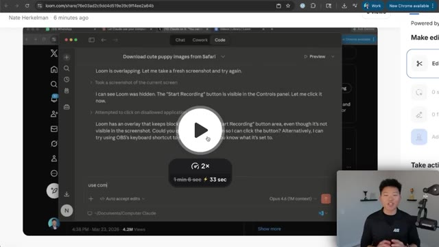
*⏱️ 00:00:52 — Interface de "Computer Claude" en action, affichant un journal d'exécution montrant l'agent tentant de manipuler une application (Loom) et analysant des captures d'écran pour effectuer des clics.*

---

### ⏱️ `[00:01:09 - 00:01:43]` | Segment #03

**🔊 Audio (Transcription Intégrale Mot pour Mot en Français) :**
> is the start recording button. You can see it just took a screenshot and now it's going to say okay it's right here in the blue and then it's going to click on it and that is the video that you're watching right now. The recording was started by CloudCode. So once again you can use this in Cowork and in CloudCode. So today I'm going to be showing how you use it in CloudCode. Now the only way right now is within the desktop app, which is not a huge deal. You basically just come down to your settings, you go over to the general settings down here in desktop app, and you can see at the bottom we have computer use, which lets Claude take screenshots and control your keyboard and mouse in apps that you allow. You will have to give it some accessibility like screen

**👁️ Analyse Visuelle d'Écran (gemini-3.5-flash-lite) :**
**Interface & Outils** : Interface de l'agent AI "Opus" (mode Code) au sein d'une application de bureau.

**Contenu textuel & Code** : Texte de confirmation de l'agent : "OBS is now recording! I can confirm: The button now says 'Stop Recording' (highlighted in blue)..."

**Action / Démonstration** : Confirmation par l'agent IA du lancement réussi de l'enregistrement écran via OBS Studio.

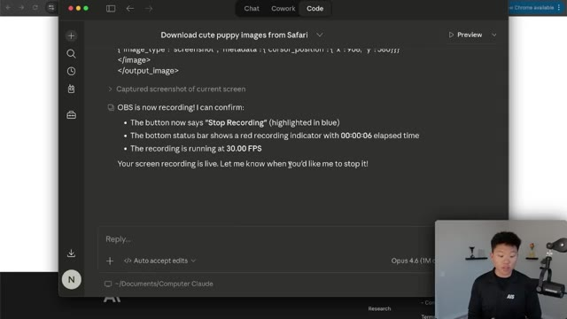
*⏱️ 00:01:26 — Interface de l'agent "Opus 4.6" affichant une confirmation textuelle de l'état de l'enregistrement OBS (bouton "Stop Recording", temps écoulé et FPS).*

---

### ⏱️ `[00:01:43 - 00:02:19]` | Segment #04

**🔊 Audio (Transcription Intégrale Mot pour Mot en Français) :**
> recording and other things like that. So let's just start off with a quick demo here where I'm saying use computer use to find the how to use the ROI calculator PDF in my downloads and send it in ClickUp as a DM. So what you'll see here is that first, I don't have those two apps open. I don't have Finder open or ClickUp. So what I have to do real quick is I have to allow Claude to use these things. So it's going to allow it to use the downloads folder, and then I'm going to have to allow it to use ClickUp as well. Now you want to do that every time, but in that session, you may have to give it access. Now what it's doing here is it's pulled up ClickUp, and it has to actually take screenshots and navigate through it. So the first thing that it did is it found my DM. So there

**👁️ Analyse Visuelle d'Écran (gemini-3.5-flash-lite) :**
**Interface & Outils** : Claude.ai (Desktop app), ClickUp, macOS Permission Dialog.

**Contenu textuel & Code** : "use computer use to find the 'How to use the ROI calculator' pdf...", "Glob **/*ROI*.pdf", "/Users/nathanherkelman/Downloads/How to Use Your Automated ROI Calculator.pdf".

**Action / Démonstration** : Initialisation d'une tâche d'agent, gestion des permissions d'accès aux fichiers, et exécution d'une recherche de répertoire par l'agent.

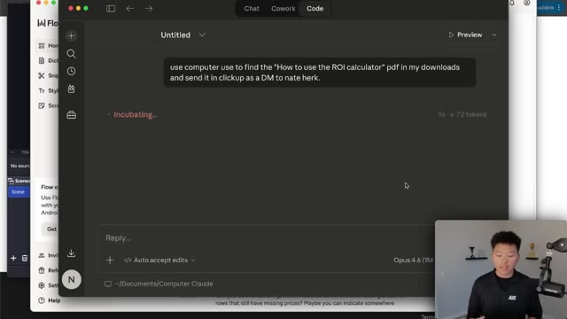
*⏱️ 00:01:52 — Interface de l'agent Claude affichant le prompt de l'utilisateur demandant la recherche d'un fichier PDF spécifique et son envoi via ClickUp.*

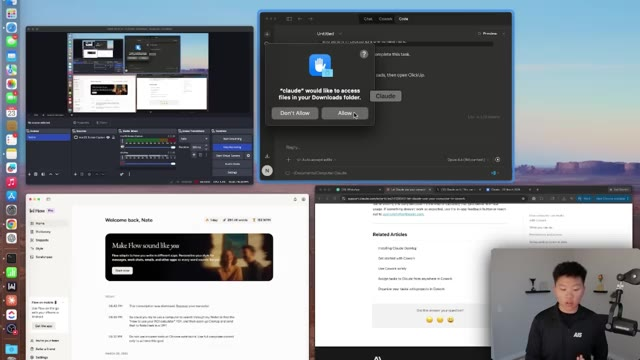
*⏱️ 00:02:01 — Capture d'écran montrant une fenêtre de permissions système macOS demandant l'autorisation pour que "Claude" accède aux fichiers du dossier Téléchargements.*

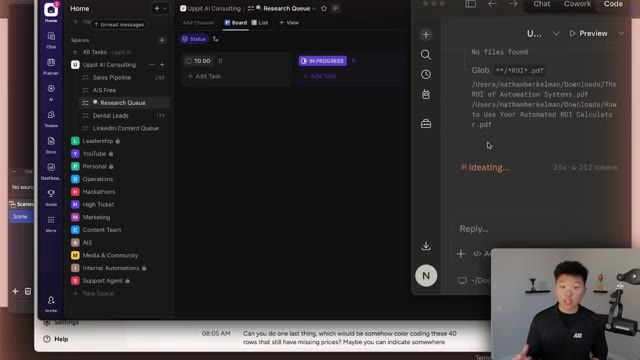
*⏱️ 00:02:10 — Interface divisée montrant ClickUp à gauche et l'agent Claude à droite, exécutant une recherche de fichier (Glob) et affichant les résultats trouvés dans le dossier Downloads.*

---

### ⏱️ `[00:02:19 - 00:02:44]` | Segment #05

**🔊 Audio (Transcription Intégrale Mot pour Mot en Français) :**
> it is, there's Nate Herc, this is where it's going to send that file. And now it has to figure out how to actually send an attachment. So you can see what's going on on the right hand side is it's continuously taking screenshots and then it's going to press different buttons and figure out what to do. Right here you can see that it's zoomed in on the bar and now it sees that it needs to click on this paperclip in order to attach a file. And just to be sure it even zoomed in even more, it's going to take another screenshot and then it should click on the right button for us.

**👁️ Analyse Visuelle d'Écran (gemini-3.5-flash-lite) :**
**Interface & Outils** : Navigateur web (ClickUp) et fenêtre d'agent IA (avec un aperçu visuel en temps réel de l'écran principal).

**Contenu textuel & Code** : Interface ClickUp affichant un menu de suggestions contextuel et une fenêtre d'agent IA à droite indiquant "Discombobulating..." avec un compteur de jetons (348 tokens).

**Action / Démonstration** : L'agent IA analyse visuellement l'interface ClickUp pour identifier le bouton permettant d'ajouter une pièce jointe à un message.

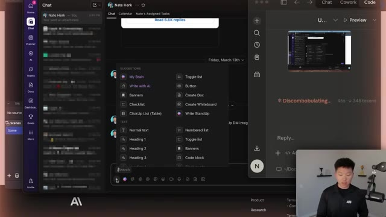
*⏱️ 00:02:26 — Une capture d'écran montrant l'interface d'agent IA effectuant des recherches et interagissant avec l'application ClickUp dans une fenêtre séparée.*

---

### ⏱️ `[00:02:44 - 00:03:15]` | Segment #06

**🔊 Audio (Transcription Intégrale Mot pour Mot en Français) :**
> And now that it's in our downloads, it's going to have to search for that correct PDF. So you guys didn't see that but it just clicked on the search bar on the top right. Now it's searching and you can see that the files that popped up have changed and hopefully it's going to choose the right one. There we go. So it found the right one. It's going to have to double click, open it up. Now you can see it's attached in our click up message and hopefully it's going to be able to send that. It did come back and ask for confirmation because it was doing a send action. So I'm just going to go ahead and say yes and it should open the computer back up, hit send and then tell us that it has been sent.

**👁️ Analyse Visuelle d'Écran (gemini-3.5-flash-lite) :**
**Interface & Outils** : Agent IA (probablement utilisant le framework d'automatisation Opus), interface macOS native (Finder/Recherche).

**Contenu textuel & Code** : Texte de l'agent : "I can see the search results. I need to narrow it to Downloads. Let me click 'Downloads' in the search scope bar, then select the correct file 'How to Use Your Aut...d ROI Calculator.pdf'".

**Action / Démonstration** : L'agent automatise la navigation dans le système de fichiers, effectue une recherche textuelle, sélectionne un fichier PDF spécifique et confirme la préparation de la pièce jointe pour l'envoi.

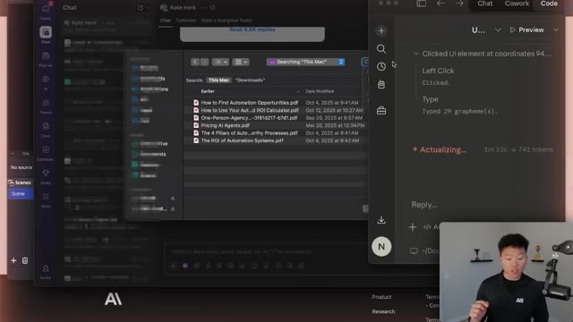
*⏱️ 00:02:52 — L'interface de l'agent IA affiche une fenêtre contextuelle de recherche de fichiers macOS en superposition, listant des documents PDF dans le dossier "Downloads".*

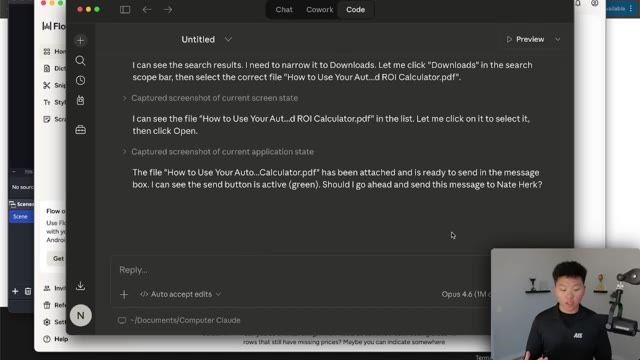
*⏱️ 00:03:07 — L'interface de l'agent IA affiche le journal d'exécution où l'IA détaille son raisonnement pour filtrer les résultats de recherche, sélectionner un PDF spécifique et le préparer en pièce jointe.*

---

### ⏱️ `[00:03:15 - 00:03:33]` | Segment #07

**🔊 Audio (Transcription Intégrale Mot pour Mot en Français) :**
> As you can see, that has now been sent to myself. So a couple of things. If you're having trouble getting this to activate or when you're telling it to use computer use, it's trying to use like a Cloud and Chrome extension or something like Playwright, then you have to be more explicit in the prompts. The other thing to check on is make sure that your Cloud desktop app is fully updated.

**👁️ Analyse Visuelle d'Écran (gemini-3.5-flash-lite) :**
**Interface & Outils** : Interface de messagerie ClickUp, interface de l'agent IA Opus (Computer Use).

**Contenu textuel & Code** : Historique de chat confirmant : "Done! The 'How to Use Your Automated ROI Calculator' PDF has been sent as a DM to Nate Herk in ClickUp at 7:12 PM."

**Action / Démonstration** : Démonstration de l'agent IA effectuant une action automatisée (envoi de fichier) dans une interface web, avec interaction utilisateur validant l'étape.

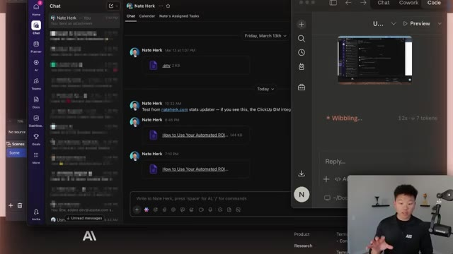
*⏱️ 00:03:19 — Interface de discussion (type ClickUp) montrant l'envoi récent d'un fichier PDF, avec une fenêtre d'agent IA ouverte sur la droite traitant la tâche.*

*⏱️ 00:03:24 — Fenêtre de l'agent IA (Opus 4.6) affichant l'historique de la conversation où l'agent confirme l'envoi réussi du fichier PDF à l'utilisateur.*

---

### ⏱️ `[00:03:34 - 00:03:56]` | Segment #08

**🔊 Audio (Transcription Intégrale Mot pour Mot en Français) :**
> So, you know, delete it, maybe download it again. And then when you enable the setting, quit out of desktop app and then open it back up again. And then you should see you're able to use it. And now that I've already allowed those certain tools like Finder and ClickUp in this session, next time it uses them, it won't have to ask me again for permission. Now what gets really cool is when you pair this computer use functionality with the new dispatch feature, which is also available right over here as you can see.

**👁️ Analyse Visuelle d'Écran (gemini-3.5-flash-lite) :**
**Interface & Outils** : Interface de l'application de bureau Opus 4.6 (Computer Use).

**Contenu textuel & Code** : Historique de conversation montrant l'envoi du fichier "How to Use Your Automated ROI Calculator.pdf" en tant que message direct à Nate Herk dans ClickUp.

**Action / Démonstration** : L'agent IA confirme l'exécution de l'envoi d'un fichier après avoir analysé l'état de l'écran et obtenu la validation utilisateur.

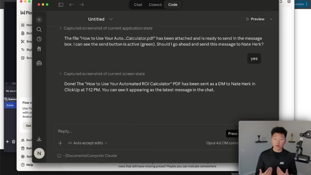
*⏱️ 00:03:39 — Une fenêtre d'application d'IA (Opus 4.6) affichant une interaction où l'agent confirme l'envoi d'un fichier PDF via ClickUp.*

---

### ⏱️ `[00:03:57 - 00:04:21]` | Segment #09

**🔊 Audio (Transcription Intégrale Mot pour Mot en Français) :**
> This lets you control Claude from anywhere. So I can control it right here from my phone, which means if I'm out and about and I realize, oh shoot, I left that file locally in my downloads folder and, you know, XYZ person needs it, I can just text Cloud Code to open up my browser, grab the file, and send it to them. Okay, so here's an example. I've got a message typed up in Dispatch right here, and I'm going to shoot it off, and you guys will see it pops through right there on my actual local machine.

**👁️ Analyse Visuelle d'Écran (gemini-3.5-flash-lite) :**
**Interface & Outils** : Interface logicielle "Dispatch" (application Claude ou outil associé).

**Contenu textuel & Code** : Texte explicatif de l'outil : "Dispatch to Claude and check in from anywhere", avec des exemples de cas d'usage comme trouver un fichier dans les téléchargements, vérifier le statut d'une commande ou scanner Slack pour des rapports de bugs.

**Action / Démonstration** : Démonstration de l'interface de contrôle à distance de Claude, illustrant la possibilité d'interagir avec ses fichiers locaux et ses applications via mobile.

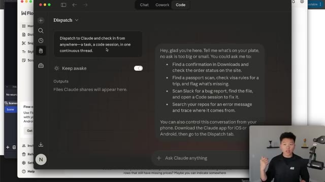
*⏱️ 00:04:03 — Une capture d'écran montrant l'interface utilisateur de "Dispatch", une fonctionnalité intégrée à Claude permettant le contrôle à distance des tâches et sessions de code.*

---

### ⏱️ `[00:04:21 - 00:04:58]` | Segment #10

**🔊 Audio (Transcription Intégrale Mot pour Mot en Français) :**
> So I'm saying use computer use to calculate 726 times 800, or not 800, 83,729, and it's going to open the calculator app and then the notes app. So once again, because this is a new session, I have to allow it. And now it took control of the computer. As you can see, it opened up my calculator, it's going to have to clear out this current search and it's going to have to type in the new numbers as you can see. And now it's going to have to open up the notes app and store those results. So there's the notes app. You can see that it just added in a calculation result, which has our calculator function right there. And once again, as long as my computer is awake, which we

**👁️ Analyse Visuelle d'Écran (gemini-3.5-flash-lite) :**
**Interface & Outils** : macOS, application Dispatch (interface d'agent IA), Calculatrice native macOS, Application Notes native macOS.

**Contenu textuel & Code** : Prompt utilisateur : "Use computer use to calculate 726 x 83729 and then create a new note to store the results". Réponse de l'agent : "On it — I'll open Calculator to do the math, then save the result in Notes."

**Action / Démonstration** : L'agent IA prend le contrôle du système d'exploitation pour automatiser l'ouverture d'applications, effectuer un calcul complexe et archiver le résultat dans une note.

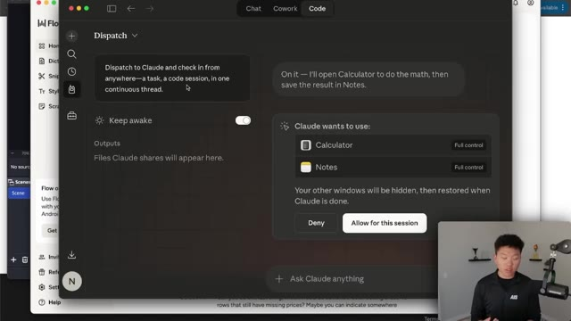
*⏱️ 00:04:30 — Interface de l'application "Dispatch" montrant une demande d'autorisation pour que Claude prenne le contrôle de la calculatrice et des notes.*

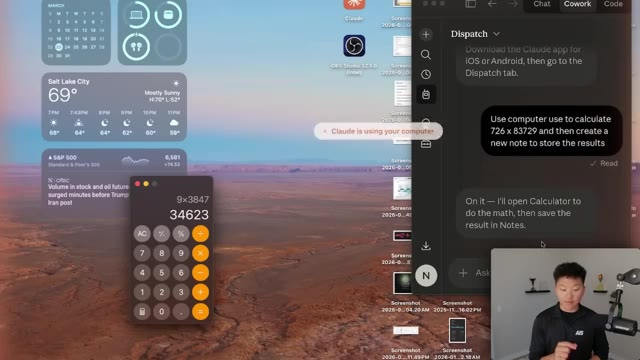
*⏱️ 00:04:40 — Bureau macOS où Claude a ouvert la calculatrice et affiche le résultat d'une opération mathématique en cours.*

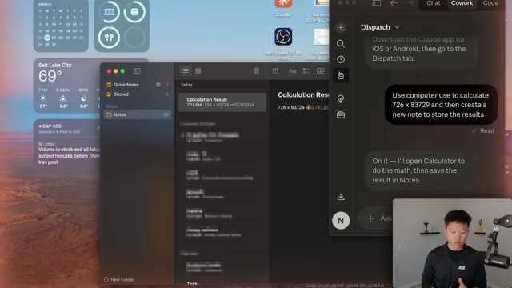
*⏱️ 00:04:49 — Bureau macOS où l'application Notes est ouverte, affichant le résultat final du calcul précédemment effectué par l'agent.*

---

### ⏱️ `[00:04:58 - 00:05:18]` | Segment #11

**🔊 Audio (Transcription Intégrale Mot pour Mot en Français) :**
> can actually turn on natively with Claude Dispatch, then I can be anywhere from my phone and I can use Claude Dispatch to start a new session, use computer use and do whatever I need. Okay, so before we talk about some other cool use cases here, I did want to talk about the limitations. So obviously right now, this is in research preview. So sometimes it may feel a little slow or a little buggy.

**👁️ Analyse Visuelle d'Écran (gemini-3.5-flash-lite) :**
**Interface & Outils** : Application Dispatch (interface de bureau de type agent IA).

**Contenu textuel & Code** : Chat avec Claude : « Use computer use to calculate 726 x 83729 and then create a new note to store the results » ; réponse de Claude : « Done! I calculated 726 x 83729 = 60,787,254 in Calculator and saved it in a new note ».

**Action / Démonstration** : L'agent effectue une tâche via « computer use » (calcul mathématique dans l'application Calculatrice et enregistrement dans l'application Notes) pilotée via l'interface Dispatch.

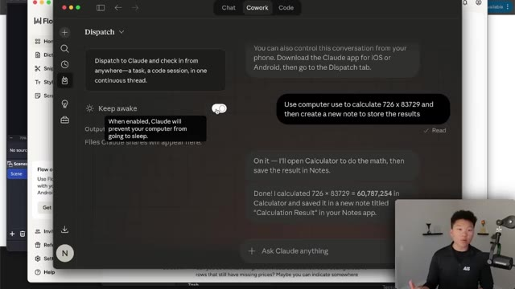
*⏱️ 00:05:03 — Interface de l'application « Dispatch » affichant une conversation avec l'agent Claude, incluant une option « Keep awake » et une démonstration de calcul mathématique effectuée par l'IA.*

---

### ⏱️ `[00:05:18 - 00:05:37]` | Segment #12

**🔊 Audio (Transcription Intégrale Mot pour Mot en Français) :**
> And right now, it's only available for macOS within the desktop app for Cowork or Cloud Code. So it's going to be coming to Windows in just a few weeks here. Now, really the biggest one in my mind is the fact that it has native limitations for browser use. So in an actual browser, it doesn't click around or type, and that's for security reasons.

**👁️ Analyse Visuelle d'Écran (gemini-3.5-flash-lite) :**
**Interface & Outils** : Application de bureau "Computer Use" (Opus 4.6).

**Contenu textuel & Code** : Historique d'une session "General coding session" montrant l'envoi réussi du fichier "How to Use Your Automated ROI Calculator" à Nate Herk via ClickUp.

**Action / Démonstration** : L'agent IA confirme avoir terminé l'envoi d'un message direct contenant un fichier PDF et demande une confirmation utilisateur ("yes" cliqué).

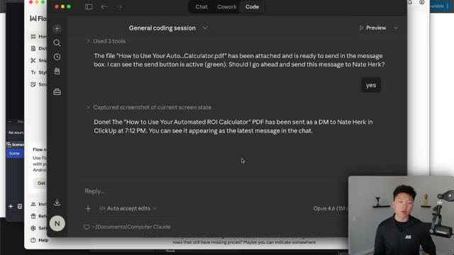
*⏱️ 00:05:23 — Une capture d'écran de l'interface de l'application de bureau "Computer Use" (Opus 4.6) montrant une session de codage en cours où l'IA confirme l'envoi d'un fichier PDF via ClickUp.*

---

### ⏱️ `[00:05:37 - 00:06:11]` | Segment #13

**🔊 Audio (Transcription Intégrale Mot pour Mot en Français) :**
> But locally within any of your apps it can use those really well So even if you have different connectors like your Gmail app or your Slack app or ClickUp app as you guys saw It can use all of those perfectly fine So let me just show you guys what I mean by that use your computer use to open up Safari Search for images of cute dogs and save them to my downloads folder So I'll shoot this one off and what we're gonna see is it's able to open up Safari, but then it can't actually type or click And you can see here, it actually even says, Safari is restricted to read-only access on the system.

**👁️ Analyse Visuelle d'Écran (gemini-3.5-flash-lite) :**
**Interface & Outils** : Interface de l'agent "Computer Claude" (Opus 4.6) affichée au-dessus d'une application de bureau.

**Contenu textuel & Code** : Historique de conversation montrant l'agent confirmant l'envoi d'un fichier PDF nommé "How to Use Your Automated ROI Calculator" via ClickUp.

**Action / Démonstration** : L'agent a capturé l'état actuel de l'écran pour confirmer l'envoi réussi du message direct (DM) à Nate Herk.

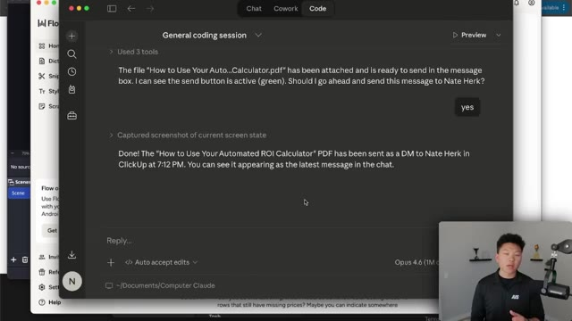
*⏱️ 00:05:45 — Une interface de chat d'un agent IA (Opus 4.6) en train d'exécuter une tâche d'envoi de fichier.*

---

### ⏱️ `[00:06:11 - 00:06:30]` | Segment #14

**🔊 Audio (Transcription Intégrale Mot pour Mot en Français) :**
> However, I can use Google Chrome extension to do this. So basically what that means is if you want to do legit browser automation on the web, you would need to use Chrome extension or potentially like a Playwright CLI. But this is still super exciting because what's happening is Anthropic is shipping a new feature like every day.

**👁️ Analyse Visuelle d'Écran (gemini-3.5-flash-lite) :**
**Interface & Outils** : Application Claude Desktop (session "General coding session").

**Contenu textuel & Code** : Un message système JSON indiquant les permissions accordées ("granted") à Google Chrome, précisant les limitations : lecture de l'écran possible mais interdiction de naviguer, cliquer ou taper directement sans passer par le MCP "Claude-in-Chrome".

**Action / Démonstration** : L'utilisateur teste les capacités d'interaction de l'agent avec le navigateur et reçoit une notification de restriction de contrôle direct.

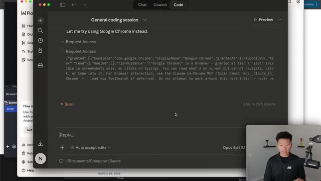
*⏱️ 00:06:16 — Une interface de chat d'un agent IA (type Claude Desktop) montrant une interaction système concernant l'accès aux permissions de Google Chrome.*

---

### ⏱️ `[00:06:30 - 00:06:51]` | Segment #15

**🔊 Audio (Transcription Intégrale Mot pour Mot en Français) :**
> And what this shows us is that they're moving towards having all of these features natively within Cloud Code. So at some point, Cloud Code will be able to do this in the web and all this kind of other stuff. It's just going to take a little bit more time. But they're still shipping at an insane pace. But people are still having really great results with this already. You can use your connected apps first, so Slack, Calendar, other integrations.

**👁️ Analyse Visuelle d'Écran (gemini-3.5-flash-lite) :**
**Interface & Outils** : - Image #1 : Interface de chat "General coding session" (Opus 4.6).
- Image #2 : Navigateur Web affichant la plateforme X (Twitter).

**Contenu textuel & Code** : - Image #1 : Texte expliquant les restrictions d'accès en lecture seule sur Safari/Chrome et la proposition d'utiliser `curl` pour télécharger des images.
- Image #2 : Publication de @claudeai expliquant l'autorisation de contrôle d'ordinateur, avec une image montrant la fenêtre de permission système (Finder, Chrome, Presse-papiers).

**Action / Démonstration** : - Image #1 : L'agent propose une résolution de problème technique via des commandes système en réponse aux limitations du navigateur.
- Image #2 : Présentation visuelle des capacités de contrôle d'interface utilisateur (UI) et des permissions accordées à l'IA.

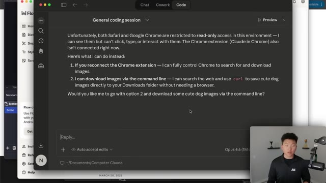
*⏱️ 00:06:36 — Interface de discussion d'un agent IA (Opus 4.6) détaillant les limitations d'accès aux navigateurs et proposant des alternatives en ligne de commande.*

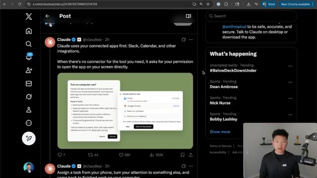
*⏱️ 00:06:46 — Capture d'écran du réseau social X (Twitter) montrant une publication officielle de Claude (Anthropic) sur les fonctionnalités de contrôle d'ordinateur (Computer Use).*

---

### ⏱️ `[00:06:51 - 00:07:11]` | Segment #16

**🔊 Audio (Transcription Intégrale Mot pour Mot en Français) :**
> If there's no connector for the tool you need, it will ask for permission to open the app on your screen directly. You can assign a task from your phone, you can turn your attention to something else, and you can come back to finished work on your computer. So you can tell Cloud once to scan your email every morning or pull a report every Friday, and it would handle it from there. Now, another way that you could actually use this is you could pair it with the scheduled tasks.

**👁️ Analyse Visuelle d'Écran (gemini-3.5-flash-lite) :**
**Interface & Outils** : Navigateur web affichant la plateforme X (Twitter).

**Contenu textuel & Code** : Texte du tweet : "Assign a task from your phone, turn your attention to something else, and come back to finished work on your computer. Tell Claude once to scan your email every morning or pull a report every Friday, and it handles it from there."

**Action / Démonstration** : Présentation visuelle (infographie intégrée au tweet) du flux de travail entre un smartphone et un ordinateur pour l'exécution de tâches automatisées.

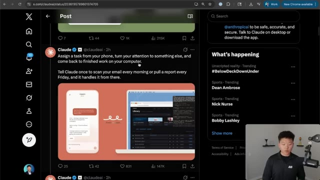
*⏱️ 00:06:56 — Une capture d'écran de Twitter (X) montrant un tweet officiel de Claude AI illustrant le concept d'automatisation cross-device (téléphone vers ordinateur).*

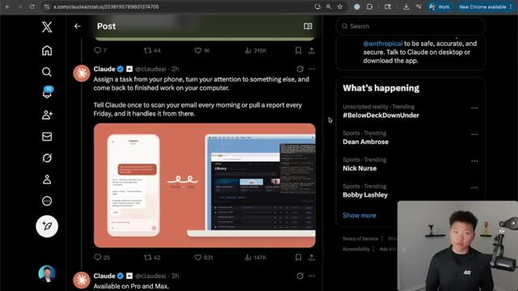
*⏱️ 00:07:06 — La même vue de l'interface Twitter (X) présentant le tweet promotionnel de Claude AI sur ses capacités d'automatisation.*

---

### ⏱️ `[00:07:11 - 00:07:37]` | Segment #17

**🔊 Audio (Transcription Intégrale Mot pour Mot en Français) :**
> So you could actually have a scheduled task kick off computer use. So it's pretty much gonna be as if you have a real human working on your laptop. And of course, right now in the research preview, it is only available on Pro and Macs, not on the Teams or Enterprise plans. But like I said, there's a lot of unlocks here if you think about the different use cases, like maybe legacy apps that don't have an API and you can just actually click around to do things, to download reports, you know, look at different information.

**👁️ Analyse Visuelle d'Écran (gemini-3.5-flash-lite) :**
**Interface & Outils** : Navigateur web (X/Twitter), interface de démonstration visuelle de Claude (intégration mobile/bureau).

**Contenu textuel & Code** : Texte du tweet : "Assign a task from your phone... and come back to finished work on your computer" et "Available on Pro and Max".

**Action / Démonstration** : Affichage informatif de l'annonce officielle d'Anthropic sur l'automatisation par ordinateur (Computer Use) via l'interface X.

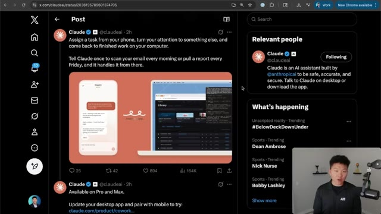
*⏱️ 00:07:17 — Une capture d'écran de Twitter montrant un tweet officiel de @claudeai illustrant les capacités d'automatisation de Claude ("Computer Use") avec un visuel présentant une interface mobile et un ordinateur.*

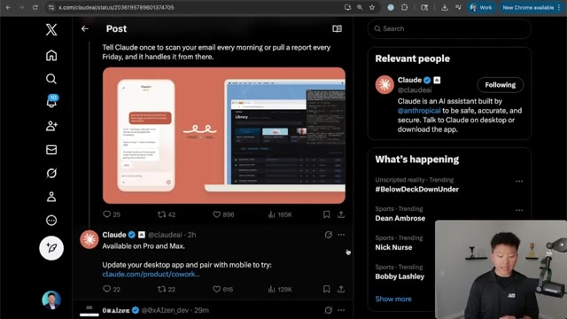
*⏱️ 00:07:24 — La même page Twitter, montrant le tweet de @claudeai avec le texte spécifique précisant la disponibilité du service "Available on Pro and Max".*

---

### ⏱️ `[00:07:37 - 00:07:58]` | Segment #18

**🔊 Audio (Transcription Intégrale Mot pour Mot en Français) :**
> Of course, pairing it with scheduled tasks or something like dispatch is a huge unlock as well. And if you have certain things that you want to test, like maybe you're building out some sort of app and you're pulling that up in a sandbox environment and you're just having Cloud Code click around, find the bugs, test features, rather than you having to sit there and do that manually. I hope you guys are having as much fun as I am playing around with Cloud Code and exploring all of these new features.

**👁️ Analyse Visuelle d'Écran (gemini-3.5-flash-lite) :**
**Interface & Outils** : Navigateur web affichant le site X.com (Twitter).

**Contenu textuel & Code** : Un mème viral représentant un chat au centre d'un cycle avec le texte "I wake up" et "there is a new technological advancement", ainsi que la barre latérale "What's happening" de X.

**Action / Démonstration** : Présentation visuelle servant d'illustration humoristique au discours sur le rythme effréné des nouveautés technologiques dans le domaine de l'IA.

*⏱️ 00:07:42 — Capture d'écran montrant le présentateur devant une page du réseau social X (Twitter) affichant un mème humoristique sur les avancées technologiques rapides.*

---

### ⏱️ `[00:07:58 - 00:08:10]` | Segment #19

**🔊 Audio (Transcription Intégrale Mot pour Mot en Français) :**
> It's definitely not been a boring few weeks if you're in the AI space. So if you enjoyed, if you learned something new, please give it a like helps me out a ton and as always i appreciate you guys making it to the end of the video i'll see you on the next one thanks everyone

**👁️ Analyse Visuelle d'Écran (gemini-3.5-flash-lite) :**
**Interface & Outils** : Navigateur web affichant la plateforme X (Twitter).

**Contenu textuel & Code** : Un mème illustré montrant un cycle répétitif avec le texte "I wake up" et "there is a new technological advancement" autour d'une photo de chat, reflétant le rythme effréné de l'actualité IA.

**Action / Démonstration** : Affichage d'un contenu social illustrant le contexte de l'actualité IA rapide mentionné par le présentateur.

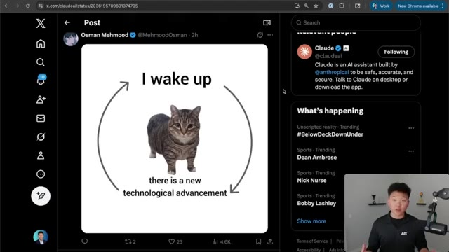
*⏱️ 00:08:01 — Capture d'écran du réseau social X (Twitter) montrant un mème viral sur les avancées technologiques rapides dans le domaine de l'IA, avec le présentateur en incrustation vidéo dans le coin inférieur droit.*

---

