# 🎬 STOP Using Bypass Permissions, Use This New Feature Instead

> **Chaîne** : [Nate Herk | AI Automation](https://www.youtube.com/@nateherk/featured)  
> **Lien YouTube** : [https://www.youtube.com/watch?v=pkSxISewcw8](https://www.youtube.com/watch?v=pkSxISewcw8)  
> **Date de publication** : 20260324  
> **Durée** : 00:05:41  
> **Identifiant vidéo** : `pkSxISewcw8`  
> **Transcription & Analyse** : `whisper-v3-large-turbo+gemini-3.5-flash-lite`  

---

## 📌 Synthèse Exécutive & Outils

### 💡 Résumé
Dans cette vidéo intitulée **STOP Using Bypass Permissions, Use This New Feature Instead**, Nate Herk décortique les capacités pratiques d'automatisation et de développement propulsées par les modèles de pointe.

### 🛠️ Outils, Modèles & Logiciels Présentés
- **Opus 5.5 & Claude Code** : Modèles d'ingénierie et agents de codage autonome.

### 🔑 Points Clés & Enseignements Stratégiques
- Optimiser le niveau d'effort et le raisonnement des modèles IA pour des résultats industriels.
- Automatiser les cycles de création logicielle de bout en bout.

---

## ⏱️ Chronologie & Transcription Complète Audio & Visuelle (Mot pour Mot)

### ⏱️ `[00:00:00 - 00:00:35]` | Segment #01

**🔊 Audio (Transcription Intégrale Mot pour Mot en Français) :**
> Well, I'm back with another Cloud Code update. Today we have Auto Mode. Auto Mode provides a safer long-running alternative to dangerously skip permissions. So what that means is when you're in Cloud Code and you shoot off a message, you are in some sort of permission mode. In this case, we are in ask before edits. So that means exactly what it sounds like. Every time before it doesn't edit, it's going to stop working and it's going to ask me, which means if I wanted to step away or work on something else, it would keep interrupting my workflow. So right here you can see that it's able to read things, but now when it wants to actually make changes, it's going to pop up this tab. It's going to say, Hey, am I allowed to do this? You can either say yes for one time only,

**👁️ Analyse Visuelle d'Écran (gemini-3.5-flash-lite) :**
**Interface & Outils** : VS Code avec l'extension Claude Code.

**Contenu textuel & Code** : Le prompt saisi dans la zone de texte : "update the visualization skill to always use dark mode, then update the claude.md file too".

**Action / Démonstration** : L'utilisateur est sur le point d'envoyer une instruction à l'agent IA via l'interface de chat intégrée de Claude Code.

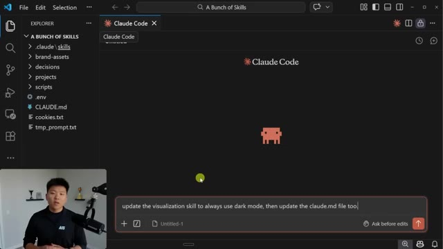
*⏱️ 00:00:09 — Interface de VS Code montrant l'extension Claude Code active avec un champ de saisie de prompt en bas au centre.*

---

### ⏱️ `[00:00:35 - 00:01:08]` | Segment #02

**🔊 Audio (Transcription Intégrale Mot pour Mot en Français) :**
> or you can say yes every time in this session. And as you can see, it's popping it up again and stopping my session because it has to make two edits. And it's not just about the writing functions. Sometimes it'll stop your workflow and say, Hey, can I do this web fetch or can I run this bash command? So the other option that a lot of people have been using and what I've shown sometimes in my videos is that you can use bypass permissions mode, which basically means Claude will do anything at whenever it wants and it won't ask for any permission, which sounds great because a lot of times when you're working on stuff, you just want it to go through and not interrupt you, but it's called dangerously skip permissions for a reason because at the end of the day,

**👁️ Analyse Visuelle d'Écran (gemini-3.5-flash-lite) :**
**Interface & Outils** : Visual Studio Code avec l'extension Claude (interface de chat intégrée).

**Contenu textuel & Code** : Historique de modification de fichiers : "Update visualization skill to always use dark mode". Détails des changements listés sous 'SKILL.md' (suppression des préfixes Light Mode, mise à jour des headers) et 'CLAUDE.md' (ajout de l'entrée 'visualizations').

**Action / Démonstration** : L'agent a terminé d'exécuter une tâche d'édition de code automatisée et présente un compte-rendu des modifications dans la zone de dialogue.

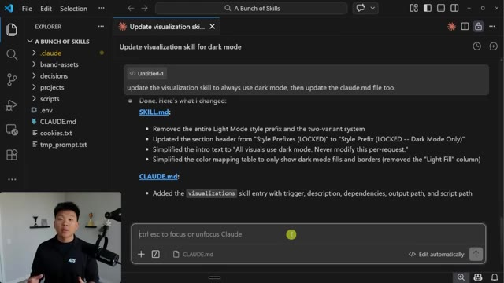
*⏱️ 00:00:43 — Une capture d'écran de l'interface VS Code montrant une interaction avec l'agent Claude, affichant un résumé des modifications apportées aux fichiers 'SKILL.md' et 'CLAUDE.md'.*

---

### ⏱️ `[00:01:08 - 00:01:30]` | Segment #03

**🔊 Audio (Transcription Intégrale Mot pour Mot en Français) :**
> if you're not watching it, it could go do anything. So the fix that I had been using for a long time is within my dot cloud folder, I would have a local settings file, which looks like this. And this basically says, okay, cloud code, you can do anything on your allow list, but you can't do anything on your deny list. And anything here, you have to ask me explicitly before. And so this gave me a lot more control over what Cloud Code does and what it can't do.

**👁️ Analyse Visuelle d'Écran (gemini-3.5-flash-lite) :**
**Interface & Outils** : VS Code (avec l'extension Claude/Cline installée).

**Contenu textuel & Code** : Historique de discussion avec Claude détaillant la mise à jour du fichier "SKILL.md" pour le mode sombre, incluant des modifications sur les préfixes de style, le texte d'introduction et la table de mapping des couleurs. La barre de saisie en bas mentionne "settings.local.json".

**Action / Démonstration** : Revue de code et suivi des modifications apportées par l'agent IA aux fichiers de configuration du projet.

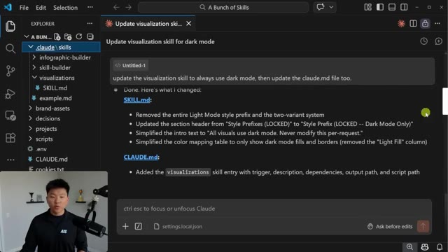
*⏱️ 00:01:13 — Une capture d'écran de l'éditeur VS Code montrant l'interface de l'extension Claude (Cline) avec un historique de modification de fichier affiché dans le panneau latéral.*

---

### ⏱️ `[00:01:30 - 00:01:54]` | Segment #04

**🔊 Audio (Transcription Intégrale Mot pour Mot en Français) :**
> And in some cases, I still think that this is the actual best option to use because you can change these per project and you could also set this globally if you'd like. But with Cloud Code's new release of auto mode, it basically makes those permission decisions on your behalf. So now instead of having to copy and paste this settings file over to all of my new projects, I could basically just come into the permissions mode. I could change this to auto mode right here, which says Claude will automatically choose the best permission mode for each task.

**👁️ Analyse Visuelle d'Écran (gemini-3.5-flash-lite) :**
**Interface & Outils** : Visual Studio Code, X (Twitter), interface utilisateur de Claude Code.

**Contenu textuel & Code** : Fichier `settings.local.json` avec des listes "allow" et "deny" pour les commandes bash et les outils, publication X expliquant le fonctionnement de l'auto-mode, menu déroulant des modes opérationnels.

**Action / Démonstration** : Revue de la configuration des permissions manuelles, consultation de l'annonce officielle d'Anthropic, sélection/modification des modes d'exécution de l'agent.

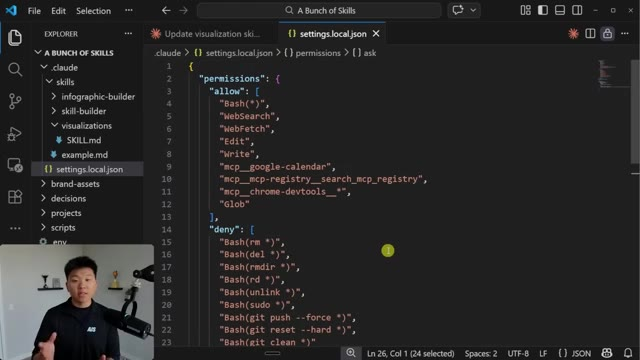
*⏱️ 00:01:36 — Éditeur VS Code affichant un fichier de configuration JSON listant les permissions autorisées et restreintes pour Claude.*

*⏱️ 00:01:42 — Capture d'écran du réseau social X (Twitter) montrant une publication officielle d'Anthropic annonçant le "auto mode" dans Claude Code.*

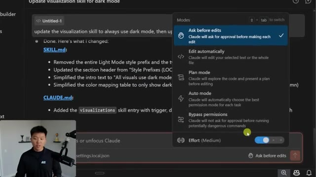
*⏱️ 00:01:48 — Interface de sélection des modes dans Claude, montrant les différentes options comme "Ask before edits", "Edit automatically" et le nouveau "Auto mode".*

---

### ⏱️ `[00:01:54 - 00:02:14]` | Segment #05

**🔊 Audio (Transcription Intégrale Mot pour Mot en Français) :**
> And you can do this in VS Code like you're seeing me do right here. Or if you open up a terminal and you run Claude like this, which is Claude enable auto mode, it will launch up Claude. And then when you shift tab through, you can see that we now have the auto mode setting. And right here, you can see that it says auto mode lets Claude handle permissions automatically. Claude checks each tool for risky actions and prompt injection before executing.

**👁️ Analyse Visuelle d'Écran (gemini-3.5-flash-lite) :**
**Interface & Outils** : Visual Studio Code (VS Code) avec terminal intégré Windows (cmd).

**Contenu textuel & Code** : Commande saisie dans le terminal : `claude --enable-auto-mode` ; structure de dossiers "A Bunch of Skills" visible dans l'explorateur à gauche.

**Action / Démonstration** : L'utilisateur saisit la commande dans le terminal VS Code pour lancer l'agent Claude avec l'option "auto mode" activée.

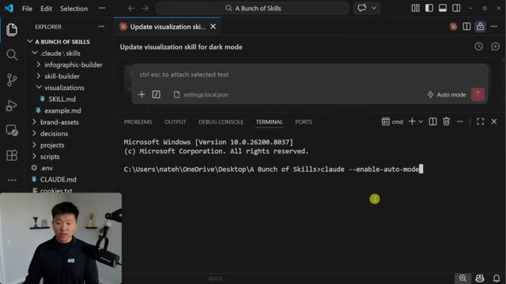
*⏱️ 00:01:59 — Capture d'écran de l'éditeur VS Code montrant un terminal ouvert où l'utilisateur tape une commande pour activer le mode automatique de Claude.*

---

### ⏱️ `[00:02:15 - 00:02:33]` | Segment #06

**🔊 Audio (Transcription Intégrale Mot pour Mot en Français) :**
> Actions Claude identify as safe are executed, while actions Claude identifies as risky are blocked. and Cloud may try a different approach. It's ideal for long running tasks. Sessions are slightly more expensive. Cloud can make mistakes that allow harmful commands to run. So it's recommended to only use in isolated environments. So right now, this is only available in the team plans.

**👁️ Analyse Visuelle d'Écran (gemini-3.5-flash-lite) :**
**Interface & Outils** : VS Code avec terminal intégré (Claude Code v2.1.81).

**Contenu textuel & Code** : Documentation textuelle expliquant le fonctionnement du "Auto mode" de Claude, incluant des avertissements de sécurité et des raccourcis clavier, suivie d'une invite "Enable auto mode?".

**Action / Démonstration** : Activation du mode automatique (Auto mode) dans l'interface de ligne de commande de l'agent IA Claude Code.

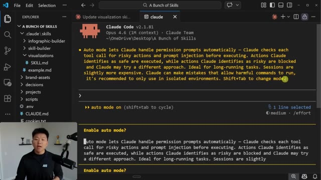
*⏱️ 00:02:20 — Une capture d'écran de l'interface VS Code affichant le terminal "Claude Code" avec une explication détaillée du "Auto mode" et une invite de confirmation utilisateur.*

---

### ⏱️ `[00:02:33 - 00:03:06]` | Segment #07

**🔊 Audio (Transcription Intégrale Mot pour Mot en Français) :**
> Right here, you can see I'm on Cloud team. Because it is a research preview, but soon it will be coming to enterprise plan and API users. And so now that I have auto mode on, whether that's in my terminal or whether that is in my VS Code, I could basically run some skills, run some agents, walk away, and I would have a little bit more confidence that it's going to be managing permissions for me. And if it's something that's super unsafe, it will probably block it. So just as a test, I'm going to send off a message that says, delete my brand assets while I'm in auto mode, because this might be something that I wouldn't want it to do. In my settings.local.json, I basically

**👁️ Analyse Visuelle d'Écran (gemini-3.5-flash-lite) :**
**Interface & Outils** : VS Code avec terminal intégré exécutant l'agent CLI Claude Code.

**Contenu textuel & Code** : Texte explicatif sur le fonctionnement du "auto mode" de Claude, indiquant qu'il gère automatiquement les prompts de permission et les appels d'outils, avec la mention "auto mode on".

**Action / Démonstration** : Activation et confirmation du mode automatique ("auto mode") de l'agent Claude au sein de l'environnement de développement.

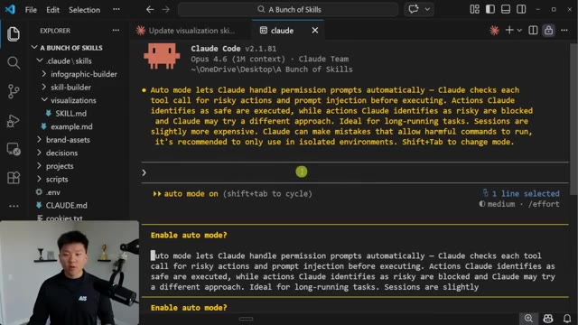
*⏱️ 00:02:41 — Une capture d'écran de VS Code montrant l'interface de "Claude Code" (version 2.1.81) dans un terminal intégré, avec l'activation du mode automatique.*

---

### ⏱️ `[00:03:06 - 00:03:39]` | Segment #08

**🔊 Audio (Transcription Intégrale Mot pour Mot en Français) :**
> exclude it from running any commands that would remove or delete things. So let's see what happens here in auto mode. Okay. This is awesome. It actually says, okay, this is a risky thing. I'm going to go ahead and ask the user if I should do this. And I'm able to then say, nope, I don't want you to delete them. Just keep them. And then it's going to basically stop that operation. But if we try something that's a little bit less risky, but still, you know, changes the way that your folder is set up or something like that. In this case, I'm asking it to move my claw.png, which is right here. Just move it somewhere else in my project. And hopefully it's able to do this without confirming for me because it's not really a risky action and it should be able to just keep going and

**👁️ Analyse Visuelle d'Écran (gemini-3.5-flash-lite) :**
**Interface & Outils** : VS Code avec l'interface intégrée de l'agent Claude Code.

**Contenu textuel & Code** : Le message de l'agent : "This will permanently delete all 3 files in brand-assets/ (AIS Brand Guidelines-1.png, AIS Logo PNG.png, Claude.png). These are referenced by the infographic-builder and visualizations skills. Are you sure?". Options proposées : "Yes, delete all", "No, keep them", "Other".

**Action / Démonstration** : L'agent IA a interrompu son exécution automatique pour solliciter une validation humaine avant d'effectuer une opération destructive (suppression de fichiers).

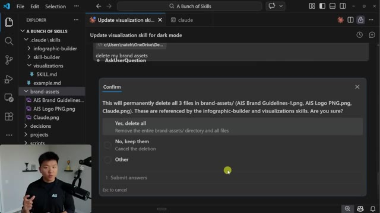
*⏱️ 00:03:14 — Une capture d'écran de l'interface de l'éditeur VS Code affichant une boîte de dialogue de confirmation d'agent IA demandant l'autorisation de supprimer définitivement plusieurs fichiers sensibles ("brand-assets").*

---

### ⏱️ `[00:03:39 - 00:04:13]` | Segment #09

**🔊 Audio (Transcription Intégrale Mot pour Mot en Français) :**
> not stop my workflow. So it just did a lot of things and it didn't ask me for any permission. It created a new folder right here called assets. That's where it ended up moving it It also had to do a grep. It had to do an edit. It had to do a read It sent me some more information and it did all of that Like I said on auto mode without asking me for permission because none of that was risky So whether this works is cloud code by default The permissions are purposely conservative every file write and bash command asks for approval It's a safe default But it means that you can't just kick off a huge task and walk away, which is really annoying I'm sure all of you guys have experienced that while some developers choose to bypass permissions

**👁️ Analyse Visuelle d'Écran (gemini-3.5-flash-lite) :**
**Interface & Outils** : VS Code (avec extension Claude Code intégrée).

**Contenu textuel & Code** : Journal d'exécution : "Moved Claude.png from brand-assets/ to assets/", "Grep 'brand-assets/Claude\.png'", "Edit [chemin du fichier] SKILL.md", montrant la modification du chemin de l'image de "brand-assets/Claude.png" vers "assets/Claude.png".

**Action / Démonstration** : Démonstration de l'agent effectuant des modifications autonomes dans le système de fichiers (déplacement de ressources et mise à jour des références dans le code) sans intervention humaine.

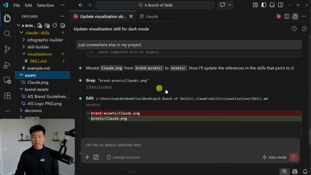
*⏱️ 00:03:48 — Interface VS Code affichant l'exécution automatisée de Claude Code avec un historique des actions effectuées (déplacement de fichier, grep, édition de code).*

---

### ⏱️ `[00:04:13 - 00:04:45]` | Segment #10

**🔊 Audio (Transcription Intégrale Mot pour Mot en Français) :**
> myself included, with dangerously skip permissions, this can result in dangerous and destructive outcomes and should not be used outside of isolated environments. So auto mode is the middle path that lets you run longer tasks with fewer interruptions while introducing less risk than skipping all permissions. And that's pretty cool because basically before every single tool call, a classifier reviews it to check for potentially destructive actions like deleting or sensitive data, things like that. So basically it reduces risk, but it does not eliminate it entirely. And we also did see in the terminal, if I go back over here and go to the terminal,

**👁️ Analyse Visuelle d'Écran (gemini-3.5-flash-lite) :**
**Interface & Outils** : Navigateur web affichant le blog technique d'Anthropic (Claude).

**Contenu textuel & Code** : Texte explicatif sur la sécurité : « Auto mode is a middle path that lets you run longer tasks with fewer interruptions while introducing less risk than skipping all permissions. Before each tool call runs, a classifier reviews it to check for potentially destructive actions... »

**Action / Démonstration** : Lecture à l'écran du paragraphe détaillant les mesures de sécurité et le rôle du classifieur dans le mode automatique de Claude Code.

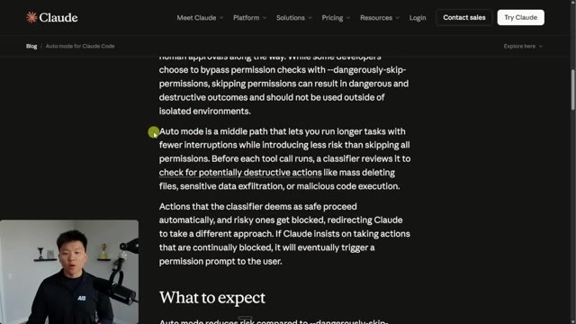
*⏱️ 00:04:21 — Capture d'écran du blog officiel d'Anthropic expliquant le fonctionnement du mode « Auto » pour Claude Code.*

---

### ⏱️ `[00:04:45 - 00:05:21]` | Segment #11

**🔊 Audio (Transcription Intégrale Mot pour Mot en Français) :**
> it basically said here that these sessions are slightly more expensive because I'm assuming before every tool call, it uses AI to say, Hey, is this dangerous? What should I do? And that would explain why it's more expensive. So like I said, in order to use this, it is right now research preview, and it's only available for Claude team users. But if you are on a team, all you have to do is you come in here and you go to your organization settings, and then you right here are able to enable allowing auto permissions mode same way that you would allow bypass permissions mode and then you guys saw earlier all we had to do was we had to run this command right here claude dash dash enable auto mode or if you're in vs code and you're just using it like

**👁️ Analyse Visuelle d'Écran (gemini-3.5-flash-lite) :**
**Interface & Outils** : VS Code (terminal intégré), interface de gestion des paramètres (console web Claude).

**Contenu textuel & Code** : Documentation textuelle sur l'Auto mode (gestion des permissions, vérification des risques, surcoût des sessions). Paramètres activables : "Allow bypass permissions mode", "Allow auto permissions mode", "Fast mode".

**Action / Démonstration** : Présentation des réglages permettant d'automatiser les autorisations de l'agent IA, soulignant les compromis entre sécurité et efficacité opérationnelle.

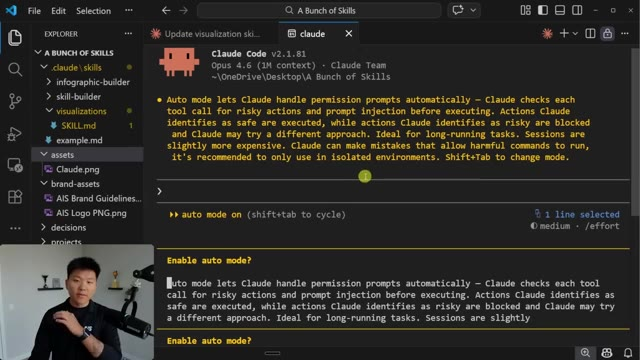
*⏱️ 00:04:54 — Interface VS Code affichant le terminal "Claude Code" expliquant le fonctionnement du "Auto mode" et ses implications sur la sécurité et les coûts.*

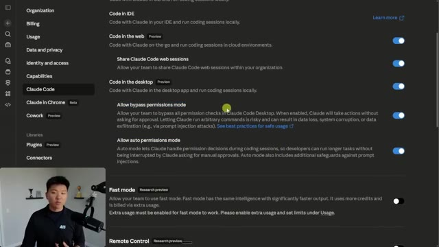
*⏱️ 00:05:12 — Panneau de configuration des paramètres de Claude Code dans une interface web, montrant les options "Bypass permissions mode" et "Auto permissions mode".*

---

### ⏱️ `[00:05:21 - 00:05:40]` | Segment #12

**🔊 Audio (Transcription Intégrale Mot pour Mot en Français) :**
> this you should be able to see it right there and then also if you want to be able to disable it you can do that like that so anyways i know that was a super quick one but i want to keep you guys up to date because anthropic is shipping every single day so if you learned something new or you enjoyed the video please give it a like definitely helps me out a ton and as always i I appreciate you guys making it to the end of the video. I'll see you on the next one. Thanks everyone.

**👁️ Analyse Visuelle d'Écran (gemini-3.5-flash-lite) :**
**Interface & Outils** : Navigateur web (Documentation Claude), plateforme X (Twitter), Terminal de ligne de commande (macOS).

**Contenu textuel & Code** : Texte technique : "disableAutoMode: disable", commande CLI : "claude --enable-auto-mode", message : "Auto permissions mode enabled".

**Action / Démonstration** : Présentation des instructions pour activer/désactiver le mode automatique dans Claude Code et démonstration visuelle de l'interface du terminal avec les autorisations actives.

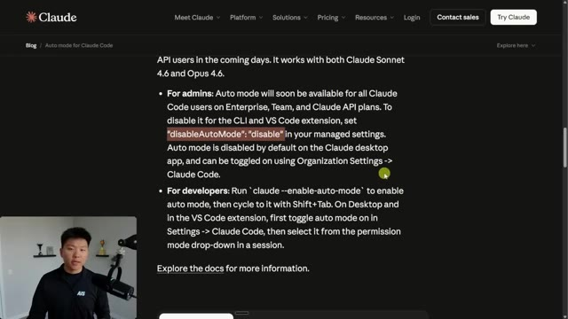
*⏱️ 00:05:26 — Page de documentation officielle de Claude détaillant l'activation et la configuration du « Auto mode » pour Claude Code.*

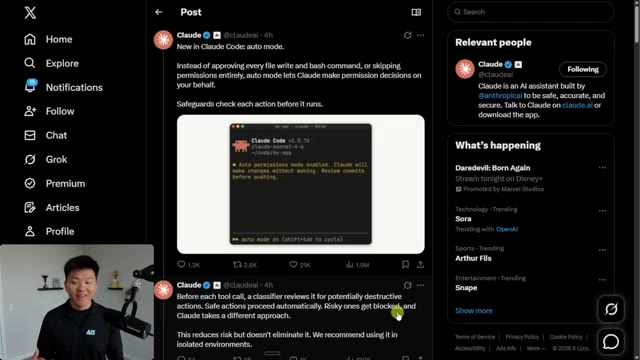
*⏱️ 00:05:31 — Publication sur X (Twitter) du compte officiel de Claude présentant une capture d'écran d'un terminal actif avec le « Auto mode » activé.*

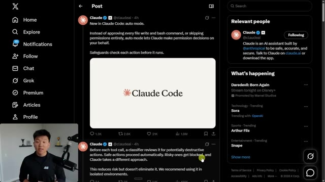
*⏱️ 00:05:36 — Suite de la publication sur X montrant le logo « Claude Code » et expliquant le fonctionnement du classifieur de sécurité pour les appels d'outils.*

---

