# 🎬 Claude Code + iMessage is Finally Here.

> **Chaîne** : [Nate Herk | AI Automation](https://www.youtube.com/@nateherk/featured)  
> **Lien YouTube** : [https://www.youtube.com/watch?v=hHlpVeooPrI](https://www.youtube.com/watch?v=hHlpVeooPrI)  
> **Date de publication** : 20260326  
> **Durée** : 00:09:30  
> **Identifiant vidéo** : `hHlpVeooPrI`  
> **Transcription & Analyse** : `whisper-v3-large-turbo+gemini-3.5-flash-lite`  

---

## 📌 Synthèse Exécutive & Outils

### 💡 Résumé
Dans cette vidéo intitulée **Claude Code + iMessage is Finally Here.**, Nate Herk décortique les capacités pratiques d'automatisation et de développement propulsées par les modèles de pointe.

### 🛠️ Outils, Modèles & Logiciels Présentés
- **Opus 5.5 & Claude Code** : Modèles d'ingénierie et agents de codage autonome.

### 🔑 Points Clés & Enseignements Stratégiques
- Optimiser le niveau d'effort et le raisonnement des modèles IA pour des résultats industriels.
- Automatiser les cycles de création logicielle de bout en bout.

---

## ⏱️ Chronologie & Transcription Complète Audio & Visuelle (Mot pour Mot)

### ⏱️ `[00:00:00 - 00:00:33]` | Segment #01

**🔊 Audio (Transcription Intégrale Mot pour Mot en Français) :**
> Alright, I'm in my Cloud Code and it says listening for channel messages from the plugin iMessage. And on my phone right here, I've got iMessage pulled up and I'm going to shoot off this text that says scrape the YouTube comments from my recent video and give me a breakdown. And what you'll see right here on my terminal is that we have iMessage and it says scrape the YouTube comments blah blah blah. So this is the exact text that I just sent off. And now Cloud Code is acting as if I just typed this message right here locally on my machine. So it's able to use all of the skills that I've got in here. It's able to look through all of these different folders and files, it's able to use my API keys and things like that. And we're able to on our

**👁️ Analyse Visuelle d'Écran (gemini-3.5-flash-lite) :**
**Interface & Outils** : VS Code (éditeur), Claude Code CLI.

**Contenu textuel & Code** : "Listening for channel messages from: plugin:imessage@claude-plugins-official" ; "bypass permissions on (shift+tab to cycle)".

**Action / Démonstration** : Le terminal est en mode écoute, prêt à recevoir des commandes textuelles envoyées depuis l'application iMessage du smartphone.

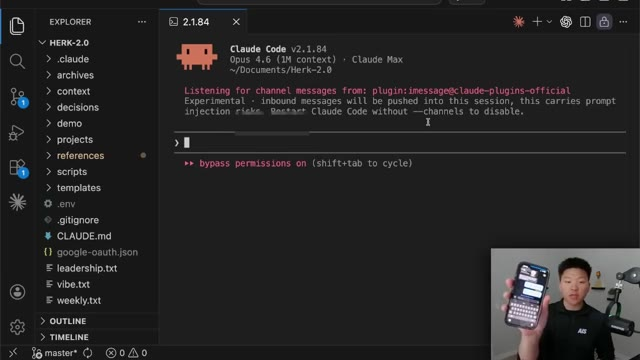
*⏱️ 00:00:08 — Interface VS Code affichant l'exécution de Claude Code en attente de messages depuis un plugin iMessage, avec le présentateur tenant son smartphone en bas à droite.*

---

### ⏱️ `[00:00:33 - 00:01:06]` | Segment #02

**🔊 Audio (Transcription Intégrale Mot pour Mot en Français) :**
> terminal watch all of this happening. And as you can see what it did is it used my YouTube analyzer skill in order to achieve this for us. So that skill finished up and it sent the reply back to myself in iMessage. You can see that it was able to scrape 511 comments across six recent videos with some biggest themes and some top video requests. And so right here in my iMessage, you can see here it is. We have the top themes, feature access frustration, token usage limit, anxiety, N&N pivot backlash, open claw versus cloud code, all this kind of stuff. We have strongest video requests like manisai, cloud code plus APIs, blah, blah, blah. And then we have

**👁️ Analyse Visuelle d'Écran (gemini-3.5-flash-lite) :**
**Interface & Outils** : VS Code (avec extension MCP/Claude Code) et une interface de messagerie instantanée.

**Contenu textuel & Code** : Log d'exécution : `youtube-analyzer` (13 tool uses), fonction `plugin:imessage:reply` contenant le texte du rapport (analyse de 511 commentaires, frustration sur les accès aux plans, limite de jetons, demandes de vidéos).

**Action / Démonstration** : L'agent IA termine l'analyse des commentaires YouTube et automatise l'envoi du résumé synthétisé sous forme de message texte.

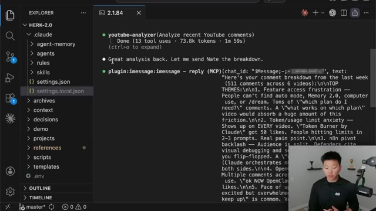
*⏱️ 00:00:41 — Interface VS Code affichant l'exécution d'un agent IA avec le rappel de la compétence "youtube-analyzer" et l'envoi du résultat via une fonction iMessage.*

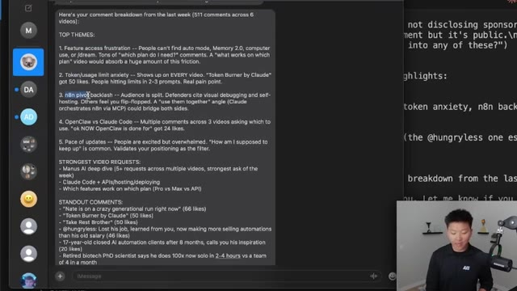
*⏱️ 00:00:58 — Interface de messagerie (type iMessage) affichant le rapport détaillé structuré des commentaires YouTube avec les thèmes principaux et les demandes de vidéos.*

---

### ⏱️ `[00:01:06 - 00:01:40]` | Segment #03

**🔊 Audio (Transcription Intégrale Mot pour Mot en Français) :**
> standout comments. It also ends the message with sent by cloud, which is pretty nice. But what you will notice is that because I'm texting myself an iMessage, it's basically going to duplicate every single one of my messages, whether cloud sent it or whether I sent it. There are obviously some fixes here. So the purpose of this video is to show you guys how this works, how to set it up and what you need to know. So let's get into it. All right. So CloudCode released channels, which you probably already knew about. This came out about a week ago, but this basically allowed you to start talking to your CloudCode session through select MCPs. And this started with Telegram and Discord, but it seemed like it was just today that they announced that iMessage is

**👁️ Analyse Visuelle d'Écran (gemini-3.5-flash-lite) :**
**Interface & Outils** : Apple iMessage (desktop) et X (interface web).

**Contenu textuel & Code** : Texte structuré listant les "TOP THEMES" (frustrations, limites, comparaisons) et les "STRONGEST VIDEO REQUESTS" ; post X détaillant l'intégration MCP pour Claude Code.

**Action / Démonstration** : Le présentateur illustre les résultats d'un workflow d'automatisation IA envoyant des rapports de commentaires, puis montre une avancée technologique liée au pilotage d'agents par messagerie.

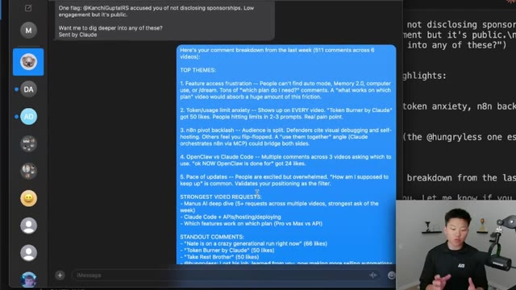
*⏱️ 00:01:15 — Interface iMessage affichant une analyse automatisée des commentaires YouTube par l'IA, classée par thèmes (ex: accès aux fonctionnalités, limites d'utilisation, retours sur n8n).*

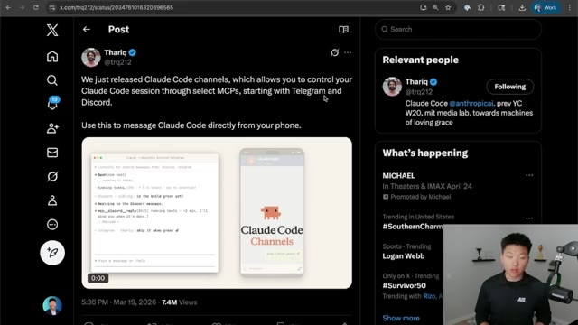
*⏱️ 00:01:32 — Capture d'écran du réseau social X montrant un post de Thariq présentant "Claude Code channels" permettant de piloter des sessions Claude Code via Telegram ou Discord.*

---

### ⏱️ `[00:01:40 - 00:02:01]` | Segment #04

**🔊 Audio (Transcription Intégrale Mot pour Mot en Français) :**
> now also available as a channel, which is super exciting. So just to start off real quick, what is a channel? Basically, it's like giving CloudCode a phone number. It basically allows us to talk to CloudCode through some sort of third-party app like Telegram, Discord, or iMessage, and it basically sends that through like a tunnel or, you know, a bridge or a channel, and it can send and reply.

**👁️ Analyse Visuelle d'Écran (gemini-3.5-flash-lite) :**
**Interface & Outils** : Diagramme explicatif (type tableau blanc numérique).

**Contenu textuel & Code** : Texte : "What Channels Are", "like giving Claude a phone number", "Text Claude", "Channel", "Does Work", "Your Phone", "Your Computer". Illustrations : icône de bonhomme avec un téléphone, pont symbolisant le canal, et icône d'ordinateur.

**Action / Démonstration** : Le diagramme illustre le fonctionnement technique : l'envoi d'un message depuis le téléphone, son traitement via le "Channel", l'exécution des tâches sur l'ordinateur, et le renvoi d'une réponse vers le téléphone.

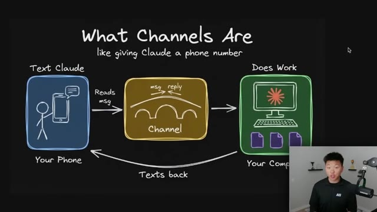
*⏱️ 00:01:46 — Schéma explicatif sur fond noir illustrant le concept de "Channel" pour Claude, montrant le flux de communication entre un téléphone (utilisateur), le canal (le pont) et l'ordinateur (exécution).*

---

### ⏱️ `[00:02:02 - 00:02:35]` | Segment #05

**🔊 Audio (Transcription Intégrale Mot pour Mot en Français) :**
> So as you saw in the demo, it basically just takes my message from iMessage and then inserts it into the conversation inside of CloudCode. And by the way, this mark, I burnt myself on my oven the other day. Anyways, that's cool because then locally on your computer, CloudCode acts as if you were sitting there talking to it. So we're getting more and more to the place where you're able to use your sessions as you want wherever you are. Now, one of the biggest downsides to this feature right now is that if that session closes out, so if I go back into my VS Code and I basically go control C, C, now if I texted my iMessage, nothing would happen. It would not actually access Cloud Code.

**👁️ Analyse Visuelle d'Écran (gemini-3.5-flash-lite) :**
**Interface & Outils** : Schéma conceptuel (dessin), Visual Studio Code, Claude Code (CLI).

**Contenu textuel & Code** : Texte affiché dans le terminal : "Listening for channel messages from: slug/somewhere/claude-plugin-office", "Claude Code v2.1.84", "Opus v5.5".

**Action / Démonstration** : Explication théorique du flux de données dans l'image 1 ; initialisation et écoute du canal de communication par l'agent Claude dans l'image 2.

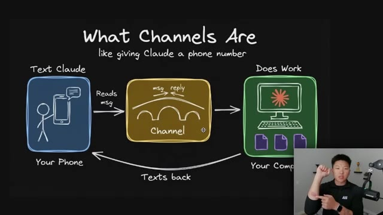
*⏱️ 00:02:10 — Schéma explicatif illustrant le concept de "Channels" où un téléphone envoie des messages à une interface "Channel" qui transmet ensuite l'instruction à l'ordinateur.*

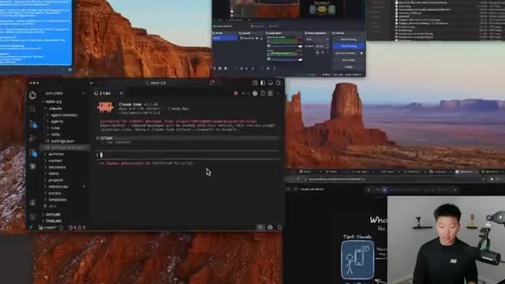
*⏱️ 00:02:27 — Capture d'écran montrant l'interface de VS Code avec Claude Code (CLI) en cours d'exécution, affichant des logs de connexion pour le canal de messagerie.*

---

### ⏱️ `[00:02:36 - 00:03:13]` | Segment #06

**🔊 Audio (Transcription Intégrale Mot pour Mot en Français) :**
> And so that can be frustrating if, you know, you want to be gone for a couple days and you're worried about your laptop turning off or an update restarting or whatever it is, you would have to go back locally, open up a new session, and then you could use that channel again. There are obviously some fixes here. Of course, you could host your cloud code on a VPS and keep it running all the time with something like a Tmux. But one of the catches here with the iMessage channel is that it's iMessage, meaning wherever you're running cloud code has to be on Mac OS. So that is why you could probably tell today I am on my laptop, which is a MacBook. The good news though, is that there are some ways that you can have like sort of a Mac OS VPS. And if you wanted to host cloud code there

**👁️ Analyse Visuelle d'Écran (gemini-3.5-flash-lite) :**
**Interface & Outils** : Visual Studio Code, Terminal (zsh), Claude Code CLI.

**Contenu textuel & Code** : Commande affichée : "claude --resume af46ed71-ae6b-4cc2-8596-6b563161b755". Message système : "Listening for channel messages from: plugin:imessage@claude-plugins-official".

**Action / Démonstration** : Exécution d'une commande pour reprendre une session spécifique de l'agent Claude Code dans le répertoire "Herk-2.0".

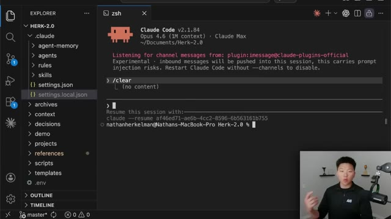
*⏱️ 00:02:45 — Interface VS Code affichant un terminal Claude Code actif avec une instruction de reprise de session.*

---

### ⏱️ `[00:03:13 - 00:03:47]` | Segment #07

**🔊 Audio (Transcription Intégrale Mot pour Mot en Français) :**
> or on a Mac mini, then you'd be all set and you could use this channel 24 seven. Now the coolest part about this is it might seem like you need to know how to set up like some sort of weird bridge or a tunnel, but it actually couldn't be simpler. You basically just run a few commands, run the plugin, and you're all set. So let me talk about how this works and maybe a few things that you might run into as far as issues. So as we know, a channel is an MCP server that pushes events into your running Cloud Code session so that Cloud can react to things that happen while you're not at the terminal, which is great. I'm not going to dive into all the technical details right here, but if you want to go to the documentation, just go to Cloud Code Docs and then search for

**👁️ Analyse Visuelle d'Écran (gemini-3.5-flash-lite) :**
**Interface & Outils** : Navigateur web affichant la documentation technique de Claude Code (docs.claude.com).

**Contenu textuel & Code** : Texte technique expliquant l'usage des "channels" (serveurs MCP) pour automatiser les interactions avec Claude Code, incluant une note sur la version requise (v2.1.80+).

**Action / Démonstration** : Consultation de la documentation officielle par le présentateur pour expliquer comment configurer la communication avec une session Claude Code persistante.

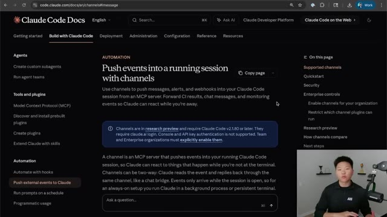
*⏱️ 00:03:22 — Page de documentation officielle de "Claude Code" expliquant la fonctionnalité des "channels" pour envoyer des événements à une session active.*

---

### ⏱️ `[00:03:47 - 00:04:23]` | Segment #08

**🔊 Audio (Transcription Intégrale Mot pour Mot en Français) :**
> channels or push events into a running session with channels. So as we know, we have three supported channels right now, and it does require you to install Bun. So I didn't know what that was before looking at all this stuff. All you have to do is, you know, take this link up here, give it to Cloud Code and say, hey, I want to set up a channel for Discord or for iMessage. Read this documentation and then help me set up everything. And it will basically install everything that you need. So we've got different steps here for Telegram, Discord, and iMessage, but they basically follow the same pattern of making sure you have the right access, installing the plugin, and then launching Claude with that channel enabled. So the first thing you're going to want to do is you're

**👁️ Analyse Visuelle d'Écran (gemini-3.5-flash-lite) :**
**Interface & Outils** : Navigateur web affichant la documentation technique de Claude Code (code.claude.com).

**Contenu textuel & Code** : Texte informatif détaillant les prérequis (Bun), les canaux supportés (Telegram, Discord, iMessage) et les étapes d'installation (accès complet au disque).

**Action / Démonstration** : Le présentateur navigue sur la page de documentation pour montrer aux spectateurs les instructions techniques nécessaires à la configuration des canaux dans Claude Code.

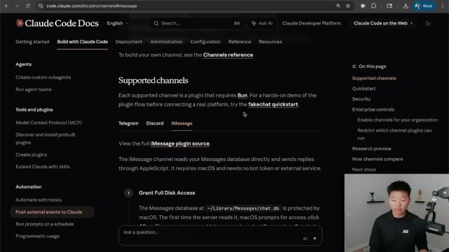
*⏱️ 00:03:56 — Capture d'écran de la documentation officielle "Claude Code Docs" présentant la section sur les "Supported channels" et l'intégration iMessage.*

---

### ⏱️ `[00:04:23 - 00:04:59]` | Segment #09

**🔊 Audio (Transcription Intégrale Mot pour Mot en Français) :**
> going to want to grant full disk access on your local Mac settings. So basically what that means is you're going to open up your settings. You're going to go to privacy and security. You're going to go to full disk access and then add whatever you need as far as where you're using Claude code. So this does have to be used in the terminal, but the good news is you can use this in Visual Studio code like I've shown in basically all my other YouTube videos. So all I had to do was enable full disk access for Visual Studio Code. Now, the next thing you're going to have to do is you're going to have to install the plugin, which once again could not be simpler. You're just going to copy this command right here. You're going to go into your cloud code. And for here, I'm just going

**👁️ Analyse Visuelle d'Écran (gemini-3.5-flash-lite) :**
**Interface & Outils** : macOS System Settings (Privacy & Security pane), Navigateur Web (Documentation Claude Code).

**Contenu textuel & Code** : Menu de réglages système affichant "Full Disk Access" (Accès complet au disque), et documentation technique sur le site code.claude.com incluant une commande terminal "/plugin install imessage@claude-plugins-official".

**Action / Démonstration** : Navigation dans les paramètres système de macOS pour accorder l'accès complet au disque nécessaire à l'utilisation de Claude Code.

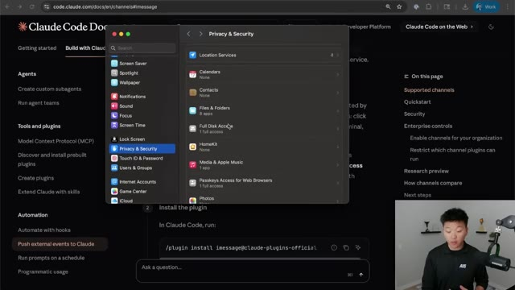
*⏱️ 00:04:32 — Capture d'écran montrant la fenêtre "Confidentialité et sécurité" des réglages système de macOS, superposée à la documentation web de Claude Code.*

---

### ⏱️ `[00:04:59 - 00:05:37]` | Segment #10

**🔊 Audio (Transcription Intégrale Mot pour Mot en Français) :**
> to launch a default version of cloud code, copy in that plugin. And then when I send that off, it will basically give you the option to install it. You can see right here, I've already installed this globally. And if I go to slash plugin, I could basically see all these plugins. And you can even see here, if I searched for the discord one, I could install the discord one right there. And if I went to telegram, I could grab the telegram one right there. But if I go over to the ones that I've actually already installed, you can see right here, I have the iMessage plugin, which is already connected and enabled. Now, once you've done that, all you have to do is copy this next command, which launches a fresh session of Claude, but it does it in this channel mode. So if I exit out of

**👁️ Analyse Visuelle d'Écran (gemini-3.5-flash-lite) :**
**Interface & Outils** : VS Code (terminal intégré), Documentation officielle Claude Code (navigateur web).

**Contenu textuel & Code** : Commandes terminal : `/plugin install imessage@claude-plugins-official`, `/clear`, `claude --resume ...`. Documentation : instructions sur `--channels`, `plugin marketplace update`.

**Action / Démonstration** : Tentative d'installation d'un plugin via le terminal CLI, suivie d'une consultation de la documentation pour configurer les canaux de communication (iMessage).

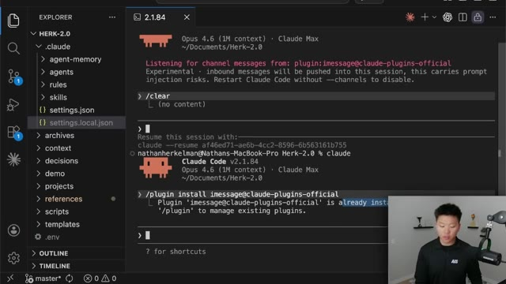
*⏱️ 00:05:08 — Interface VS Code affichant un terminal Claude Code actif, montrant une tentative d'installation de plugin déjà existante.*

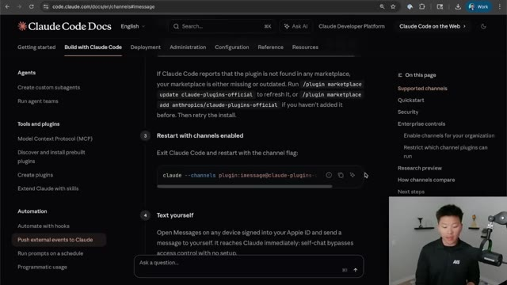
*⏱️ 00:05:28 — Page de documentation officielle "Claude Code Docs" montrant les instructions pour configurer les canaux et les plugins.*

---

### ⏱️ `[00:05:37 - 00:06:15]` | Segment #11

**🔊 Audio (Transcription Intégrale Mot pour Mot en Français) :**
> this cloud code and I paste in that way where I'm running cloud code like this, it basically says right away, listening for channel messages at iMessage. So then what I could do is I could open up my iMessage. I could just say, Hey, can you hear me? And when I shoot that off, we should see that in just a second pop up right here in our cloud code session. And here's a quick example. I didn't launch this one in bypass permissions. So it says, Hey, I need to do this. Do you want to let me proceed. And here is where I would in my local session say yes or no. But it does tell us right here that we could reply on our iMessage. So I can go yes, MWUPY. And if I shoot that off,

**👁️ Analyse Visuelle d'Écran (gemini-3.5-flash-lite) :**
**Interface & Outils** : VS Code, terminal Claude Code, iMessage, OBS Studio.

**Contenu textuel & Code** : - Image 1 : Documentation Claude Code, terminal affichant la commande `claude --channels plugin:imessage@claude-plugins-official`.
- Image 2 : Message reçu dans le terminal : `imessage ... Hey can you hear me`, état "Deciphering...".

**Action / Démonstration** : Le présentateur exécute Claude Code avec le plugin iMessage pour écouter les messages entrants, puis envoie un message de test depuis l'application iMessage pour vérifier la réception en temps réel.

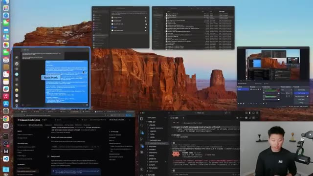
*⏱️ 00:05:47 — Vue d'ensemble du bureau du présentateur affichant plusieurs fenêtres : un terminal Claude Code, une fenêtre iMessage, de la documentation web et le logiciel de streaming OBS.*

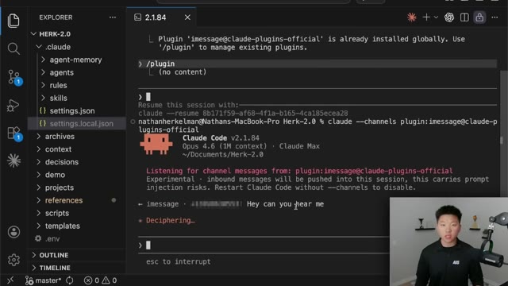
*⏱️ 00:05:56 — Gros plan sur l'interface de VS Code montrant le terminal Claude Code actif qui confirme l'écoute des messages iMessage et reçoit le message "Hey can you hear me".*

---

### ⏱️ `[00:06:15 - 00:06:41]` | Segment #12

**🔊 Audio (Transcription Intégrale Mot pour Mot en Français) :**
> then let's see if Claude's able to get that and actually take action. There we go. So that's how you're able to approve things from your phone. So you're not completely blocked off in case you forgot about some sort of permission. And you can also see here that Claude Code is able to send emojis, which is cool. So right now I'm texting myself on iMessage and that's basically how this thing works. If you want to be able to text yourself from a different number or have other people be able to text your cloud code, then all you have to do is allow different numbers to.

**👁️ Analyse Visuelle d'Écran (gemini-3.5-flash-lite) :**
**Interface & Outils** : VS Code (avec extension Claude Code/Agent).

**Contenu textuel & Code** : Terminal affichant : "Listening for channel messages from: plugin:imessage@claude-plugins-official" et diverses logs de communication floutées.

**Action / Démonstration** : L'agent attend des commandes externes (via iMessage) pour déclencher une action dans l'environnement de développement.

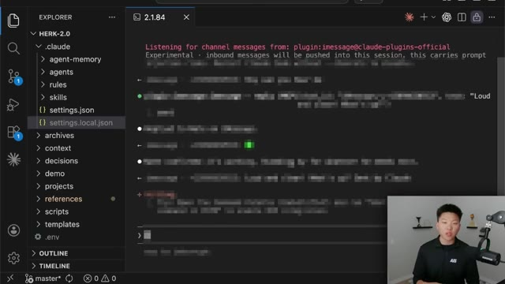
*⏱️ 00:06:21 — Interface VS Code affichant un terminal Claude Code en cours d'écoute de messages via un plugin iMessage.*

---

### ⏱️ `[00:06:42 - 00:07:18]` | Segment #13

**🔊 Audio (Transcription Intégrale Mot pour Mot en Français) :**
> But the very first time when you text yourself after this channel set up, it may pop up right here and say like, hey, I'm getting a text from this number. Is this you? Should I allow it? Blah, blah, blah. And that's where you just say yes. But if you wanted to allow other members to be able to text your cloud code, then all you have to do is slash iMessage, access allow, and then you can either do a phone number or you could also do an Apple ID. And then that Apple ID or that phone number could also text your Cloud Code session. So if you really wanted to get rid of these double texts, then you would just want to text this number. So right here is, you know, my Nate Herc Apple ID. And I would just want to text that number or that Apple ID from a different account or from

**👁️ Analyse Visuelle d'Écran (gemini-3.5-flash-lite) :**
**Interface & Outils** : VS Code (terminal Claude Code), Navigateur web (documentation Claude Code), Application Messages (macOS).

**Contenu textuel & Code** : Commande `/imessage:access allow +15551234567`, logs d'exécution de plugin MCP, échanges de messages automatisés.

**Action / Démonstration** : Configuration des permissions d'accès pour permettre à des contacts externes d'interagir avec l'agent Claude via iMessage.

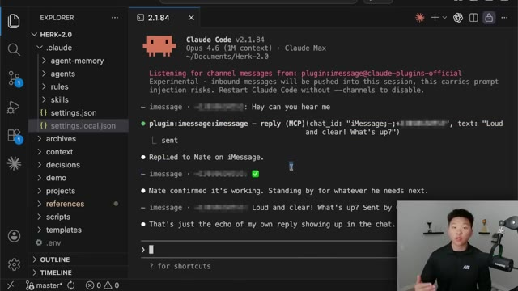
*⏱️ 00:06:51 — Interface de VS Code montrant l'exécution de "Claude Code" dans le terminal, avec des logs d'interaction iMessage.*

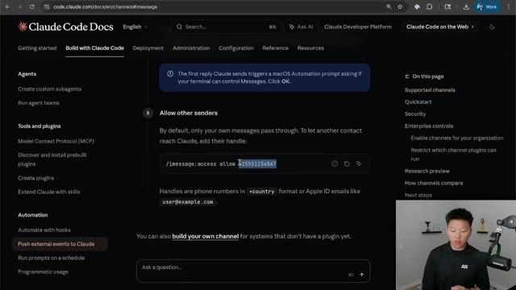
*⏱️ 00:07:00 — Documentation officielle de Claude Code affichée dans un navigateur, expliquant comment autoriser d'autres expéditeurs via une commande.*

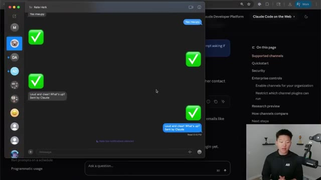
*⏱️ 00:07:09 — Application iMessage superposée sur l'écran, affichant une conversation active avec des messages envoyés par Claude.*

---

### ⏱️ `[00:07:18 - 00:07:52]` | Segment #14

**🔊 Audio (Transcription Intégrale Mot pour Mot en Français) :**
> a different number. And then I could just have like basically a one-way conversation that feels more like a human or, you know, an AI agent. Now, pro and max users, that's basically all you have to do is install the plugin and then run Cloud Code in that way. But for enterprise users, or if you're on a team plan, then you're going to have to make sure the admin allows channel use because by default it will be turned off. But all of the plans should be able to use this once everything's configured correctly. So if that is you, you would basically just go to your admin settings, Cloud Code, and then channels. So here I am in my organization settings. You can see that

**👁️ Analyse Visuelle d'Écran (gemini-3.5-flash-lite) :**
**Interface & Outils** : Navigateur web affichant la documentation technique de Claude Code (code.claude.com).

**Contenu textuel & Code** : Tableau des paramètres "Enterprise controls" détaillant `channelsEnabled` et `allowedChannelPlugins`, expliquant comment gérer les autorisations et les restrictions de canaux pour les comptes Team et Enterprise.

**Action / Démonstration** : Navigation dans la section "Security" de la documentation pour illustrer la gestion des configurations de sécurité des agents IA.

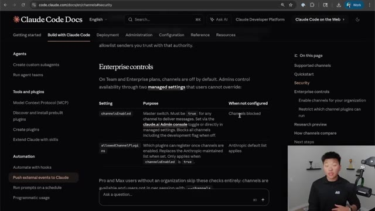
*⏱️ 00:07:27 — Capture d'écran de la documentation officielle "Claude Code Docs" présentant les paramètres de contrôle pour les entreprises concernant les canaux (channels).*

---

### ⏱️ `[00:07:52 - 00:08:12]` | Segment #15

**🔊 Audio (Transcription Intégrale Mot pour Mot en Français) :**
> I've got a lot of options here that I can turn on like fast mode, remote control. A lot of these are because they're in research preview. Right here at the bottom, we have channels, and this is where we could actually enable that. And one final thing that I wanted to cover, which I think is a very valid question, is the difference, because there's lots of ways now that we can control our local sessions from our phone or from the go.

**👁️ Analyse Visuelle d'Écran (gemini-3.5-flash-lite) :**
**Interface & Outils** : Navigateur web affichant la plateforme Claude.ai (console d'administration et documentation officielle).

**Contenu textuel & Code** : Détails techniques sur les paramètres `channelsEnabled` et `allowedChannelPlugins`, ainsi qu'une explication textuelle des modes d'interaction avec Claude (Dispatch, Channels, Remote Control).

**Action / Démonstration** : Navigation et présentation des paramètres de configuration de Claude Code et consultation de la documentation pour expliquer les fonctionnalités avancées de connectivité.

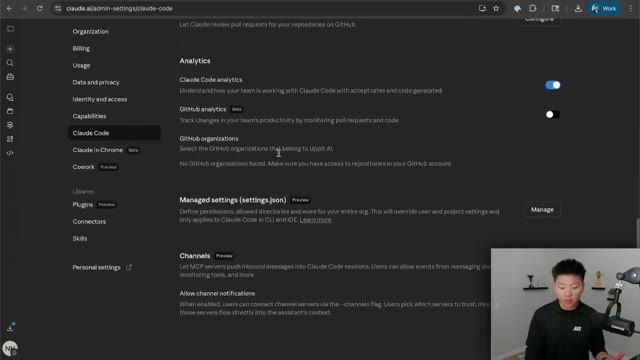
*⏱️ 00:07:57 — Interface d'administration sur claude.ai affichant les paramètres "Claude Code", incluant les options d'analytics, les organisations GitHub et la section "Channels" (en préversion).*

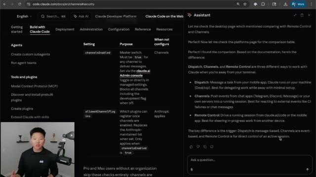
*⏱️ 00:08:07 — Documentation technique de Claude Code affichant un tableau comparatif entre "Dispatch", "Channels" et "Remote Control", avec une fenêtre d'assistant IA ouverte sur le côté droit expliquant ces différences.*

---

### ⏱️ `[00:08:12 - 00:08:39]` | Segment #16

**🔊 Audio (Transcription Intégrale Mot pour Mot en Français) :**
> And we have dispatch, we have channels, and we have remote control. So I basically came to the docs and I said, hey, what's the difference? And here's what it pulled. Dispatch is message a task from your mobile app, Claude runs on your machine. It's best for delegating work while you're away with minimal setup. Channels means you push events from chat apps like Telegram, Discord, iMessage, or your own servers into a running session, which is best for reacting to external events like CI failures or chat messages.

**👁️ Analyse Visuelle d'Écran (gemini-3.5-flash-lite) :**
**Interface & Outils** : Navigateur web affichant une page de documentation technique (probablement la documentation de Claude/Anthropic).

**Contenu textuel & Code** : Texte expliquant les différences : "Dispatch: Message a task from your mobile app...", "Channels: Push events from chat apps...", "Remote Control: Drive a running session from claude.ai/code...".

**Action / Démonstration** : Présentation informative où le présentateur expose la documentation pour illustrer ses propos sur les différentes manières de piloter des agents IA.

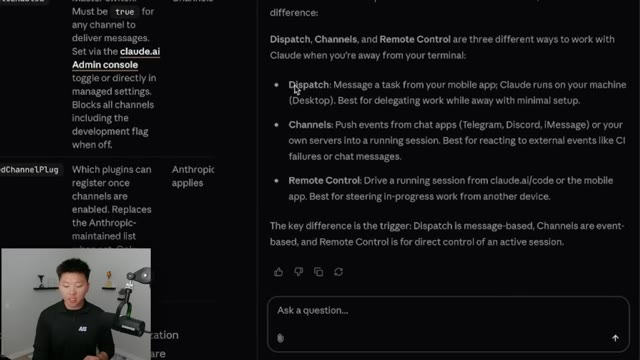
*⏱️ 00:08:19 — Capture d'écran de la documentation officielle présentant une comparaison textuelle entre les fonctionnalités "Dispatch", "Channels" et "Remote Control" de l'outil Claude.*

---

### ⏱️ `[00:08:39 - 00:08:59]` | Segment #17

**🔊 Audio (Transcription Intégrale Mot pour Mot en Français) :**
> And remote control, drive a running session from cloud.ai slash code or the mobile app, which is best for steering in progress work from another device. And so that still might to you sound like it's all basically the same thing. The key difference here is the trigger. Dispatch is message-based. Channels are event-based and remote control is for direct control of an active session.

**👁️ Analyse Visuelle d'Écran (gemini-3.5-flash-lite) :**
**Interface & Outils** : Interface de documentation technique / Application web (type Claude.ai).

**Contenu textuel & Code** : Texte explicatif définissant les différences entre 'Dispatch' (basé sur les messages), 'Channels' (basé sur les événements) et 'Remote Control' (contrôle direct).

**Action / Démonstration** : Présentation informative expliquant les méthodes de pilotage à distance de Claude.

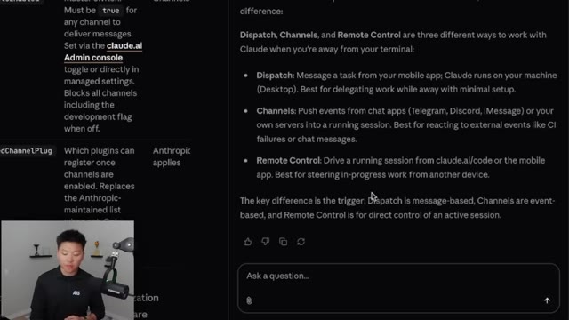
*⏱️ 00:08:44 — Une capture d'écran montrant une documentation technique sur les modes de fonctionnement de Claude (Dispatch, Channels, Remote Control) avec une zone de chat en bas de l'écran.*

---

### ⏱️ `[00:08:59 - 00:09:21]` | Segment #18

**🔊 Audio (Transcription Intégrale Mot pour Mot en Français) :**
> So hopefully that should clear things up a little bit. They're all very different. They're all kind of similar, but they're all steering us in the direction of Anthropic wanting us to be able to use CloudCode from anywhere, which I think is obviously great. And I know that this is an iMessage plugin or channel, but even if you're doing your green SMSs, if they're being sent to that number, then CloudCode should also be able to read those and respond to those as well.

**👁️ Analyse Visuelle d'Écran (gemini-3.5-flash-lite) :**
**Interface & Outils** : Interface web (documentation officielle ou aide en ligne de Claude).

**Contenu textuel & Code** : Texte explicatif détaillant le fonctionnement de "Dispatch" (basé sur les messages), "Channels" (basé sur les événements comme Telegram/iMessage) et "Remote Control" (pilotage d'une session active).

**Action / Démonstration** : Consultation de la documentation pour clarifier les méthodes d'interaction avec Claude en dehors du terminal local.

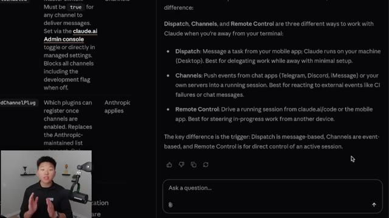
*⏱️ 00:09:05 — Une capture d'écran de la documentation technique d'Anthropic expliquant les différences entre Dispatch, Channels et Remote Control.*

---

### ⏱️ `[00:09:21 - 00:09:29]` | Segment #19

**🔊 Audio (Transcription Intégrale Mot pour Mot en Français) :**
> So that is going to do it for this video. If you enjoyed it, you learned something new, please give it a like. It helps me out a ton. And as always, I appreciate you guys making it to the end of the video. I'll see you on the next one. Thanks everyone.

**👁️ Analyse Visuelle d'Écran (gemini-3.5-flash-lite) :**
**Interface & Outils** : Documentation web (interface de lecture/aide).

**Contenu textuel & Code** : Texte explicatif définissant "Dispatch" (basé sur les messages), "Channels" (basé sur les événements) et "Remote Control" (contrôle direct d'une session active).

**Action / Démonstration** : Présentation informative des capacités de configuration et de contrôle à distance de Claude.

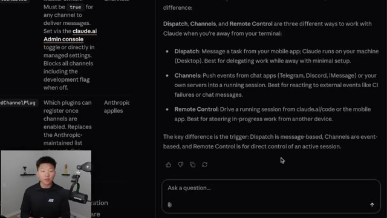
*⏱️ 00:09:23 — Capture d'écran montrant la documentation officielle de Claude expliquant les différences entre les modes Dispatch, Channels et Remote Control.*

---

