# 🎬 Claude Code + Paperclip Just Destroyed OpenClaw

> **Chaîne** : [Nate Herk | AI Automation](https://www.youtube.com/@nateherk/featured)  
> **Lien YouTube** : [https://www.youtube.com/watch?v=HJ-dwefABss](https://www.youtube.com/watch?v=HJ-dwefABss)  
> **Date de publication** : 20260328  
> **Durée** : 00:20:33  
> **Identifiant vidéo** : `HJ-dwefABss`  
> **Transcription & Analyse** : `whisper-v3-large-turbo+gemini-3.5-flash-lite`  

---

## 📌 Synthèse Exécutive & Outils

### 💡 Résumé
Dans cette vidéo intitulée **Claude Code + Paperclip viennent de pulvériser OpenClaw**, Nate Herk décortique les capacités pratiques d'automatisation et de développement propulsées par les modèles de pointe.

### 🛠️ Outils, Modèles & Logiciels Présentés
- **Opus 5.5 & Claude Code** : Modèles d'ingénierie et agents de codage autonome.

### 🔑 Points Clés & Enseignements Stratégiques
- Optimiser le niveau d'effort et le raisonnement des modèles IA pour des résultats industriels.
- Automatiser les cycles de création logicielle de bout en bout.

---

## ⏱️ Chronologie & Transcription Complète Audio & Visuelle (Mot pour Mot)

### ⏱️ `[00:00:00 - 00:00:18]` | Segment #01

**🔊 Audio (Transcription Intégrale Mot pour Mot en Français) :**
> What you're looking at right here is my Mission Control Center. You can see I've got seven agents enabled. I've got five tasks in progress. You can see what all of them are doing right here. We can see all of the recent activity and all the tasks. And in my inbox, I can see what is needed to be approved by me or what I have to look at. Down here, you can see the seven different agents we have. And you can see what they're actually working on.

**👁️ Analyse Visuelle d'Écran (gemini-3.5-flash-lite) :**
**Interface & Outils** : Interface web propriétaire de type "AIS Content" (tableau de bord de gestion d'agents IA).

**Contenu textuel & Code** : Détails des agents (AIS Marketer, AIS Designer, AIS Researcher, AIS Copywriter), listes de tâches (ex: "AIS-12 - Draft Week 1 X Content"), statuts d'exécution, recherches web effectuées et métriques globales (7 agents activés, 5 tâches en cours, 0$ de dépenses).

**Action / Démonstration** : Visualisation du suivi en temps réel de l'activité des agents IA et de l'état d'avancement des projets de contenu.

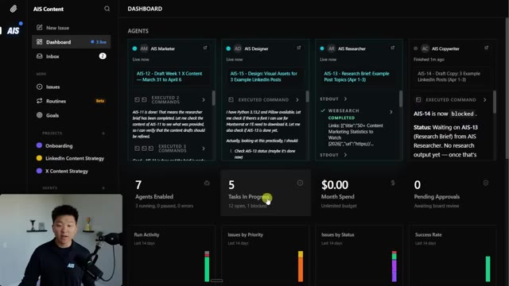
*⏱️ 00:00:05 — Capture d'écran du tableau de bord "Mission Control Center" montrant une interface de gestion d'agents IA, avec des cartes d'activité pour plusieurs agents, des statistiques système et le présentateur en médaillon.*

---

### ⏱️ `[00:00:18 - 00:00:38]` | Segment #02

**🔊 Audio (Transcription Intégrale Mot pour Mot en Français) :**
> So right now, the AIS Marketer is running. And for each of our different agents, we can control their instructions, their skills, their configuration, everything. So now in a matter of 30 minutes of me coming in here, acting as a board, which means I'm giving them high-level goals, metrics, things that I want to achieve, but I'm not actually sitting in the business being an operator. I have this entire company now.

**👁️ Analyse Visuelle d'Écran (gemini-3.5-flash-lite) :**
**Interface & Outils** : Plateforme "AIS Content" (application web de gestion d'agents IA).

**Contenu textuel & Code** : Noms des agents (CEO, AIS Marketer, Social Media Agent, AIS Copywriter, AIS Designer, AIS Researcher, AIS Strategist) et structure organisationnelle en arborescence.

**Action / Démonstration** : Navigation dans les menus de configuration d'un agent puis visualisation de la structure hiérarchique de l'équipe d'IA.

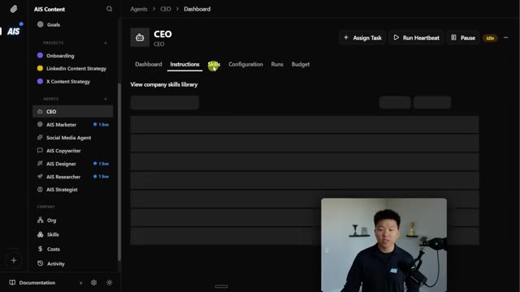
*⏱️ 00:00:23 — Interface de gestion de l'agent "CEO" affichant les onglets de configuration (Dashboard, Instructions, Skills, etc.) et une barre latérale listant les différents agents.*

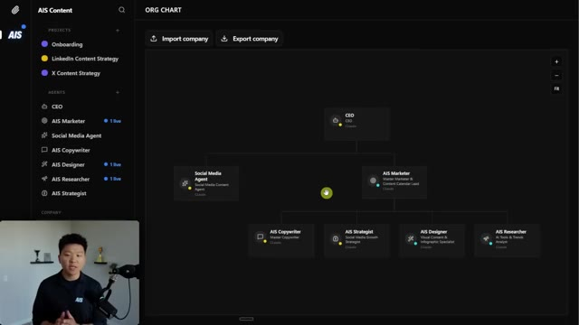
*⏱️ 00:00:28 — Organigramme interactif (ORG CHART) montrant la hiérarchie entre le CEO et ses différents agents subordonnés (Copywriter, Strategist, Designer, Researcher, etc.).*

---

### ⏱️ `[00:00:38 - 00:01:01]` | Segment #03

**🔊 Audio (Transcription Intégrale Mot pour Mot en Français) :**
> I have a CEO, I have a social media agent, I have a marketer that manages a copywriter, a strategist, a designer, and a researcher. And this is all thanks to a combination of CloudCode and this tool right here, which is called Paperclip. So by the end of this video, you guys are gonna see exactly what this tool is, how it works, and you're gonna be able to either set up a brand new company right now with no human employees, just you, or you're gonna be able to build a team around maybe a portion of your business.

**👁️ Analyse Visuelle d'Écran (gemini-3.5-flash-lite) :**
**Interface & Outils** : Plateforme web "Paperclip" (interface de gestion d'agents IA).

**Contenu textuel & Code** : Arborescence hiérarchique montrant le CEO en haut, suivi d'un "Social Media Agent" et d'un "AIS Marketer" supervisant lui-même quatre sous-agents : Copywriter, Strategist, Designer et Researcher.

**Action / Démonstration** : Présentation visuelle de la structure hiérarchique et du flux de travail des agents IA au sein de l'application.

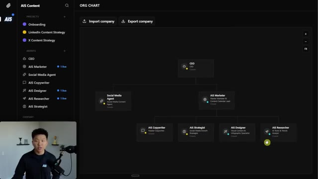
*⏱️ 00:00:44 — Interface de l'outil "Paperclip" affichant un organigramme dynamique (Org Chart) structurant une équipe composée d'agents IA (CEO, Marketer, Copywriter, Strategist, Designer, Researcher).*

---

### ⏱️ `[00:01:01 - 00:01:20]` | Segment #04

**🔊 Audio (Transcription Intégrale Mot pour Mot en Français) :**
> So for example, right now, with my Up at AI business and AI Automation Society, I'm not going to come in here and automate everything and go fire all my employees. But what I did here is I can automate a portion of it and then slowly just kind of like chip away more and more, expand this organization in here and maybe grab a different subunit from my business and try to make that completely AI first.

**👁️ Analyse Visuelle d'Écran (gemini-3.5-flash-lite) :**
**Interface & Outils** : Dashboard web propriétaire (AIS) pour la gestion d'agents IA.

**Contenu textuel & Code** : Noms des agents, statuts des tâches (ex: "Draft Week 1 X Content"), résumés d'activités des agents, métriques de performance ("7 Agents Enabled", "5 Tasks In Progress", "Month Spend $0.00").

**Action / Démonstration** : Visualisation du suivi des processus automatisés par les agents IA au sein de l'organisation.

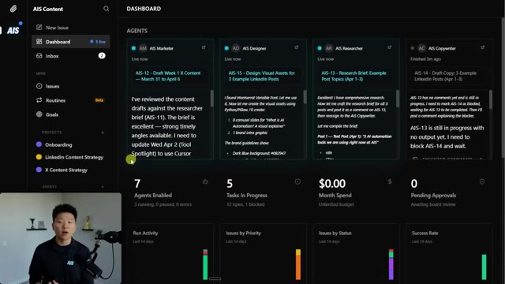
*⏱️ 00:01:06 — Une capture d'écran montrant le tableau de bord de la plateforme "AIS" (AI Automation Society), affichant une liste d'agents IA actifs (Marketer, Designer, Researcher, Copywriter) avec leurs tâches en cours et des statistiques globales.*

---

### ⏱️ `[00:01:21 - 00:01:40]` | Segment #05

**🔊 Audio (Transcription Intégrale Mot pour Mot en Français) :**
> You can see they're sending me notifications down here. I could come in here and I could create new issues whenever I want. And I can say, hey, this is for the AI's designer and this is for the LinkedIn content strategy project. Here's what I need you to do. Here's the high level goal. Work with the team and just figure it out. So if this sounds like something that's interesting to you, let's not waste any time and get straight into the video. So the tool that we're talking about today is called Paperclip.

**👁️ Analyse Visuelle d'Écran (gemini-3.5-flash-lite) :**
**Interface & Outils** : Application de gestion de workflow de travail basée sur des agents (plateforme AIS).

**Contenu textuel & Code** : Liste déroulante des assignataires incluant : "AIS Designer", "CEO", "AIS Copywriter", "AIS Marketer", "AIS Researcher". Menu latéral avec des sections comme "Dashboard", "Inbox", "Issues", "Routines" et "Goals".

**Action / Démonstration** : Le présentateur démontre la création d'une nouvelle tâche ("New Issue") et sélectionne un agent spécifique dans la liste déroulante pour lui assigner un travail.

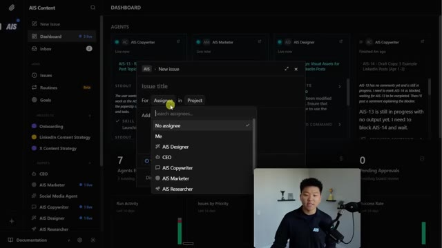
*⏱️ 00:01:26 — Une interface de gestion de projet sombre affichant une fenêtre modale "New Issue" permettant d'assigner une tâche à différents agents IA spécialisés.*

---

### ⏱️ `[00:01:41 - 00:02:01]` | Segment #06

**🔊 Audio (Transcription Intégrale Mot pour Mot en Français) :**
> It is completely free. It's an open source orchestration for zero human companies where you can literally have your AI employees hire other ones, set goals, automate the entire business. You can see on the GitHub that they just hit over 36,000 stars and this has only been out for a few weeks. You can bring in your own agents. So if you've already set up some custom, you know, open clause or cloud code things, you can bring those in.

**👁️ Analyse Visuelle d'Écran (gemini-3.5-flash-lite) :**
**Interface & Outils** : Site web officiel de la plateforme "Paperclip" (paperclip.ai).

**Contenu textuel & Code** : Texte descriptif : "Open-source orchestration for zero-human companies", "Hire AI employees, set goals, automate jobs".

**Action / Démonstration** : Navigation et défilement sur la page de présentation du produit pour illustrer ses fonctionnalités.

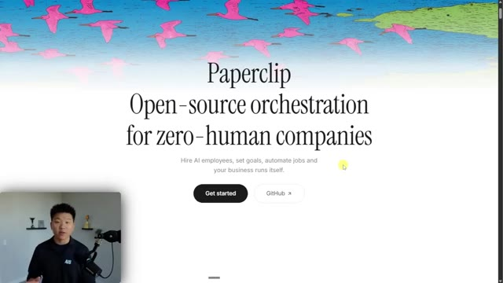
*⏱️ 00:01:46 — Page d'accueil du site web "Paperclip", plateforme d'orchestration open-source pour entreprises automatisées.*

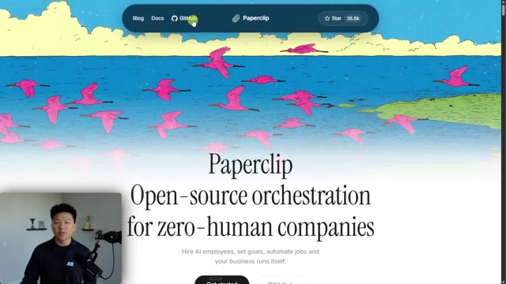
*⏱️ 00:01:51 — Capture du haut de la page web "Paperclip" affichant la barre de navigation avec le compteur de stars GitHub (35.5k).*

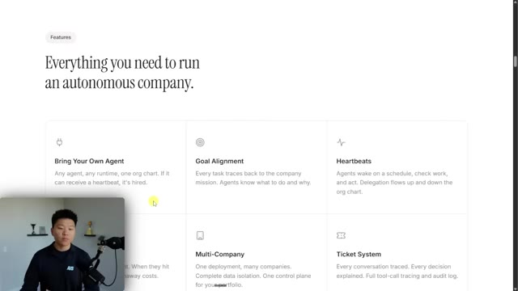
*⏱️ 00:01:56 — Section "Features" du site web détaillant les capacités du produit : Bring Your Own Agent, Goal Alignment, Heartbeats, Multi-Company et Ticket System.*

---

### ⏱️ `[00:02:01 - 00:02:22]` | Segment #07

**🔊 Audio (Transcription Intégrale Mot pour Mot en Français) :**
> You set goals. There are heartbeats, so it can actually just be waking up and checking things all the time. You can set a specific budget per agent. So if I come into the dashboard and I go to the, you know, designer, for example, I could come in here and just make sure that the designer is only using a certain amount of my money per month, which means every single one of our agents, we can see exactly how much money they're actually spending.

**👁️ Analyse Visuelle d'Écran (gemini-3.5-flash-lite) :**
**Interface & Outils** : Application web propriétaire "AIS" (système de gestion d'agents autonomes).

**Contenu textuel & Code** : Détails de configuration des agents : budgets mensuels, planification des "heartbeats", suivi des tâches ("AIS-15 - Design drafts complete, status: blocked") et statistiques d'activité.

**Action / Démonstration** : Navigation du présentateur à travers l'interface pour démontrer le contrôle granulaire des agents (définition de budgets et état des routines).

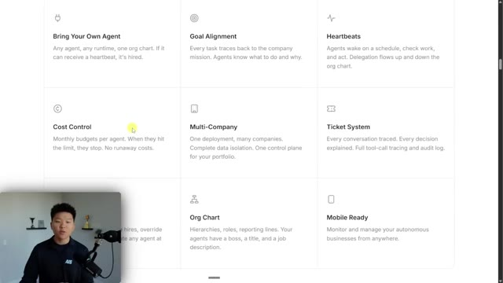
*⏱️ 00:02:06 — Une grille de fonctionnalités décrivant la plateforme, incluant "Cost Control", "Heartbeats" et "Goal Alignment".*

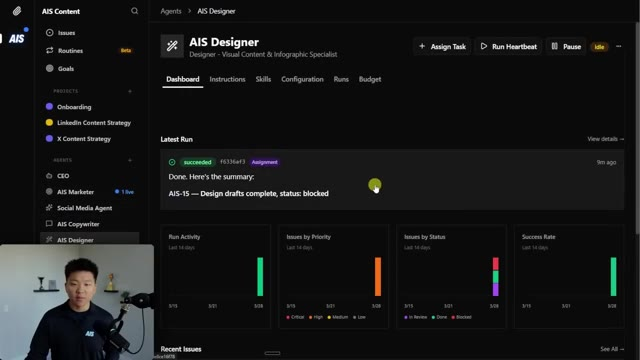
*⏱️ 00:02:11 — Le tableau de bord de l'agent "AIS Designer" montrant l'état des exécutions ("succeeded"), des graphiques de performance et les onglets de configuration.*

---

### ⏱️ `[00:02:22 - 00:02:56]` | Segment #08

**🔊 Audio (Transcription Intégrale Mot pour Mot en Français) :**
> Now, the reason you guys are seeing zero here and on my dashboard is because I'm using my subscription. So if you're using something that is actually paper token, that's where you get all of the spend analytics You can run multiple companies inside of paperclip. So if you see on the dashboard over here I've got this AIS But I could go down here and just add a new company and add a new company and just keep doing different things And so that's where maybe if you wanted to start up a new idea Then you would start a company for that But if you wanted to integrate some different like teams into an existing business Then maybe you could just do different departments in here and completely automate those So for example with this company, this is part of AIS and the overall goal I set here

**👁️ Analyse Visuelle d'Écran (gemini-3.5-flash-lite) :**
**Interface & Outils** : Plateforme web AIS (dashboard de gestion d'agents).

**Contenu textuel & Code** : Cartes d'agents ("AIS Marketer", "AIS Copywriter", "AIS Designer"), statut des tâches, statistiques "Month Spend" à 0,00 $, et indicateurs de performance (Run Activity, Issues by Priority, Success Rate).

**Action / Démonstration** : Le présentateur pointe du doigt la section "Month Spend" pour expliquer pourquoi les coûts apparaissent à zéro en raison de son type d'abonnement.

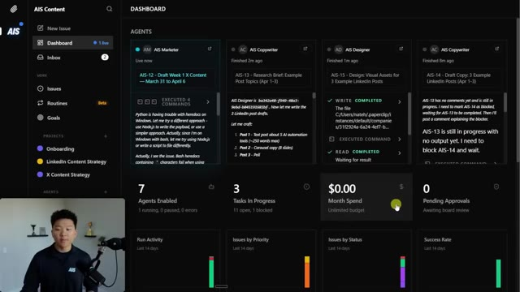
*⏱️ 00:02:31 — Capture d'écran du tableau de bord de la plateforme AIS montrant une vue d'ensemble des agents IA actifs, leurs tâches en cours et les statistiques budgétaires.*

---

### ⏱️ `[00:02:56 - 00:03:14]` | Segment #09

**🔊 Audio (Transcription Intégrale Mot pour Mot en Français) :**
> is we have a community called AI Animation Society. It's got over 300,000 members, but we wanna scale the content efforts around the community and scale the brand around this that doesn't rely on me and my personal brand. So that's what I'm gonna be doing here in Paperclip. It's got a ticketing system, so everything is logged, every conversation, every issue.

**👁️ Analyse Visuelle d'Écran (gemini-3.5-flash-lite) :**
**Interface & Outils** : Paperclip (outil de gestion de tickets et de projets).

**Contenu textuel & Code** : Texte descriptif de l'objectif : "We have a community called AI Automation Society... The goal is to grow an online presence and get people into the AIS ecosystem without leveraging Nate Herk."

**Action / Démonstration** : Consultation de la fiche d'objectif et lecture du texte explicatif concernant le passage à l'échelle de la stratégie de contenu de la communauté.

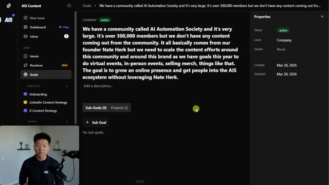
*⏱️ 00:03:00 — Interface de gestion de projet "Paperclip" affichant la fiche d'un objectif nommé "AI Automation Society", détaillant la stratégie de déploiement du contenu de la communauté.*

---

### ⏱️ `[00:03:14 - 00:03:44]` | Segment #10

**🔊 Audio (Transcription Intégrale Mot pour Mot en Français) :**
> If I go back to my dashboard here and I go down here, we can see all the activity and all the tasks. And I can open these up, I can leave comments, and I can see what they're thinking and what they're actually doing in here. And in this specific one, you can see what it was doing is it was creating some carousels. This was its first try, so I'm going to have to go back, but very cool. And like I said, you can use this with OpenClaw, Claude, Codex, Cursor, whatever you want. In today's example, we're going to be talking about using it with Claude Code. So I know I was just clicking around and I showed you guys a ton of stuff. That's just to sort of get you in the mindset of what we're going to talk about today and how it works.

**👁️ Analyse Visuelle d'Écran (gemini-3.5-flash-lite) :**
**Interface & Outils** : Application de gestion de projet type SaaS (AIS) et site web de présentation de structure d'agents IA.

**Contenu textuel & Code** : Détails de tâche : "Design: Visual Assets for 3 Example LinkedIn Posts", statut "Blocked", priorité "High", et organigramme fonctionnel des agents.

**Action / Démonstration** : Navigation dans le tableau de bord de gestion des tâches pour examiner le statut d'un projet spécifique, puis présentation de l'architecture organisationnelle des agents IA.

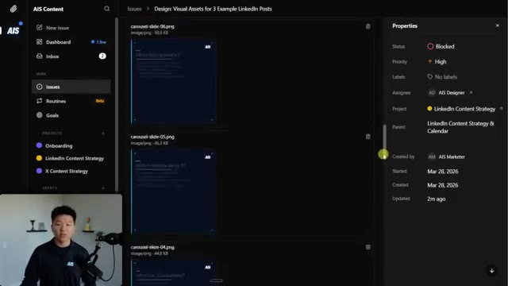
*⏱️ 00:03:22 — Interface de gestion de projet (AIS) affichant une liste de fichiers images (carousel-slide) en cours de création, avec un panneau de propriétés détaillant le statut "Blocked" et l'assignation à un agent IA.*

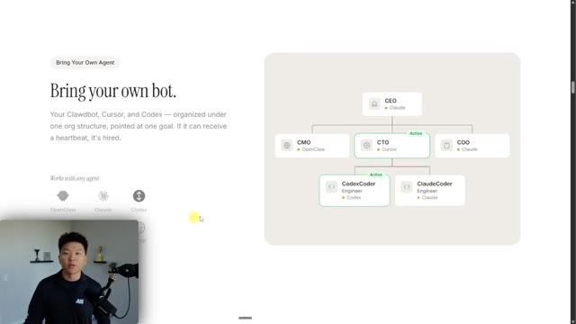
*⏱️ 00:03:37 — Page de présentation marketing intitulée "Bring your own bot", illustrée par un organigramme montrant une hiérarchie d'agents IA (CEO, CMO, CTO, COO) associés à différents outils comme Claude, Cursor et Codex.*

---

### ⏱️ `[00:03:45 - 00:04:03]` | Segment #11

**🔊 Audio (Transcription Intégrale Mot pour Mot en Français) :**
> But what I'm going to do is set up an entire new company from scratch with you guys so you can see exactly what it would look like on your end, what you need to click and what you need to know. So before we get into that, let me just do a quick explanation on Paperclip. Also guys, real quick, I threw together this 12 page document about what Paperclip is and walking through how you should get set up and what you can do with CloudCode.

**👁️ Analyse Visuelle d'Écran (gemini-3.5-flash-lite) :**
**Interface & Outils** : Dashboard de plateforme IA (AIS), Google Docs.

**Contenu textuel & Code** : - Image 1 : Statut d'agents (Marketer, Copywriter, Designer), tâches en cours, indicateurs financiers (0.00$), et mesures de performance.
- Image 2 : Notes documentées sur "Paperclip" incluant le lancement, la trajectoire GitHub, les moteurs de croissance, le créateur et la stack technologique (Node.js, React).

**Action / Démonstration** : - Image 1 : Présentation visuelle de la gestion multi-agents au sein d'une organisation automatisée.
- Image 2 : Explication théorique des fondements techniques et de l'historique du projet Paperclip.

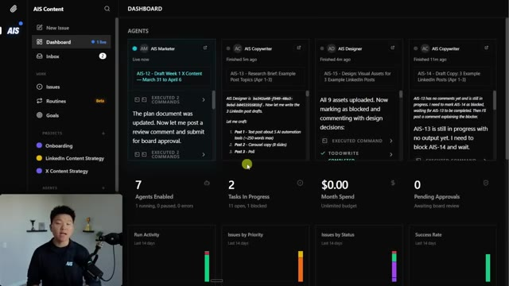
*⏱️ 00:03:49 — Interface de tableau de bord (Dashboard) d'une plateforme d'automatisation d'agents IA (AIS), montrant des cartes d'activité pour divers agents spécialisés.*

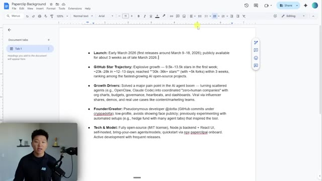
*⏱️ 00:03:54 — Capture d'écran d'un document Google Docs intitulé "Paperclip Background", détaillant des informations sur un projet open-source d'agents IA.*

---

### ⏱️ `[00:04:03 - 00:04:22]` | Segment #12

**🔊 Audio (Transcription Intégrale Mot pour Mot en Français) :**
> So if you wanna access this for completely free, you can do so by joining my FreeSchool community. The link for that is down in the description, but let's get back to the video. So this launched in early March, so about three weeks ago, and it's already trending a lot on GitHub, as you can see with the explosive growth of the stars. Now, the thing that I think is interesting is why did this blow up? Because there's been lots of things going on, right?

**👁️ Analyse Visuelle d'Écran (gemini-3.5-flash-lite) :**
**Interface & Outils** : Google Docs.

**Contenu textuel & Code** : Texte explicatif définissant Paperclip comme une plateforme d'orchestration open-source pour gérer des unités commerciales avec des agents IA, distinguant son fonctionnement par rapport aux outils comme Claude Code.

**Action / Démonstration** : Présentation informative du document de guide utilisateur détaillant la vision et les fonctionnalités de la plateforme Paperclip.

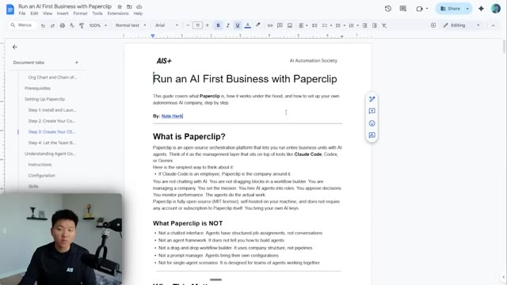
*⏱️ 00:04:08 — Capture d'écran montrant un document Google Docs ouvert, présentant un guide intitulé "Run an AI First Business with Paperclip" rédigé par Nate Herk pour la communauté AIS+.*

---

### ⏱️ `[00:04:22 - 00:04:41]` | Segment #13

**🔊 Audio (Transcription Intégrale Mot pour Mot en Français) :**
> We've had like OpenClaw, which took over. And then we had CloudCode start to work in things like remote control and channels. And this idea of like being able to work more with your things from anywhere and have them be more productive and proactive. But one of the founders of this Dota, he basically explained a pain point, which was every day he would have 20 different terminals running, 20 different CloudCode sessions running.

**👁️ Analyse Visuelle d'Écran (gemini-3.5-flash-lite) :**
**Interface & Outils** : Google Docs.

**Contenu textuel & Code** : Texte structuré sous forme de liste à puces concernant le projet "Paperclip", mentionnant des métriques de croissance GitHub, des détails sur le fondateur pseudonyme (@dotta) et des spécifications techniques (Node.js, React, npx paperclip).

**Action / Démonstration** : Le document est affiché à l'écran pour servir de support visuel informatif pendant que le présentateur explique le contexte du projet.

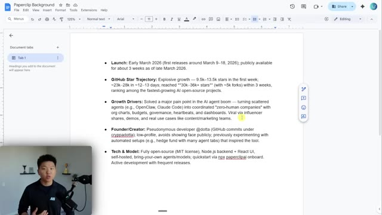
*⏱️ 00:04:27 — Une capture d'écran montrant un document Google Docs ouvert, détaillant les statistiques de lancement, la trajectoire GitHub et les caractéristiques techniques du projet "Paperclip".*

---

### ⏱️ `[00:04:42 - 00:05:15]` | Segment #14

**🔊 Audio (Transcription Intégrale Mot pour Mot en Français) :**
> And I've definitely been there. I'm sure you guys have been there. And then what happens is, yeah, you have all this proactivity. But then when you come back, you're like, OK, I forgot which one's doing what. and I forgot like what I asked and I forgot like, you know, I just don't have as much visibility as I'd like. So it seems like Paperclip is solving a major pain point of figuring out all of that orchestration and keeping everything kind of synchronized in one place with different sessions being able to actually understand the overall goal that we're working towards. But anyways, it is fully open source. It actually has MIT license. And then here's a little bit about how it works. Right now, when you just go ahead and launch it up, you're going to launch it from a

**👁️ Analyse Visuelle d'Écran (gemini-3.5-flash-lite) :**
**Interface & Outils** : Google Docs.

**Contenu textuel & Code** : Texte détaillé sur le lancement, la trajectoire sur GitHub, les moteurs de croissance, le créateur et la pile technologique (Node.js, React, npx paperclip) d'un projet open-source.

**Action / Démonstration** : Le présentateur explique les concepts et les antécédents techniques du projet tandis que le document est affiché à l'écran.

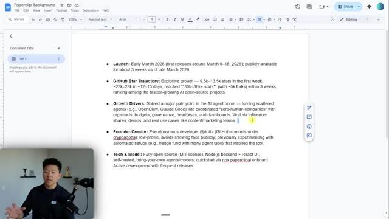
*⏱️ 00:04:50 — Capture d'écran montrant le présentateur dans un petit cadre en bas à gauche, superposé sur un document Google Docs ouvert en plein écran contenant des notes structurées sur un projet nommé "Paperclip Background".*

---

### ⏱️ `[00:05:15 - 00:05:48]` | Segment #15

**🔊 Audio (Transcription Intégrale Mot pour Mot en Français) :**
> terminal and then it's going to open up, you know, obviously this pretty dashboard. This by default will be in a local host, so it only works on this machine. But what you could do is you could set it up on a VPS or something else, so you could access this from anywhere. But anyways, what you're going to do to get started is you're either going to go to the GitHub or you're going to go to right here, paperclip.ing. I will put a link in the description. And you literally just click on get started. And what happens is it brings you down here to this command, and that's all you have to run in your terminal. So if I copy this and I go to my terminal, and don't worry if you don't want to be in a terminal, you don't have to, you just paste this in. And then what it's going to do is it's going to

**👁️ Analyse Visuelle d'Écran (gemini-3.5-flash-lite) :**
**Interface & Outils** : Dashboard d'application SaaS (AIS Content) et site web officiel de Paperclip (projet open-source).

**Contenu textuel & Code** : Commande terminal : "$ npx paperclipai onboard --yes". Métriques de dashboard : Agents enabled, Tasks in progress, Budget, Success Rate.

**Action / Démonstration** : Présentation visuelle de l'écosystème de gestion d'agents IA et démonstration de la méthode d'installation rapide via ligne de commande.

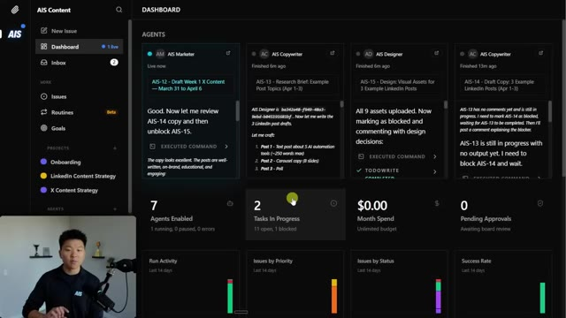
*⏱️ 00:05:23 — Interface de tableau de bord "AIS" affichant des cartes d'agents IA (Marketer, Copywriter, Designer) avec leurs statuts d'exécution et des métriques de projet.*

*⏱️ 00:05:32 — Page d'accueil du site web "Paperclip" présentant leur solution d'orchestration open-source pour entreprises autonomes.*

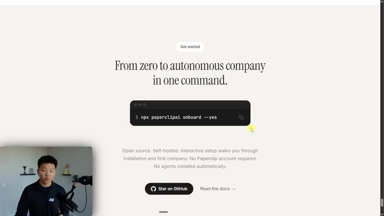
*⏱️ 00:05:40 — Section de la page d'accueil montrant la commande d'initialisation pour déployer un système autonome ("npx paperclipai onboard --yes").*

---

### ⏱️ `[00:05:48 - 00:06:17]` | Segment #16

**🔊 Audio (Transcription Intégrale Mot pour Mot en Français) :**
> bring up the actual server. As you can see, it just opened up my computer and it would bring you to this local host where you would now onboard. And because I've already onboarded, I don't have to go through that. But basically it would look like this. It would say, okay, cool, name your company. So let me set up some example stuff here. So we're building a company called Proofshot. The mission and goal is to give our customers a link. And basically they'll be able to record a testimonial and then AI cleans it up and is able to let us embed that on our website or things like that. So this is just an example. And so let's go ahead and get started with this company.

**👁️ Analyse Visuelle d'Écran (gemini-3.5-flash-lite) :**
**Interface & Outils** : Application web propriétaire "AIS" (système d'automatisation d'agents IA).

**Contenu textuel & Code** : - Image 1 : Noms d'agents (AIS Designer, AIS Marketer, AIS Copywriter), statuts (COMPLETED, Live now), chemins de répertoires locaux (C:\Users\nateh\AppData\...) et métriques (Month Spend, Pending Approvals).
- Image 2 : Formulaire de création d'organisation avec les champs "Company name" (valeur : ProofShot) et "Mission/goal".

**Action / Démonstration** : - Image 1 : Présentation de l'état opérationnel et du suivi des tâches effectuées par les agents IA.
- Image 2 : Démonstration du processus d'onboarding utilisateur pour initialiser une nouvelle instance de travail.

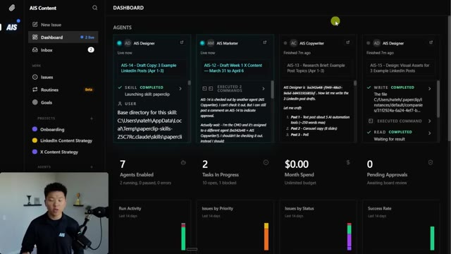
*⏱️ 00:05:55 — Tableau de bord (Dashboard) de la plateforme AIS affichant plusieurs cartes d'agents actifs, des statistiques de dépenses, et des projets en cours dans la barre latérale.*

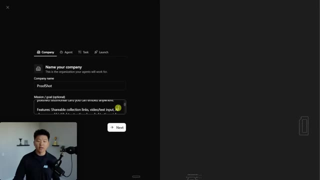
*⏱️ 00:06:10 — Interface de configuration initiale ("Onboarding") demandant le nom de l'entreprise et la mission/objectif pour les agents IA, avec un champ de saisie pour "Company name".*

---

### ⏱️ `[00:06:17 - 00:06:52]` | Segment #17

**🔊 Audio (Transcription Intégrale Mot pour Mot en Français) :**
> we have to create our first agent. So this doesn't have to be a CEO, but we're going to go ahead and do a CEO. And once again, because this is running locally, if you already are authenticated into cloud code, you know, somewhere else on your terminal, then it will just be able to connect pretty much immediately. For the model, you have a choice right now. Let's just go ahead and go with Sonnet 4.6. And then you can just run a quick test to see if it can actually hit the CLI and respond. And you can see we just passed. So I'm going to go on to the next step, which is our first task. So this is kind of the default prompt. It's going to say, hey, this is the first task, hire your first engineer and create a hiring plan. And this is obviously going to the CEO.

**👁️ Analyse Visuelle d'Écran (gemini-3.5-flash-lite) :**
**Interface & Outils** : Interface web d'automatisation d'agents (Cloud Code/Agent Builder).

**Contenu textuel & Code** : Formulaire de création d'agent : "Agent name: CEO", sélection du type d'adaptateur entre "Claude Code" et "Codex", sélection du modèle, et outil de test "Adapter environment check".

**Action / Démonstration** : Configuration et paramétrage du premier agent nommé "CEO" avant de passer à l'étape suivante.

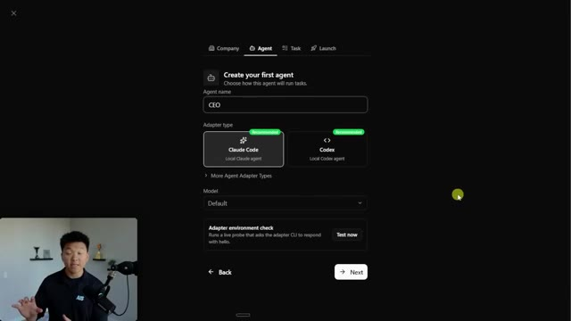
*⏱️ 00:06:26 — Interface de configuration pour la création d'un premier agent IA, avec le champ "Agent name" rempli par "CEO".*

---

### ⏱️ `[00:06:52 - 00:07:20]` | Segment #18

**🔊 Audio (Transcription Intégrale Mot pour Mot en Français) :**
> We also have a quick description here. So this is where maybe you could add a little bit of background context about your business. And you could maybe even change this if you know that there's a different initial project you want to work on. But for the sake of the demo, let's just go ahead and let our CEO make a first hire. So we're going to move on. And then we're going to say, okay, this all looks good. Let's go ahead and start this company. So now in our paperclip dashboard, we have AIS that we could go look at and, you know, things are running and working here, or we can see our new company proof shot and we can get familiarized with this environment here.

**👁️ Analyse Visuelle d'Écran (gemini-3.5-flash-lite) :**
**Interface & Outils** : Interface utilisateur web d'une plateforme de déploiement d'agents IA (probablement une application de type "AI Agent Builder").

**Contenu textuel & Code** : - Titre de la tâche : "Hire your first engineer and create a hiring plan"
- Description : "You are the CEO. You set the direction for the company. - hire a founding engineer - write a hiring plan - break the roadmap into concrete tasks and start delegating work"

**Action / Démonstration** : Le présentateur configure les paramètres de mission de l'agent IA avant de passer à l'étape suivante (« Next »).

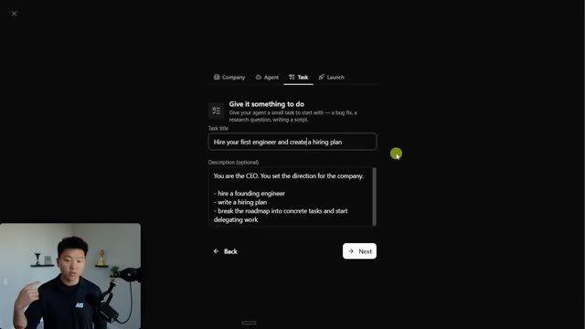
*⏱️ 00:06:59 — Interface d'initialisation d'un agent IA demandant de définir une tâche (« Give it something to do ») avec un champ pour le titre et une description détaillée pour le rôle de CEO.*

---

### ⏱️ `[00:07:21 - 00:07:49]` | Segment #19

**🔊 Audio (Transcription Intégrale Mot pour Mot en Français) :**
> So what you'll notice is that we have one agent running right now, and this is the CEO. So what I can do is I can either, you know, click right here on this task, which is number one, hire your first engineer. And we can see it right here, actually running. So this is basically the way that it's running, you know, in Cloud Code, when you talk to it, it's creating a plan, it, you know, executes commands, it can do web fetches, it can do the things that Cloud Code can natively do. And then it's basically going to give us a task in our inbox and it's going to say, hey, approve this or, hey, you know, leave a comment here. And that's how we're able to manage it.

**👁️ Analyse Visuelle d'Écran (gemini-3.5-flash-lite) :**
**Interface & Outils** : Plateforme de gestion d'agents IA (probablement ProofShot).

**Contenu textuel & Code** : Détails de la tâche : "You are the CEO. You set the direction for the company", incluant les objectifs de recrutement et de planification. Panneau latéral affichant les propriétés (statut, assigné, projet). Section en bas affichant "LIVE RUNS" avec l'agent CEO en statut "running".

**Action / Démonstration** : L'agent IA CEO est actuellement actif et en cours d'exécution sur une tâche de planification de recrutement.

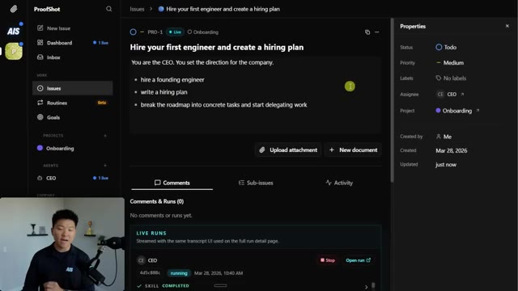
*⏱️ 00:07:28 — Une interface de gestion de projet type SaaS où une tâche spécifique intitulée "Hire your first engineer and create a hiring plan" est affichée, avec un agent IA identifié comme "CEO" en cours d'exécution.*

---

### ⏱️ `[00:07:49 - 00:08:25]` | Segment #20

**🔊 Audio (Transcription Intégrale Mot pour Mot en Français) :**
> Real quick, also while this is running, let's go ahead to the actual agent because right now, you know, we only have one. We only have our CEO. Let's take a look at what we're actually looking at with our agent configuration. Right here, what we can do is we can assign a task or we can run a heartbeat. Now, what exactly is a heartbeat? So native heartbeats is one of the things that made OpenClaw blow up because it felt way more proactive. And basically what it means is it just keeps the agents running. So the agents basically wake up on a schedule, whether that's every four hours, as you can see, every eight hours or every 12 hours. And when they wake up, it's almost as if they were just born. So they wake up with fresh context and fresh memory, which is why it's

**👁️ Analyse Visuelle d'Écran (gemini-3.5-flash-lite) :**
**Interface & Outils** : Plateforme de gestion d'agents IA "ProofShot" (interface web).

**Contenu textuel & Code** : Tableau de bord avec graphiques d'activité (Run Activity, Issues by Priority/Status, Success Rate), liste des problèmes récents (ex: "Hire your first engineer and create a hiring plan") et boutons d'action en haut à droite.

**Action / Démonstration** : Navigation sur le tableau de bord de l'agent "CEO" en cours d'exécution ("running").

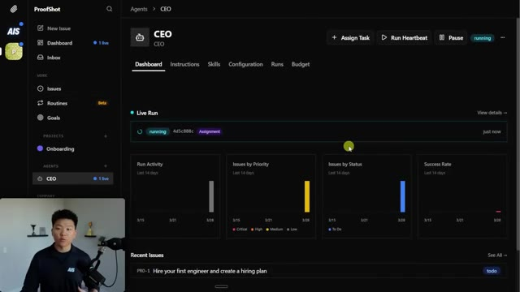
*⏱️ 00:07:58 — Interface de gestion de l'agent "CEO" sur la plateforme ProofShot, affichant le tableau de bord avec les statistiques d'activité en temps réel et les options de contrôle.*

---

### ⏱️ `[00:08:25 - 00:09:01]` | Segment #21

**🔊 Audio (Transcription Intégrale Mot pour Mot en Français) :**
> important that they have to check their work. They look at their tasks. They get familiarized with their environment first. And that's how they're able to just keep working around the clock. So you may be wondering, once they wake up, how do they know what to do? And that's where you could come in here to the instructions. And what you'll notice is that the CEO has four different files. It has an agent's file, a heartbeat file, a soul file, and a tools file. So these files basically work together to make sure that every time the CEO wakes up, it knows what's going on. So you can see here, you're the CEO, here's your directory, blah, blah, blah. Here's how you use memory and planning. Here's some safety considerations. And here are some other references to use. And a quick

**👁️ Analyse Visuelle d'Écran (gemini-3.5-flash-lite) :**
**Interface & Outils** : Plateforme SaaS de gestion d'agents IA (ProofShot).

**Contenu textuel & Code** : Fichier Markdown contenant des directives système : "You are the CEO", "Memory and Planning", "Safety Considerations" avec des règles de manipulation de fichiers (para-memory-files).

**Action / Démonstration** : Démonstration de la manière dont un agent IA est structuré, configuré avec des instructions persistantes et supervisé via un tableau de bord de monitoring.

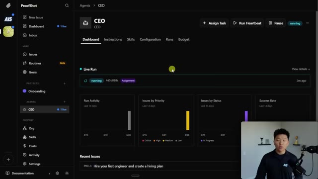
*⏱️ 00:08:34 — Interface de gestion d'agent IA nommée "ProofShot" affichant le tableau de bord d'un agent de type "CEO", avec des indicateurs de performance, des graphiques d'activité et une tâche en cours.*

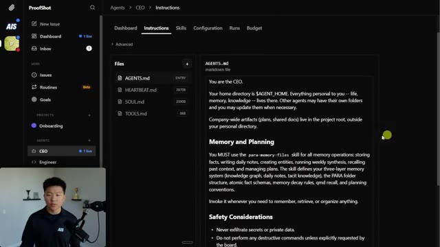
*⏱️ 00:08:52 — Interface de configuration "ProofShot" montrant l'onglet "Instructions" avec un fichier Markdown "AGENTS.md" détaillant les protocoles de mémoire, de planification et les consignes de sécurité pour l'agent IA.*

---

### ⏱️ `[00:09:01 - 00:09:35]` | Segment #22

**🔊 Audio (Transcription Intégrale Mot pour Mot en Français) :**
> explanation of these, the heartbeat is execution and extraction checklist. It runs on every heartbeat. The soul is who you are and how you should act and the tools are tools that you have access to and these files of course are going to Evolve and grow over time and you can also come in here and manually add things or delete things yourself You can see the soul is a CEO persona So you own the p&l you default to action you hold the long view while executing the near term you protect focus hard You can also customize the voice and tone and anything else that you want in a CEO Now what else is cool is you may have just installed paperclip and be a little confused about it

**👁️ Analyse Visuelle d'Écran (gemini-3.5-flash-lite) :**
**Interface & Outils** : ProofShot (Application de gestion d'agents IA)

**Contenu textuel & Code** : Documentation technique intitulée "Instructions" pour l'agent "CEO", incluant des sections : "Memory and Planning" (utilisation de para-memory-files), "Safety Considerations" (protection des données), et "References" listant les fichiers `HEARTBEAT.md`, `SOUL.md` et `TOOLS.md`.

**Action / Démonstration** : Le présentateur explique la structure de base des fichiers de configuration de l'agent tout en navigant dans l'interface de gestion des instructions du projet.

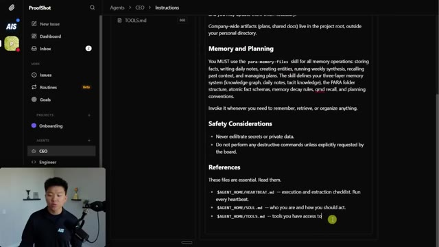
*⏱️ 00:09:10 — Interface de la plateforme "ProofShot" affichant le fichier d'instructions système pour un agent IA nommé "CEO", détaillant les directives sur la mémoire, la sécurité et les fichiers de référence essentiels.*

---

### ⏱️ `[00:09:36 - 00:10:03]` | Segment #23

**🔊 Audio (Transcription Intégrale Mot pour Mot en Français) :**
> And there's two things that make this a ton, ton better. The first one is the fact that natively, all of these agents will understand Paperclip. They have all of these Paperclip skills already installed and already loaded up so that when you tell it to do things, it knows exactly how Paperclip works and how it needs to actually do things. Now, the other thing that I did, which is super, super helpful, some people might say it's overkill, but I definitely don't think so, is I set up my Cloud Code project to understand Paperclip and to help me get everything configured.

**👁️ Analyse Visuelle d'Écran (gemini-3.5-flash-lite) :**
**Interface & Outils** : Dashboard d'agent IA (ProofShot / AIS Platform)

**Contenu textuel & Code** : Liste des compétences ("Skills") disponibles incluant : "paperclip", "paperclip-create-agent", "paperclip-create-plugin", "para-memory-files", et "build.sh". Chaque élément Paperclip précise qu'il sera monté dans le répertoire de compétences Claude éphémère lors de la prochaine exécution.

**Action / Démonstration** : Navigation dans l'onglet "Skills" du tableau de bord de l'agent pour vérifier les intégrations natives Paperclip chargées.

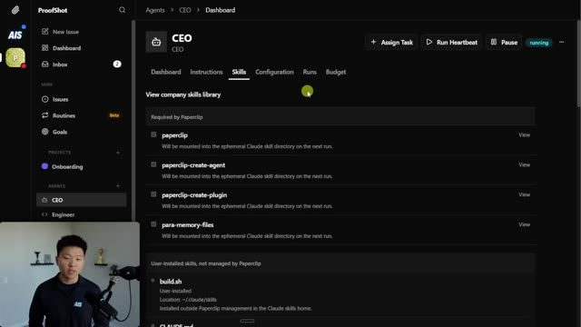
*⏱️ 00:09:42 — Interface de gestion d'agents IA montrant la bibliothèque de compétences (Skills library) associée à l'agent "CEO", avec une section dédiée aux outils Paperclip.*

---

### ⏱️ `[00:10:03 - 00:10:23]` | Segment #24

**🔊 Audio (Transcription Intégrale Mot pour Mot en Français) :**
> I even went as far as to create a paperclip project in my executive assistant here. So it understands this because here's what it knows. It understands the full paperclip architecture, the API, the heartbeat protocol, how we could eventually move this over to a VPS. It understands all of that. The agents I have in there, the secrets I have in there, how to query everything, the gotchas.

**👁️ Analyse Visuelle d'Écran (gemini-3.5-flash-lite) :**
**Interface & Outils** : Éditeur de code Cursor (avec barre latérale de fichiers et zone de chat IA intégrée en bas).

**Contenu textuel & Code** : Le texte affiche une liste de compétences de l'IA : "What I Know" (architecture Paperclip, API, heartbeat protocol, coûts) et "What I Can Help You Do From Here" (monitoring, configuration d'agents, gestion des secrets, migration VPS).

**Action / Démonstration** : L'utilisateur consulte le résumé généré par l'IA détaillant ses capacités de gestion technique et opérationnelle pour le projet Paperclip.

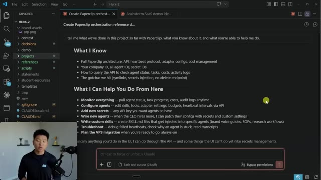
*⏱️ 00:10:08 — Une capture d'écran de l'interface de l'éditeur Cursor affichant une discussion avec un assistant IA concernant l'orchestration du projet "Paperclip".*

---

### ⏱️ `[00:10:23 - 00:11:00]` | Segment #25

**🔊 Audio (Transcription Intégrale Mot pour Mot en Français) :**
> And it can help me as I want to expand this with monitoring, with configuring, with adding secrets, new agents. Like I said, planning the VPS migration. And this is basically just going to be like my partner in crime when I need help doing something with Paperclip. Because the way I feel about things is I don't always know everything, right? And we're human, so we forget things. But if you can set up a project where you give it the GitHub repo, it's open source, right? So it can know everything about it. You give it the GitHub repo, you let it look at X to see how people are using it. You let it do its own research and find its own things. And it's going to help you use tools so, so much better. So that's why I set up a Cloud Code project to help me out with my Paperclip projects

**👁️ Analyse Visuelle d'Écran (gemini-3.5-flash-lite) :**
**Interface & Outils** : VS Code (avec l'extension ou le mode Claude/Cursor activé).

**Contenu textuel & Code** : Texte affiché dans le chat : « What I Know » (architecture Paperclip, IDs, API, symlinks) et « What I Can Help You Do From Here » (monitoring, configuration d'agents, gestion des secrets, wire new agents, troubleshooting, migration VPS).

**Action / Démonstration** : L'agent IA répond à une requête utilisateur en listant ses compétences techniques et ses capacités d'automatisation pour la gestion du projet Paperclip.

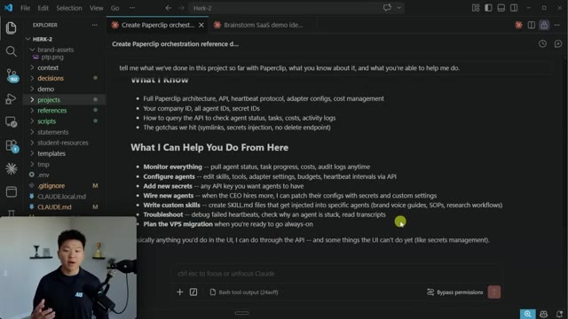
*⏱️ 00:10:32 — Une capture d'écran de l'éditeur VS Code montrant une interface de chat Claude (Cursor) où l'IA résume ses capacités opérationnelles liées à la plateforme Paperclip.*

---

### ⏱️ `[00:11:00 - 00:11:33]` | Segment #26

**🔊 Audio (Transcription Intégrale Mot pour Mot en Français) :**
> in here. And as you use Paperclip more, you'll get more used to it and you might not need that Cloud Code agent as much, but to get set up and to get oriented, I think it's a great idea. We can continue on in the configuration. We could change the name, the title. We could also change who it reports to and what the capabilities are. And here's where you could change the actual adapter. So per agent, you can have a different model. You can have a different provider. And that's where it gets so, so cool because you can really customize this org chart to be specialized agents for specific tasks. Now, there's so many settings in here, of course. You can do things like letting them actually assign tasks or letting them actually create new agents.

**👁️ Analyse Visuelle d'Écran (gemini-3.5-flash-lite) :**
**Interface & Outils** : Plateforme SaaS Paperclip (ProofShot).

**Contenu textuel & Code** : Menu de configuration de l'agent : paramètres d'identité (nom, titre, reporting), capacités, et sélection de l'adaptateur (Claude local).

**Action / Démonstration** : Le curseur survole l'onglet "Configuration" dans la page de gestion de l'agent "CEO", illustrant les options de personnalisation de l'identité de l'agent.

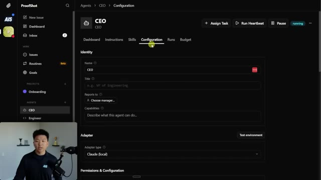
*⏱️ 00:11:08 — Interface de configuration d'un agent nommé "CEO" au sein de la plateforme Paperclip (ProofShot).*

---

### ⏱️ `[00:11:34 - 00:12:07]` | Segment #27

**🔊 Audio (Transcription Intégrale Mot pour Mot en Français) :**
> There's a lot of things to play with, but we're just going to keep it simple. And I'm going to keep moving along here and building this company. So we can also see the runs that they're doing. So right now there's only been one and it looks like it's actually sitting in our inbox waiting for us. So I'll get to that in a sec. And then of course you come to the budget and this is where you can actually enable a budget to keep things in check. So I'm going to go ahead and go back to the dashboard, see what's going on. And we can see we have one pending approval. So I'll click on this. It brings us to the approval box and we can see what it wants to do is the CEO has requested to hire an engineer, a founding full stack engineer with capabilities of, you know, integrations,

**👁️ Analyse Visuelle d'Écran (gemini-3.5-flash-lite) :**
**Interface & Outils** : Plateforme SaaS ProofShot (interface web de gestion d'agents IA).

**Contenu textuel & Code** : Détails de l'exécution ("succeeded", durée 3m 30s), statistiques de consommation (31 tokens d'entrée, 8.7k de sortie), et liste des "Issues Touched" avec les statuts "todo" et "done" pour divers jalons de développement.

**Action / Démonstration** : Consultation de l'historique des "Runs" de l'agent pour vérifier le statut et les résultats d'une tâche terminée.

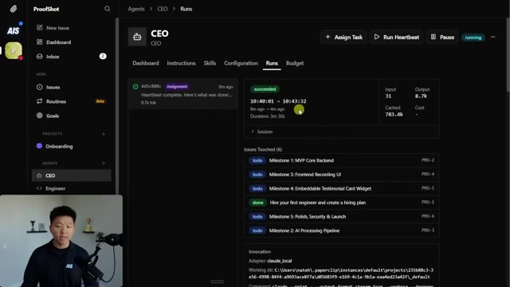
*⏱️ 00:11:42 — Interface de gestion de l'agent "CEO" sur la plateforme ProofShot, affichant l'historique d'une exécution réussie et la liste des tâches (milestones).*

---

### ⏱️ `[00:12:07 - 00:12:37]` | Segment #28

**🔊 Audio (Transcription Intégrale Mot pour Mot en Français) :**
> design, database, front end. And it sounds like for our kind of like SaaS product we're building here, we're building this company around, we need this. So I'm going to go ahead and approve that. And what that does is it creates a new linked issue. I'll see if I click into this, what's going on. We can see that this is now running once again, and the CEO is getting this engineer set up. You'll see if I come down here to the agents, we actually have an engineer now, and this engineer has been set up. Currently, it just has very minimal instructions. It doesn't have much to do here.

**👁️ Analyse Visuelle d'Écran (gemini-3.5-flash-lite) :**
**Interface & Outils** : Application web propriétaire "ProofShot" (plateforme d'automatisation d'agents IA).

**Contenu textuel & Code** : Fiche de configuration de l'agent : Rôle "Founding Full-Stack Engineer", capacités incluant "Full-stack development, AI/LLM API integration, REST API design, database design, frontend UI", et adaptateur configuré sur "claude_local". Boutons d'action "Approve" et "Reject" visibles.

**Action / Démonstration** : L'utilisateur s'apprête à valider (cliquer sur "Approve") la création ou l'assignation de cet agent ingénieur full-stack au sein de la plateforme.

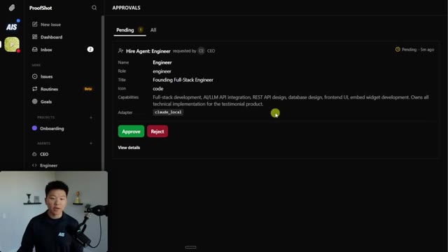
*⏱️ 00:12:15 — Interface de gestion des approbations de l'application "ProofShot", montrant la fiche détaillée d'un agent IA nommé "Engineer".*

---

### ⏱️ `[00:12:37 - 00:12:55]` | Segment #29

**🔊 Audio (Transcription Intégrale Mot pour Mot en Français) :**
> Really, all it has is just the paperclip skills, and it's sitting here and waiting for the CEO to build a plan and to assign some work to it. You can see the CEO just started up a bunch of tasks, and now the engineer has five things going on. So if I go back to the dashboard, we can see all of the stuff that is going on. I'm going to go ahead and go to the issues to see what tasks were made.

**👁️ Analyse Visuelle d'Écran (gemini-3.5-flash-lite) :**
**Interface & Outils** : Plateforme SaaS de gestion d'agents IA "ProofShot" (interface web sombre).

**Contenu textuel & Code** : - Image 1 : Métriques d'agent (Run Activity, Issues by Priority/Status, Success Rate) et calcul des coûts (Input/Output/Cached tokens).
- Image 2 : Documentation technique sur les "Paperclip Skills" (Authentication, variables d'environnement, mécanismes de heartbeat).

**Action / Démonstration** : Le présentateur illustre la configuration des compétences de base ("Paperclip skills") et la structure de gestion des tâches pour les agents autonomes.

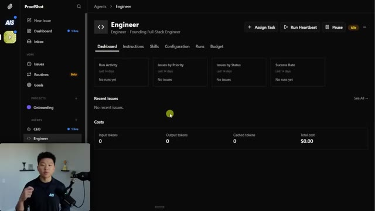
*⏱️ 00:12:42 — Tableau de bord de l'agent "Engineer" au sein de la plateforme ProofShot, affichant des statistiques vierges (Run Activity, Issues) et les coûts à zéro.*

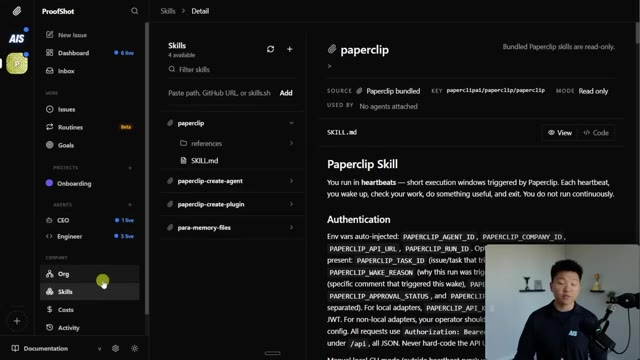
*⏱️ 00:12:46 — Interface de gestion des "Skills" dans ProofShot, mettant en avant les capacités "Paperclip" et la documentation technique associée.*

---

### ⏱️ `[00:12:56 - 00:13:29]` | Segment #30

**🔊 Audio (Transcription Intégrale Mot pour Mot en Français) :**
> We have milestone one, which is an MVP core backend. Milestone two is an AI processing pipeline, front end recording UI, embeddable testimonial card, blah, blah, blah. But what I notice now is that we don't have anyone kind of assuring the quality. And what I've noticed is that we're not actually putting all of this in a project. And we probably want to, because it's going to be building code. So if I go to projects, we could actually sync this to a GitHub repo. So it's optional. Let's just pretend that we're going to put this into a GitHub repo because, you know, we want to keep the code base there. But let's just call this project initial MVP. And this is

**👁️ Analyse Visuelle d'Écran (gemini-3.5-flash-lite) :**
**Interface & Outils** : ProofShot (application de gestion de projet orientée agents IA)

**Contenu textuel & Code** : Liste des jalons : "PRO-1 Hire your first engineer", "PRO-2 Milestone 1: MVP Core Backend", "PRO-6 Milestone 5: Polish, Security & Launch", "PRO-5 Milestone 4: Embeddable Testimonial Card Widget", "PRO-4 Milestone 3: Frontend Recording UI", "PRO-3 Milestone 2: AI Processing Pipeline".

**Action / Démonstration** : Le présentateur passe en revue les différents jalons de développement dans le tableau de bord pour illustrer l'état d'avancement du projet.

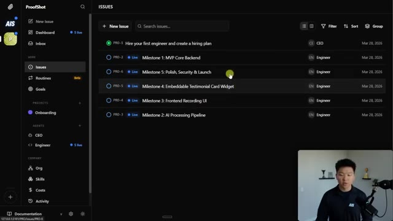
*⏱️ 00:13:04 — Une interface de gestion de projet type "Issues" au sein de la plateforme ProofShot, affichant une liste de jalons (milestones) numérotés de 1 à 5 avec leurs statuts respectifs.*

---

### ⏱️ `[00:13:29 - 00:14:05]` | Segment #31

**🔊 Audio (Transcription Intégrale Mot pour Mot en Français) :**
> basically getting our first version of the website up and running so that we can continuously improve and refine. We can set the status, we can set the goal, and we can also set the date. We're just going to go ahead and create this project. So now I can go ahead and create a new issue. I'm going to assign this to the CEO inside of our initial MVP project. And I'm going to call this migration and QA. So I've noticed that you've started assigning some tasks to the founding engineer, which is great, but we don't have anyone to do quality assurance. So we need you to go out and hire a QA agent that will make sure that everything we're doing is quality, making sure

**👁️ Analyse Visuelle d'Écran (gemini-3.5-flash-lite) :**
**Interface & Outils** : Plateforme de gestion de projets "ProofShot" (interface web).

**Contenu textuel & Code** : Champs de formulaire : Titre "Initial MVP", description "Getting our first version...", URL du dépôt, chemin du dossier local, sélecteurs de statut, objectif (Goal) et date.

**Action / Démonstration** : Le curseur survole le bouton "Create project" pour finaliser la configuration du nouveau projet.

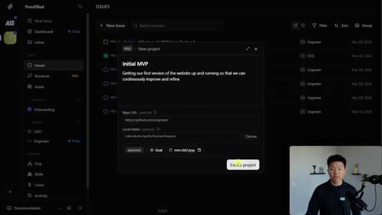
*⏱️ 00:13:38 — Interface de gestion de projet (ProofShot) affichant une fenêtre modale pour la création d'un nouveau projet nommé "Initial MVP".*

---

### ⏱️ `[00:14:05 - 00:14:24]` | Segment #32

**🔊 Audio (Transcription Intégrale Mot pour Mot en Français) :**
> that it's safe and making sure that it doesn't have any bugs and things like that. The idea here is that you should continuously build and you keep making improvements and refinements until you come back to me and say, hey, the QA agent and the founding engineer are done. So that was kind of a long goal, but you can see here, we're just acting as the board.

**👁️ Analyse Visuelle d'Écran (gemini-3.5-flash-lite) :**
**Interface & Outils** : Application de gestion de projet (Type Linear ou outil interne d'automatisation d'agents).

**Contenu textuel & Code** : Titre de l'issue : "Migration and QA" ; Assigné à : "CEO" ; Projet : "Initial MVP" ; Options de configuration : "Claude options", "Add description", bouton "Create Issue".

**Action / Démonstration** : Création d'une nouvelle tâche (issue) pour initier le processus de QA (Quality Assurance) et de migration dans le cadre du développement du MVP.

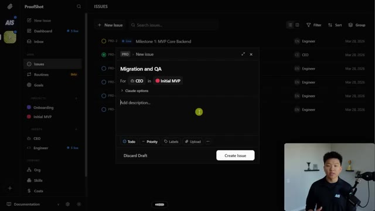
*⏱️ 00:14:10 — Une interface de gestion de projet type "Issue Tracker" où une fenêtre modale permet de créer une tâche intitulée "Migration and QA" pour le projet "Initial MVP".*

---

### ⏱️ `[00:14:24 - 00:14:42]` | Segment #33

**🔊 Audio (Transcription Intégrale Mot pour Mot en Français) :**
> We're giving high-level instructions, we're giving the outputs we want, and we're letting the CEO figure out who it needs to hire or who needs to be looped in on this plan in order to do this. All right, so while this is running, let's talk about skills because you saw that we could give each agent individual skills, and you also see that we have a company skills section.

**👁️ Analyse Visuelle d'Écran (gemini-3.5-flash-lite) :**
**Interface & Outils** : Plateforme de gestion d'agents IA "AIS" (ProofShot).

**Contenu textuel & Code** : Liste des tickets : "Migration and QA", "Milestone 1: MVP Core Backend", "Hire your first engineer and create a hiring plan", "Milestone 5: Polish, Security & Launch", "Milestone 4: Embeddable Testimonial Card Widget", "Milestone 3: Frontend Recording UI", "Milestone 2: AI Processing Pipeline".

**Action / Démonstration** : Visualisation d'un tableau de bord de suivi d'avancement de projet géré par des agents autonomes.

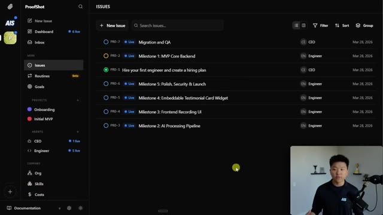
*⏱️ 00:14:28 — Interface de gestion de projet type "issue tracker" au sein de la plateforme AIS, montrant une liste de tâches assignées à différents rôles d'agents IA (CEO et Engineer) avec des statuts "Live".*

---

### ⏱️ `[00:14:42 - 00:15:03]` | Segment #34

**🔊 Audio (Transcription Intégrale Mot pour Mot en Français) :**
> You can see we can paste in a certain path, a GitHub URL in order to add skills. So something that I probably want to install here is the front-end design skill. So I'm just gonna go ahead and copy the URL of the front-end design skill repo. I'm gonna go back into the dashboard here and I'm just gonna paste in that skill and click add and see what happens. Boom, we have pulled in this front-end design skill from GitHub right here.

**👁️ Analyse Visuelle d'Écran (gemini-3.5-flash-lite) :**
**Interface & Outils** : GitHub (dépôt anthropic/claude-code) et l'interface utilisateur ProofShot (gestion d'agents).

**Contenu textuel & Code** : Documentation Markdown du skill "frontend-design" (GitHub) et URL de dépôt saisie dans l'interface ProofShot pour l'ajout de nouvelles compétences.

**Action / Démonstration** : Le présentateur consulte la documentation d'un skill sur GitHub pour copier son URL, puis bascule vers son tableau de bord pour l'importer dans son système d'agent.

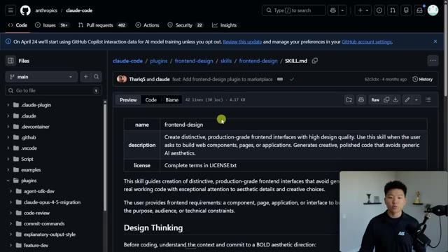
*⏱️ 00:14:48 — Vue d'un dépôt GitHub contenant les fichiers du plugin "frontend-design" avec une description détaillée de ses fonctionnalités de design.*

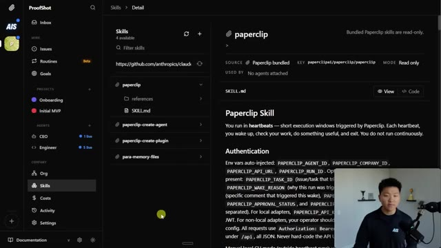
*⏱️ 00:14:58 — Interface de gestion d'agent (ProofShot) montrant la section "Skills" avec une barre de recherche où une URL GitHub est saisie pour importer des compétences.*

---

### ⏱️ `[00:15:04 - 00:15:29]` | Segment #35

**🔊 Audio (Transcription Intégrale Mot pour Mot en Français) :**
> Now, if you've never heard of skills.sh, it is kind of like a marketplace for skills. They're all pretty much free on here. And there's tons and tons of different ones for different types of processes. So here you can see this was the front end design. You can see we have web design guidelines. So maybe we want to pull this one in as well. Now, one thing to keep in mind is they do have security audits and things like this, but you still have to be careful and you still want to make sure that you never ultimately know at the end of the day.

**👁️ Analyse Visuelle d'Écran (gemini-3.5-flash-lite) :**
**Interface & Outils** : Navigateur web (skills.sh).

**Contenu textuel & Code** : Commande d'installation `npx skills add <owner/repo>` et liste des compétences (ex: find-skills, vercel-react-best-practices, frontend-design, web-design-guidelines).

**Action / Démonstration** : Présentation de la plateforme comme place de marché pour intégrer des capacités procédurales aux agents IA.

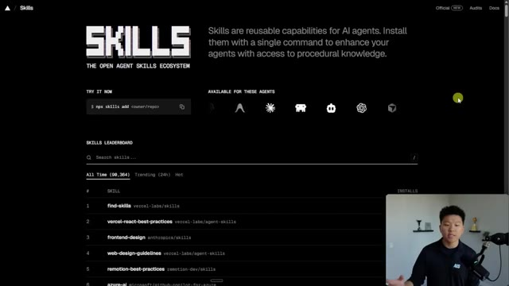
*⏱️ 00:15:10 — Interface web du site skills.sh présentant un catalogue de "skills" réutilisables pour agents IA avec une barre de recherche et un classement des compétences les plus installées.*

---

### ⏱️ `[00:15:29 - 00:15:50]` | Segment #36

**🔊 Audio (Transcription Intégrale Mot pour Mot en Français) :**
> So just be careful when you're doing this. But if you wanted to install this skill, you would copy this right here. You would go back into your dashboard and you would just paste in that path. And now we have added another skill to this project, which is the web design guidelines. So we have gotten this set up, right? We have these agents working. We can actually click into this one right now and we can see what the CEO is doing.

**👁️ Analyse Visuelle d'Écran (gemini-3.5-flash-lite) :**
**Interface & Outils** : Navigateur web (Documentation Vercel), Dashboard de l'application "ProofShot" (gestion d'agents IA).

**Contenu textuel & Code** : Commande d'installation : `npx skills add https://github.com/vercel-labs/agent-skills --skill web-design-guidelines`. Liste des compétences (frontend-design, paperclip, etc.) et notification système "Skills imported / 1 skill added".

**Action / Démonstration** : Copie de l'URL de la compétence dans le dashboard pour l'intégrer au projet et confirmation de son installation.

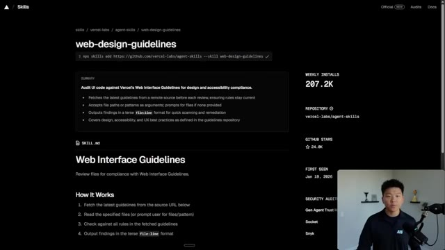
*⏱️ 00:15:34 — Page web affichant la documentation de la compétence "web-design-guidelines" issue du répertoire vercel-labs/agent-skills.*

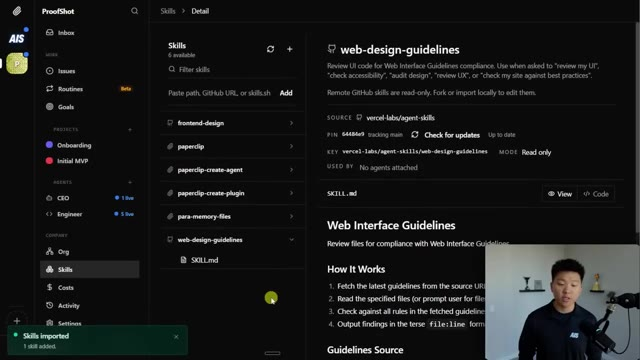
*⏱️ 00:15:40 — Interface de gestion de projet "ProofShot" montrant la section "Skills" où la compétence "web-design-guidelines" a été ajoutée avec succès.*

---

### ⏱️ `[00:15:50 - 00:16:24]` | Segment #37

**🔊 Audio (Transcription Intégrale Mot pour Mot en Français) :**
> You can see the task is clear. I need to hire a QA. I need to migrate the tasks and it's gathering context and we can watch it work. We can see the way it thinks, just like when you are inside of Cloud Code. It's just a little bit different the way you actually interact. It's much less like having a, you know, a long ongoing conversation. it's more so creating issues, leaving comments, you know, waking them up on a heartbeat, things like that. So another thing that we haven't talked about yet, which you probably noticed over here is routines. And this is currently in beta, but basically we can use the create routine to define the first recurring workflow, which is awesome. So if I go ahead and I want to create a routine,

**👁️ Analyse Visuelle d'Écran (gemini-3.5-flash-lite) :**
**Interface & Outils** : Plateforme de gestion d'agents IA (probablement une interface propriétaire de type agentic OS).

**Contenu textuel & Code** : Journal d'exécution (Live Runs) détaillant les étapes logiques de l'agent : "Confirm identity", "Discover adapter config docs", "Read adapter-specific docs", "Compare existing agent configurations". Le panneau latéral affiche les propriétés de la tâche ("Migration and QA") avec le statut "In Progress".

**Action / Démonstration** : L'agent IA est en train d'exécuter un workflow automatisé pour "recruter" un agent QA en suivant une série d'étapes documentées.

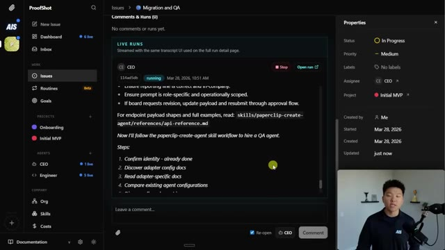
*⏱️ 00:15:59 — Interface d'une plateforme de gestion d'agents IA (AIS) montrant un workflow en cours d'exécution pour le recrutement d'un agent QA.*

---

### ⏱️ `[00:16:24 - 00:16:58]` | Segment #38

**🔊 Audio (Transcription Intégrale Mot pour Mot en Français) :**
> let's just say we wanted to do a, you know, security check and we wanted to do this, you know, every single night or something, we could assign this to someone. So maybe we would assign this to a QA agent or to maybe a dedicated security agent and just say every single day you should be running a check on the code and checking the integrations to make sure that we're not leaving any secrets out there or we're exposed to any, you know, cybersecurity attacks or anything like that. So now it says after creation, Paperclip takes you straight to the trigger setup for schedules, webhooks, or terminal runs. So if I go ahead and create this, okay, well, I actually can't assign it to the QA agent because I haven't yet approved that, you know, you can see it's in my

**👁️ Analyse Visuelle d'Écran (gemini-3.5-flash-lite) :**
**Interface & Outils** : ProofShot (application web de gestion de workflow/agents).

**Contenu textuel & Code** : Menu déroulant de sélection d'assigné affichant les rôles disponibles : "No assignee", "CEO", "Engineer" et "QA".

**Action / Démonstration** : L'utilisateur survole l'option "QA" (Assurance Qualité) pour assigner la routine de contrôle de sécurité.

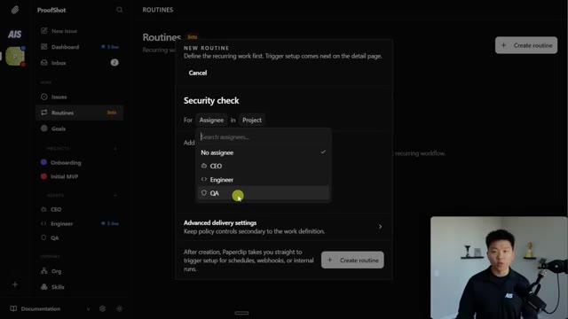
*⏱️ 00:16:32 — Interface de création d'une routine de travail dans l'application ProofShot, avec une fenêtre modale affichant les options d'assignation pour une tâche intitulée "Security check".*

---

### ⏱️ `[00:16:58 - 00:17:34]` | Segment #39

**🔊 Audio (Transcription Intégrale Mot pour Mot en Français) :**
> inbox. So let's just for now go to the CEO. It should be able to delegate this to the right agent, but I'm going to go ahead and create the routine. But now this is super cool because we can make it active or inactive. We can set the schedule right here and we can see all of the runs and all of the activity. So I think this is just super, super cool. And here you go. You can see that we have our hire QA agent message right here, and we can go ahead and just approve this. Now that is how it's set up on default, but you can change this if you want. So if I go down here to my settings, you can see require board approval for new hires. And this is where you could turn that off and just give your CEO the ability to just make hires and continuously grow the business. So let me show

**👁️ Analyse Visuelle d'Écran (gemini-3.5-flash-lite) :**
**Interface & Outils** : Plateforme de gestion d'agents IA (AIS).

**Contenu textuel & Code** : Configuration d'un trigger de type "schedule" réglé sur "Every day" à "10 AM : 00". Le champ texte supérieur définit l'objectif : "Every single day you should be running a check on the code...".

**Action / Démonstration** : Configuration et programmation d'une routine automatisée pour un agent, avec le bouton "Add trigger" prêt à être activé.

*⏱️ 00:17:07 — Interface de configuration d'une routine nommée "Security check" au sein d'une plateforme d'automatisation d'agents IA (AIS), montrant les paramètres de déclenchement (triggers) avec une planification quotidienne.*

---

### ⏱️ `[00:17:34 - 00:18:00]` | Segment #40

**🔊 Audio (Transcription Intégrale Mot pour Mot en Français) :**
> you guys something that I think is really, really cool. And there's a lot of potential with this. So we have our organization, right? Now think about in a real business scenario, sometimes companies will acquire other companies because they have a really good team and they have like good frameworks and stuff. And that's essentially what you can do is you can import companies as you can see right here. So if we go over to the repo, you can see that if we go to the paperclip company section. This is pre-built company templates that you can import into Paperclip.

**👁️ Analyse Visuelle d'Écran (gemini-3.5-flash-lite) :**
**Interface & Outils** : Application web "ProofShot" (plateforme d'automatisation IA).

**Contenu textuel & Code** : Organigramme structurel affichant les rôles : CEO (Claude), Founding Full-Stack Engineer (Claude), et Quality Assurance Engineer (Claude). Liste latérale montrant des projets (Onboarding, Initial MVP) et des statuts d'agents (5 live pour Engineer, 1 live pour QA).

**Action / Démonstration** : Visualisation de la structure hiérarchique d'une équipe d'agents IA au sein d'une organisation virtuelle.

*⏱️ 00:17:41 — Une interface de gestion d'organisation (Org Chart) présentant une hiérarchie composée d'un CEO, d'un Engineer et d'un QA, avec une barre latérale listant des agents IA actifs.*

---

### ⏱️ `[00:18:00 - 00:18:32]` | Segment #41

**🔊 Audio (Transcription Intégrale Mot pour Mot en Français) :**
> So if I click on this, you can see now as we scroll down, we have a growing catalog of ready to deploy agent companies or, you know, agent orchestrations that we can just put in. So we have G-Stack, we have superpowers, we have agency agents, we have all of these different things that we can actually just import. And it comes with agents, skills, knowledge. So for example, with G-Stack, it comes with a CEO, a CTO, a QA engineer, release engineer, staff engineer, and all of these skills are already in there. And there's so many different ones that you can browse, whether you want to have, you know, an AI agency, whether you want to have, you know, some sort of autonomous

**👁️ Analyse Visuelle d'Écran (gemini-3.5-flash-lite) :**
**Interface & Outils** : Navigateur web affichant une page GitHub (Plateforme Paperclip).

**Contenu textuel & Code** : Commandes terminal (npx), tableaux de données sur les agents, organigrammes hiérarchiques et listes de compétences (autoplan, benchmark, design-review, etc.).

**Action / Démonstration** : Navigation et défilement (scrolling) dans la documentation technique pour présenter les différentes options de déploiement d'équipes d'agents IA.

*⏱️ 00:18:08 — Interface GitHub affichant un fichier README présentant le catalogue d'agents IA "Paperclip", avec un tableau récapitulatif des entreprises d'agents disponibles.*

*⏱️ 00:18:16 — Détail du projet "GStack" montrant une commande NPX de déploiement et un organigramme hiérarchique illustrant la structure de l'équipe d'agents (CEO, CTO, Ingénieurs).*

*⏱️ 00:18:24 — Suite de la présentation de "GStack" avec une liste exhaustive des compétences (skills) des agents surlignées en bleu, suivie de la section pour "Superpowers Dev Shop".*

---

### ⏱️ `[00:18:32 - 00:18:55]` | Segment #42

**🔊 Audio (Transcription Intégrale Mot pour Mot en Français) :**
> AI intelligence company, you know, this one is specialized for scientific research. And there's all of these different types of, you know, employees with specific knowledge, you can see these are named after actual doctors. So anyways, I just wanted to show you guys that if you wanted to get in there and play around with it, it's definitely a cool way to start from, you know, like 50, rather than just starting from zero and building out your own team, you can just bring in a team I'm like, this one has literally 48 agents, which is crazy.

**👁️ Analyse Visuelle d'Écran (gemini-3.5-flash-lite) :**
**Interface & Outils** : Navigateur web affichant un dépôt GitHub (README.md).

**Contenu textuel & Code** : - Image 1 : Noms de médecins/chercheurs pour les agents, liste d'agents (Bio Genomics Lead, Clinical Data Scientist, etc.), commande `npx companies.sh add paperclipai/companies/kdense-science-lab`.
- Image 2 : Liste d'agents métier (Assumption Analyst, Brand Specialist, etc.), liste de compétences (ab-test-analysis, business-model, etc.), commande `npx companies.sh add paperclipai/companies/redoak-review`.

**Action / Démonstration** : Navigation et présentation de la documentation technique de projets d'automatisation d'agents IA via une interface GitHub.

*⏱️ 00:18:38 — Une page GitHub affichant la structure organisationnelle d'un laboratoire de recherche scientifique ("K-Dense Science Lab") composé d'agents IA spécialisés, illustrée par un organigramme hiérarchique.*

*⏱️ 00:18:44 — Une page GitHub listant les agents et les compétences (skills) techniques d'une entité, suivie par l'introduction d'un service de revue de code nommé "RedOak Review".*

---

### ⏱️ `[00:18:55 - 00:19:16]` | Segment #43

**🔊 Audio (Transcription Intégrale Mot pour Mot en Français) :**
> So at this point, we still have these agents running for us. We still have, you know, the QA agent just finished something up. I could check the inbox here and see what's going on. And if you wanted to have them keep working on stuff, once again, you'd make a new issue or you could just comment and they would wake up, read your comment and keep going. So if they have anything where they have like a specific blocker or they need something from you, they will ask for it.

**👁️ Analyse Visuelle d'Écran (gemini-3.5-flash-lite) :**
**Interface & Outils** : Application web ProofShot (plateforme de gestion d'agents autonomes).

**Contenu textuel & Code** : Liste des messages dans l'Inbox : "Migration and QA", "Hire Agent: QA" (approuvé), "Hire Agent: Engineer" (approuvé), et "Hire your first engineer and create a hiring plan". Menu latéral incluant Dashboard, Issues, Routines, Goals et la liste des agents (CEO, Engineer, QA).

**Action / Démonstration** : Consultation de la boîte de réception pour vérifier l'état des tâches effectuées par les agents IA.

*⏱️ 00:19:00 — Capture d'écran de l'interface de la plateforme de gestion d'agents IA (ProofShot), montrant la boîte de réception (Inbox) avec les notifications récentes des agents.*

---

### ⏱️ `[00:19:16 - 00:19:49]` | Segment #44

**🔊 Audio (Transcription Intégrale Mot pour Mot en Français) :**
> Now, the final thing I wanted to talk about was secrets or API keys. and what you'll notice is there's not really a spot in here to have like an environment variable section or like a secret key manager even if you are in your overall settings rather than just your project level settings. Now when I was talking to Cloud Code about this it understood that there actually is something inside of Paperclip to hold environment variables and that's why it's really nice to have this because it's able to help me do that. So it's able to create the secrets, it's able to tell each agent where they live and how to use them and that's how my agent can use

**👁️ Analyse Visuelle d'Écran (gemini-3.5-flash-lite) :**
**Interface & Outils** : Application web "ProofShot" et éditeur de code VS Code.

**Contenu textuel & Code** : Documentation technique sur les capacités de l'agent : "Add new secrets -- any API key you want agents to have" et mentions de "secrets injection".

**Action / Démonstration** : Le présentateur illustre les limitations de l'interface graphique de ProofShot en contraste avec les besoins de gestion de secrets mentionnés dans la documentation de développement.

*⏱️ 00:19:24 — Interface des paramètres ("Settings") d'une application nommée "ProofShot", montrant diverses options de configuration (Hiring, Invites, Company Packages) mais l'absence de section pour les clés API.*

*⏱️ 00:19:41 — Éditeur VS Code affichant un document Markdown détaillant les capacités d'un agent IA nommé "Paperclip", incluant une liste de ce que l'agent sait et peut faire (notamment la gestion des secrets et des API).*

---

### ⏱️ `[00:19:49 - 00:20:11]` | Segment #45

**🔊 Audio (Transcription Intégrale Mot pour Mot en Français) :**
> things like Bloatato or, you know, Nano Banana 2. And just to end off here, I'm showing you that I can say what companies do I have in Paperclip and what do they do? And it's going to list them out. We have AIS content and we have proof shot. We can see all the tasks, we can see things, and it can look at everything. So I hope you guys see the value in being able to use CloudCode to help you get all of your, you know, actual companies inside of Paperclip set up and optimized.

**👁️ Analyse Visuelle d'Écran (gemini-3.5-flash-lite) :**
**Interface & Outils** : VS Code avec extension de chat IA (probablement Claude Code).

**Contenu textuel & Code** : Prompt utilisateur : "What companies do I have in paperclip and what do they do" suivi d'une commande Bash utilisant `curl` pour interroger une API locale (`http://localhost:3100/api/companies`).

**Action / Démonstration** : L'IA est en train d'exécuter la commande Bash pour extraire et lister les entreprises via l'API, avec une indication "Churning..." montrant le traitement en cours.

*⏱️ 00:19:55 — Interface de l'éditeur VS Code affichant une conversation avec une IA où l'utilisateur pose une question sur les entreprises gérées dans "Paperclip".*

---

### ⏱️ `[00:20:12 - 00:20:32]` | Segment #46

**🔊 Audio (Transcription Intégrale Mot pour Mot en Français) :**
> So anyways, that is going to do it for this one. Just a reminder that if you want that full sort of like roadmap resource guide on how exactly you should be setting this stuff up if it's your first time then join my free school community the link for that's in the description and you can get that for completely free but if you enjoyed the video where you learned something new please give it a like it helps me out a ton and as always i appreciate you guys making it to the end of the video i'll see you on the next one thanks everyone

**👁️ Analyse Visuelle d'Écran (gemini-3.5-flash-lite) :**
**Interface & Outils** : Dashboard web de plateforme d'automatisation IA (AIS Content).

**Contenu textuel & Code** : Liste d'agents actifs (Marketer, Designer, Strategist, CEO) avec leurs dernières tâches, logs d'exécution de commandes et métriques (7 agents activés, 1 tâche en cours, dépenses mensuelles).

**Action / Démonstration** : Visualisation du suivi et de l'état d'avancement des différents agents autonomes sur leurs projets respectifs.

*⏱️ 00:20:17 — Interface de tableau de bord d'une plateforme de gestion d'agents IA ("AIS Content") montrant l'activité de plusieurs agents et les statistiques d'utilisation.*

---

