# 🎬 Gemini 3.1 Flash Live Just Changed Voice Agents Forever

> **Chaîne** : [Nate Herk | AI Automation](https://www.youtube.com/@nateherk/featured)  
> **Lien YouTube** : [https://www.youtube.com/watch?v=Qt3zMBH-FNg](https://www.youtube.com/watch?v=Qt3zMBH-FNg)  
> **Date de publication** : 20260328  
> **Durée** : 00:18:41  
> **Identifiant vidéo** : `Qt3zMBH-FNg`  
> **Transcription & Analyse** : `whisper-v3-large-turbo+gemini-3.5-flash-lite`  

---

## 📌 Synthèse Exécutive & Outils

### 💡 Résumé
Dans cette vidéo intitulée **Gemini 3.1 Flash Live Just Changed Voice Agents Forever**, Nate Herk décortique les capacités pratiques d'automatisation et de développement propulsées par les modèles de pointe.

### 🛠️ Outils, Modèles & Logiciels Présentés
- **Opus 5.5 & Claude Code** : Modèles d'ingénierie et agents de codage autonome.

### 🔑 Points Clés & Enseignements Stratégiques
- Optimiser le niveau d'effort et le raisonnement des modèles IA pour des résultats industriels.
- Automatiser les cycles de création logicielle de bout en bout.

---

## ⏱️ Chronologie & Transcription Complète Audio & Visuelle (Mot pour Mot)

### ⏱️ `[00:00:00 - 00:00:34]` | Segment #01

**🔊 Audio (Transcription Intégrale Mot pour Mot en Français) :**
> Hey, so I think that these scissors are broken. These two different pieces came apart. Do you know how I might be able to fix this? I see. It looks like these are designed to come apart for cleaning. If you align the rivet on one blade with the slot on the other, they should slide back together securely. Can you give that a try? There we go. I think I got it working. Perfect. That's exactly how they connect. They look like they're working just fine now. Hey, so I was just scrolling through through my school community and I was curious if you were able to see these different posts

**👁️ Analyse Visuelle d'Écran (gemini-3.5-flash-lite) :**
**Interface & Outils** : Google AI Studio (Playground)

**Contenu textuel & Code** : Transcription en temps réel d'une conversation sur la réparation de ciseaux, paramètres de configuration du modèle (Voice: Zephyr, Tokens/image: 258), et champ de saisie de prompt.

**Action / Démonstration** : Démonstration de l'interaction vocale et textuelle en direct avec le modèle Gemini dans un environnement de développement.

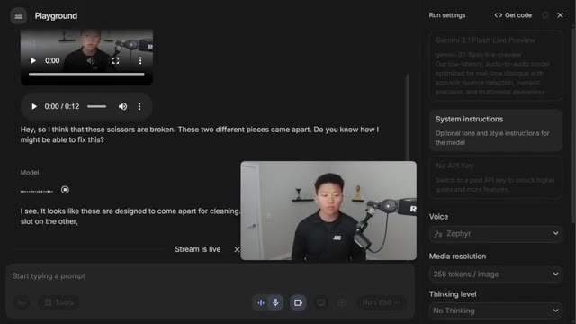
*⏱️ 00:00:08 — Interface du Google AI Studio (Playground) affichant une interaction multimodale en temps réel avec le modèle Gemini 3.1 Flash Live Preview.*

---

### ⏱️ `[00:00:34 - 00:01:02]` | Segment #02

**🔊 Audio (Transcription Intégrale Mot pour Mot en Français) :**
> and specifically the one about the Claude usage limits. Yes, I can see the different posts in the AI Automation Society community. I see one from Vishal Chojnik titled Claude limits me four times in 20 hours. Anyone else facing this? Is that the one you were referring to? Yeah, wow, I scrolled past that really quick and you were still able to pull that out. All right, so Google Google just dropped Gemini 3.1 Flash Live, which is their latest voice model that has a lot of upgrades.

**👁️ Analyse Visuelle d'Écran (gemini-3.5-flash-lite) :**
**Interface & Outils** : Interface web "Playground" (probablement Google AI Studio ou similaire), affichant un panneau de configuration des paramètres du modèle (System instructions, Voice, Media resolution, Thinking level) et une zone de dialogue.

**Contenu textuel & Code** : Texte du prompt analysé : "Claude limits me four times in 20 hours. Anyone else facing this?". Paramètres visibles : "Gemini 3.1 Flash Live Preview", "Voice: Zephyr", "Thinking level: No Thinking".

**Action / Démonstration** : Le modèle IA traite et transcrit en temps réel le contenu textuel provenant d'une capture d'écran d'un forum au sein d'une interface de développement.

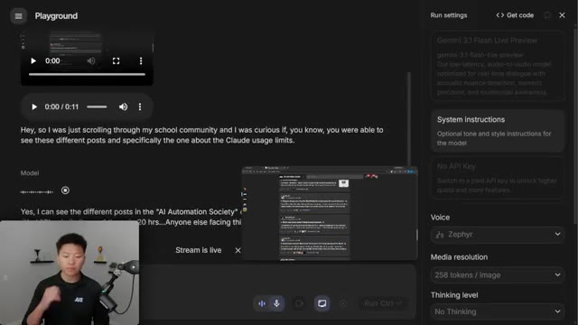
*⏱️ 00:00:41 — Interface de la plateforme "Playground" affichant une interaction avec un modèle IA (Gemini 3.1 Flash Live Preview) qui analyse une capture d'écran d'une discussion communautaire sur les limites d'utilisation de Claude.*

---

### ⏱️ `[00:01:02 - 00:01:23]` | Segment #03

**🔊 Audio (Transcription Intégrale Mot pour Mot en Français) :**
> In fact, you can even see right here in this video, they're calling it their biggest upgrade yet. The whole idea is that this is way more human because it's no longer doing speech to text and then text to speech, it's just straight up speech to speech. And it can also see things as you guys saw in that quick demo beforehand. So this model is said to have improved precision, lower latency, and just more fluid, natural interactions.

**👁️ Analyse Visuelle d'Écran (gemini-3.5-flash-lite) :**
**Interface & Outils** : Navigateur web affichant le blog officiel Google "The Keyword".

**Contenu textuel & Code** : Titre de l'article : "Gemini 3.1 Flash Live: Making audio AI more natural and reliable", avec les auteurs (Valeria Wu et Yifan Ding) et la date du 26 mars 2026.

**Action / Démonstration** : Présentation informative du nouveau modèle Gemini 3.1 Flash Live par le créateur.

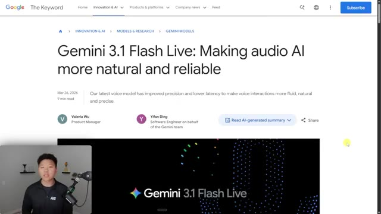
*⏱️ 00:01:07 — Une capture d'écran du blog "Google The Keyword" présentant l'article sur "Gemini 3.1 Flash Live", illustrant les avancées de l'IA vocale.*

---

### ⏱️ `[00:01:23 - 00:01:56]` | Segment #04

**🔊 Audio (Transcription Intégrale Mot pour Mot en Français) :**
> Now this first benchmark is about multi-step function calling, which it has outperformed the previous Gemini 2.5 flash model by about 19% here, as you can see. And here's another one called audio multi-challenge, where it's not only outperforming the previous Gemini models, but also different models from different providers. One thing that I think is really cool is this is apparently a huge step up when it comes to the agent being able to listen in noisy environments, like if you're on the side of the road or if you're in a noisy restaurant or workspace, which obviously if you're in a real world environment and you want to set up voice agents for a business That's probably really important. So here's a quick example

**👁️ Analyse Visuelle d'Écran (gemini-3.5-flash-lite) :**
**Interface & Outils** : Navigateur web (Blog officiel Google "The Keyword").

**Contenu textuel & Code** : Graphique à barres comparant les scores d'accuracy (90.8% vs 71.5% et 66.0%) et interface utilisateur d'une application de services d'assurance avec une bannière d'assistance vocale.

**Action / Démonstration** : Présentation des capacités de raisonnement du modèle et illustration concrète d'une interface d'agent vocal pour les entreprises.

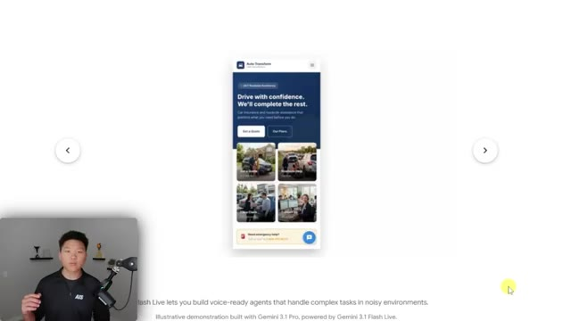
*⏱️ 00:01:39 — Interface web mobile d'une application d'assurance nommée "Auto Transform", utilisée comme démonstration d'un agent vocal IA.*

---

### ⏱️ `[00:01:56 - 00:02:14]` | Segment #05

**🔊 Audio (Transcription Intégrale Mot pour Mot en Français) :**
> And I'm gonna call out some of the benefits so we know that it's speech-to-speech We know that there is less latency and we know that it can work in noisy environments So there's the first one you might hear you know on the side of the road things like traffic things like horns I can look you up with your registration plate and postcode instead. Could you provide those for me, please?

**👁️ Analyse Visuelle d'Écran (gemini-3.5-flash-lite) :**
**Interface & Outils** : Application web/mobile de démonstration (Gemini 1.5 Flash Live).

**Contenu textuel & Code** : Texte de l'agent : "Hi I've blown a tyre and had to pull over to the side of the road Can you help", suivi de la réponse de l'agent "Ace" proposant une assistance immédiate.

**Action / Démonstration** : Démonstration visuelle du fonctionnement d'un agent vocal IA capable de gérer des situations d'urgence (assistance routière) dans un environnement contextuel.

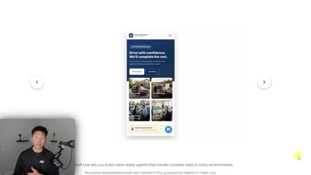
*⏱️ 00:02:00 — Interface mobile d'une application d'assurance automobile intitulée "Auto Transform", illustrant un cas d'usage de service d'assistance routière.*

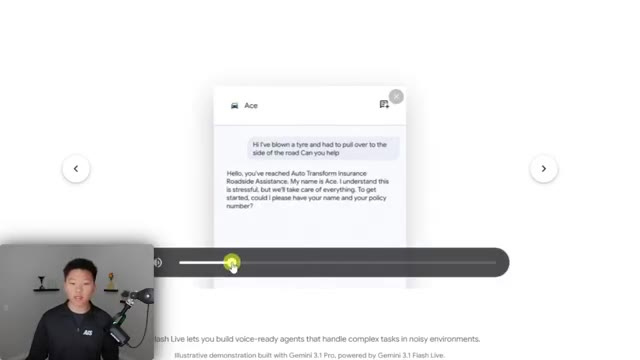
*⏱️ 00:02:05 — Interface de messagerie d'un agent IA nommé "Ace", affichant un échange textuel simulant une assistance en cas de pneu crevé.*

---

### ⏱️ `[00:02:15 - 00:02:50]` | Segment #06

**🔊 Audio (Transcription Intégrale Mot pour Mot en Français) :**
> Whoa And it's still able to be unfazed by stuff like that. It also has a higher level of accuracy when it comes to alphanumeric strings. And because it's interpreting speech rather than speech being transcribed into text, there's way more contextual awareness because the audio is coming through and it can understand things like sarcasm or stress or frustration, which is obviously very important if you're setting up something like a customer support bot or maybe like a sales type of agent. Now, because of the reasoning and thinking and the tool calling ability, there's also this cool demo here where this person is talking to Gemini 3.1 Flash and the talking leads to things

**👁️ Analyse Visuelle d'Écran (gemini-3.5-flash-lite) :**
**Interface & Outils** : Application de démonstration Gemini (Google AI Studio ou plateforme similaire).

**Contenu textuel & Code** : - Image 1 : Journal de conversation traitant des détails de véhicule (immatriculation BD21XYA, code postal SN48ZX, Mini Cooper F Series).
- Image 2 : Bloc de code source (syntaxe de type configuration ou interface utilisateur) et indicateur d'entrée vocale.

**Action / Démonstration** : - Image 1 : Démonstration de la capacité de l'IA à extraire des données alphanumériques complexes en temps réel dans une conversation.
- Image 2 : Illustration de la fonctionnalité "vibe code" permettant de transformer des commandes vocales en modifications de code source.

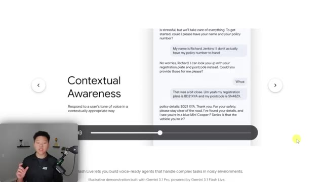
*⏱️ 00:02:24 — Interface interactive de démonstration illustrant la "Contextual Awareness" d'un agent conversationnel gérant une situation de sinistre automobile.*

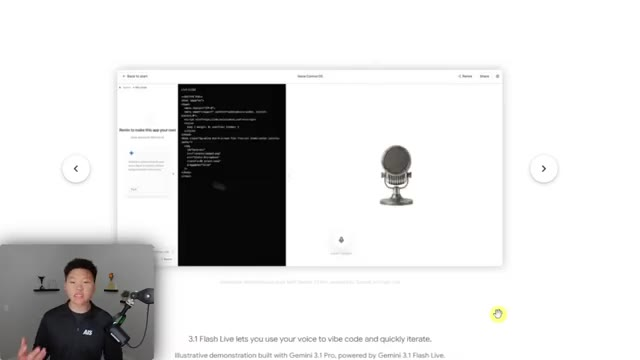
*⏱️ 00:02:41 — Interface de développement permettant de générer ou modifier du code via une entrée vocale, affichant un bloc de code et une icône de microphone.*

---

### ⏱️ `[00:02:50 - 00:03:22]` | Segment #07

**🔊 Audio (Transcription Intégrale Mot pour Mot en Français) :**
> actually happening. So in this case, they're basically vibe coding, which is their voice. They're saying to zoom in. They're saying to change the background. They're saying to do all these things. And on the side panel, the agent is actually coding as well. And I think it's really cool because I could definitely see a world where at some point our operating systems basically just work with voice. So if you want to try this out, you can do it for completely free. Just go to Google AI Studio and then come to the screen that looks like this. And all you have to do is in the top right, you just have to find the model. So by default, when you get in here, it might just be on all or whatever. You're going to go over here to live and then you're going to click on Gemini 3.1

**👁️ Analyse Visuelle d'Écran (gemini-3.5-flash-lite) :**
**Interface & Outils** : Interface "Live Code" (Gemini 3.1 Pro / Flash Live) et interface "Playground" de Google Gemini.

**Contenu textuel & Code** : Code source CSS/HTML dans l'image 1 ; menus de configuration système, sélection de modèles IA et paramètres vocaux dans l'image 2.

**Action / Démonstration** : "Vibe coding" : manipulation dynamique du code via commande vocale pour modifier l'apparence visuelle (fond, zoom) dans l'image 1 ; sélection et configuration d'agents IA dans l'image 2.

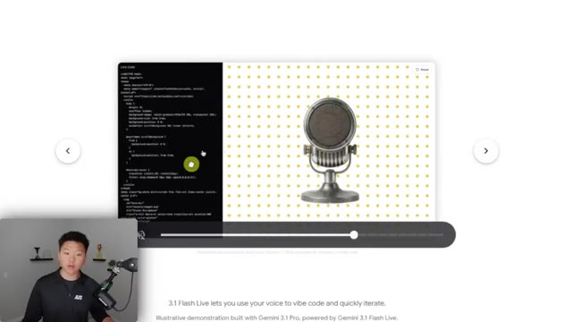
*⏱️ 00:02:58 — Une interface de démonstration "Live Code" montrant un éditeur de code sur la gauche et le rendu visuel d'un microphone sur un fond à pois sur la droite.*

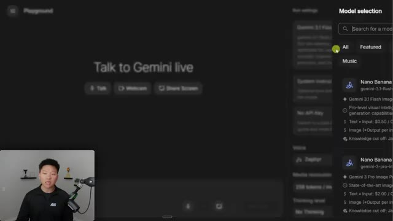
*⏱️ 00:03:14 — L'interface "Playground" de Google Gemini, affichant un menu latéral de sélection de modèles (Gemini 3.1 Flash / 3 Pro) et une zone centrale pour interagir vocalement avec l'IA.*

---

### ⏱️ `[00:03:22 - 00:03:58]` | Segment #08

**🔊 Audio (Transcription Intégrale Mot pour Mot en Français) :**
> Flash Live Preview. Now, yes, there are some prices down here, but you'll notice when I click on this, you can see that it says no API key. So that means I'm on a free plan right now. I've not given it any billing information and I could later switch to a paid API key to unlock higher quota and more features. But right now you can get in here and just play around with it for completely free. Now, the first thing I noticed when I started talking to this thing is that it is way quicker and that it actually lets you interrupt it. So a lot of times with other voice agents, you get into this awkward like game of chicken of like who's going to speak. Or if you try to interrupt it, you guys both sort of like say, oh, sorry, no, you go, you go. And it's just like weird. But in this case,

**👁️ Analyse Visuelle d'Écran (gemini-3.5-flash-lite) :**
**Interface & Outils** : Google AI Studio (Playground).

**Contenu textuel & Code** : Paramètres de run : modèle "Gemini 3.1 Flash Live Preview", champ "System instructions", état "No API Key", choix de voix ("Zephyr"), résolution média et niveau de réflexion ("No Thinking").

**Action / Démonstration** : Le curseur survole la section "No API Key" dans le panneau de configuration, illustrant l'absence de facturation active sur le compte.

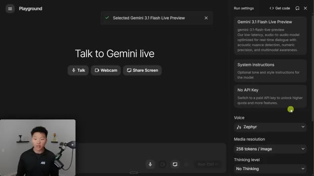
*⏱️ 00:03:31 — Interface du Google AI Studio affichant le mode "Playground" pour le modèle Gemini 3.1 Flash Live Preview, avec une barre latérale de configuration ouverte.*

---

### ⏱️ `[00:03:58 - 00:04:27]` | Segment #09

**🔊 Audio (Transcription Intégrale Mot pour Mot en Français) :**
> and I'll show you guys, when I start talking over it, it just stops like immediately and it feels a lot more human. So I'm basically just going to go ahead and just do the talk. Earlier, you guys saw that I could do a webcam or share screen, but for right now, I'm just going to go ahead and talk. Now it is listening to me right now. Hey, Gemini, how's it going? Can you hear me? Yes, I can hear you clearly. Things are going well here. Just ready to chat or help with whatever you need. How are you doing? Yeah, I mean, the voice sounds really good. The latency is good.

**👁️ Analyse Visuelle d'Écran (gemini-3.5-flash-lite) :**
**Interface & Outils** : Google AI Studio / Gemini Playground.

**Contenu textuel & Code** : Modèle sélectionné : "Gemini 3.1 Flash Live Preview". Paramètres : Voice (Zephyr), Media resolution (258 tokens/image), Thinking level (No Thinking).

**Action / Démonstration** : Le curseur survole le bouton "Talk" pour initier une session de conversation vocale en temps réel avec l'IA.

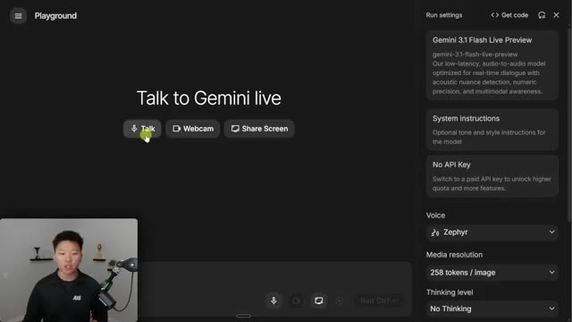
*⏱️ 00:04:06 — Interface du "Playground" de Google Gemini affichant les options d'interaction en direct (Talk, Webcam, Share Screen) avec un panneau latéral de configuration des paramètres du modèle.*

---

### ⏱️ `[00:04:28 - 00:05:01]` | Segment #10

**🔊 Audio (Transcription Intégrale Mot pour Mot en Français) :**
> Once again, how are you doing? I'm doing great. Actually, you know what? I don't really care about how you're doing, can you just tell me a little bit more about the voice model? Sure, I can tell you about it. Okay, so I was just a little rude, but basically what I was trying to show you is how fast it is, and when I interrupted it, how fast it stopped talking, which I think was really impressive. Now, what you can do in here in Google AI Studio is basically just build your own little voice agents right in here, because we're able to set up system instructions. So right here, we can create instructions, and we can save them. So let's say in this one, I'm calling this my

**👁️ Analyse Visuelle d'Écran (gemini-3.5-flash-lite) :**
**Interface & Outils** : Google AI Studio (Playground).

**Contenu textuel & Code** : Historique de chat textuel et audio entre l'utilisateur et le modèle, panneau latéral affichant "Gemini 3.1 Flash Live Preview", choix de la voix "Zephyr", résolution média et niveau de réflexion.

**Action / Démonstration** : Démonstration de la latence du modèle vocal en temps réel via l'interface de test.

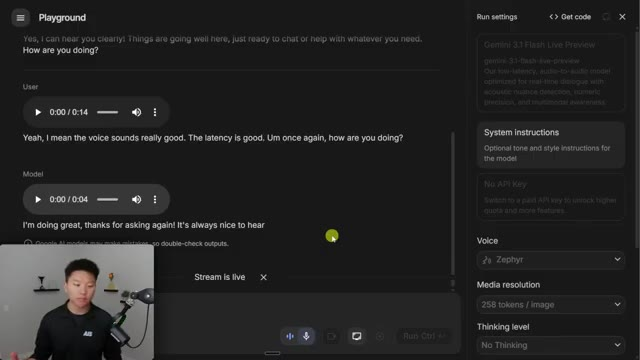
*⏱️ 00:04:37 — Interface du "Playground" de Google AI Studio montrant une conversation avec le modèle Gemini 3.1 Flash Live Preview et les paramètres de configuration sur la droite.*

---

### ⏱️ `[00:05:01 - 00:05:38]` | Segment #11

**🔊 Audio (Transcription Intégrale Mot pour Mot en Français) :**
> coach. And in here I can give it tone and style instructions. So I can say, you are my personal fitness coach. You will help me get on a plan to eat healthier, build muscle, stuff like that. And you also have a very strong Scottish accent. So that is the new prompt here. This has been saved and we can create new ones. And now if I go ahead and talk to my coach, let's hear it. Hey there. I'm thinking about taking a break from the gym for about three weeks what do you think about that three weeks eh well it depends on why you're taking the break

**👁️ Analyse Visuelle d'Écran (gemini-3.5-flash-lite) :**
**Interface & Outils** : Interface web Google Gemini (Playground).

**Contenu textuel & Code** : Champ de saisie "System instructions" avec le titre "Coach" et une zone de texte pour les instructions de ton et de style.

**Action / Démonstration** : Configuration des paramètres système de l'agent IA pour définir une personnalité spécifique (coach sportif avec accent écossais).

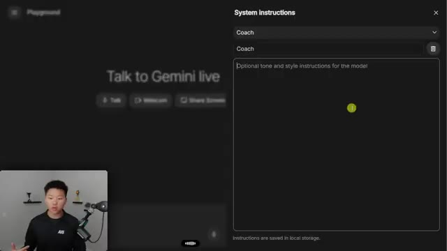
*⏱️ 00:05:11 — Interface du "Playground" de Gemini Live montrant le panneau latéral "System instructions" où l'utilisateur configure le rôle et le style de l'IA.*

---

### ⏱️ `[00:05:38 - 00:06:07]` | Segment #12

**🔊 Audio (Transcription Intégrale Mot pour Mot en Français) :**
> if it's for rest and recovery wow you got a pretty strong accent out of nowhere i will sometimes it just comes out stronger you can but back to your break what's the reason behind it are you feeling burned out or is there something else going on okay that was funny i just had to show you guys though um how you're able to really quickly change a lot of the stuff about these agents. But yeah, let me just go ahead and do one more webcam example. Hey, Gemini, how's it going?

**👁️ Analyse Visuelle d'Écran (gemini-3.5-flash-lite) :**
**Interface & Outils** : Google AI Studio (Playground).

**Contenu textuel & Code** : Transcription de la conversation incluant la phrase "Wow. You got a pretty strong accent out of nowhere" et des paramètres système configurés pour un "personal fitness coach" avec un accent écossais.

**Action / Démonstration** : Démonstration de l'interaction en temps réel entre l'utilisateur et l'agent IA vocal via le mode "Live" de Gemini.

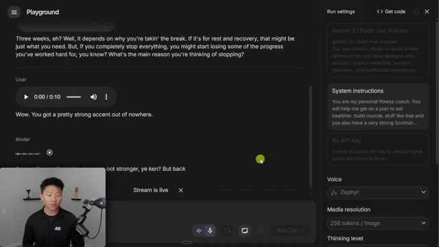
*⏱️ 00:05:45 — Interface du Google AI Studio (Playground) montrant une interaction vocale avec le modèle Gemini 1.5 Flash Live Preview, avec le présentateur en médaillon en bas à gauche.*

---

### ⏱️ `[00:06:07 - 00:06:41]` | Segment #13

**🔊 Audio (Transcription Intégrale Mot pour Mot en Français) :**
> Just wanted to make sure you can see me and that we can have a conversation. I can see you. You're in a room with light gray walls, a shelf behind you with some trophies and a microphone in front of you. Everything looks good from my end. Ready to chat. What's on your mind? What kind of microphone do you think I have? That looks like a Shure MV7, probably connected to that road arm. Is that right? Yeah, that is. You can see right here, I've got the road and you can see right here, this is the Shure M7. Well, actually, I don't even know if this is an MV7, but

**👁️ Analyse Visuelle d'Écran (gemini-3.5-flash-lite) :**
**Interface & Outils** : Google AI Studio / Gemini Playground

**Contenu textuel & Code** : Transcription de la conversation audio : "Hey Gemini, how's it going? Just wanted to make sure you can see me and that we can have a conversation." suivie de la réponse du modèle confirmant la description de la pièce. Paramètres affichés : Modèle (Gemini 1.5 Flash Live Preview), Voix (Zephyr), Résolution (258 tokens/image).

**Action / Démonstration** : Démonstration de l'interaction multimodale en temps réel (vision et audio) avec le modèle Gemini via le Playground de Google.

*⏱️ 00:06:15 — Interface du "Playground" de Google Gemini affichant une interaction vidéo en temps réel. Une fenêtre centrale montre le flux vidéo du présentateur, tandis que le texte de la conversation est transcrit en dessous. Le panneau de droite détaille les paramètres du modèle, incluant "Gemini 1.5 Flash Live Preview" et la configuration vocale "Zephyr".*

---

### ⏱️ `[00:06:41 - 00:07:14]` | Segment #14

**🔊 Audio (Transcription Intégrale Mot pour Mot en Français) :**
> you probably know better than I do. Based on the design and the logo, it definitely looks like an MV7. I mean, I just think it's really cool because you think about like, okay, you know, there's still some flaws, but where is this headed? And where might we be able to at some point have like agents that we can talk to almost like it's a Zoom call and we can see them and they can talk to us and it's just way more real feeling and what other doors does that actually open and then with the whole screen sharing thing in vision think about like where we're also headed with computer use and the fact that now when the agent can actually take over

**👁️ Analyse Visuelle d'Écran (gemini-3.5-flash-lite) :**
**Interface & Outils** : Interface web Google AI Studio / Gemini Playground.

**Contenu textuel & Code** : Modèle : "Gemini 3.1 Flash Live Preview". Instructions système : "You are my personal fitness coach...". Paramètres : Voix "Zephyr", Media resolution "258 tokens / image".

**Action / Démonstration** : Configuration des paramètres système et de la voix pour une session interactive avec l'agent IA Gemini.

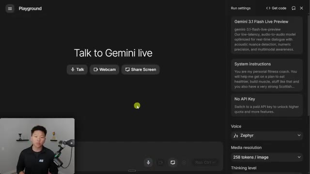
*⏱️ 00:06:49 — Interface du "Playground" de Google Gemini affichant l'option "Talk to Gemini live" avec des paramètres système configurés pour un coach sportif.*

---

### ⏱️ `[00:07:14 - 00:07:33]` | Segment #15

**🔊 Audio (Transcription Intégrale Mot pour Mot en Français) :**
> your screen and take control of your browser and click on things but it can also watch over you and you can talk to it at the same time like at some point we really might be able to just like throw out our keyboards throw out our mice and just be able to sit here look at our screens and talk and things will just be happening and happening. And like, you can be so productive in that way.

**👁️ Analyse Visuelle d'Écran (gemini-3.5-flash-lite) :**
**Interface & Outils** : Google AI Studio / Gemini Playground.

**Contenu textuel & Code** : Modèle sélectionné : "Gemini 3.1 Flash Live Preview". Instructions système : "You are my personal fitness coach...". Paramètres : Voix "Zephyr", résolution média "258 tokens / image".

**Action / Démonstration** : Démonstration de l'interface de contrôle permettant de configurer une interaction multimodale (audio/visuel) avec un agent IA.

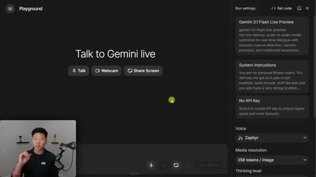
*⏱️ 00:07:19 — Interface du "Gemini Playground" permettant d'interagir en temps réel avec le modèle Gemini 3.1 Flash Live, avec des options pour activer le micro, la webcam ou le partage d'écran.*

---

### ⏱️ `[00:07:33 - 00:07:55]` | Segment #16

**🔊 Audio (Transcription Intégrale Mot pour Mot en Français) :**
> Now, there are some other things you can do in here. You can see you can change the voice. If I end the session, we can change the voice right here. There's different ones to choose from. You can change the media resolution and you can also change whether they are low, medium, high thinking or just no thinking at all, which is the default. You can also come in here and play with the session context. So there's a lot bigger max context as well as target context.

**👁️ Analyse Visuelle d'Écran (gemini-3.5-flash-lite) :**
**Interface & Outils** : Google AI Studio / Gemini Playground

**Contenu textuel & Code** : Menu déroulant de sélection de voix avec les caractéristiques tonales associées (ex: "Bright, Middle pitch" pour Autonoe).

**Action / Démonstration** : Navigation dans les paramètres de configuration du modèle pour modifier la voix de l'assistant.

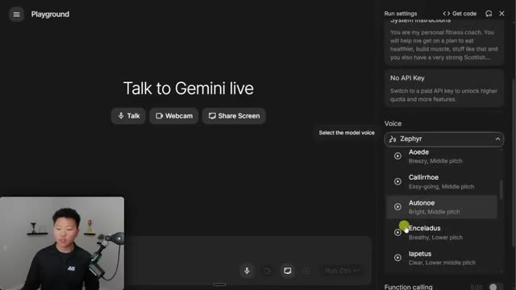
*⏱️ 00:07:39 — Interface du "Playground" Gemini Live affichant un panneau de configuration latéral permettant de sélectionner la voix de l'IA parmi une liste (Zephyr, Aoede, Callirrhoe, Autonoe, Enceladus, Iapetus).*

---

### ⏱️ `[00:07:55 - 00:08:28]` | Segment #17

**🔊 Audio (Transcription Intégrale Mot pour Mot en Français) :**
> And down here, you can see that we have a few other things. We have function calling which you can turn on you have automatic function response And then we also have grounding with google search, which means when you're talking to it It will do google search on the back end to answer your questions Now what you might notice in here is okay giving it tools giving it functions That's awesome because you might want it to do things in your calendar or you know Look at the emails or look at the support tickets or whatever it is And so if we go ahead and try to turn this on and we click on edit We can basically define different functions but we would have to give it those actual code snippets

**👁️ Analyse Visuelle d'Écran (gemini-3.5-flash-lite) :**
**Interface & Outils** : Google AI Studio / Gemini Playground (interface web).

**Contenu textuel & Code** : Paramètres de configuration : voix (Zephyr), résolution média, niveau de réflexion, et outils activables : Function calling, Automatic Function Response, et Grounding with Google Search.

**Action / Démonstration** : Le curseur de la souris survole l'option "Function calling" dans le panneau de droite pendant que le présentateur explique les fonctionnalités de l'outil.

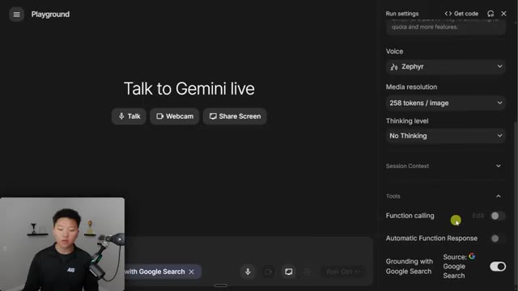
*⏱️ 00:08:03 — Interface du "Playground" de Gemini avec le panneau de configuration latérale affichant les options "Function calling" et "Grounding with Google Search".*

---

### ⏱️ `[00:08:28 - 00:08:53]` | Segment #18

**🔊 Audio (Transcription Intégrale Mot pour Mot en Français) :**
> or whatever it is. So if we go to the API documentation, for examples, this is where we could understand how we can actually give our voice agent here in Gemini hands, basically, tools. And that's where the Gemini Live API comes in because this lets us actually connect this voice model to different things like our websites or potentially even phone numbers and other things like that so that we're not just stuck to using it right here in Google AI Studio.

**👁️ Analyse Visuelle d'Écran (gemini-3.5-flash-lite) :**
**Interface & Outils** : Navigateur web affichant la documentation de Gemini API (developers.google.com).

**Contenu textuel & Code** : Extrait de code JSON définissant une fonction nommée "schedule_meeting" avec ses paramètres : "attendees", "date", "time" et "topic".

**Action / Démonstration** : Le présentateur illustre visuellement la méthode pour déclarer des outils (fonctions) qu'un agent IA peut utiliser via l'API.

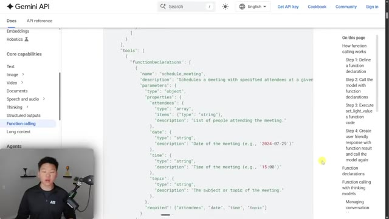
*⏱️ 00:08:34 — Capture d'écran de la documentation officielle de l'API Google Gemini montrant un exemple de structure JSON pour le "Function calling".*

---

### ⏱️ `[00:08:53 - 00:09:28]` | Segment #19

**🔊 Audio (Transcription Intégrale Mot pour Mot en Français) :**
> Now in here, you can see that it goes over some really nice use cases like e-commerce, you know, shopping assistance, even gaming, interactive NPCs, next-gen interfaces, healthcare, financial services, education. And something I think is really cool is multilingual support. So it has over 70 supported languages, which means not only could you talk to it in a different language, but this thing could be a really good real-time translator, which could be a very important use case. Now, all of this kind of stuff right here, the API documentation and, you know, the different SDKs or ADKs that you can actually use, this is where Cloud Code really comes in and makes this thing powerful. Because without Cloud Code or,

**👁️ Analyse Visuelle d'Écran (gemini-3.5-flash-lite) :**
**Interface & Outils** : Site web de la documentation Gemini API (Google).

**Contenu textuel & Code** : Liste détaillée des domaines d'application : e-commerce, gaming, interfaces de nouvelle génération, santé, services financiers et éducation, ainsi que la section "Key features" mentionnant le support multilingue.

**Action / Démonstration** : Présentation informative de la documentation pour illustrer les capacités et les cas d'usage de l'API.

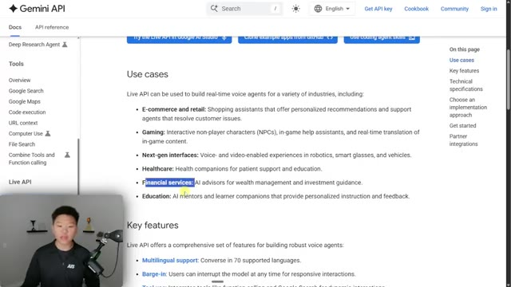
*⏱️ 00:09:02 — Capture d'écran de la documentation officielle de l'API Gemini présentant une liste de cas d'utilisation pour les agents vocaux en temps réel.*

---

### ⏱️ `[00:09:28 - 00:10:01]` | Segment #20

**🔊 Audio (Transcription Intégrale Mot pour Mot en Français) :**
> you know, a different type of coding assistant or, you know, agent, you're kind of stuck to using Gemini 3.1 Flash Live in Google AI Studio. And so if you wanted to connect it to something else, you would have to be pretty technical to understand how to do that because of the way that this thing actually works on the backend with WebSockets. Now, what I did is I gave my Cloud Code project all of the documentation and I had to do research and I had to figure out how this stuff works so that it could help me embed this into other things and it could help me set up tool calls and stuff like that. So let me show you two quick examples of what I was able to do

**👁️ Analyse Visuelle d'Écran (gemini-3.5-flash-lite) :**
**Interface & Outils** : Google AI Studio (Playground) et documentation officielle Google Gemini API.

**Contenu textuel & Code** : - Image 1 : Sélection du modèle "Gemini 3.1 Flash Live", configuration des instructions système pour un coach sportif, et choix de la voix "Zephyr".
- Image 2 : Spécifications techniques détaillant les modalités d'entrée/sortie, le protocole WebSocket, et les approches d'implémentation "Server-to-server" vs "Client-to-server".

**Action / Démonstration** : Présentation des contraintes techniques liées à l'utilisation de Gemini Live en dehors de l'interface par défaut, nécessitant une implémentation via WebSockets pour connecter l'agent.

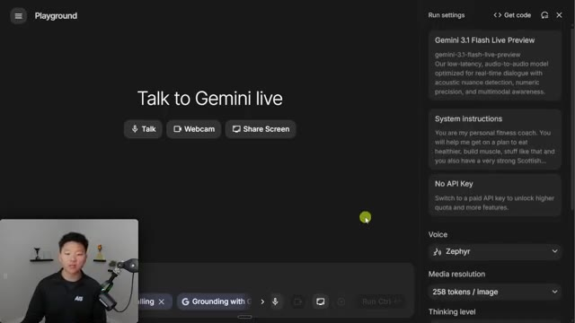
*⏱️ 00:09:36 — Interface Google AI Studio montrant le Playground de "Gemini Live" avec les paramètres du modèle Gemini 3.1 Flash Live.*

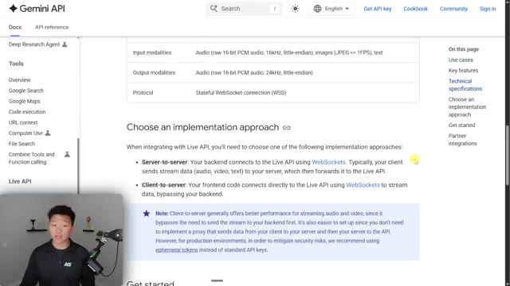
*⏱️ 00:09:45 — Documentation technique de l'API Gemini affichant les spécifications des WebSockets pour l'intégration de l'API Live.*

---

### ⏱️ `[00:10:01 - 00:10:36]` | Segment #21

**🔊 Audio (Transcription Intégrale Mot pour Mot en Français) :**
> with Cloud Code and this new model. Okay, so here's a first really simple example where we have this embedded into a fake website. This is called Apex. It's just like a keyboard website. Obviously, this thing looks very vibe coded and it is and I just wanted to do a really quick demo. So let's pretend that I wanted to embed this on my product website, right? I have this little button down here that I can now click on and I get a Gemini 3.1 Flash agent. So opens up. Hey, so can you tell me a little bit about Apex, like the brand and what I can do here? Welcome to Apex. We make premium

**👁️ Analyse Visuelle d'Écran (gemini-3.5-flash-lite) :**
**Interface & Outils** : Navigateur web affichant une application web type "vibe coded".

**Contenu textuel & Code** : Noms de produits (Apex 75% Mechanical, TKL Pro, Full-Size, 60% Compact), prix, listes de spécifications (ex: RGB backlight, hot-swappable switches), étiquettes de catégories (Best Seller, Premium, Portable).

**Action / Démonstration** : Démonstration de l'interface du site web généré par le modèle, avec le présentateur visible en incrustation dans le coin inférieur gauche.

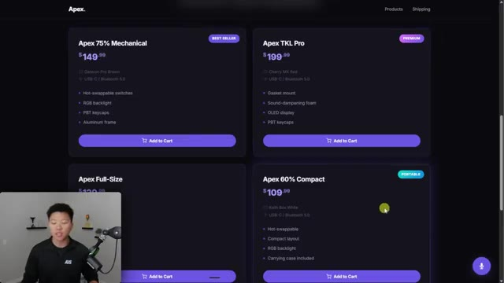
*⏱️ 00:10:10 — Une interface web sombre (site e-commerce "Apex") présentant une grille de modèles de claviers mécaniques avec prix, caractéristiques techniques et boutons d'ajout au panier.*

---

### ⏱️ `[00:10:36 - 00:11:11]` | Segment #22

**🔊 Audio (Transcription Intégrale Mot pour Mot en Français) :**
> mechanical keyboards with great switches, customizable features and durable builds. Okay, cool. So I don't really know that much about keyboards, but could you help me figure out which one might be best for me out of these four options? I'd love to help. To give you the best recommendation, are you looking for something for gaming, typing, or office work? No, I'm really just going to be working in my office, but I might be doing some traveling. For office work and travel? Actually, you know what? I'm just going to go with the 60% mode, but can you tell me about the shipping and how long is this going to take? Great choice. Free standard shipping takes five to

**👁️ Analyse Visuelle d'Écran (gemini-3.5-flash-lite) :**
**Interface & Outils** : Interface web (e-commerce).

**Contenu textuel & Code** : Détails des produits : Apex Full-Size (129,99 $), Apex 60% Compact (109,99 $), et deux autres modèles sans nom visible avec des prix de 149,99 $ et 199,99 $. Les caractéristiques listées incluent : Hot-swappable, RGB, PBT keycaps, Aluminum frame, Gasket mount, OLED display, etc.

**Action / Démonstration** : Présentation comparative des options de produits à l'utilisateur.

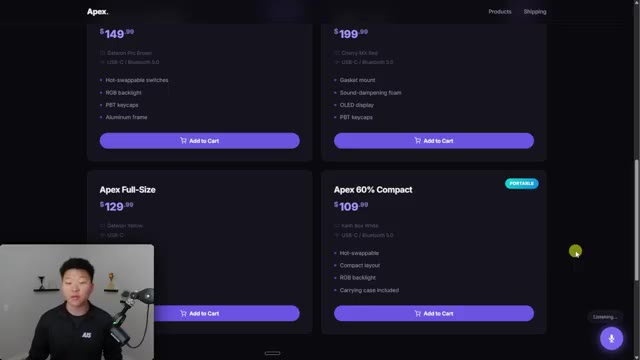
*⏱️ 00:10:45 — Une interface web de boutique en ligne nommée "Apex" présentant quatre modèles de claviers mécaniques avec leurs prix et spécifications techniques (switchs, connectivité, caractéristiques physiques).*

---

### ⏱️ `[00:11:11 - 00:11:30]` | Segment #23

**🔊 Audio (Transcription Intégrale Mot pour Mot en Français) :**
> seven business. Okay. So I was interrupting it there and I was just showing you that you can give it knowledge and that it feels super, super conversational. So the second example is Aria. And obviously this is, you know, a very ugly interface, but I just wanted to show you guys what you can do. So this one is one where I actually gave it tools.

**👁️ Analyse Visuelle d'Écran (gemini-3.5-flash-lite) :**
**Interface & Outils** : Navigateur web affichant une interface utilisateur (UI) de boutique en ligne.

**Contenu textuel & Code** : Texte promotionnel : "Type Different. Premium mechanical keyboards crafted for those who demand more." et bouton d'action "Shop Now".

**Action / Démonstration** : Présentation visuelle d'une interface utilisateur générée, illustrant le rendu final d'un projet web.

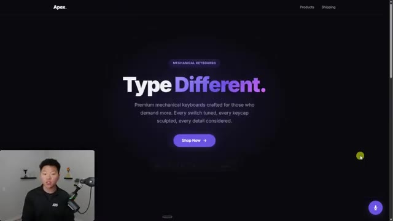
*⏱️ 00:11:16 — Une page d'accueil de site web e-commerce moderne pour une marque nommée "Apex", spécialisée dans les claviers mécaniques, avec un bouton "Shop Now" bien visible.*

---

### ⏱️ `[00:11:30 - 00:11:50]` | Segment #24

**🔊 Audio (Transcription Intégrale Mot pour Mot en Français) :**
> So it's able to look at my ClickUp and it's able to look at my calendar. So this is obviously just a few examples, but showing you how you can build some functions around this in case you wanted to have your agent do things rather than just be conversational. So I'm going to start talking to Aria. Hey there, how are you doing today? Hey, I'm doing pretty well.

**👁️ Analyse Visuelle d'Écran (gemini-3.5-flash-lite) :**
**Interface & Outils** : Interface web dédiée à l'agent vocal Aria.

**Contenu textuel & Code** : Titre "Aria — Voice Assistant", mention "Powered by Gemini 1.5 Flash Live", icône de micro, instruction "Click to start" et une zone de texte vide en attente d'interaction.

**Action / Démonstration** : Le présentateur s'apprête à interagir avec l'assistant vocal pour tester ses capacités d'intégration avec ClickUp et le calendrier.

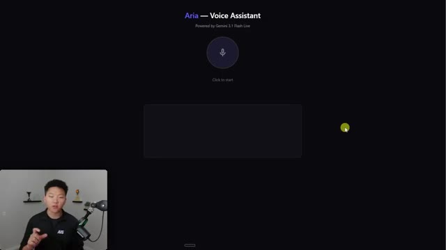
*⏱️ 00:11:35 — Interface épurée sur fond sombre présentant l'assistant vocal "Aria", propulsé par Gemini 1.5 Flash Live, avec un bouton central d'activation micro et une zone de chat vide.*

---

### ⏱️ `[00:11:50 - 00:12:24]` | Segment #25

**🔊 Audio (Transcription Intégrale Mot pour Mot en Français) :**
> Thanks for asking. Just here ready to help with whatever you need. Yeah. So the first thing I need you to do is can you look at my calendar for tomorrow? Sure thing. For tomorrow, Saturday, March 28th, you have two things scheduled. First, you've got a walk from 9am to 10am and then a meeting from 1230pm to 130pm. Anything you'd like to add or look into more about those? Yeah. Can you block off 3pm to 5pm and call it my research block? Done. I've added a research block to your calendar for tomorrow from 3pm to 5pm.

**👁️ Analyse Visuelle d'Écran (gemini-3.5-flash-lite) :**
**Interface & Outils** : Google Calendar, Assistant vocal "Aria" (Gemini 3.1 Flash Live).

**Contenu textuel & Code** : Détails de rendez-vous : "Walk" (9h-10h), "Meeting" (12h30-13h30). Texte de dialogue entre l'utilisateur et Aria confirmant ces horaires.

**Action / Démonstration** : Consultation et vérification du calendrier par l'assistant IA suite à la requête vocale de l'utilisateur.

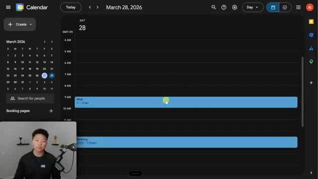
*⏱️ 00:11:58 — Interface Google Calendar montrant le planning du 28 mars 2026 avec deux événements ("Walk" et "Meeting").*

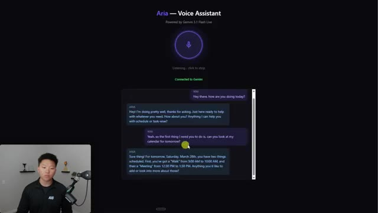
*⏱️ 00:12:07 — Interface de l'assistant vocal "Aria" (propulsé par Gemini 3.1 Flash Live) affichant une conversation textuelle reprenant les détails du calendrier.*

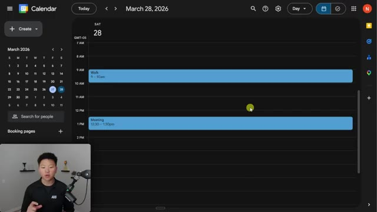
*⏱️ 00:12:15 — Interface Google Calendar revenant à l'affichage du planning journalier avec le focus sur les événements.*

---

### ⏱️ `[00:12:24 - 00:12:44]` | Segment #26

**🔊 Audio (Transcription Intégrale Mot pour Mot en Français) :**
> Anything else? Awesome, yeah. So for that research block, if you could go into my ClickUp and look up my research queue and see anything that I currently have to do. And also if you could go ahead and add another to-do in here called Microsoft. I can definitely do that. First, I need to navigate to your lists.

**👁️ Analyse Visuelle d'Écran (gemini-3.5-flash-lite) :**
**Interface & Outils** : ClickUp (application web/bureau).

**Contenu textuel & Code** : La liste "Research Queue" affiche deux sections : "COMPLETE" (tâches Perplexity AI, Anthropic, Nvidia, Lovable) et "TO DO" (tâche Chipotle).

**Action / Démonstration** : L'utilisateur visualise la file d'attente de recherche dans ClickUp avant de demander à l'agent IA d'ajouter une nouvelle tâche pour "Microsoft".

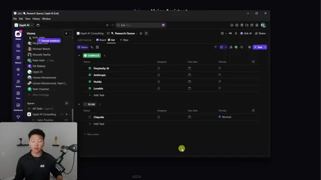
*⏱️ 00:12:29 — Une capture d'écran montrant l'interface du logiciel de gestion de projet ClickUp, affichant une liste de tâches intitulée "Research Queue".*

---

### ⏱️ `[00:12:44 - 00:13:04]` | Segment #27

**🔊 Audio (Transcription Intégrale Mot pour Mot en Français) :**
> Which workspace should I check? Up at AI or RootRise Media? Yeah, the Up at AI space. And it will be in an Up at AI consulting space. You're looking for a research queue. All right, I've got it. In your up at AI consulting space, I found the research queue list. Currently you have one task in there called Chipotle.

**👁️ Analyse Visuelle d'Écran (gemini-3.5-flash-lite) :**
**Interface & Outils** : Application de gestion de projet ClickUp (interface web/desktop).

**Contenu textuel & Code** : On peut voir deux sections : une section « COMPLETE » contenant les tâches Perplexity AI, Anthropic, Nvidia et Lovable, et une section « TO DO » contenant une seule tâche nommée « Chipotle » avec une priorité définie sur « Normal ».

**Action / Démonstration** : Navigation dans l'arborescence des dossiers et listes de ClickUp pour localiser et afficher le contenu de la file d'attente de recherche (Research Queue).

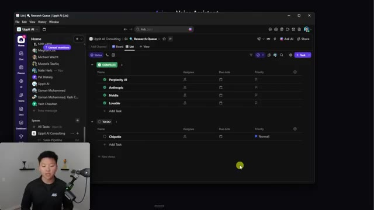
*⏱️ 00:12:49 — Une capture d'écran montrant l'interface ClickUp avec la liste « Research Queue » ouverte dans l'espace « Uppit AI Consulting ».*

---

### ⏱️ `[00:13:05 - 00:13:31]` | Segment #28

**🔊 Audio (Transcription Intégrale Mot pour Mot en Français) :**
> I've also gone ahead and added a new task named Microsoft to that list. Anything else? Okay. So I went ahead and stopped that. And I just wanted to show you guys that that works, right? But what you will notice is that there was pauses while it was actually calling those functions. And that is a current limitation of this model. A lot of times what you want to do with voice agents is you want to have them keep talking as they are calling a function because they call the function and they have to wait for the response, right?

**👁️ Analyse Visuelle d'Écran (gemini-3.5-flash-lite) :**
**Interface & Outils** : Application web "Aria - Voice Assistant" (powered by Gemini 1.5 Flash Live).

**Contenu textuel & Code** : Historique de discussion montrant l'utilisateur demandant d'ajouter "Microsoft" à sa liste de tâches et la confirmation de l'assistant Aria indiquant qu'il a trouvé la liste "Research Queue" et effectué l'ajout.

**Action / Démonstration** : Démonstration du fonctionnement de l'agent conversationnel qui exécute des tâches de gestion de liste via une interface de dialogue.

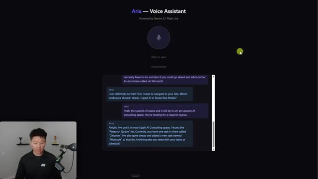
*⏱️ 00:13:11 — Une interface de chatbot vocal nommée "Aria" affichant une conversation textuelle où l'IA confirme l'ajout de la tâche "Microsoft" dans une liste de tâches spécifique.*

---

### ⏱️ `[00:13:31 - 00:13:54]` | Segment #29

**🔊 Audio (Transcription Intégrale Mot pour Mot en Français) :**
> And you can usually prompt them and have them working out so that they talk. So there's not awkward silences. But right now with this Gemini 3.1 flash live, it doesn't do that. And I think that's just a matter of time until obviously it can, but it's basically like you've got your asynchronous or synchronous. So that is one thing that you will need to keep in mind right now with this model is that when you call a function, the agent will not be speaking.

**👁️ Analyse Visuelle d'Écran (gemini-3.5-flash-lite) :**
**Interface & Outils** : Application web d'assistance vocale ("Aria").

**Contenu textuel & Code** : Texte affiché : "Aria — Voice Assistant", "Powered by Gemini 1.5 Flash Live", "Click to start", et une zone de texte vide en dessous.

**Action / Démonstration** : Interface en attente d'interaction utilisateur (clic sur le bouton micro) pour activer la session vocale.

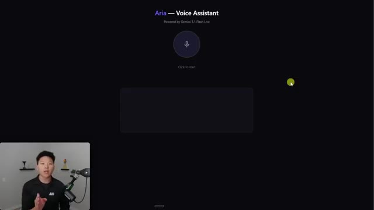
*⏱️ 00:13:37 — Interface web minimaliste d'un assistant vocal nommé "Aria" propulsé par Gemini 1.5 Flash Live, avec un bouton de microphone central invitant à cliquer pour démarrer.*

---

### ⏱️ `[00:13:54 - 00:14:19]` | Segment #30

**🔊 Audio (Transcription Intégrale Mot pour Mot en Français) :**
> It's just gonna stop and it's gonna wait till it gets a response. And also keep in mind that both of these sites and integrations were made in under 30 minutes with me just spinning up two different cloud sessions and saying, hey, in this one, I want you to build me this use case. And in this one, I want you to build me this use case. Here are my API keys. Have at it. The point is, once you actually sit down and you give it a structured plan and you iterate and iterate with cloud code, you can get way better outputs than this.

**👁️ Analyse Visuelle d'Écran (gemini-3.5-flash-lite) :**
**Interface & Outils** : Navigateur web affichant une landing page e-commerce moderne au design sombre (dark mode).

**Contenu textuel & Code** : Titre "Type Different", sous-titre descriptif, bouton d'appel à l'action "Shop Now", et une icône de microphone/assistant vocal en bas à droite.

**Action / Démonstration** : Présentation visuelle du résultat final de l'application web générée par l'IA, illustrant la rapidité de création mentionnée dans le segment audio.

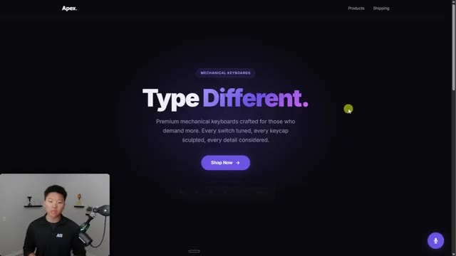
*⏱️ 00:14:00 — Interface web d'un site e-commerce nommé "Apex" spécialisé dans les claviers mécaniques, présentée comme un exemple de projet généré par une IA.*

---

### ⏱️ `[00:14:19 - 00:14:52]` | Segment #31

**🔊 Audio (Transcription Intégrale Mot pour Mot en Français) :**
> So this is the project that I created just to spin up a few demos, right? And what I did basically is I opened up a fresh project of cloud code. I threw in the documentation like you know this api documentation this one the function calling I gave it all this this information and then I just said hey I want you to analyze all this and what you even could do is say hey create a resource guide in this folder called you know gemini flash.md and just store all of this information so later you can reference it and then from there I just started asking it questions how does this work what can you do what should we do as a demo and

**👁️ Analyse Visuelle d'Écran (gemini-3.5-flash-lite) :**
**Interface & Outils** : - Image #1 : Navigateur web (Documentation Google Gemini API).
- Image #2 : Éditeur de code Visual Studio Code avec interface Claude Code intégrée.

**Contenu textuel & Code** : - Image #1 : Détails techniques du modèle Gemini 3.1 Flash, incluant ses capacités multimodales.
- Image #2 : Invite de commande ("Tell Claude to remember what you've told it using CLAUDE.md") et champ de saisie pour interaction avec l'agent.

**Action / Démonstration** : - Image #1 : Consultation de la documentation pour préparer le projet.
- Image #2 : Initialisation d'un espace de travail dans VS Code pour automatiser un flux de travail avec Claude Code.

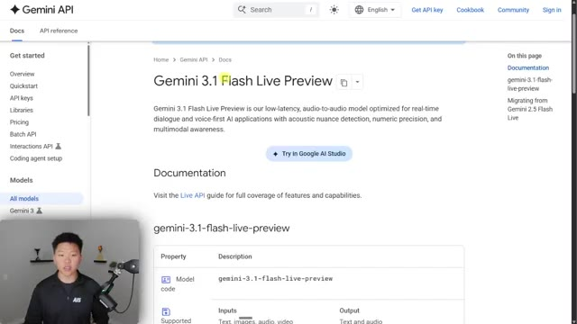
*⏱️ 00:14:27 — Page de documentation officielle de l'API Google Gemini présentant le modèle "Gemini 3.1 Flash Live Preview".*

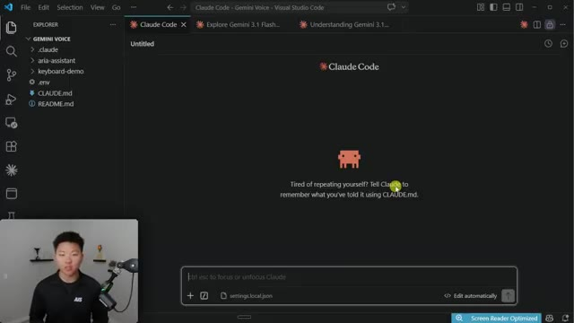
*⏱️ 00:14:35 — Interface de l'éditeur Visual Studio Code affichant l'extension "Claude Code" prête à recevoir des instructions.*

---

### ⏱️ `[00:14:52 - 00:15:27]` | Segment #32

**🔊 Audio (Transcription Intégrale Mot pour Mot en Français) :**
> then it was able to help me come up with these two use cases that are kind of different and you can see that everything has been organized into this project. So what I'm going to do is drop this exact folder, this whole project into my free school community. The link for that is down in the description. It's completely free. So you guys can grab this and just kind of analyze it and ask questions about it. Now, along with that, I'll also attach a resource guide that basically says, Hey, here's what the project does. Here's all the things you need to know about it. Here's where to find the things and stuff like that. Really the best way to learn is just to get your hands dirty and to ask a ton of questions. Now that we're in here though, there are a few things that I wanted to tell you guys about. The first one is kind of about the pricing. So yes, it is free. But what

**👁️ Analyse Visuelle d'Écran (gemini-3.5-flash-lite) :**
**Interface & Outils** : Visual Studio Code (VS Code) avec l'extension ou l'intégration Claude Code.

**Contenu textuel & Code** : Arborescence de fichiers ("GEMINI VOICE", ".claude", "aria-assistant", "keyboard-demo", ".env", "CLAUDE.md", "README.md") et une invite de commande centrale affichant "ctrl esc to focus or unfocus Claude".

**Action / Démonstration** : Le présentateur illustre l'organisation du projet dans VS Code, prêt à être partagé avec sa communauté.

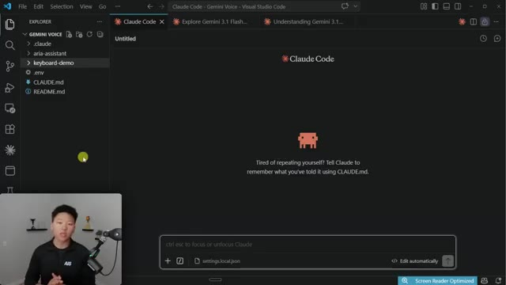
*⏱️ 00:15:00 — Une capture d'écran de l'éditeur Visual Studio Code montrant l'arborescence d'un projet nommé "GEMINI VOICE" avec les fichiers associés (CLAUDE.md, README.md) et l'interface de Claude Code au centre.*

---

### ⏱️ `[00:15:27 - 00:16:04]` | Segment #33

**🔊 Audio (Transcription Intégrale Mot pour Mot en Français) :**
> you'll notice is that if we're in the studio, you can see that it says switch to a paid API key to unlock higher quota and more features. So what does that actually mean? So here's what that pricing could look like once you start paying. It's still really, really cheap, which is great. But what's the difference? So obviously it's free or it's paper token, but on the free tier, your data is used by Google to improve the products. On the paid tier, it's not. So you're getting enterprise grade privacy. Your rate limits on the free tier are much lower. I think you can only have like three active sessions going or something like that. You get obviously way more flexibility here if you are paying. You also get things like context caching and batch API. So what does all that

**👁️ Analyse Visuelle d'Écran (gemini-3.5-flash-lite) :**
**Interface & Outils** : Visual Studio Code (avec Claude Code actif).

**Contenu textuel & Code** : Tableau comparatif des coûts par million de tokens pour les entrées/sorties texte et audio (ex: $0.75 pour le texte, $3.00 pour l'audio input), et section sur les différences entre les niveaux gratuit et payant.

**Action / Démonstration** : Présentation informative des données de tarification de l'API Google Gemini au sein de l'IDE.

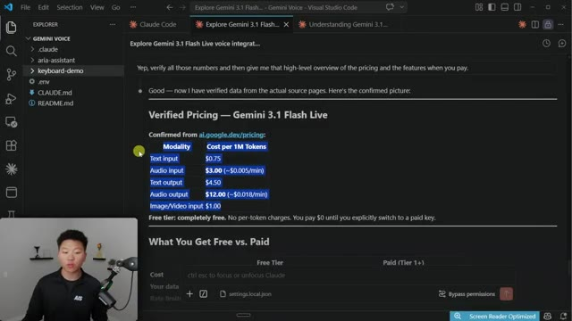
*⏱️ 00:15:36 — L'éditeur Visual Studio Code affichant un document Markdown détaillant la structure tarifaire de Gemini 3.1 Flash Live.*

---

### ⏱️ `[00:16:04 - 00:16:41]` | Segment #34

**🔊 Audio (Transcription Intégrale Mot pour Mot en Français) :**
> pricing and token stuff mean practically? So for a 10 minute call, you're roughly going to be paying maybe about 14 cents. You have a different charge for your input tokens and a different charge for your output tokens. But of course, if you're just playing around and you're testing things, definitely just stay on the free tier. Now I will be honest using a platform like 11 labs or something else like that makes it so much easier to actually just embed a widget on a website because 11 lab server basically manages all of that and just puts it onto your site. So both of these two demos right here are local hosts and they're local hosts because it's really easy for me to then just connect the web socket with Gemini to my machine and it all talks to each other really

**👁️ Analyse Visuelle d'Écran (gemini-3.5-flash-lite) :**
**Interface & Outils** : Visual Studio Code (utilisé pour la documentation technique)

**Contenu textuel & Code** : Texte Markdown détaillant une estimation de coût : "Audio input: 10 min x $0.005 = $0.05", "Audio output: 5 min x $0.018 = $0.09", "Simple estimate: ~$0.14 per 10-minute call".

**Action / Démonstration** : Le créateur présente une analyse détaillée des coûts opérationnels de l'intégration de Gemini 3.1 Flash, illustrée par des calculs mathématiques affichés dans son environnement de développement.

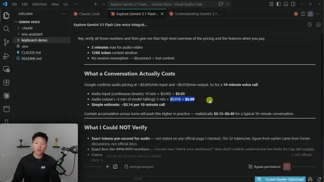
*⏱️ 00:16:13 — Une capture d'écran de l'éditeur Visual Studio Code affichant un document Markdown détaillant le coût des appels vocaux avec l'API Gemini 3.1 Flash.*

---

### ⏱️ `[00:16:41 - 00:17:18]` | Segment #35

**🔊 Audio (Transcription Intégrale Mot pour Mot en Français) :**
> nice and it works. So if I wanted to then push this website to for sell or, you know, somewhere live, or if I already have a website that is live and I wanted to push, you know, this little widget onto that site, it's not just super, super simple, the same way that it would be with something like 11 labs. It's still doable and cloud code will definitely be able to get you there. If you give it the right planning information and you know, you give it the right documentation, but I will just say it's not as simple. It's not one click of a button the same way that 11 labs is. So that is what I wanted to end off this video talking about. So like we just talked about, 11labs basically handles everything. They host everything and it makes that persistent WebSocket connection easier

**👁️ Analyse Visuelle d'Écran (gemini-3.5-flash-lite) :**
**Interface & Outils** : - Image 1 : Navigateur web (site vitrine "Apex").
- Image 2 : Visual Studio Code (VS Code).

**Contenu textuel & Code** : - Image 1 : Page d'accueil du site "Apex" avec bouton "Shop Now" et icône de micro (widget).
- Image 2 : Texte explicatif sur les limitations de Vercel (timeout 10-30s, pas de support WebSocket persistant) et un tableau comparatif des solutions alternatives (Railway, Render, Fly.io, VPS).

**Action / Démonstration** : - Image 1 : Démonstration visuelle du résultat final (site live avec widget intégré).
- Image 2 : Analyse technique du code/architecture par l'IA dans l'éditeur pour expliquer les contraintes de déploiement en production.

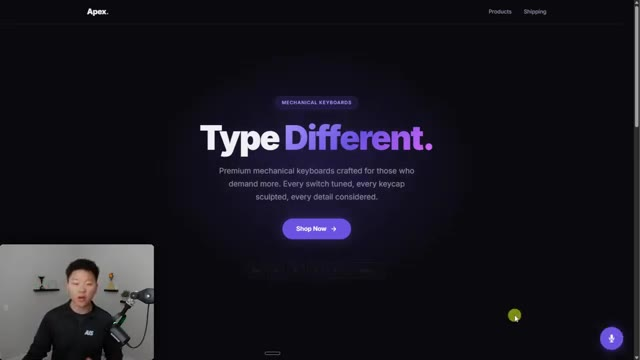
*⏱️ 00:16:50 — Interface web d'un site e-commerce "Apex" pour des claviers mécaniques avec un widget vocal en bas à droite.*

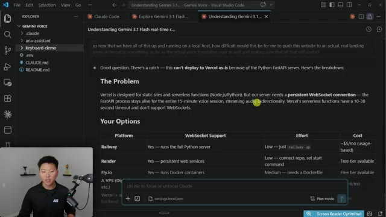
*⏱️ 00:17:09 — Éditeur VS Code affichant une explication technique sur les défis du déploiement d'un serveur WebSocket sur Vercel.*

---

### ⏱️ `[00:17:18 - 00:17:55]` | Segment #36

**🔊 Audio (Transcription Intégrale Mot pour Mot en Français) :**
> so you could basically just embed it anywhere. But with Gemini Live, it requires a persistent server process. And this isn't stuff I understood, right? This is stuff that I had at CloudCode research for me based on all the documentation and figuring out how it works. So that's really the mindset shift here is a lot of things you're not going to understand and you need to understand them enough to understand how do you communicate things and what do you need to look into and how do you make things safe but when i'm teaching myself things i just have clawed code or perplexity or some ai research it i prompt them in a way to make sure that it's not hallucinating i always you know am fact checking things as well but you just adopt this mindset of being genuinely curious and

**👁️ Analyse Visuelle d'Écran (gemini-3.5-flash-lite) :**
**Interface & Outils** : Visual Studio Code (VS Code).

**Contenu textuel & Code** : Documentation Markdown expliquant les limitations de Gemini Live (pas d'auth sécurisée côté client, SDK Python uniquement, nécessité d'un WebSocket persistant) face à ElevenLabs, avec un tableau comparatif final des compromis.

**Action / Démonstration** : Le présentateur illustre ses propos en affichant une analyse comparative technique générée par son outil d'assistance IA au sein de son éditeur de code.

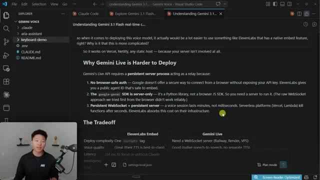
*⏱️ 00:17:27 — Une vue de l'éditeur VS Code montrant un fichier Markdown qui compare la complexité de déploiement entre ElevenLabs et Gemini Live, expliquant pourquoi ce dernier nécessite un serveur persistant.*

---

### ⏱️ `[00:17:55 - 00:18:27]` | Segment #37

**🔊 Audio (Transcription Intégrale Mot pour Mot en Français) :**
> that's how you can push this stuff a lot farther so basically the point that i'm trying to communicate here is gemini's 3.1 flash model is awesome and if you come into the playground in the studio, you can do a lot of cool stuff here with it. If you want to start to think about how you can embed it somewhere else or, you know, customize your own tools and stuff, Cloud Code helps you get there way faster, way easier with natural language. And then finally, if you want to push this all onto like a live production phone number or a live production website, Cloud Code, once again, will get you there. But you do have to go back and forth a little bit more, and you have to be thinking about how you actually transfer over things like your keys

**👁️ Analyse Visuelle d'Écran (gemini-3.5-flash-lite) :**
**Interface & Outils** : Google AI Studio (Playground)

**Contenu textuel & Code** : Panneau de configuration affichant "System instructions" (rôle de coach fitness), choix de la voix ("Zephyr"), réglage de résolution, et niveau de réflexion ("No Thinking").

**Action / Démonstration** : Configuration des paramètres système et des préférences de sortie pour une session interactive avec le modèle Gemini.

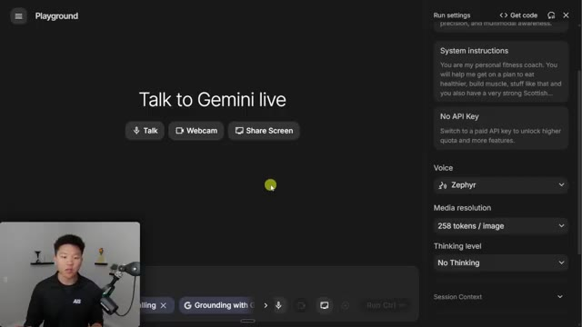
*⏱️ 00:18:03 — Interface du "Playground" de Google AI Studio configurée pour interagir avec le modèle Gemini en mode "Live", avec un panneau latéral de paramètres système et de configuration vocale.*

---

### ⏱️ `[00:18:27 - 00:18:41]` | Segment #38

**🔊 Audio (Transcription Intégrale Mot pour Mot en Français) :**
> and your connections and a few things like that. But anyways, that is going to do it for today's video. So if you guys learned something new or if you enjoyed, please give it a like. It helps me out a ton. And as always, I appreciate you guys making it to the end of the video. I'll see you on the next one. Thanks everyone.

**👁️ Analyse Visuelle d'Écran (gemini-3.5-flash-lite) :**
**Interface & Outils** : Navigateur web (Blog Google The Keyword)

**Contenu textuel & Code** : Titre de l'article : "Gemini 3.1 Flash Live: Making audio AI more natural and reliable", avec mention des auteurs (Valeria Wu, Yifan Ding) et un bouton "Read AI-generated summary".

**Action / Démonstration** : Consultation de l'article officiel de Google annonçant la mise à jour du modèle Gemini.

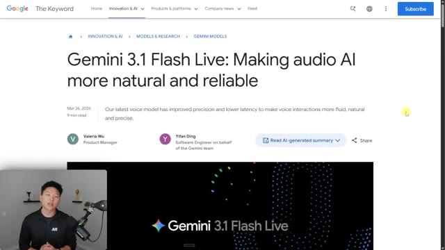
*⏱️ 00:18:31 — Capture d'écran montrant le blog "The Keyword" de Google présentant l'article sur Gemini 3.1 Flash Live, avec le présentateur en médaillon dans le coin inférieur gauche.*

---

