# 🎬 I’ve Built 500 AI Workflows, This is What Businesses Want in 2026

> **Chaîne** : [Nate Herk | AI Automation](https://www.youtube.com/@nateherk/featured)  
> **Lien YouTube** : [https://www.youtube.com/watch?v=Y3PcRp5RFzk](https://www.youtube.com/watch?v=Y3PcRp5RFzk)  
> **Date de publication** : 20260330  
> **Durée** : 00:14:50  
> **Identifiant vidéo** : `Y3PcRp5RFzk`  
> **Transcription & Analyse** : `whisper-v3-large-turbo+gemini-3.5-flash-lite`  

---

## 📌 Synthèse Exécutive & Outils

### 💡 Résumé
Dans cette vidéo intitulée **I’ve Built 500 AI Workflows, This is What Businesses Want in 2026**, Nate Herk décortique les capacités pratiques d'automatisation et de développement propulsées par les modèles de pointe.

### 🛠️ Outils, Modèles & Logiciels Présentés
- **Opus 5.5 & Claude Code** : Modèles d'ingénierie et agents de codage autonome.

### 🔑 Points Clés & Enseignements Stratégiques
- Optimiser le niveau d'effort et le raisonnement des modèles IA pour des résultats industriels.
- Automatiser les cycles de création logicielle de bout en bout.

---

## ⏱️ Chronologie & Transcription Complète Audio & Visuelle (Mot pour Mot)

### ⏱️ `[00:00:00 - 00:00:29]` | Segment #01

**🔊 Audio (Transcription Intégrale Mot pour Mot en Français) :**
> After building hundreds of AI workflows for real clients and teaching thousands to do the same, I noticed something weird, which is that most people online are building the fancy stuff, but businesses don't actually want that. They just want five types of automations, and these are simple, boring workflows. They're things that genuinely save time, save money, or remove mistakes. And these five automations are the ones that clients will pay the most for. So in this video, I'll show you what they are, why they sell, and how you can build and sell them too. But before we jump into the first one, let me show you how I figured all this out. I've worked with coaches, real estate agents, dentists, HVAC, e-commerce, and more.

**👁️ Analyse Visuelle d'Écran (gemini-3.5-flash-lite) :**
**Interface & Outils** : Zapier (outil d'automatisation no-code).

**Contenu textuel & Code** : Configuration du trigger : "New File in Folder in Dropbox".

**Action / Démonstration** : Paramétrage d'un déclencheur dans un workflow d'automatisation.

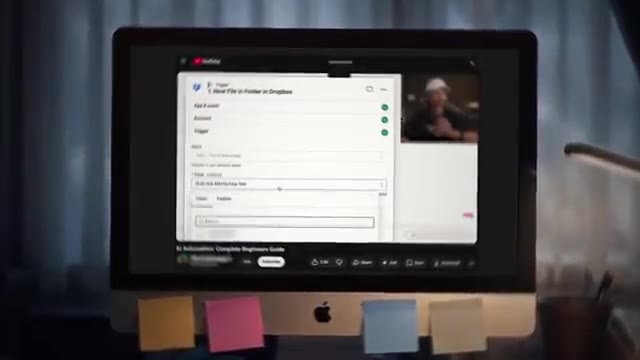
*⏱️ 00:00:07 — Une capture d'écran montrant l'interface de configuration d'un workflow Zapier, avec un déclencheur ("Trigger") défini sur "New File in Folder in Dropbox".*

---

### ⏱️ `[00:00:29 - 00:00:48]` | Segment #02

**🔊 Audio (Transcription Intégrale Mot pour Mot en Français) :**
> And I've seen the same patterns across every business. They're different industries, yes, but they have the same problems. And these workflows keep showing up again and again. So if you're watching this and you wanna make money selling AI in 2026, don't overthink it. Just start with what businesses are actually paying for, what the data is showing. So let's get into the first workflow. So this one is speed to lead. And honestly, it might be the single easiest automation to sell to any service-based business.

**👁️ Analyse Visuelle d'Écran (gemini-3.5-flash-lite) :**
**Interface & Outils** : Plateforme de workflow automatisé (type Make ou n8n).

**Contenu textuel & Code** : Diagramme de flux comprenant le nœud "When chat message received", l'agent central "Dink Agent", et les sorties "v/c Dink Chat Model" et "Message a model in Perplexity".

**Action / Démonstration** : Visualisation d'une architecture logique de pipeline d'automatisation d'agent IA.

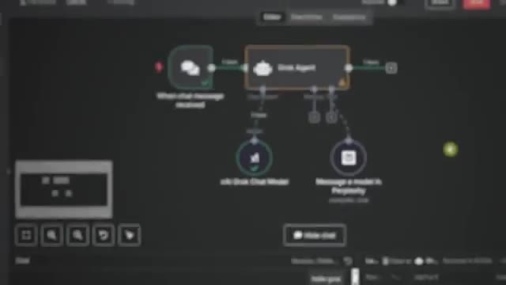
*⏱️ 00:00:33 — Interface de création de workflow type "no-code" montrant un agent IA central connecté à un déclencheur de message et deux modules de sortie.*

---

### ⏱️ `[00:00:48 - 00:01:23]` | Segment #03

**🔊 Audio (Transcription Intégrale Mot pour Mot en Français) :**
> So here's what it is. When someone fills out a form on a website, sends an inquiry, or calls a business, there's a clock that immediately starts ticking. And the faster that the business responds, the more likely they are to close that deal. Studies show if you respond to a lead within five minutes, you're up to 10 times more likely to convert them compared to responding even 30 minutes later. And yet, the average business takes 47 hours to respond to a new lead, which is two full days. By that point, the prospect has already talked to three of your competitors, forgotten they reached out to you, or maybe they've just solved the problem already themselves. So a speed to lead system fixes that gap completely. The moment someone submits a form, the automation kicks in, it captures the lead info, it qualifies them based on criteria like budget, location,

**👁️ Analyse Visuelle d'Écran (gemini-3.5-flash-lite) :**
**Interface & Outils** : Logiciel de montage/animation graphique (graphisme statique).

**Contenu textuel & Code** : Texte affiché : "Client", "Fills out a form", "Sends an inquiry", "Calls a business", "DEAL CLOSED", "Business".

**Action / Démonstration** : Visualisation schématique d'un processus commercial et d'une mesure de délai de réponse.

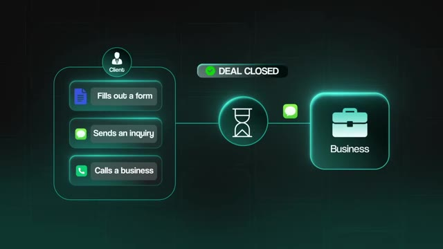
*⏱️ 00:00:57 — Schéma conceptuel illustrant le flux d'interaction entre un client et une entreprise, avec un sablier symbolisant le délai de réponse.*

---

### ⏱️ `[00:01:23 - 00:01:48]` | Segment #04

**🔊 Audio (Transcription Intégrale Mot pour Mot en Français) :**
> service type, whatever, and then it routes that lead to the right person on the team. And it also fires off a personalized follow-up message immediately. So all of this happens within seconds. So who actually pays for this? Service-based businesses. Dental clinics, law firms, home services companies like HVAC and plumbing, real estate agents, even marketing agencies. Basically, any business where a missed lead or slow response directly equals lost revenue. So basically every business. And the reason they pay so well for this is because the ROI is immediately obvious.

**👁️ Analyse Visuelle d'Écran (gemini-3.5-flash-lite) :**
**Interface & Outils** : Logiciel de création de diagrammes ou présentation (type Lucidchart, Miro ou Canva).

**Contenu textuel & Code** : Schéma logique : Client -> Formulaire -> IA (Budget/Lieu/Service) -> Membre d'équipe -> Suivi (Follow up).

**Action / Démonstration** : Représentation visuelle et schématique du processus d'automatisation des leads en temps réel.

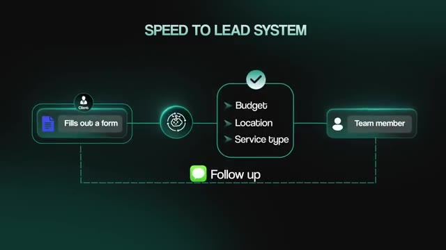
*⏱️ 00:01:29 — Schéma de workflow intitulé "SPEED TO LEAD SYSTEM" montrant le parcours d'un prospect : remplissage de formulaire, traitement par IA (budget, lieu, type de service), routage vers un membre de l'équipe et envoi d'un suivi automatisé.*

---

### ⏱️ `[00:01:48 - 00:02:22]` | Segment #05

**🔊 Audio (Transcription Intégrale Mot pour Mot en Français) :**
> You don't have to convince them of some theoretical AI agent future benefit that may or may not happen, you just show them the math. So let me give you a simple example. Let's say you're working with a local dental clinic. They're spending five grand a month on Google ads to drive new patient inquiries. And let's say they're getting 100 new leads a month from those ads. But because the front desk is busy, they're not getting back to people for hours, sometimes not even until the next day. Their close rate on those leads is 12%, which means out of 100 leads that come in, they're booking 12 of those as new patients. Now, you can build a speed delete system where every time someone fills out that appointment request form, the system instantly sends a personalized text and email, which confirms the inquiry, qualifies them based on the type of service they

**👁️ Analyse Visuelle d'Écran (gemini-3.5-flash-lite) :**
**Interface & Outils** : Logiciel de présentation graphique / Animation de workflow.

**Contenu textuel & Code** : Texte "SPEED TO LEAD - DENTAL CLINIC" et icône symbolisant un client remplissant un formulaire.

**Action / Démonstration** : Illustration du flux de travail d'un prospect (lead) dans un cabinet dentaire.

*⏱️ 00:02:05 — Une scène illustrant une réception de cabinet dentaire bondée, utilisée pour montrer la charge de travail humaine.*

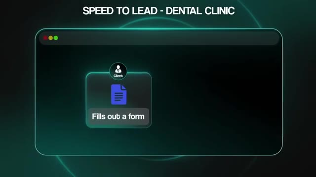
*⏱️ 00:02:13 — Schéma animé intitulé "SPEED TO LEAD - DENTAL CLINIC" montrant l'étape "Client fills out a form".*

---

### ⏱️ `[00:02:22 - 00:02:56]` | Segment #06

**🔊 Audio (Transcription Intégrale Mot pour Mot en Français) :**
> need, and it notifies the right person at the clinic right away with all the context that they need. So what you did there is you didn't change the ad spend, you didn't change the copy, you didn't change the offer, you just made the actual business faster. And let's say that close rate goes from 12% to 25%, which is conservative. So they're getting 13 extra patients a month for the exact same amount of ad spend. And the key is when you can walk a business owner through that exact math using their data, price objections will disappear. Because at that point, if they really think about it, the expensive decision is to ignore you and just not hire you. All right. So now that you understand that first one, the second one's going to make more sense. And this is probably the least exciting automation on the list, but it's also one of the most profitable.

**👁️ Analyse Visuelle d'Écran (gemini-3.5-flash-lite) :**
**Interface & Outils** : Aucune interface logicielle ou outil technique n'est affiché.

**Contenu textuel & Code** : Texte informatif (graphiques statistiques) en surimpression sur la vidéo du présentateur.

**Action / Démonstration** : Aucune action technique ou démonstration de flux de travail.

---

### ⏱️ `[00:02:56 - 00:03:32]` | Segment #07

**🔊 Audio (Transcription Intégrale Mot pour Mot en Français) :**
> And that is document processing. So first, let me just paint you a picture. Imagine you're an accountant and it's Monday morning. So you've got 200 invoices sitting on your inbox from last week and your job for the next several hours is to open each one, read it, pull out the vendor name, the amount, the date, the line items, and then just type all of that into a different software, categorize it, and then file it 200 times every single week. You have to do that. And that's not an exaggeration. That's the actual reality for a small accounting firm that I've worked with. 50 hours a week, basically a full-time employee's entire job, just moving numbers from PDFs into spreadsheets. So at $30 an hour, let's say that's $78,000 a year. So what you can do is build a workflow. Invoice systems can come in via email. The system extracts the vendor, the amount,

**👁️ Analyse Visuelle d'Écran (gemini-3.5-flash-lite) :**
**Interface & Outils** : Interface de gestion de documents (type portail cloud) et tableur (type Microsoft Excel ou Google Sheets).

**Contenu textuel & Code** : Liste de tâches (Read invoice, Vendor name, Amount, Date, Line items) et icônes graphiques représentant le transfert de données (PDF vers tableur).

**Action / Démonstration** : Simulation d'un flux de travail manuel de saisie de données : lecture d'une facture papier et saisie des informations dans un fichier numérique.

*⏱️ 00:03:05 — Vue par-dessus l'épaule d'un comptable travaillant sur un ordinateur portable, avec une interface de gestion de documents affichée à l'écran.*

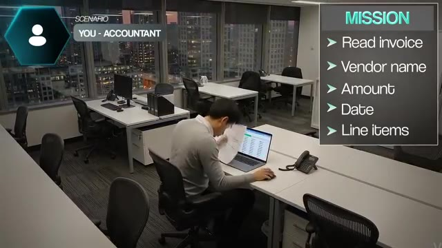
*⏱️ 00:03:14 — Vue large d'un bureau où une personne consulte une facture physique tout en travaillant sur un tableur (type Excel), accompagnée d'une liste de tâches de traitement de données.*

---

### ⏱️ `[00:03:32 - 00:04:04]` | Segment #08

**🔊 Audio (Transcription Intégrale Mot pour Mot en Français) :**
> the date, all of these other things that you need. It can also check it against a chart of accounts. It can flag anything unusual and then push all that clean data where it needs to go. This will cut processing times down from 15 minutes per invoice, let's just say, to something like two minutes because you still maybe want like a human review step at the end. And that would free up about 45 hours a week, which is over $70,000 in direct labor savings per year before you even factor in things like human errors because those cost the business money as well. And the cool thing about document processing automations is that a lot of times you don't even need AI for this. Some of the most valuable document workflows that I've ever built were purely rule-based. No

**👁️ Analyse Visuelle d'Écran (gemini-3.5-flash-lite) :**
**Interface & Outils** : Système d'exploitation avec interface de travail bureautique (écran de bureau).

**Contenu textuel & Code** : Texte affiché : "45 HOURS / WEEK" et "$55,152".

**Action / Démonstration** : Le présentateur illustre visuellement les coûts et le temps alloués aux processus manuels (facturation) avant automatisation.

*⏱️ 00:03:48 — Le présentateur est filmé de profil, assis à son bureau devant un écran d'ordinateur. Une superposition de texte indique "45 HOURS / WEEK" et "$55,152", illustrant une démonstration de données chiffrées sur le coût du travail.*

---

### ⏱️ `[00:04:04 - 00:04:36]` | Segment #09

**🔊 Audio (Transcription Intégrale Mot pour Mot en Français) :**
> LLMs, no fancy prompts, just clean logic that moves data from A to B without a human ever touching it. And when there's no AI involved, the system is completely deterministic. It runs the same way every time, it's rock solid logic, and it's basically maintenance free. And the reason this sells is simple. Manual document processing takes about 15 minutes per document, costs between 15 to $25 each, and has an error rate between 5 and 15%. And like I said earlier, every one of those errors actually costs real money to the business. So you automate that, you free up some time, you drop the cost, and the math does the selling for you. And unlike Speed to Lead, which is mostly service-based businesses, this one hits a completely different set of industries.

**👁️ Analyse Visuelle d'Écran (gemini-3.5-flash-lite) :**
**Interface & Outils** : Graphique de présentation (type schéma de flux de données).

**Contenu textuel & Code** : Texte affichant les métriques d'inefficacité d'un processus manuel : "Manual document processing", "15min per document", "$25 Each doc".

**Action / Démonstration** : Visualisation des points de douleur métier justifiant l'automatisation.

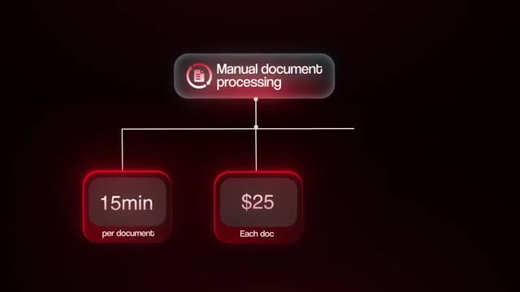
*⏱️ 00:04:20 — Un diagramme schématique sur fond sombre illustrant le coût du "Manual document processing" (15 min par document et 25 $ par document).*

---

### ⏱️ `[00:04:37 - 00:05:10]` | Segment #10

**🔊 Audio (Transcription Intégrale Mot pour Mot en Français) :**
> Insurance companies, law firms, accounting firms, logistics, construction, really anyone that's drowning in paperwork. If people in the business are spending hours every day just moving information between systems, then there's a deal waiting to be made. All right, so before I get into this next one, I need you to understand something. I'm about to cover two workflows back-to-back that sound pretty similar on the surface, which are follow-up sequences and database reactivation, but they solve different problems. Follow-up is about leads who just came in and need more touch points to actually convert, and reactivation is about leads that you forgot existed, you know, six months ago. They're two different situations, they're two different systems, but they are both extremely profitable. So pay attention to the distinction because it does

**👁️ Analyse Visuelle d'Écran (gemini-3.5-flash-lite) :**
**Interface & Outils** : Graphique animé de présentation (type présentation de type "slide").

**Contenu textuel & Code** : Texte affiché : "5 Types of Automations", "1", "2 Document process", "3 Follow up sequences", "4", "5".

**Action / Démonstration** : Transition visuelle présentant une liste structurée des types d'automatisations.

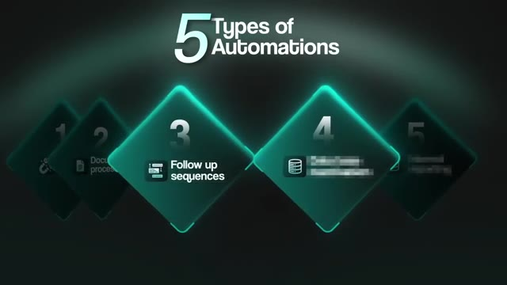
*⏱️ 00:04:53 — Une infographie stylisée intitulée "5 Types of Automations" présentant une liste numérotée sous forme de losanges lumineux, mettant en avant les catégories 3 ("Follow up sequences") et 4.*

---

### ⏱️ `[00:05:10 - 00:05:40]` | Segment #11

**🔊 Audio (Transcription Intégrale Mot pour Mot en Français) :**
> matter. All right, so follow up and nurture sequences first. This ties directly into speed elite because getting the lead fast is only half the battle. What happens after that first touch point is where businesses also once again drop the ball because most businesses spend a ton of money acquiring leads. They get someone interested. Maybe they fill out a form or book a call or attend a webinar or something like that. And then the business follows up with them once, maybe twice, and then they move on. Meanwhile, the prospect just needed one more touch point before they were ready to actually buy something. Research shows that 80% of sales require at least five follow ups, but most salespeople just stop after one or two. And here's the thing that kills me.

**👁️ Analyse Visuelle d'Écran (gemini-3.5-flash-lite) :**
**Interface & Outils** : Interface utilisateur graphique (superposition vidéo) affichant des boutons d'interaction standard (UI/UX).

**Contenu textuel & Code** : "FILL OUT FORM" et "BOOK CALL" (icônes associées : document et combiné téléphonique).

**Action / Démonstration** : Illustration visuelle du processus de conversion de leads ("nurture sequences") via des points d'interaction numérique.

*⏱️ 00:05:25 — Séquence vidéo illustrant un employé de bureau au téléphone, avec une superposition graphique de deux boutons d'action : "FILL OUT FORM" et "BOOK CALL".*

---

### ⏱️ `[00:05:40 - 00:05:59]` | Segment #12

**🔊 Audio (Transcription Intégrale Mot pour Mot en Français) :**
> that person has already raised their hand. They've already said, hey, Mr. or Mrs. Business, I am interested in what you're doing. And that first intent action is always the toughest part of the entire sales process. Because once someone has filled out a form or attended a webinar or had a conversation, they're now a warm lead. And converting a warm lead is exponentially easier and cheaper to convert than trying to convince a cold stranger to care.

**👁️ Analyse Visuelle d'Écran (gemini-3.5-flash-lite) :**
**Interface & Outils** : Diagramme de workflow (type interface de modélisation visuelle d'automatisation).

**Contenu textuel & Code** : Texte affichant "Client" et "Filled out the form" reliés par un connecteur logique.

**Action / Démonstration** : Représentation visuelle d'une étape de conversion dans un entonnoir de vente ou un workflow d'automatisation.

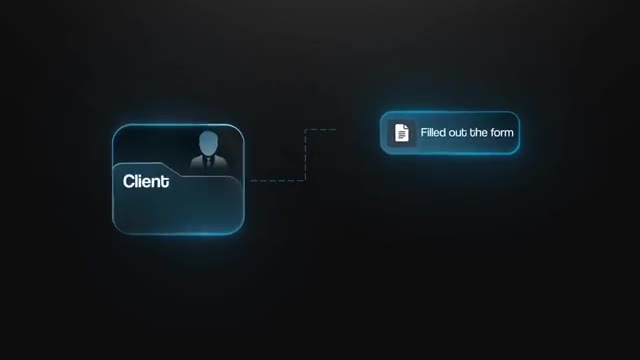
*⏱️ 00:05:49 — Diagramme de workflow épuré montrant une étape "Client" connectée à une action "Filled out the form".*

---

### ⏱️ `[00:05:59 - 00:06:19]` | Segment #13

**🔊 Audio (Transcription Intégrale Mot pour Mot en Français) :**
> And yet most businesses just let those warm leads go cold again because they don't follow up. So a follow-up automation can fix this. When a trigger event happens, the system will kick off a personalized sequence automatically every single time. And over time, you can layer on more intelligence. You can pull in CRM data. You can do real-time research, whatever it is. You can add more steps into this nurture sequence. And honestly, I would kind of fit this into the bucket of appointment setting.

**👁️ Analyse Visuelle d'Écran (gemini-3.5-flash-lite) :**
**Interface & Outils** : Diagramme de workflow conceptuel animé (interface graphique propriétaire).

**Contenu textuel & Code** : Texte affiché : "FOLLOW UP AUTOMATION", "TRIGGER", "PERSONALISED SEQUENCE", "ADD ON", "Intelligence", "CRM data", "Research".

**Action / Démonstration** : Illustration visuelle du déclenchement d'un événement (Trigger) suivie de l'ajout progressif de couches de données et d'intelligence au processus de suivi client.

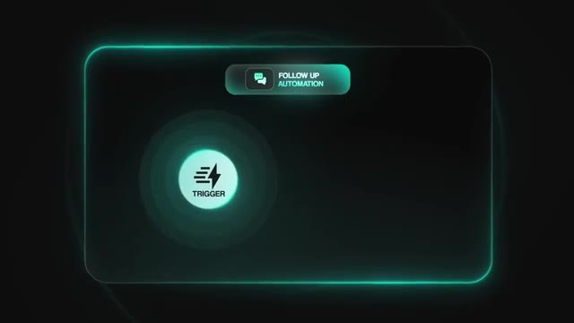
*⏱️ 00:06:04 — Un graphique animé stylisé sur fond sombre représentant l'étape initiale d'un système d'automatisation : un bouton "TRIGGER" émettant des ondes sous un encart intitulé "FOLLOW UP AUTOMATION".*

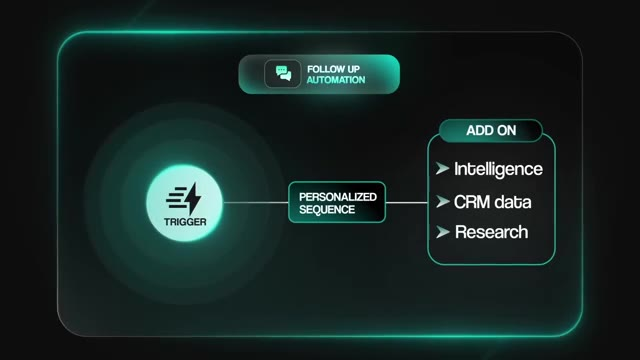
*⏱️ 00:06:14 — Le même graphique progressant pour montrer le flux de travail complet : le "TRIGGER" se connecte à une "PERSONALISED SEQUENCE", qui s'alimente ensuite via un bloc "ADD ON" comprenant "Intelligence", "CRM data" et "Research".*

---

### ⏱️ `[00:06:19 - 00:06:38]` | Segment #14

**🔊 Audio (Transcription Intégrale Mot pour Mot en Français) :**
> So think like an Instagram DM automation that will nurture people who followed your account and try to book them into a call with you. Now, I'm not gonna run through a full industry list again. I think you already understand the types of businesses that need this. You know, coaches, consultants, agencies, stuff like that. But the sweet spot specifically is a business that already have decent lead volume. And they know that they're not staying in front of people well enough.

**👁️ Analyse Visuelle d'Écran (gemini-3.5-flash-lite) :**
**Interface & Outils** : Aucune interface logicielle ou outil technique n'est affiché.

**Contenu textuel & Code** : Aucun code, commande ou donnée n'est présent à l'écran.

**Action / Démonstration** : Aucune action technique ou démonstration de workflow n'est montrée ; il s'agit d'un plan de présentation classique.

---

### ⏱️ `[00:06:38 - 00:06:58]` | Segment #15

**🔊 Audio (Transcription Intégrale Mot pour Mot en Français) :**
> because obviously you can't follow up with leads or reactivate leads if their bottleneck in the first place is getting leads. But here's a simple example. So let's say a B2B consulting firm runs monthly webinars. 150 registrants, 60 show up. Before automation, someone is manually sending follow-up emails and trying to book those calls. And this could take two to three days because the messaging is inconsistent, half the list never gets touched, and humans just forget.

**👁️ Analyse Visuelle d'Écran (gemini-3.5-flash-lite) :**
**Interface & Outils** : Notion (ou interface de type dashboard de gestion).

**Contenu textuel & Code** : "B2B CONSULTING", "REGISTRANTS 150", "ATTENDEES 46".

**Action / Démonstration** : Illustration des données avant l'automatisation du suivi des prospects.

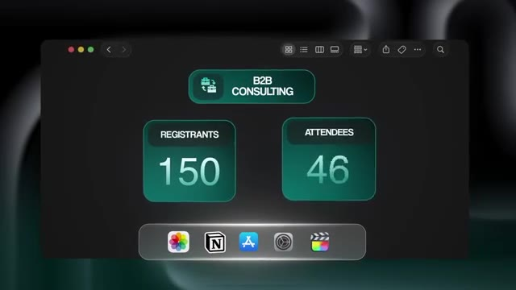
*⏱️ 00:06:48 — Interface graphique type Notion affichant des statistiques pour une société de conseil B2B (150 inscrits, 46 participants).*

---

### ⏱️ `[00:06:58 - 00:07:30]` | Segment #16

**🔊 Audio (Transcription Intégrale Mot pour Mot en Français) :**
> And this manual process had a conversion rate of, let's just say 4% of registrants. But after the automation is in place, every attendee's getting a personalized follow-up within minutes. no-shows get a different message with the replay of the webinar. Over the next two weeks, the system runs three to five touch points with real value, each pulling in context so it always feels personal. The second someone replies or books a call, the sequence stops and the sales team gets notified with all of the context of that conversation. The conversion rate will jump to maybe 10 to 12 percent, and that's 18 calls instead of the original six that we were getting with the manual process. And then, of course, you turn that into a value. So if the average deal is

**👁️ Analyse Visuelle d'Écran (gemini-3.5-flash-lite) :**
**Interface & Outils** : Graphique conceptuel (motion design).

**Contenu textuel & Code** : Texte affiché : "Follow ups", "ATTENDEES", icônes d'utilisateurs et symbole d'intelligence artificielle (AI).

**Action / Démonstration** : Illustration visuelle du flux de travail automatisé d'un système de conversion de leads.

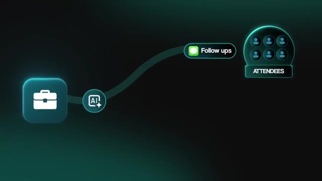
*⏱️ 00:07:06 — Schéma de workflow simplifié illustrant un processus automatisé où un élément source (représenté par une mallette) passe par un moteur IA pour envoyer des suivis ("Follow ups") à un groupe de participants ("ATTENDEES").*

---

### ⏱️ `[00:07:30 - 00:08:06]` | Segment #17

**🔊 Audio (Transcription Intégrale Mot pour Mot en Français) :**
> $20,000 and they close 30 percent, that's going from $36,000 to over $90,000 per webinar. Same webinar, same content, same spend. They just actually followed up. Okay, so that was follow-up sequences which handle new leads that need nurturing. Database reactivation is a completely different animal. This is about going back in time. Every business that's been around for any amount of time is probably sitting on a goldmine that they've completely forgotten about. Past customers who have churned, newsletter subscribers who never bought, people who started a free trial and then just disappeared, leads who went quiet after a conversation. Same concept as before. These people already know the business, they've already had some level of interest, and they're just sitting in a CRM collecting dust. So this type of automation, database reactivation, will pull them

**👁️ Analyse Visuelle d'Écran (gemini-3.5-flash-lite) :**
**Interface & Outils** : Superposition graphique (overlay) de texte animée.

**Contenu textuel & Code** : Liste de segments marketing : "Churned", "Subscribers", "Trial Drop-offs", "Cold Leads".

**Action / Démonstration** : Apparition synchronisée à l'écran des catégories de bases de données pour illustrer la "Database reactivation".

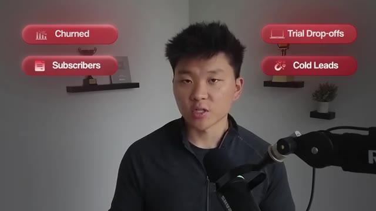
*⏱️ 00:07:57 — Le présentateur apparaît avec des éléments graphiques superposés : quatre pastilles rouges identifiant des segments de clients ("Churned", "Subscribers", "Trial Drop-offs", "Cold Leads").*

---

### ⏱️ `[00:08:06 - 00:08:24]` | Segment #18

**🔊 Audio (Transcription Intégrale Mot pour Mot en Français) :**
> from that existing database, it will segment people based on where they dropped off and can send personalized outreach. This is designed to restart the conversation or reactivate the lead. When someone responds with interest, the system qualifies them, hands them off to a salesperson as a warm lead. No mass blasts, no generic messaging. Each touch point references their specific history with the business.

**👁️ Analyse Visuelle d'Écran (gemini-3.5-flash-lite) :**
**Interface & Outils** : Diagramme de workflow de type boîte à outils d'automatisation (style Make ou n8n).

**Contenu textuel & Code** : Noms des segments : "Data base", "Form_Drop", "No_Show", "No_Buy", accompagnés d'icônes Gmail.

**Action / Démonstration** : Segmentation automatique des leads depuis une base de données vers des flux de communication personnalisés.

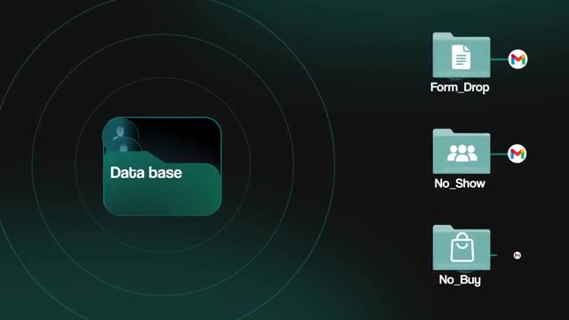
*⏱️ 00:08:11 — Schéma de workflow illustrant une base de données centralisée segmentant des leads vers des catégories spécifiques (Form_Drop, No_Show, No_Buy) avec une intégration vers Gmail.*

---

### ⏱️ `[00:08:25 - 00:08:57]` | Segment #19

**🔊 Audio (Transcription Intégrale Mot pour Mot en Français) :**
> Now let me skip straight to why this is so powerful because I think an example will hit harder than me explaining the mechanics. So let's take a local gym as an example. Let's say they've been open for three years. They've got 4,000 people in their system, which is past members, trial users, and cold inquiries, but nobody's reaching out to any of those people. They're spending all of their budget on new ads, trying to get fresh people in the door. So you build a reactivation workflow that segments the list and sends personalized messages referencing each person's history with the gym. And even a modest two to 3% conversion rate here means that that's 80 to 130 people walking back through the door at $50 a month with an average eight month retention. That's 32 to

**👁️ Analyse Visuelle d'Écran (gemini-3.5-flash-lite) :**
**Interface & Outils** : Navigateur web (Google Chrome).

**Contenu textuel & Code** : Page de renvoi (landing page) pour une salle de sport avec des boutons d'appel à l'action "JOIN NOW" et des menus de navigation.

**Action / Démonstration** : Présentation visuelle du canal d'acquisition (site web) utilisé dans le scénario marketing pour le CRM mentionné.

*⏱️ 00:08:41 — Gros plan sur un écran d'ordinateur portable affichant une page d'accueil de site web promotionnel pour une salle de sport ("Get Fit Today!").*

---

### ⏱️ `[00:08:57 - 00:09:30]` | Segment #20

**🔊 Audio (Transcription Intégrale Mot pour Mot en Français) :**
> $48,000 in recovered revenue with no new ad spend, no new copy, no new leads, just working what they already had. And agencies that specialize specifically in database reactivation are reporting average ROI of 1200% in the first 60 days. So this one almost sells itself. You ask a business owner how many contacts are sitting in their CRM doing nothing. You show them what even a small percentage of those people coming back would mean for their bottom line. And you're not selling in automation anymore. You're showing them basically just a big pile of money that they forgot they had and you're offering to go pick it up for them. The industries that benefit the most from these are ones with high lifetime value and recurring revenue. So gyms, dental clinics,

**👁️ Analyse Visuelle d'Écran (gemini-3.5-flash-lite) :**
**Interface & Outils** : Interface graphique de présentation (slides).

**Contenu textuel & Code** : Texte informatif : "Key Benefits of Database Reactivation", "Low cost", "Quick turnaround", "1200% ROI".

**Action / Démonstration** : Présentation conceptuelle des avantages commerciaux de la réactivation de leads dormants via une illustration visuelle.

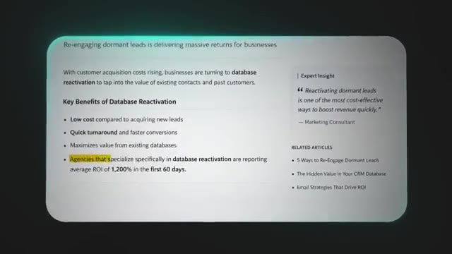
*⏱️ 00:09:06 — Une infographie présentant les bénéfices de la réactivation de base de données, mettant en avant un ROI moyen de 1200%.*

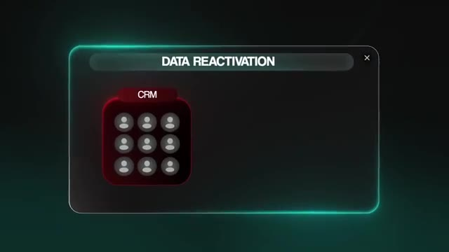
*⏱️ 00:09:14 — Un schéma simplifié illustrant un système de "Data Reactivation" partant d'un CRM contenant des contacts clients.*

---

### ⏱️ `[00:09:30 - 00:09:53]` | Segment #21

**🔊 Audio (Transcription Intégrale Mot pour Mot en Français) :**
> SaaS platforms, e-commerce, coaching, anyone with a database of 500 or more contacts that aren't being actively worked. All right, so the last one, and I saved this one for the end because it might be one of the most underrated automations on the entire list, which is internal reporting and status notifications. It doesn't sound too sexy at all, but it's one of the stickiest automations that you can sell because once a business has it and is using it, they literally could not imagine going back to life without it.

**👁️ Analyse Visuelle d'Écran (gemini-3.5-flash-lite) :**
**Interface & Outils** : Logiciel de montage graphique (incrustation de texte animé).

**Contenu textuel & Code** : Texte "5 Types of Automations" et numéro "5" associé à une icône de base de données.

**Action / Démonstration** : Animation de transition montrant les différents types d'automations de la liste.

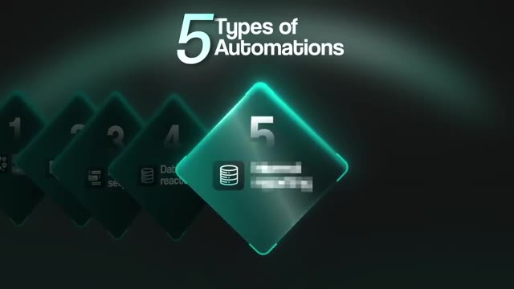
*⏱️ 00:09:42 — Graphique animé présentant une liste numérotée "5 Types of Automations", avec une mise en avant de la catégorie 5 (floutée) liée à une icône de base de données.*

---

### ⏱️ `[00:09:53 - 00:10:14]` | Segment #22

**🔊 Audio (Transcription Intégrale Mot pour Mot en Français) :**
> Same way that you and I would feel if we lost our favorite AI productivity tools, we would feel super slow. Every business has people spending hours compiling information, that the other people need to make decisions. So sales managers pulling weekly pipeline numbers, agency owners compiling client KPI reports, operations people gathering status updates from all these different tools. None of this work is hard, once again, but it's just manual and it's repetitive and it eats up hours every single week.

**👁️ Analyse Visuelle d'Écran (gemini-3.5-flash-lite) :**
**Interface & Outils** : Notion

**Contenu textuel & Code** : Interface de gestion de projet/base de données Notion ; texte superposé : "Weekly pipeline numbers", "Compiling client KPI reports", "Gathering status updates".

**Action / Démonstration** : Illustration visuelle des tâches répétitives de compilation de données que l'IA est destinée à automatiser en entreprise.

*⏱️ 00:10:09 — Un employé travaillant dans un bureau open space devant un écran affichant l'interface Notion, avec une liste de tâches métier superposée à droite.*

---

### ⏱️ `[00:10:14 - 00:10:48]` | Segment #23

**🔊 Audio (Transcription Intégrale Mot pour Mot en Français) :**
> And I can tell you firsthand, when I was working at Goldman Sachs, a massive part of my job was automating exactly these types of reports. And that's one of the reasons why I got into the automation space because I realized how much time can truly be saved. So an internal reporting automation can handle stuff like this in the background because it can pull data from different systems, it can run the analysis, this and it can just basically notify the team where they would have gotten that already. This could be a daily Slack message with yesterday's sales numbers. It could be a weekly email with the client performance metrics. It could be an automatic notification when a deal hits a certain stage or if a project falls behind schedule. The system runs on its own. It pulls real-time data and it puts it exactly where the team already looks for information. So no new dashboards,

**👁️ Analyse Visuelle d'Écran (gemini-3.5-flash-lite) :**
**Interface & Outils** : Diagramme de workflow, Éditeur de code (non spécifié).

**Contenu textuel & Code** : Schéma de processus métier (Récupération de données -> Analyse -> Notification) et lignes de code sources (illisibles mais identifiables comme syntaxe de programmation).

**Action / Démonstration** : Représentation visuelle de l'automatisation d'un flux de travail de reporting interne.

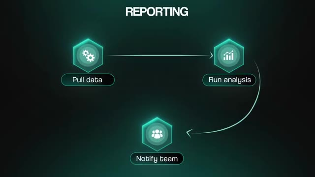
*⏱️ 00:10:31 — Schéma de flux de travail stylisé illustrant le processus de "Reporting" avec trois étapes connectées : "Pull data", "Run analysis" et "Notify team".*

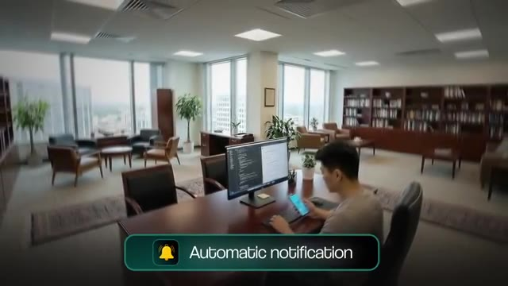
*⏱️ 00:10:40 — Illustration d'un environnement de bureau professionnel où un individu utilise un ordinateur affichant du code informatique, avec un bandeau en surimpression indiquant "Automatic notification".*

---

### ⏱️ `[00:10:49 - 00:11:23]` | Segment #24

**🔊 Audio (Transcription Intégrale Mot pour Mot en Français) :**
> no new tools, no new processes. You're just automating a process that sometimes people have their entire full-time job just doing that. And once again, I think that it's not to replace that person, but maybe let that person do something that's a little bit more valuable to the business. So here's an actual example of one of the most profitable automations that I've ever seen. And it was so, so simple. It just converted daily phone orders into the same text format that the construction crew was already using. It got organized automatically instead of someone typing it every morning. It saved 45 minutes a day and helped avoid $12,000 a month in scheduling errors. The crew didn't have to change a single habit. And that's the power of meeting a business exactly where they already work. They don't want to learn new processes. They don't want to learn

**👁️ Analyse Visuelle d'Écran (gemini-3.5-flash-lite) :**
**Interface & Outils** : Interface graphique de présentation de workflow / Dashboard de reporting.

**Contenu textuel & Code** : Texte : "Daily phone orders", "Construction crew", "Time saved: 45 mins / day".

**Action / Démonstration** : Illustration visuelle du gain de temps généré par l'automatisation d'une tâche répétitive (commandes téléphoniques).

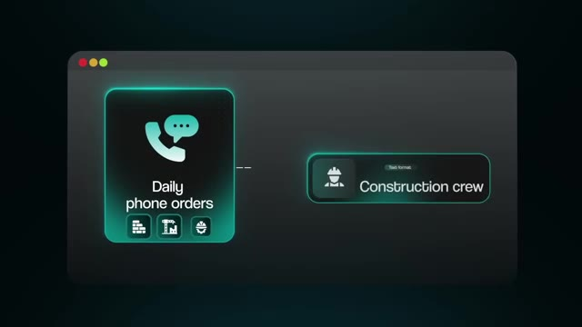
*⏱️ 00:11:06 — Schéma conceptuel d'un workflow automatisé montrant la transition entre "Daily phone orders" et "Construction crew".*

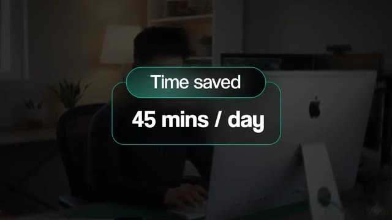
*⏱️ 00:11:15 — Overlay graphique affichant un bénéfice de productivité chiffré : "Time saved: 45 mins / day" avec le présentateur en arrière-plan.*

---

### ⏱️ `[00:11:23 - 00:11:42]` | Segment #25

**🔊 Audio (Transcription Intégrale Mot pour Mot en Français) :**
> a new UI. They just want to be faster. And I'm not even going to list industries for this one, because honestly, every single business has this problem. If a business has more than a few employees and uses more than just one software tool, then they need reporting. And this sells because the definition of a flywheel that I always talk about, you design a system that basically saves the business time. It's lets them serve more clients serve existing clients better.

**👁️ Analyse Visuelle d'Écran (gemini-3.5-flash-lite) :**
**Interface & Outils** : Trello, ClickUp, Slack (représentés sous forme d'icônes dans une infographie).

**Contenu textuel & Code** : Schéma conceptuel illustrant l'intégration de logiciels au sein d'une entreprise pour connecter les employés aux outils.

**Action / Démonstration** : Visualisation schématique du besoin en reporting et centralisation des données.

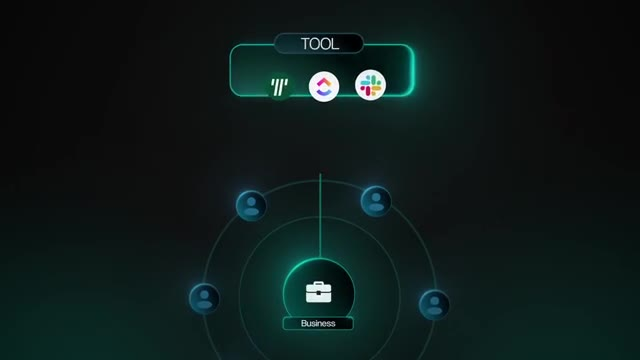
*⏱️ 00:11:32 — Infographie montrant une icône centrale "Business" entourée d'employés et connectée à une barre supérieure intitulée "TOOL" avec les logos de Trello, ClickUp et Slack.*

---

### ⏱️ `[00:11:42 - 00:12:12]` | Segment #26

**🔊 Audio (Transcription Intégrale Mot pour Mot en Français) :**
> And all of this grows the business. And when the business grows, the system gets used more, which basically feeds right back into itself. So the value is exponential. And that's real leverage. Okay, so now that you know what the five best workflows are to sell, here's how to actually sell them. Because I see so many people start out trying to sell the actual workflow, you need to be selling the outcome. You need to be selling, I can save you 10 hours a week, cut your admin mistakes and human error, speed up your leads. That positioning is what people actually pay for. So instead of offering to build an edit in workflow or a cloud code automation, you're actually offering to save time, cut costs, help them focus on making more money.

**👁️ Analyse Visuelle d'Écran (gemini-3.5-flash-lite) :**
**Interface & Outils** : Interface de messagerie type smartphone (iMessage).

**Contenu textuel & Code** : Texte de la discussion : "I can save you ten hours a week, cut your admin mistakes and human error, Speed up your leads." avec une réponse "Ok sure".

**Action / Démonstration** : Simulation d'un pitch de vente direct envoyé à un client potentiel via une application de messagerie.

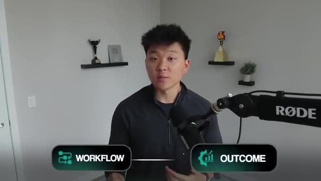
*⏱️ 00:11:57 — Le présentateur apparaît à l'écran avec une infographie incrustée en bas affichant "WORKFLOW" lié par une flèche à "OUTCOME".*

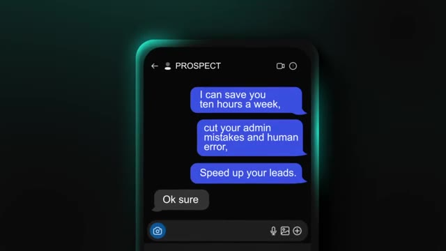
*⏱️ 00:12:04 — Capture d'écran d'une interface de messagerie mobile montrant une conversation avec un "PROSPECT".*

---

### ⏱️ `[00:12:12 - 00:12:30]` | Segment #27

**🔊 Audio (Transcription Intégrale Mot pour Mot en Français) :**
> And there's actually a simple way to start doing this. Don't try to learn all five of those automations. Just pick one, learn it inside and out and build a simple version of it. Then show a business owner a demo. Now, once you pick your lane, you've got two paths that you can take. So path one is to completely niche down on a specific process. You basically say, hey, I'm going to be the absolute expert on speed to lead systems. That's my thing.

**👁️ Analyse Visuelle d'Écran (gemini-3.5-flash-lite) :**
**Interface & Outils** : Aucune interface logicielle ou technique réelle n'est montrée.

**Contenu textuel & Code** : Texte à l'écran : "PICK ONE", "LEARN IT", "2 Paths", "Niche down", "PATH 1", "PATH 2".

**Action / Démonstration** : Aucune manipulation technique ; il s'agit d'une séquence de présentation illustrant un choix stratégique via des infographies simplifiées.

---

### ⏱️ `[00:12:30 - 00:12:51]` | Segment #28

**🔊 Audio (Transcription Intégrale Mot pour Mot en Français) :**
> And there's a huge benefit to this, which is you learn the language of that specific problem. You learn what converts. You learn what objections come up. You learn where things typically fall through the cracks in that process. And you legitimately become the expert, which means you have better case studies. You have better positioning. You have stronger testimonials. And you can likely promise better results than someone over here who's kind of more of a generalist and has 10 different services.

**👁️ Analyse Visuelle d'Écran (gemini-3.5-flash-lite) :**
**Interface & Outils** : Graphique de présentation superposé (overlay) et habillage vidéo.

**Contenu textuel & Code** : Schéma de relations conceptuelles (Image 1) et liste textuelle d'avantages business (Image 2).

**Action / Démonstration** : Illustration visuelle des concepts abordés par le présentateur (schématisation et listage).

---

### ⏱️ `[00:12:51 - 00:13:10]` | Segment #29

**🔊 Audio (Transcription Intégrale Mot pour Mot en Français) :**
> Same reason why a really good steakhouse doesn't need hot dogs because they are known for their steak. And it also means they can charge way more for their product. So then the second path is to kind of go more broad and be a consultant. And if you go this route, your job isn't to walk in with your demo solution and force it on a business. Your job is to understand all of these use cases so that you can make smart suggestions.

**👁️ Analyse Visuelle d'Écran (gemini-3.5-flash-lite) :**
**Interface & Outils** : AUCUNE

**Contenu textuel & Code** : Texte affiché : "2 Paths", "Niche down (PATH 1)", "Be a consultant (PATH 2)".

**Action / Démonstration** : Présentation visuelle des options stratégiques de positionnement professionnel.

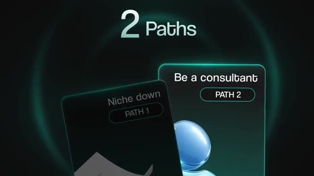
*⏱️ 00:13:00 — Graphique informatif présentant deux chemins de carrière : "Niche down" (PATH 1) et "Be a consultant" (PATH 2).*

---

### ⏱️ `[00:13:10 - 00:13:31]` | Segment #30

**🔊 Audio (Transcription Intégrale Mot pour Mot en Français) :**
> But ultimately, you're there to identify the actual bottleneck. This isn't what the business owner thinks the problem is or what he or she thinks the AI solution that he or she wants is. It's actually finding the constraint. And there's a really good question that you can use to find it, which is saying, hey, if 500 new clients showed up at your business tomorrow, what would break first? And this is super powerful because that question forces them to think through their entire operation logically, step by step.

**👁️ Analyse Visuelle d'Écran (gemini-3.5-flash-lite) :**
**Interface & Outils** : Application de visioconférence (type Zoom/Google Meet).

**Contenu textuel & Code** : Noms des participants : "ME" (le présentateur) et "CLIENT".

**Action / Démonstration** : Simulation visuelle d'un rendez-vous client pour illustrer le contexte de conseil en automatisation.

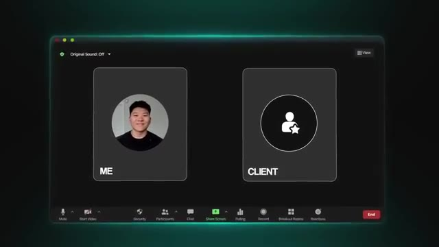
*⏱️ 00:13:20 — Interface de visioconférence style Zoom montrant deux fenêtres : "ME" avec le portrait du présentateur et "CLIENT" avec un avatar générique.*

---

### ⏱️ `[00:13:31 - 00:13:52]` | Segment #31

**🔊 Audio (Transcription Intégrale Mot pour Mot en Français) :**
> And as they walk through it, you'll find every single hole. Maybe their intake process falls apart. Maybe their team can't follow up fast enough. Maybe their reporting breaks down and nobody knows what's happening. Whatever breaks first, that's probably where you want to start. Think of it like this. Imagine your business is a pipe and you have water flowing through it. And that is basically your cash flow. That's your money. If there's a clog near the beginning of the pipe, then why in the world would you try to pour more water into this clogged pipe?

**👁️ Analyse Visuelle d'Écran (gemini-3.5-flash-lite) :**
**Interface & Outils** : Zoom (représentation graphique)

**Contenu textuel & Code** : Texte à l'écran : "#1 My intake falls apart", "#2 My team cant follow up fast"

**Action / Démonstration** : Illustration des points de friction opérationnels dans un flux de travail client via une interface de messagerie simulée.

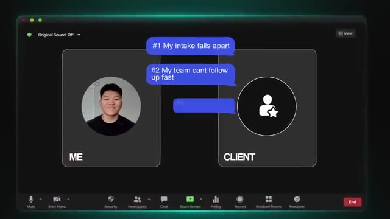
*⏱️ 00:13:36 — Une capture d'écran d'un appel vidéo (type Zoom) illustrant une conversation client, avec deux bulles de texte superposées pointant les failles d'un processus ("My intake falls apart", "My team cant follow up fast").*

---

### ⏱️ `[00:13:52 - 00:14:11]` | Segment #32

**🔊 Audio (Transcription Intégrale Mot pour Mot en Français) :**
> But that's what most businesses do. They spend more on ads, they spend more on salespeople, and they do all of this stuff to try to put more volume through a system that's already broken. What you should actually be doing is removing that clog. And then once it's gone and the water can go through the pipe, then you focus on finding more water and putting more water through it. And the five workloads that we just covered are the most common clogs.

**👁️ Analyse Visuelle d'Écran (gemini-3.5-flash-lite) :**
**Interface & Outils** : Graphique vectoriel dynamique (schéma de workflow).

**Contenu textuel & Code** : Texte "LEAKY SYSTEM" et icônes représentant le marketing (Ads) et la vente (Sales person).

**Action / Démonstration** : Animation illustrative du concept de dysfonctionnement d'un pipeline commercial.

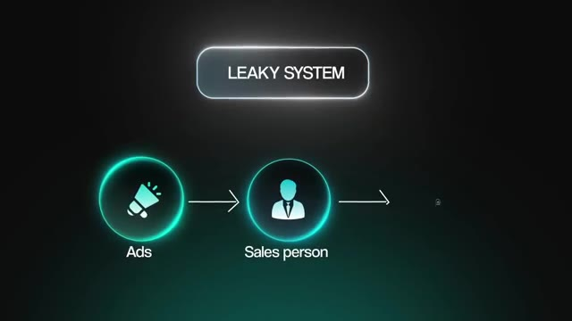
*⏱️ 00:13:57 — Schéma conceptuel illustrant un "système fuyant" (Leaky System) avec des icônes pour les publicités et les vendeurs.*

---

### ⏱️ `[00:14:11 - 00:14:29]` | Segment #33

**🔊 Audio (Transcription Intégrale Mot pour Mot en Français) :**
> Speed to lead fixes the response gap. Document processing fixes the operational bottleneck. Follow-up sequences fix the leaky pipeline. Database reactivation unlocks revenue that's already been paid for. And internal reporting fixes visibility gap that slows down every decision. So pick your path, pick your first workflow, and go show someone the value. That's how this starts. So I know that we covered a ton of information in this video.

**👁️ Analyse Visuelle d'Écran (gemini-3.5-flash-lite) :**
**Interface & Outils** : AUCUNE

**Contenu textuel & Code** : AUCUN

**Action / Démonstration** : AUCUNE

---

### ⏱️ `[00:14:30 - 00:14:48]` | Segment #34

**🔊 Audio (Transcription Intégrale Mot pour Mot en Français) :**
> So what I did is I threw all of this into a resource guide that you can access for completely free in my FreeSchool community. The link for that will be down in the description. And if you wanna see exactly how I started making money using this framework, then check out this video on screen right up here. But anyways, that's gonna do it for today. If you guys enjoyed or you learned something new, and please give it a like. Definitely helps me out a ton. And as always, I appreciate you guys made it to the end of the video.

**👁️ Analyse Visuelle d'Écran (gemini-3.5-flash-lite) :**
**Interface & Outils** : Plateforme communautaire Skool (skool.com).

**Contenu textuel & Code** : Liste de fils de discussion (ex: "Weekly Wins Recap", "Build ANYTHING with Base44 and n8n AI Agents"), statistiques de la communauté (156k membres) et classement des membres (leaderboard).

**Action / Démonstration** : Navigation au sein d'un espace communautaire en ligne pour montrer l'accès aux ressources gratuites mentionnées.

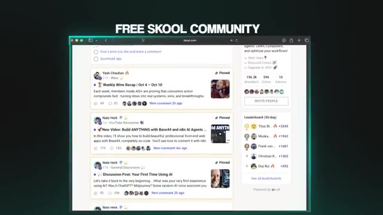
*⏱️ 00:14:34 — Capture d'écran de l'interface de la plateforme communautaire Skool, affichant une liste de publications de membres et un tableau de bord.*

---

### ⏱️ `[00:14:48 - 00:14:50]` | Segment #35

**🔊 Audio (Transcription Intégrale Mot pour Mot en Français) :**
> I'll see you on the next one. Thanks, everyone.

**👁️ Analyse Visuelle d'Écran (gemini-3.5-flash-lite) :**
**Interface & Outils** : Aucune

**Contenu textuel & Code** : Aucun

**Action / Démonstration** : Clôture de la vidéo par le présentateur.

---

