# 🎬 Codex Just 10x’d Claude Code Projects

> **Chaîne** : [Nate Herk | AI Automation](https://www.youtube.com/@nateherk/featured)  
> **Lien YouTube** : [https://www.youtube.com/watch?v=B2Kh_ZoLVTM](https://www.youtube.com/watch?v=B2Kh_ZoLVTM)  
> **Date de publication** : 20260331  
> **Durée** : 00:13:11  
> **Identifiant vidéo** : `B2Kh_ZoLVTM`  
> **Transcription & Analyse** : `whisper-v3-large-turbo+gemini-3.5-flash-lite`  

---

## 📌 Synthèse Exécutive & Outils

### 💡 Résumé
Dans cette vidéo intitulée **Codex Just 10x’d Claude Code Projects**, Nate Herk décortique les capacités pratiques d'automatisation et de développement propulsées par les modèles de pointe.

### 🛠️ Outils, Modèles & Logiciels Présentés
- **Opus 5.5 & Claude Code** : Modèles d'ingénierie et agents de codage autonome.

### 🔑 Points Clés & Enseignements Stratégiques
- Optimiser le niveau d'effort et le raisonnement des modèles IA pour des résultats industriels.
- Automatiser les cycles de création logicielle de bout en bout.

---

## ⏱️ Chronologie & Transcription Complète Audio & Visuelle (Mot pour Mot)

### ⏱️ `[00:00:00 - 00:00:23]` | Segment #01

**🔊 Audio (Transcription Intégrale Mot pour Mot en Français) :**
> So today OpenAI released an official Codex plugin for CloudCode. You can see here it says if you already use CloudCode, this Codex plugin gives you a simple way to pull Codex into that same workflow. Now this isn't like groundbreaking technology. People have already been kind of using a combination of Codex and CloudCode together. But this plugin makes it a lot easier. And so obviously I've been focusing a lot on CloudCode, but I have played around with Codex a little bit, and they felt very similar to me.

**👁️ Analyse Visuelle d'Écran (gemini-3.5-flash-lite) :**
**Interface & Outils** : Plateforme X (anciennement Twitter) affichant une interface en ligne de commande (CLI) intégrée dans le corps du tweet.

**Contenu textuel & Code** : Liste des commandes CLI du plugin Codex : `/codex:review`, `/codex:rescue`, `/codex:result`, `/codex:status`, `/codex:adversarial-review`, `/codex:setup`. Texte descriptif sur l'intégration de Codex dans le workflow Claude Code.

**Action / Démonstration** : Affichage des commandes de l'outil dans un terminal, illustrant les fonctionnalités disponibles pour l'utilisateur.

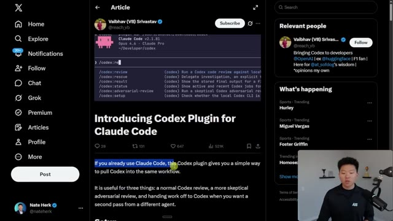
*⏱️ 00:00:06 — Capture d'écran d'un post sur la plateforme X présentant le "Codex Plugin pour Claude Code", avec une démonstration visuelle d'une interface en ligne de commande (CLI) listant les commandes disponibles du plugin.*

---

### ⏱️ `[00:00:23 - 00:00:43]` | Segment #02

**🔊 Audio (Transcription Intégrale Mot pour Mot en Français) :**
> But as of lately, I've been seeing more and more people talk about how they've been using Codex inside of their CloudCode workflows and projects to help do code reviews and to help get a second pair of eyes on their code. So here you can see the head of developer experience at OpenAI said that they've been seeing Cloud Code users bring in Codex for code reviews and use GBT 5.4 for some more complex tasks.

**👁️ Analyse Visuelle d'Écran (gemini-3.5-flash-lite) :**
**Interface & Outils** : Plateforme X (anciennement Twitter), interface de ligne de commande (CLI) Claude Code.

**Contenu textuel & Code** : Textes de posts traitant de l'intégration de Codex dans Claude Code, prompts textuels dans une interface terminal ("Ask Cod...").

**Action / Démonstration** : Démonstration de l'utilisation d'un plugin permettant d'appeler Codex depuis l'interface Claude Code pour effectuer des revues de code ou déléguer des tâches.

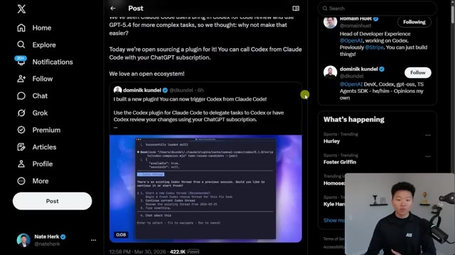
*⏱️ 00:00:28 — Une capture d'écran de la plateforme X montrant un post de Dominik Kundel sur l'intégration du plugin Codex dans Claude Code, incluant une vidéo de démonstration terminal.*

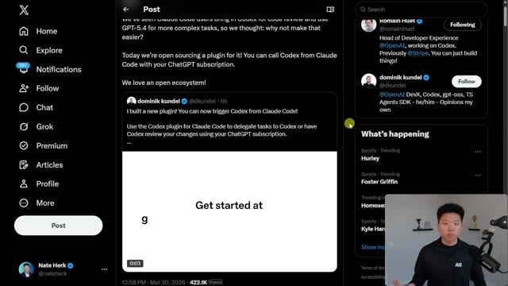
*⏱️ 00:00:33 — La suite du thread sur X montrant une démonstration vidéo du plugin Codex affichant "Get started at".*

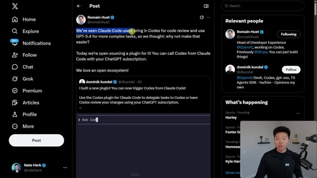
*⏱️ 00:00:38 — Le message original de Romain Huet sur X présentant l'open-source du plugin Codex pour Claude Code avec une zone d'invite interactive.*

---

### ⏱️ `[00:00:43 - 00:01:04]` | Segment #03

**🔊 Audio (Transcription Intégrale Mot pour Mot en Français) :**
> So that's kind of why they decided to do this. And the cool thing is, which I didn't actually know, you can use Codex for free. So you can just use your free ChatGBT subscription, which means there's basically no reason for you to get this plugin, put it into some of your Cloud Code projects where you're building some software or game or whatever it is, and then just have it do some code reviews and see what you might've missed with Cloud Code.

**👁️ Analyse Visuelle d'Écran (gemini-3.5-flash-lite) :**
**Interface & Outils** : Navigateur web affichant l'interface de X (Twitter).

**Contenu textuel & Code** : Commandes bash : `/plugin marketplace add openai/codex-plugin-cc`, `/plugin install codex@openai-codex`, `/codex:setup`, `npm install -g @openai/codex` et `!codex login`. Texte mentionnant la nécessité d'un abonnement ChatGPT.

**Action / Démonstration** : Présentation des étapes d'installation technique et de configuration du plugin Codex pour l'automatisation.

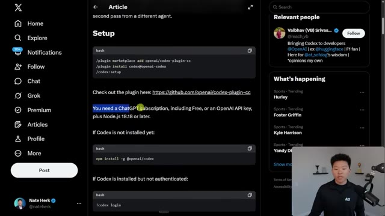
*⏱️ 00:00:49 — Capture d'écran montrant un article sur la plateforme X (Twitter) détaillant les instructions d'installation pour le plugin OpenAI Codex, avec des blocs de code pour l'installation via npm.*

---

### ⏱️ `[00:01:04 - 00:01:35]` | Segment #04

**🔊 Audio (Transcription Intégrale Mot pour Mot en Français) :**
> So you might be wondering to yourself, is this just overkill and is it actually needed? And so I was thinking the exact same thing and I decided to do a little bit of research to compare the benchmarks. So starting off, Opus 4.6 versus GPT 5.4, Opus is the purple, GPT is the green, and we're looking at different coding benchmarks. So the SWE Opus has a slight edge, but in all of these other ones, you'll notice that GBT 5.4 is actually ahead of Opus 4.6. And if you actually break them down head to head, you can see here's the SWE bench verified where Opus leads by almost a point.

**👁️ Analyse Visuelle d'Écran (gemini-3.5-flash-lite) :**
**Interface & Outils** : Graphique de données intégré dans une présentation ou une interface web.

**Contenu textuel & Code** : Graphique comparatif intitulé "Core coding benchmarks" montrant les scores pour différentes catégories (SWE-bench, HumanEval, etc.) avec une légende identifiant les deux modèles.

**Action / Démonstration** : Analyse comparative et visualisation des performances des modèles d'IA par le présentateur.

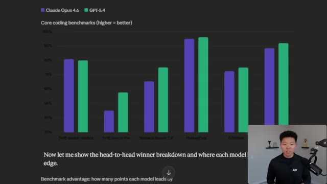
*⏱️ 00:01:12 — Un graphique à barres comparatif présentant les performances des modèles d'IA "Claude Opus 4.6" (en violet) et "GPT-5.4" (en vert) sur divers benchmarks de codage.*

---

### ⏱️ `[00:01:36 - 00:02:08]` | Segment #05

**🔊 Audio (Transcription Intégrale Mot pour Mot en Français) :**
> But in all these other ones, 13 points, 10 points, 1, 2.5, 3.5, GBT 5.4 actually beats out Opus 4.6. And when you think about those benchmarks, and then you realize that Opus 4.5 is also much more expensive than GBT 5.4, it definitely makes you think. Now, all of these are the benchmarks, right? So I think they're always important to look at and to sort of be aware of like what models are supposed to be good at certain things. But I always want to get in there, get my hands dirty and see how I like them, see what they feel like rather than just basing my assumptions off of benchmarks.

**👁️ Analyse Visuelle d'Écran (gemini-3.5-flash-lite) :**
**Interface & Outils** : Présentation de données/Graphique analytique.

**Contenu textuel & Code** : Le graphique compare les performances sur SWE-bench Verified, SWE-bench Pro, Terminal-Bench 2.0, HumanEval, OSWorld et GPQA Diamond, illustrant l'écart en points entre les deux modèles.

**Action / Démonstration** : Analyse comparative et visualisation des performances des modèles d'IA pour justifier un choix en fonction du rapport performance/coût.

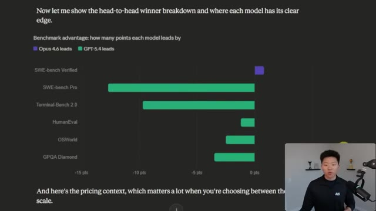
*⏱️ 00:01:44 — Un graphique à barres comparatif présentant l'avantage des modèles Opus 4.6 (violet) et GPT-5.4 (vert) sur divers benchmarks techniques.*

---

### ⏱️ `[00:02:08 - 00:02:41]` | Segment #06

**🔊 Audio (Transcription Intégrale Mot pour Mot en Français) :**
> So I did some research on X and Reddit and I scraped information and thoughts from people who have been using both of them a lot. And I threw together some of the pitfalls of both of them. And it's interesting because when you hear the weaknesses of both, the strengths of both kind of complement each other really well. So for CloudCode, some of the things that people have been saying are weaknesses are that it over-engineers, that it can be really token-hungry, and that it can sort of get into long-run drift. So it can miss edge cases and just build bugs. And the important part of that is when it goes and reviews its own code, sometimes it misses those because it just can't

**👁️ Analyse Visuelle d'Écran (gemini-3.5-flash-lite) :**
**Interface & Outils** : Outil de création de diagrammes (type Excalidraw).

**Contenu textuel & Code** : Le schéma détaille trois points : "Over-Engineers" (avec les sous-points Verbose, Skips Tests, Gold Plates), "Token Hungry" (avec l'icône d'une batterie faible et d'une jauge), et "Long Run Drift" (avec le sous-point Edge Cases Missed).

**Action / Démonstration** : Présentation visuelle statique utilisée pour appuyer le discours analytique sur les faiblesses des outils d'automatisation de code.

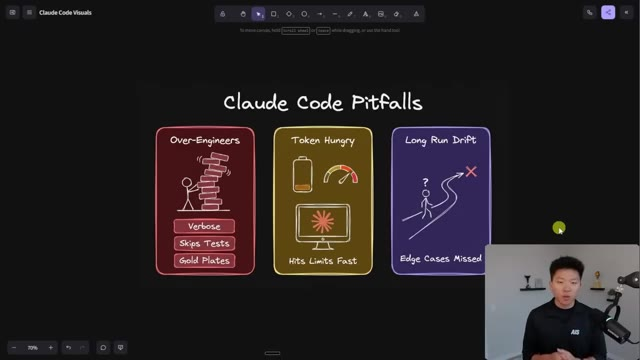
*⏱️ 00:02:17 — Une infographie illustrée sur fond noir présentant les trois principaux inconvénients (pitfalls) de "Claude Code" sous forme de cartes colorées.*

---

### ⏱️ `[00:02:41 - 00:03:15]` | Segment #07

**🔊 Audio (Transcription Intégrale Mot pour Mot en Français) :**
> see them. And these things right here are some of the things that Codex is known for being really good at. But then if we switch over to Codex weaknesses, people complain that it's not super good at planning and it doesn't ask the right questions and sometimes you don't get a lot of good creative outputs from it and it's just a little bit more rigid in that way and it's interesting because some of these things that people complain about codex, CloudCode or Opus does really well and so naturally that's why you've seen a lot of people on X talking about oh I like to plan and maybe build the initial POC with CloudCode but then I'll bring in codex to execute the rest of it kind of push it into production and do all of the reviewing. Now

**👁️ Analyse Visuelle d'Écran (gemini-3.5-flash-lite) :**
**Interface & Outils** : Diagrammes explicatifs dessinés à la main (style tableau blanc numérique).

**Contenu textuel & Code** : Texte structuré : "Codex Weaknesses", "Needs Detail", "Flat Output", "Code Reviews", "Claude vs Codex", "the real workflow: Claude -> Codex -> Merge".

**Action / Démonstration** : Présentation théorique illustrant les rôles respectifs des modèles d'IA dans un flux de travail de développement.

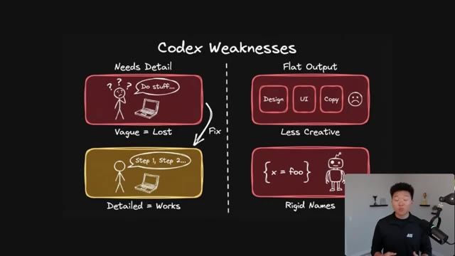
*⏱️ 00:02:49 — Schéma explicatif illustrant les faiblesses de Codex : le besoin de détails, le risque d'outputs plats, le manque de créativité et l'utilisation de noms rigides.*

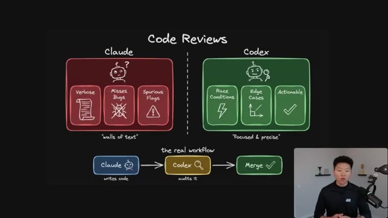
*⏱️ 00:03:07 — Schéma comparatif entre Claude et Codex pour la revue de code, montrant Claude comme verbeux et Codex comme précis, avec un workflow de validation combiné.*

---

### ⏱️ `[00:03:15 - 00:03:36]` | Segment #08

**🔊 Audio (Transcription Intégrale Mot pour Mot en Français) :**
> what this really makes me think about is just the fact that you should be trying different tools and understanding like where to use them together. It's not always like, oh, I'm all in on this one and I'm only gonna use this one. It's about understanding like, okay, for this specific use case, I might use 30% Claude and 70% OpenAI. And for this next use case, I'm probably gonna use Claude code pretty much all the way through until the very end.

**👁️ Analyse Visuelle d'Écran (gemini-3.5-flash-lite) :**
**Interface & Outils** : Diagramme conceptuel (style dessin à la main).

**Contenu textuel & Code** : Le schéma montre Claude (caractérisé par "Verbose", "Misses Bugs", "Spurious Flags" et "walls of text") opposé à Codex (caractérisé par "Race Conditions", "Edge Cases", "Actionable" et "Focused & precise"). En bas, le workflow suggéré : "Claude (writes code) -> Codex (audits it) -> Merge".

**Action / Démonstration** : Illustration d'une méthodologie d'utilisation conjointe de plusieurs outils d'IA pour optimiser le cycle de développement logiciel.

*⏱️ 00:03:20 — Schéma comparatif illustrant une stratégie de workflow hybride pour les revues de code, opposant les caractéristiques de Claude et de Codex avant de proposer une approche combinée.*

---

### ⏱️ `[00:03:37 - 00:03:55]` | Segment #09

**🔊 Audio (Transcription Intégrale Mot pour Mot en Français) :**
> So I'll leave a link to this article down in the description of this video, but it's really, really simple to set up. All you have to do is run these three commands in order. So this one basically installs the Marketplace. This one installs the plugin and then this one helps you get set up. And you can also go to the actual GitHub documentation, which has been growing in stars pretty quickly since the release. And you pretty much can read every single thing about this.

**👁️ Analyse Visuelle d'Écran (gemini-3.5-flash-lite) :**
**Interface & Outils** : - Image #1 : Interface web de X (Twitter).
- Image #2 : Interface web de GitHub.

**Contenu textuel & Code** : - Image #1 : Bloc de code affichant : `/plugin marketplace add openai/codex-plugin-cc`, `/plugin install codex@openai-codex`, `/codex:setup` et `npm install -g @openai/codex`.
- Image #2 : Liste des répertoires du projet (ex: .claude-plugin, plugins/codex, tests).

**Action / Démonstration** : Présentation des commandes nécessaires à l'installation du plugin et visualisation du dépôt GitHub source pour le projet d'automatisation.

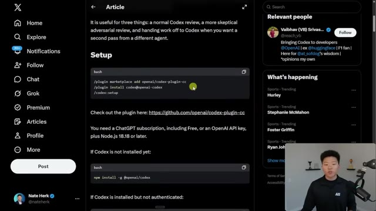
*⏱️ 00:03:41 — Une page Twitter affichant un article qui détaille les commandes de configuration pour le plugin Codex.*

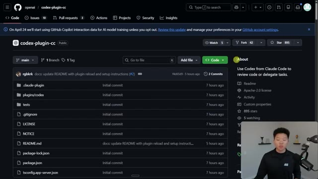
*⏱️ 00:03:51 — La page GitHub du projet "codex-plugin-cc", montrant la structure du dépôt et les fichiers associés.*

---

### ⏱️ `[00:03:56 - 00:04:18]` | Segment #10

**🔊 Audio (Transcription Intégrale Mot pour Mot en Français) :**
> You can see that you can also use your free chat to be a subscription once again, but you would just run these in order. And it also breaks down all of the different functions that are in here. So we have like a review, we have an adversarial review, we have rescue, we have all these different little functions that you can run, which almost you can think of them like skills now. And you can do some other things that are pretty cool by adding these flags that let them run in the background or wait for things. And you get a lot of extra functionality here.

**👁️ Analyse Visuelle d'Écran (gemini-3.5-flash-lite) :**
**Interface & Outils** : Documentation technique affichée probablement dans une interface type éditeur de code ou navigateur web.

**Contenu textuel & Code** : Documentation sur '/codex:review' : description des fonctionnalités, options (--base, --wait, --background) et exemples d'utilisation en ligne de commande.

**Action / Démonstration** : Présentation des fonctionnalités de l'outil et explication de la syntaxe des commandes par l'intervenant.

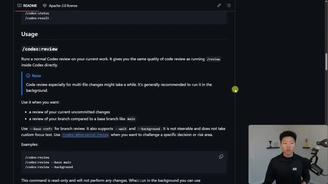
*⏱️ 00:04:01 — Une page de documentation (format README) détaillant l'utilisation de la commande '/codex:review' pour un outil d'assistance au codage.*

---

### ⏱️ `[00:04:18 - 00:04:52]` | Segment #11

**🔊 Audio (Transcription Intégrale Mot pour Mot en Français) :**
> So in a session, if you come over here and you do slash plugins, you would basically have to, you know, try to install that marketplace. You can see that I have the OpenAI Codex one right here. And then you can see right here, I've got the Codex plugin installed and enabled. So now if I went ahead to do a slash Codex, you could see all of these different things that I could actually call on. And all of these would be using GBT 5.4 instead of Opus. So real quick example of what that may look like. Here's a project where I'm setting up just some sort of dashboard for an internal system. And keep in mind, a lot of this is mock data. This is something that I just recently spun up. And right now I'm just working on sort of the flow and the feel

**👁️ Analyse Visuelle d'Écran (gemini-3.5-flash-lite) :**
**Interface & Outils** : Visual Studio Code avec le terminal intégré exécutant "Claude Code v2.1.86".

**Contenu textuel & Code** : Commande `/plugin` active, liste des plugins (codex, superpowers, telegram, gmail, google calendar, n8n) avec leurs statuts respectifs.

**Action / Démonstration** : Consultation de l'onglet "Installed" pour vérifier l'état des plugins configurés.

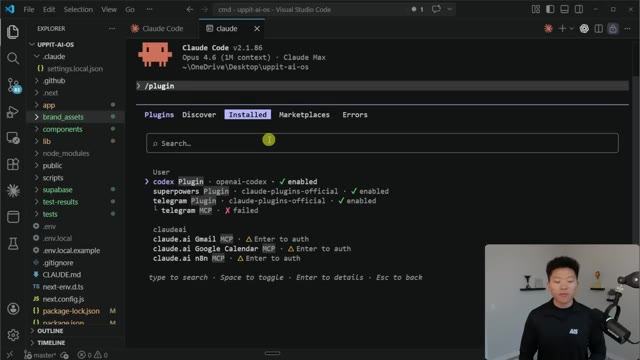
*⏱️ 00:04:27 — Interface du terminal Claude Code à l'intérieur de VS Code montrant la liste des plugins installés et leur état (activé, échec ou en attente d'authentification).*

---

### ⏱️ `[00:04:52 - 00:05:24]` | Segment #12

**🔊 Audio (Transcription Intégrale Mot pour Mot en Français) :**
> rather than like having the data synced in. But anyways, I built this obviously using Opus. So now in this project, if I do slash codex, I can see all these different things to run. And right now I want to decide between a review or an adversarial review. So if I go over back to the GitHub, we can read the difference between the two, which is a review runs a normal codex review on your current work, which is the same quality of code review as running a slash review inside of Codex directly. So you can use this for reviewing uncommitted changes or comparing branches. And this is a read-only type of skill. Now the adversarial review is kind of just like a

**👁️ Analyse Visuelle d'Écran (gemini-3.5-flash-lite) :**
**Interface & Outils** : Visual Studio Code (éditeur) et GitHub (documentation web).

**Contenu textuel & Code** : Liste de commandes slash (/codexcancel, /codexreview, /codexadversarial-review, /codexstatus, /codexresult, /codexrescue, /codexsetup, /n8n-code-javascript, /n8n-code-python) et texte descriptif de la documentation pour "/codex:review".

**Action / Démonstration** : Le présentateur démontre l'utilisation des commandes slash dans son éditeur, puis consulte la documentation technique en ligne pour comparer les options de revue de code disponibles.

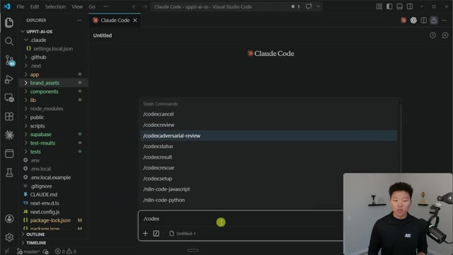
*⏱️ 00:05:00 — Interface de Visual Studio Code affichant une liste de commandes "Slash Commands" pour l'outil Claude Code, avec la commande "/codex" active et des options comme "/codexreview" ou "/codexadversarial-review" suggérées.*

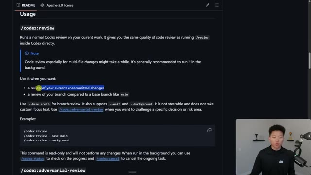
*⏱️ 00:05:16 — Page de documentation GitHub (README) détaillant l'utilisation de la commande "/codex:review", expliquant ses fonctionnalités pour examiner les changements non validés ou comparer des branches.*

---

### ⏱️ `[00:05:24 - 00:06:00]` | Segment #13

**🔊 Audio (Transcription Intégrale Mot pour Mot en Français) :**
> review on steroids. It's steerable and it questions the chosen implementation and design, and it can be used to pressure test things, look at trade-offs, failure modes, and whether different approaches would be safer or more simple. This is also a read-only command that does not change code. Essentially, these are both just kind of giving you a nice audit. So I'm going to go ahead and try the adversarial review right here. So what you'll notice is right away it has to get familiarized and acclimated with the environment. So it's going to look at the working tree size. It's going to check the differences between what's staged and what's unstaged. And after that it should come back and ask us how we want to run this review. So it's asking me how we

**👁️ Analyse Visuelle d'Écran (gemini-3.5-flash-lite) :**
**Interface & Outils** : VS Code (avec extension Claude Code).

**Contenu textuel & Code** : Documentation des commandes '/codex:review' et '/codex:adversarial-review' ; liste de commandes slash incluant /codexcancel, /codexreview, /codexadversarial-review, /codexstatus, /n8n-code-javascript, etc.

**Action / Démonstration** : Navigation et présentation des capacités de l'agent "Claude Code" pour la revue de code automatisée et critique.

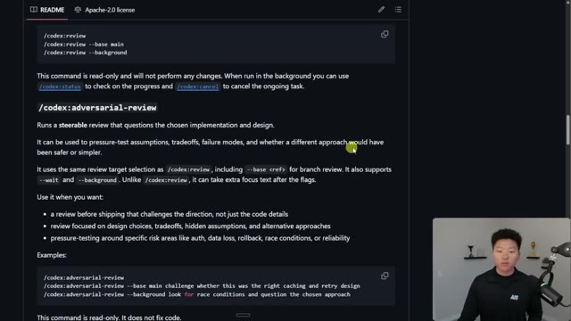
*⏱️ 00:05:33 — Une page de documentation technique (type fichier README) détaillant la commande '/codex:adversarial-review', expliquant son utilité pour le test de pression, l'analyse des risques et les alternatives de conception.*

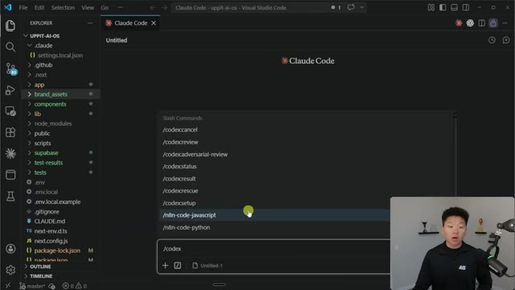
*⏱️ 00:05:42 — L'interface de l'éditeur VS Code affichant le menu contextuel de "Claude Code" avec la liste des commandes disponibles, incluant les fonctions codex et n8n.*

---

### ⏱️ `[00:06:00 - 00:06:35]` | Segment #14

**🔊 Audio (Transcription Intégrale Mot pour Mot en Français) :**
> want to run it. I'm just going to go ahead and say in the background and shoot that off. You can see that it also said that this is a pretty large review. So we'll see how long this takes. So by the way, I'm on Windows and when I was using this I've gotten a bug a few times which basically said that there was something wrong with like path, but it was able to do research and fix that for me. And now you can see that that adversarial review has been complete. So let's take a look and see what we got here. It gives us a target. It gives us a verdict. It tells things that we don't need to ship. And here are the things that it found. And it also looks like it has priority scores. So we have some high priority things. We have a recommendation, same thing right here.

**👁️ Analyse Visuelle d'Écran (gemini-3.5-flash-lite) :**
**Interface & Outils** : Visual Studio Code avec l'extension Claude (Claude Dev/Code).

**Contenu textuel & Code** : - Image 1 : Journal de commandes Bash, exécution de scripts Node.js pour des tests de modules et lancement du processus en arrière-plan.
- Image 2 : Rapport d'analyse de code identifiant des problèmes de "fabrication de données" (mock data) et de gestion d'erreurs dans l'API, avec des recommandations de sécurité.

**Action / Démonstration** : L'agent IA exécute un test de sécurité ("adversarial review") sur le codebase en arrière-plan et présente les résultats de son audit sous forme de rapport textuel.

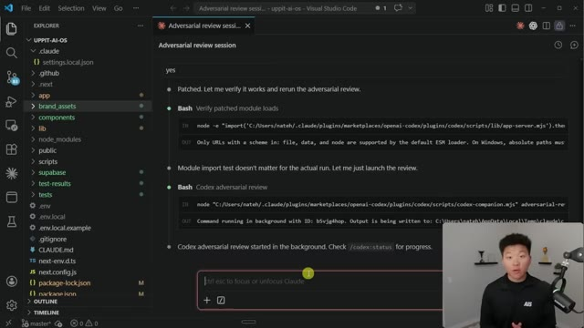
*⏱️ 00:06:09 — Interface de VS Code montrant l'exécution d'une commande "Codex adversarial review" dans le terminal intégré de l'extension Claude.*

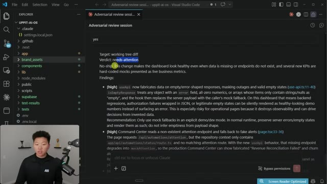
*⏱️ 00:06:26 — Interface de VS Code affichant le rapport détaillé "Adversarial review session" avec une section "Verdict: needs-attention" et des constatations techniques détaillées.*

---

### ⏱️ `[00:06:35 - 00:07:07]` | Segment #15

**🔊 Audio (Transcription Intégrale Mot pour Mot en Français) :**
> And then we also have a medium priority thing as well as some next steps. So from here, it would be up to you to either continue on using codecs to build out these changes or switch back to cloud code. Or what I would probably do is I would split them off, do one with opus, one with gbt, and then just see which one's better. So that was a lot of the use cases that I've been seeing on X. And just when I started looking into this, right. But then I, of course, wanted to try, okay, let's give both of them the exact same prompt and see what the outputs actually look like. So I gave them both this prompt, which was basically just like to build me a game. I gave them

**👁️ Analyse Visuelle d'Écran (gemini-3.5-flash-lite) :**
**Interface & Outils** : VS Code avec l'extension/intégration Claude (agent de codage).

**Contenu textuel & Code** : Le texte affiche des recommandations techniques sur les données de santé communautaire ("Community health KPIs"), mentionnant des problèmes de mélange entre données réelles et "mock" (factices), avec une section "Next steps" listant des actions correctives pour le backend et le frontend.

**Action / Démonstration** : L'utilisateur est en train de consulter le rapport d'analyse généré par l'IA concernant l'état du projet "uppit-ai-os".

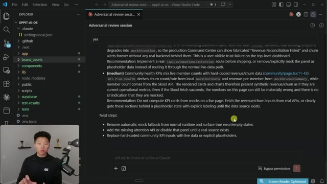
*⏱️ 00:06:43 — Une vue de l'éditeur VS Code affichant une session de revue contradictoire (adversarial review) dans la fenêtre de chat Claude, avec le présentateur en médaillon dans le coin inférieur gauche.*

---

### ⏱️ `[00:07:07 - 00:07:26]` | Segment #16

**🔊 Audio (Transcription Intégrale Mot pour Mot en Français) :**
> some specifications and things like that. And it's detailed, but it's not like super, super detailed. I didn't put them into plan mode. I just shot it off and bypassed permissions to see what the outputs looked like. And so here's Codex open up in VS Code as well with the extension. And you can see that I gave them the exact same prompts and then I just shot them off to see what happened.

**👁️ Analyse Visuelle d'Écran (gemini-3.5-flash-lite) :**
**Interface & Outils** : Visual Studio Code (VS Code) avec l'extension Claude.

**Contenu textuel & Code** : Texte descriptif des spécifications du jeu : "Build procedurally generated 2D roguelike...", incluant les détails du style visuel (couleurs des ennemis, taille des tuiles, gestion de la caméra) et les contrôles.

**Action / Démonstration** : Affichage des instructions de développement transmises à l'IA pour générer le projet.

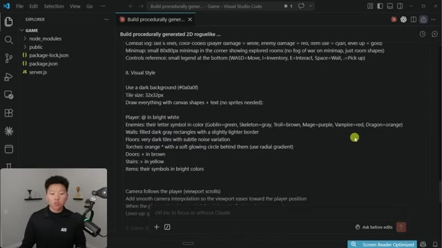
*⏱️ 00:07:11 — Interface de VS Code montrant un fichier de spécifications détaillées pour un projet de jeu 2D roguelike ouvert dans l'extension Claude.*

---

### ⏱️ `[00:07:26 - 00:07:48]` | Segment #17

**🔊 Audio (Transcription Intégrale Mot pour Mot en Français) :**
> Now, before we open up the outputs, there's two things I wanted to tell you. The first thing is that Opus finished way quicker than Codex did. So whether you take that as a good thing or a bad thing, just something I wanted to call out, Codex ran for a lot longer. The second thing is Opus came back and basically said, hey, the server started, you can open it up and you can play the game. But when Codex came back, it basically said like, hey, this is only task one out of three, but the game's finished and you're ready to play.

**👁️ Analyse Visuelle d'Écran (gemini-3.5-flash-lite) :**
**Interface & Outils** : Visual Studio Code avec extension de chat IA (Codex).

**Contenu textuel & Code** : Historique de commandes système (git status, Get-ChildItem), logs de génération de code pour "index.html" et prévisualisation d'un bloc de code HTML pour un "Roguelike Dungeon Crawler".

**Action / Démonstration** : L'agent IA documente la création d'une architecture de projet from scratch et propose des modifications de fichiers dans l'IDE.

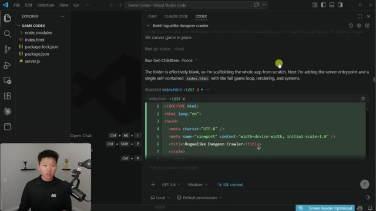
*⏱️ 00:07:31 — Interface VS Code affichant l'onglet "CODEX" avec un historique de discussion concernant la création d'un jeu roguelike.*

---

### ⏱️ `[00:07:48 - 00:08:07]` | Segment #18

**🔊 Audio (Transcription Intégrale Mot pour Mot en Français) :**
> And then after that I said, okay, well, is the game done? And it said not fully, it's playable and it's local, but there's still a lot of things that I need to do to meet the original spec. Now let's take a look at the games. This first version right here, this is the version that was built by Claude Code. So we have Dungeon Crawler, a roguelike adventure. We're going to go ahead and start up a new game.

**👁️ Analyse Visuelle d'Écran (gemini-3.5-flash-lite) :**
**Interface & Outils** : Visual Studio Code (avec plugin IA), Navigateur web.

**Contenu textuel & Code** : Rapport d'état de développement (liste des fonctionnalités implémentées vs manquantes), écran titre du jeu "Dungeon Crawler".

**Action / Démonstration** : Revue du code généré par l'IA et démonstration du prototype de jeu jouable.

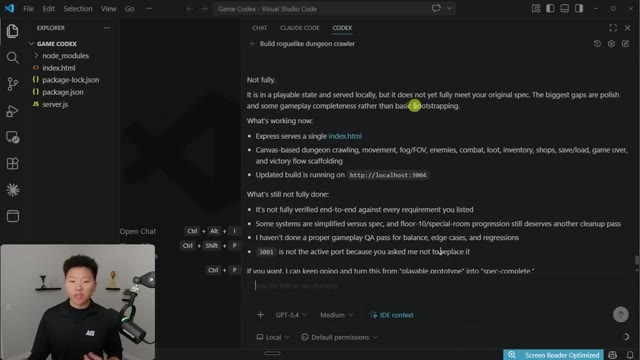
*⏱️ 00:07:52 — Interface de l'éditeur VS Code affichant une conversation avec une IA sous l'onglet "CODEX", détaillant l'état d'avancement du développement d'un jeu roguelike.*

*⏱️ 00:08:02 — Capture d'écran de l'interface du jeu "Dungeon Crawler" en cours d'exécution dans un navigateur web, avec les boutons "New Game" et "Continue".*

---

### ⏱️ `[00:08:07 - 00:08:27]` | Segment #19

**🔊 Audio (Transcription Intégrale Mot pour Mot en Français) :**
> And you can see here, we have a little nav bar on the right with our floor. I think maybe our health, our stats, our XP, equipment, gold, combat log. We have a little mini map. And then we have our controls. So if I start moving around here, you can see that I can kind of see what's going on. I can break through these little barriers. And here's like a goblin, apparently.

**👁️ Analyse Visuelle d'Écran (gemini-3.5-flash-lite) :**
**Interface & Outils** : Interface utilisateur de jeu vidéo (Web/Application personnalisée).

**Contenu textuel & Code** : Données de jeu affichées : "Floor 1", "Health 30/30", "ATK 5", "DEF 2", "SPD 1", "Level 1", "Combat Log: You enter the dungeon...", listes des commandes clavier (WASD, I, E, Space, .).

**Action / Démonstration** : Démonstration de l'interface de jeu par le présentateur, avec visualisation du personnage (représenté par "@") se déplaçant sur la grille.

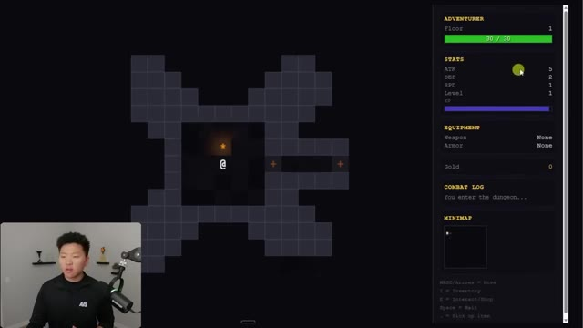
*⏱️ 00:08:12 — Interface d'un jeu de type roguelike textuel montrant une zone de jeu à grille sur la gauche et un panneau latéral droit détaillant les statistiques (santé, ATK, DEF, SPD, XP), l'équipement, un journal de combat, une mini-carte et les commandes.*

---

### ⏱️ `[00:08:27 - 00:08:50]` | Segment #20

**🔊 Audio (Transcription Intégrale Mot pour Mot en Français) :**
> I can move up here. There's a skeleton. Here's some gold. I don't know how to pick that up exactly. I don't know exactly what all this stuff is, but you can see that it is, you know, it's a 2D playable game. It's nothing crazy, but the mini map starts to unlock. And honestly, like for one prompt and maybe like about a five minute workflow, this is not too bad. But now let's just go ahead and close out of that and let's go over to Codex's version.

**👁️ Analyse Visuelle d'Écran (gemini-3.5-flash-lite) :**
**Interface & Outils** : Jeu web 2D / Navigateur.

**Contenu textuel & Code** : Panneaux "Adventurer" (PV, stats, équipement), "Combat Log" (historique des actions de combat) et une "Minimap" en bas à droite.

**Action / Démonstration** : Le joueur explore le donjon, avec un journal de combat affichant les interactions réussies contre un squelette.

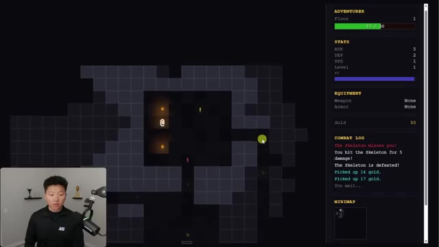
*⏱️ 00:08:33 — Interface d'un jeu de rôle 2D minimaliste (type rogue-like) avec une grille de jeu centrale, des statistiques de personnage et un journal de combat sur la droite.*

---

### ⏱️ `[00:08:50 - 00:09:27]` | Segment #21

**🔊 Audio (Transcription Intégrale Mot pour Mot en Français) :**
> This is what the initial UI looks like. And already it looks a little bit more polished and it feels more like an app. And I can go ahead and start this new game here. And let me just zoom in a little bit more now. this one already looks a lot less pixely and i guess i died really quick but this one looks a lot less pixely and it just feels a little bit more polished as you can see um i don't actually see on this right hand side though i guess the mini map is down there so there is still the mini map but overall i would have definitely said that codex did a better job of this game on the first one shot prompt than cloud code did so now what i would do is i would come back into this game

**👁️ Analyse Visuelle d'Écran (gemini-3.5-flash-lite) :**
**Interface & Outils** : Interface utilisateur web (application de jeu type RPG textuel/visuel).

**Contenu textuel & Code** : Panneau latéral avec : "ADVENTURER: Delver", "30/30 HP", statistiques (ATK 5, DEF 2, SPD 1), équipement ("None"), statistiques de partie (Run Stats) et "COMBAT LOG" indiquant "You enter the dungeon".

**Action / Démonstration** : Le présentateur affiche l'interface utilisateur initiale du jeu en cours d'exécution, permettant de visualiser la progression du personnage dans le donjon.

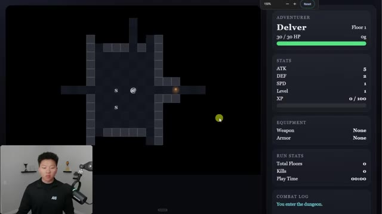
*⏱️ 00:08:59 — Interface d'un jeu de type "dungeon crawler" généré, affichant une carte en grille à gauche et les statistiques du personnage (PV, ATK, DEF, équipement, log de combat) dans une colonne latérale à droite.*

---

### ⏱️ `[00:09:27 - 00:09:48]` | Segment #22

**🔊 Audio (Transcription Intégrale Mot pour Mot en Français) :**
> the version that was built with Cloud Code, and I would just want to do an adversarial review. And then what I'm going to do after Codex comes back with this review, I'm just going to tell Opus, go implement all of these changes. And then we're going to open up the game again and see how much different it is. But that's why it's always interesting to test things out yourself, because some people were saying that Codex does a worse job with like UI design.

**👁️ Analyse Visuelle d'Écran (gemini-3.5-flash-lite) :**
**Interface & Outils** : Visual Studio Code, Terminal de commande intégré (Claude Code/Codex), Présentation graphique.

**Contenu textuel & Code** : Dans l'image 1 : commande `/codex:adversarial-review` et exécution de scripts Bash (`git status`, `git diff`). Dans l'image 2 : texte "Codex Weaknesses", "Needs Detail", "Flat Output", "Less Creative", "Rigid Names".

**Action / Démonstration** : L'utilisateur lance une revue contradictoire via une commande d'agent dans VS Code pour analyser le code avant de demander une implémentation.

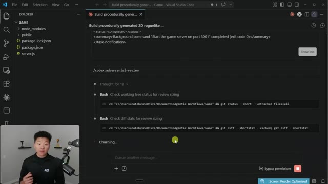
*⏱️ 00:09:32 — Interface VS Code affichant l'exécution d'une commande d'agent IA dans le terminal intégré.*

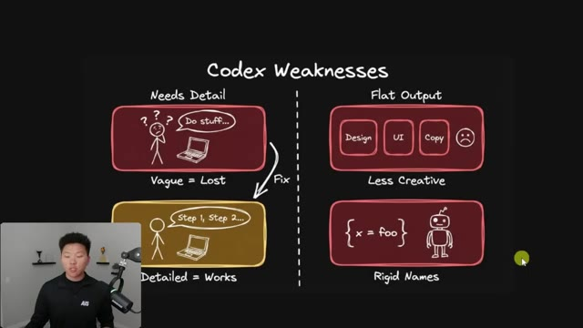
*⏱️ 00:09:43 — Slide de présentation schématique illustrant les limites et faiblesses identifiées de l'agent Codex (manque de détails, output plat).*

---

### ⏱️ `[00:09:48 - 00:10:17]` | Segment #23

**🔊 Audio (Transcription Intégrale Mot pour Mot en Français) :**
> Although clearly from this example with the same prompt, Codex's version in my mind was a lot better. Now, as this is running, I did want to just address something real quick, which is basically like, okay, if Codex is just better than CloudCode and it's cheaper, then why would I not just use Codex instead? And that's honestly a very fair question. And the only answer that I can give you is download it, try it, and just see which one you like better. From what I've been playing around with so far, I think there's definitely very clear strengths where Codex is better than CloudCode.

**👁️ Analyse Visuelle d'Écran (gemini-3.5-flash-lite) :**
**Interface & Outils** : Visual Studio Code (avec une extension de type Claude/Agent IA).

**Contenu textuel & Code** : Commande shell `node "C:\Users\nateh\.claude\plugins\marketplaces\openai-codex\plugins\codex\scripts\codex-companion.mjs" adversarial` et logs d'exécution.

**Action / Démonstration** : Exécution en arrière-plan d'un script d'analyse adversaire (adversarial review) par l'agent IA.

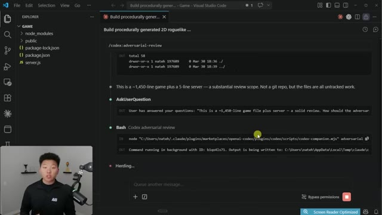
*⏱️ 00:09:55 — Interface de VS Code montrant l'exécution d'un processus "Codex adversarial review" au sein d'une fenêtre de chat intégrée.*

---

### ⏱️ `[00:10:17 - 00:10:51]` | Segment #24

**🔊 Audio (Transcription Intégrale Mot pour Mot en Français) :**
> But overall, I really like the way CloudCode feels. I think that it's a lot more forgiving, especially for me because I don't come from a formal software engineering background. And that type of feel aligns with a lot of the stuff that I've been seeing other people say as well. But I'll tell you for sure that I'm definitely going to be using this Codex plugin to help review stuff and to help build on extra features. And maybe one day I'll get to the point where I decide that I want to use Codex 80% and Cloud Code 20 rather than the other way around. So this is now running in the background and I wanted to show you guys what it looks like when you do the Codex status. It basically just shows you the exact job that has, you know, been running and how

**👁️ Analyse Visuelle d'Écran (gemini-3.5-flash-lite) :**
**Interface & Outils** : Visual Studio Code avec extension Claude Code.

**Contenu textuel & Code** : Commandes terminal affichées : `/codex:adversarial-review`, `git init`, `echo "node_modules/" > .gitignore`. Messages système indiquant le succès de l'initialisation du dépôt Git.

**Action / Démonstration** : L'outil d'IA initialise automatiquement un dépôt Git local et configure le fichier .gitignore pour le projet avant de poursuivre la revue de code.

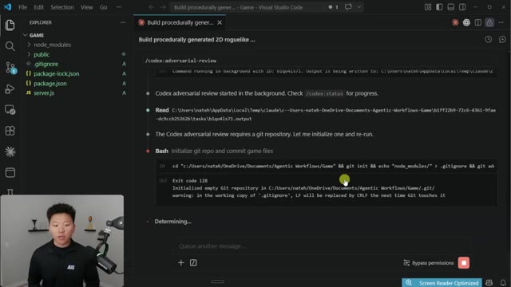
*⏱️ 00:10:25 — Interface de VS Code montrant l'exécution d'un outil d'IA "Codex" effectuant une revue contradictoire et l'initialisation d'un dépôt Git pour un projet de jeu 2D.*

---

### ⏱️ `[00:10:51 - 00:11:10]` | Segment #25

**🔊 Audio (Transcription Intégrale Mot pour Mot en Français) :**
> long it's been running. And it looks like that's actually finished up because now it's giving us another output. And this is interesting because I just spun up this game as a demo. There was no actual branch to compare itself with, or there was no commit. So what it decided to do is rerun it properly by creating a review branch so that Codex can actually diff the actual game code.

**👁️ Analyse Visuelle d'Écran (gemini-3.5-flash-lite) :**
**Interface & Outils** : Visual Studio Code avec l'extension de workflow agentique "Codex".

**Contenu textuel & Code** : Log d'exécution montrant une erreur de comparaison ("no branch diff to compare against"), suivie d'une commande Bash pour créer une branche orpheline (`git checkout --orphan empty-base`) et l'ID de processus d'arrière-plan associé.

**Action / Démonstration** : L'agent identifie une erreur de contexte Git, explique la nécessité de recréer une branche pour effectuer un diff, et exécute automatiquement des commandes Git pour corriger le workflow.

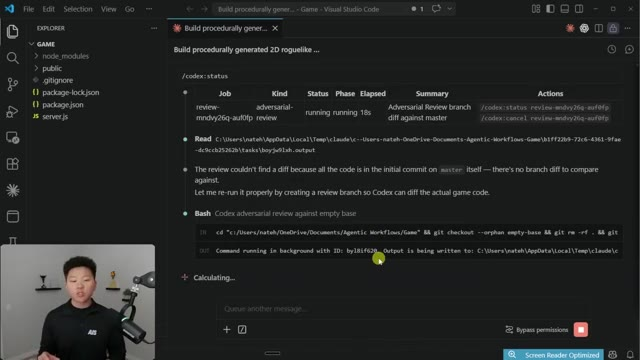
*⏱️ 00:10:55 — Interface VS Code affichant l'extension Codex en pleine exécution d'une revue de code, avec une zone de chat interactif détaillant l'absence de branche de comparaison et le lancement d'une nouvelle commande Bash.*

---

### ⏱️ `[00:11:10 - 00:11:44]` | Segment #26

**🔊 Audio (Transcription Intégrale Mot pour Mot en Français) :**
> So this has come back and keep in mind that these changes that it's suggesting are probably not going to be anything to do with the UI. So that won't really see any changes. It's about the actual gameplay. And it's about the actual like functionality of the code and how this works. So we have just two high things. We have final floor stairs, let the player soft lock the run permanently, but the ancient amulet is only ever spawned when floor equals 10. So there's no matching upward travel mechanic and victory only triggers from using the amulet. So a player can therefore step on floor 10 stairs before collecting the amulet, get sent to floor 11, and then the run

**👁️ Analyse Visuelle d'Écran (gemini-3.5-flash-lite) :**
**Interface & Outils** : Visual Studio Code avec l'extension Claude/Codex intégrée.

**Contenu textuel & Code** : Rapport "Codex Adversarial Review" identifiant des problèmes de logique de jeu ("soft-lock" au niveau 10, problème de sauvegarde de progression) dans le fichier `public/index.html`.

**Action / Démonstration** : L'agent présente ses conclusions (findings) concernant des bugs critiques de gameplay sans modifier l'interface utilisateur, conformément à la narration audio.

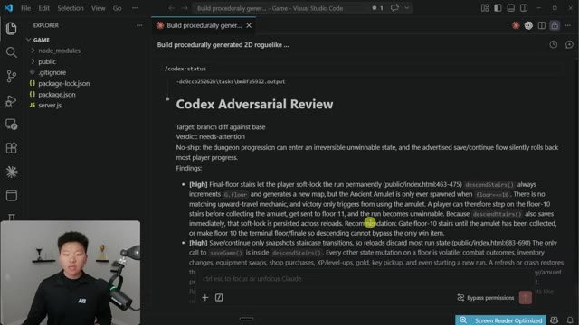
*⏱️ 00:11:19 — L'éditeur Visual Studio Code affiche un rapport d'analyse de code généré par un agent IA appelé "Codex".*

---

### ⏱️ `[00:11:44 - 00:12:10]` | Segment #27

**🔊 Audio (Transcription Intégrale Mot pour Mot en Français) :**
> becomes unwinnable. So that's definitely a flaw in the way that this was actually built from Opus. And then there's another issue over here, as you can see, which is a real data loss rollback bug for a game that exposes a continue entry point. So it gives us a recommendation for how to fix both of these. We can gate floor 10 stairs and we can also persist after state changing player actions or debounce and autosave after each turn and on major events like new game, blah, blah, blah, blah, blah.

**👁️ Analyse Visuelle d'Écran (gemini-3.5-flash-lite) :**
**Interface & Outils** : Visual Studio Code (avec une extension de type "Codex" ou interface d'agent intégrée).

**Contenu textuel & Code** : Rapport d'analyse technique détaillant deux problèmes critiques : un "soft-lock" au niveau 10 (l'escalier vers le niveau 11 avant d'avoir l'amulette) et un bug de perte de données/rollback lié à la fonction `saveGame()` qui ne sauvegarde qu'aux transitions d'escaliers.

**Action / Démonstration** : Le modèle d'IA présente ses conclusions et ses recommandations de correction pour les bugs identifiés dans le code du jeu (public/index.html).

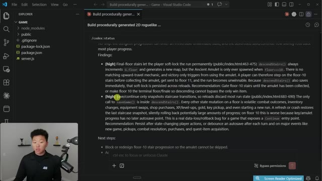
*⏱️ 00:11:51 — Une capture d'écran de l'interface VS Code montrant un rapport d'audit de code généré par un agent (probablement Claude Code) concernant un bug de progression dans un jeu roguelike.*

---

### ⏱️ `[00:12:10 - 00:12:43]` | Segment #28

**🔊 Audio (Transcription Intégrale Mot pour Mot en Français) :**
> So I'm just going to go ahead on bypass permissions mode, just say implements. But obviously all of this stuff is kind of more of a demo. I would be taking this feedback and I would be once again going into a plan mode with CloudCode and then taking that plan and telling it to go ahead and make the changes. So those changes have been made as you can see and if I go ahead and open up the game and I give it a quick refresh, like I said nothing really about the UI of the game has changed but apparently those changes have been fixed and actually it does already look a little bit better for some reason. I'm probably just making that up but anyways the point being that was a super strong combination

**👁️ Analyse Visuelle d'Écran (gemini-3.5-flash-lite) :**
**Interface & Outils** : VS Code (avec extension IA intégrée), Interface de jeu web/natif roguelike.

**Contenu textuel & Code** : Rapport de bug détaillé sur la gestion des sauvegardes (`saveGame()`), étapes de correction suggérées (bloquer la progression étage 10), statistiques de jeu (HP 30/30, Niveau 1).

**Action / Démonstration** : L'utilisateur active le mode "Bypass permissions" dans l'IA pour implémenter les corrections suggérées dans le code source du jeu.

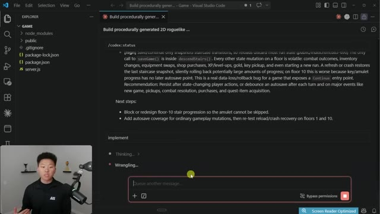
*⏱️ 00:12:18 — Interface VS Code affichant un outil d'IA type "Codex" qui analyse un bug de sauvegarde dans un jeu 2D roguelike et propose des étapes de résolution.*

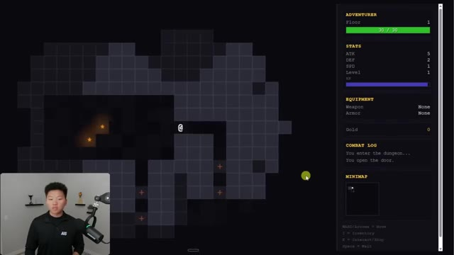
*⏱️ 00:12:35 — Aperçu de l'interface du jeu 2D généré, affichant une grille de donjon, les statistiques du personnage (PV, ATK, DEF) et un journal de combat.*

---

### ⏱️ `[00:12:43 - 00:13:02]` | Segment #29

**🔊 Audio (Transcription Intégrale Mot pour Mot en Français) :**
> as you can see, we're using Cloud Code and then the adversarial review with Codex. So anyways, that is gonna do it for this one. I know that I haven't made a video on Codex yet on this channel, but I've been playing around with all these different tools and focusing mainly on Cloud Code because I don't wanna just confuse you guys with throwing a bunch of different tools at you. But I do think that this one is definitely something that is worth checking out.

**👁️ Analyse Visuelle d'Écran (gemini-3.5-flash-lite) :**
**Interface & Outils** : - Image #1 : Visual Studio Code avec l'extension Claude Code.
- Image #2 : Plateforme X (anciennement Twitter) dans un navigateur web.

**Contenu textuel & Code** : - Image #1 : Extraits de code JavaScript (fonctions `debouncedSave` et `doTurn`) et liste des correctifs appliqués (Floor-10 stairs, Debounced autosave).
- Image #2 : Tweet de Romain Huet expliquant l'utilisation de Codex pour la revue de code dans Claude Code, avec une capture d'écran d'un terminal montrant la commande `/plugin`.

**Action / Démonstration** : - Image #1 : Affichage d'un journal de modifications généré automatiquement par l'IA au sein de l'éditeur.
- Image #2 : Navigation sur le web pour présenter l'annonce officielle et la documentation de l'intégration logicielle.

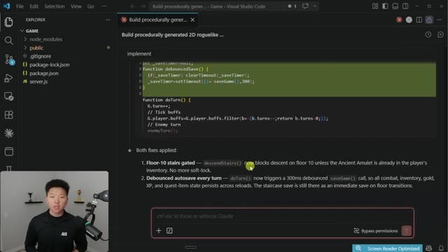
*⏱️ 00:12:48 — Interface VS Code affichant un projet de jeu 2D avec un bloc de code JavaScript et un rapport d'implémentation de corrections par l'agent IA.*

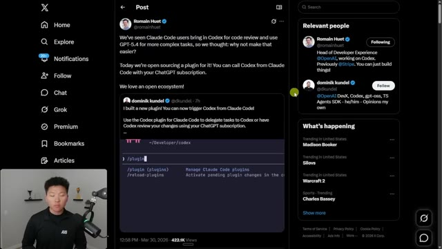
*⏱️ 00:12:53 — Interface du réseau social X affichant une publication sur l'intégration du plugin Codex dans Claude Code pour la revue de code.*

---

### ⏱️ `[00:13:03 - 00:13:10]` | Segment #30

**🔊 Audio (Transcription Intégrale Mot pour Mot en Français) :**
> So if you enjoyed the video or you learned something new, please give it a like, it helps me out a ton. And as always, I appreciate you guys making it to the end of the video. I'll see you on the next one. Thanks everyone.

**👁️ Analyse Visuelle d'Écran (gemini-3.5-flash-lite) :**
**Interface & Outils** : Réseau social X (anciennement Twitter) via navigateur web.

**Contenu textuel & Code** : Texte du post : "We've seen Claude Code users bring in Codex for code review and use GPT-5.4 for more complex tasks... Today we're open sourcing a plugin for it! You can call Codex from Claude Code with your ChatGPT subscription."

**Action / Démonstration** : Navigation sur les réseaux sociaux pour montrer une annonce liée à l'actualité de Claude Code et l'intégration de Codex.

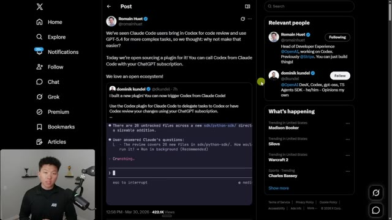
*⏱️ 00:13:04 — Capture d'écran de l'interface du réseau social X affichant un post de Romain Huet concernant l'intégration d'un plugin pour utiliser Codex via Claude Code.*

---

