# 🎬 Claude Code Just Gave Everyone Virtual Pets (April Fools?)

> **Chaîne** : [Nate Herk | AI Automation](https://www.youtube.com/@nateherk/featured)  
> **Lien YouTube** : [https://www.youtube.com/watch?v=JoPmpwpRrBI](https://www.youtube.com/watch?v=JoPmpwpRrBI)  
> **Date de publication** : 20260401  
> **Durée** : 00:07:14  
> **Identifiant vidéo** : `JoPmpwpRrBI`  
> **Transcription & Analyse** : `whisper-v3-large-turbo+gemini-3.5-flash-lite`  

---

## 📌 Synthèse Exécutive & Outils

### 💡 Résumé
Dans cette vidéo intitulée **Claude Code Just Gave Everyone Virtual Pets (April Fools?)**, Nate Herk décortique les capacités pratiques d'automatisation et de développement propulsées par les modèles de pointe.

### 🛠️ Outils, Modèles & Logiciels Présentés
- **Opus 5.5 & Claude Code** : Modèles d'ingénierie et agents de codage autonome.

### 🔑 Points Clés & Enseignements Stratégiques
- Optimiser le niveau d'effort et le raisonnement des modèles IA pour des résultats industriels.
- Automatiser les cycles de création logicielle de bout en bout.

---

## ⏱️ Chronologie & Transcription Complète Audio & Visuelle (Mot pour Mot)

### ⏱️ `[00:00:00 - 00:00:22]` | Segment #01

**🔊 Audio (Transcription Intégrale Mot pour Mot en Français) :**
> Yesterday, Cloud Code's entire source code was leaked and people started digging through it, and we saw little teasers of a buddy system. And today, April 1st, the slash buddy command has been released, which basically lets you use slash buddy, and it instantly starts hatching and spawning a little companion for you in your Cloud Code terminal. So right here, you can see that this person was able to pull a rare cat named Vexel. And you can see here, it has a little description.

**👁️ Analyse Visuelle d'Écran (gemini-3.5-flash-lite) :**
**Interface & Outils** : Plateforme Twitter (X) et terminal de commande (interface Claude Code).

**Contenu textuel & Code** : Commande saisie dans le terminal : "/buddy", avec la description affichée "Hatch a coding companion - pet, off".

**Action / Démonstration** : Démonstration de l'utilisation de la commande "/buddy" pour activer un compagnon virtuel dans l'outil de ligne de commande Claude Code.

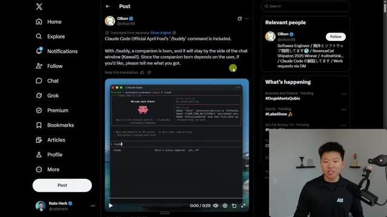
*⏱️ 00:00:06 — Une capture d'écran de Twitter montrant un post sur la commande "/buddy" de Claude Code, incluant une vidéo intégrée d'un terminal affichant l'interface de Claude Code.*

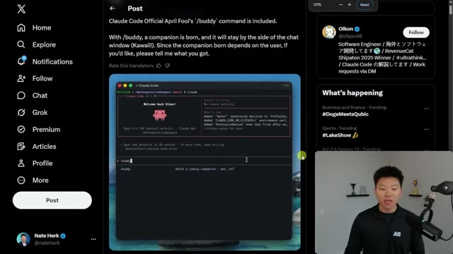
*⏱️ 00:00:11 — Une vue agrandie et centrée sur l'interface du terminal à l'intérieur du post Twitter, mettant en évidence la ligne de commande "/buddy" et son usage.*

---

### ⏱️ `[00:00:22 - 00:00:57]` | Segment #02

**🔊 Audio (Transcription Intégrale Mot pour Mot en Français) :**
> It has five stats, debugging, patience, chaos, wisdom, and snark. And then at the bottom, it says Vexil is here. It'll chime in as you code. Your buddy won't count towards your usage, but you can say its name to get its take. And if you want to get rid of it, you just do slash buddy off. So I'm going to show you guys exactly how to set this up. And I'm going to hatch my pet right here in front of you guys and tell you how this works. So before we get into that, I wanted to show you guys the different types of characters and the different rarities that you can get when you hatch your pet. You can see on the left, we are starting with like an uncommon. So this is a snail named Huskel. We've got a dragon. We've got an uncommon octopus. We've got a rare cat and a rare dragon. So that means just because you have a dragon doesn't mean it's going to be common.

**👁️ Analyse Visuelle d'Écran (gemini-3.5-flash-lite) :**
**Interface & Outils** : Terminal de ligne de commande (CLI) de Claude Code.

**Contenu textuel & Code** : Fiches de statistiques (Debugging, Patience, Chaos, Wisdom, Snark), art ASCII représentant des créatures, commandes "/buddy", "/buddy pet", "/buddy off".

**Action / Démonstration** : Démonstration des différentes options de "buddy" (compagnons IA) disponibles pour assister l'utilisateur dans son environnement de développement.

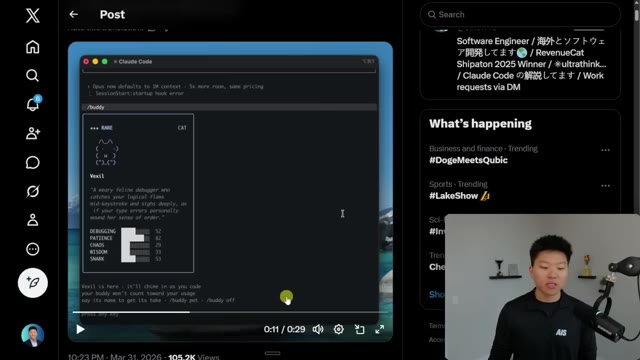
*⏱️ 00:00:31 — Capture d'écran montrant une interface de terminal "Claude Code" présentant la fiche descriptive du personnage "Vexil" avec ses statistiques de débogage.*

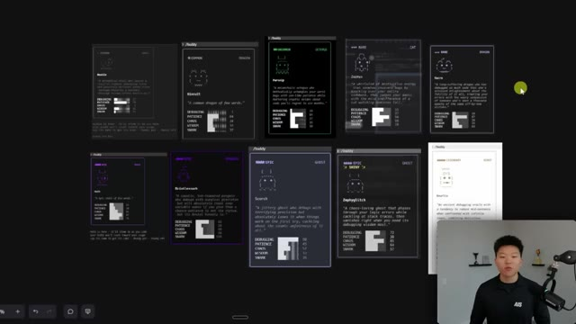
*⏱️ 00:00:40 — Vue d'ensemble affichant une galerie de multiples personnages "buddy" (compagnons) avec différents niveaux de rareté et caractéristiques graphiques (ASCII art).*

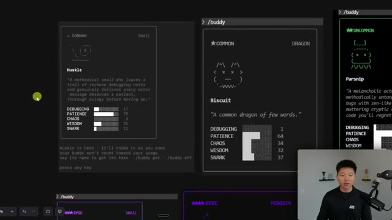
*⏱️ 00:00:49 — Gros plan sur une sélection de cartes de personnages type "Huskle" et "Biscuit" dans l'interface de configuration des compagnons.*

---

### ⏱️ `[00:00:58 - 00:01:35]` | Segment #03

**🔊 Audio (Transcription Intégrale Mot pour Mot en Français) :**
> You can get a different character from a different rarity and they'll all have their own name, description, and stats. And then you can see we can keep moving up. Here's an epic snail. Here's an epic penguin. Here's an epic ghost. Here's an epic shiny ghost. And here is a legendary robot. So apparently these pets are tied directly to like your user ID. So once you pull one, you're unable to re-roll. So let's real quick just hop into Cloud Code and see if I can't pull a pretty cool pet. So I'm in my VS Code. I'm going to go ahead and just open up a terminal here. I think that's how you have to use it. If we go ahead and pull up Claude, you can see that I am on version 2.1.89, which is the version that you need to be on here. And you can see over here in a little

**👁️ Analyse Visuelle d'Écran (gemini-3.5-flash-lite) :**
**Interface & Outils** : VS Code (Image 3), Interface web personnalisée de jeu/collection (Images 1, 2)

**Contenu textuel & Code** : Noms de personnages (Zephyglitch, Knurlix, Biscuit), statistiques de compétences (barres graphiques), commandes shell Windows (Image 3).

**Action / Démonstration** : Navigation et présentation de la collection de personnages générés par IA, exploration de l'environnement de développement du projet.

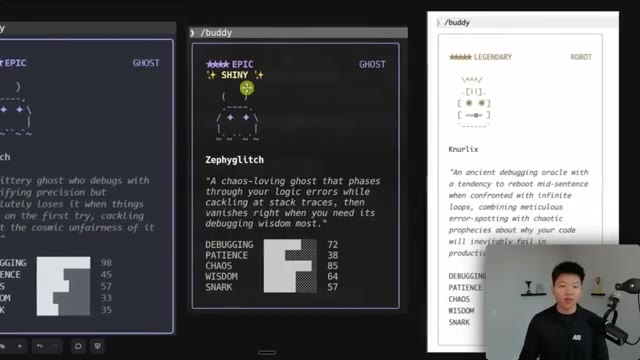
*⏱️ 00:01:07 — Gros plan sur une interface utilisateur affichant trois cartes de personnages stylisées avec du texte et des statistiques (Debugging, Patience, Chaos, etc.).*

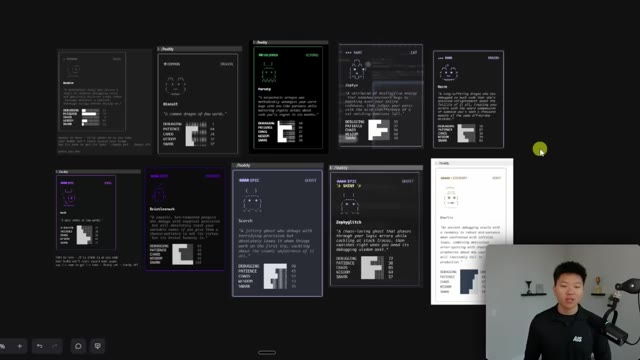
*⏱️ 00:01:16 — Vue d'ensemble d'une interface présentant une grille de dix cartes de personnages aux raretés variées (Common, Epic, Legendary).*

---

### ⏱️ `[00:01:35 - 00:02:10]` | Segment #04

**🔊 Audio (Transcription Intégrale Mot pour Mot en Français) :**
> rainbow font, we've got the slash buddy prompting us. So we're going to go ahead and do a slash buddy, hatch a companion, pet, and I'm going to run this. Let's see what we get. Hatching a coding buddy, it'll watch you work and occasionally have opinions. Oof, we got a common turtle. It's fine. We have vortex the common turtle a chaotic turtle that spins in frantic circles whenever you hit a bug offering zero patience But absolute confidence that thrashing around is somehow productive vortex is here blah blah blah Okay, so press any key. Let's just hit enter and I think I can't see him because my terminal is kind of a little small right now So there we go. If I expand it up, we can see that vortex says

**👁️ Analyse Visuelle d'Écran (gemini-3.5-flash-lite) :**
**Interface & Outils** : Visual Studio Code avec le terminal intégré Claude Code (v2.1.89).

**Contenu textuel & Code** : Commande saisie : "/buddy" ; texte affiché : "hatching a coding buddy... it'll watch you work and occasionally have opinions" avec une représentation graphique en art ASCII.

**Action / Démonstration** : L'utilisateur exécute la commande "/buddy" via Claude Code pour initialiser un compagnon IA dans son environnement de développement.

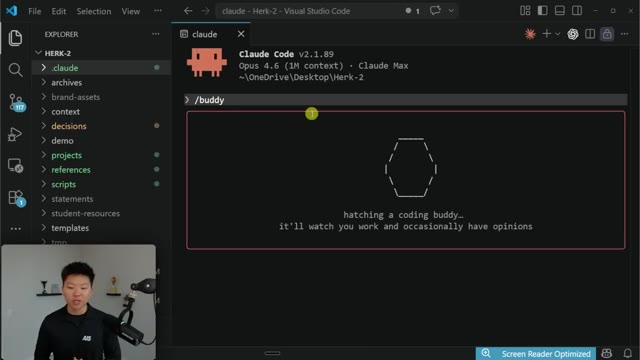
*⏱️ 00:01:43 — Interface VS Code affichant le terminal "Claude Code" où la commande "/buddy" est en cours d'exécution pour faire éclore un compagnon de codage.*

---

### ⏱️ `[00:02:10 - 00:02:31]` | Segment #05

**🔊 Audio (Transcription Intégrale Mot pour Mot en Français) :**
> Okay, there was a little chat bubble there. I'm not sure if you guys saw that. Let's just see if we can say Hey vortex Okay, cool So you can see that it will sometimes respond in a little chat bubble right over here, which is kind of funny. Now, once again, these have no actual functional impact on your coding or no extra impact on your token usage. So we're going to keep playing around a little bit and see what it does when we're running through some long prompts.

**👁️ Analyse Visuelle d'Écran (gemini-3.5-flash-lite) :**
**Interface & Outils** : Visual Studio Code (avec terminal intégré Claude Code v2.1.89).

**Contenu textuel & Code** : La commande "> hey Vortex" saisie dans le terminal, suivie d'un statut "Slithering..." et de l'avatar ASCII de l'agent "Vortex".

**Action / Démonstration** : L'utilisateur interagit avec l'agent IA via le terminal et observe la réponse textuelle/visuelle de l'agent.

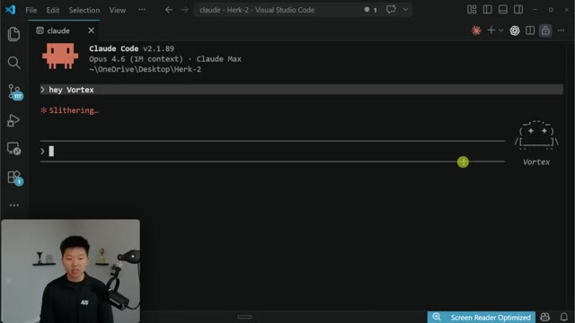
*⏱️ 00:02:15 — Une capture d'écran de l'interface VS Code montrant une instance de Claude Code en exécution, avec une bulle de dialogue stylisée en ASCII intitulée "Vortex" à droite.*

---

### ⏱️ `[00:02:31 - 00:03:04]` | Segment #06

**🔊 Audio (Transcription Intégrale Mot pour Mot en Français) :**
> But for now, let's just hop into this doc so I can explain to you guys exactly how this works and what it is. So this is Claude Code's new Buddy feature, which is a fun Tamagotchi style virtual pet system that lives directly in your terminal while you code. It launched very recently april 1st with version 2.1.89 and people on x are you know sharing all of the different versions of pets that they've hatched It's kind of funny. So if you want to do this for yourself Go ahead and update cloud code start a cloud code session in your terminal and then do a slash buddy Just like you guys saw me if you open up cloud code in just the regular extension through vs code

**👁️ Analyse Visuelle d'Écran (gemini-3.5-flash-lite) :**
**Interface & Outils** : Google Docs (ou éditeur de texte en ligne).

**Contenu textuel & Code** : Texte explicatif sur la fonctionnalité Tamagotchi de Claude Code incluant les commandes terminal (`npm install -g @anthropic-ai/claude-code`, `/buddy`, `/buddy pet`, `/buddy off`) et des détails sur les mécaniques du compagnon virtuel.

**Action / Démonstration** : Présentation informative du document décrivant le fonctionnement et les commandes de la fonctionnalité "Buddy".

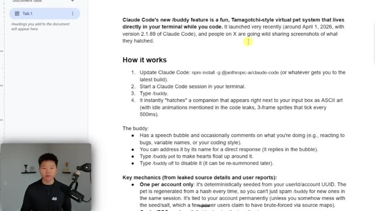
*⏱️ 00:02:40 — Capture d'écran montrant un document textuel expliquant la fonctionnalité "/buddy" de Claude Code, avec le présentateur en médaillon dans le coin inférieur gauche.*

---

### ⏱️ `[00:03:04 - 00:03:40]` | Segment #07

**🔊 Audio (Transcription Intégrale Mot pour Mot en Français) :**
> I don't think you're going to see a buddy here and even if you type in slash buddy There's not even going to be a matching command So you have to be doing this in your terminal The buddy has a speech bubble and will occasionally comment on what you're doing, which is kind of funny You can address it by its name and get a direct response You can type slash buddy pet to make hearts float up around it and you can type slash buddy off to turn it off So let's see real quick if I do this slash Buddy oops slash buddy pet Oh no, cool. We actually do get some hearts over here. Okay, fine. That was acceptable resume chaos He's definitely not very Patient so here is where it gets interesting. There is only one per account

**👁️ Analyse Visuelle d'Écran (gemini-3.5-flash-lite) :**
**Interface & Outils** : Visual Studio Code (extension Claude Code).

**Contenu textuel & Code** : Commandes terminal "/buddy pet", historique de dialogue avec l'agent et affichage ASCII du personnage "Vortex" avec une bulle de dialogue ("Okay fine, that was... acceptable. Resume chaos.").

**Action / Démonstration** : Démonstration de l'interaction avec le compagnon virtuel dans le terminal, incluant une commande de caresse ("/buddy pet") et la réponse textuelle personnalisée de l'agent.

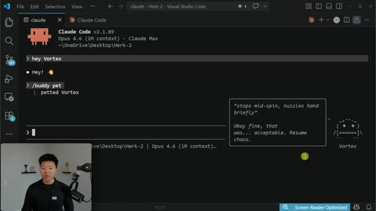
*⏱️ 00:03:31 — Interface de Visual Studio Code avec le terminal Claude Code affichant un compagnon ASCII nommé "Vortex" et sa bulle de texte interactive.*

---

### ⏱️ `[00:03:40 - 00:03:59]` | Segment #08

**🔊 Audio (Transcription Intégrale Mot pour Mot en Français) :**
> It is deterministically seeded from your user ID. So it's regenerated from your hash every single time. So you can't just spam buddy and get a new one in the same session. It's tied to your account permanently. So just to test that out, if I go ahead and exit out of Claude code here and we go ahead and just like open up a new session, we still have the same buddy.

**👁️ Analyse Visuelle d'Écran (gemini-3.5-flash-lite) :**
**Interface & Outils** : VS Code, Documentation technique (type Google Docs/Notion), terminal Claude Code.

**Contenu textuel & Code** : Documentation sur les mécanismes de "Gacha/RPG system", liste des espèces de compagnons (duck, goose, blob, etc.), niveaux de rareté (Common à Legendary) et commande terminal "claude --resume [ID]".

**Action / Démonstration** : Présentation des concepts théoriques du système de familier, suivie d'une démonstration pratique dans le terminal Claude Code pour interagir avec le compagnon virtuel.

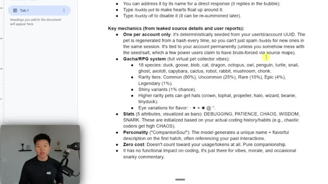
*⏱️ 00:03:44 — Une page de documentation technique détaillée présentant les mécanismes du système de "Buddy" (familier virtuel), incluant les probabilités de rareté, les statistiques et le fonctionnement lié à l'ID utilisateur.*

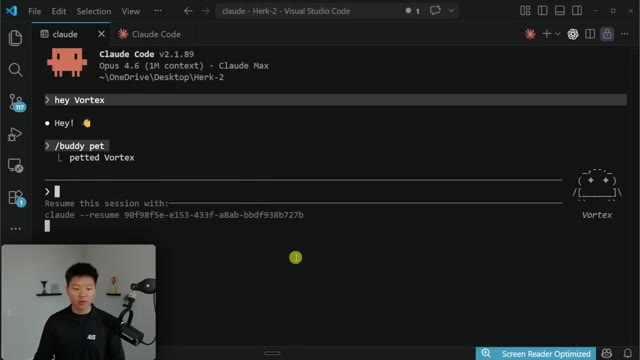
*⏱️ 00:03:54 — Une interface VS Code affichant le terminal "Claude Code" avec une interaction utilisateur, la commande "/buddy pet" et l'affichage d'un petit personnage en art ASCII nommé "Vortex".*

---

### ⏱️ `[00:03:59 - 00:04:33]` | Segment #09

**🔊 Audio (Transcription Intégrale Mot pour Mot en Français) :**
> And if I just did a regular slash buddy, it's not going to hatch a new one for me. We are, I'm not gonna say stuck with, I don't wanna hurt his feelings, but we are stuck with Vortex. I should probably just give him a quick pet. okay anyways there is a rpg system so it's a full virtual pet collector sort of feel there's 18 different species duck goose blob cat dragon octopus owl penguin turtle snail ghost axolotl capybar cactus robot rabbit mushroom trunk i also saw someone on x said that they got a waffle so maybe that was just you know an ai generated image and they were trolling but maybe there's

**👁️ Analyse Visuelle d'Écran (gemini-3.5-flash-lite) :**
**Interface & Outils** : Visual Studio Code (Image 1), Éditeur de texte/Note (Image 2).

**Contenu textuel & Code** : Commande `/buddy`, détails de l'objet "Vortex", liste des espèces (duck, goose, blob, etc.), niveaux de rareté et attributs RPG.

**Action / Démonstration** : Présentation visuelle de l'état actuel du compagnon (Vortex) suivie de l'explication théorique du système de collection RPG intégré à l'outil.

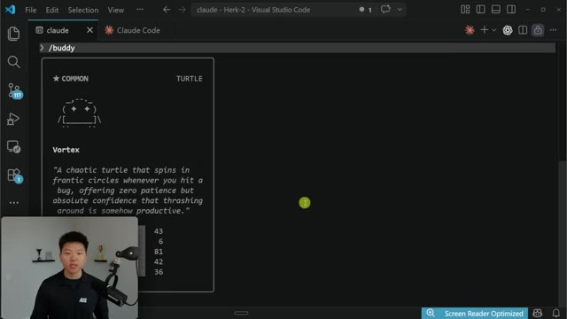
*⏱️ 00:04:07 — Interface VS Code affichant une carte interactive du compagnon virtuel nommée "Vortex", une tortue de rareté "Common", avec ses statistiques chiffrées en bas.*

*⏱️ 00:04:16 — Une page de documentation textuelle listant les mécaniques du système "Gacha/RPG" du compagnon (espèces, raretés, statistiques comme DEBUGGING ou CHAOS).*

---

### ⏱️ `[00:04:33 - 00:04:58]` | Segment #10

**🔊 Audio (Transcription Intégrale Mot pour Mot en Français) :**
> more than 18 species so if you guys run this and you get something please share in the comments what you're getting. Now this is funny because I'm sure you guys have seen the leaks of the model that Anthropic is working on called Capybara. Some are saying it's just kind of Opus 4.6 or the next version of it, but that is something to note that we saw in some of the leaks. So when it comes to rarity, common is 60%, uncommon is 25%, rare is 10%, epic is 4%, and legendary is 1%.

**👁️ Analyse Visuelle d'Écran (gemini-3.5-flash-lite) :**
**Interface & Outils** : Éditeur de documents de type Google Docs ou outil de prise de notes.

**Contenu textuel & Code** : Liste détaillée des fonctionnalités : "Key mechanics", "18 species" (duck, goose, blob, etc.), "Rarity tiers" (Common, Uncommon, Rare, etc.), ainsi que les statistiques de l'IA ("DEBUGGING, PATIENCE, CHAOS, WISDOM, SNARK").

**Action / Démonstration** : Le document sert de support visuel à l'explication des rumeurs sur le projet "Capybara" et ses fonctionnalités ludiques cachées dans une interface de codage.

*⏱️ 00:04:40 — Capture d'écran montrant un document textuel détaillant les mécaniques de jeu (système Gacha/RPG) d'un "animal de compagnie virtuel" intégré à un environnement de développement, incluant les espèces, les niveaux de rareté et les statistiques.*

---

### ⏱️ `[00:04:58 - 00:05:17]` | Segment #11

**🔊 Audio (Transcription Intégrale Mot pour Mot en Français) :**
> Shiny variants also have a 1% chance. Higher rarity pets apparently can get hats like crowns, top hats, propellers, halos, wizards, beanies, or a little tiny duck on top. And there are different eye variations for flavor. So these are the different little like characters that could be eyes. Let's see, I forgot what ours was. It were these little stars right there. So it is interesting.

**👁️ Analyse Visuelle d'Écran (gemini-3.5-flash-lite) :**
**Interface & Outils** : Google Docs / Éditeur de texte riche.

**Contenu textuel & Code** : Texte détaillé expliquant les mécaniques du système de pets : "One per account only", "Gacha/RPG system" (18 espèces, niveaux de rareté, variantes shiny, chapeaux, variations d'yeux), "Stats" (Debugging, Patience, Chaos, Wisdom, Snark), et "Personality".

**Action / Démonstration** : Présentation informative des spécificités techniques et des probabilités liées au système de pets intégré dans l'outil discuté.

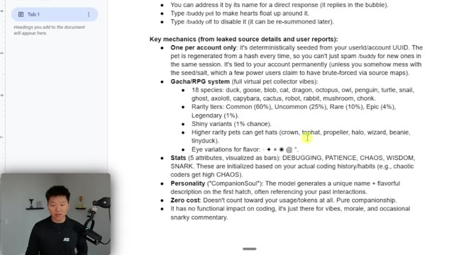
*⏱️ 00:05:02 — Une capture d'écran montrant un document textuel (probablement Google Docs ou une application de prise de notes) listant les mécaniques détaillées du système de "pets" (animaux de compagnie virtuels), avec le présentateur en médaillon en bas à gauche.*

---

### ⏱️ `[00:05:17 - 00:05:53]` | Segment #12

**🔊 Audio (Transcription Intégrale Mot pour Mot en Français) :**
> I'm sure that there is, you know, so many different variations of what you could get as far as the species, the rarity, if it's shiny, the hat, and maybe even the eye variation. So it'll be interesting to see if anyone's getting the exact same character, but then of course the name and the stats will probably be different. This is pretty cool. So debugging, patience, chaos, wisdom, and snark are initialized based on your actual coding history and habits. So chaotic coders get high chaos, which means if I go back into my buddy and see if we can pull up the stats, Claude Code thinks that I am not very patient and I have a lot of chaos. The model also generates

**👁️ Analyse Visuelle d'Écran (gemini-3.5-flash-lite) :**
**Interface & Outils** : Google Docs, Visual Studio Code (Terminal Claude Code).

**Contenu textuel & Code** : Liste détaillée des mécaniques de jeu (Gacha/RPG), raretés (Common à Legendary), probabilités, et logs d'exécution du terminal incluant la commande `/buddy pet`.

**Action / Démonstration** : Présentation théorique des fonctionnalités du "Buddy" dans le document, suivie de l'exécution pratique de la commande dans le terminal de l'éditeur.

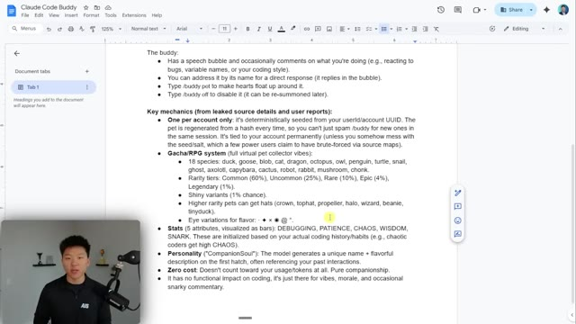
*⏱️ 00:05:26 — Une page de document Google Docs détaillée listant les mécaniques du système "Claude Code Buddy", incluant les espèces, les niveaux de rareté et les variations cosmétiques (chapeaux, yeux).*

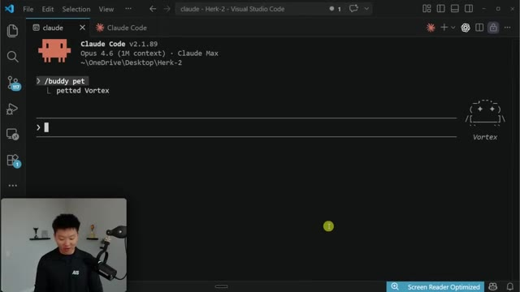
*⏱️ 00:05:44 — Une interface VS Code affichant le terminal "Claude Code" où la commande "/buddy pet" a été exécutée, confirmant l'interaction avec une créature nommée "Vortex".*

---

### ⏱️ `[00:05:53 - 00:06:28]` | Segment #13

**🔊 Audio (Transcription Intégrale Mot pour Mot en Français) :**
> a unique name and a flavorful description on the first hatch, once again, often referencing your pass interactions. And of course, zero cost. It doesn't eat up your tokens. It's just for fun and it has no impact on your actual coding. So the last thing I wanted to do here is I wanted to just shoot it off on kind of a longer task and see if Vortex says or does anything as it's coding. All right, so I'm going to start off in plan mode and just ask it to start building me this game. And this is going to be, of course, a very high level plan. Okay, so it just explored the context and now you can see Vortex has said, whoa, whoa, roguelike becomes shooter. That's spin, spin, spin chaos.

**👁️ Analyse Visuelle d'Écran (gemini-3.5-flash-lite) :**
**Interface & Outils** : Visual Studio Code, Claude Code CLI.

**Contenu textuel & Code** : Documentation sur les systèmes de rareté et de statistiques des compagnons ; commande "/buddy pet" ; prompt de génération de jeu 2D.

**Action / Démonstration** : Présentation des fonctionnalités ludiques de l'agent puis exécution d'un prompt pour le développement d'un jeu.

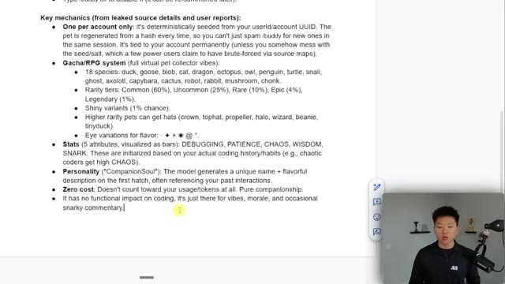
*⏱️ 00:06:02 — Une page de documentation textuelle présentant les mécaniques détaillées du système de "compagnon virtuel" (pet) intégré à l'outil.*

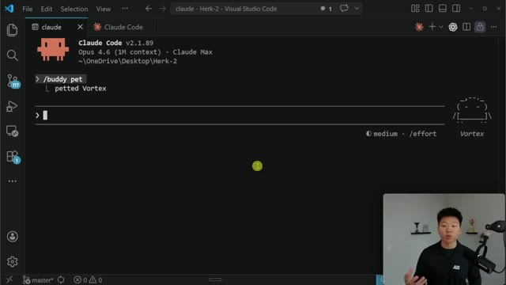
*⏱️ 00:06:10 — L'interface de ligne de commande Claude Code au sein de VS Code montrant l'interaction "/buddy pet" avec un animal nommé "Vortex".*

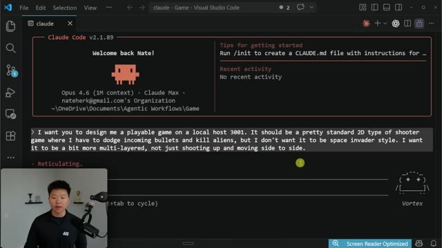
*⏱️ 00:06:19 — L'interface Claude Code où une commande détaillée est saisie pour générer un jeu de tir 2D complexe sur localhost 3001.*

---

### ⏱️ `[00:06:28 - 00:07:02]` | Segment #14

**🔊 Audio (Transcription Intégrale Mot pour Mot en Français) :**
> So it is, it seems like it is actually understanding what we're talking about here. And it made a comment about the game that we are building right here. I wonder if you can do a slash by the way, and still talk to Vortex. Hey, Vortex, what are you working on? Okay. He literally just waved. He didn't say anything else. And by the way, if you didn't know about the slash BTW, it just basically means that you can ask a one-off question to CloudCode without interrupting what you were already doing. So it could save you a lot of tokens or some extra time. So anyways, that is the slash buddy feature. Go in here, update CloudCode, run your buddy, and then let me know in the comments

**👁️ Analyse Visuelle d'Écran (gemini-3.5-flash-lite) :**
**Interface & Outils** : Visual Studio Code (terminal intégré), Claude Code (v2.1.89).

**Contenu textuel & Code** : Le terminal affiche une requête utilisateur pour scrapper X (Twitter) à propos de la fonctionnalité "/buddy", l'exécution d'une commande Bash pour récupérer une clé API, et l'avatar ASCII de l'agent "Vortex" en bas à droite.

**Action / Démonstration** : L'agent IA (Vortex) est en train d'exécuter une tâche de recherche sur X suite à une instruction de l'utilisateur.

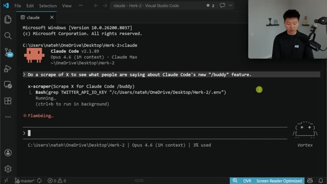
*⏱️ 00:06:37 — Une capture d'écran de l'interface VS Code montrant un terminal intégré où s'exécute Claude Code avec l'agent "Vortex".*

---

### ⏱️ `[00:07:02 - 00:07:14]` | Segment #15

**🔊 Audio (Transcription Intégrale Mot pour Mot en Français) :**
> what you guys got. I'm really curious to see what are some of the coolest things that people are able to pull. So that's going to do it for this one. If you learned something new or you enjoyed, please give it a like. It helps me out a ton. And as always, I appreciate you guys making it to the end. I'll see you on the next one. Thanks everyone.

**👁️ Analyse Visuelle d'Écran (gemini-3.5-flash-lite) :**
**Interface & Outils** : Visual Studio Code (éditeur de code).

**Contenu textuel & Code** : Une carte de personnage nommée "Vortex" (classe: Turtle, rareté: Common) avec une représentation graphique en art ASCII et des statistiques (Debugging 43, Patience 6, Chaos 81, Wisdom 42, Snark 36).

**Action / Démonstration** : Affichage du résultat d'une interaction avec un agent ou un script automatisé sous forme de carte de jeu textuelle.

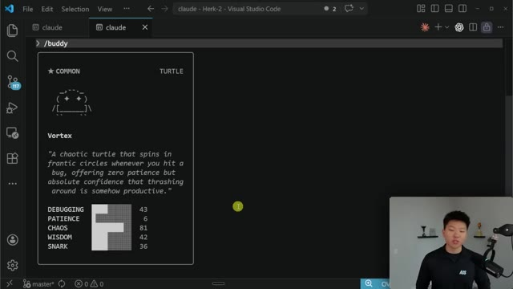
*⏱️ 00:07:05 — Une carte de personnage stylisée en art ASCII affichée dans un terminal intégré à Visual Studio Code.*

---

