# 🎬 Claude Code Source Code Just Leaked… 8 Things You Must Do

> **Chaîne** : [Nate Herk | AI Automation](https://www.youtube.com/@nateherk/featured)  
> **Lien YouTube** : [https://www.youtube.com/watch?v=tXtCK66fPj8](https://www.youtube.com/watch?v=tXtCK66fPj8)  
> **Date de publication** : 20260401  
> **Durée** : 00:12:51  
> **Identifiant vidéo** : `tXtCK66fPj8`  
> **Transcription & Analyse** : `whisper-v3-large-turbo+gemini-3.5-flash-lite`  

---

## 📌 Synthèse Exécutive & Outils

### 💡 Résumé
Dans cette vidéo intitulée **Claude Code Source Code Just Leaked… 8 Things You Must Do**, Nate Herk décortique les capacités pratiques d'automatisation et de développement propulsées par les modèles de pointe.

### 🛠️ Outils, Modèles & Logiciels Présentés
- **Opus 5.5 & Claude Code** : Modèles d'ingénierie et agents de codage autonome.

### 🔑 Points Clés & Enseignements Stratégiques
- Optimiser le niveau d'effort et le raisonnement des modèles IA pour des résultats industriels.
- Automatiser les cycles de création logicielle de bout en bout.

---

## ⏱️ Chronologie & Transcription Complète Audio & Visuelle (Mot pour Mot)

### ⏱️ `[00:00:00 - 00:00:35]` | Segment #01

**🔊 Audio (Transcription Intégrale Mot pour Mot en Français) :**
> So CloudCode's source code just got leaked to the internet. 2,000 files, over half a million lines of production code, the actual code base behind CloudCode. Here's what happened. Anthropic published an npm package that included a source map file pointing to readable TypeScript source on their servers. A security researcher found it, followed the breadcrumbs, and the full source was mirrored publicly on GitHub within hours. It went super viral. So I went through everything that people found, and I went through the code base, and I pulled out every practical insight that will actually change how you use Cloud Code. I'm talking hidden commands that most people have no idea exist, how context and tokens actually work under the hood, and what the architecture

**👁️ Analyse Visuelle d'Écran (gemini-3.5-flash-lite) :**
**Interface & Outils** : Plateforme X (Twitter).

**Contenu textuel & Code** : Texte du tweet mentionnant la fuite du code source via un fichier "map" dans le registre npm, accompagné d'une capture d'écran d'une liste de répertoires et fichiers (arborescence du projet).

**Action / Démonstration** : Visualisation d'une preuve de la fuite de données (leaks) pour illustrer l'explication du présentateur.

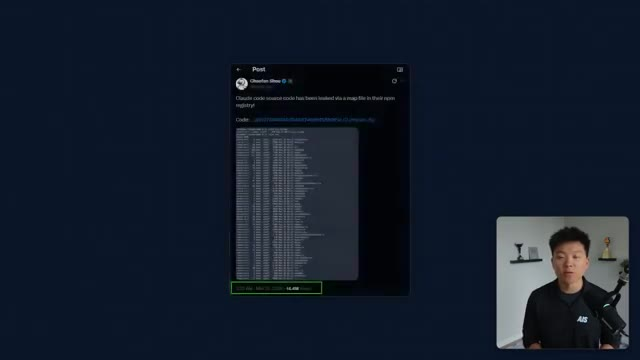
*⏱️ 00:00:09 — Capture d'écran d'un tweet/post sur X (Twitter) montrant une liste de fichiers révélés suite à la fuite du code source de Claude Code.*

---

### ⏱️ `[00:00:35 - 00:00:55]` | Segment #02

**🔊 Audio (Transcription Intégrale Mot pour Mot en Français) :**
> reveals about features most users never touch. I broke it down into eight key insights that we're going to talk about today, and each one builds on the previous one. The first few will change how you think about the tool, but the last one ties everything together into a system, and that's where the real leverage is. So by the end of this video, you'll know how to use Cloud Code like a top 1% user, so let's get into it. Okay, I do have to start off with a quick disclaimer.

**👁️ Analyse Visuelle d'Écran (gemini-3.5-flash-lite) :**
**Interface & Outils** : Aucune interface logicielle active.

**Contenu textuel & Code** : Texte informatif sur le sujet de la vidéo.

**Action / Démonstration** : Le présentateur introduit la structure de sa vidéo.

---

### ⏱️ `[00:00:55 - 00:01:29]` | Segment #03

**🔊 Audio (Transcription Intégrale Mot pour Mot en Français) :**
> I'm not going to show you guys any of the actual source code in this video And i'd encourage you to be careful if you go downloading it yourself Even though this leaked through a public npm package Anthropic still owns the copyright They've shown that they're willing to send dmca takedown notices So everything i'm covering is just based on takeaways of how you can use the tool better All right So just to start off real quick and to give you a taste of what's in this code base You know those little messages that you see while cloud code is thinking that's a file with 187 spinner verbs in it You've got normal ones like computing or generating, but then you've also got funny ones like boondoggling

**👁️ Analyse Visuelle d'Écran (gemini-3.5-flash-lite) :**
**Interface & Outils** : Aucune interface logicielle ou outil technique n'est affiché.

**Contenu textuel & Code** : Texte d'avertissement listant : "No actual source code shown", "Anthropic owns the copyright", "DMCA takedowns sent".

**Action / Démonstration** : Le présentateur s'exprime face caméra en expliquant les risques juridiques liés au code source d'Anthropic.

---

### ⏱️ `[00:01:29 - 00:01:54]` | Segment #04

**🔊 Audio (Transcription Intégrale Mot pour Mot en Français) :**
> discombobulating, fibbertagibbing, moonwalking, things like that. And someone at Anthropic got paid to write 187 of these I just think you know That's the energy that I want from the people that are building my tools. But anyways, that's just a quick appetizer Let's get into the stuff that actually matters here. So starting off with number one It's not what you think it is The first thing this leak reveals is that cloud code is not what most people think it is Because most people think that it's basically just like cloud but in your terminal like a chatbot with access to your local files.

**👁️ Analyse Visuelle d'Écran (gemini-3.5-flash-lite) :**
**Interface & Outils** : Terminal de ligne de commande (CLI).

**Contenu textuel & Code** : Liste de termes : "/Boondoggling...", "/Discombobulating...", "/Flibbertigibbeting...", "/Moonwalking...", "/Razzmatazzing...", "/Shenaniganing...".

**Action / Démonstration** : Affichage des messages de statut ou de chargement fantaisistes de l'outil Anthropic cité dans la vidéo.

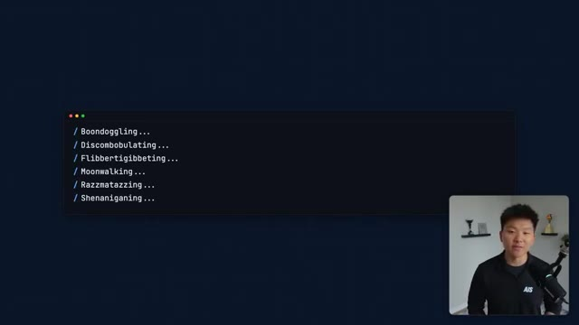
*⏱️ 00:01:35 — Une capture d'écran montrant une fenêtre de terminal affichant une liste de termes humoristiques précédés de barres obliques, avec le présentateur en médaillon dans le coin inférieur droit.*

---

### ⏱️ `[00:01:55 - 00:02:13]` | Segment #05

**🔊 Audio (Transcription Intégrale Mot pour Mot en Français) :**
> And that's completely wrong. What the source code shows is that CloudCode is a full agent runtime. It's a proper application built with Bun, TypeScript, and React. It has a tool system, a command system, a memory system, a permission engine, a task manager, a multi-agent coordinator, and an MCP client and server all wired together under one execution pipeline.

**👁️ Analyse Visuelle d'Écran (gemini-3.5-flash-lite) :**
**Interface & Outils** : Terminal de ligne de commande (CLI).

**Contenu textuel & Code** : La commande `$ claude --version` est écrite dans le terminal.

**Action / Démonstration** : L'utilisateur s'apprête à vérifier la version de l'outil Claude Code.

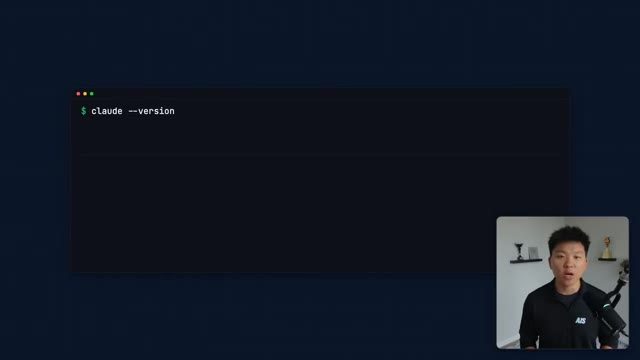
*⏱️ 00:01:59 — Une fenêtre de terminal sombre affichant une commande saisie par l'utilisateur.*

---

### ⏱️ `[00:02:13 - 00:02:33]` | Segment #06

**🔊 Audio (Transcription Intégrale Mot pour Mot en Français) :**
> So the flow goes, your input hits a CLI parser. It goes to something called the query engine, calls the LLM API, runs a tool execution loop, and then renders results back in your terminal. So I know that sounded like a bunch of gibberish. So why does this matter to you? Because if you're using Cloud Code like a chatbot, meaning you're just typing questions and hoping for good answers, you're using maybe 10% of what it can actually do.

**👁️ Analyse Visuelle d'Écran (gemini-3.5-flash-lite) :**
**Interface & Outils** : Diagramme de flux graphique intégré à la vidéo.

**Contenu textuel & Code** : Séquence logique : "CLI Parser" > "Query Engine" > "LLM API" > ">"

**Action / Démonstration** : Illustration visuelle du processus technique décrit par l'orateur pour expliquer comment une commande utilisateur est traitée par un agent IA.

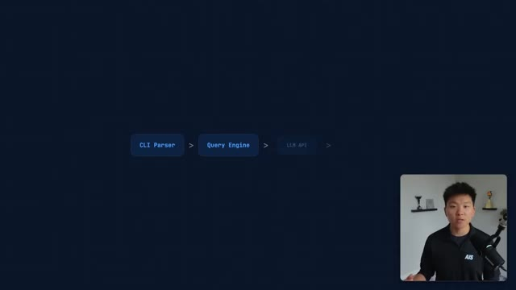
*⏱️ 00:02:18 — Schéma de flux simplifié illustrant les étapes d'exécution d'un outil d'IA en ligne de commande.*

---

### ⏱️ `[00:02:33 - 00:02:54]` | Segment #07

**🔊 Audio (Transcription Intégrale Mot pour Mot en Français) :**
> The rest of the value is in the systems that are built around the model. And that's what the rest of this video is about. So the second piece is the command service that you're ignoring. Here's something that most people don't realize about Cloud Code, that the source code revealed there's 85 slash commands in Cloud Code, roughly. Most users may know maybe five of them. You probably type slash help and that's about it, or maybe slash context.

**👁️ Analyse Visuelle d'Écran (gemini-3.5-flash-lite) :**
**Interface & Outils** : Logiciel de présentation (type PowerPoint ou Canva).

**Contenu textuel & Code** : Texte affiché : "SECTION 2" suivi de "The Command Surface You're Ignoring".

**Action / Démonstration** : Le présentateur introduit la deuxième partie de la vidéo concernant les surfaces de commande.

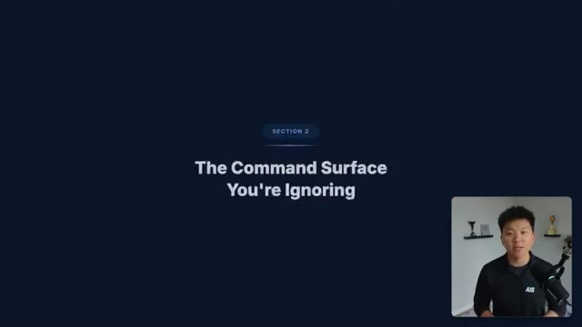
*⏱️ 00:02:38 — Une diapositive de présentation affiche le titre de la section "The Command Surface You're Ignoring" avec le présentateur en médaillon dans le coin inférieur droit.*

---

### ⏱️ `[00:02:54 - 00:03:14]` | Segment #08

**🔊 Audio (Transcription Intégrale Mot pour Mot en Français) :**
> But the power users, the ones getting 10 times more value out of Cloud Code, are using commands like shortcuts. Here are the ones that matter most. You've got slash init, which sets up your project context. It generates a Cloud.md file that acts as Cloud Code's operating manual for your repository. And we'll talk more about why this file is so important in a second. We also have slash plan or slash ultra plan.

**👁️ Analyse Visuelle d'Écran (gemini-3.5-flash-lite) :**
**Interface & Outils** : Terminal de ligne de commande (Claude CLI)

**Contenu textuel & Code** : Commande shell : "claude /help --all | wc -l". Résultats affichés : "85 commands found", "Most users know: ~5", "Power users know: 15+".

**Action / Démonstration** : Exécution d'une requête dans le terminal pour lister et compter le nombre total de commandes disponibles dans l'outil Claude Code.

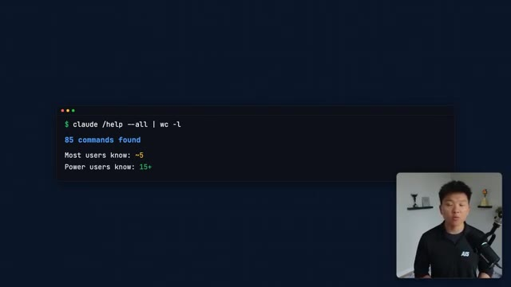
*⏱️ 00:02:59 — Capture d'un terminal affichant le nombre de commandes disponibles pour l'outil Claude CLI, avec une comparaison entre les utilisateurs standards et les "power users".*

---

### ⏱️ `[00:03:14 - 00:03:34]` | Segment #09

**🔊 Audio (Transcription Intégrale Mot pour Mot en Français) :**
> These put Cloud Code into planning mode. Instead of immediately executing, it maps out the full approach first, and then it asks you before it starts touching files. And this is huge when you're working on something complex, and you don't want it to just start editing things everywhere. You're also going to save tokens in the long run doing this. You've got slash compact, and this is a big one for saving money. When your conversation gets long, context gets expensive.

**👁️ Analyse Visuelle d'Écran (gemini-3.5-flash-lite) :**
**Interface & Outils** : Terminal de ligne de commande (CLI).

**Contenu textuel & Code** : Commandes affichées : "$ claude /plan" et "$ claude /ultraplan", accompagnées des descriptions : "Planning mode activated", "Maps out approach first", "Asks before editing".

**Action / Démonstration** : Démonstration textuelle des commandes permettant de passer l'agent IA en mode planification avant toute modification de fichiers.

*⏱️ 00:03:19 — Capture d'écran montrant une interface de terminal illustrant l'activation des commandes de planification pour l'outil Claude.*

---

### ⏱️ `[00:03:34 - 00:03:53]` | Segment #10

**🔊 Audio (Transcription Intégrale Mot pour Mot en Français) :**
> So slash compact compresses your conversation history so you can keep the important stuff, but drop the noise. And if you're burning through tokens, this is one of the fastest fixes. You can also do slash compact and then give it a prompt. So if you want to compact a project but keep all of the important information about the website integration, you can specify that when you run your compaction. Then we have slash review and slash security review.

**👁️ Analyse Visuelle d'Écran (gemini-3.5-flash-lite) :**
**Interface & Outils** : Terminal de ligne de commande (Claude CLI).

**Contenu textuel & Code** : Commande exécutée : "$ claude /compact". Résultat affiché : "Before: 142,000 tokens ($4.26)", "After: 28,000 tokens ($0.84)", "Saved: 80%".

**Action / Démonstration** : Exécution de la fonction de compactage de l'historique de conversation pour optimiser la consommation de jetons.

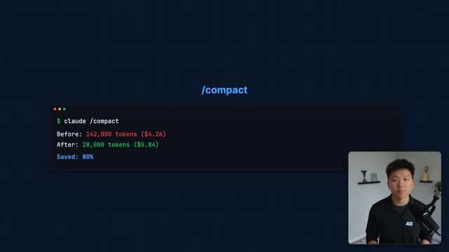
*⏱️ 00:03:39 — Une capture d'écran montrant l'exécution de la commande "/compact" dans un terminal Claude, affichant une réduction significative de l'utilisation des jetons.*

---

### ⏱️ `[00:03:53 - 00:04:11]` | Segment #11

**🔊 Audio (Transcription Intégrale Mot pour Mot en Français) :**
> These are built-in code review workflows. Instead of asking CloudCode to look at my code, you just use these commands and it runs a structured review. And the fact that these exist as dedicated commands tells you something. That review isn't an afterthought in this product. It is a first-class workflow. Then we have slash context. This manages what files CloudCode is actually paying attention to.

**👁️ Analyse Visuelle d'Écran (gemini-3.5-flash-lite) :**
**Interface & Outils** : Terminal de ligne de commande (CLI) "Claude".

**Contenu textuel & Code** : Les commandes `/review` et `/security-review` sont affichées. La sortie du terminal indique le succès ([ok]) pour les catégories "Architecture", "Security" et "Performance" suite à l'exécution de la commande `/review`.

**Action / Démonstration** : Démonstration de l'exécution de commandes de workflow de revue de code intégrées directement dans l'interface en ligne de commande de l'outil.

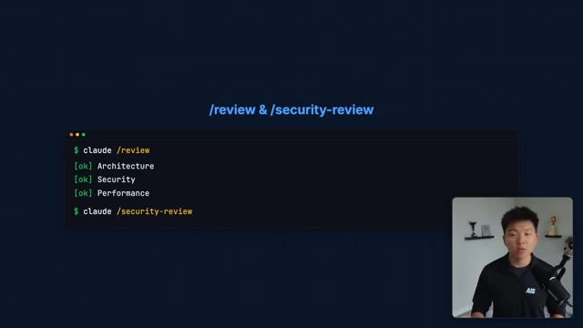
*⏱️ 00:03:58 — Capture d'écran montrant l'utilisation de commandes intégrées dans un terminal pour effectuer des revues de code automatisées.*

---

### ⏱️ `[00:04:11 - 00:04:34]` | Segment #12

**🔊 Audio (Transcription Intégrale Mot pour Mot en Français) :**
> This matters because every file in context costs you tokens. So this command gives you more visibility so you can help clean up your project. Slash cost. This one shows you what you've actually spent. Most people usually have no idea how much a session is costing them until they look at the bill. So run slash cost. Then we have slash resume and slash summary. These let you pick up where you left off between sessions without having to re-explain everything.

**👁️ Analyse Visuelle d'Écran (gemini-3.5-flash-lite) :**
**Interface & Outils** : Terminal CLI Claude (Claude Code)

**Contenu textuel & Code** : Commande `$ claude /context` avec les résultats affichés : "Files: 12 | Tokens: 47,200" et "Active context: src/**, tests/**".

**Action / Démonstration** : Consultation de l'utilisation actuelle des ressources contextuelles par l'agent IA.

*⏱️ 00:04:17 — Capture d'écran montrant l'exécution de la commande `/context` dans l'interface CLI de Claude, affichant le nombre de fichiers et de jetons utilisés.*

---

### ⏱️ `[00:04:34 - 00:04:54]` | Segment #13

**🔊 Audio (Transcription Intégrale Mot pour Mot en Français) :**
> And that's only the tip of the iceberg when it comes to all of these different built-in commands. The point is better prompts are one lever, but knowing these commands is a completely separate lever that most people aren't even touching. Next one, number three, we have the memory system and it is way more important than you think. The source code here reveals that CloudCode has a full memory system and the center of it is a file called cloud.md.

**👁️ Analyse Visuelle d'Écran (gemini-3.5-flash-lite) :**
**Interface & Outils** : Présentation graphique (diapositive)

**Contenu textuel & Code** : Texte affiché : "Better Prompts", "Better Commands" et "Most people only pull one lever".

**Action / Démonstration** : Illustration conceptuelle du sujet abordé par le présentateur sur les méthodes d'optimisation de l'utilisation des outils IA.

*⏱️ 00:04:39 — Une diapositive minimaliste sur fond bleu sombre présentant deux boutons stylisés, "Better Prompts" (inactif) et "Better Commands" (en surbrillance), avec le texte "Most people only pull one lever" en dessous, accompagnée d'une fenêtre incrustée montrant le présentateur.*

---

### ⏱️ `[00:04:54 - 00:05:13]` | Segment #14

**🔊 Audio (Transcription Intégrale Mot pour Mot en Français) :**
> Now, most people either ignore this file or dump a bunch of random notes into it. And that's a huge mistake because cloud.md is not documentation, it's operating context. So think of it like this. And you guys know I love analogies. If CloudCode is an employee, then claw.md is their onboarding document. It tells them, here's how we do things. Here's what matters. Here's what we never do.

**👁️ Analyse Visuelle d'Écran (gemini-3.5-flash-lite) :**
**Interface & Outils** : Terminal de ligne de commande (CLI).

**Contenu textuel & Code** : Commande : `cat CLAUDE.md`. Contenu du fichier : "CLAUDE.md" et la phrase "The center of Claude Code's memory system".

**Action / Démonstration** : Visualisation du contenu d'un fichier de configuration système pour l'agent Claude Code.

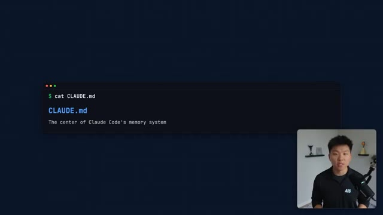
*⏱️ 00:04:59 — Capture d'écran montrant un terminal affichant le contenu du fichier CLAUDE.md et le présentateur en médaillon.*

---

### ⏱️ `[00:05:13 - 00:05:31]` | Segment #15

**🔊 Audio (Transcription Intégrale Mot pour Mot en Français) :**
> And here's how this project is structured. The best users keep the claw.md file short, opinionated, and operational. Things like we use TypeScript strict mode always. Tests go in test folders next to the source file. Never modify the database schema without running migrations. Use pnpm, not npm. That kind of stuff. Decision rules, constraints, conventions.

**👁️ Analyse Visuelle d'Écran (gemini-3.5-flash-lite) :**
**Interface & Outils** : Présentation graphique (type diaporama).

**Contenu textuel & Code** : Texte affiché : "Claude Code = Employee", flèche de transition, "CLAUDE.md = Onboarding Doc", ainsi que trois piliers thématiques : "How we do things", "What matters", "What to never do".

**Action / Démonstration** : Le présentateur explique la structure de fonctionnement des projets utilisant l'outil Claude Code.

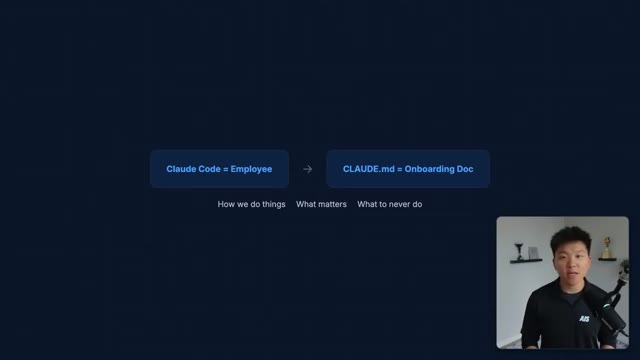
*⏱️ 00:05:17 — Schéma conceptuel illustrant l'analogie entre l'agent IA et la documentation : "Claude Code = Employee" lié à "CLAUDE.md = Onboarding Doc".*

---

### ⏱️ `[00:05:32 - 00:05:52]` | Segment #16

**🔊 Audio (Transcription Intégrale Mot pour Mot en Français) :**
> Not a novel about your project's history. The source also reveals that there are multiple layers to this. You've got user level memory, extracted memories, and even team memory synchronization. What that tells us is that Cloud Code has persistent memory mechanisms across project, user, and session contexts. And Cloud.MD is one of the highest leverage inputs shaping how it behaves in future sessions.

**👁️ Analyse Visuelle d'Écran (gemini-3.5-flash-lite) :**
**Interface & Outils** : Présentation graphique (type diaporama).

**Contenu textuel & Code** : Texte affiché : "User-Level Memory - Per-user preferences & habits".

**Action / Démonstration** : Illustration visuelle du concept théorique abordé par l'orateur concernant la mémoire persistante des systèmes d'IA.

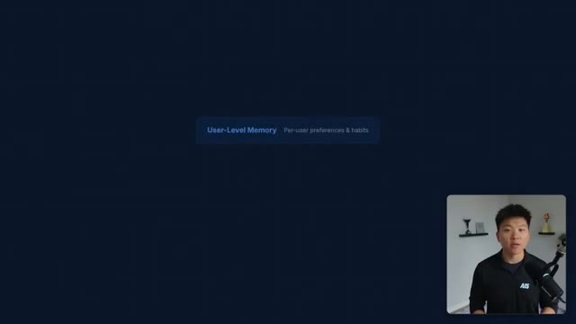
*⏱️ 00:05:37 — Une infographie minimaliste sur fond bleu sombre présentant le concept de "User-Level Memory" avec une brève description explicative, accompagnée du présentateur en médaillon en bas à droite.*

---

### ⏱️ `[00:05:52 - 00:06:12]` | Segment #17

**🔊 Audio (Transcription Intégrale Mot pour Mot en Français) :**
> So if you get nothing else from this video, go update your Cloud.MD file today, whether that's on the global level or the project level. And remember, these get injected every single session before every single chat. All right, number four, we have that permissions are why Claude might feel slow. If you've used Claude code, you've hit this. You ask it to do something and it keeps asking, allow me to do this.

**👁️ Analyse Visuelle d'Écran (gemini-3.5-flash-lite) :**
**Interface & Outils** : Terminal de ligne de commande (CLI).

**Contenu textuel & Code** : La commande `claude /init` est affichée à l'intérieur du bloc terminal.

**Action / Démonstration** : Incitation textuelle à initialiser ou mettre à jour le fichier de configuration spécifique à Claude pour optimiser les performances de l'agent.

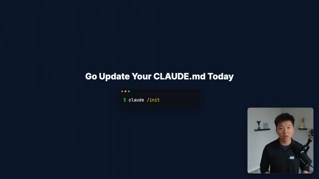
*⏱️ 00:05:57 — Une diapositive de présentation affichant le texte "Go Update Your CLAUDE.md Today" au centre, accompagnée d'un bloc de terminal stylisé en dessous.*

---

### ⏱️ `[00:06:12 - 00:06:32]` | Segment #18

**🔊 Audio (Transcription Intégrale Mot pour Mot en Français) :**
> Will you allow me to do this? Can I run this? Can I edit this? And it's really annoying. And most people think the fix is better prompting, but it's not. The fix is permissions. The source code shows us a deep permission system with multiple modes. Default mode where it asks you about everything, plan mode. And then there are things like bypass permissions or auto modes where it can just execute. But here's the real gem. You can set wildcard permissions.

**👁️ Analyse Visuelle d'Écran (gemini-3.5-flash-lite) :**
**Interface & Outils** : Terminal de ligne de commande (CLI).

**Contenu textuel & Code** : Liste de demandes d'autorisation avec choix binaire [Y/n] pour des commandes telles que "git status", "edit src/app.tsx", "npm test", "git diff", "read package.json", et "mkdir components".

**Action / Démonstration** : L'agent IA sollicite l'utilisateur pour valider chaque action individuelle avant exécution, illustrant le système de permissions évoqué.

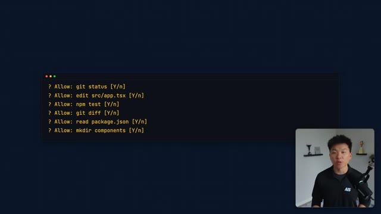
*⏱️ 00:06:17 — Une fenêtre de terminal affichant une liste de requêtes de permission système pour un agent IA, avec le présentateur en médaillon dans le coin inférieur droit.*

---

### ⏱️ `[00:06:32 - 00:07:01]` | Segment #19

**🔊 Audio (Transcription Intégrale Mot pour Mot en Français) :**
> So things like allow all git commands or allow all file edits in my SRC folder. So instead of Cloud Code asking you 15 times, can I run git status or can I edit this file? Can I run this test? You set the rule once and then it just works. So for recurring workflows, stuff that you do every day, this is one of the highest ROI changes that you can make. So in your settings.local.json or in your settings.json, you can set global or user level or project level permissions for things that you always want to allow or have it always deny or have it always ask to do.

**👁️ Analyse Visuelle d'Écran (gemini-3.5-flash-lite) :**
**Interface & Outils** : Terminal de ligne de commande (CLI) Claude Code.

**Contenu textuel & Code** : Commande `claude permissions --add` suivie d'une liste de permissions accordées : "Allow all git commands", "Allow file edits in src/", et "Allow npm test".

**Action / Démonstration** : Ajout de règles de permissions permanentes pour automatiser les workflows récurrents de l'agent IA.

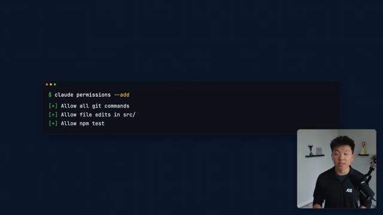
*⏱️ 00:06:39 — Une fenêtre de terminal affichant la configuration des permissions pour l'outil Claude Code, avec le présentateur en médaillon dans le coin inférieur droit.*

---

### ⏱️ `[00:07:02 - 00:07:24]` | Segment #20

**🔊 Audio (Transcription Intégrale Mot pour Mot en Français) :**
> And this lets you go from babysitting every action to actually being able to let it operate like an agent while you step away. So number five is that it is built from multi-agent work. And this one surprised me. The source code reveals a full coordinator subsystem, agent tools, team tools, and a task system designed for background and parallel work. So what does this mean in plain English? That the architecture is clearly built to support decomposition, splitting work across multiple agents that can run in parallel.

**👁️ Analyse Visuelle d'Écran (gemini-3.5-flash-lite) :**
**Interface & Outils** : Logiciel de présentation (type PowerPoint ou Google Slides).

**Contenu textuel & Code** : Texte affiché : "SECTION 5 - It's Built for Multi-Agent Work".

**Action / Démonstration** : Aucune action technique ou logicielle montrée, il s'agit d'un support visuel statique illustrant le point abordé par l'orateur.

---

### ⏱️ `[00:07:24 - 00:07:49]` | Segment #21

**🔊 Audio (Transcription Intégrale Mot pour Mot en Français) :**
> So think one agent exploring your code base, another one implementing changes, and another validating tests. There are even concepts in the source for background tasks, work that continues while you're focused on something else. Now, how much of this is fully user-facing today versus still rolling out? That's a little bit harder to say from the source alone, but the architecture makes the intent clear, which is that Cloud Code is designed to handle complex, multi-step work by breaking it apart, not by cramming it all into one thread.

**👁️ Analyse Visuelle d'Écran (gemini-3.5-flash-lite) :**
**Interface & Outils** : Diagramme dynamique sur fond sombre.

**Contenu textuel & Code** : Le schéma montre un bloc central intitulé "Big Task" relié à trois sous-blocs : "Exploring" (bleu), "Implementing" (vert) et "Testing" (jaune).

**Action / Démonstration** : Présentation visuelle de l'architecture multi-agents pour le développement logiciel.

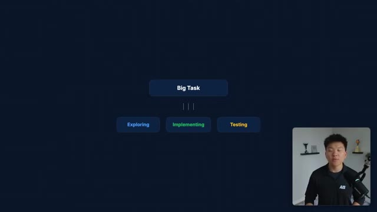
*⏱️ 00:07:30 — Un schéma conceptuel illustrant la décomposition d'une tâche complexe en trois sous-tâches gérées par des agents IA distincts.*

---

### ⏱️ `[00:07:49 - 00:08:17]` | Segment #22

**🔊 Audio (Transcription Intégrale Mot pour Mot en Français) :**
> The practical takeaway here is about how you structure your requests. Instead of one massive prompt, like refactor this entire module, update the tests, and fix the documentation, break that up. Let Cloud Code decompose the work. Think about it the same way I talk about workflows versus agents in something like NNN or just in general. The best results come from breaking complex work into clear sequential steps, or in this case, parallel steps, rather than hoping that one giant general instruction to one giant general agent gets everything right.

**👁️ Analyse Visuelle d'Écran (gemini-3.5-flash-lite) :**
**Interface & Outils** : Interface de type Terminal (CLI)

**Contenu textuel & Code** : Commande : `claude "Refactor this entire module, update the tests, fix the documentation, update the changelog, and deploy"`. Message d'erreur/avertissement en rouge : "Too much for one prompt."

**Action / Démonstration** : Illustration visuelle du problème lié à une requête trop chargée (multi-tâches) envoyée à l'agent IA, justifiant la nécessité de décomposer les tâches.

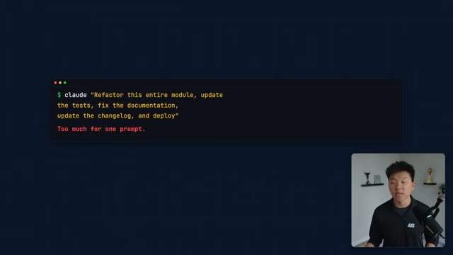
*⏱️ 00:07:56 — Une capture d'écran montrant une interface de terminal illustrant un exemple de prompt trop complexe envoyé à l'IA, avec le présentateur incrusté en bas à droite.*

---

### ⏱️ `[00:08:17 - 00:08:36]` | Segment #23

**🔊 Audio (Transcription Intégrale Mot pour Mot en Français) :**
> All right, so number six is about MCP plugins and skills being the real extension layer. If you've been following my channel, you know that I've talked a lot about MCP, which is model context protocol, and here's what the source code confirms. MCP isn't just supported by CloudCode, but it's kind of baked into the architecture. CloudCode is both an MCP client and an MCP server.

**👁️ Analyse Visuelle d'Écran (gemini-3.5-flash-lite) :**
**Interface & Outils** : Logiciel de présentation (type diaporama).

**Contenu textuel & Code** : Texte informatif : "SECTION 6 - MCP, Plugins & Skills Are the Real Extension Layer".

**Action / Démonstration** : Présentation orale du sujet par l'orateur.

---

### ⏱️ `[00:08:36 - 00:08:56]` | Segment #24

**🔊 Audio (Transcription Intégrale Mot pour Mot en Français) :**
> It can connect to external tools through MCP and other systems can connect to it, but it does go beyond MCP. The source also reveals a skills and plugin layer, meaning power users can build repeatable workflows, custom capabilities, and domain-specific extensions that compound over time. It's not just about connecting to one tool, it's about building an ecosystem around CloudCode that makes it smarter for your specific work.

**👁️ Analyse Visuelle d'Écran (gemini-3.5-flash-lite) :**
**Interface & Outils** : Diagramme logique simplifié sur fond sombre.

**Contenu textuel & Code** : Le diagramme affiche trois blocs connectés : "MCP Client" <- "Claude Code" -> "MCP Server".

**Action / Démonstration** : Présentation visuelle de la place centrale de Claude Code au sein d'un écosystème MCP pour connecter des clients et des serveurs.

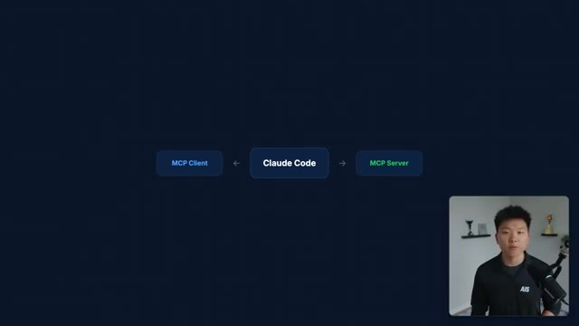
*⏱️ 00:08:41 — Schéma conceptuel illustrant l'intégration de Claude Code dans l'architecture MCP (Model Context Protocol).*

---

### ⏱️ `[00:08:56 - 00:09:15]` | Segment #25

**🔊 Audio (Transcription Intégrale Mot pour Mot en Français) :**
> This is where Cloud Code stops being just a coding tool, and it starts being an integration layer. You can connect it to databases, APIs, internal tools, documentation systems, anything with an MCP server. And then you can layer skills and plugins on top for the stuff that you do repeatedly. Now, the more systems you connect it to, the more useful it becomes. So the power, of course, isn't the tool itself.

**👁️ Analyse Visuelle d'Écran (gemini-3.5-flash-lite) :**
**Interface & Outils** : Interface de présentation graphique simplifiée.

**Contenu textuel & Code** : Texte "Claude Code" centré.

**Action / Démonstration** : Présentation visuelle du concept ou de l'outil "Claude Code" par l'orateur.

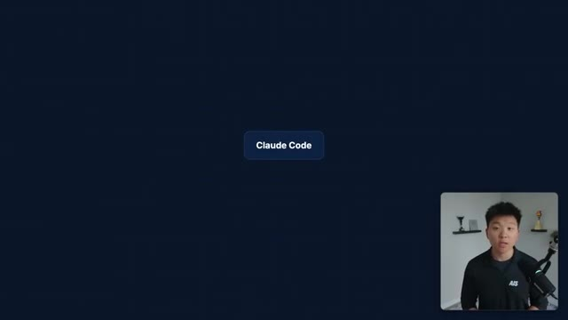
*⏱️ 00:09:01 — Une capture d'écran montrant un fond bleu marine avec un bouton central rectangulaire portant l'inscription "Claude Code" et le présentateur en médaillon dans le coin inférieur droit.*

---

### ⏱️ `[00:09:15 - 00:09:34]` | Segment #26

**🔊 Audio (Transcription Intégrale Mot pour Mot en Français) :**
> It's what you connect to and the workflows that you start to automate and build with it. Okay, number seven, there are features that we don't even have access to yet. And this one's super interesting because the code base includes checks for something called user underscore type. And one of the values is ant, which means anthropic. What this tells us is that certain capabilities are gated behind internal feature flags.

**👁️ Analyse Visuelle d'Écran (gemini-3.5-flash-lite) :**
**Interface & Outils** : Aucune interface logicielle, éditeur de code ou outil d'automatisation n'est visible.

**Contenu textuel & Code** : Texte informatif de la présentation : "SECTION 7 - There Are Features You Don't Have Access to Yet".

**Action / Démonstration** : Aucune action technique n'est démontrée, il s'agit d'un support visuel pour le discours.

---

### ⏱️ `[00:09:34 - 00:09:52]` | Segment #27

**🔊 Audio (Transcription Intégrale Mot pour Mot en Français) :**
> The source references things like voice mode, you know, a system called Kairos, a daemon mode, and a coordinator mode. All behind flags that suggest that they're either internal, experimental, or maybe being rolled out gradually. I want to be honest here. We can't say for sure how different the internal experience actually is. Some of these could be early prototypes. Some might be close to shipping publicly.

**👁️ Analyse Visuelle d'Écran (gemini-3.5-flash-lite) :**
**Interface & Outils** : Interface logicielle propriétaire (UI web ou application)

**Contenu textuel & Code** : Noms des fonctionnalités : "Voice Mode", "Kairos", "Daemon Mode" avec étiquettes d'état "[LOCKED]"

**Action / Démonstration** : Présentation visuelle de fonctionnalités verrouillées ou en cours de développement au sein d'une plateforme d'IA.

![Interface utilisateur sombre affichant trois boutons fonctionnels marqués comme "[LOCKED]" : "Voice Mode", "Kairos", et "Daemon Mode", avec le présentateur visible en médaillon dans le coin inférieur droit.](../screenshots/tXtCK66fPj8/tXtCK66fPj8_000939_seg27.jpg)
*⏱️ 00:09:39 — Interface utilisateur sombre affichant trois boutons fonctionnels marqués comme "[LOCKED]" : "Voice Mode", "Kairos", et "Daemon Mode", avec le présentateur visible en médaillon dans le coin inférieur droit.*

---

### ⏱️ `[00:09:53 - 00:10:16]` | Segment #28

**🔊 Audio (Transcription Intégrale Mot pour Mot en Français) :**
> the source alone doesn't tell us that. But what it does confirm is that Cloud Code is heavily feature flagged, meaning different users may already be getting meaningfully different experiences depending on their environment, their build, or their rollout group. The practical takeaway is pay attention to Cloud Code updates. Capabilities that are flagged or limited today are likely on the roadmap, and when they land, the people who already understand the architecture, like you watching this video, will be ready to use them immediately.

**👁️ Analyse Visuelle d'Écran (gemini-3.5-flash-lite) :**
**Interface & Outils** : Présentation de diapositives (graphique informatif).

**Contenu textuel & Code** : Texte affiché : "Heavily Feature-Flagged" et "Different users get different experiences".

**Action / Démonstration** : Aucune, il s'agit d'un support visuel textuel pour accompagner l'explication orale.

---

### ⏱️ `[00:10:16 - 00:10:37]` | Segment #29

**🔊 Audio (Transcription Intégrale Mot pour Mot en Français) :**
> I mean, think about how many features and tools Cloud Code has been shipping lately. It's because they've all been already built and tested internally. I've heard rumors that computer use has been around for a long, long time, but they just released those functions now that they were ready. Moving on to number eight, we have how to actually use this to save money and to get better results. Let me tie all of this together with what I think matters most, the habits that separate top 1% users from everyone else.

**👁️ Analyse Visuelle d'Écran (gemini-3.5-flash-lite) :**
**Interface & Outils** : Terminal de ligne de commande.

**Contenu textuel & Code** : Commande saisie : "$ claude --check-updates" ; Sortie texte : "Features ship: Internal > Tested > Public".

**Action / Démonstration** : Illustration du processus de déploiement des fonctionnalités internes vers le public.

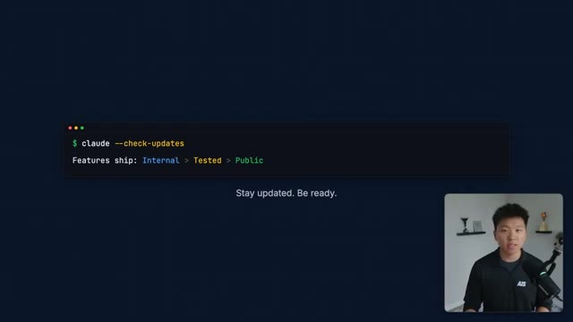
*⏱️ 00:10:21 — Une capture d'écran montrant une interface de terminal stylisée affichant un cycle de développement de fonctionnalités.*

---

### ⏱️ `[00:10:37 - 00:10:58]` | Segment #30

**🔊 Audio (Transcription Intégrale Mot pour Mot en Français) :**
> And the single biggest insight from this entire source code is this. Top users don't just write better prompts, they design a better operating environment for their Claude code. Here's what that looks like in practice. First, treat Claude.md like a force multiplier. Keep it short, keep it opinionated, update it regularly, route to other files. This single file shapes every interaction that you have with Cloud Code.

**👁️ Analyse Visuelle d'Écran (gemini-3.5-flash-lite) :**
**Interface & Outils** : Aucune interface logicielle ou outil technique n'est affiché.

**Contenu textuel & Code** : Texte citationnel sur l'importance de l'environnement opérationnel par rapport à la rédaction de prompts.

**Action / Démonstration** : Aucune action technique n'est montrée ; il s'agit d'un support visuel pour la narration du présentateur.

---

### ⏱️ `[00:10:58 - 00:11:17]` | Segment #31

**🔊 Audio (Transcription Intégrale Mot pour Mot en Français) :**
> Second, learn the command surface. You don't need all 85 commands, but slash plan, slash compact, slash context, review, cost, and resume. These types of commands will change your daily workflow immediately. Third, configure permissions for your recurring workflows. Stop babysitting every action. Set wildcard rules for the stuff that you do every day.

**👁️ Analyse Visuelle d'Écran (gemini-3.5-flash-lite) :**
**Interface & Outils** : Interface graphique de présentation (overlay textuel).

**Contenu textuel & Code** : Liste des commandes affichées : /plan, /compact, /review, /context, /cost, /resume.

**Action / Démonstration** : Illustration visuelle des commandes essentielles à maîtriser pour optimiser le flux de travail avec des agents IA.

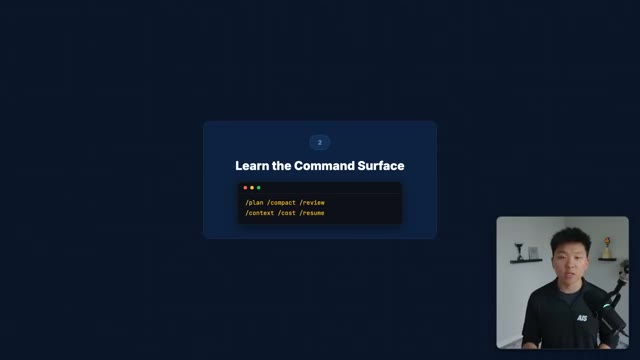
*⏱️ 00:11:03 — Une diapositive graphique présentant le titre "Learn the Command Surface" avec une fenêtre de terminal stylisée affichant une liste de commandes clés.*

---

### ⏱️ `[00:11:17 - 00:11:35]` | Segment #32

**🔊 Audio (Transcription Intégrale Mot pour Mot en Français) :**
> Fourth, think in terms of decomposition, not monolithic prompts. So break complex work into a search phase, a plan phase, an execute phase, a verify phase. Let Claude Code use its architecture the way that it was actually designed to. Otherwise, it might feel like you're trying to shoot an American football through a basketball hoop. That's not what it was designed to do.

**👁️ Analyse Visuelle d'Écran (gemini-3.5-flash-lite) :**
**Interface & Outils** : Présentation visuelle (diapositive intégrée au montage).

**Contenu textuel & Code** : Texte affiché : "4", "Think Decomposition", "Search > Plan > Execute > Verify".

**Action / Démonstration** : Le présentateur illustre visuellement le concept méthodologique de décomposition des tâches pour l'utilisation efficace de Claude Code.

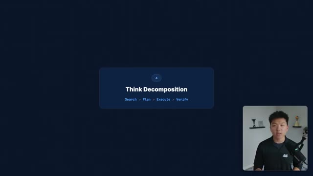
*⏱️ 00:11:21 — Une diapositive graphique sur fond bleu sombre présentant le quatrième point de la présentation : "Think Decomposition" avec les étapes séquentielles Search > Plan > Execute > Verify.*

---

### ⏱️ `[00:11:35 - 00:11:54]` | Segment #33

**🔊 Audio (Transcription Intégrale Mot pour Mot en Français) :**
> Fifth, manage your context like it's money, because it literally is. Use slash compact when conversations get long. Use slash context to control what's loaded. Use slash summary and slash resume to carry work across sessions without losing your important details. Every unnecessary file in context is tokens that you're paying for. And context management isn't just a nice to have, but it is an actual discipline.

**👁️ Analyse Visuelle d'Écran (gemini-3.5-flash-lite) :**
**Interface & Outils** : Interface graphique de présentation avec une fenêtre de terminal stylisée.

**Contenu textuel & Code** : Texte affiché : "/compact", "/context".

**Action / Démonstration** : Illustration visuelle des commandes utilisées par l'agent IA pour optimiser la gestion du contexte de la conversation.

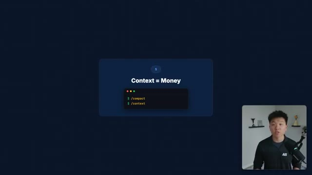
*⏱️ 00:11:40 — Une diapositive minimaliste illustrant le concept "Context = Money" avec une fenêtre de terminal affichant des commandes de gestion de contexte.*

---

### ⏱️ `[00:11:54 - 00:12:28]` | Segment #34

**🔊 Audio (Transcription Intégrale Mot pour Mot en Français) :**
> It's something that you need to build a habit around. Sixth, connect things to it. Whether that's MCP servers or CLIs or plugins or skills. The more tools that Cloud Code can access, the more valuable it actually becomes. And seventh, treat it like infrastructure, not an app. The source reveals a massive configuration surface. model routing, subagent model overrides, shell behavior, privacy controls, even the ability to route through different cloud backends like AWS Bedrock or Google Vertex. Most people never touch these settings, but if you're using CloudCode seriously, there's real leverage in tuning the environment to fit your workflow. Anyways, that's what was hiding inside of CloudCode's source code,

**👁️ Analyse Visuelle d'Écran (gemini-3.5-flash-lite) :**
**Interface & Outils** : Présentation graphique simple (diapositive textuelle).

**Contenu textuel & Code** : Texte affiché : "6 - Connect Everything - MCP Servers + CLIs + Plugins + Skills".

**Action / Démonstration** : Le présentateur expose une étape clé de son argumentaire concernant l'intégration d'outils externes à l'IA.

*⏱️ 00:12:03 — Une diapositive minimaliste sur fond bleu sombre présentant le sixième point du guide : "Connect Everything".*

---

### ⏱️ `[00:12:28 - 00:12:50]` | Segment #35

**🔊 Audio (Transcription Intégrale Mot pour Mot en Français) :**
> and I know that that was a ton of information, and I wanted to move as quick as I could so I didn't bore you guys in this video. So I broke all of this stuff that we talked about and more into a full resource guide that you can access for completely free. You get that inside of my free school community and the link for that is down in the description. But anyways, that's going to do it for today. So if you enjoyed the video or you learned something new, please give it a like, definitely helps me out a ton. And as always, I appreciate you guys making it to the end of the video. I'll see you on the next one. Thanks everyone.

**👁️ Analyse Visuelle d'Écran (gemini-3.5-flash-lite) :**
**Interface & Outils** : Graphique statique (superposition de texte).

**Contenu textuel & Code** : Texte informatif orientant vers un lien externe.

**Action / Démonstration** : Conclusion de la vidéo par l'appel à l'action pour accéder aux ressources.

---

