# 🎬 18 Claude Code Token Hacks in 18 Minutes

> **Chaîne** : [Nate Herk | AI Automation](https://www.youtube.com/@nateherk/featured)  
> **Lien YouTube** : [https://www.youtube.com/watch?v=49V-5Ock8LU](https://www.youtube.com/watch?v=49V-5Ock8LU)  
> **Date de publication** : 20260402  
> **Durée** : 00:18:57  
> **Identifiant vidéo** : `49V-5Ock8LU`  
> **Transcription & Analyse** : `whisper-v3-large-turbo+gemini-3.5-flash-lite`  

---

## 📌 Synthèse Exécutive & Outils

### 💡 Résumé
Dans cette vidéo intitulée **18 Claude Code Token Hacks in 18 Minutes**, Nate Herk décortique les capacités pratiques d'automatisation et de développement propulsées par les modèles de pointe.

### 🛠️ Outils, Modèles & Logiciels Présentés
- **Opus 5.5 & Claude Code** : Modèles d'ingénierie et agents de codage autonome.

### 🔑 Points Clés & Enseignements Stratégiques
- Optimiser le niveau d'effort et le raisonnement des modèles IA pour des résultats industriels.
- Automatiser les cycles de création logicielle de bout en bout.

---

## ⏱️ Chronologie & Transcription Complète Audio & Visuelle (Mot pour Mot)

### ⏱️ `[00:00:00 - 00:00:29]` | Segment #01

**🔊 Audio (Transcription Intégrale Mot pour Mot en Français) :**
> In the past week or so, so many people have been complaining about hitting their cloud code limit insanely fast. Claims like one prompt that is about 1% of the limit is now around 10%. You could go through X and find tons and tons of threads about this topic. Even on a $200 per month plan, people are reaching the session limit way too fast. And then we got this post from an Anthropic employee that basically said that they are working on a little change with peak hours and off-peak hours. But even after that, some people were saying they were still hitting it really quick, even during off-peak hours.

**👁️ Analyse Visuelle d'Écran (gemini-3.5-flash-lite) :**
**Interface & Outils** : Plateforme de réseau social X (interface web).

**Contenu textuel & Code** : Texte du tweet : "@claudeai Code hitting usage limit faster than before. This seems like a bug but the AI company is keeping mum. One prompt that is about 1% of the limit is now around 10%. I could hit my limit in 5 prompts."

**Action / Démonstration** : Affichage d'un témoignage utilisateur illustrant le problème de quota mentionné dans la vidéo.

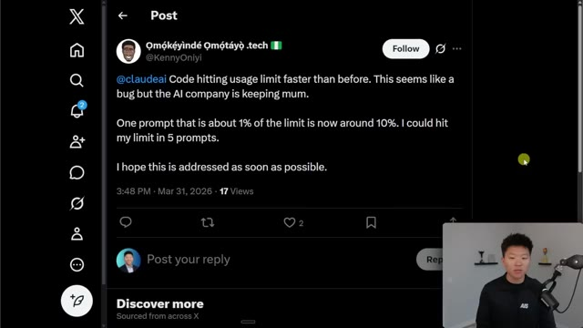
*⏱️ 00:00:07 — Capture d'écran montrant un post sur la plateforme X (anciennement Twitter) écrit par l'utilisateur @KennyOniyi, qui se plaint de la consommation excessive de la limite d'utilisation de Claude AI.*

---

### ⏱️ `[00:00:29 - 00:00:48]` | Segment #02

**🔊 Audio (Transcription Intégrale Mot pour Mot en Français) :**
> So anyways, I've been playing around a ton, trying different things, doing research, and I have 18 token management hacks for you guys that I've organized from tier 1 all the way up to tier 3 so they get more advanced as we go. I'm very confident that by the end of this video, you will feel like your Claude code usage has doubled, tripled, maybe even 5x'd. So let's not waste any time and just get straight into the video.

**👁️ Analyse Visuelle d'Écran (gemini-3.5-flash-lite) :**
**Interface & Outils** : Présentation type diaporama (PowerPoint/Keynote).

**Contenu textuel & Code** : Texte : "18 Token Management Hacks", "Tier 1", "Tier 2", "Tier 3".

**Action / Démonstration** : Présentation introductive des catégories de contenu à venir.

---

### ⏱️ `[00:00:48 - 00:01:08]` | Segment #03

**🔊 Audio (Transcription Intégrale Mot pour Mot en Français) :**
> So as I've been optimizing my own token management, I think that what's really important to realize first is how tokens actually work. Because once you realize how Claude uses tokens, it makes it very clear how you should actually reverse engineer the way that you work in order to use less tokens. So a token is the smallest unit of text that an AI model reads and charges you for.

**👁️ Analyse Visuelle d'Écran (gemini-3.5-flash-lite) :**
**Interface & Outils** : Diaporama de présentation (format éducatif).

**Contenu textuel & Code** : Texte à l'écran : "A token is the smallest unit of text that an AI model reads and charges you for, roughly one token per word." et "Every time you send a message, Claude re-reads the entire conversation from the beginning."

**Action / Démonstration** : Le présentateur explique le fonctionnement théorique du traitement des tokens par le modèle Claude pour introduire l'optimisation des coûts.

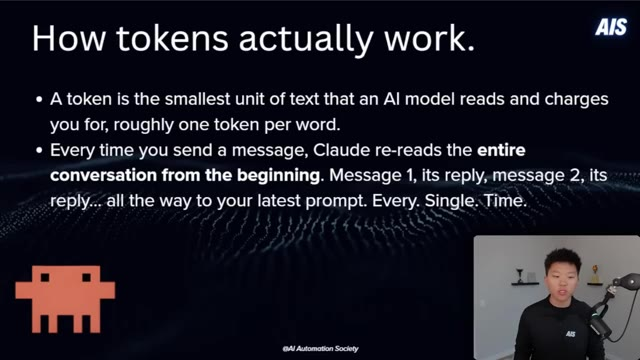
*⏱️ 00:00:53 — Une diapositive explicative intitulée "How tokens actually work" présentant deux points clés sur la consommation des tokens dans Claude, avec le présentateur incrusté en bas à droite.*

---

### ⏱️ `[00:01:08 - 00:01:26]` | Segment #04

**🔊 Audio (Transcription Intégrale Mot pour Mot en Français) :**
> It's roughly one token is one word, but that's not explicitly true. Kind of just a good baseline. So every time that you send a message, Claude rereads the entire conversation from the beginning, and all of those are tokens that it's charging you for. So message one, it will read it, then it will read its reply, and then message two, and then the reply all the way up to your latest prompt.

**👁️ Analyse Visuelle d'Écran (gemini-3.5-flash-lite) :**
**Interface & Outils** : Présentation pédagogique (diapositive).

**Contenu textuel & Code** : Texte affiché : "How tokens actually work." avec deux points principaux : la définition d'un jeton comme unité de facturation et l'explication du recalcul systématique de tout l'historique de la conversation par le modèle à chaque nouvel envoi.

**Action / Démonstration** : Illustration visuelle du concept théorique de fonctionnement de la fenêtre de contexte des LLM.

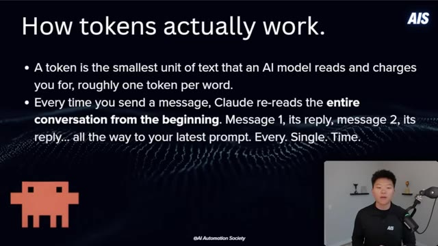
*⏱️ 00:01:13 — Une diapositive explicative sur fond sombre présentant le fonctionnement des jetons (tokens) dans les modèles d'IA comme Claude.*

---

### ⏱️ `[00:01:27 - 00:01:54]` | Segment #05

**🔊 Audio (Transcription Intégrale Mot pour Mot en Français) :**
> And it does that every single time. And I think that alone is a huge light bulb moment for a lot of people. This means as you're having a conversation with Claude, your cost is compounding, not just adding, it's exponentially growing. Meaning message one might cost 500 tokens, message 30 costs 15,000 because it's rereading everything before it. One developer actually tracked a 100 plus message chat and found that 98.5% of all the tokens were just spent rereading the old chat history in the session.

**👁️ Analyse Visuelle d'Écran (gemini-3.5-flash-lite) :**
**Interface & Outils** : Diapositive de présentation éducative.

**Contenu textuel & Code** : Texte expliquant que le coût des tokens n'est pas additif mais composé : "Message 1 might cost 500 tokens. Message 30 costs 15,000+, because it's re-reading everything before it." et une statistique sur une conversation de 100+ messages montrant que 98,5% des tokens sont utilisés pour relire l'historique.

**Action / Démonstration** : Présentation théorique illustrant le concept de contexte de fenêtre (context window) et l'impact financier de la ré-lecture de l'historique par les LLM.

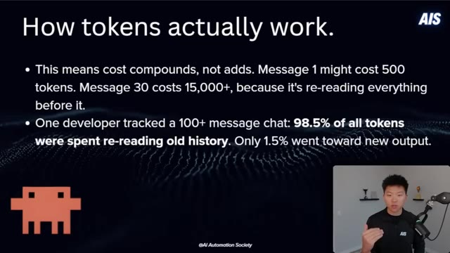
*⏱️ 00:01:34 — Une diapositive explicative intitulée "How tokens actually work" détaillant le coût cumulatif des tokens dans une conversation avec une IA.*

---

### ⏱️ `[00:01:54 - 00:02:13]` | Segment #06

**🔊 Audio (Transcription Intégrale Mot pour Mot en Français) :**
> Like that's a huge waste. Now, yes, the argument has to be made that, well, it needs the context and it needs to understand what we're doing. But still, 98.5% is crazy. So take a quick look at this graphic here. Along the x-axis, we have message number. And as it increases, you can see that we have our per message cost and our cumulative tokens increasing. But it's not linear.

**👁️ Analyse Visuelle d'Écran (gemini-3.5-flash-lite) :**
**Interface & Outils** : Présentation pédagogique (diapositives).

**Contenu textuel & Code** : Le graphique affiche en abscisse le numéro du message et en ordonnée le coût en tokens. Il démontre visuellement que le "coût par message individuel" (ligne bleue) et le "total cumulé" (barres rouges) augmentent proportionnellement au nombre de messages. On y voit des données chiffrées : Message 1 = 500 tokens, Message 30 = 15 500 tokens, Total = 232 000 tokens.

**Action / Démonstration** : Le présentateur illustre visuellement la croissance des coûts liés à la gestion de la mémoire contextuelle dans les conversations avec des agents IA.

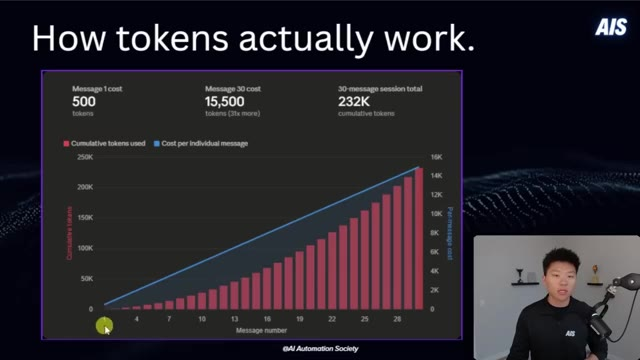
*⏱️ 00:02:04 — Graphique montrant la croissance exponentielle du coût en tokens par message au fil d'une session de chat.*

---

### ⏱️ `[00:02:13 - 00:02:35]` | Segment #07

**🔊 Audio (Transcription Intégrale Mot pour Mot en Français) :**
> It's basically each message is rereading all of the past ones and it has to count that in. So message one could be 500. Message 30 could be 15,500, which is 31 times more. And then after 30 messages, you might already be at almost a quarter million cumulative tokens. Now, on top of all of your own messages, Claude will also reload your Claude.md, your MCP servers, your system prompts, your skills, your files on every single turn.

**👁️ Analyse Visuelle d'Écran (gemini-3.5-flash-lite) :**
**Interface & Outils** : Présentation pédagogique (slides).

**Contenu textuel & Code** : Graphique "How tokens actually work" comparant le coût par message et le cumul total sur 30 messages ; texte explicatif sur le surcoût lié aux fichiers de configuration (CLAUDE.md, MCP, etc.).

**Action / Démonstration** : Démonstration théorique expliquant la mécanique de consommation des jetons par les modèles LLM lors de sessions interactives.

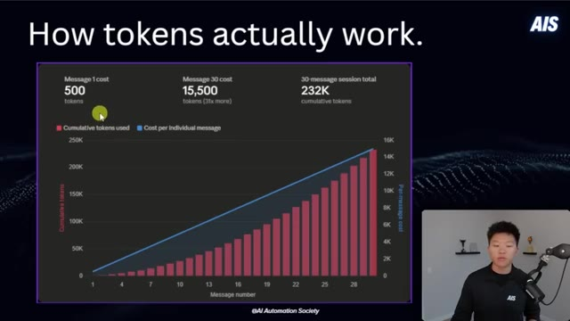
*⏱️ 00:02:19 — Un graphique montrant la croissance cumulative de la consommation de jetons (tokens) au fil d'une session de 30 messages, illustrant l'augmentation exponentielle du coût par message.*

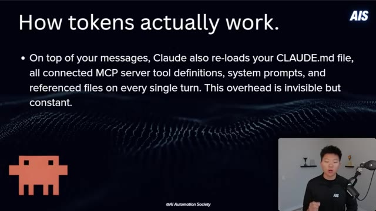
*⏱️ 00:02:30 — Une diapositive explicative listant les éléments techniques (fichiers CLAUDE.md, serveurs MCP, prompts système) qui s'ajoutent à la consommation de jetons à chaque interaction.*

---

### ⏱️ `[00:02:36 - 00:02:55]` | Segment #08

**🔊 Audio (Transcription Intégrale Mot pour Mot en Français) :**
> And this is invisible overhead, but it is constantly dripping into your context and your tokens. And a really important thing to realize is that bloated context doesn't just cost you more money, but it also produces worse output. So you're paying more and you're getting less. There's this phenomenon called lost in the middle, which basically says that models are paying the most intention in the beginning of your session and kind of at the end.

**👁️ Analyse Visuelle d'Écran (gemini-3.5-flash-lite) :**
**Interface & Outils** : Présentation pédagogique (diapositive).

**Contenu textuel & Code** : Texte affiché : "On top of your messages, Claude also re-loads your CLAUDE.md file, all connected MCP server tool definitions, system prompts, and referenced files on every single turn. This overhead is invisible but constant."

**Action / Démonstration** : Explication théorique des mécanismes de consommation de jetons (tokens) par les agents IA.

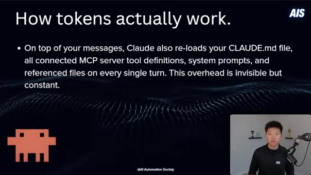
*⏱️ 00:02:41 — Une diapositive pédagogique présentant le titre "How tokens actually work" avec un texte explicatif sur la charge invisible des fichiers CLAUDE.md et des serveurs MCP lors de chaque requête.*

---

### ⏱️ `[00:02:55 - 00:03:15]` | Segment #09

**🔊 Audio (Transcription Intégrale Mot pour Mot en Français) :**
> So all that stuff in the middle of your session, kind of in this dip, is getting ignored. All right, so now that we kind of understand a little bit more about how Cloud Code works and how tokens work, let's move into the hacks. We're going to start here with tier one hacks. These are the ones that are going to be super easy to implement and everyone should be able to understand. So we've got nine of these. Number one is to start fresh conversations.

**👁️ Analyse Visuelle d'Écran (gemini-3.5-flash-lite) :**
**Interface & Outils** : Présentation type PowerPoint/Keynote.

**Contenu textuel & Code** : Texte "Tier 1 Hacks", logos d'applications, logo "AIS" (AI Automation Society).

**Action / Démonstration** : Le présentateur introduit visuellement la section sur les astuces de niveau 1.

---

### ⏱️ `[00:03:16 - 00:03:34]` | Segment #10

**🔊 Audio (Transcription Intégrale Mot pour Mot en Français) :**
> Use slash clear between unrelated tasks. Don't carry context about topic A into a conversation about topic B. So every single message in a long chat is exponentially more expensive than the same message in a fresh chat. So this one habit is the number one thing that extends your session life. And it's pretty obvious based on what we just talked about.

**👁️ Analyse Visuelle d'Écran (gemini-3.5-flash-lite) :**
**Interface & Outils** : Présentation pédagogique (style slide de cours).

**Contenu textuel & Code** : Texte listant les avantages de démarrer de nouvelles conversations : "Start fresh conversations", "Use /clear between unrelated tasks", "Don't carry context about topic A into a conversation about topic B", "Every message in a long chat is exponentially more expensive", "This single habit is the #1 thing that extends session life".

**Action / Démonstration** : Présentation théorique sur l'optimisation des coûts et de la gestion de contexte des agents IA.

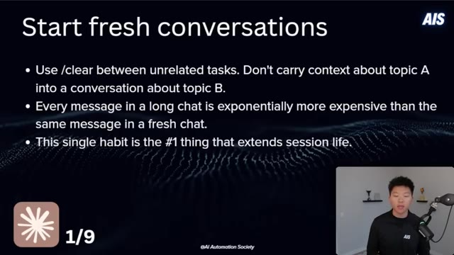
*⏱️ 00:03:20 — Une diapositive de présentation avec un fond sombre illustrant les bonnes pratiques pour optimiser l'utilisation des agents IA.*

---

### ⏱️ `[00:03:34 - 00:03:54]` | Segment #11

**🔊 Audio (Transcription Intégrale Mot pour Mot en Français) :**
> So that's why this was number one. Okay, number two is to disconnect MCP servers. Every single connected MCP server loads all of its tool definitions into your context on every message. This is another source of completely invisible tokens that might just be eating up and eating away. So one server alone might be something like 18,000 tokens per message.

**👁️ Analyse Visuelle d'Écran (gemini-3.5-flash-lite) :**
**Interface & Outils** : Diapositive de présentation (Slide).

**Contenu textuel & Code** : Texte à l'écran : "Disconnect MCP servers", expliquant que chaque serveur MCP connecté charge toutes ses définitions d'outils dans le contexte à chaque message (soit environ 17 600 jetons par message). Conseils affichés : "Run /mcp at the start of each session" et "Use CLIs instead!".

**Action / Démonstration** : Présentation pédagogique des meilleures pratiques pour économiser les jetons en déconnectant les serveurs MCP inutilisés.

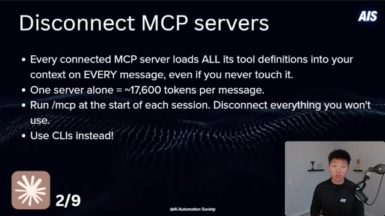
*⏱️ 00:03:39 — Une diapositive de présentation sombre listant les points clés concernant l'optimisation des serveurs MCP (Model Context Protocol) pour réduire la consommation de jetons.*

---

### ⏱️ `[00:03:54 - 00:04:16]` | Segment #12

**🔊 Audio (Transcription Intégrale Mot pour Mot en Français) :**
> So run MCP at the start of each session and disconnect the ones that you don't need. And better yet, if you're able to find CLIs for something, so for example, rather than having the Google Workspace or Google Calendar MCP server, which eats a lot of tokens, just use the Google Workspace CLI. It's faster, it's cheaper, and I think the future is moving towards having our agents use CLIs rather than MCPs.

**👁️ Analyse Visuelle d'Écran (gemini-3.5-flash-lite) :**
**Interface & Outils** : Présentation de diapositives (format vidéo éducative).

**Contenu textuel & Code** : Texte listant les points suivants :
- "Every connected MCP server loads ALL its tool definitions into your context on EVERY message, even if you never touch it."
- "One server alone = ~17,600 tokens per message."
- "Run /mcp at the start of each session. Disconnect everything you won't use."
- "Use CLIs instead!"

**Action / Démonstration** : Explication théorique sur l'optimisation de la consommation de jetons (tokens) lors de l'utilisation d'outils MCP dans les agents IA.

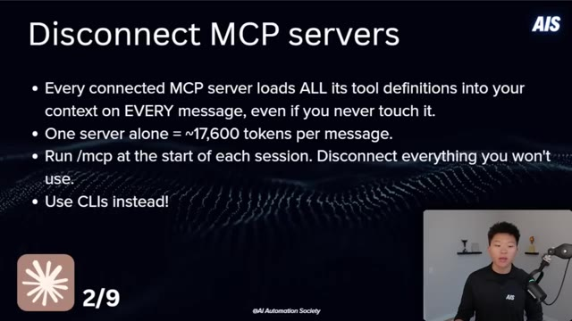
*⏱️ 00:04:00 — Une diapositive de présentation explicative intitulée "Disconnect MCP servers", détaillant les raisons pour lesquelles il faut limiter l'usage des serveurs MCP pour économiser les tokens.*

---

### ⏱️ `[00:04:17 - 00:04:39]` | Segment #13

**🔊 Audio (Transcription Intégrale Mot pour Mot en Français) :**
> All right, number three, batch prompts into one message. Three separate messages cost three times what one combined message costs because of the way the tokens work, right? Instead of summarize this as one message and then now extract the issues, now suggest a fix, send it all in one prompt. If clogged something slightly wrong, edit your original message and regenerate instead of sending a full follow-up correction.

**👁️ Analyse Visuelle d'Écran (gemini-3.5-flash-lite) :**
**Interface & Outils** : Logiciel de présentation (diapositive pédagogique).

**Contenu textuel & Code** : Texte affiché : "Batch prompts into 1 message. Three separate messages cost 3x what one combined message costs. Instead of 'summarize this' → 'now extract the issues' → 'now suggest a fix', send it all in one prompt. If Claude gets something slightly wrong, edit your original message and regenerate instead of sending a follow-up correction. Follow-ups stack onto history permanently. Edits replace the bad exchange entirely."

**Action / Démonstration** : Présentation théorique illustrant la stratégie d'optimisation des prompts.

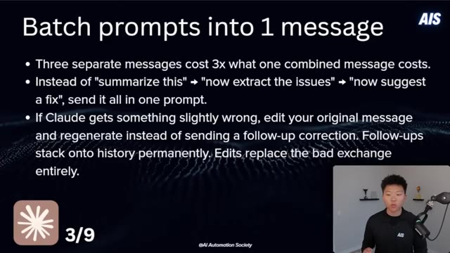
*⏱️ 00:04:22 — Une diapositive de présentation listant les avantages de regrouper les prompts en un seul message pour optimiser les coûts et la gestion de l'historique.*

---

### ⏱️ `[00:04:39 - 00:05:02]` | Segment #14

**🔊 Audio (Transcription Intégrale Mot pour Mot en Français) :**
> Follow-ups stack onto history permanently, while edits replace the bad exchange entirely. Now, I will say, there is an argument to be made here that potentially doing it this way, where you're doing task one, task two, then task three, might actually be better output quality. I think it depends on the actual use case. Basically, the idea would be, if you can give AI one specific task at a time, it's going to do better because it's more specialized and it's more focused.

**👁️ Analyse Visuelle d'Écran (gemini-3.5-flash-lite) :**
**Interface & Outils** : Diapositive de présentation (format slide).

**Contenu textuel & Code** : Texte affiché : "Three separate messages cost 3x what one combined message costs.", "Instead of 'summarize this' -> 'now extract the issues' -> 'now suggest a fix', send it all in one prompt.", "If Claude gets something slightly wrong, edit your original message and regenerate instead of sending a follow-up correction. Follow-ups stack onto history permanently. Edits replace the bad exchange entirely."

**Action / Démonstration** : Présentation théorique illustrant une stratégie d'optimisation de prompt pour réduire les coûts et améliorer la qualité des réponses de l'IA.

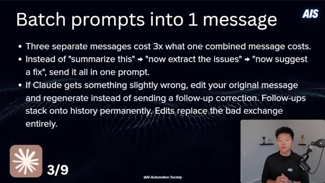
*⏱️ 00:04:45 — Une diapositive de présentation titrée "Batch prompts into 1 message" expliquant les avantages économiques et qualitatifs de combiner plusieurs prompts en un seul, avec une comparaison entre les messages de suivi et l'édition de messages existants.*

---

### ⏱️ `[00:05:03 - 00:05:22]` | Segment #15

**🔊 Audio (Transcription Intégrale Mot pour Mot en Français) :**
> But this is definitely something that you should be aware of. Okay, number four is to use plan mode before any real task. This lets Claude map out the approach, ask you the right questions, and it prevents the single biggest source of token waste, which is just having Claude go down the wrong path, writing code, and then basically everything that it just did, you have to basically like scrap and redo. It's just a huge waste of time and tokens.

**👁️ Analyse Visuelle d'Écran (gemini-3.5-flash-lite) :**
**Interface & Outils** : Diapositive de présentation (slide deck).

**Contenu textuel & Code** : Texte affiché : "Plan Mode before any real task", expliquant les bénéfices (réduction du gaspillage de tokens, validation de l'approche) et une consigne spécifique à ajouter dans le fichier `CLAUDE.md` : "Do not make any changes until you have 95% confidence in what you need to build."

**Action / Démonstration** : Présentation pédagogique des meilleures pratiques pour optimiser les interactions avec l'agent Claude via un fichier de configuration système.

*⏱️ 00:05:08 — Une diapositive de présentation listant les avantages et une recommandation concrète pour l'utilisation du "Plan Mode" avec Claude, avec le présentateur visible en médaillon dans le coin inférieur droit.*

---

### ⏱️ `[00:05:23 - 00:05:43]` | Segment #16

**🔊 Audio (Transcription Intégrale Mot pour Mot en Français) :**
> So you can add something like this to your Claude.md. Do not make any changes until you have 95% confidence in what you need to build. Ask me follow-up questions until you reach that confidence level. This is something that I'm putting into all of my Claude.mds when I am having it help me build things. Number five, we have run slash context and slash cost. Slash context shows you exactly what's eating your tokens right now.

**👁️ Analyse Visuelle d'Écran (gemini-3.5-flash-lite) :**
**Interface & Outils** : Présentation (diapositive pédagogique).

**Contenu textuel & Code** : Texte à ajouter au fichier CLAUDE.md : "Do not make any changes until you have 95% confidence in what you need to build. Ask me follow-up questions until you reach that confidence."

**Action / Démonstration** : Le présentateur explique une stratégie de prompt engineering pour éviter le gaspillage de tokens et les erreurs de développement de l'IA.

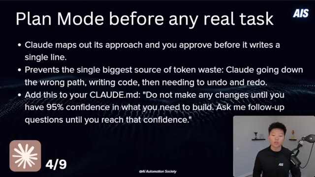
*⏱️ 00:05:28 — Une diapositive de présentation titrée "Plan Mode before any real task", listant des recommandations pour optimiser l'interaction avec l'IA Claude.*

---

### ⏱️ `[00:05:43 - 00:06:02]` | Segment #17

**🔊 Audio (Transcription Intégrale Mot pour Mot en Français) :**
> So your conversation history, your MCP overhead, loaded files, stuff like that. And slash cost shows your actual token usage and estimated spend for that current session. Most people have no idea where their tokens are going. And these two commands make the invisible visible. Because if you don't actually know that you're bleeding because of MCPs, then how would you be able to fix that?

**👁️ Analyse Visuelle d'Écran (gemini-3.5-flash-lite) :**
**Interface & Outils** : Présentation type PowerPoint/Keynote.

**Contenu textuel & Code** : Titre : "Run /context and /cost". Texte explicatif sur les fonctions de chaque commande : "/context" affiche l'historique de conversation, les fichiers chargés et les overheads MCP ; "/cost" affiche l'utilisation réelle des tokens et les dépenses estimées.

**Action / Démonstration** : Explication théorique des outils de diagnostic pour l'optimisation des coûts d'utilisation des agents IA.

*⏱️ 00:05:48 — Une diapositive de présentation sombre détaillant les commandes `/context` et `/cost` pour surveiller l'utilisation des tokens dans un environnement d'IA, avec le présentateur visible en médaillon en bas à droite.*

---

### ⏱️ `[00:06:02 - 00:06:35]` | Segment #18

**🔊 Audio (Transcription Intégrale Mot pour Mot en Français) :**
> So when you run slash context, this is what it will look like. it'll basically give you a screenshot of how many tokens you're at, what is the cap, and it will estimate based on the different categories. And what I did here is this was ran in a completely fresh session, no chats. So what that tells me is, okay, before I even talk to Claude, I'm already down 51,000 tokens because of things like the system prompt, the system tools, my custom agents, my skills, memory files. And here I've actually cleared out all the MCPs. So there wasn't anything in there. But those can, like I said, completely blow up your tokens right from the get go.

**👁️ Analyse Visuelle d'Écran (gemini-3.5-flash-lite) :**
**Interface & Outils** : Terminal de ligne de commande (CLI).

**Contenu textuel & Code** : Analyse "Context Usage" détaillant la consommation par catégorie : System prompt, System tools, Custom agents, Memory files, Skills, Messages, et Free space. Le total est de 51.5k tokens sur 1M de capacité.

**Action / Démonstration** : Exécution de la commande `/context` pour vérifier l'utilisation de la fenêtre de contexte dans une session active.

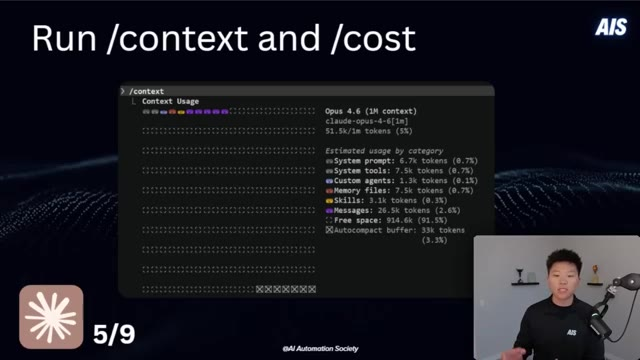
*⏱️ 00:06:11 — Capture d'écran montrant le résultat de la commande "/context" dans un terminal, affichant une analyse détaillée de l'utilisation des tokens pour le modèle Opus 4.6.*

---

### ⏱️ `[00:06:36 - 00:07:09]` | Segment #19

**🔊 Audio (Transcription Intégrale Mot pour Mot en Français) :**
> Okay, number six is to set up a status line. This kind of goes hand in hand with having more visibility. You only actually see this in your terminal though, so you will have to do it there. And it basically lets you see what's going on. So right here, you can see in my terminal, I've got this set up so that I can see the model I'm using. I can see a visual kind of progress bar of my usage. And then I can see 5% of my whole 1 million context window. And I can see 52,000 tokens out of a thousand thousand, which is a million. And just to clarify, this isn't my session, like my five hour session. This is basically just indicating that I'm 5% of the way

**👁️ Analyse Visuelle d'Écran (gemini-3.5-flash-lite) :**
**Interface & Outils** : Présentation de diapositives / Terminal (simulé)

**Contenu textuel & Code** : Texte explicatif sur la ligne de statut, commande "/statusline", et une barre d'état affichant "Opus 4.6 (1M context) | [---] | 5% | 52k / 1000k".

**Action / Démonstration** : Démonstration visuelle du concept de surveillance de la consommation de contexte IA via une barre de statut dans le terminal.

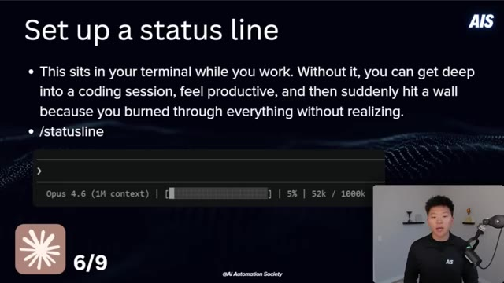
*⏱️ 00:06:44 — Une diapositive de présentation illustrant l'importance d'une "status line" dans le terminal, avec une capture d'exemple montrant l'utilisation du modèle Opus 4.6 et la consommation de jetons.*

---

### ⏱️ `[00:07:09 - 00:07:42]` | Segment #20

**🔊 Audio (Transcription Intégrale Mot pour Mot en Français) :**
> or 52K out of a thousand K. So all you have to do is in cloud code in the terminal, do slash status line and explain that you want to replicate this setup. Number seven is just super simple, but keep your dashboard open. Same thing with visibility. You might run into issues with your limit and just get hit out of nowhere. But if you have it pulled up next to you or you have it ready so that you can switch into that tab and, you know, check every 20, 40 minutes, then you're going to be able to pace yourself a little bit better. You could even set up a automation to basically check in on it every 30 minutes and send you like a text or a Slack message and say, Hey,

**👁️ Analyse Visuelle d'Écran (gemini-3.5-flash-lite) :**
**Interface & Outils** : Diapositive de présentation (PowerPoint/Keynote) intégrant une simulation de terminal.

**Contenu textuel & Code** : Texte explicatif : "Set up a status line", "/statusline", et une barre d'état montrant "Opus 4.6 (1M context) | [####] | 5% | 52k / 1000k".

**Action / Démonstration** : Présentation théorique sur la configuration d'une commande système pour éviter de dépasser les limites de tokens lors d'une session de développement.

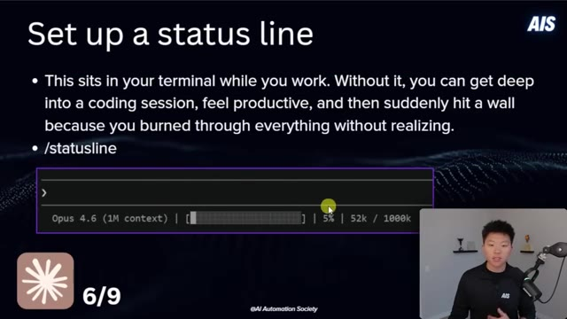
*⏱️ 00:07:17 — Une diapositive de présentation expliquant l'utilité d'une barre d'état dans le terminal pour surveiller la consommation de contexte, avec une capture d'exemple affichant "Opus 4.6", une barre de progression et l'utilisation actuelle (52k / 1000k).*

---

### ⏱️ `[00:07:42 - 00:08:10]` | Segment #21

**🔊 Audio (Transcription Intégrale Mot pour Mot en Français) :**
> by the way, you're getting near your usage. All right. So number eight, we have be smart with pasting before you drop a document or a file or something large, just ask yourself, does Claude need to read this whole thing? Sometimes it does. Sometimes it needs that full context, but sometimes it just needs one section or one page. So if the bug is in one function, then paste just that function. Or if it just needs the context of one little paragraph, just paste that. Claude needs to be precise about what it reads, but you also need to be precise about what you feed it.

**👁️ Analyse Visuelle d'Écran (gemini-3.5-flash-lite) :**
**Interface & Outils** : Logiciel de présentation (diapositive pédagogique).

**Contenu textuel & Code** : Texte affiché : "Before you drop a document, file, or error log into the chat, ask yourself: does Claude need the entire thing, or just one section? If the bug is in one function, paste that function. If the error is in the last 10 lines of a log, paste those 10 lines. Claude should be precise about what it reads, and you should be precise about what you feed it."

**Action / Démonstration** : Illustration visuelle d'un conseil pratique concernant la gestion des limites d'utilisation et de la précision du contexte fourni à l'IA.

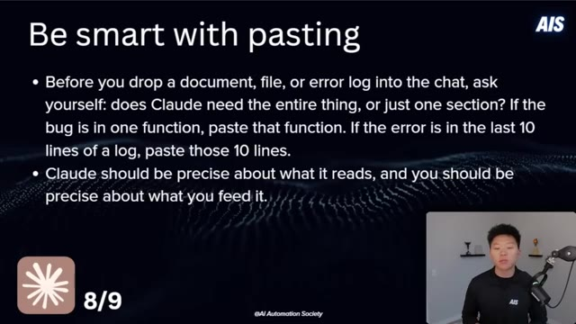
*⏱️ 00:07:49 — Une diapositive de présentation titrée "Be smart with pasting" listant des conseils sur la gestion des documents envoyés à Claude pour optimiser l'utilisation du contexte.*

---

### ⏱️ `[00:08:10 - 00:08:28]` | Segment #22

**🔊 Audio (Transcription Intégrale Mot pour Mot en Français) :**
> Number nine, our last tier one hack, is to actually watch Claude code work. Don't just fire off a prompt and walk away or switch tabs. Watch what Claude is doing, especially on longer tasks. And this is because if you actually sit and watch it, sometimes you'll realize it's going down the wrong path. Sometimes it gets stuck in its own loops, rereads the same files, things like that.

**👁️ Analyse Visuelle d'Écran (gemini-3.5-flash-lite) :**
**Interface & Outils** : Diapositive de présentation (PowerPoint/Keynote).

**Contenu textuel & Code** : Texte affiché : "Watch Claude work", "Don't just fire off a prompt and walk away...", et le numéro "9/9" en bas à gauche.

**Action / Démonstration** : Présentation théorique du concept par le créateur.

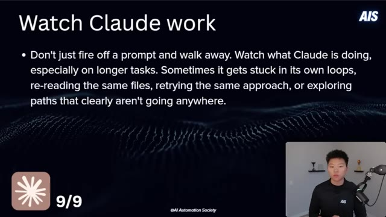
*⏱️ 00:08:14 — Une diapositive de présentation illustrant le conseil numéro 9 : "Watch Claude work", avec une liste à puces expliquant pourquoi il faut surveiller les agents IA en action.*

---

### ⏱️ `[00:08:28 - 00:09:02]` | Segment #23

**🔊 Audio (Transcription Intégrale Mot pour Mot en Français) :**
> So if it's doing that, you might as well just stop it right there. Kind of the same idea as plan mode. Why would you let it go down the wrong path, waste all your tokens, and then just have to scrap it all? In a bad loop, 80% of the tokens are being used, producing zero value. So if you're able to just watch your session run until you know it's going down the right path, it could save you thousands of tokens. All right, let's kick it up a little bit. Let's move into our tier two hacks. And for these ones, we have five of them. So number one is to keep your claw.md file lean. Place it in your project root, whether that is globally or in local project. Clawd

**👁️ Analyse Visuelle d'Écran (gemini-3.5-flash-lite) :**
**Interface & Outils** : Présentation (slide de cours/vidéo).

**Contenu textuel & Code** : Texte affiché : "Don't just fire off a prompt and walk away. Watch what Claude is doing, especially on longer tasks. Sometimes it gets stuck in its own loops, re-reading the same files, retrying the same approach, or exploring paths that clearly aren't going anywhere."

**Action / Démonstration** : Le présentateur explique conceptuellement pourquoi il faut monitorer l'activité de l'IA pour interrompre les processus inefficaces.

*⏱️ 00:08:37 — Une diapositive de présentation avec un fond sombre, titrée "Watch Claude work", expliquant l'importance de surveiller les agents IA pour éviter les boucles infinies ou le gaspillage de jetons. Le présentateur apparaît dans une petite fenêtre en bas à droite.*

---

### ⏱️ `[00:09:02 - 00:09:37]` | Segment #24

**🔊 Audio (Transcription Intégrale Mot pour Mot en Français) :**
> auto reads it at the start of every single chat as system context. So keep it under 200 lines. Include things like your tech stack, your coding conventions, your build commands, the 95% confidence rule, only the most important things. And you need to treat this like an index route to where more data lives. And it's a complete mindset shift. This file basically just tells Cloud Code where is everything that it needs and what to do every single time. So it can point to files that are huge, but that way it just says, okay, I don't need this right now, but if I do need this, I know exactly where to look. And because it knows exactly where to look, it's not going to waste time or tokens searching through and reading other files. It's just able to grab

**👁️ Analyse Visuelle d'Écran (gemini-3.5-flash-lite) :**
**Interface & Outils** : Diapositive de présentation de type slides.

**Contenu textuel & Code** : Liste des recommandations pour le fichier CLAUDE.md :
- Placer à la racine du projet.
- Limiter à moins de 200 lignes.
- Inclure : stack technologique, conventions de code, commandes de build, règle des 95% de confiance.
- Utiliser comme index pour orienter vers les autres sources de données du projet.

**Action / Démonstration** : Présentation théorique sur l'optimisation du contexte pour les agents IA.

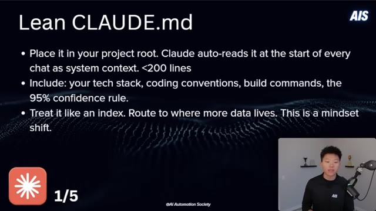
*⏱️ 00:09:11 — Une diapositive de présentation intitulée "Lean CLAUDE.md" détaillant les meilleures pratiques pour configurer un fichier de contexte système pour Claude.*

---

### ⏱️ `[00:09:37 - 00:10:02]` | Segment #25

**🔊 Audio (Transcription Intégrale Mot pour Mot en Français) :**
> it right there by the file name. And the reason I say this is a mindset shift, because you should be doing this with other things, not just your Cloud.MD, with your skills or with your master reference guide sheets. I saw someone talking about how they created an index that's super, super lean and it shows CloudCode exactly where to go in the CloudCode documentation. So if it needs help with something related to CloudCode, it doesn't have to search through the whole database. It can just say, okay, here's my index file. I know exactly which URL to look up at.

**👁️ Analyse Visuelle d'Écran (gemini-3.5-flash-lite) :**
**Interface & Outils** : Diapositive de présentation (format slide).

**Contenu textuel & Code** : Texte listant trois recommandations : 1) Placer le fichier à la racine du projet pour qu'il soit lu automatiquement (<200 lignes). 2) Inclure la stack technique, les conventions de code, les commandes de build et la règle des 95% de confiance. 3) Traiter le fichier comme un index pour rediriger vers des données plus détaillées.

**Action / Démonstration** : Présentation théorique d'une méthodologie d'organisation de fichiers pour optimiser l'interaction avec l'IA.

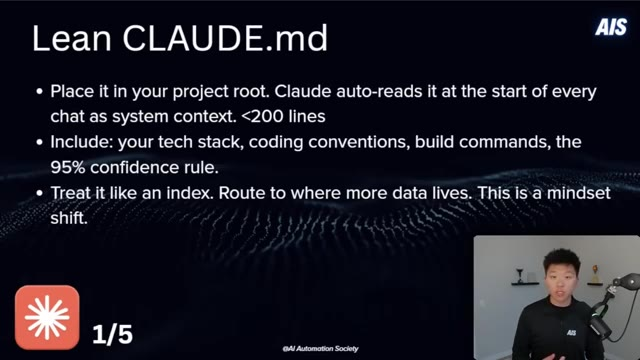
*⏱️ 00:09:43 — Une diapositive de présentation titrée "Lean CLAUDE.md" détaillant les bonnes pratiques pour configurer un fichier de contexte système pour Claude.*

---

### ⏱️ `[00:10:02 - 00:10:30]` | Segment #26

**🔊 Audio (Transcription Intégrale Mot pour Mot en Français) :**
> Super simple. You want to keep this lean and trim it all the time. It's always a work in progress because every single chat, not just like your session, every single message, cloud.md gets read. So if your cloud.md file is a thousand lines, every single time you shoot off a message, even if you just say hi, the whole thing's going to get read. Okay, number two here is to be surgical with file references. Don't just say something like, here's my whole repo, go find the bug. Say something more like, check the verify user function inside the auth.js file.

**👁️ Analyse Visuelle d'Écran (gemini-3.5-flash-lite) :**
**Interface & Outils** : Présentation de type diaporama (support visuel).

**Contenu textuel & Code** : Texte affiché : "Keep it lean and trim ruthlessly. Every token in your CLAUDE.md loads on every single message... Include only what Claude needs... Don't put your project's entire history or documentation".

**Action / Démonstration** : Le présentateur explique la nécessité de maintenir un fichier de configuration léger pour l'agent IA afin d'éviter les redondances et l'utilisation inutile de jetons à chaque interaction.

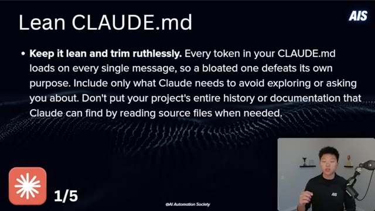
*⏱️ 00:10:09 — Une diapositive de présentation titrée "Lean CLAUDE.md" expliquant l'importance de limiter la taille du fichier CLAUDE.md pour optimiser la consommation de jetons.*

---

### ⏱️ `[00:10:31 - 00:11:04]` | Segment #27

**🔊 Audio (Transcription Intégrale Mot pour Mot en Français) :**
> Or you can also use at file name to point at specific files instead of once again, letting Claude explore freely. The whole idea of being specific and routing. All right, so number three, I'm saying to compact at around 60% capacity. Auto-compact triggers at like 95%, by which point your context is already pretty degraded. So run slash context to check your capacity percentage, or you should have the status line set up. And at about 60%, just run the slash compact with specific instructions on what it should actually be preserving. After three to four compacts in a row, the quality does start to degrade. So at that point, once you've done

**👁️ Analyse Visuelle d'Écran (gemini-3.5-flash-lite) :**
**Interface & Outils** : Diapositive de présentation (PowerPoint/Keynote).

**Contenu textuel & Code** : Texte affiché : "Don't: 'Here's my whole repo, go find the bug.'", "Do: 'Check the verifyUser function inside auth.js.'", "Use @filename to point at specific files instead of letting Claude explore freely."

**Action / Démonstration** : Le présentateur explique la nécessité d'être spécifique dans les requêtes adressées à l'IA pour optimiser l'utilisation du contexte.

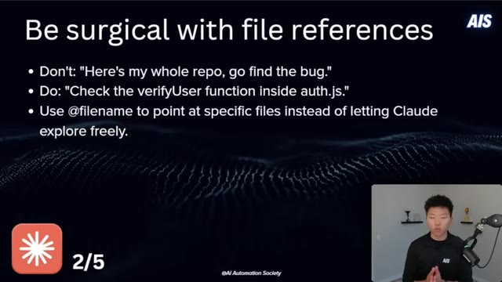
*⏱️ 00:10:39 — Une diapositive de présentation illustrant une bonne pratique pour interagir avec des agents IA, intitulée "Be surgical with file references".*

---

### ⏱️ `[00:11:04 - 00:11:38]` | Segment #28

**🔊 Audio (Transcription Intégrale Mot pour Mot en Français) :**
> three or four, just get a session summary, slash clear, give the session summary back, and then keep going. All right. So number four, short breaks are actually costing you. Cloud code uses prompt training to avoid reprocessing unchanged context, but the cache has a five minute timeout. So if you step away and you come back and it's been longer than five minutes, your next message reprocesses everything from scratch at full cost. And that is why some people feel like their usage just randomly spikes if they might've, you know, stepped away and came back. So if you're going to do that, just consider doing a slash compact or a slash clear before you step away. All right. Number five,

**👁️ Analyse Visuelle d'Écran (gemini-3.5-flash-lite) :**
**Interface & Outils** : Diapositive de présentation textuelle.

**Contenu textuel & Code** : Texte explicatif sur le "prompt caching" de Claude Code, mentionnant un délai d'expiration de 5 minutes, le coût de retraitement des données et la recommandation d'utiliser les commandes "/compact" ou "/clear" avant une pause.

**Action / Démonstration** : Présentation théorique illustrant les bonnes pratiques de gestion de session pour réduire les coûts d'utilisation des agents IA.

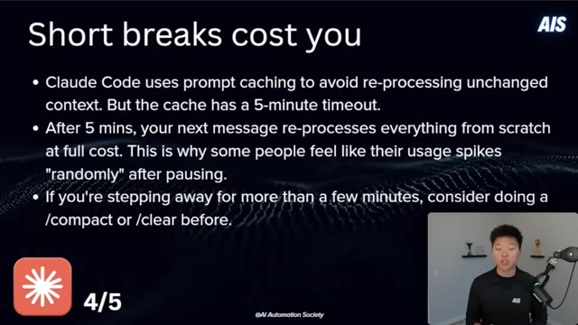
*⏱️ 00:11:12 — Une diapositive de présentation expliquant les coûts liés aux interruptions de session avec l'outil Claude Code.*

---

### ⏱️ `[00:11:38 - 00:12:04]` | Segment #29

**🔊 Audio (Transcription Intégrale Mot pour Mot en Français) :**
> command output bloat. When Claude runs shell commands, the full output enters your context window. So if you have a command that it comes back with 200 commits or, you know, just tons and tons of data, then all of that is tokens that get sent to your model. So really the takeaway here is to be intentional about what you let Claude run. If you know in a certain project that it doesn't need to use certain commands, then you can go ahead and in that project, deny those permissions.

**👁️ Analyse Visuelle d'Écran (gemini-3.5-flash-lite) :**
**Interface & Outils** : Diapositive de présentation pédagogique.

**Contenu textuel & Code** : Texte explicatif sur le problème du "Command output bloat" : Claude charge toute la sortie (logs, git logs, tests) dans la fenêtre de contexte. Conseils : utiliser "head", "tail", ou limiter la sortie des commandes.

**Action / Démonstration** : Explication théorique des bonnes pratiques d'optimisation de contexte pour les agents IA.

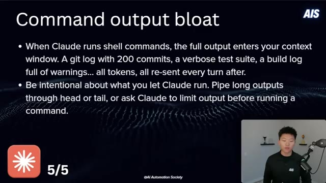
*⏱️ 00:11:44 — Une diapositive de présentation titrée "Command output bloat" expliquant les risques de consommation de jetons (tokens) liés à l'exécution de commandes shell par Claude, avec des conseils pour limiter la sortie.*

---

### ⏱️ `[00:12:04 - 00:12:39]` | Segment #30

**🔊 Audio (Transcription Intégrale Mot pour Mot en Français) :**
> And this is another one that seems like it's invisible because when it runs like a bash or you know certain commands It basically just has like one line and you don't actually see all the tokens that it has, you know sent there All right So sitting here editing this video and there's just one more thing that I wanted to get off my chest And it's basically about hitting your limit And you know the goal of this video and your goal should be to optimize so that you don't hit your limit But I don't think that you should associate hitting your limit with like it shouldn't be a negative connotation because ultimately if you're doing a lot of these hacks and you are not just like being wasteful

**👁️ Analyse Visuelle d'Écran (gemini-3.5-flash-lite) :**
**Interface & Outils** : Présentation de type diapositives (Slide deck).

**Contenu textuel & Code** : Texte explicatif sur la consommation de jetons liée à la sortie de commandes (command output) et éléments graphiques de style "Tier 3 Hacks".

**Action / Démonstration** : Le présentateur explique les concepts théoriques liés aux coûts des agents IA sans démonstration technique directe à l'écran.

---

### ⏱️ `[00:12:39 - 00:13:16]` | Segment #31

**🔊 Audio (Transcription Intégrale Mot pour Mot en Français) :**
> with tokens then hitting your limit is actually a good thing if you think about it because it means that you are using this tool so much and i think that's what you want to be i think you want to be a power user of this tool to the point where it's like gotta wait again and you know waiting sucks but people that are using it so much are going to be so much more productive and so much farther head than people who are never hitting their limits, you know, not make, not getting their money's worth and not truly getting the leverage that you are now getting. So anyways, quick little raw rant there, but I think it's an important mindset shift to have, you know, just something

**👁️ Analyse Visuelle d'Écran (gemini-3.5-flash-lite) :**
**Interface & Outils** : Présentation visuelle (Slide deck)

**Contenu textuel & Code** : Titre "Tier 3 Hacks" et logo/graphique "AIS" (AI Automation Society).

**Action / Démonstration** : Présentation orale du contenu par le créateur.

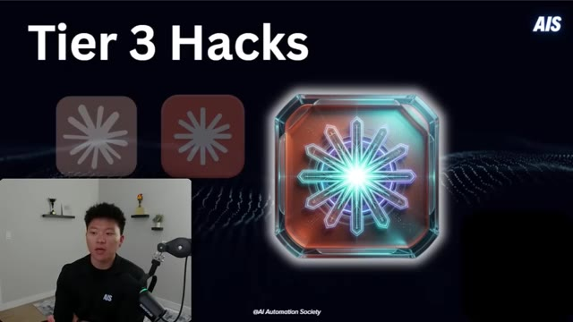
*⏱️ 00:12:49 — Une diapositive de présentation titrée "Tier 3 Hacks" avec une icône stylisée en forme d'étoile ou de flocon luminescent, accompagnée du présentateur en médaillon dans le coin inférieur gauche.*

---

### ⏱️ `[00:13:16 - 00:13:42]` | Segment #32

**🔊 Audio (Transcription Intégrale Mot pour Mot en Français) :**
> to think about. All right. So we're moving on to tier three now. I hope you guys feel like you already have a lot of things that you want to implement and these ones are getting a little crazier as well. So we've got four of these here and I've got a few bonus ones also, but number one is to pick the right model. So Sonnet for your default, most coding work, Haiku for sub-agents, formatting, simple tasks, Opus for deep architectural planning, and only when Sonnet wasn't enough, try to keep this under 20% of usage or unless you just really, really need it for that project.

**👁️ Analyse Visuelle d'Écran (gemini-3.5-flash-lite) :**
**Interface & Outils** : Présentation PowerPoint/Slide deck pédagogique.

**Contenu textuel & Code** : - "Sonnet = your default for most coding work."
- "Haiku = subagents, formatting, simple tasks (3x cheaper than Sonnet)."
- "Opus = deep architectural planning only, and only when Sonnet wasn't enough. Keep under 20% of total usage."

**Action / Démonstration** : Explication théorique des stratégies de sélection de modèles IA pour l'optimisation des coûts et des performances.

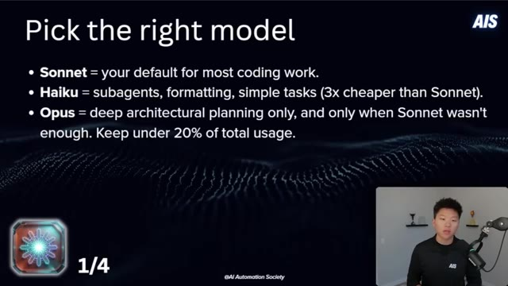
*⏱️ 00:13:29 — Diapositive présentant le premier "hack" intitulé "Pick the right model", listant les usages recommandés pour les modèles Sonnet, Haiku et Opus.*

---

### ⏱️ `[00:13:43 - 00:14:04]` | Segment #33

**🔊 Audio (Transcription Intégrale Mot pour Mot en Français) :**
> Now, a little tip here is when you have a huge code base and you want to do certain things like maybe a review, then try bringing in codecs. There is an official plugin now, and I made a video about this. I'll tag that right up here, but you could basically have, you know, Opus and Sonnet working together to build you, you know, a project or a code base. And then you could just bring in codecs to actually review everything. And that way you're saving yourself on the Claude tokens.

**👁️ Analyse Visuelle d'Écran (gemini-3.5-flash-lite) :**
**Interface & Outils** : Présentation (diapositive pédagogique).

**Contenu textuel & Code** : Texte explicatif : "Sonnet = your default for most coding work", "Haiku = subagents, formatting, simple tasks (3x cheaper than Sonnet)", "Opus = deep architectural planning only, and only when Sonnet wasn't enough. Keep under 20% of total usage."

**Action / Démonstration** : Recommandation stratégique sur l'utilisation des différents modèles LLM d'Anthropic pour optimiser le travail de développement.

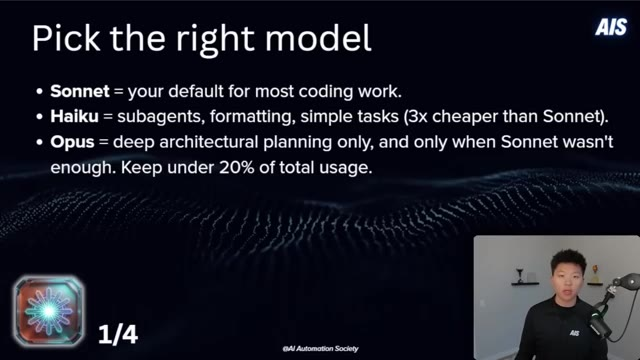
*⏱️ 00:13:48 — Une diapositive de présentation titrée "Pick the right model" détaillant les cas d'usage optimaux pour les modèles Claude (Sonnet, Haiku, Opus).*

---

### ⏱️ `[00:14:04 - 00:14:41]` | Segment #34

**🔊 Audio (Transcription Intégrale Mot pour Mot en Français) :**
> The next one, number two here is the cost of sub agents. Agent workflows use roughly seven to 10 times more tokens than a standard single agent session. Now, why is that? Because they wake up with their own full context and it's a separate instance. So they basically have to reload everything when you start up the new session, all of those files, all of the system tools, like everything like that. Now what you can do though, which is helpful, is to delegate to sub agents for one-off tasks, especially if you want that one-off task to use haiku. So maybe you need to process a lot of information or maybe you need to do a ton of research and get just like a summary back. Now yes, tokens are still tokens no matter what at the end of the day, but if you can make 80%

**👁️ Analyse Visuelle d'Écran (gemini-3.5-flash-lite) :**
**Interface & Outils** : Présentation PowerPoint ou Keynote (diapositive graphique).

**Contenu textuel & Code** : Texte à l'écran : "Agent workflows use roughly 7-10x more tokens than a standard single-agent session.", "Delegate to subagents for one off tasks that can use Haiku.", "Each subagent runs its own full context window as a separate Claude instance.", "Agent teams? Very expensive."

**Action / Démonstration** : Présentation théorique des coûts liés à l'utilisation d'agents multiples et de contextes séparés.

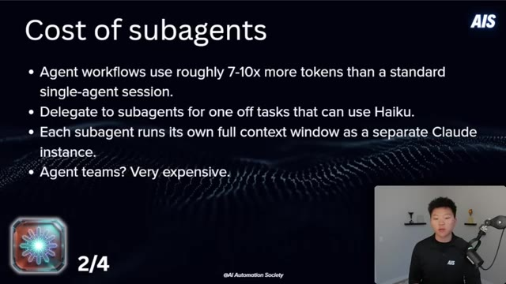
*⏱️ 00:14:14 — Une diapositive de présentation titrée "Cost of subagents" détaillant pourquoi les workflows d'agents consomment plus de jetons, avec le présentateur visible en incrustation dans le coin inférieur droit.*

---

### ⏱️ `[00:14:41 - 00:15:18]` | Segment #35

**🔊 Audio (Transcription Intégrale Mot pour Mot en Français) :**
> of your tokens a cheaper model rather than 80% of your tokens an expensive model, then you're going to be saving money. And then of course agent teams are cool. Sometimes I really do actually like them and it helps me get more higher quality outputs, but they're very, very expensive. So try to use them very sparingly. All right. So number three is to understand peak hours. So we just talked about at the beginning, how they've adjusted how fast your five hour session window drains based on demand during the peak hours, which are 8am to 2pm Eastern time on weekdays, but off peak, this is when your usage is kind of either normal or it lasts a little longer.

**👁️ Analyse Visuelle d'Écran (gemini-3.5-flash-lite) :**
**Interface & Outils** : Diapositive de présentation (type PowerPoint/Google Slides) intégrée à la vidéo.

**Contenu textuel & Code** : Liste à puces : "Agent workflows use roughly 7-10x more tokens than a standard single-agent session", "Delegate to subagents for one off tasks that can use Haiku", "Each subagent runs its own full context window as a separate Claude instance", "Agent teams? Very expensive."

**Action / Démonstration** : Présentation théorique illustrant les coûts élevés liés à la multiplication des sous-agents et à la gestion des fenêtres de contexte.

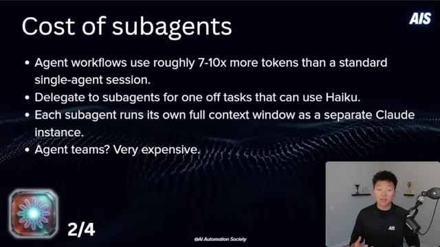
*⏱️ 00:14:51 — Une diapositive de présentation titrée "Cost of subagents" expliquant les implications financières de l'utilisation d'équipes d'agents IA, avec le présentateur en médaillon.*

---

### ⏱️ `[00:15:18 - 00:15:42]` | Segment #36

**🔊 Audio (Transcription Intégrale Mot pour Mot en Français) :**
> and these are afternoons, evenings, weekends. So if you actually think about this strategically, maybe you wanna make sure that you're running big refactors or multi-agent sessions or big projects during off-peak hours only. Otherwise, you're gonna drain right through that peak session. And on top of this, we'll call this a little hack 3.5, which is the one I kind of alluded to earlier when I said, hey, just keep open your Clot account so you can see your usage at all times.

**👁️ Analyse Visuelle d'Écran (gemini-3.5-flash-lite) :**
**Interface & Outils** : Présentation de type "Slide" avec texte informatif.

**Contenu textuel & Code** : Texte explicatif sur les heures de pointe (Peak : 8h-14h ET) et les heures creuses (Off-peak), recommandant d'exécuter les tâches lourdes comme les refactorisations et projets multi-agents en dehors des heures de forte demande pour économiser les quotas.

**Action / Démonstration** : Aucune action technique, il s'agit d'une illustration théorique pour appuyer les conseils stratégiques donnés à l'oral.

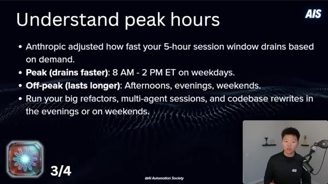
*⏱️ 00:15:24 — Une diapositive explicative intitulée "Understand peak hours" détaillant la gestion des fenêtres de session Anthropic selon la demande.*

---

### ⏱️ `[00:15:42 - 00:16:17]` | Segment #37

**🔊 Audio (Transcription Intégrale Mot pour Mot en Français) :**
> If you're near a reset and you have room left in your allocation, then go heavy. Try to hit that usage limit before it resets. get your money's worth. Let your agents go loose at that point. And on the other side, if you're getting near your limit, but you still have lots of time, then step away. This is your time to take a break, take a walk, make some lunch, come back with a full budget instead of burning the last 5% on something small and getting stuck mid-task and having to just kind of, you know, lose that flow state that you might've been in. Okay. Number four, your system's constitution, which is Claude.md. This should contain stable decisions, architecture rules, and progress

**👁️ Analyse Visuelle d'Écran (gemini-3.5-flash-lite) :**
**Interface & Outils** : Diapositive de présentation (format texte).

**Contenu textuel & Code** : Texte listant deux stratégies de gestion de budget : "Go heavy" (utiliser le quota restant pour des tâches lourdes avant réinitialisation) et "Step away" (faire une pause si la limite est proche et qu'il reste peu de temps avant la réinitialisation).

**Action / Démonstration** : Présentation théorique illustrant la gestion optimisée des ressources informatiques/IA.

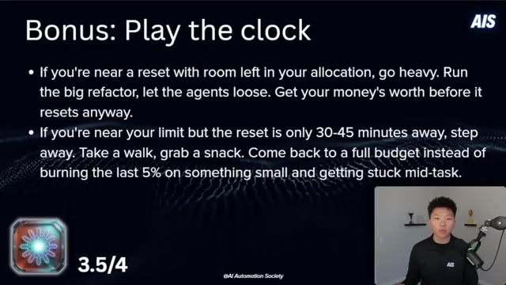
*⏱️ 00:15:51 — Une diapositive de présentation titrée "Bonus: Play the clock" qui donne des conseils stratégiques sur la gestion des quotas d'utilisation des agents IA en fonction du temps restant avant le réinitialisation.*

---

### ⏱️ `[00:16:17 - 00:16:53]` | Segment #38

**🔊 Audio (Transcription Intégrale Mot pour Mot en Français) :**
> summaries. Think of it like the source of truth that makes every prompt shorter and shorter. Save decisions, not conversations. Every architectural call that you store there is a paragraph that you never have to type again. So this builds on top of the way that you were thinking about it back in tier one. You can add rules in there that basically tell it, hey, I want you to help me make sure I'm being smart about tokens. Use subagents for any exploration or research. If a task needs three plus files or multi-file analysis, spawn a subagent and only return summarized insights. Spawn that subagent in Haiku. And here's a little prompt that I have at the bottom of mycloud.md. And I will say before I read this out, you have to be careful because

**👁️ Analyse Visuelle d'Écran (gemini-3.5-flash-lite) :**
**Interface & Outils** : Diapositive de présentation (format slide).

**Contenu textuel & Code** : Le texte affiche les principes suivants : "Your CLAUDE.md should contain stable decisions, architecture rules, and progress summaries. Think of it as the source of truth that makes every future prompt shorter." et "Save decisions, not conversations. Every architectural call you store there is a paragraph you never have to type again."

**Action / Démonstration** : Le présentateur explique la stratégie de gestion de la mémoire contextuelle pour les agents IA via le fichier CLAUDE.md.

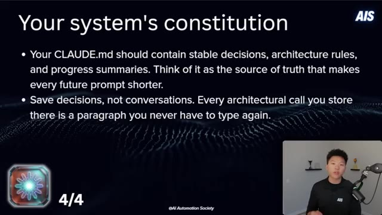
*⏱️ 00:16:26 — Une diapositive de présentation titrée "Your system's constitution" expliquant l'utilité du fichier CLAUDE.md pour centraliser les décisions architecturales.*

---

### ⏱️ `[00:16:53 - 00:17:26]` | Segment #39

**🔊 Audio (Transcription Intégrale Mot pour Mot en Français) :**
> when you make a file like this kind of self-learning or self-evolving, you have to check on it frequently because you don't want it to accidentally get too bloated. But here I said, applied learning. When something fails repeatedly, when Nate has to re-explain, or when a workaround is found for a platform tool or limitation, add a one-line bullet here. Keep each bullet under 15 words, no explanations, only add things that will save time in future sessions. And then it's got some bullets. Now I'm not saying this is the most optimal prompt, but I think this sort of system of having your cloud.md actually learn and continuously think about how it can save you time

**👁️ Analyse Visuelle d'Écran (gemini-3.5-flash-lite) :**
**Interface & Outils** : Présentation (PowerPoint ou similaire) affichée sur fond sombre.

**Contenu textuel & Code** : Texte technique listant des bonnes pratiques d'automatisation : "Templates + Puppeteer for visual consistency", "Agents fail silently on wrong paths", "Google Slides 'autofit' crashes", "Windows Developer Mode required for symlinks".

**Action / Démonstration** : Présentation conceptuelle des directives d'apprentissage autonome pour un système d'automatisation.

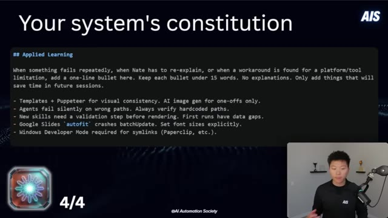
*⏱️ 00:17:01 — Une diapositive de présentation intitulée "Your system's constitution" affichant une section "Applied Learning" avec une liste de règles techniques pour optimiser les performances des agents IA.*

---

### ⏱️ `[00:17:26 - 00:17:58]` | Segment #40

**🔊 Audio (Transcription Intégrale Mot pour Mot en Français) :**
> and tokens is a good idea to play with. All right. So I know that we just went through a ton of stuff. This whole slide deck will be available for download for free in my free school community. The link for that will be down in the description. But right now what you should go do are these things. Go run slash context. See what it looks like. Go to some of your active sessions. Run slash cost. Status line. Make sure it's showing your model, your context percentage, and your token count. Make sure you pull up your cloud usage dashboard so you can see your remaining allocation and what time it resets. Disconnect unused MCP servers. Start complex tasks in plan

**👁️ Analyse Visuelle d'Écran (gemini-3.5-flash-lite) :**
**Interface & Outils** : Diapositive de présentation (PowerPoint/Keynote).

**Contenu textuel & Code** : Liste de recommandations :
- Exécuter /context et /cost.
- Surveiller la ligne d'état (modèle, contexte %, nombre de tokens).
- Utiliser le tableau de bord d'usage de Claude.
- Déconnecter les serveurs MCP inutilisés via /mcp.
- Utiliser le "Plan Mode" (Shift+Tab).
- Utiliser /clear pour les changements de tâches.
- Exécuter /compact à ~60% de capacité.
- Regrouper les instructions multi-étapes.
- Planifier les sessions lourdes en heures creuses.

**Action / Démonstration** : Présentation de bonnes pratiques (best practices) pour la gestion efficace de l'utilisation des tokens et du contexte dans les flux de travail IA.

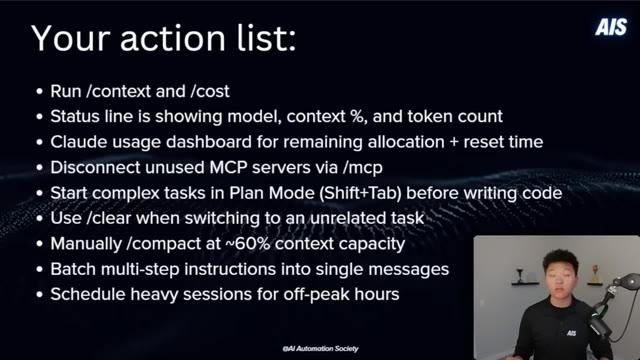
*⏱️ 00:17:34 — Une diapositive de présentation intitulée "Your action list" listant des bonnes pratiques pour l'optimisation de l'utilisation des agents IA (type Claude Code).*

---

### ⏱️ `[00:17:58 - 00:18:30]` | Segment #41

**🔊 Audio (Transcription Intégrale Mot pour Mot en Français) :**
> mode. Use slash clear when you're switching to an unrelated task. Manually compact at 60% context. Batch your multi-step instructions into single messages and schedule heavy sessions for off-peak hours and really just be mindful about the actual timing. So I wanted to kind of leave you guys with one, maybe two messages. The first thing is just the idea that there is a balance between quality and cost. And so that's kind of a game that you have to play a little bit. And sometimes you do have to go for the higher quality, which ultimately is going to cost you more money. And that's just the way it works. But the other thing is just to keep it simple and

**👁️ Analyse Visuelle d'Écran (gemini-3.5-flash-lite) :**
**Interface & Outils** : Présentation pédagogique sous forme de diapositives (slides).

**Contenu textuel & Code** : Liste de commandes recommandées (ex: /context, /cost, /mcp, /clear, /compact), conseils d'utilisation (Plan Mode, traitement par lots, horaires), et argumentaire sur la gestion efficace de l'historique de conversation.

**Action / Démonstration** : Synthèse des meilleures pratiques de gestion de contexte pour les outils d'IA et recommandations de "hygiène" de session pour maximiser l'efficacité.

*⏱️ 00:18:06 — Une diapositive intitulée "Your action list" listant des bonnes pratiques pour l'optimisation de l'utilisation d'outils d'IA.*

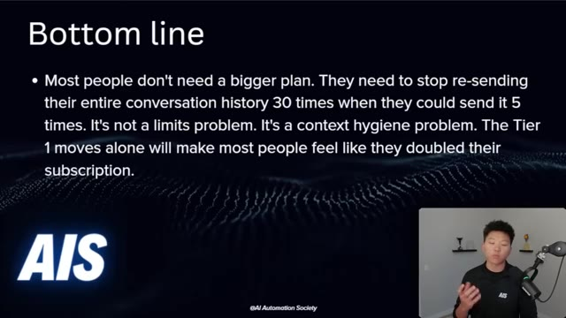
*⏱️ 00:18:14 — Une diapositive intitulée "Bottom line" concluant sur l'importance de l'hygiène du contexte plutôt que de l'augmentation des limites d'abonnement.*

---

### ⏱️ `[00:18:30 - 00:18:51]` | Segment #42

**🔊 Audio (Transcription Intégrale Mot pour Mot en Français) :**
> think about what we talked about at the beginning of this video, how tokens actually work, how Claude Code actually charges you. Most people don't need a bigger plan. They need to stop resending their entire conversation history 30 times when you could just send it five times. It's not a limits problem. It's a context hygiene problem. But anyways, that is gonna do it for this one. If you guys enjoyed or learned something new, please give it a like, it helps me out a ton.

**👁️ Analyse Visuelle d'Écran (gemini-3.5-flash-lite) :**
**Interface & Outils** : Diapositive de présentation (PowerPoint/Keynote).

**Contenu textuel & Code** : Texte affiché : "Bottom line. Most people don't need a bigger plan. They need to stop re-sending their entire conversation history 30 times when they could send it 5 times. It's not a limits problem. It's a context hygiene problem. The Tier 1 moves alone will make most people feel like they doubled their subscription."

**Action / Démonstration** : Le présentateur explique conceptuellement pourquoi l'optimisation de l'historique des conversations est plus efficace que l'augmentation des limites de forfait.

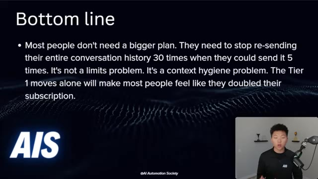
*⏱️ 00:18:36 — Une diapositive de présentation affichant une synthèse textuelle sur la gestion des tokens et l'optimisation des requêtes IA, avec le présentateur visible en médaillon dans le coin inférieur droit.*

---

### ⏱️ `[00:18:52 - 00:18:56]` | Segment #43

**🔊 Audio (Transcription Intégrale Mot pour Mot en Français) :**
> And as always, I appreciate you guys making it to the end of the video. I'll see you on the next one. Thanks everyone.

**👁️ Analyse Visuelle d'Écran (gemini-3.5-flash-lite) :**
**Interface & Outils** : Présentation (PowerPoint ou similaire)

**Contenu textuel & Code** : Texte : "Most people don't need a bigger plan. They need to stop re-sending their entire conversation history 30 times when they could send it 5 times. It's not a limits problem. It's a context hygiene problem."

**Action / Démonstration** : Présentation de la conclusion finale de la vidéo.

---

