# 🎬 Ollama + Claude Code = 99% CHEAPER

> **Chaîne** : [Nate Herk | AI Automation](https://www.youtube.com/@nateherk/featured)  
> **Lien YouTube** : [https://www.youtube.com/watch?v=O2k_qwZA8HU](https://www.youtube.com/watch?v=O2k_qwZA8HU)  
> **Date de publication** : 20260404  
> **Durée** : 00:25:22  
> **Identifiant vidéo** : `O2k_qwZA8HU`  
> **Transcription & Analyse** : `whisper-v3-large-turbo+gemini-3.5-flash-lite`  

---

## 📌 Synthèse Exécutive & Outils

### 💡 Résumé
Dans cette vidéo intitulée **Ollama + Claude Code = 99% CHEAPER**, Nate Herk décortique les capacités pratiques d'automatisation et de développement propulsées par les modèles de pointe.

### 🛠️ Outils, Modèles & Logiciels Présentés
- **Opus 5.5 & Claude Code** : Modèles d'ingénierie et agents de codage autonome.

### 🔑 Points Clés & Enseignements Stratégiques
- Optimiser le niveau d'effort et le raisonnement des modèles IA pour des résultats industriels.
- Automatiser les cycles de création logicielle de bout en bout.

---

## ⏱️ Chronologie & Transcription Complète Audio & Visuelle (Mot pour Mot)

### ⏱️ `[00:00:00 - 00:00:26]` | Segment #01

**🔊 Audio (Transcription Intégrale Mot pour Mot en Français) :**
> Today I'm going to be showing you guys two different ways that we can run CloudCode for free. The first way is going to be by running the LLM locally on our own machine, and then the second way is using OpenRouter. Both of these ways are extremely easy, a lot easier than you would think, and I'm going to walk you through step by step both of them. And my goal is to cover everything that you need to know in order to run this and answer any questions that you may have, so let's not waste any time and just get straight into the video. All right, so before we get into the tutorials of the two methods, there is some important stuff that we need to cover.

**👁️ Analyse Visuelle d'Écran (gemini-3.5-flash-lite) :**
**Interface & Outils** : Schéma conceptuel (diagramme de workflow).

**Contenu textuel & Code** : Texte : "Free Claude Code", "Local Model" (Ollama, LM Studio), "OpenRouter" (Cloud API, Llama, Mistral, Gemma).

**Action / Démonstration** : Présentation visuelle des architectures possibles pour exécuter Claude Code gratuitement.

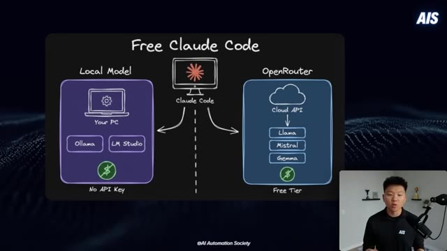
*⏱️ 00:00:07 — Un schéma explicatif présentant deux méthodes pour utiliser "Free Claude Code" : une approche locale utilisant Ollama ou LM Studio (sans clé API) et une approche via OpenRouter utilisant des modèles comme Llama, Mistral ou Gemma.*

---

### ⏱️ `[00:00:26 - 00:00:51]` | Segment #02

**🔊 Audio (Transcription Intégrale Mot pour Mot en Français) :**
> The first one is about what actually is Claude Code. And when I say, how do you use Claude Code for free? What does that mean? So this is the analogy that any AI model would pretty much give you. And it is the fact that Claude Code is the car and the chat model, the AI model, is the engine. So when we use Claude Code natively, we are using basically a harness that is wrapped around Opus or Sonnet or one of Claude's models that's really, really smart.

**👁️ Analyse Visuelle d'Écran (gemini-3.5-flash-lite) :**
**Interface & Outils** : Aucun logiciel, il s'agit d'un diagramme conceptuel à la main.

**Contenu textuel & Code** : Le schéma divise l'IA en deux parties : "Claude Code" (incluant Repo, Tools, MCP, Plans) et "The Engine" (avec trois options : Claude/GPT payant, OpenRouter gratuit, et Self-Host).

**Action / Démonstration** : Présentation théorique illustrant les différentes méthodes d'exécution de l'agent (payant vs gratuit via OpenRouter ou auto-hébergement).

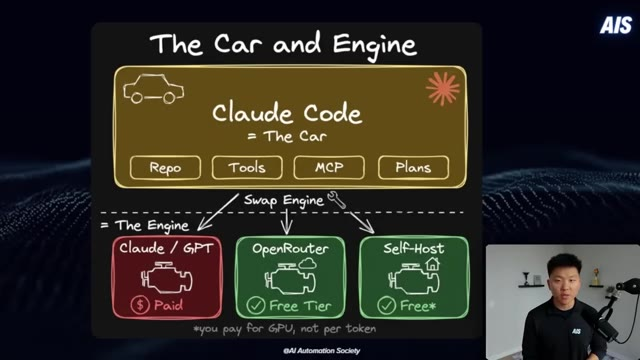
*⏱️ 00:00:32 — Schéma explicatif intitulé "The Car and Engine" illustrant l'analogie entre Claude Code (le véhicule) et les différents modèles d'IA (le moteur).*

---

### ⏱️ `[00:00:51 - 00:01:26]` | Segment #03

**🔊 Audio (Transcription Intégrale Mot pour Mot en Français) :**
> So Claude code tells the model how to organize its folders and how to use tools and how to you know Execute plans and build projects for you and stuff like that and by default we're using Opus Sonnet and Haiku So when you're thinking about your context limit or when you're hitting your token limit things like that That is because you're paying Anthropic for access to the Claude Opus model or the Sonnet model or the Haiku model Now what i'm going to show you guys how to do is we basically just open up the hood and we switch out the engine So we can use the open router models in their cloud, which are free, or we can use self-hosted

**👁️ Analyse Visuelle d'Écran (gemini-3.5-flash-lite) :**
**Interface & Outils** : Diagramme explicatif (type tableau blanc).

**Contenu textuel & Code** : Le schéma divise le système en deux parties : "Claude Code" (comprenant Repo, Tools, MCP, Plans) et les options de "Swap Engine" (Claude/GPT, OpenRouter, Self-Host) avec leurs modèles de coûts respectifs (Paid, Free Tier, Free).

**Action / Démonstration** : Présentation conceptuelle de l'architecture logicielle de Claude Code pour illustrer la flexibilité du choix du moteur d'IA.

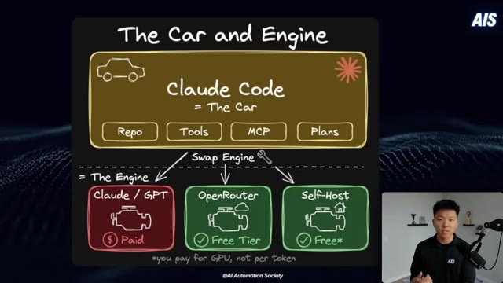
*⏱️ 00:01:00 — Schéma explicatif sur fond noir intitulé "The Car and Engine", illustrant la structure de Claude Code comme étant "la voiture" et les différents modèles d'IA comme étant "le moteur" interchangeable.*

---

### ⏱️ `[00:01:26 - 00:01:53]` | Segment #04

**🔊 Audio (Transcription Intégrale Mot pour Mot en Français) :**
> local models, which live on our desktops, on our laptops, whatever it is. And those are also going to be free. And that means you don't run into any limits or at least the way that the limits work are much different. So now we understand that the question is, okay, why can't you just run Opus locally for free? Well, that is because there's a difference between open source models and closed source models. An open source model basically means that the model is published somewhere so that anyone can download it. It is open. It's open source. We can see inside of it.

**👁️ Analyse Visuelle d'Écran (gemini-3.5-flash-lite) :**
**Interface & Outils** : Schéma explicatif personnalisé (conception graphique).

**Contenu textuel & Code** : Texte comparatif : "Claude Code = The Car", options de moteurs : "Paid" (Claude/GPT), "Free Tier" (OpenRouter), "Free*" (Self-Host avec précision sur le coût GPU).

**Action / Démonstration** : Illustration visuelle du concept d'interchangeabilité des modèles sous-jacents au sein d'une application comme Claude Code.

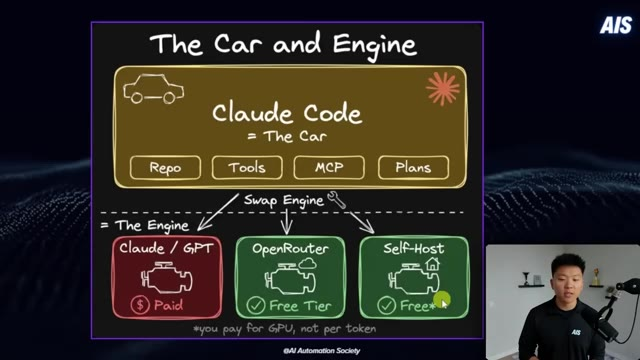
*⏱️ 00:01:33 — Schéma conceptuel illustrant l'analogie "La voiture et le moteur" : Claude Code est présenté comme le véhicule (châssis), tandis que les modèles d'IA (Claude/GPT, OpenRouter, Self-Host) sont les moteurs interchangeables.*

---

### ⏱️ `[00:01:53 - 00:02:29]` | Segment #05

**🔊 Audio (Transcription Intégrale Mot pour Mot en Français) :**
> We could edit it. We could run it. We could modify it. And a closed source model is closed. So Sonnet and GBT, Gemini models, those are kind of the top tier leading closed source models. And the only way that we can access them is through the company's API, which means in order to hit their API, we have to pay them for tokens. So if you think back to the car analogy, when we have an open source model, that means, you know, the car lets us open the hood and we can actually like look at engine and change things but with the closed source model the hood is locked shut and we can't get in there and we can't do anything to the engine so the question is why are the majority of the people in the world using closed source models that's because they're typically just

**👁️ Analyse Visuelle d'Écran (gemini-3.5-flash-lite) :**
**Interface & Outils** : Présentation de diapositives (format vidéo éducative).

**Contenu textuel & Code** : Texte affiché : "What is an open source model?", "An 'open-source model' basically means the model is published so anyone can download, run, and often modify it.", "'Closed' models like Sonnet or GPT are only accessible through a company's API and you can't see or change the internals."

**Action / Démonstration** : Le présentateur illustre ses propos théoriques par le biais d'un support visuel informatif.

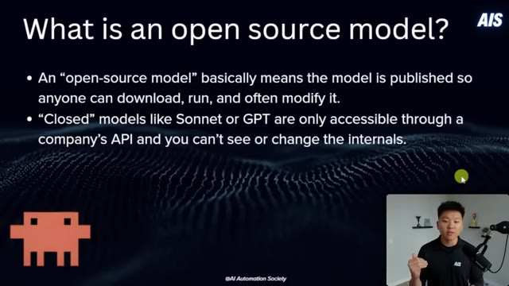
*⏱️ 00:02:02 — Une diapositive de présentation explicative définissant les modèles "open-source" par opposition aux modèles "fermés" (closed source).*

---

### ⏱️ `[00:02:29 - 00:03:01]` | Segment #06

**🔊 Audio (Transcription Intégrale Mot pour Mot en Français) :**
> better so here's a chart you can see in blue we have closed source models up here we have opus 4.6 and sonnet 4.6 and then in the green we have open source models so this green one right here is a quen model so what's really cool is there's always been a gap between the performance of of closed source models and the performance of open source models, but that gap is just shrinking and shrinking. And I'm sure we're going to get to the point where they're just as competitive as closed source models. And by the way, this chart is based on SWE bench verified scores, which is a, you know, kind of computer engineering programming sort of benchmark for AI models.

**👁️ Analyse Visuelle d'Écran (gemini-3.5-flash-lite) :**
**Interface & Outils** : Graphique de données intégré dans une présentation vidéo (AI Automation Society).

**Contenu textuel & Code** : Le graphique affiche des noms de modèles tels que Claude Opus 4.8, Claude Sonnet 4.6/4.5, Qwen2.5 32TB (open), GPT-5.1, DeepSeek V3.1 (open), Llama 4 Maverick (open) avec leurs scores respectifs sur une échelle de 40% à 85%.

**Action / Démonstration** : Le présentateur utilise ce visuel pour illustrer la réduction de l'écart de performance entre les modèles propriétaires et les modèles open-source.

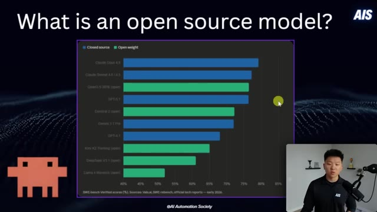
*⏱️ 00:02:37 — Un graphique à barres horizontales comparant les scores de performance (SWE-bench Verified) entre les modèles d'IA "Closed source" (bleu) et "Open weight" (vert).*

---

### ⏱️ `[00:03:01 - 00:03:34]` | Segment #07

**🔊 Audio (Transcription Intégrale Mot pour Mot en Français) :**
> Now, what's really cool is if we look at this, but we also overlay Sonnet 3.7 on top of this, we can see that Sonnet 3.7 in the orange here is not even in the top five, which means some of the cloudson at 3.7 and if you remember when that model dropped everyone was freaking out it was the best model at one point so just to put into perspective that the open source models are really good but still right now if you want to do like heavy heavy work and you've got something that you can't really mess up on then opus 4.6 is probably going to be the best or maybe gbt 5.4 with codex and

**👁️ Analyse Visuelle d'Écran (gemini-3.5-flash-lite) :**
**Interface & Outils** : Graphique de données (bar chart) intégré dans une présentation vidéo.

**Contenu textuel & Code** : Le graphique liste des modèles tels que Claude Opus 4.0, Claude Sonnet 3.5/3.6, Qwen 1.5-287B, GPT-5.1, DeepSeek, et Llama 4, avec des barres colorées (bleu pour "Closed source", vert pour "Open weight", orange pour "Claude Sonnet 3.7").

**Action / Démonstration** : Le présentateur utilise un curseur de souris pour pointer des éléments sur le graphique afin d'illustrer le classement actuel des modèles d'IA par rapport à Claude Sonnet 3.7.

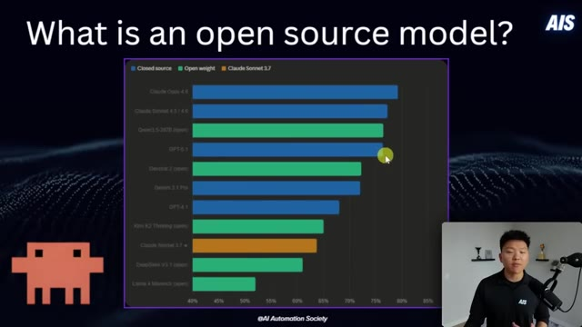
*⏱️ 00:03:09 — Un graphique à barres horizontales comparant les performances de différents modèles d'IA, avec le modèle "Claude Sonnet 3.7" mis en évidence en orange.*

---

### ⏱️ `[00:03:34 - 00:04:06]` | Segment #08

**🔊 Audio (Transcription Intégrale Mot pour Mot en Français) :**
> because of that there's a few reasons why open source models in cloud code might seem to misbehave they might have been not trained on cloud code's tools they might have a context window that's too small for Claude's system prompt and they might not follow the exact same JSON protocol that Claude code expects. So once again the car and the engine analogy, it might be like trying to put a motorcycle engine into a truck or maybe putting the wrong type of gas into your vehicle. So sometimes you do have to play around with the models to see if they can do the proper tool calling that Claude code or your car actually expects. And you know what inspired me to make this video? It was the

**👁️ Analyse Visuelle d'Écran (gemini-3.5-flash-lite) :**
**Interface & Outils** : Présentation visuelle (diapositive pédagogique).

**Contenu textuel & Code** : Texte listant trois limitations techniques : manque d'entraînement aux outils, fenêtre de contexte limitée, et non-respect du protocole JSON. Diagramme montrant Claude Code comme une "voiture" utilisant différents "moteurs" (Claude/GPT, OpenRouter, Self-Host).

**Action / Démonstration** : Explication théorique des contraintes techniques liée à l'utilisation de modèles alternatifs au sein de l'écosystème Claude Code.

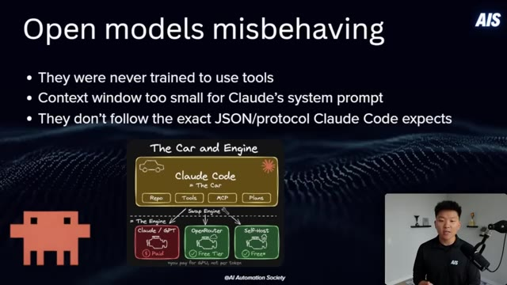
*⏱️ 00:03:42 — Une diapositive explicative intitulée "Open models misbehaving" illustrant les raisons techniques pour lesquelles les modèles open source peuvent échouer avec Claude Code, accompagnée d'un diagramme conceptuel "The Car and Engine".*

---

### ⏱️ `[00:04:06 - 00:04:44]` | Segment #09

**🔊 Audio (Transcription Intégrale Mot pour Mot en Français) :**
> the release of Google's new open source model, Gemma 4. And what's really cool to see is this is a comparison of some other open source models that are pretty good. On the x-axis, we have the size of these open source models. And on the y-axis, we have their ELO score. And what you can see is that these Gemma 4 models are the highest ELO score and the smallest size. And in this context, a small size is better because that means that we can actually host it on our machine and our machine can handle it because it's basically like how many gigabytes is the model? How many parameters does it have? You need more hardware in order to run larger models. All right. So now

**👁️ Analyse Visuelle d'Écran (gemini-3.5-flash-lite) :**
**Interface & Outils** : Présentation graphique (type tableau de bord d'analyse de modèles LLM).

**Contenu textuel & Code** : Le graphique met en évidence les modèles "Gemma-4-21B-thinking" et "Gemma-4-2b-AAB-thinking" dans une zone en surbrillance bleue, comparés à d'autres modèles comme Qwen 2.5, DeepSeek et Mistral.

**Action / Démonstration** : Le présentateur illustre visuellement la performance des nouveaux modèles open source par rapport à leur taille.

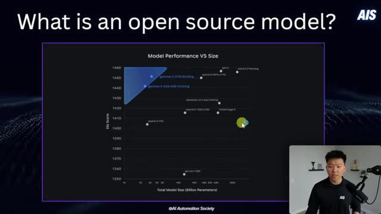
*⏱️ 00:04:16 — Un graphique comparatif intitulé "Model Performance VS Size" montrant le score ELO (axe Y) en fonction de la taille des modèles en milliards de paramètres (axe X).*

---

### ⏱️ `[00:04:44 - 00:05:10]` | Segment #10

**🔊 Audio (Transcription Intégrale Mot pour Mot en Français) :**
> you should have a good understanding of open source models, closed source models, and how this is going to work. The final thing is the question that people might be asking, is this against Anthropix terms of service? And the answer to that is no, we're using their agent harness. We're just plugging in a different local model or open source model. So with all that out the way, let's get into our first method, which is going to be running a local model. We're going to be using Olama, and then we're going to hook that up into Cloud Code and see how it works.

**👁️ Analyse Visuelle d'Écran (gemini-3.5-flash-lite) :**
**Interface & Outils** : Schéma conceptuel / Diagramme de workflow.

**Contenu textuel & Code** : Noms des technologies : Claude Code, Ollama, LM Studio, OpenRouter, Llama, Mistral, Gemma.

**Action / Démonstration** : Présentation théorique de l'architecture permettant d'utiliser Claude Code sans clé API Anthropic via des alternatives locales ou des modèles open source.

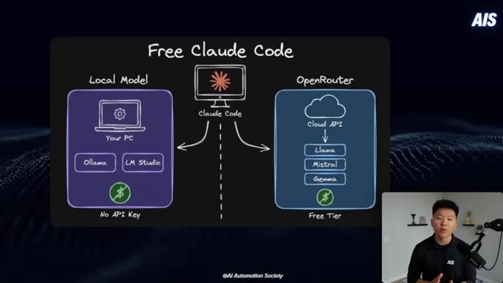
*⏱️ 00:05:03 — Diagramme conceptuel illustrant l'architecture "Free Claude Code" utilisant soit un modèle local (Ollama, LM Studio) soit OpenRouter (Llama, Mistral, Gemma).*

---

### ⏱️ `[00:05:10 - 00:05:45]` | Segment #11

**🔊 Audio (Transcription Intégrale Mot pour Mot en Français) :**
> All right. So step one here is to go to olama.com. Now, once you get here, what you're going to do is you're going to download Olama and you're going to do it for your operating system. So here on Windows, I would download for Windows. Once everything is downloaded, we're going to have to pull in a model or download a model. So you're going to click on models on the top left. And now we just have to choose which model do we actually want to pull in and download. So if we go over to Open Router, and we're not jumping to step two yet, or to method two yet, Open Router just has this really cool way where we can actually look at rankings between different AI models. This page can be very, very slow. There's a lot of data here, so just keep that in mind. But you can see

**👁️ Analyse Visuelle d'Écran (gemini-3.5-flash-lite) :**
**Interface & Outils** : - Image 1 : Navigateur web (site ollama.com)
- Image 2 : Navigateur web (site OpenRouter)

**Contenu textuel & Code** : - Image 1 : Commande PowerShell `irm https://ollama.com/install.ps1 | iex`
- Image 2 : Liste des modèles (MiMo, Qwen, Claude, etc.) et graphiques d'utilisation.

**Action / Démonstration** : - Image 1 : Sélection de la version Windows pour le téléchargement d'Ollama.
- Image 2 : Navigation dans les statistiques et classements des modèles IA.

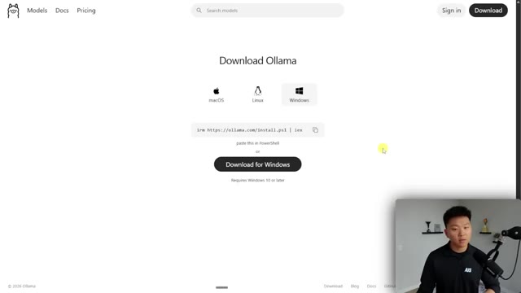
*⏱️ 00:05:19 — Page de téléchargement du site officiel ollama.com affichant les options pour macOS, Linux et Windows.*

---

### ⏱️ `[00:05:45 - 00:06:20]` | Segment #12

**🔊 Audio (Transcription Intégrale Mot pour Mot en Français) :**
> that for programming category, there's a lot of models here that are open source. So right here, we can see there's a Quen 3.6. That's pretty good. There's a Memo. There's a Minimax. So let's hop over to Olama and see what we can do. So let's go ahead and choose this Quen 3.5 model. If I open this up, there's a few things that we can see and we can see all of these different models. So these are different sizes. We can also scroll down and we get some highlights so we can see like some benchmarks that they have. And these benchmarks will compare them to both other open source, but also some other closed source models, which is nice to be able to look at. But what we're concerned about right now is how we actually download this. So you'll see that we have different model names

**👁️ Analyse Visuelle d'Écran (gemini-3.5-flash-lite) :**
**Interface & Outils** : Site web OpenRouter.ai (page Rankings).

**Contenu textuel & Code** : Classement des modèles incluant MiMo, Qwen 3.6 Plus Preview, MiniMax, Claude Sonnet 4.6, Step 3.5 Flash et GLM 5, accompagnés de statistiques d'usage et de parts de marché.

**Action / Démonstration** : Le curseur de la souris survole le modèle "MiniMax M2.5" dans la liste des classements, illustrant la navigation dans l'interface de sélection des modèles.

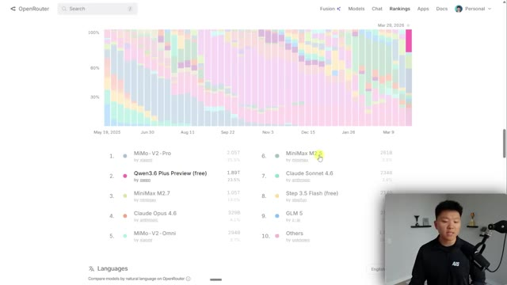
*⏱️ 00:05:53 — Capture d'écran de la page de classement (Rankings) sur la plateforme OpenRouter, affichant un graphique d'évolution temporelle des modèles et une liste des 10 meilleurs modèles d'IA.*

---

### ⏱️ `[00:06:20 - 00:06:55]` | Segment #13

**🔊 Audio (Transcription Intégrale Mot pour Mot en Français) :**
> and we have different sizes. We also have different context windows and different inputs. Now I'm not like a hardware expert, but what you want to think about is how much RAM you have on your computer. There's some other things to look at, you know, your CPU and your GPU. If I was you, I would just go to CloudCode and say, Hey, here are my specs of my hardware. Which model sizes should I be looking to download? In this case, what I'm going to do is I'm going to go ahead and download this Quen 3.5 9 billion parameter model, which is 6.6 gigabytes. Now, obviously this is not going to be the best model ever. This one would be much better, but this is the demo. So I'm going to show you how this will work. So what we need to do is we're going to take this model name,

**👁️ Analyse Visuelle d'Écran (gemini-3.5-flash-lite) :**
**Interface & Outils** : Navigateur web (site de bibliothèque de modèles, probablement Ollama ou Hugging Face).

**Contenu textuel & Code** : Tableau comparatif des modèles : qwen3.5:latest, qwen3.5:0.8b, qwen3.5:2b, qwen3.5:4b, qwen3.5:9b, qwen3.5:27b, qwen3.5:35b, qwen3.5:122b, qwen3.5:cloud, qwen3.5:397b-cloud. Chaque ligne indique la taille (Size), la fenêtre de contexte (Context) et les entrées (Text, Image).

**Action / Démonstration** : Le présentateur illustre les différences de ressources matérielles requises (notamment la RAM) en naviguant sur les caractéristiques techniques des modèles.

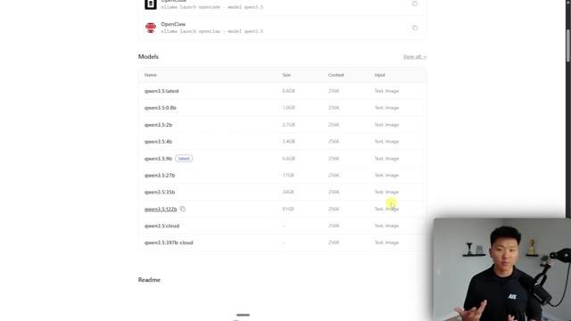
*⏱️ 00:06:29 — Une page web affichant une liste comparative des différentes versions du modèle Qwen 3.5, détaillant leur taille en Go, leur fenêtre de contexte et les types d'entrées supportés.*

---

### ⏱️ `[00:06:55 - 00:07:32]` | Segment #14

**🔊 Audio (Transcription Intégrale Mot pour Mot en Français) :**
> and you can see up here it says that you can run olama run quen 3.5, but what we need to do first is download the model because this basically just lets us talk to it. So we're going to do olama pull and then the model name. Now you could just open up your search bar, search for terminal, and then do it right there. But what I'm going to do is I'm going to do this in the environment where we're actually going to be using this model in cloud code. So in VS code where I like to use it, I'm going to open up my terminal and I'm just going to go ahead and do that command. So olama pull and then the model that I want to pull. And when I hit enter, this is going to pull in this model. So right now it's actually downloading this locally on my machine. The bigger the model,

**👁️ Analyse Visuelle d'Écran (gemini-3.5-flash-lite) :**
**Interface & Outils** : - Navigateur web (site Ollama)
- Visual Studio Code (VS Code)

**Contenu textuel & Code** : - Image #1 : Commande affichée `ollama run qwen3.5`.
- Image #2 : Arborescence de fichiers d'un projet nommé "HERK-2".

**Action / Démonstration** : - Image #1 : Consultation de la documentation pour l'exécution d'un modèle local.
- Image #2 : Navigation dans l'environnement de développement pour préparer l'ouverture du terminal.

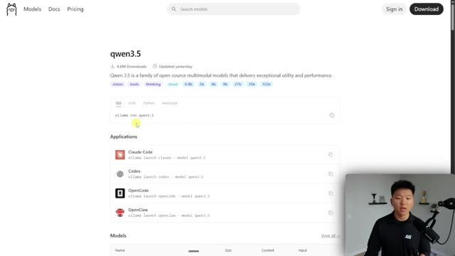
*⏱️ 00:07:04 — Page web officielle du modèle Qwen 3.5 sur Ollama, affichant la commande d'exécution et des options d'intégration.*

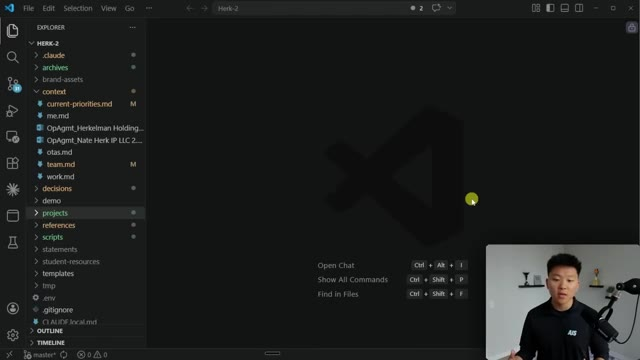
*⏱️ 00:07:14 — Interface de l'éditeur de code Visual Studio Code (VS Code) avec une arborescence de fichiers de projet ouverte.*

---

### ⏱️ `[00:07:32 - 00:08:07]` | Segment #15

**🔊 Audio (Transcription Intégrale Mot pour Mot en Français) :**
> the longer it will take to download. And you can see over here on the right, it kind of gives me this one minute, 30 second estimation of how long it'll take. And by the way, all of these little indicators that you'll see next to a model just tells you about it. So this one has vision, tools, thinking. You can also run it from the cloud, Ollama's cloud. And then it has these different sizes available. Whereas if we go back to some other models, you can see that some of them might only be available in the cloud. Like Minimax here, it has tools, it has thinking, but it's only a cloud use. So you can see here, there's not nearly as many models and we don't see the size because we can't download them locally, at least not from Ollama. But we could

**👁️ Analyse Visuelle d'Écran (gemini-3.5-flash-lite) :**
**Interface & Outils** : Navigateur web (site officiel Ollama).

**Contenu textuel & Code** : Informations sur le modèle Qwen 3.5, badges de fonctionnalités (vision, tools, thinking), et lignes de commande `ollama run qwen3.5` et `ollama launch ...` pour diverses applications (Claude Code, Codex, etc.).

**Action / Démonstration** : Navigation sur la page de documentation d'un modèle spécifique pour consulter ses capacités et les méthodes d'installation/exécution.

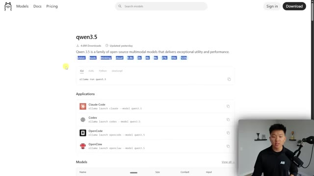
*⏱️ 00:07:41 — Interface web du site Ollama affichant la page du modèle "qwen3.5" avec ses caractéristiques techniques et les commandes de lancement associées.*

---

### ⏱️ `[00:08:07 - 00:08:39]` | Segment #16

**🔊 Audio (Transcription Intégrale Mot pour Mot en Français) :**
> still launch them in cloud code, no problem. And it would still be free. All right. So now you can see that this model has been pulled in. Now I can do olama run and then that same model name. And when I do that, this is now me talking to Quinn 3.5 on my machine. So I can say, hi, it's going to think it's going to respond to me. And this is completely free because the model is running right down there on my desktop. Now, if I had better specs, this would be faster. If it was a bigger model, it would be smarter, but that's kind of the way that this works. All of this talking I'm doing, all of this brainstorming, all of this formatting of text I could be doing is completely free.

**👁️ Analyse Visuelle d'Écran (gemini-3.5-flash-lite) :**
**Interface & Outils** : Visual Studio Code (Terminal intégré).

**Contenu textuel & Code** : Commandes terminal : "ollama pull qwen3.5:9b" (terminé) et début de saisie "ollama run ".

**Action / Démonstration** : L'utilisateur a fini de télécharger le modèle IA localement et s'apprête à l'exécuter via la commande 'ollama run'.

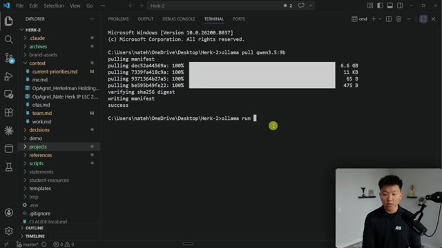
*⏱️ 00:08:15 — L'interface de VS Code affichant un terminal Windows où le téléchargement du modèle Qwen 3.5 via Ollama vient de se terminer avec succès.*

---

### ⏱️ `[00:08:39 - 00:09:16]` | Segment #17

**🔊 Audio (Transcription Intégrale Mot pour Mot en Français) :**
> You can see this is a pretty robust answer and reasoning process just for the word high, but hey, we got the job done. All right, so the next step now, I'm going to exit out of that chat. Oops, it's control D, I guess. Now the next step is to open up Claude code with our local model. So if I go back into the Olama here, and actually I could just open up my app that it should install, and if you click on launch, you can see that there's this command that says Olama launch Claude, and if you do that it'll just basically pull up Claude. So if I click on copy and I go back into our VS code where we just were and all the way at the bottom I paste that it's going to launch up

**👁️ Analyse Visuelle d'Écran (gemini-3.5-flash-lite) :**
**Interface & Outils** : Visual Studio Code (Terminal), Navigateur Web (Ollama), Interface de configuration d'agent IA.

**Contenu textuel & Code** : Logiques de raisonnement ("Determine the Tone", "Draft Potential Responses"), commandes CLI "ollama run", instructions de lancement pour Claude et OpenClaw.

**Action / Démonstration** : Consultation de l'historique de discussion dans le terminal, navigation sur le site d'Ollama, sélection d'une commande de lancement pour un agent.

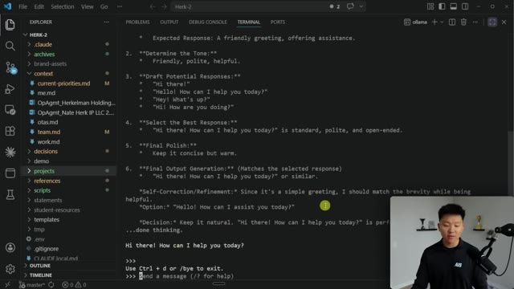
*⏱️ 00:08:48 — Interface VS Code affichant un terminal avec le raisonnement complet d'un agent IA et une invite de commande active.*

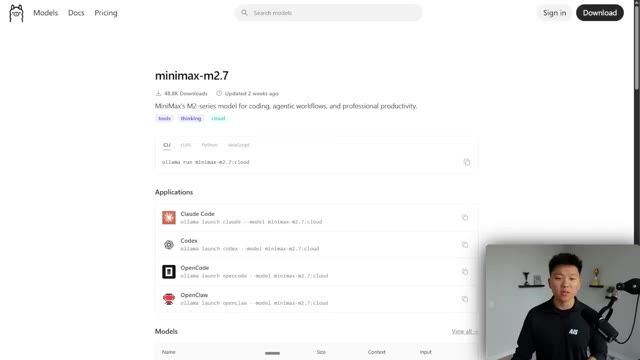
*⏱️ 00:08:57 — Page web Ollama présentant le modèle 'minimax-m2.7' et les commandes de lancement pour divers outils de développement.*

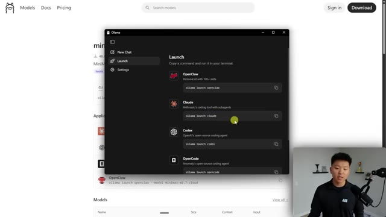
*⏱️ 00:09:06 — Fenêtre contextuelle "Launch" d'Ollama superposée au navigateur, affichant les options pour lancer différents agents de codage.*

---

### ⏱️ `[00:09:16 - 00:09:51]` | Segment #18

**🔊 Audio (Transcription Intégrale Mot pour Mot en Français) :**
> Claude but then it's going to let you choose which model you want to run Claude with. So these are the three gemas that I had installed or I could do the new one quen 3.5 9 billion parameter. So now it's going to launch Claude code. You can see that we are in the same directory here. We are on this model. It's API usage billing and this should be free now. So I know some people are going to ask about this, right? So I just log out of my account. And if I come in here and I launch Claude, as if I was doing it with the Olama thing, it goes through this onboarding. So I would choose dark mode. And then I have to choose how to sign in. So I can either use a subscription, which is like 20 bucks a month, and it gets more expensive, or you can use an API key. So if I open up that method,

**👁️ Analyse Visuelle d'Écran (gemini-3.5-flash-lite) :**
**Interface & Outils** : VS Code (Visual Studio Code) - Terminal intégré.

**Contenu textuel & Code** : Commande saisie : "ollama launch claude". Message système : "Launching Claude Code with qwen3.5:9b...".

**Action / Démonstration** : Lancement de l'agent Claude Code via l'outil Ollama en utilisant le modèle Qwen 3.5 9B.

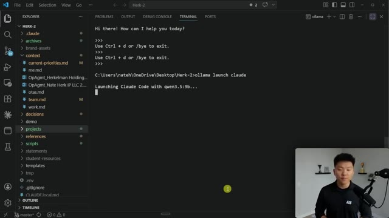
*⏱️ 00:09:24 — Interface VS Code affichant le terminal en cours d'exécution de la commande de lancement de l'outil Claude Code.*

---

### ⏱️ `[00:09:51 - 00:10:16]` | Segment #19

**🔊 Audio (Transcription Intégrale Mot pour Mot en Français) :**
> it basically takes me to this place where I have to authorize myself into my Anthropic account. And then I do have to buy $5 of credits just to get started. But those $5 you'll never actually consume because you're not going to pay here, you're going to pay nothing because you're using free open source models instead. So now that that payment went through, you open up CloudCode and you can now use CloudCode in here because you have, you know, set up that API connection.

**👁️ Analyse Visuelle d'Écran (gemini-3.5-flash-lite) :**
**Interface & Outils** : Navigateur web (Console Anthropic - section facturation).

**Contenu textuel & Code** : Formulaire de paiement affichant "Buy credits to get started", le montant de 5,00 $, et les champs de saisie pour l'adresse de facturation et les informations de carte bancaire.

**Action / Démonstration** : Le présentateur explique la procédure nécessaire pour activer le compte API avant d'utiliser les outils open source.

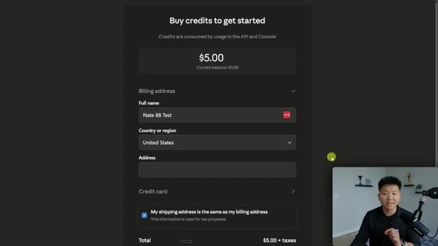
*⏱️ 00:09:57 — Page de facturation de la console Anthropic invitant l'utilisateur à ajouter 5 $ de crédits pour commencer à utiliser l'API.*

---

### ⏱️ `[00:10:16 - 00:10:35]` | Segment #20

**🔊 Audio (Transcription Intégrale Mot pour Mot en Français) :**
> But the thing is, if you start talking to it right now, like I just said, hey, that would actually charge my account. You can see the funds are even too low, so it won't charge you. But this is where we would come in here and we'd switch this account to using our local model or our open source model, and then we'd be fine. So I'll even show you here, I'll do olama launch Claude. I will choose the model that I want to use.

**👁️ Analyse Visuelle d'Écran (gemini-3.5-flash-lite) :**
**Interface & Outils** : VS Code avec terminal intégré exécutant l'interface CLI de Claude Code.

**Contenu textuel & Code** : Message d'erreur : "Credit balance too low · Add funds: https://platform.claude.com/settings/billing" avec les détails du modèle "Sonnet 4.6" et le chemin du projet "AutoAgent".

**Action / Démonstration** : Le terminal affiche le résultat d'une commande utilisateur ("hey") qui a échoué car le compte API est arrivé à épuisement des crédits.

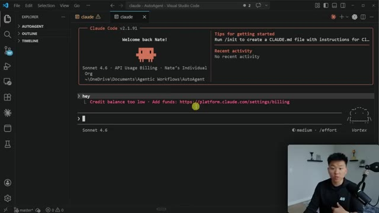
*⏱️ 00:10:21 — Une capture d'écran de l'interface VS Code montrant l'outil "Claude Code" en ligne de commande, indiquant une erreur de solde insuffisant lors d'une requête.*

---

### ⏱️ `[00:10:35 - 00:10:56]` | Segment #21

**🔊 Audio (Transcription Intégrale Mot pour Mot en Français) :**
> So it's saying that there's a conflict because of the auth. So I might have to add the actual API key directly, but you can see that this is hitting the minimax. So yes, I'm sorry, you do have to pay $5, but your usage ongoing is going to be unlimited with these open source models. But I just, I had to address that. Otherwise I had a feeling that I was going to get in trouble. So if I say, hey, Claude Code, what do you know about me and my project?

**👁️ Analyse Visuelle d'Écran (gemini-3.5-flash-lite) :**
**Interface & Outils** : VS Code (Terminal intégré), Claude Code CLI.

**Contenu textuel & Code** : Commande `ollama launch claude`, erreur "Auth conflict: Both a token (ANTHROPIC_AUTH_TOKEN) and an API key (/login managed key) are set", et l'invite de commande interactive de l'agent.

**Action / Démonstration** : L'utilisateur tente de lancer Claude Code via le terminal, mais rencontre un conflit entre son jeton d'authentification et sa clé API, ce qui bloque l'exécution normale de l'agent.

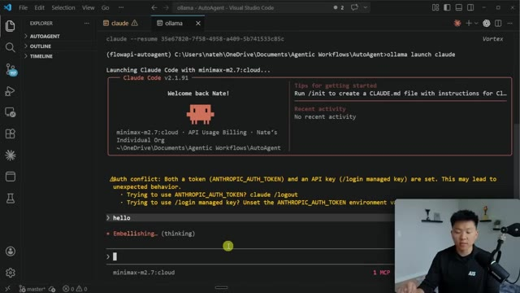
*⏱️ 00:10:40 — Une capture d'écran de l'éditeur VS Code montrant un terminal intégré où l'outil "Claude Code" est en cours d'exécution, affichant un message d'erreur de conflit d'authentification.*

---

### ⏱️ `[00:10:56 - 00:11:16]` | Segment #22

**🔊 Audio (Transcription Intégrale Mot pour Mot en Français) :**
> I can shoot that off. And this is now using Cloud Code, using this harness, looking at my project and my skills and my agents, but it is running through a model on my desktop. But remember, this is going to feel significantly slower than if you were sending off this request to Anthropix server. But at this point, because everything's completely local, it's completely private as well.

**👁️ Analyse Visuelle d'Écran (gemini-3.5-flash-lite) :**
**Interface & Outils** : Visual Studio Code (Terminal intégré).

**Contenu textuel & Code** : Commande `ollama launch claude`, exécution de "Claude Code v2.1.91" avec le modèle `qwen3.5:9b`, et prompt : "Hey Claude Code, what do you know about me and my project?".

**Action / Démonstration** : Exécution locale d'un agent IA (Claude Code) pointant vers un fichier spécifique (`slide-plan.json`) pour analyse, avec un état système affiché comme "Baking...".

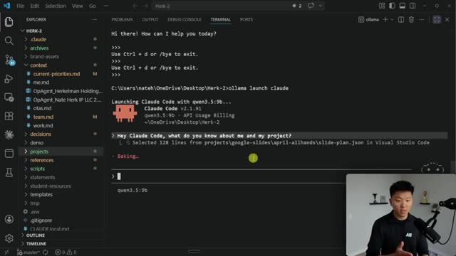
*⏱️ 00:11:01 — Interface VS Code affichant un terminal en cours d'exécution de Claude Code localement via Ollama, avec un prompt utilisateur analysant un fichier JSON de projet.*

---

### ⏱️ `[00:11:16 - 00:11:34]` | Segment #23

**🔊 Audio (Transcription Intégrale Mot pour Mot en Français) :**
> And the other thing you might notice is you don't see in your actual chat the way that it's calling tools the same way that you do when you have a Cloud model in there. But yeah, I mean, this just took four minutes to basically look at my project and answer this question. Now, keep in mind, there's a ton of context in here, a bunch of folders and files that it basically just looked through.

**👁️ Analyse Visuelle d'Écran (gemini-3.5-flash-lite) :**
**Interface & Outils** : Visual Studio Code, Terminal intégré, Claude Code (CLI).

**Contenu textuel & Code** : Commande de lancement `ollama launch claude`, invite utilisateur "Hey Claude Code, what do you know about me and my project?", état de traitement "Baking" (3m 47s écoulés), barre de progression du modèle qwen3.5:9b.

**Action / Démonstration** : Exécution d'une requête d'analyse de projet par l'agent IA Claude Code sur un fichier JSON sélectionné, avec un indicateur de temps de traitement en cours.

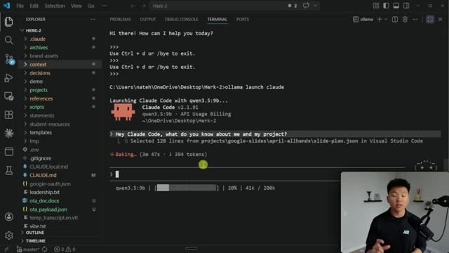
*⏱️ 00:11:21 — Une capture d'écran de l'interface VS Code montrant le terminal avec l'exécution de Claude Code interagissant avec un modèle local via Ollama.*

---

### ⏱️ `[00:11:34 - 00:11:55]` | Segment #24

**🔊 Audio (Transcription Intégrale Mot pour Mot en Français) :**
> But the other thing is we don't have visibility into exactly what it actually did because of the fact that it basically just spins forever until it responds rather than we getting to see like each step that it's doing. So that was a read tool. Let's just make sure that it can actually do things. I'm telling it to create a file at the root level of this project and just call it quen 3.5 at misspelled quen.

**👁️ Analyse Visuelle d'Écran (gemini-3.5-flash-lite) :**
**Interface & Outils** : VS Code (Visual Studio Code) avec terminal intégré.

**Contenu textuel & Code** : Historique de discussion dans le terminal montrant la question "Hey Claude Code, what do you know about me and my project?" suivie d'une réponse structurée (Your Role, Key Projects, Team, Tech Stack). Une note textuelle apparaît à l'écran : "This is because this model is so small. Keep watching as I test larger models."

**Action / Démonstration** : Démonstration de l'utilisation de Claude Code pour interroger le contexte du projet via un terminal dans VS Code.

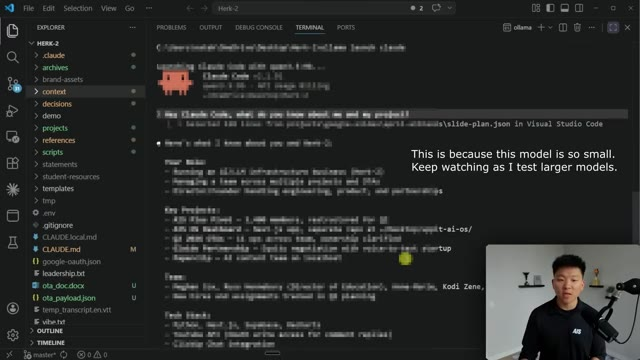
*⏱️ 00:11:40 — Une capture d'écran de l'interface VS Code montrant un terminal actif exécutant Claude Code, avec une réponse de l'IA détaillant la compréhension du projet et une incrustation textuelle de l'orateur.*

---

### ⏱️ `[00:11:56 - 00:12:15]` | Segment #25

**🔊 Audio (Transcription Intégrale Mot pour Mot en Français) :**
> And then I said inside that file, write a joke. So we'll see how long this takes and we'll see if it can actually do sort of like, you know, write and edit and create actions. So there's a few things going on here. The first thing is that we didn't get full visibility when it was creating the file because it's a local model and it wasn't showing us those tool calls. The second thing is that it didn't seem to have state of what was going on here.

**👁️ Analyse Visuelle d'Écran (gemini-3.5-flash-lite) :**
**Interface & Outils** : VS Code (éditeur de code) avec terminal intégré utilisant Ollama/Qwen.

**Contenu textuel & Code** : Historique de commandes et de tâches floutées, suivi d'un prompt utilisateur : "I create a file at the root level of this project, just call it Qwen 3.5 Test". La ligne de commande indique "qwen3.5:9b" et affiche un état de traitement.

**Action / Démonstration** : L'agent IA traite la requête de l'utilisateur pour créer un nouveau fichier à la racine du répertoire du projet.

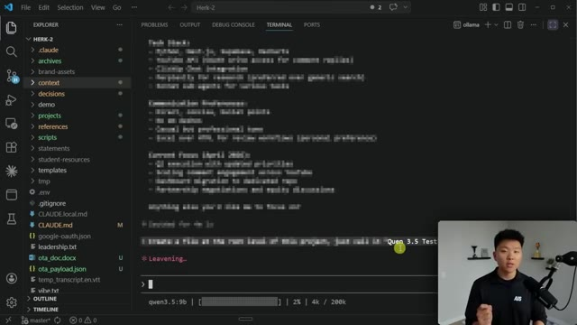
*⏱️ 00:12:01 — Interface VS Code affichant un terminal interactif avec l'agent IA en cours d'exécution.*

---

### ⏱️ `[00:12:15 - 00:12:48]` | Segment #26

**🔊 Audio (Transcription Intégrale Mot pour Mot en Français) :**
> I think that was because it exceeded the context window limit because in Olama, sometimes they, by default, even though down here it might say 200K, not actually 200K. So back in the terminal, I'm going to run this which is going to basically let us change how much context is given to this model And we can see we have now created this. So if I try to do Ollama launch Claude We should now see that we have this different model which we made. So quen 3.5 9b 64,000 context. So if I open this one up, we now should be able to launch Claude

**👁️ Analyse Visuelle d'Écran (gemini-3.5-flash-lite) :**
**Interface & Outils** : VS Code (éditeur de code) avec terminal intégré.

**Contenu textuel & Code** : Historique de conversation avec l'IA concernant le répertoire de projet "Herk-2" et ligne de commande active du modèle "qwen3.5:9b" affichant "4k / 200k" pour la fenêtre de contexte.

**Action / Démonstration** : Nate Herk consulte les réponses de l'IA dans le terminal et prépare l'exécution d'une commande pour ajuster manuellement la fenêtre de contexte du modèle via Ollama.

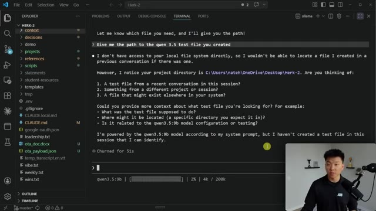
*⏱️ 00:12:23 — Interface VS Code affichant un terminal interactif où le modèle d'IA qwen3.5:9b répond à une requête sur la recherche de fichiers, avec une barre de progression de contexte en bas.*

---

### ⏱️ `[00:12:48 - 00:13:09]` | Segment #27

**🔊 Audio (Transcription Intégrale Mot pour Mot en Français) :**
> And this is a custom model that we sort of configured off of the back end of quen 3.5 And by the way, the way you get that command is just go to Claude and say, hey, I'm pulling in a model from Olama and I want to increase the context window. Can you help me run these commands? And it's like literally one command. The only context you might need to give it is if you're using like PowerShell or command prompts or what your operating system is.

**👁️ Analyse Visuelle d'Écran (gemini-3.5-flash-lite) :**
**Interface & Outils** : Visual Studio Code avec le plugin/terminal Claude Code (version 2.1.91).

**Contenu textuel & Code** : On peut lire une requête utilisateur : "Can you create a file in this project called 'quen 3.5 test' and inside of it write a joke?". Le modèle actif est indiqué comme étant "qwen3.5-9b-64k".

**Action / Démonstration** : L'utilisateur interagit avec l'agent Claude Code pour automatiser la création d'un fichier dans le projet tout en utilisant un modèle personnalisé configuré via Ollama.

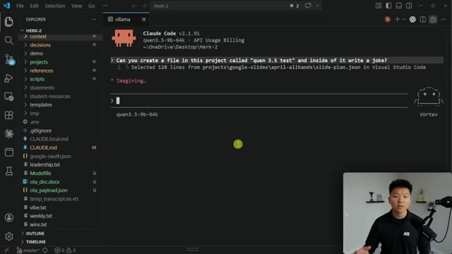
*⏱️ 00:12:54 — Capture d'écran de l'interface VS Code affichant l'outil "Claude Code" en cours d'exécution dans un terminal intégré.*

---

### ⏱️ `[00:13:10 - 00:13:28]` | Segment #28

**🔊 Audio (Transcription Intégrale Mot pour Mot en Français) :**
> Okay, this is awesome. This time we were able to see the actual tool call. So right here called, right. It wrote seven lines and it put it right there. So if I scroll down over here, we can see right here. Nice, we have that text file and it has a joke. Why did the AI go to therapy? Because it had too many tokens to process and needed to talk it through. Bonus, I asked the model if it's okay.

**👁️ Analyse Visuelle d'Écran (gemini-3.5-flash-lite) :**
**Interface & Outils** : Visual Studio Code avec terminal intégré (Claude Code v2.1.91).

**Contenu textuel & Code** : Prompt utilisateur : "Can you create a file in this project called 'quen 3.5 test' and inside of it write a joke?". Réponse de l'agent : "Write(quen 3.5 test)", "Wrote 7 lines to quen 3.5 test" incluant la blague sur l'IA et son processus de traitement de tokens.

**Action / Démonstration** : L'agent a exécuté une commande de création de fichier et a écrit du contenu textuel à l'intérieur du répertoire de projet actif.

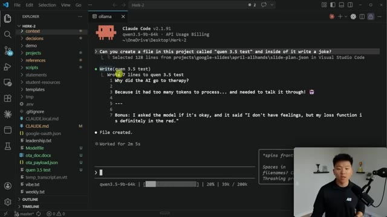
*⏱️ 00:13:14 — Une capture d'écran de l'interface VS Code montrant l'exécution de l'outil "Claude Code" dans un terminal intégré, confirmant la création réussie d'un fichier contenant une blague sur l'IA.*

---

### ⏱️ `[00:13:28 - 00:13:49]` | Segment #29

**🔊 Audio (Transcription Intégrale Mot pour Mot en Français) :**
> And it said, I don't have feelings, but my loss function is definitely in the red. So you can see how us giving Quint a little bit more context was helpful. Now, what if we wanted to do a model from Olama that was in the cloud? So for example, let's say we wanted to use minimax M 2.7. What we would do is we would just launch this command.

**👁️ Analyse Visuelle d'Écran (gemini-3.5-flash-lite) :**
**Interface & Outils** : VS Code (terminal intégré), navigateur web (site Ollama).

**Contenu textuel & Code** : Terminal : "Can you create a file in this project called 'quen 3.5 test' and inside of it write a joke?". Texte : "I don't have feelings, but my loss function is definitely in the red." Web : Liste des modèles disponibles, incluant "minimax-m2.7".

**Action / Démonstration** : Démonstration de l'exécution d'une commande via un agent IA dans le terminal, puis navigation sur le site d'Ollama pour illustrer la sélection d'un nouveau modèle.

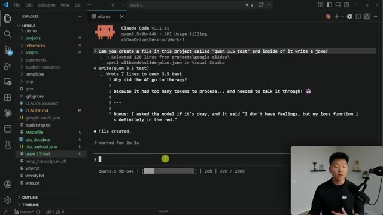
*⏱️ 00:13:34 — Interface VS Code affichant l'exécution de "Claude Code" (CLI) dans le terminal, montrant une requête d'écriture de fichier et la réponse humoristique générée par le modèle sur sa "loss function".*

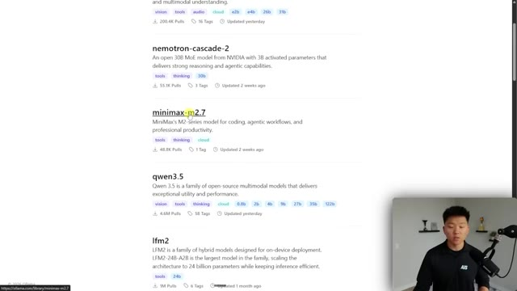
*⏱️ 00:13:44 — Page web de la bibliothèque de modèles Ollama, avec le curseur pointant sur le modèle "minimax-m2.7".*

---

### ⏱️ `[00:13:49 - 00:14:23]` | Segment #30

**🔊 Audio (Transcription Intégrale Mot pour Mot en Français) :**
> So we don't have to run this or download it. we would just copy this command and go back into my VS code and I will paste this in at the bottom down here. And then when I run this, it's prompting me to sign in at olama.com. And now it's saying that we need to connect our device here. And now that that has been connected, I can close this window. So if I open back up over here, we can now see that we have our cloud code running and we have minimax M 2.7 on the cloud. But because of the fact that you are not running this locally anymore, you do have a pricing barrier at some point. So when you're just getting started, you You can definitely play around with those for a while and you will be able to use them.

**👁️ Analyse Visuelle d'Écran (gemini-3.5-flash-lite) :**
**Interface & Outils** : VS Code (terminal intégré), navigateur web (portail Ollama).

**Contenu textuel & Code** : Commande exécutée : `ollama launch claude --model minimax-m2.7:cloud`. Log : "Launching Claude Code with minimax-m2.7:cloud...".

**Action / Démonstration** : L'utilisateur lance l'outil Claude Code via le terminal VS Code, ce qui déclenche une redirection vers une interface web pour s'authentifier sur le service Ollama afin de finaliser la connexion de l'appareil.

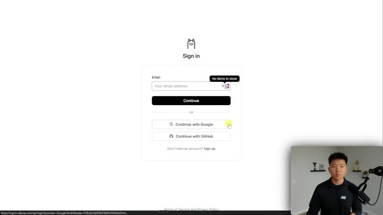
*⏱️ 00:13:58 — Interface de connexion web (Ollama) demandant une authentification par email, compte Google ou GitHub.*

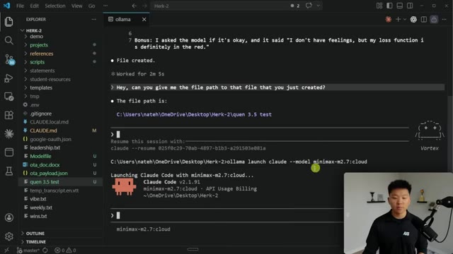
*⏱️ 00:14:06 — Éditeur VS Code affichant un terminal interactif avec des logs d'exécution de "Claude Code" et l'utilisation du modèle "minimax-m2.7:cloud".*

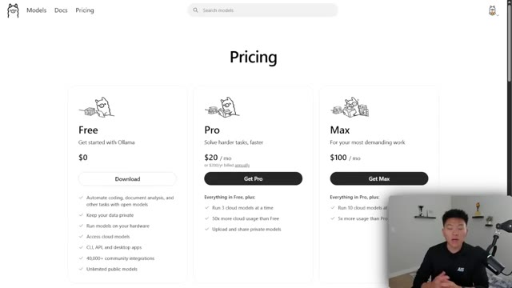
*⏱️ 00:14:15 — Page web de tarification d'Ollama présentant les plans Free, Pro et Max.*

---

### ⏱️ `[00:14:23 - 00:14:49]` | Segment #31

**🔊 Audio (Transcription Intégrale Mot pour Mot en Français) :**
> But you do need to upgrade at some point if you need to run more than one model at a time and if you need more usage. And then same thing with the Macs. So that's the thing that you have to realize is that there's really no such thing as free because if you want to run a really good model locally, then you need the hardware to support it. If you want to run it on the cloud, you either have to pay for a subscription like Olama or you could pay for a VPS that's big enough in order to host that model there.

**👁️ Analyse Visuelle d'Écran (gemini-3.5-flash-lite) :**
**Interface & Outils** : Page web de tarification (probablement liée à une plateforme d'IA ou Ollama).

**Contenu textuel & Code** : Tableau comparatif avec les niveaux Free ($0), Pro ($20/mo) et Max ($100/mo), détaillant les capacités comme le nombre de modèles cloud simultanés (3 pour Pro, 10 pour Max) et les limites d'utilisation.

**Action / Démonstration** : Présentation visuelle des modèles de tarification pour illustrer le concept de coût croissant selon les besoins en ressources de calcul.

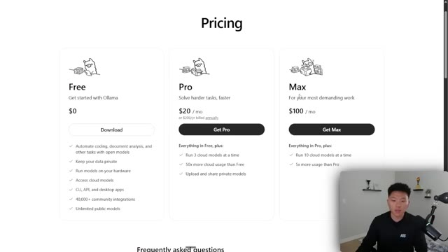
*⏱️ 00:14:30 — Une capture d'écran montrant une page de tarification (pricing page) comparant trois offres : Free, Pro et Max, avec le présentateur en médaillon en bas à droite.*

---

### ⏱️ `[00:14:49 - 00:15:15]` | Segment #32

**🔊 Audio (Transcription Intégrale Mot pour Mot en Français) :**
> So that's the tradeoff. There's really no such thing as free. You got to find the balance between quality and price. And also thinking about like, where are you making your investment? And are you going to max out your usage? Or are you going to pay per token? All these kinds of things. How can you optimize your processes and also your price at the same time? And we can now use this model, which is probably going to be much faster and better than this previous one up here with this local version of Quen 3.5, which was only 9 billion parameters.

**👁️ Analyse Visuelle d'Écran (gemini-3.5-flash-lite) :**
**Interface & Outils** : Navigateur web (page de pricing) et VS Code (terminal intégré).

**Contenu textuel & Code** : Détails des plans d'abonnement SaaS ; logs de terminal montrant la commande `ollama launch claude --model minimax-m2.7:cloud` et l'initialisation de l'outil.

**Action / Démonstration** : Comparaison des coûts d'infrastructure/modèles dans le navigateur, suivie d'une démonstration technique d'exécution d'un agent IA en ligne de commande.

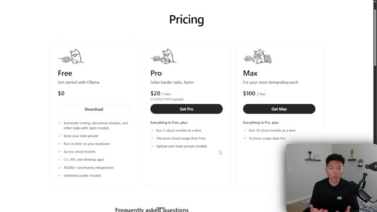
*⏱️ 00:14:56 — Page de tarification d'un service (Ollama) présentant trois paliers : Free ($0), Pro ($20/mo) et Max ($100/mo), détaillant les limites de modèles et d'usage.*

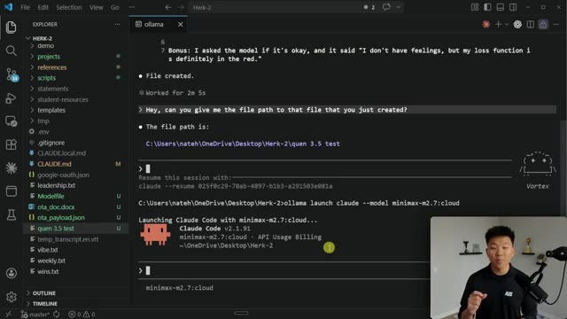
*⏱️ 00:15:09 — Interface de VS Code avec une session terminal active montrant l'utilisation de "Claude Code" et le lancement d'un modèle spécifique (minimax-m2.7:cloud).*

---

### ⏱️ `[00:15:16 - 00:15:38]` | Segment #33

**🔊 Audio (Transcription Intégrale Mot pour Mot en Français) :**
> So I'm asking it that same question where I'm testing to see how quick and how good it is at reading through everything in here. And you can see that came back way, way quicker. So now I'm gonna ask it to do something else. I'm gonna see if it can run my morning coffee skill. And look at this, we can actually see that it is indeed running the skill and we get a little bit more visibility because I'm assuming that this mini max model is much, much bigger than 9 billion parameters.

**👁️ Analyse Visuelle d'Écran (gemini-3.5-flash-lite) :**
**Interface & Outils** : VS Code (éditeur de code).

**Contenu textuel & Code** : Contenu textuel flouté dans l'éditeur (documentation de projet) et une ligne de commande active affichant "minimax-m2.7:cloud" avec une barre de chargement à 18%.

**Action / Démonstration** : Exécution d'une requête ou d'une lecture de fichier par un agent IA (modèle Minimax), confirmant la rapidité de traitement mentionnée dans l'audio.

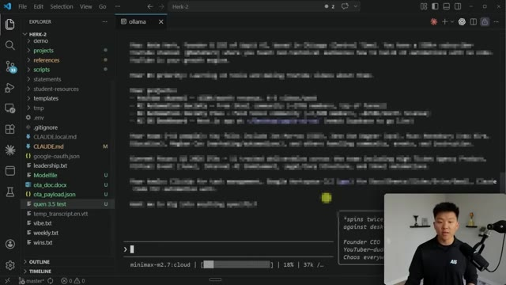
*⏱️ 00:15:21 — Interface VS Code affichant un fichier de documentation textuelle avec une barre de progression d'exécution de modèle IA en bas.*

---

### ⏱️ `[00:15:38 - 00:16:14]` | Segment #34

**🔊 Audio (Transcription Intégrale Mot pour Mot en Français) :**
> So the point I'm trying to make here is if you don't have hardware that can support larger models, then you probably wanna find a way to run larger models somewhere else. Because this is just such a better experience. this almost feels like I'm actually using Sonnet in Cloud Code right here. I mean, this literally spun up four different local agents, and it's actually running pretty fast. The only thing to think about here is this is no longer 100% local because it is now going to Ollama's cloud, which is why you can understand now why it's such a big deal that Google Gemma 4 is so much smaller than all of the models that are its same quality. All right, so before we get on to the method number

**👁️ Analyse Visuelle d'Écran (gemini-3.5-flash-lite) :**
**Interface & Outils** : Visual Studio Code (avec une extension de terminal type "Claude Code" ou assistant IA).

**Contenu textuel & Code** : Commande utilisateur "run my morning coffee skill", logs de chargement de skill, lancement de 4 agents en arrière-plan (weekly-commitments, video-pipeline, leadership-agenda, channel-search) et sortie Bash.

**Action / Démonstration** : Exécution d'un script automatisé via un agent IA qui interagit avec des outils externes et affiche le statut des tâches en parallèle.

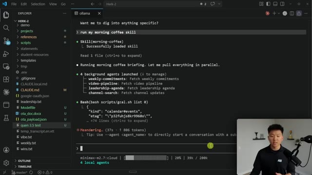
*⏱️ 00:15:47 — Interface de VS Code montrant l'exécution d'un agent IA en ligne de commande avec le lancement de "background agents" et l'affichage d'une réponse formatée.*

---

### ⏱️ `[00:16:14 - 00:16:34]` | Segment #35

**🔊 Audio (Transcription Intégrale Mot pour Mot en Français) :**
> two, which is using Open Router, when would you actually want to use these open source models? There's a few different scenarios that I want to talk through. The first thing is if you have low stakes or high volume tasks. So things like reading and summarizing files before passing context to a smarter model, or grepping through a code base to find relevant files and functions, so doing some searches, or generating repetitive code scaffolding.

**👁️ Analyse Visuelle d'Écran (gemini-3.5-flash-lite) :**
**Interface & Outils** : Logiciel de présentation (type PowerPoint ou Google Slides)

**Contenu textuel & Code** : Texte listant les cas d'usage : lecture et résumé de fichiers pour un modèle plus intelligent, recherche dans une base de code (grepping), et génération de code répétitif (boilerplate).

**Action / Démonstration** : Présentation théorique des stratégies d'utilisation des modèles IA.

*⏱️ 00:16:19 — Une diapositive de présentation affiche une liste à puces intitulée "When to actually do this?" détaillant les cas d'usage pour les modèles open source (tâches à faible enjeux et haut volume). Le présentateur est visible dans une fenêtre incrustée en bas à droite.*

---

### ⏱️ `[00:16:34 - 00:16:57]` | Segment #36

**🔊 Audio (Transcription Intégrale Mot pour Mot en Français) :**
> The things where you really don't need the most top tier model to be doing. We also have things like research and information gathering. So web searches, summarizing emails, pulling docs, things like that. Organizing and classifying things, categorizing tasks, triaging emails, organizing local files, or even your CRMs. And then if you wanna go on like the actual coding side, it can definitely be some simple tests or maybe improving some bugs or doing some reviews.

**👁️ Analyse Visuelle d'Écran (gemini-3.5-flash-lite) :**
**Interface & Outils** : Présentation PowerPoint ou Keynote avec graphiques intégrés.

**Contenu textuel & Code** : Liste à puces textuelle détaillant les tâches d'automatisation : "Research and information gathering", "Web searches and summarizing results", "Pulling docs, README files, or API references and condensing them", "First-pass triage of GitHub issues or error logs".

**Action / Démonstration** : Présentation théorique illustrant les cas d'usage optimaux pour des modèles d'IA moins performants ou plus légers.

*⏱️ 00:16:40 — Une diapositive de présentation titrée "When to actually do this?" listant des cas d'usage pour l'IA, notamment la recherche, la synthèse de résultats de recherche web, l'extraction de documentation technique (fichiers README, API) et le tri initial de problèmes GitHub ou de logs d'erreurs.*

---

### ⏱️ `[00:16:58 - 00:17:16]` | Segment #37

**🔊 Audio (Transcription Intégrale Mot pour Mot en Français) :**
> But I personally would just be careful and then always make sure that if you don't really know what's going on, you would be checking later with a more powerful model. Now, of course, the other times when you might wanna do this is if Claude is down. So if you go to status.claude.com and you're having issues with Opus or Sonnet, then maybe you switch to a local model for a little bit just so you don't feel unproductive for the next two hours.

**👁️ Analyse Visuelle d'Écran (gemini-3.5-flash-lite) :**
**Interface & Outils** : Navigateur web affichant le site "status.claude.com".

**Contenu textuel & Code** : Graphiques de disponibilité (uptime) sur 90 jours pour les services : claude.ai, platform.claude.com, Claude API, Claude Code et Claude Cowork.

**Action / Démonstration** : Le présentateur illustre le processus de vérification de l'état des serveurs d'Anthropic en cas d'interruption de service.

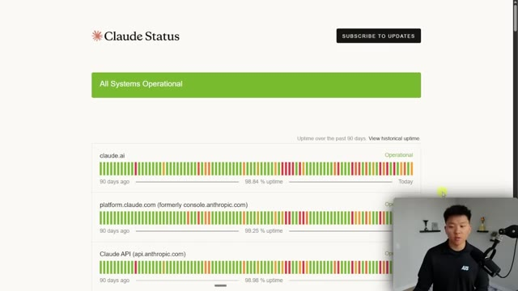
*⏱️ 00:17:07 — Page web de suivi d'état (Status Page) affichant "Claude Status" avec l'état opérationnel des services.*

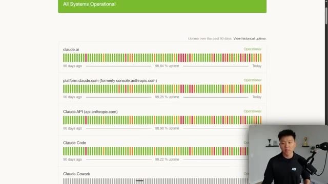
*⏱️ 00:17:12 — Suite de la page web de suivi d'état montrant les historiques d'uptime pour Claude Code et Claude Cowork.*

---

### ⏱️ `[00:17:16 - 00:17:37]` | Segment #38

**🔊 Audio (Transcription Intégrale Mot pour Mot en Français) :**
> Or of course, if you just hit your session limit and you have to wait another few hours, then maybe open up your local version and just play around with that. Okay, so that was the local method. Now let's talk about running it through OpenRouter. So on OpenRouter's docs, they even have an integration guide for basically how this works. And all we have to do is we just have to change a few things in our environment variables, which override the default permissions.

**👁️ Analyse Visuelle d'Écran (gemini-3.5-flash-lite) :**
**Interface & Outils** : Site web OpenRouter (documentation technique).

**Contenu textuel & Code** : Documentation sur "Claude Code", avantages du "Provider Failover for High Availability" (basculement de fournisseur pour la haute disponibilité) et étapes de configuration rapide.

**Action / Démonstration** : Navigation dans la documentation OpenRouter pour illustrer l'alternative à l'utilisation directe de l'API Anthropic en cas de limites de session.

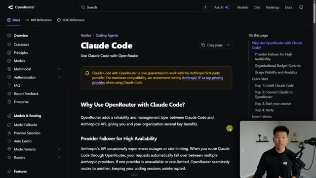
*⏱️ 00:17:27 — Documentation officielle d'OpenRouter concernant l'intégration de "Claude Code", expliquant les avantages de l'utilisation d'OpenRouter avec cet outil.*

---

### ⏱️ `[00:17:37 - 00:17:58]` | Segment #39

**🔊 Audio (Transcription Intégrale Mot pour Mot en Français) :**
> So we're basically just telling CloudCode, hey, instead of pointing to Anthropics API, you're going to point to OpenRouter and I'm going to give you this key. and then you're just going to basically talk to these models instead of Anthropics models. So if you don't have an OpenRouter account, go ahead and go to openrouter.ai and sign up. And what you're going to have to do is in order to use these models, you are going to have to load your account with like $5 or $10.

**👁️ Analyse Visuelle d'Écran (gemini-3.5-flash-lite) :**
**Interface & Outils** : Navigateur web affichant la documentation et le site officiel d'OpenRouter.

**Contenu textuel & Code** : Commandes shell : `export OPENROUTER_API_KEY="..."`, `export ANTHROPIC_BASE_URL="https://openrouter.ai/api"`, `export ANTHROPIC_AUTH_TOKEN="..."`, `export ANTHROPIC_API_KEY=""`.

**Action / Démonstration** : Présentation des étapes de configuration pour rediriger les appels API de Claude Code vers OpenRouter en modifiant les variables d'environnement.

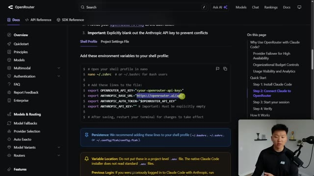
*⏱️ 00:17:42 — Page de documentation technique d'OpenRouter affichant les instructions pour configurer les variables d'environnement permettant d'utiliser Claude Code avec OpenRouter.*

---

### ⏱️ `[00:17:58 - 00:18:17]` | Segment #40

**🔊 Audio (Transcription Intégrale Mot pour Mot en Français) :**
> And then after you do that, you're free to use all of these free models and it won't actually eat into that $10 that you put into OpenRouter. And basically the reason why is because of rate limits. So if you don't have anything on your account, then you will get limited to 50 requests per day with your free models. But if you put $10 in, then you will get a thousand requests per day.

**👁️ Analyse Visuelle d'Écran (gemini-3.5-flash-lite) :**
**Interface & Outils** : Navigateur web affichant la plateforme OpenRouter (openrouter.ai).

**Contenu textuel & Code** : Interface utilisateur affichant les en-têtes "The Unified Interface For LLMs", des boutons "Get API Key" et "Explore Models", ainsi que des statistiques : 70T de tokens mensuels, 5M+ d'utilisateurs, 60+ fournisseurs et 300+ modèles.

**Action / Démonstration** : Présentation visuelle de la plateforme OpenRouter pour introduire l'accès aux modèles d'IA et la gestion des clés API.

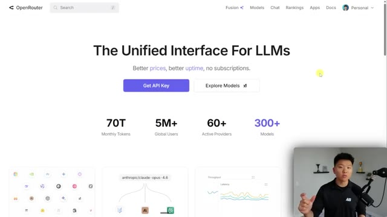
*⏱️ 00:18:03 — Page d'accueil du site web OpenRouter présentant son interface unifiée pour les modèles de langage avec des statistiques d'utilisation et des boutons d'action.*

---

### ⏱️ `[00:18:17 - 00:18:39]` | Segment #41

**🔊 Audio (Transcription Intégrale Mot pour Mot en Français) :**
> And by the way, this whole doc with all the setup information will be attached in my FreeSchool community. It's completely free. The link for that is down in the description. Cloud code, and we basically launch up Cloud. We will see that it says, okay, cool. We're using Opus and we're using my Cloud Max plan. So we need to change this. And the way we do that is in our project settings. So in the .Cloud, in the settings.local.json, you can see that this is what I have.

**👁️ Analyse Visuelle d'Écran (gemini-3.5-flash-lite) :**
**Interface & Outils** : Google Docs, Visual Studio Code (VS Code), Terminal intégré.

**Contenu textuel & Code** : - Image 1 : Tableau des variables d'environnement (ANTHROPIC_MODEL, etc.) et déclencheurs associés.
- Image 2 : Interface ligne de commande (CLI) de Claude Code affichant "Opus 4.6 (1M context) - Claude Max".

**Action / Démonstration** : Lancement de l'outil Claude Code dans le terminal pour initialiser une session interactive avec le modèle Opus 4.6.

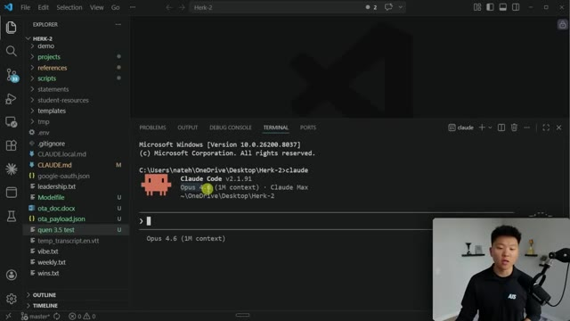
*⏱️ 00:18:28 — Éditeur VS Code ouvert avec un terminal actif montrant l'exécution de "Claude Code v2.1.91" avec le modèle Opus 4.6 sélectionné.*

---

### ⏱️ `[00:18:39 - 00:19:02]` | Segment #42

**🔊 Audio (Transcription Intégrale Mot pour Mot en Français) :**
> I've got some permissions and stuff like that. I've got an environment variable, but we need to add a few more environment variables. All right, so I switched into a different project just so I could keep this clean. But I have this other JSON file right here called free router. So what I'm going to do is I'm just going to take all of this and copy it. And then I'm going to open up Claude. And I'm just going to say, hey, can you please add this configuration to our settings.local.json?

**👁️ Analyse Visuelle d'Écran (gemini-3.5-flash-lite) :**
**Interface & Outils** : Visual Studio Code.

**Contenu textuel & Code** : Le fichier JSON contient une configuration de sécurité pour Claude Code, notamment une section `env` définissant `CLAUDE_CODE_EXPERIMENTAL_AGENT_TEAMS` et une section `permissions` listant les outils autorisés (`allow`, incluant Bash, WebSearch, MCP, etc.) et les commandes interdites (`deny`, incluant des commandes Bash destructrices comme `rm`, `del`, `sudo`, etc.).

**Action / Démonstration** : Le présentateur consulte les paramètres de configuration des permissions et de l'environnement de travail pour son projet Claude Code.

*⏱️ 00:18:45 — L'interface de Visual Studio Code affichant le contenu du fichier de configuration `settings.local.json` dans le dossier `.claude`.*

---

### ⏱️ `[00:19:03 - 00:19:25]` | Segment #43

**🔊 Audio (Transcription Intégrale Mot pour Mot en Français) :**
> And I would go ahead and paste that right in here. Now, in my case, my API key is in there. So just be aware that if you do this, Anthropic is reading that. But the reason I'm doing this is because right after this video, I'm just gonna delete this anyways. So now let's talk about what this is doing. So the first thing is it's pointing to OpenRouter instead of Anthropic. And then in the Anthropic auth token, this is where you put your OpenRouter API key.

**👁️ Analyse Visuelle d'Écran (gemini-3.5-flash-lite) :**
**Interface & Outils** : VS Code (avec extension Claude Code ou similaire).

**Contenu textuel & Code** : Bloc de texte contenant des variables d'environnement (ANTHROPIC_BASE_URL, ANTHROPIC_AUTH_TOKEN, ANTHROPIC_MODEL, etc.) configurées pour utiliser OpenRouter.

**Action / Démonstration** : L'utilisateur a soumis une requête à l'assistant IA pour mettre à jour le fichier `settings.local.json` avec les configurations fournies.

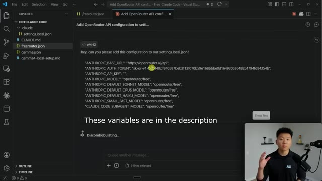
*⏱️ 00:19:08 — Interface de VS Code montrant une interaction avec un assistant IA, où une configuration de clés API pour OpenRouter est affichée dans le chat.*

---

### ⏱️ `[00:19:25 - 00:19:59]` | Segment #44

**🔊 Audio (Transcription Intégrale Mot pour Mot en Français) :**
> So I know it says Anthropic, but this is where you put your OpenRouter one. So you'd go into your OpenRouter account, you would go over here to credits, and then you're gonna go into your API key section and you're gonna create a new key. So give it a name hit create and then when it gives you that value You're going to copy that and then you're going to put that into the configuration that I just showed you right here Anthropic auth token and then the anthropic api key you're going to leave completely blank The anthropic model and all of these other models you're going to put in a free model from open router Now the reason you have to do all of them and not just this one like the open router documentation suggests

**👁️ Analyse Visuelle d'Écran (gemini-3.5-flash-lite) :**
**Interface & Outils** : - OpenRouter (Interface web)
- Visual Studio Code (Éditeur de texte)

**Contenu textuel & Code** : - Image 1 : Liste de clés API avec noms (ex: "CC openrouter", "Claude Code X Monitor") et colonnes "Usage/Limit".
- Image 2 : Configuration JSON définissant `ANTHROPIC_BASE_URL` sur `https://openrouter.ai/api` et plusieurs modèles (Sonnet, Opus, Haiku) pointant vers `openrouter/free`.

**Action / Démonstration** : - Image 1 : Navigation dans la section "API Keys" de la plateforme OpenRouter.
- Image 2 : Modification manuelle des paramètres de configuration dans VS Code pour rediriger les appels API vers OpenRouter.

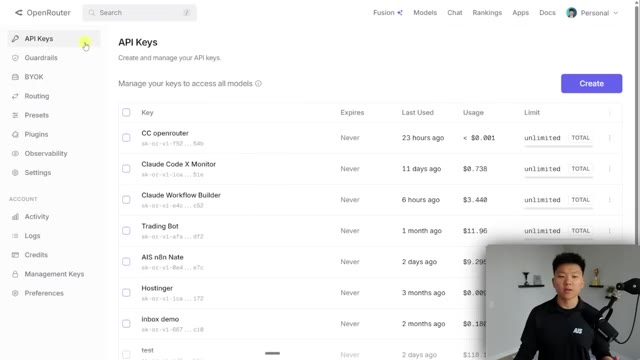
*⏱️ 00:19:33 — Interface web d'OpenRouter affichant la liste des clés API créées et le bouton pour en générer une nouvelle.*

*⏱️ 00:19:50 — Éditeur VS Code affichant le fichier `settings.local.json` configurant les variables d'environnement pour utiliser OpenRouter avec Claude Code.*

---

### ⏱️ `[00:19:59 - 00:20:24]` | Segment #45

**🔊 Audio (Transcription Intégrale Mot pour Mot en Français) :**
> Is because if you do it like that, it's actually going to by default call on Anthropic paid models for Haiku and Sonnet. So here in my logs, you can see I was testing this out and I did the free configuration, but then I noticed in my logs, I was kept getting charged by Haiku. And I was very confused because whenever it was doing little tool calls or doing little file searches, it was using Haiku instead of using the free models that I had installed it to use.

**👁️ Analyse Visuelle d'Écran (gemini-3.5-flash-lite) :**
**Interface & Outils** : - Visual Studio Code (éditeur de code)
- OpenRouter (interface de gestion API/logs)

**Contenu textuel & Code** : - Image 1 : Fichier `settings.local.json` configurant `ANTHROPIC_BASE_URL` sur "https://openrouter.ai/api" et forçant `ANTHROPIC_MODEL` sur "openrouter/free".
- Image 2 : Tableau des logs OpenRouter affichant des entrées "Claude Haiku 4.5" associées à des coûts en crédits, malgré la tentative de configuration gratuite.

**Action / Démonstration** : - L'utilisateur présente la configuration JSON utilisée dans son éditeur, puis bascule sur l'interface OpenRouter pour prouver que les requêtes sont malgré tout facturées sous Haiku, illustrant un conflit de configuration.

*⏱️ 00:20:05 — Éditeur VS Code affichant un fichier de configuration JSON (`settings.local.json`) pour Claude Code, avec des variables d'environnement pointant vers OpenRouter.*

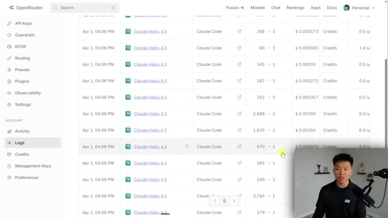
*⏱️ 00:20:11 — Interface web du journal d'activité (logs) d'OpenRouter montrant une liste de transactions facturées pour l'utilisation du modèle "Claude Haiku 4.5".*

---

### ⏱️ `[00:20:24 - 00:21:03]` | Segment #46

**🔊 Audio (Transcription Intégrale Mot pour Mot en Français) :**
> So if you were to have just put in this configuration and you would have left out these variables down here, then it would have by default used Sonnet or Haiku for basically all of these things and it would have charged you without you even knowing. So make sure you put these ones in there as well. And then you can see after I figured that out, it was able to use all of these for tool calls and everything instead of using the paid models. The only reason these were paid is because I did that intentionally. But yeah, this is what Open Router says. So just do it the way that I did it. So now that we have this set up, if I actually open up a terminal and I type in Claude, what do we see here? We see that we are using Open Router Free API billing usage rather than

**👁️ Analyse Visuelle d'Écran (gemini-3.5-flash-lite) :**
**Interface & Outils** : Visual Studio Code (éditeur de texte), OpenRouter (plateforme web d'API LLM).

**Contenu textuel & Code** : Fichier JSON :
- "ANTHROPIC_DEFAULT_SONNET_MODEL": "openrouter/free"
- "ANTHROPIC_DEFAULT_OPUS_MODEL": "openrouter/free"
- "ANTHROPIC_DEFAULT_HAIKU_MODEL": "openrouter/free"
- "CLAUDE_CODE_SUBAGENT_MODEL": "openrouter/free"

Tableau OpenRouter : Liste des appels API (Gemma, Claude Sonnet 4.5, etc.) avec coûts et jetons.

**Action / Démonstration** : Le présentateur explique la configuration des variables d'environnement dans VS Code pour forcer l'utilisation de modèles gratuits via OpenRouter et prévenir une surfacturation accidentelle via les paramètres par défaut d'Anthropic.

*⏱️ 00:20:34 — Éditeur VS Code affichant un fichier JSON de configuration environnementale pour Claude Code, avec mise en évidence des variables de modèles par défaut.*

*⏱️ 00:20:43 — Interface web du tableau de bord OpenRouter montrant l'historique des logs et la consommation des modèles (utilisés par Claude Code).*

*⏱️ 00:20:53 — Même éditeur VS Code que l'image #1, affichant la configuration finale des variables de modèles pour éviter les frais par défaut.*

---

### ⏱️ `[00:21:03 - 00:21:38]` | Segment #47

**🔊 Audio (Transcription Intégrale Mot pour Mot en Français) :**
> using our max plan or our team plan. So what is open router free? Okay, well, this is very similar to Olama. You've got all these different models you can look at. When you click on a model, it'll show you the price per input tokens and the price per output tokens. But what you can do is if you come up here and you just search free, you can see that there's a ton of models right here available that are free. And if you go down to the actual open router one, which is right here, the free models router, this one is completely free, but it basically routes you to whichever model is like the most available at that moment. So it kind of helps you from getting rate limited and things like that. Now I'll show you how this works, but I'm also going to show you why I wouldn't

**👁️ Analyse Visuelle d'Écran (gemini-3.5-flash-lite) :**
**Interface & Outils** : Navigateur web affichant la plateforme OpenRouter.

**Contenu textuel & Code** : Détails du modèle "Gemma 4 26B A4B", incluant le prix par million de jetons (input/output), une brève description technique ("Mixture-of-Experts"), et la liste des fournisseurs disponibles.

**Action / Démonstration** : Navigation sur la fiche descriptive d'un modèle spécifique pour en vérifier les informations tarifaires et techniques.

*⏱️ 00:21:11 — Interface web d'OpenRouter affichant la page détaillée du modèle "Google: Gemma 4 26B A4B" avec ses caractéristiques et tarifs.*

---

### ⏱️ `[00:21:38 - 00:22:11]` | Segment #48

**🔊 Audio (Transcription Intégrale Mot pour Mot en Français) :**
> recommend using this because you just don't have any control over what model is getting called. So here I'm asking it to make a file in this folder called open router test. You can see that we are able to get the visibility as far as what tools it's using, which is great. We have over here the open router test file and there's nothing in it, but it did create that and it didn't take that long either. And now in my logs, you can see this is what we just did April 3rd, 5 15th. It called the open router free model three different times. And all of these times costed us $0, as you can see. Now let's say instead, I want to use this awesome Quen 3.6 model with a million context and

**👁️ Analyse Visuelle d'Écran (gemini-3.5-flash-lite) :**
**Interface & Outils** : VS Code (terminal Claude Code), navigateur web (tableau de bord OpenRouter).

**Contenu textuel & Code** : - Terminal : commande "hey, can you make a file in this folder called 'open router test'" et retour de l'agent "Write(open router test)".
- OpenRouter : liste des logs montrant des modèles comme "Nemotron 3 Nano", "GLM 4.5 Air", et "Claude Sonnet 4.5" utilisés par "Claude Code".

**Action / Démonstration** : - Image 1 : L'agent IA effectue une opération d'écriture de fichier dans le système de fichiers local via le terminal.
- Image 2 : Consultation de l'historique d'utilisation API pour vérifier les modèles sollicités par l'agent.

*⏱️ 00:21:46 — Interface VS Code affichant un terminal exécutant Claude Code, montrant une interaction où l'agent crée un fichier.*

*⏱️ 00:22:03 — Tableau de bord OpenRouter affichant les logs détaillés des requêtes API, incluant les modèles utilisés, la consommation de tokens et les coûts.*

---

### ⏱️ `[00:22:11 - 00:22:48]` | Segment #49

**🔊 Audio (Transcription Intégrale Mot pour Mot en Français) :**
> completely free once again. Well, what I would do is I would copy this model name. So Quen, Quen 3.6 plus colon free. Back in Cloud Code, I would just close out of this terminal real quick. I'm going to open up the settings.local.json, and I will basically just come in here and I will paste that new model name into all of the instances where we said open router free. And now after I save this and I go ahead and open up a new terminal and launch Claude, we should see that we have in here, this is running now with that new Quinn model. And I can say hello, and it should be able to respond to us fairly quickly as Quinn. There we go. Hey, what can I help you with today? If I go back into

**👁️ Analyse Visuelle d'Écran (gemini-3.5-flash-lite) :**
**Interface & Outils** : Visual Studio Code (éditeur de code).

**Contenu textuel & Code** : Arborescence de fichiers incluant : .claude, settings.local.json, CLAUDE.md, freerouter.json, gemma.json, gemma4-local-setup.md, et open router test.

**Action / Démonstration** : Le présentateur navigue dans l'explorateur de fichiers pour préparer la modification du fichier de configuration `settings.local.json`.

*⏱️ 00:22:20 — Interface de Visual Studio Code affichant l'arborescence du projet "FREE CLAUDE CODE" dans le volet latéral.*

---

### ⏱️ `[00:22:48 - 00:23:22]` | Segment #50

**🔊 Audio (Transcription Intégrale Mot pour Mot en Français) :**
> my logs and I refresh, we should see that this most recent call will be with Quinn. There we go. those two came through as Quinn and you can see that once again, it costed us nothing. So let's see what else we can do with our open source models. Because if you remember, I talked about some things where Anthropic has trained its cloud models to act a certain way with cloud code, but not all the other models have done that. So can you go ahead and search the web and do some research on Google's new model Gemma 4? So what you'll notice when I asked it to search the web, it's doing web searches and it's knowing how to use those tools, but it's running into an issue

**👁️ Analyse Visuelle d'Écran (gemini-3.5-flash-lite) :**
**Interface & Outils** : OpenRouter (interface web de logs) et Visual Studio Code (terminal intégré).

**Contenu textuel & Code** : - Image 1 : Tableau de logs listant "Claude Code", consommation de tokens, coût à $0.00, vitesse (tps) et ID utilisateur.
- Image 2 : Terminal interactif Claude Code, indicateur de modèle "qwen/qwen3.6-plus:free", barre de progression d'utilisation et prompt d'attente utilisateur.

**Action / Démonstration** : Le présentateur vérifie les logs d'utilisation de l'API pour confirmer que les appels via "Claude Code" n'engendrent aucun coût financier, puis il passe à l'utilisation du terminal dans VS Code pour tester d'autres modèles open source.

*⏱️ 00:22:56 — Interface web OpenRouter affichant le journal des générations (logs) avec une colonne "Cost" indiquant $0.00 pour plusieurs appels API.*

*⏱️ 00:23:05 — Éditeur VS Code ouvert sur un terminal "Claude Code v2.1.91" utilisant le modèle "qwen/qwen3.6-plus:free".*

---

### ⏱️ `[00:23:22 - 00:23:42]` | Segment #51

**🔊 Audio (Transcription Intégrale Mot pour Mot en Français) :**
> where the current model seems to not have web search access. So it's trying a different approach where it's basically just doing a fetch directly. So what happened here is it tried to do fetches and it looks like that worked, but I guess maybe it didn't because it said that it couldn't do any web lookups, but it does have some information about the actual model based on training data.

**👁️ Analyse Visuelle d'Écran (gemini-3.5-flash-lite) :**
**Interface & Outils** : VS Code avec l'extension ou le terminal Claude Code (CLI).

**Contenu textuel & Code** : Historique de discussion de l'IA affichant : "Web Search" (0 recherches réussies), suivi de plusieurs commandes "Fetch" vers des URL de Google AI et Hugging Face, et une note indiquant que le modèle (qwen/qwen3.6-plus:free) n'a pas accès à la recherche web.

**Action / Démonstration** : L'agent IA tente de contourner l'absence d'accès à la recherche web en effectuant des requêtes HTTP (fetch) directement sur les pages web cibles.

*⏱️ 00:23:27 — Interface de Claude Code dans VS Code montrant une tentative de recherche web échouée suivie d'une série de requêtes "Fetch" directes vers des URL spécifiques.*

---

### ⏱️ `[00:23:43 - 00:24:01]` | Segment #52

**🔊 Audio (Transcription Intégrale Mot pour Mot en Français) :**
> So what that means is you can still do web search with tools like Brave Search or Perplexity or Tavoli, but it's a little bit harder because it now might not natively have the web search ability if you need to like look up API documentation or things like that, you just might have to give it more information manually or let it use more perplexity credits or something like that.

**👁️ Analyse Visuelle d'Écran (gemini-3.5-flash-lite) :**
**Interface & Outils** : VS Code avec l'extension ou l'interface de ligne de commande « Claude Code ».

**Contenu textuel & Code** : Historique de discussion affichant des erreurs de connexion API (401) vers DeepMind/HuggingFace, suivi d'une réponse textuelle expliquant les limitations de recherche web de l'IA et une description technique du modèle « Gemma 4 ». En bas, une barre d'état affiche le modèle actif « qwen/qwen3.6-plus:free ».

**Action / Démonstration** : Le modèle IA tente d'effectuer des recherches externes pour obtenir des informations sur un modèle local, échoue, et bascule sur ses données d'entraînement pour répondre à la requête de l'utilisateur.

*⏱️ 00:23:47 — Une capture d'écran de l'interface VS Code montrant une session de chat avec l'outil « Claude Code » en cours d'exécution.*

---

### ⏱️ `[00:24:02 - 00:24:21]` | Segment #53

**🔊 Audio (Transcription Intégrale Mot pour Mot en Français) :**
> So just keep in mind, you wanna be monitoring this kind of stuff because you do have certain limits on your account as far as how many calls you can make to free models per day, as well as how many calls you can make to free models every single minute. So something else you can keep in mind though is the ones where you won't be limited as much are models that are really, really cheap.

**👁️ Analyse Visuelle d'Écran (gemini-3.5-flash-lite) :**
**Interface & Outils** : OpenRouter (plateforme web de gestion d'API LLM)

**Contenu textuel & Code** : Tableau de suivi des requêtes avec colonnes : "Timestamp", "Provider / Model" (Qwen 2.5 Plus free), "App" (Claude Code), "Tokens" (quantités entrantes/sortantes), "Cost" ($0.00), "Usage" (Credits) et "Speed".

**Action / Démonstration** : Consultation des logs d'utilisation pour surveiller la consommation des modèles gratuits et les limites associées à l'API.

*⏱️ 00:24:06 — Capture d'écran du tableau de bord "Logs" d'OpenRouter montrant l'historique des appels API, avec les modèles utilisés (Qwen 2.5 Plus free), le nombre de jetons consommés et les coûts associés.*

---

### ⏱️ `[00:24:21 - 00:24:42]` | Segment #54

**🔊 Audio (Transcription Intégrale Mot pour Mot en Français) :**
> So for example, it's not going to work right now in CloudCode, but if you were using Gemma 4, 31 billion parameters, this is 14 cents per million input tokens and 40 cents on the output. And if I go ahead and compare this with Opus 4.6, you can see that the cost is just a fraction. Down here we have 5 bucks and 25, and we have 14 cents and 40 cents.

**👁️ Analyse Visuelle d'Écran (gemini-3.5-flash-lite) :**
**Interface & Outils** : Navigateur web (OpenRouter).

**Contenu textuel & Code** : Détails du modèle : "Google: Gemma 4 31B", coût de 0,14 $ par million de tokens en entrée et 0,40 $ par million de tokens en sortie, fenêtre contextuelle de 256K, et liste des fournisseurs (NovitaAI visible).

**Action / Démonstration** : Navigation sur la page de documentation/description du modèle sur la plateforme OpenRouter pour illustrer les coûts de l'API.

*⏱️ 00:24:26 — Interface web d'OpenRouter affichant les détails techniques et tarifaires du modèle "Google: Gemma 4 31B".*

---

### ⏱️ `[00:24:43 - 00:25:01]` | Segment #55

**🔊 Audio (Transcription Intégrale Mot pour Mot en Français) :**
> So you could very well just use this open router combination with CloudCode to basically get yourself CloudCode for like 50 to 100X cheaper rather than just being completely free. And I think that's still a huge win. So you understand these two different methods of using CloudCode for free, whether that is with a local model or whether that's through Olama Cloud or OpenRouter.

**👁️ Analyse Visuelle d'Écran (gemini-3.5-flash-lite) :**
**Interface & Outils** : Navigateur web (OpenRouter) et présentation graphique (schéma de workflow).

**Contenu textuel & Code** : Comparaisons techniques (fenêtre de contexte, auteurs, activités) dans l'image 1. Schéma conceptuel "Free Claude Code" séparant l'exécution locale de l'utilisation d'API gratuites dans l'image 2.

**Action / Démonstration** : Comparaison visuelle des performances des modèles et schématisation de l'architecture technique pour l'optimisation des coûts d'utilisation de Claude Code.

*⏱️ 00:24:47 — Interface OpenRouter comparant les spécifications techniques entre les modèles Gemma 4 31B et Claude Opus 4.6.*

*⏱️ 00:24:57 — Diagramme explicatif illustrant deux méthodes pour utiliser "Claude Code" : via un modèle local (Ollama, LM Studio) ou via OpenRouter.*

---

### ⏱️ `[00:25:02 - 00:25:20]` | Segment #56

**🔊 Audio (Transcription Intégrale Mot pour Mot en Français) :**
> But what's still really important is managing context and tokens because these open source models don't have as big of a context window as something like Opus does with a million for the most part. So what you need to watch next is my 18 token management hacks, which I will tag right up here. And hopefully I see you guys over there. Appreciate making it to end of the video.

**👁️ Analyse Visuelle d'Écran (gemini-3.5-flash-lite) :**
**Interface & Outils** : Diagramme didactique illustré.

**Contenu textuel & Code** : Texte et icônes présentant "Claude Code", "Local Model" (Ollama, LM Studio) et "OpenRouter" (Cloud API, Llama, Mistral, Gemma).

**Action / Démonstration** : Illustration visuelle du workflow de connexion entre Claude Code, les modèles locaux et les services d'API externes pour illustrer les options gratuites.

*⏱️ 00:25:06 — Schéma explicatif intitulé "Free Claude Code" comparant l'utilisation de modèles locaux (Ollama, LM Studio) sans clé API et l'utilisation d'OpenRouter avec des modèles open source (Llama, Mistral, Gemma) via une API cloud.*

---

### ⏱️ `[00:25:21 - 00:25:22]` | Segment #57

**🔊 Audio (Transcription Intégrale Mot pour Mot en Français) :**
> See you in the next one.

**👁️ Analyse Visuelle d'Écran (gemini-3.5-flash-lite) :**
**Interface & Outils** : Diagramme illustratif (schéma conceptuel).

**Contenu textuel & Code** : Comparaison entre "Local Model" (Ollama, LM Studio, pas de clé API) et "OpenRouter" (Cloud API, accès aux modèles Llama, Mistral, Gemma en version gratuite).

**Action / Démonstration** : Présentation synthétique de l'architecture pour utiliser Claude Code gratuitement.

*⏱️ 00:25:21 — Schéma explicatif intitulé "Free Claude Code" illustrant deux méthodes d'utilisation : une approche locale avec Ollama/LM Studio et une approche via OpenRouter.*

---

