# 🎬 Andrej Karpathy Just 10x’d Everyone’s Claude Code

> **Chaîne** : [Nate Herk | AI Automation](https://www.youtube.com/@nateherk/featured)  
> **Lien YouTube** : [https://www.youtube.com/watch?v=sboNwYmH3AY](https://www.youtube.com/watch?v=sboNwYmH3AY)  
> **Date de publication** : 20260405  
> **Durée** : 00:17:46  
> **Identifiant vidéo** : `sboNwYmH3AY`  
> **Transcription & Analyse** : `whisper-v3-large-turbo+gemini-3.5-flash-lite`  

---

## 📌 Synthèse Exécutive & Outils

### 💡 Résumé
Dans cette vidéo intitulée **Andrej Karpathy vient de multiplier par 10 le Claude Code de tout le monde**, Nate Herk décortique les capacités pratiques d'automatisation et de développement propulsées par les modèles de pointe.

### 🛠️ Outils, Modèles & Logiciels Présentés
- **Opus 5.5 & Claude Code** : Modèles d'ingénierie et agents de codage autonome.

### 🔑 Points Clés & Enseignements Stratégiques
- Optimiser le niveau d'effort et le raisonnement des modèles IA pour des résultats industriels.
- Automatiser les cycles de création logicielle de bout en bout.

---

## ⏱️ Chronologie & Transcription Complète Audio & Visuelle (Mot pour Mot)

### ⏱️ `[00:00:00 - 00:00:32]` | Segment #01

**🔊 Audio (Transcription Intégrale Mot pour Mot en Français) :**
> Ce que vous regardez juste ici, ce sont 36 de mes vidéos YouTube les plus récentes organisées en un véritable système de connaissances qui a du sens. Et dans la vidéo d'aujourd'hui, je vais vous montrer comment vous pouvez mettre cela en place en cinq minutes. C'est super, super facile. Vous pouvez voir ici comment nous avons ces différents nœuds et différents schémas qui émergent. Et à mesure que nous zoomons, nous pouvons voir ce que chacun de ces petits points représente. Donc par exemple, voici l'une de mes vidéos, « Workflows agentiques à 10 000 $ ». On peut voir qu'elle comporte des tags, qu'elle a le lien de la vidéo, qu'elle a le fichier brut, et elle donne une explication de ce dont parle cette vidéo et de ce qu'il faut en retenir. Et le plus cool, c'est que je peux suivre les backlinks

**👁️ Analyse Visuelle d'Écran (gemini-3.5-flash-lite) :**
**Interface & Outils** : Obsidian (logiciel de prise de notes/gestion de connaissances).

**Contenu textuel & Code** : Arborescence de dossiers (raw, wiki, comparisons, concepts, people, sources, techniques, tools, index, log, overview) et une vue graphique complexe représentant les relations entre les différentes notes.

**Action / Démonstration** : Présentation du système de connaissances organisé, montrant la vue en graphe des connexions entre les vidéos et les concepts.

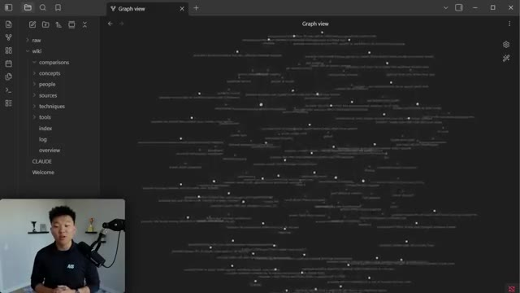
*⏱️ 00:00:08 — Une capture d'écran montrant l'interface d'Obsidian (ou un éditeur basé sur Markdown similaire) affichant une visualisation en graphe des notes du présentateur, avec une barre latérale de gestion de fichiers à gauche.*

---

### ⏱️ `[00:00:32 - 00:01:05]` | Segment #02

**🔊 Audio (Transcription Intégrale Mot pour Mot en Français) :**
> pour arriver là où je veux. Il y a un backlink pour le framework WAT. Il y a un backlink pour Claude Code. Il y a un backlink pour tous ces différents outils que j'ai mentionnés comme Perplexity, Visual Studio Code, Nano Banana, N8N. Il comporte également des techniques comme le framework WAT, le mode de contournement des autorisations ou le point de contrôle de révision humaine. Donc, au fur et à mesure que cela continue de se remplir, nous pouvons commencer à voir des schémas et des relations entre chaque outil, chaque compétence ou chaque serveur MCP dont j'ai pu parler dans une vidéo YouTube. Et je peux simplement l'interroger de manière vraiment efficace maintenant que nous avons mis en place ce système concret. Et le plus fou, c'est que j'ai dit : « Hé, Claude Code, va récupérer les transcriptions »

**👁️ Analyse Visuelle d'Écran (gemini-3.5-flash-lite) :**
**Interface & Outils** : Obsidian (logiciel de prise de notes).

**Contenu textuel & Code** : Liste détaillée d'outils comprenant : Claude Code, Visual Studio Code, Perplexity, Nano Banana, Gmail, Google Sheets, n8n, Zapier, Trigger.dev, Modal, Vercel, Beehive, Github. Chaque entrée contient une brève description de son rôle dans l'automatisation.

**Action / Démonstration** : Présentation visuelle de la documentation du workflow, mettant en évidence les interconnexions entre les différents outils logiciels cités par le narrateur.

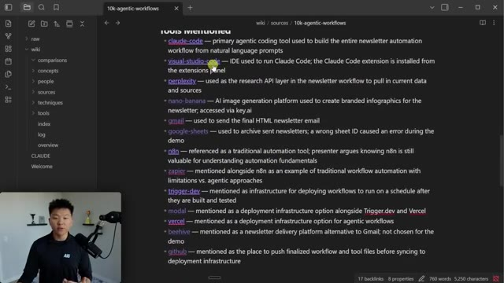
*⏱️ 00:00:40 — Une capture d'écran de l'interface Obsidian montrant une note intitulée "10k-agentic-workflows" qui liste et décrit les différents outils technologiques utilisés dans le cadre du projet.*

---

### ⏱️ `[00:01:05 - 00:01:27]` | Segment #03

**🔊 Audio (Transcription Intégrale Mot pour Mot en Français) :**
> de mes vidéos récentes et tout organiser. Je n'ai littéralement eu aucune création de liens manuelle à faire ici. Il a simplement tout trouvé par lui-même. Et puis juste ici, j'en ai un beaucoup plus petit, mais c'est plutôt mon cerveau personnel. Donc ce sont des choses qui se passent dans ma vie personnelle. Ce sont des choses qui se passent avec, vous savez, Up at AI ou ma chaîne YouTube ou mes différentes entreprises et mes employés et nos initiatives du deuxième trimestre et des choses comme ça, c'est davantage mon propre deuxième cerveau.

**👁️ Analyse Visuelle d'Écran (gemini-3.5-flash-lite) :**
**Interface & Outils** : Obsidian (logiciel de prise de notes avec visualisation en graphe).

**Contenu textuel & Code** : Nœuds connectés représentant des concepts tels que "Claude-code", "Agentic workflows", "LLMs", "Automation", "Youtube-tutorial", et diverses structures de données de projet.

**Action / Démonstration** : Navigation et visualisation de la structure des connexions automatiques entre les notes et les projets de l'utilisateur.

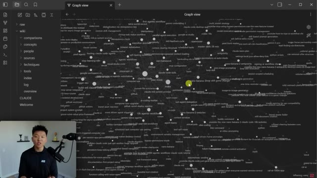
*⏱️ 00:01:11 — Vue d'ensemble d'un graphe de connaissances complexe affichant des liens entre divers concepts, outils et projets liés à l'automatisation IA dans l'interface Obsidian.*

---

### ⏱️ `[00:01:28 - 00:01:47]` | Segment #04

**🔊 Audio (Transcription Intégrale Mot pour Mot en Français) :**
> J'ai donc un second cerveau ici, et ensuite j'ai en gros un système de connaissances YouTube, et je pourrais les combiner ou je pourrais les garder séparés, et je peux simplement continuer à créer d'autres systèmes de connaissances et les connecter tous à d'autres agents IA dont j'ai besoin qu'ils aient ce contexte. C'est juste super cool. Donc Andre Karpathy vient de publier ce petit post sur les bases de connaissances LLM et d'expliquer ce qu'il fait avec.

**👁️ Analyse Visuelle d'Écran (gemini-3.5-flash-lite) :**
**Interface & Outils** : Obsidian (logiciel de prise de notes) et X (anciennement Twitter).

**Contenu textuel & Code** : Nœuds et liens (Graphe de connaissances) dans Obsidian ; texte théorique sur l'ingestion de données et la compilation de wikis via LLM dans le post d'Andrej Karpathy.

**Action / Démonstration** : Navigation visuelle dans l'arborescence du "second cerveau" et lecture de recommandations sur la gestion de bases de connaissances basées sur l'IA.

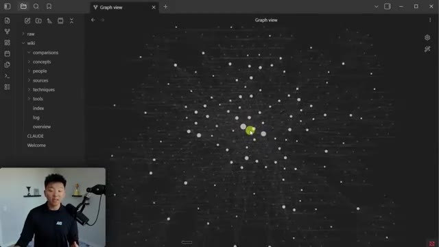
*⏱️ 00:01:32 — Vue graphique (Graph view) dans Obsidian montrant un réseau complexe de nœuds interconnectés représentant une base de connaissances personnelle.*

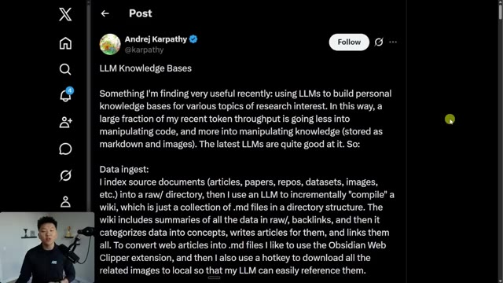
*⏱️ 00:01:42 — Publication sur X (Twitter) d'Andrej Karpathy concernant les "LLM Knowledge Bases", détaillant l'utilisation de fichiers Markdown et d'outils d'indexation pour structurer les connaissances.*

---

### ⏱️ `[00:01:47 - 00:02:05]` | Segment #05

**🔊 Audio (Transcription Intégrale Mot pour Mot en Français) :**
> Et en l'espace de seulement quelques jours, ça a eu énormément de succès sur X. Alors faisons une analyse rapide, et ensuite je vais vous montrer comment vous pouvez mettre ça en place en gros en cinq minutes. C'est bien plus simple que vous ne le pensez. Quelque chose que j'ai trouvé très utile récemment, c'est d'utiliser des LLM pour créer des bases de connaissances personnelles pour divers sujets de recherche d'intérêt. Il y a donc différentes étapes. La première partie, c'est l'ingestion de données.

**👁️ Analyse Visuelle d'Écran (gemini-3.5-flash-lite) :**
**Interface & Outils** : Plateforme X (anciennement Twitter) affichée dans un navigateur web.

**Contenu textuel & Code** : Texte du tweet : "LLM Knowledge Bases. Something I'm finding very useful recently: using LLMs to build personal knowledge bases... Data ingest: I index source documents... into a raw/ directory, then I use an LLM to incrementally 'compile' a wiki...".

**Action / Démonstration** : Présentation du tweet source servant de base à l'explication technique du vidéaste sur l'automatisation de la gestion de connaissances.

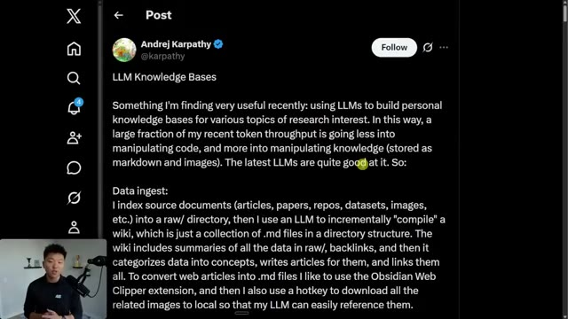
*⏱️ 00:01:51 — Capture d'écran montrant un tweet d'Andrej Karpathy sur X, expliquant sa méthode pour créer des bases de connaissances personnelles avec des LLM.*

---

### ⏱️ `[00:02:05 - 00:02:33]` | Segment #06

**🔊 Audio (Transcription Intégrale Mot pour Mot en Français) :**
> En gros, il met des documents sources. Donc, en gros, il prend un PDF et le met dans Cloud Code, puis Cloud Code fait le reste. Il utilise Obsidian comme IDE. Donc, ce n'est vraiment rien de très révolutionnaire. Obsidian vous permet juste de voir visuellement vos fichiers markdown. Mais par exemple, ce projet Obsidian juste ici avec tout ce truc de transcriptions YouTube. Ça se trouve en fait juste ici. C'est exactement la même chose. Voici les transcriptions YouTube brutes. Et voici ce wiki que je vous ai montré les gars, avec les différents dossiers pour ce que CloudCo a fait avec mes transcriptions YouTube.

**👁️ Analyse Visuelle d'Écran (gemini-3.5-flash-lite) :**
**Interface & Outils** : Obsidian (logiciel de prise de notes/gestion de connaissances).

**Contenu textuel & Code** : Structure de dossiers (raw, wiki/comparisons, concepts, sources, techniques), vue en graphe interactive montrant les interconnexions de données, texte sur l'automatisation LLM.

**Action / Démonstration** : Navigation dans l'arborescence des fichiers du projet et visualisation graphique de la base de connaissances liée au projet.

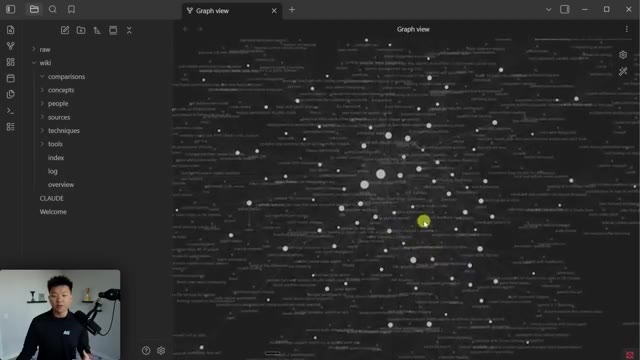
*⏱️ 00:02:19 — Capture d'écran de l'interface Obsidian affichant la "Graph view" (vue en graphe) montrant les connexions entre de nombreuses notes et dossiers structurés.*

---

### ⏱️ `[00:02:33 - 00:02:55]` | Segment #07

**🔊 Audio (Transcription Intégrale Mot pour Mot en Français) :**
> And then there's a Q&A phase where you basically can ask questions about YouTube or about the research. And it can look through the entire wiki in a much more efficient way. And it can give you answers that are super intelligent. He said here, I thought that I had to reach for fancy rag, but the LLM has been pretty good about auto-maintaining index files and brief summaries of all documents, and it reads all the important related data fairly easily at this small scale.

**👁️ Analyse Visuelle d'Écran (gemini-3.5-flash-lite) :**
**Interface & Outils** : X (anciennement Twitter) affichant un texte de blog ou une réflexion technique.

**Contenu textuel & Code** : Texte traitant de l'utilisation d'Obsidian, de l'automatisation par LLM pour la maintenance de données, de la gestion de RAG (Retrieval-Augmented Generation) et de la génération de sorties visuelles (Markdown, Marp, Matplotlib).

**Action / Démonstration** : Lecture d'un témoignage utilisateur sur l'intégration d'agents IA dans un flux de travail de recherche basé sur Obsidian.

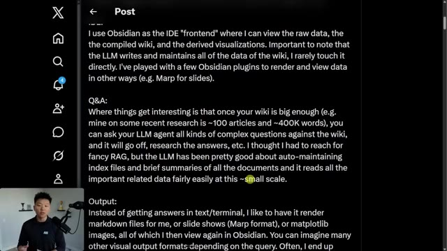
*⏱️ 00:02:38 — Une capture d'écran d'un post sur X (Twitter) expliquant l'utilisation d'Obsidian comme interface pour gérer une base de connaissances (wiki) maintenue par un LLM.*

---

### ⏱️ `[00:02:55 - 00:03:16]` | Segment #08

**🔊 Audio (Transcription Intégrale Mot pour Mot en Français) :**
> Donc en ce moment, il fait environ 100 articles et environ un demi-million de mots. Donc il y a quelques autres choses que nous aborderons plus tard, mais le TLDR c'est que vous donnez des données brutes à CloudCode, il les compare, il les organise, puis il les place aux bons endroits avec des relations, et ensuite vous pouvez l'interroger sur n'importe quoi. Et cela peut vous aider à identifier où il y a des lacunes dans ce nœud ou dans cette relation, et il peut faire des recherches et combler ces lacunes.

**👁️ Analyse Visuelle d'Écran (gemini-3.5-flash-lite) :**
**Interface & Outils** : Plateforme de réseau social (X / Twitter).

**Contenu textuel & Code** : Texte technique décrivant un workflow : collecte de données brutes -> compilation par LLM en wiki Markdown -> interaction via CLI pour Q&A -> consultation dans Obsidian -> finetuning de modèles pour intégration des connaissances.

**Action / Démonstration** : Le présentateur utilise ce post comme support visuel pour illustrer le concept de "données brutes organisées et automatisées par un agent" (CloudCode).

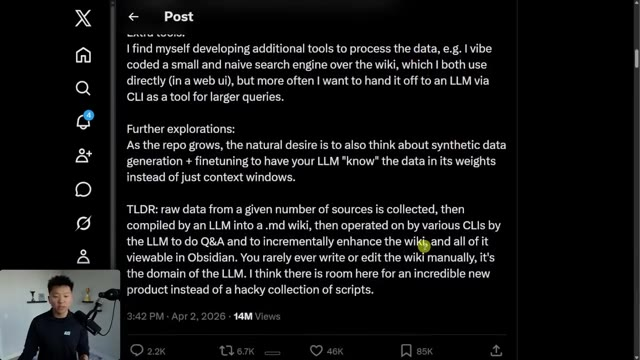
*⏱️ 00:03:01 — Une capture d'écran d'une publication sur la plateforme X (anciennement Twitter) détaillant le processus d'automatisation de données via LLM, incluant la compilation en wiki .md et l'usage d'Obsidian.*

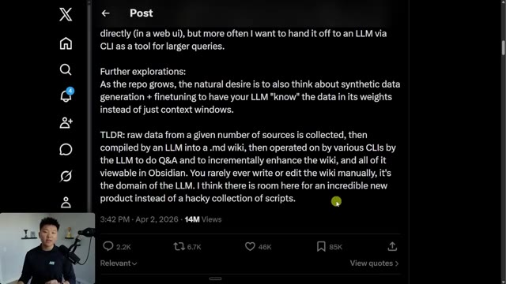
*⏱️ 00:03:11 — La suite du même texte sur X, mettant en avant le concept de "finetuning" et l'automatisation totale du wiki par des LLM plutôt que par des scripts manuels.*

---

### ⏱️ `[00:03:17 - 00:03:36]` | Segment #09

**🔊 Audio (Transcription Intégrale Mot pour Mot en Français) :**
> D'accord, alors pourquoi est-ce si important ? Parce que les conversations d'IA normales sont éphémères, ce qui signifie que les connaissances disparaissent après la conversation. Mais cette méthode, qui utilise le wiki LLM de Karpathy, fait fructifier les connaissances comme des intérêts à la banque. Les gens sur X qualifient cela de véritable révolution parce que cela donne enfin l'impression que l'IA est un collègue infatigable qui se souvient vraiment de tout et qui reste organisé. C'est aussi super simple.

**👁️ Analyse Visuelle d'Écran (gemini-3.5-flash-lite) :**
**Interface & Outils** : Présentation (diapositives).

**Contenu textuel & Code** : Liste à puces expliquant que les chats IA classiques sont éphémères tandis que la méthode de Karpathy permet une accumulation des connaissances ("compound like interest in a bank") et une meilleure organisation.

**Action / Démonstration** : Présentation théorique des concepts fondamentaux derrière l'automatisation proposée.

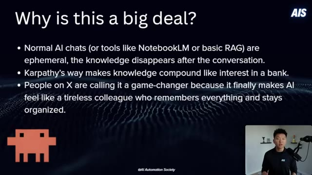
*⏱️ 00:03:22 — Une diapositive de présentation textuelle illustrant les avantages de la méthode de Wiki LLM par rapport aux chats IA traditionnels, avec le présentateur en médaillon.*

---

### ⏱️ `[00:03:36 - 00:03:56]` | Segment #10

**🔊 Audio (Transcription Intégrale Mot pour Mot en Français) :**
> Cela vous prendra cinq minutes à configurer. Je vais vous montrer, les gars. Vous n'avez pas besoin d'une base de données vectorielle sophistiquée, d'embeddings ou d'une infrastructure complexe. C'est littéralement juste un dossier avec des fichiers Markdown. C'est tout. Vous avez littéralement juste un coffre en haut. Donc dans cet exemple, il s'appelle MyWiki. Vous avez un dossier « raw » où vous mettez toutes vos données, et ensuite vous avez un dossier wiki, qui est ce que le LLM prend depuis votre dossier « raw » et met dans le wiki.

**👁️ Analyse Visuelle d'Écran (gemini-3.5-flash-lite) :**
**Interface & Outils** : Présentation de type "Slide" avec annotations graphiques manuelles.

**Contenu textuel & Code** : - Arborescence : `my-wiki/` contenant `raw/` (read-only) et `wiki/` (géré par LLM).
- Fichiers clés dans `wiki/` : `index.md` (sommaire), `log.md` (historique), `*.md` (pages).
- Fichier racine : `CLAUDE.md` (règles et schéma).

**Action / Démonstration** : Illustration conceptuelle de l'organisation des fichiers pour un système de gestion de connaissances autonome par un LLM.

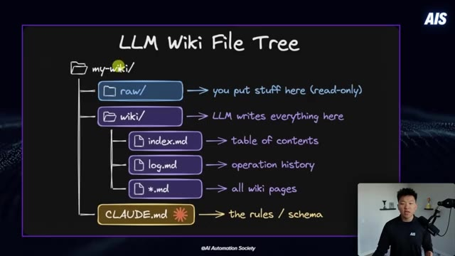
*⏱️ 00:03:46 — Diagramme structuré présentant l'arborescence de fichiers ("LLM Wiki File Tree") pour organiser une base de connaissances locale pilotée par IA.*

---

### ⏱️ `[00:03:56 - 00:04:30]` | Segment #11

**🔊 Audio (Transcription Intégrale Mot pour Mot en Français) :**
> Donc ici, vous avez toutes les pages wiki qu'il va créer, mais vous avez aussi un index et vous avez un journal. Donc par exemple, dans mon coffre de transcriptions YouTube, voici l'index. Vous pouvez voir que j'ai tous ces différents outils, sur lesquels je pourrais évidemment cliquer et cela m'amènerait directement sur cette page. Ou après cela, j'ai toutes les différentes techniques : équipes d'agents, sous-agents, modes d'autorisation, le framework WAT. Et puis nous avons différents concepts : serveurs MCP, RAG, Vibe coding. Nous avons toutes ces différentes sources, qui sont, vous savez, les vidéos YouTube. Et puis quand j'ai des personnes ou quand j'ai des comparaisons, elles seront mises ici dans l'index. Et puis nous avons aussi un journal, qui est l'historique des opérations. Donc dans ce cas, dans le

**👁️ Analyse Visuelle d'Écran (gemini-3.5-flash-lite) :**
**Interface & Outils** : Obsidian (éditeur de notes Markdown)

**Contenu textuel & Code** : Liste d'outils comprenant : claude-code, n8n, cursor, trigger-dev, firecrawl, perplexity, nano-banana-2, antigravity, pinecone, google-workspace-cli, clickup, vercel, playwright, pixel-agents, key-ai, openrouter, 21st-dev.

**Action / Démonstration** : Navigation dans l'arborescence des fichiers du coffre (vault) Obsidian, avec le fichier « index » sélectionné et affiché à l'écran.

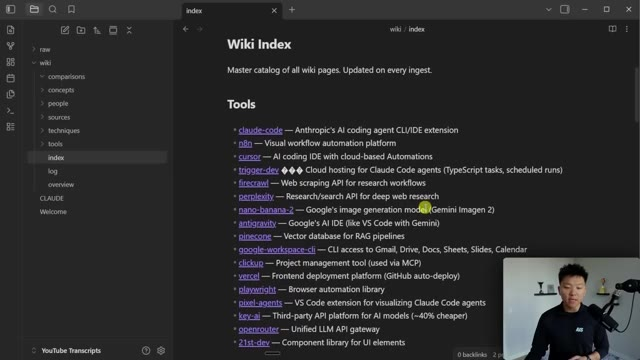
*⏱️ 00:04:05 — Une capture d'écran montrant l'interface d'Obsidian affichant une page intitulée « Wiki Index », qui répertorie divers outils technologiques et d'IA avec une brève description pour chacun.*

---

### ⏱️ `[00:04:30 - 00:05:05]` | Segment #12

**🔊 Audio (Transcription Intégrale Mot pour Mot en Français) :**
> YouTube project, the log isn't huge because I only ran one huge batch of the initial 36 YouTube videos. But now every time I have one, I say, hey, can you go ahead and ingest the new YouTube video into the wiki and then we'll see every single time we update this. And then of course, you need your Claude.md to explain how the project works and how to search through things and how to, you know, update things. It's also a big deal from a cost perspective, token efficiency and long-term value. One ex-user turned 383 scattered files and over 100 meeting transcripts into a compact wiki and dropped token usage by 95% when querying with Claude. And obviously token management

**👁️ Analyse Visuelle d'Écran (gemini-3.5-flash-lite) :**
**Interface & Outils** : Obsidian (éditeur Markdown), Slides de présentation graphique.

**Contenu textuel & Code** : Structure de fichiers : 'raw/', 'wiki/' (index.md, log.md), 'CLAUDE.md'. Logs d'opérations : "[2026-04-05] ingest | Initial batch ingest of 36 YouTube transcripts".

**Action / Démonstration** : Présentation de la structure de données "Wiki" utilisée pour optimiser le contexte pour les modèles de langage (LLM).

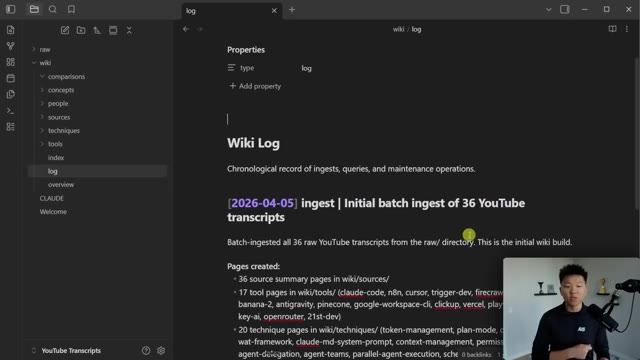
*⏱️ 00:04:39 — Une capture d'écran de l'interface de l'éditeur Obsidian montrant le fichier "Wiki Log" qui détaille l'historique des opérations, notamment l'ingestion initiale de 36 transcriptions YouTube.*

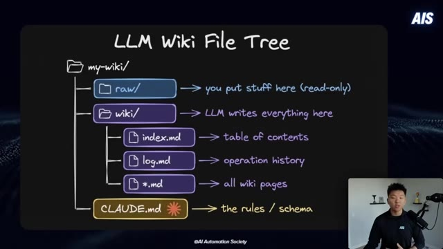
*⏱️ 00:04:48 — Une infographie schématique intitulée "LLM Wiki File Tree" illustrant l'organisation des répertoires d'un projet, incluant les dossiers 'raw/' et 'wiki/', ainsi que le fichier central 'CLAUDE.md'.*

---

### ⏱️ `[00:05:05 - 00:05:28]` | Segment #13

**🔊 Audio (Transcription Intégrale Mot pour Mot en Français) :**
> and efficiency is a huge conversation right now and will always be. The other thing that's really cool about this is there's not really like a GitHub repo, you go copy, or there's not a complicated setup. You literally just say, Hey, Cloud Code, read this idea from Andre Karpathy and implement it. And people on X are now talking about like, this is how 2026 AI agentic software and products will be made. You just give it a high level idea and it goes and builds it out.

**👁️ Analyse Visuelle d'Écran (gemini-3.5-flash-lite) :**
**Interface & Outils** : Présentation type diaporama (Slide deck).

**Contenu textuel & Code** : Texte affiché : "Why is this a big deal? • Idea files > code. Karpathy's follow-up post today emphasized sharing high-level "idea files" (prompts/specs) instead of code. • Your agent's job is to implement and customize. This is blowing up because it fits the new agent era perfectly. PRs become "prompt requests."

**Action / Démonstration** : Présentation théorique et conceptuelle du changement de paradigme dans le développement logiciel assisté par IA.

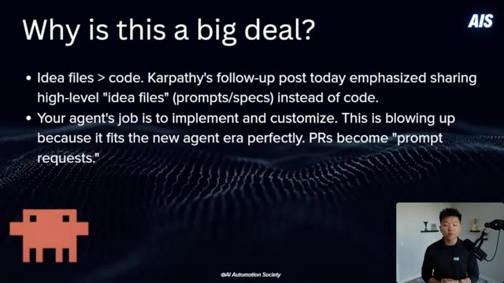
*⏱️ 00:05:11 — Une diapositive de présentation avec un fond abstrait numérique, expliquant pourquoi le passage des fichiers de code vers les "fichiers d'idées" (idea files) est important pour l'ère des agents IA.*

---

### ⏱️ `[00:05:28 - 00:06:01]` | Segment #14

**🔊 Audio (Transcription Intégrale Mot pour Mot en Français) :**
> And Karpathy even said, Hey, you know, I left this prompt vague so that you guys can customize it. And I'll show you the ways in my two different vaults right now that it changed things a little bit based on the context and understanding of what the project is actually for. Okay, so this was the original tweet I just showed you guys. And then he followed up and said, hey, this one went viral. So here is the idea in a gist format. So if you open this up, this is basically just another explanation of the core idea of how this works and why the architecture, indexing, all this kind of stuff. And by the way, this is the part where he says, hey, this is left vague so that you can hack it and customize it to your own project. So we're going to come right back to this in a sec,

**👁️ Analyse Visuelle d'Écran (gemini-3.5-flash-lite) :**
**Interface & Outils** : Plateforme X (Twitter), GitHub Gist (via navigateur web).

**Contenu textuel & Code** : Texte explicatif sur les agents LLM, lien vers un Gist, et contenu technique sur l'automatisation de la gestion de connaissances (Obsidian, CLI tools, dataview).

**Action / Démonstration** : Navigation et lecture commentée de la documentation théorique et technique partagée par Karpathy pour illustrer le concept de "prompt/spec" orienté agent IA.

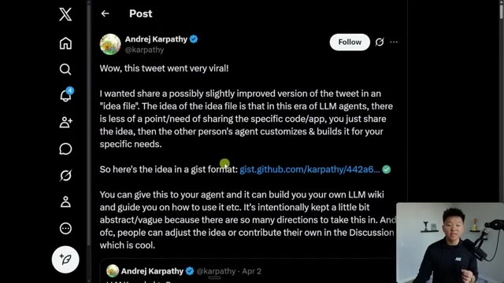
*⏱️ 00:05:45 — Capture d'écran d'un post Twitter (X) d'Andrej Karpathy expliquant le concept de partage d'idées plutôt que de code spécifique.*

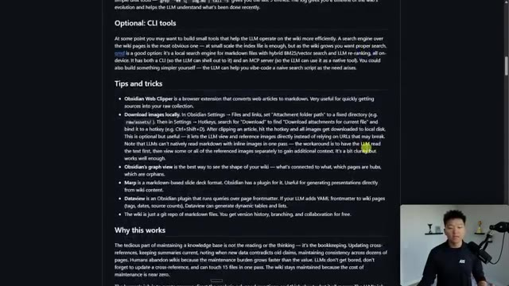
*⏱️ 00:05:53 — Vue détaillée du contenu textuel d'un GitHub Gist rédigé par Karpathy, détaillant des outils CLI et des conseils techniques pour l'utilisation d'Obsidian avec des LLM.*

---

### ⏱️ `[00:06:01 - 00:06:36]` | Segment #15

**🔊 Audio (Transcription Intégrale Mot pour Mot en Français) :**
> but the first prereq that we're going to do, it's not necessary, but I like to have a nice little front end to see the relationships is we're going to go to Obsidian and download it. So if you just go to obsidian.md, you can see this is the completely free tool and you're going to go ahead and download it. So just for your operating system, download this and then open up the wizard and open up the app. So when you open up the app, it'll look like this. And what we're going to do here is we're going to create a new vault. So down here, you can see I have HercBrain and I have YouTube transcripts. I'll just make a little bigger. I'm going to go to manage vaults. I'm going to create a new one. And now we just have to give this a name. So I'm just going to call this

**👁️ Analyse Visuelle d'Écran (gemini-3.5-flash-lite) :**
**Interface & Outils** : Navigateur web (Obsidian.md), Application de bureau Obsidian.

**Contenu textuel & Code** : Texte du site web, structure de dossiers dans la barre latérale, nœuds et liens de la vue graphique ("Graph view").

**Action / Démonstration** : Présentation de l'outil de gestion de connaissances et visualisation d'un graphe de notes interconnectées.

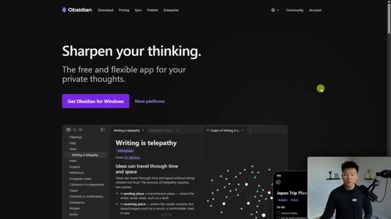
*⏱️ 00:06:10 — Page d'accueil du site web Obsidian montrant le bouton de téléchargement et une prévisualisation de l'interface du logiciel.*

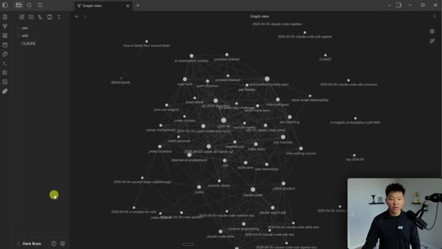
*⏱️ 00:06:27 — Capture d'écran de l'application Obsidian ouverte, affichant la "Graph view" (vue graphique) montrant les connexions entre différentes notes et projets.*

---

### ⏱️ `[00:06:36 - 00:06:54]` | Segment #16

**🔊 Audio (Transcription Intégrale Mot pour Mot en Français) :**
> one demo vault. And you're going to choose a location where you want to put this. So I'm just throwing this on my desktop. And I'm going to go ahead and create this vault. Then what you're going to do is go to wherever you like to run cloud code. So in this case, I'm doing it in VS code. And I open up that folder. So demo vault, we get an obsidian, and then we get a welcome.md.

**👁️ Analyse Visuelle d'Écran (gemini-3.5-flash-lite) :**
**Interface & Outils** : Obsidian (version 1.12.7)

**Contenu textuel & Code** : Champs de saisie : "Vault name" (demo vault) et "Location" (chemin OneDrive), avec un avertissement système concernant la synchronisation de fichiers.

**Action / Démonstration** : Configuration et création d'un nouveau répertoire local (vault) dans Obsidian avant son utilisation dans un éditeur de code.

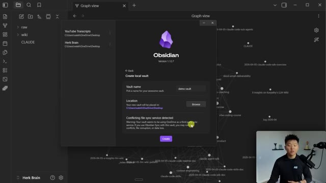
*⏱️ 00:06:40 — Fenêtre de création d'un nouveau coffre ("vault") dans l'application Obsidian, affichant les champs pour le nom du coffre ("demo vault") et son emplacement sur le bureau via OneDrive.*

---

### ⏱️ `[00:06:55 - 00:07:31]` | Segment #17

**🔊 Audio (Transcription Intégrale Mot pour Mot en Français) :**
> So I'm going to open up cloud. So I'm going to do it in my terminal. I'm going to run cloud. And lately I've been liking using my terminal better for Claude. I like to do it inside of VS Code, but the reason is just because I like to see the status line and I have a little bit more functionality. So anyways, now that we have Claude Code open, here's what we're going to do. We're going to go back over to the LLM wiki thing that we got from Andre Carpathie. We're going to copy all of this and we're going to go back into Claude Code and then just paste it in there. So that is the prompt from Carpathie that's going to build out everything we need. And then before we send that off. We're dropping this in, which you guys can screenshot and then just throw into yours.

**👁️ Analyse Visuelle d'Écran (gemini-3.5-flash-lite) :**
**Interface & Outils** : Visual Studio Code, Claude Code CLI, navigateur web (GitHub).

**Contenu textuel & Code** : Commandes terminal liées à "Claude Code v2.1.92", indicateurs "Opus 4.6 (1M context)", paramètre "bypass permissions on", et texte inséré "[Pasted text #1 +62 lines]".

**Action / Démonstration** : Exécution et interaction avec l'outil Claude Code dans un terminal VS Code, incluant le collage d'un bloc de texte pour traitement par l'IA.

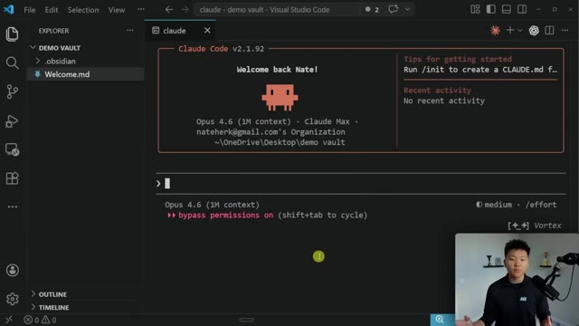
*⏱️ 00:07:04 — Interface de terminal Claude Code v2.1.92 au sein de l'éditeur VS Code, affichant un message de bienvenue.*

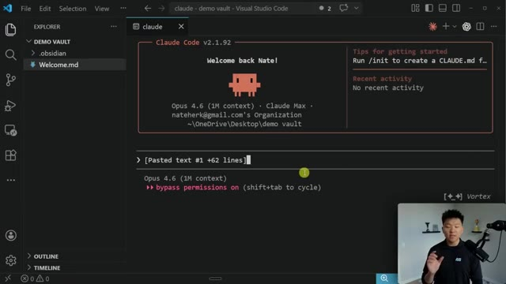
*⏱️ 00:07:22 — Terminal Claude Code dans VS Code après l'insertion (paste) d'un contenu de 62 lignes.*

---

### ⏱️ `[00:07:31 - 00:08:03]` | Segment #18

**🔊 Audio (Transcription Intégrale Mot pour Mot en Français) :**
> But I'm saying you are now my LLM wiki agent. Implement this exact idea file as my complete second brain. Guide me step by step. Create the cloud.md schema, blah, blah, blah. So this is just telling it what it needs to do with this idea that we just got from Karpathy. So anyways, on the right, we have this cloud code running. And on the left, we have our Obsidian Vault. And you can see it just created those two folders. So it created the raw and it created the wiki, as you can see. Now, by default, it threw in four folders. It threw in analysis, concepts, entities, and sources. Once we start to populate stuff, we can talk to it to see if that's actually the way we want to do it or not.

**👁️ Analyse Visuelle d'Écran (gemini-3.5-flash-lite) :**
**Interface & Outils** : Visual Studio Code (VS Code) avec l'extension terminal Claude Code (v2.1.92).

**Contenu textuel & Code** : Le prompt affiché est : "You are now my LLM Wiki agent. Implement this exact idea file as my complete second brain. Guide me step-by-step: create the CLAUDE.md schema file with full rules, set up index.md and log.md, define folder conventions, and show me the first ingest example. From now on, every interaction follows the schema."

**Action / Démonstration** : L'utilisateur soumet ses instructions à l'agent Claude Code pour initialiser une structure de répertoire (vault) destinée à devenir un "second cerveau" piloté par l'IA.

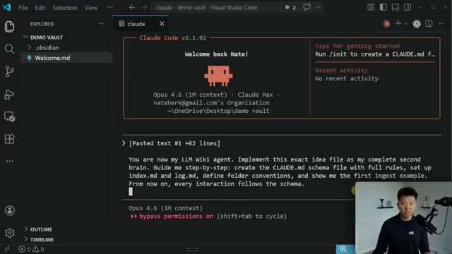
*⏱️ 00:07:39 — L'interface de VS Code montrant le terminal Claude Code en cours d'exécution avec un prompt complexe adressé à l'IA pour configurer un système de gestion de connaissances "second brain".*

---

### ⏱️ `[00:08:03 - 00:08:37]` | Segment #19

**🔊 Audio (Transcription Intégrale Mot pour Mot en Français) :**
> Because it's interesting, in my personal kind of second brain, the wiki is literally just markdown files. There's no structure to it. And in some cases, that's good. Karpathy actually said, sometimes I like to keep it really simple and really flat, which means like no subfolders and not a bunch of over organizing. But then you guys did see in my YouTube transcript one, there were different subfolders. And I think that in this case, it actually makes more sense. But you can see that it went ahead and it created a claw.md. It created an index and a log and then a few different folders in our wiki. But now it's saying, hey, let's go ahead and try it out. Drop in your first source into the raw folder and tell me to ingest it. Okay, so I'm at this website called

**👁️ Analyse Visuelle d'Écran (gemini-3.5-flash-lite) :**
**Interface & Outils** : Obsidian (logiciel de prise de notes).

**Contenu textuel & Code** : Liste de fichiers Markdown dans le dossier "wiki" (ex: _index-personal, _index-business, 2026-04-05-claude-code-sub-agents) et une représentation visuelle interconnectée des notes (nœuds) dans la vue graphique.

**Action / Démonstration** : Navigation dans l'explorateur de fichiers de l'espace de travail "Herk Brain", avec survol de la souris sur le fichier "_index-personal" affichant ses métadonnées de création et de modification.

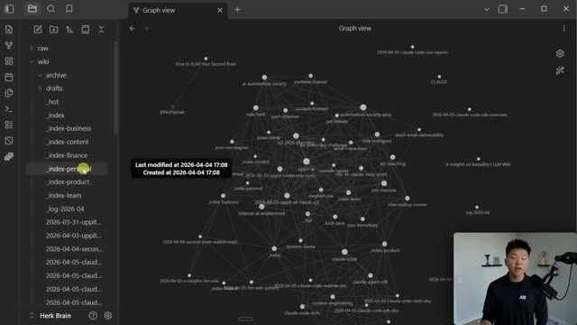
*⏱️ 00:08:11 — Capture d'écran de l'interface Obsidian affichant la "Graph view" (vue graphique) d'un second cerveau numérique, avec une arborescence de fichiers Markdown dans la barre latérale gauche.*

---

### ⏱️ `[00:08:37 - 00:09:06]` | Segment #20

**🔊 Audio (Transcription Intégrale Mot pour Mot en Français) :**
> AI 2027. If you guys haven't read this before, it's kind of an interesting read. So go check it out. And now let's say I want to get this into my vault. What I could do is just copy the whole page, right? And it might just come through a little weird. Or we can just get an obsidian extension, which lets us basically take articles right from the web and just put it right into our vault. Super easy. So search for this extension called Obsidian Web Clipper. You would go ahead and add this to Chrome. So then when you're in the article that you want, you basically just click on your extensions, you open up Obsidian Web Clipper, and then you can just chuck it into your vault.

**👁️ Analyse Visuelle d'Écran (gemini-3.5-flash-lite) :**
**Interface & Outils** : Navigateur web (Google Chrome).

**Contenu textuel & Code** : Textes informatifs sur l'évolution de l'IA (rapport AI 2027) ; interface de l'extension de navigateur Obsidian Web Clipper.

**Action / Démonstration** : Navigation et présentation d'outils pour capturer du contenu web vers un coffre-fort (vault) personnel Obsidian.

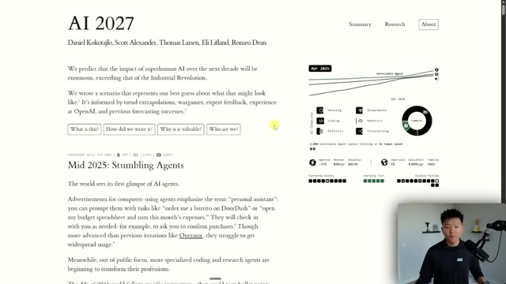
*⏱️ 00:08:45 — Page web du rapport "AI 2027" présentant des analyses prospectives sur l'IA, incluant des graphiques de tendances et des sections sur les agents IA.*

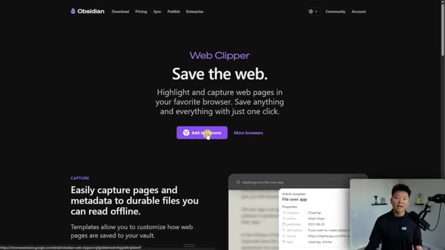
*⏱️ 00:08:59 — Page de téléchargement de l'extension "Obsidian Web Clipper" dans le Chrome Web Store, illustrant l'outil pour capturer des pages web vers Obsidian.*

---

### ⏱️ `[00:09:07 - 00:09:41]` | Segment #21

**🔊 Audio (Transcription Intégrale Mot pour Mot en Français) :**
> And then right here, you're going to want to set this to raw because this is the actual folder that it's going to put it in. So you can go ahead and click add to Obsidian, open Obsidian. And then now you can see in my raw section, we have this AI 2027 source with the title, the source, and it's not super, super populated yet because the LLM and cloud code is going to do that. So here is our file. I'm going to open up cloud code and say, awesome. I just threw in an article called AI 2027 into the raw. Can you please go ahead and ingest that? It might ask you some questions. It might also be helpful to, before you start ingesting stuff, say, Hey, by the way, this project is specifically

**👁️ Analyse Visuelle d'Écran (gemini-3.5-flash-lite) :**
**Interface & Outils** : Obsidian, VS Code (ou éditeur compatible avec les extensions Claude/Opus).

**Contenu textuel & Code** : Propriétés de note (Titre : AI 2027, Source : ai-2027.com), texte descriptif sur l'IA, et instructions de l'agent "Claude" pour traiter les sources ingérées.

**Action / Démonstration** : Organisation de notes de recherche dans un dossier "raw" et interaction avec un agent IA pour la gestion de connaissances (Knowledge Management).

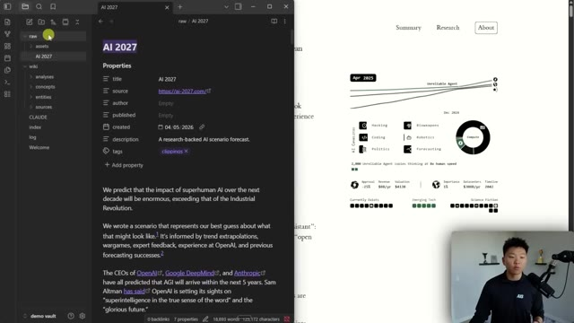
*⏱️ 00:09:15 — L'interface d'Obsidian affichant une note nommée "AI 2027" avec ses propriétés et un contenu texte, dans le dossier "raw".*

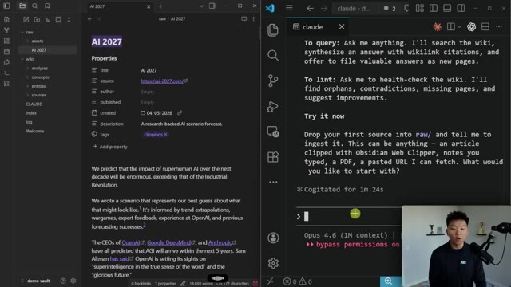
*⏱️ 00:09:32 — Une vue en écran divisé montrant à gauche la note "AI 2027" dans Obsidian, et à droite une interface de chat IA nommée "Claude" intégrée dans un éditeur de code.*

---

### ⏱️ `[00:09:41 - 00:10:13]` | Segment #22

**🔊 Audio (Transcription Intégrale Mot pour Mot en Français) :**
> for my second brain. So personal things, business things, whatever. Or this is just a research project. This is where I'm going to chuck you all of the articles and all the things that I want to learn about and all the things that I know. So there's different ways that you can set up the project as you saw with mine, one for YouTube, one for just personal second brain. So now what it's doing is it's going to read through this article and then it's going to figure out where should I chuck everything into the wiki. It's not just going to create one MD file for this. It might create five or it might create 10. And there's going to be relationships between each of the different sections that it creates. So it's kind of doing its own method of chunking. Now, one thing

**👁️ Analyse Visuelle d'Écran (gemini-3.5-flash-lite) :**
**Interface & Outils** : Obsidian (panneau de gauche) et VS Code avec Claude Code (panneau de droite).

**Contenu textuel & Code** : Dans Obsidian : note "AI 2027" avec métadonnées et texte sur les prédictions d'IA. Dans Claude Code : logs d'exécution indiquant "Cogitated for 1m 24s", lecture du fichier "raw\AI 2027.md" et message d'état "Pontificating...".

**Action / Démonstration** : L'utilisateur demande à l'agent IA de lire et d'ingérer un article nommé "AI 2027" préalablement ajouté au dossier "raw" du projet, afin de traiter son contenu pour le "second brain".

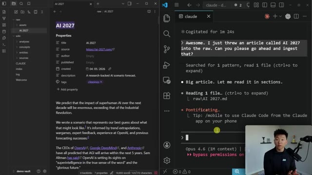
*⏱️ 00:09:49 — Capture d'écran montrant un environnement de travail scindé en deux : à gauche, l'application Obsidian affichant une note sur "AI 2027" ; à droite, le terminal de VS Code exécutant Claude Code.*

---

### ⏱️ `[00:10:13 - 00:10:49]` | Segment #23

**🔊 Audio (Transcription Intégrale Mot pour Mot en Français) :**
> I want to call out real quick is with this extension, if you go here and you open up the options for it, you can see that you can actually change where by default the folders are dropped, which is in the location section. By default, it'll be going to a place called clippings, but just go ahead and change that to raw. Okay. So here it came back with all these questions, right? It said, here are my key takeaways from this article, blah, blah, blah. And now it'll ask you, what do you want to emphasize from this article? What's your focus? How granular do you want to be? What's your plan? So I'm just going to say, I want this to be extremely thorough. This is my passion looking at where AI is going to go. And this whole project, by the way, that you're

**👁️ Analyse Visuelle d'Écran (gemini-3.5-flash-lite) :**
**Interface & Outils** : Interface de paramètres d'extension de navigateur (Web Clipper).

**Contenu textuel & Code** : Champs de configuration pour "Note name" ([title]), "Note location" (valeur réglée sur "raw"), et propriétés de métadonnées (title, source, author, etc.).

**Action / Démonstration** : Navigation dans les options de configuration de l'extension pour modifier le chemin de stockage par défaut des notes.

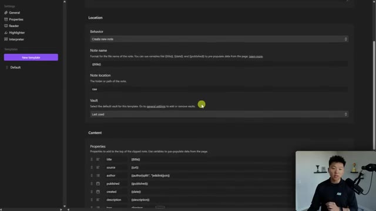
*⏱️ 00:10:22 — Menu de configuration d'une extension de prise de notes (probablement Obsidian Web Clipper) montrant les paramètres "Location" et "Content".*

---

### ⏱️ `[00:10:49 - 00:11:17]` | Segment #24

**🔊 Audio (Transcription Intégrale Mot pour Mot en Français) :**
> setting up in this vault is basically just going to be my place to dump in research about AI. So help me keep all that organized so that I can query it and that I can, you know, keep my thoughts related. So that's just a quick example of what it might look like for you to give it some more context to continuously build your project. So I'm going to switch over over here to the graph view because I think it'll be interesting to see as it is starting to go through and create those different wiki files, it's gonna go ahead and it's gonna create all those relationships and we'll be able to watch it in real time.

**👁️ Analyse Visuelle d'Écran (gemini-3.5-flash-lite) :**
**Interface & Outils** : Obsidian (pour la gestion de notes) et VS Code (avec une extension de chat IA, probablement Claude).

**Contenu textuel & Code** : Dans Obsidian : note intitulée "AI 2027" avec des métadonnées (propriétés) et un texte de recherche. Dans VS Code : un message de l'IA demandant des précisions sur le focus de la recherche ("What's your focus?") et la granularité souhaitée pour les pages wiki, avec une mention "Opus 4.6".

**Action / Démonstration** : Le créateur montre comment il utilise son "vault" (coffre-fort) Obsidian pour centraliser la recherche sur l'IA, tout en utilisant une IA dans VS Code pour générer et structurer la documentation.

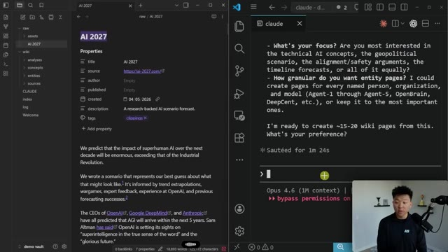
*⏱️ 00:10:56 — Une capture d'écran montrant l'interface d'Obsidian (à gauche) et une fenêtre d'interaction avec une IA (à droite) intégrée dans VS Code.*

---

### ⏱️ `[00:11:17 - 00:11:39]` | Segment #25

**🔊 Audio (Transcription Intégrale Mot pour Mot en Français) :**
> All right, so it's creating all of the wiki pages now and you can see that it said it's gonna make about 25 because there's so much stuff going on in the original AI 2027 article. Okay, so our first one just popped in here and there a second one just came through and now you can understand, you're starting to see where do you have hubs or where do you just have little individual nodes? So this is a major hub, someone named Eli, someone named Thomas, Daniel.

**👁️ Analyse Visuelle d'Écran (gemini-3.5-flash-lite) :**
**Interface & Outils** : Obsidian (vue graphique) et VS Code (avec une extension de chat IA/agent).

**Contenu textuel & Code** : Le terminal affiche un plan de travail listant 25 pages wiki à générer, avec des tâches comme "Create entity pages for people", "Create concept pages", et "Update index.md". Le statut indique "Writing source summary...".

**Action / Démonstration** : L'agent IA exécute une séquence automatisée de création et d'indexation de fichiers Markdown basés sur l'article "AI 2027".

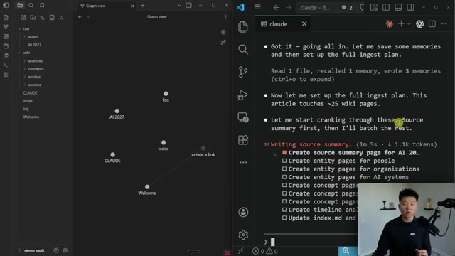
*⏱️ 00:11:23 — Interface divisée en deux volets : à gauche, une vue graphique des nœuds de données dans Obsidian ; à droite, une fenêtre VS Code montrant l'interaction avec un agent IA en train de planifier la création de pages wiki.*

---

### ⏱️ `[00:11:40 - 00:11:59]` | Segment #26

**🔊 Audio (Transcription Intégrale Mot pour Mot en Français) :**
> And you can see all the different relationships here with things like AI governance, with things like OpenBrain, Superhuman Coder. Okay, so that ingest took about 10 minutes. So sometimes you have to be a little patient with reading through everything and organizing everything, but it does a lot of heavy lifting, of course. When I uploaded the 36 YouTube transcripts in batch, it took about 14 minutes.

**👁️ Analyse Visuelle d'Écran (gemini-3.5-flash-lite) :**
**Interface & Outils** : VS Code (avec une extension de gestion de connaissances type Obsidian ou Markdown) et une vue en graphe intégrée.

**Contenu textuel & Code** : Fichier Markdown contenant des tags (`person`, `ai-researcher`), des sources et une liste de tâches ("Writing people entity pages...", "Create entity pages for people", "Create entity pages for organizations", etc.). On observe également la mention "Opus 4.6 (1M context)" dans la barre d'état.

**Action / Démonstration** : L'agent automatise la création de pages d'entités et l'organisation de données structurées, tout en visualisant les connexions entre ces éléments dans un graphe dynamique.

*⏱️ 00:11:44 — Une vue scindée en deux : à gauche, une vue en graphe interactive montrant les relations entre différentes entités (superhuman-coder, src-ai-2027) ; à droite, l'interface de VS Code affichant un fichier Markdown avec des métadonnées (frontmatter) et une liste de tâches (checklist) en cours d'exécution par un agent.*

---

### ⏱️ `[00:11:59 - 00:12:34]` | Segment #27

**🔊 Audio (Transcription Intégrale Mot pour Mot en Français) :**
> So it kind of just depends. But it created 23 wiki pages. We have the source, we have six people, five organizations and one AI systems page, different concepts of technical alignment and geopolitical, and then an analysis. And then it asks some questions about it so that it can help make the relationships and make the structure even better. Now let's just open this one up a little bit deeper and see what it actually did in here with this stuff. So we have, this is the source with all the main relationships. So as we start to add other articles, we will see other big kind of like nodes. And maybe in some cases we'll have relationships between like compute scaling with

**👁️ Analyse Visuelle d'Écran (gemini-3.5-flash-lite) :**
**Interface & Outils** : Obsidian (vue graphique) et VS Code (éditeur de texte).

**Contenu textuel & Code** : Liste détaillée des entités : "Scott Alexander", "Yoshua Bengio", 5 organisations (OpenBrain, DeepCent, OpenAI, Anthropic, Google DeepMind), 1 page "AI systems" (Agent-0 à Agent-5), et diverses catégories de concepts (Technique, Alignement, Géopolitique).

**Action / Démonstration** : Présentation visuelle de la structure de connaissances générée par un agent, montrant les connexions entre différents concepts liés à l'IA.

*⏱️ 00:12:08 — Une capture d'écran divisée en deux colonnes : à gauche, une vue graphique (nœuds et liens) d'un wiki Obsidian ; à droite, un éditeur de texte dans VS Code listant le contenu structuré du wiki (organisations, systèmes IA, concepts techniques, alignement et géopolitique).*

---

### ⏱️ `[00:12:34 - 00:12:56]` | Segment #28

**🔊 Audio (Transcription Intégrale Mot pour Mot en Français) :**
> different articles that we upload as well. So let's just see if I click into the main source, we can see the tags that it got, we can see the authors, and we can click around. So here's a link to OpenAI. Okay, what's OpenAI? Here's references in AI 2027. Here's some other connections with OpenAI, like model spec. Okay, we're in model spec. Let's take a look. We can see other things about model spec. And we could also go to how the LLM psychology model works.

**👁️ Analyse Visuelle d'Écran (gemini-3.5-flash-lite) :**
**Interface & Outils** : Logiciel de prise de notes Obsidian (vue "vault" avec arborescence latérale).

**Contenu textuel & Code** : Métadonnées de document : tags ("ai-forecasting", "superintelligence", etc.), liste d'auteurs, URL source et paragraphe d'introduction du rapport AI 2027.

**Action / Démonstration** : Navigation au sein d'une base de connaissances personnelle (Knowledge Management) pour consulter les propriétés et le contenu d'un article spécifique.

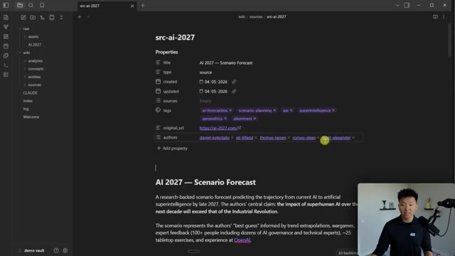
*⏱️ 00:12:40 — Une interface Obsidian affichant la fiche de métadonnées "src-ai-2027" avec ses propriétés (titre, tags, auteurs) et un résumé du rapport "AI 2027 — Scenario Forecast".*

---

### ⏱️ `[00:12:56 - 00:13:31]` | Segment #29

**🔊 Audio (Transcription Intégrale Mot pour Mot en Français) :**
> So this is just super, super cool, all the relationships that we get. And once again, all of this stuff that we're looking at was derived from one article and automatically organized and related. So the question now is like, what do we do from here? Do we query it inside of this environment? Do we query it from somewhere else? And that's completely up to the way that you want to use this. So for example, with my YouTube project, I'm probably just going to keep this here. And whenever I want to ask questions about YouTube, or if I want to turn this into like a website, I can just do that from here. Or if I need to, I can point a different project at this folder since everything's here and it can crawl through the wiki it can read the index and it

**👁️ Analyse Visuelle d'Écran (gemini-3.5-flash-lite) :**
**Interface & Outils** : Obsidian (logiciel de gestion de connaissances).

**Contenu textuel & Code** : Graphe de relations nodal avec des nœuds représentant des sujets (ex: "ai-governance", "alignment-techniques", "yoshua-bengio") reliés par des lignes de connexion.

**Action / Démonstration** : Navigation et visualisation de la structure de connaissances générée automatiquement à partir d'un article, avec une mise en avant interactive des nœuds.

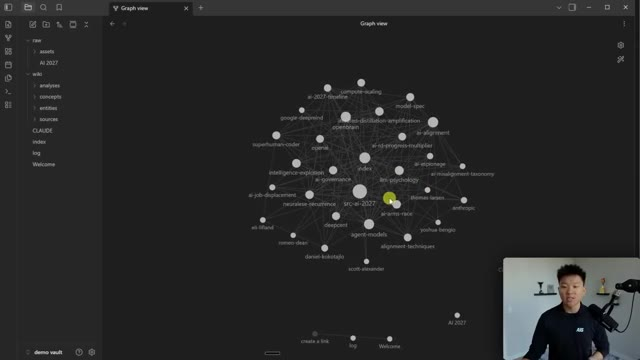
*⏱️ 00:13:05 — Une vue graphique interactive dans Obsidian montrant les connexions sémantiques entre différents concepts liés à l'IA (comme "AI 2027", "agent-models", "OpenAI", "Anthropic").*

---

### ⏱️ `[00:13:31 - 00:14:00]` | Segment #30

**🔊 Audio (Transcription Intégrale Mot pour Mot en Français) :**
> knows how this stuff works because you can give it the claw.md so it understands the project as well so for example in this one which is just my second brain where we have all of the different things about like i drop in my meeting recordings i drop in you know click up channels summaries and things like that this is something that i want to use in my executive assistant so what i did in my executive assistant here called herc2 if i go to this claw.md you can see that we have a wiki path So whenever you need to read things about me and my business that you don't have already, you would basically go to my HercBrain vault.

**👁️ Analyse Visuelle d'Écran (gemini-3.5-flash-lite) :**
**Interface & Outils** : Visual Studio Code (VS Code) avec l'extension Claude Code intégrée.

**Contenu textuel & Code** : - Image 1 : Texte explicatif sur le rôle du fichier `_hot.md` (cache de 500 tokens pour les threads actifs et chiffres clés).
- Image 2 : Documentation `CLAUDE.md` incluant le chemin vers le wiki Obsidian et les étapes du protocole : 1. Hot cache, 2. Master index, 3. Domain sub-index, 4. Grep fallback, 5. Page limit.

**Action / Démonstration** : Navigation dans l'arborescence de fichiers du projet "Herk Brain" pour illustrer la structure du second cerveau et les instructions de contexte données à l'IA.

*⏱️ 00:13:38 — Interface VS Code affichant le contenu du fichier `_hot.md` qui sert de cache de mémoire de travail pour l'agent IA.*

*⏱️ 00:13:53 — Interface VS Code affichant le fichier `CLAUDE.md`, détaillant le protocole de récupération (Retrieval Protocol) pour l'assistant IA.*

---

### ⏱️ `[00:14:00 - 00:14:25]` | Segment #31

**🔊 Audio (Transcription Intégrale Mot pour Mot en Français) :**
> You would go to that directory and then you would read through the wiki. You can read the hot cache, which I'll explain in just a sec. You can read the index. You can read the domain subindex. And then you can also just search through everything here. And I said, don't read from the wiki unless you actually need it. Here are some things that you might do that you don't need to go read the wiki for. And all of this is my business knowledge. Now, if you guys remember, if you watch my video on setting up an executive assistant, I used to do this with context files inside of this project.

**👁️ Analyse Visuelle d'Écran (gemini-3.5-flash-lite) :**
**Interface & Outils** : Visual Studio Code (VS Code).

**Contenu textuel & Code** : Un fichier Markdown listant une stratégie de recherche : "Hot cache first" (_hot.md), "Master index" (_index.md), "Domain sub-index" (_index-{domain}.md), "Grep fallback" (recherche par mots-clés) et une limite de lecture de pages. Le chemin du répertoire "Herk Brain\wiki" est également visible.

**Action / Démonstration** : Le présentateur explique la structure de son système de fichiers "Knowledge Base" (Wiki) et met en surbrillance la ligne concernant le "Master index".

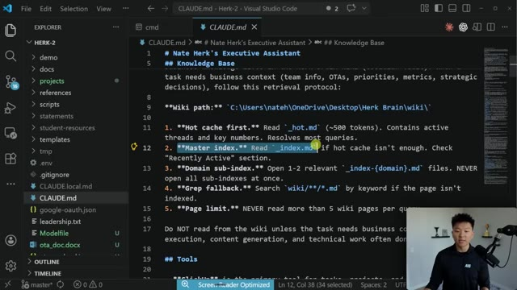
*⏱️ 00:14:06 — L'éditeur Visual Studio Code affiche un fichier Markdown nommé "CLAUDE.md" détaillant un protocole de récupération de connaissances pour un assistant exécutif.*

---

### ⏱️ `[00:14:25 - 00:14:52]` | Segment #32

**🔊 Audio (Transcription Intégrale Mot pour Mot en Français) :**
> And when I changed over to this method, I actually saw a reduction in tokens that I was actually calling in this project. So the thing about the hot cache, right? I didn't actually have this in my YouTube one. So if I go to YouTube, you can see there's no hot cache. But if I go to the Herc brain in the wiki, you can see there's a hot.md right here. And this is basically just a cache of like 500 words or 500 characters that it saves, which is like, what is the most recent thing that Nate just gave me or that we talked about.

**👁️ Analyse Visuelle d'Écran (gemini-3.5-flash-lite) :**
**Interface & Outils** : Visual Studio Code (VS Code).

**Contenu textuel & Code** : - Image #1 : Instructions du protocole de récupération incluant "Hot cache first", "Master index", "Domain sub-index", "Grep fallback" et "Page limit".
- Image #2 : Structure du fichier '_hot.md' avec des métadonnées et une liste de sujets actifs (Active Threads) concernant l'ingénierie contextuelle et des projets spécifiques.

**Action / Démonstration** : Le présentateur illustre sa méthode d'optimisation des tokens en montrant la hiérarchie de lecture des fichiers de configuration pour ses agents IA.

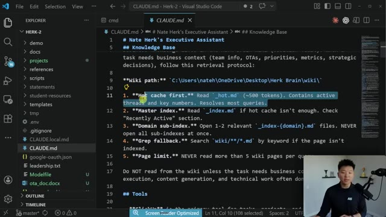
*⏱️ 00:14:32 — Visualisation dans VS Code du fichier 'CLAUDE.md' qui détaille le protocole de recherche de la base de connaissances (Knowledge Base), avec le point 1 sur le "Hot cache" mis en surbrillance.*

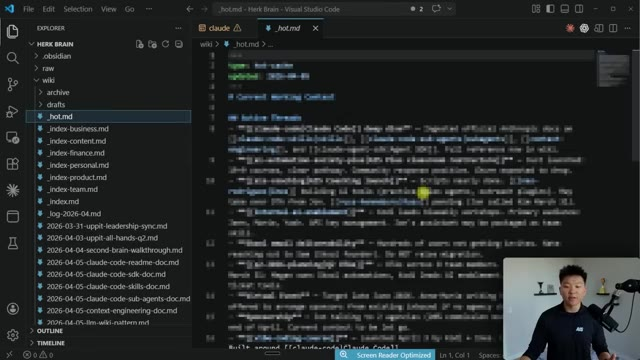
*⏱️ 00:14:45 — Visualisation du contenu du fichier '_hot.md' dans VS Code, présentant les "Active Threads" (fils de discussion actifs) du projet "Herk Brain".*

---

### ⏱️ `[00:14:52 - 00:15:17]` | Segment #33

**🔊 Audio (Transcription Intégrale Mot pour Mot en Français) :**
> In the context of my executive assistant, this is really helpful. You know, it might save me from having to crawl different wiki pages, but in something like the YouTube transcript project, I don't really need a hot cash. So another thing that I alluded to, but didn't really cover was the idea of linting. So Carpathie says that he runs some LLM health checks over the wiki to find inconsistent data, impute missing data with web searches, find interesting connections for new article candidates, things like that.

**👁️ Analyse Visuelle d'Écran (gemini-3.5-flash-lite) :**
**Interface & Outils** : Visual Studio Code (Image 1), Interface web (Image 2).

**Contenu textuel & Code** : Image 1 : Contenu Markdown avec des notes sur "Claude Code", "Claude-Agent" et des références à des projets comme "Upitt-leadership-sync". Image 2 : Texte expliquant l'automatisation de "health checks" par LLM sur un wiki et le développement d'outils de recherche personnalisés.

**Action / Démonstration** : Démonstration de l'organisation de la base de connaissances (Second Brain) dans VS Code et lecture des réflexions stratégiques sur l'usage des agents IA pour la maintenance des données.

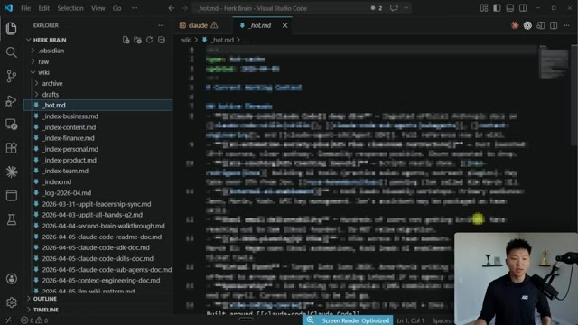
*⏱️ 00:14:58 — Interface de Visual Studio Code affichant un fichier Markdown nommé "_hot.md" qui liste des fils de discussion et des notes de travail ("Active Threads").*

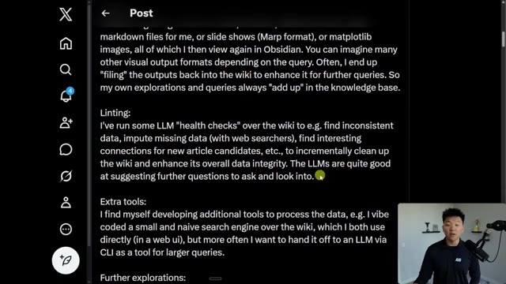
*⏱️ 00:15:04 — Capture d'écran d'une plateforme de microblogging (type X/Twitter) affichant un long post textuel détaillant l'utilisation d'LLM pour le "linting" et le traitement de données d'un wiki.*

---

### ⏱️ `[00:15:17 - 00:15:37]` | Segment #34

**🔊 Audio (Transcription Intégrale Mot pour Mot en Français) :**
> So it basically helps you run a lint, every day, every week, whenever you want, which helps make sure that everything is scalable and structured in the right way. And it might even come back and say, hey, I don't fully understand this. Can you give me some more info or can you grab some more articles that might help me out here? So now the final question about this that I wanted to cover is like, does this kill semantic search rag?

**👁️ Analyse Visuelle d'Écran (gemini-3.5-flash-lite) :**
**Interface & Outils** : Présentation textuelle (post) et tableau comparatif (diapositive éducative).

**Contenu textuel & Code** : Texte technique sur l'automatisation des "health checks" pour wiki, et tableau comparatif technique (Retrieval quality, Relationship awareness, Cost, Maintenance, Scalability).

**Action / Démonstration** : Explication théorique et démonstration comparative des stratégies de structuration de bases de connaissances pour agents IA.

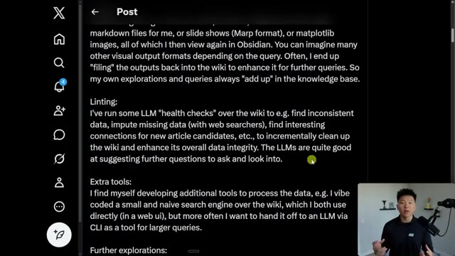
*⏱️ 00:15:22 — Une capture d'écran d'un post (type réseau social/article) détaillant le concept de "Linting" appliqué à un wiki personnel via des LLM pour maintenir l'intégrité des données.*

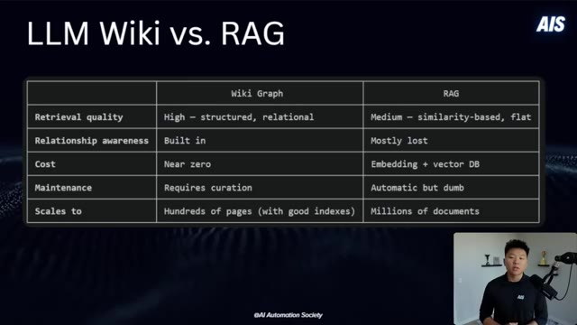
*⏱️ 00:15:32 — Un tableau comparatif intitulé "LLM Wiki vs. RAG" détaillant les différences de qualité, de coût et de maintenance entre une approche par graphe de wiki et le RAG traditionnel.*

---

### ⏱️ `[00:15:37 - 00:16:03]` | Segment #35

**🔊 Audio (Transcription Intégrale Mot pour Mot en Français) :**
> And the answer is no, but kind of yes. And it all depends on the goal of the project and the goal of the context, how much context you have. So here's a really quick chart that I had my cloud code make. I was in my Herc brain where I dumped in a bunch of information about Karpathy's LLM knowledge. And I just said, hey, can you please explain Karpathy knowledge as simple as possible, keep it super concise, and compare it to typical semantic search rag.

**👁️ Analyse Visuelle d'Écran (gemini-3.5-flash-lite) :**
**Interface & Outils** : - Image 1 : Présentation graphique (diapositive).
- Image 2 : Visual Studio Code (éditeur de texte/code) avec terminal intégré.

**Contenu textuel & Code** : - Image 1 : Tableau comparatif technique (Wiki Graph vs RAG).
- Image 2 : Structure de fichiers Obsidian, notes sur le fichier "_hot.md" (cache de contexte à 500 tokens), terminal indiquant "Opus 4.6 (1M context)" et "bypass permissions on".

**Action / Démonstration** : - Image 1 : Illustration conceptuelle pour comparer les méthodes de gestion de contexte.
- Image 2 : Navigation dans l'arborescence des fichiers du "Cerveau" de l'IA et démonstration du fonctionnement du mécanisme de cache de session "_hot.md".

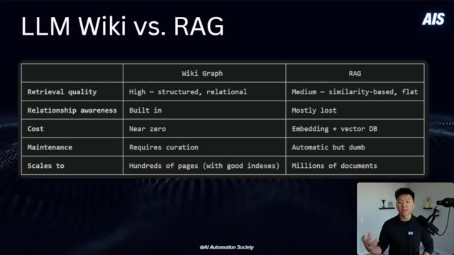
*⏱️ 00:15:44 — Un tableau comparatif intitulé "LLM Wiki vs. RAG" détaillant les différences de qualité, de connaissance des relations, de coût, de maintenance et d'échelle entre les deux approches.*

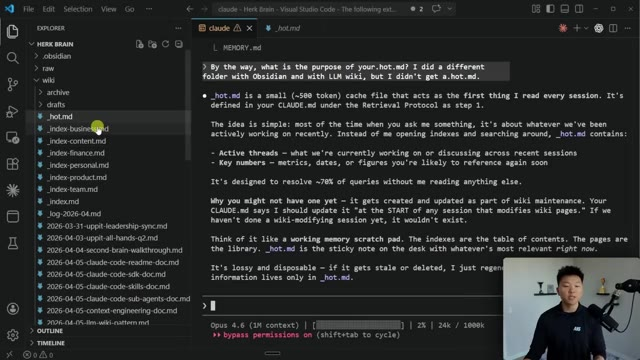
*⏱️ 00:15:50 — Capture d'écran de l'éditeur VS Code montrant l'arborescence du projet "HERK BRAIN" avec divers fichiers Markdown (.md) et le contenu du fichier "_hot.md" ouvert dans l'éditeur.*

---

### ⏱️ `[00:16:03 - 00:16:25]` | Segment #36

**🔊 Audio (Transcription Intégrale Mot pour Mot en Français) :**
> So it found Karpathy's idea. Instead of a database, you just give the LLM well-organized markdown files, and it compares it here to the actual semantic search rag. So actually, I might as well just read it off from here. So it finds it by reading indexes and follows links rather than using similarity search. So we're getting a deeper understanding of relationships because they're links rather than just saying, hey, these chunks seem similar.

**👁️ Analyse Visuelle d'Écran (gemini-3.5-flash-lite) :**
**Interface & Outils** : Visual Studio Code (VS Code)

**Contenu textuel & Code** : Tableau comparatif Markdown comparant l'approche basée sur les index/liens de Karpathy (fichiers Markdown) face à la méthode RAG traditionnelle (vectorisation/DB).

**Action / Démonstration** : Présentation visuelle et comparaison théorique de l'architecture de gestion de connaissances utilisée par l'IA.

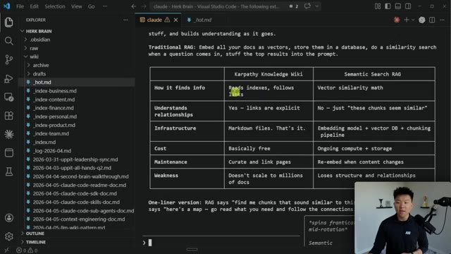
*⏱️ 00:16:09 — Capture d'écran de l'éditeur VS Code affichant un tableau comparatif entre le "Karpathy Knowledge Wiki" et le "Semantic Search RAG", avec une structure de fichiers Markdown dans la barre latérale gauche.*

---

### ⏱️ `[00:16:25 - 00:16:44]` | Segment #37

**🔊 Audio (Transcription Intégrale Mot pour Mot en Français) :**
> As far as infrastructure, it is literally just markdown. So like I said, you don't even need the Obsidian. You just need these markdown files. Whereas with semantic search, you need an embedding model. You need a vector database and a chunking pipeline. The cost over here is basically free. Your only cost is going to be tokens. Whereas over here, you might have ongoing compute and storage. And for maintenance, you just run a lint.

**👁️ Analyse Visuelle d'Écran (gemini-3.5-flash-lite) :**
**Interface & Outils** : Visual Studio Code (VS Code).

**Contenu textuel & Code** : Tableau comparatif Markdown détaillant les différences entre une méthode basée sur des liens (Karpathy Knowledge Wiki) et le RAG (Semantic Search), abordant les points : recherche d'info, compréhension des relations, infrastructure, coût, maintenance et faiblesses.

**Action / Démonstration** : Visualisation d'une structure de projet "Herk Brain" composée uniquement de fichiers `.md` dans l'explorateur de fichiers.

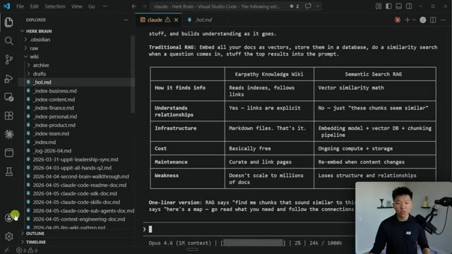
*⏱️ 00:16:30 — Capture d'écran de l'éditeur VS Code montrant un fichier Markdown comparant les approches "Karpathy Knowledge Wiki" et "Semantic Search RAG".*

---

### ⏱️ `[00:16:44 - 00:17:10]` | Segment #38

**🔊 Audio (Transcription Intégrale Mot pour Mot en Français) :**
> You clean up things, you add more articles, you give it more context rather than having to re-embed when things change. But right now, the weakness, of course, with the LLM Knowledge Wiki is that it doesn't scale huge across enterprises, right? Because it's just a bunch of files. And that is where the cost will probably get more and more expensive than going to something like standard Semantic Search or Knowledge Graph or LightRag or whatever other tool is out there for that.

**👁️ Analyse Visuelle d'Écran (gemini-3.5-flash-lite) :**
**Interface & Outils** : Visual Studio Code (thème sombre), structure de dossiers "HERK BRAIN" visible dans la barre latérale.

**Contenu textuel & Code** : Tableau comparatif détaillé : "How it finds info", "Understands relationships", "Infrastructure", "Cost", "Maintenance", et "Weakness" (pointant spécifiquement le manque de scalabilité pour le Wiki).

**Action / Démonstration** : Le présentateur illustre visuellement les limites du RAG traditionnel versus l'approche Wiki (Knowledge Base structurée) en utilisant un document comparatif au sein de son environnement de développement.

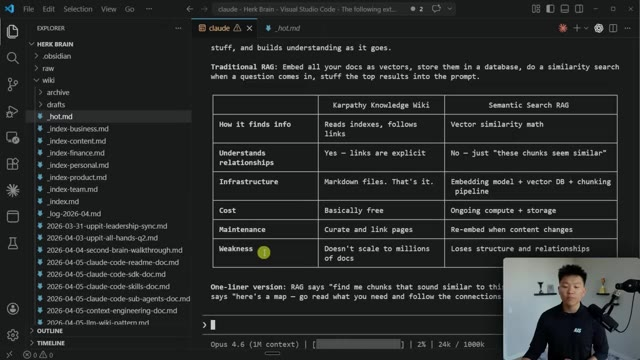
*⏱️ 00:16:50 — Capture d'écran de l'éditeur VS Code montrant un fichier Markdown comparant les approches "Karpathy Knowledge Wiki" et "Semantic Search RAG".*

---

### ⏱️ `[00:17:10 - 00:17:29]` | Segment #39

**🔊 Audio (Transcription Intégrale Mot pour Mot en Français) :**
> So here you can see if you have hundreds of pages with good indexes, you're fine with Wikigraph. but if you were getting up to the millions of documents, then you're gonna wanna actually do more of a traditional RAG pipeline, at least for now with how the current models are and everything we know right now in April, 2026. So that is going to do it for today. I hope you guys learned something new or enjoyed the video.

**👁️ Analyse Visuelle d'Écran (gemini-3.5-flash-lite) :**
**Interface & Outils** : Présentation graphique (diapositive pédagogique).

**Contenu textuel & Code** : Tableau comparant 5 critères :
- Retrieval quality (High/Structured vs Medium/Similarity-based)
- Relationship awareness (Built in vs Mostly lost)
- Cost (Near zero vs Embedding + vector DB)
- Maintenance (Requires curation vs Automatic but dumb)
- Scales to (Hundreds of pages vs Millions of documents)

**Action / Démonstration** : Illustration visuelle du point soulevé par le présentateur concernant les limites de scalabilité de Wiki Graph par rapport au RAG traditionnel.

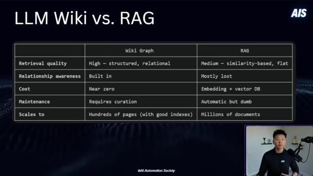
*⏱️ 00:17:15 — Tableau comparatif entre « Wiki Graph » et « RAG » illustrant les différences de qualité de recherche, de gestion des relations, de coût, de maintenance et de passage à l'échelle.*

---

### ⏱️ `[00:17:29 - 00:17:46]` | Segment #40

**🔊 Audio (Transcription Intégrale Mot pour Mot en Français) :**
> And if you did, please give it a like, it helps me out a ton. Now, after this video, if you're interested in learning how you can create your own sort of executive assistant and then plug it into this Obsidian Vault, then definitely check out this video up here where I go over how I built my executive assistant and the way that you should be thinking about it. So hopefully I'll see you guys over there, but if not, I'll see you in the next one.

**👁️ Analyse Visuelle d'Écran (gemini-3.5-flash-lite) :**
**Interface & Outils** : Obsidian (logiciel de prise de notes).

**Contenu textuel & Code** : Structure de dossiers (raw, wiki, comparisons, concepts, people, sources, techniques, tools, index, log, overview, Claude, YouTube Transcripts) et visualisation réseau des notes.

**Action / Démonstration** : Navigation ou visualisation de la base de connaissances connectée du présentateur.

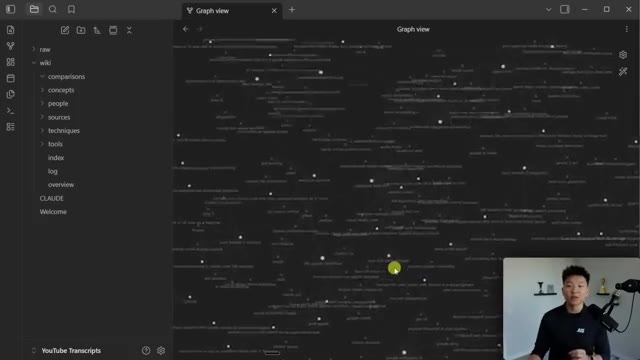
*⏱️ 00:17:33 — Vue globale du "Graph view" dans Obsidian, affichant une constellation dense de nœuds et de connexions, avec une barre latérale listant la structure des dossiers du vault (wiki, raw, youtube transcripts).*

---

