# 🎬 Planning In Claude Code Just Got a Huge Upgrade

> **Chaîne** : [Nate Herk | AI Automation](https://www.youtube.com/@nateherk/featured)  
> **Lien YouTube** : [https://www.youtube.com/watch?v=T4fXb3sbJIo](https://www.youtube.com/watch?v=T4fXb3sbJIo)  
> **Date de publication** : 20260406  
> **Durée** : 00:15:48  
> **Identifiant vidéo** : `T4fXb3sbJIo`  
> **Transcription & Analyse** : `whisper-v3-large-turbo+gemini-3.5-flash-lite`  

---

## 📌 Synthèse Exécutive & Outils

### 💡 Résumé
Dans cette vidéo intitulée **La planification dans Claude Code vient de recevoir une mise à niveau majeure**, Nate Herk décortique les capacités pratiques d'automatisation et de développement propulsées par les modèles de pointe.

### 🛠️ Outils, Modèles & Logiciels Présentés
- **Opus 5.5 & Claude Code** : Modèles d'ingénierie et agents de codage autonome.

### 🔑 Points Clés & Enseignements Stratégiques
- Optimiser le niveau d'effort et le raisonnement des modèles IA pour des résultats industriels.
- Automatiser les cycles de création logicielle de bout en bout.

---

## ⏱️ Chronologie & Transcription Complète Audio & Visuelle (Mot pour Mot)

### ⏱️ `[00:00:00 - 00:00:36]` | Segment #01

**🔊 Audio (Transcription Intégrale Mot pour Mot en Français) :**
> Donc juste ici, j'ai Cloud Code classique qui me prépare un plan, et il tourne depuis près de quatre minutes maintenant. Et dans ce terminal, il fait exactement le même plan, mais cette fois-ci, il le fait avec le mode Ultra Plan. Vous pouvez voir qu'il est écrit Suivre la progression dans Cloud Code sur le web, et juste ici, il est écrit Ultra Plan Prêt. Donc si je passe la souris dessus, que je clique sur Entrée, je peux examiner cela sur le web, et ça s'est terminé en environ une minute, alors que celui-ci est toujours en train de tourner et ça fait plus de quatre minutes maintenant. Et quand je vais sur cette session web, nous pouvons voir le plan réel. J'ai le contexte, j'ai ce qui existe déjà, la nouvelle approche avec de nouveaux fichiers à créer, les modifications, ainsi qu'une simple vérification finale. Cela me donne le plan d'une manière beaucoup plus structurée. J'obtiens aussi parfois

**👁️ Analyse Visuelle d'Écran (gemini-3.5-flash-lite) :**
**Interface & Outils** : VS Code (Terminal intégré), Interface web Claude Code (Claude.ai).

**Contenu textuel & Code** : Commandes terminal : `/ultraplan I need to figure out the best way to be able to analyze my YouTube comments...`. Plan détaillé : étapes d'automatisation (Daily 8am trigger, scripts Python, analyse de signaux, cross-ref).

**Action / Démonstration** : Exécution d'une commande d'agent IA, activation du mode Ultra Plan, et revue visuelle d'un plan de développement généré par l'IA.

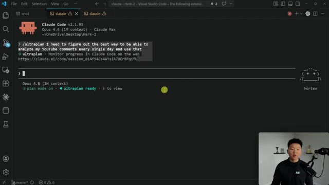
*⏱️ 00:00:09 — Interface du terminal dans VS Code montrant l'activation du mode "ultraplan" dans Claude Code (v2.1.92) avec une requête utilisateur sur l'analyse des commentaires YouTube.*

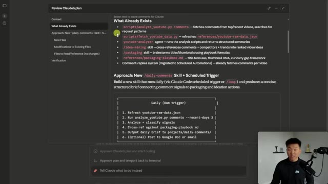
*⏱️ 00:00:27 — Interface web "Review Claude's plan" affichant un récapitulatif détaillé d'un plan généré, incluant "What Already Exists" et une approche structurée pour un nouveau script automatisé.*

---

### ⏱️ `[00:00:36 - 00:01:10]` | Segment #02

**🔊 Audio (Transcription Intégrale Mot pour Mot en Français) :**
> des diagrammes basés sur ce qu'il est réellement en train de planifier. Et ici, je peux aller de l'avant et laisser des réactions avec des émojis à certains endroits, ce qui, je trouve, est une touche agréable. Ou je pourrais aller de l'avant et commenter des éléments spécifiques. Comme vous pouvez le voir juste ici, je pourrais ajouter un commentaire. Et ensuite, quand je veux envoyer ces commentaires, Claude va revenir en arrière et faire une autre itération du plan. Ou je pourrais cliquer sur ce bouton, qui est d'approuver le plan et de me téléporter de retour vers le terminal. Donc je fais ça et maintenant il va l'renvoyer. Et si je retourne dans cette session juste ici, nous pouvons maintenant voir que le plan a été reçu et nous pouvons soit l'implémenter ici, soit nous pourrions commencer une nouvelle conversation et l'implémenter là-bas. Donc si je clique simplement là-dessus, nous avons maintenant ce plan complet que Claude Code sur le web a effectivement

**👁️ Analyse Visuelle d'Écran (gemini-3.5-flash-lite) :**
**Interface & Outils** : Interface web de Claude et Visual Studio Code (extension Claude Code).

**Contenu textuel & Code** : Plan détaillé de l'agent d'analyse de commentaires YouTube ("Daily Comment Analysis Feedback Loop"), commandes de Claude Code et options de validation du plan ("Implement here", "Start new session", "Cancel").

**Action / Démonstration** : Examen du plan généré par Claude et sélection de l'option d'implémentation pour l'automatisation quotidienne.

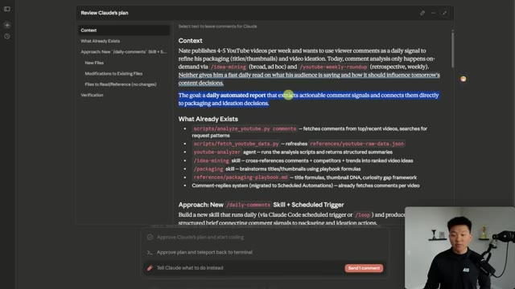
*⏱️ 00:00:44 — Interface web de Claude affichant le plan détaillé du projet avec le contexte et les objectifs d'analyse des commentaires YouTube.*

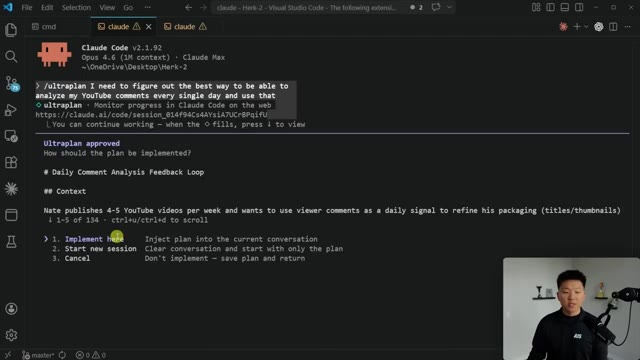
*⏱️ 00:01:01 — Éditeur VS Code affichant le terminal intégré avec l'interface de Claude Code et les options d'implémentation du plan (Ultraplan).*

---

### ⏱️ `[00:01:10 - 00:01:34]` | Segment #03

**🔊 Audio (Transcription Intégrale Mot pour Mot en Français) :**
> construit pour nous et il est en train d'être développé ici même, localement. Et pendant tout ce temps, cette section originale continue de planifier. Elle continue de me poser des questions et elle avance tout simplement très lentement. Maintenant, je ne dis pas que la vitesse est toujours la chose la plus importante, mais si vous obtenez de la vitesse et une plus haute qualité, alors c'est une bonne combinaison. Et ce que vous remarquerez également, c'est que dans cette session du cloud, où elle envoie mes requêtes pour être ultra-planifiées, elle est toujours capable de voir ce qui se trouve à l'intérieur de notre répertoire parce qu'elle se synchronise avec Git.

**👁️ Analyse Visuelle d'Écran (gemini-3.5-flash-lite) :**
**Interface & Outils** : VS Code (terminal intégré) et interface web de planification d'agent (Nate Herk Cloud / Ultraplan).

**Contenu textuel & Code** : Texte interactif d'un agent IA listant les pièces existantes d'un projet, identifiant les lacunes et posant des choix multiples pour concevoir une automatisation d'analyse de commentaires YouTube.

**Action / Démonstration** : L'agent IA analyse le répertoire de travail, élabore un plan d'architecture et pose des questions à l'utilisateur pour affiner la stratégie de développement.

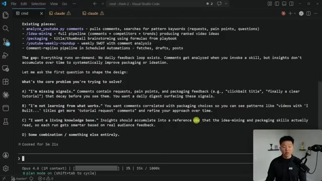
*⏱️ 00:01:16 — Interface de VS Code montrant un terminal avec une conversation d'agent IA interactif (Opus 4.6) posant des questions de conception sur l'analyse des commentaires YouTube.*

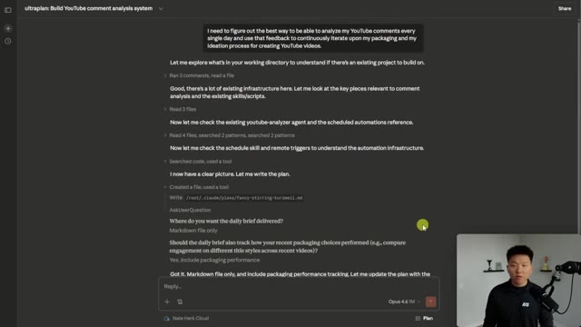
*⏱️ 00:01:28 — Interface d'une application web de planification (« ultraplan ») affichant le déroulement d'une planification d'agent IA avec des questions interactives sur l'automatisation des commentaires.*

---

### ⏱️ `[00:01:35 - 00:02:09]` | Segment #04

**🔊 Audio (Transcription Intégrale Mot pour Mot en Français) :**
> Donc juste ici, ça commence par explorer ce qu'il y a dans le répertoire pour voir sur quoi il peut s'appuyer. Et il a été capable de trouver des compétences et des scripts existants et a juste pu les exploiter et les utiliser dans le plan. Donc en gros, tout cela est grâce au nouveau genre de fonctionnalité secrète appelée ultraplan. Planifiez dans le cloud avec ultraplan. Vous démarrez un plan depuis votre CLI, vous le rédigez sur le web, puis vous l'envoyez de nouveau vers le terminal, ou vous pouvez simplement l'exécuter à distance également. Et c'est vraiment intéressant. J'ai fait une tonne de tests différents entre les mêmes invites localement et les mêmes invites pour être ultraplanifié. Et non seulement ultraplanifié est plus rapide pour planifier, mais pour une certaine raison, c'est beaucoup plus rapide pour exécuter aussi. Et je pense que c'est juste

**👁️ Analyse Visuelle d'Écran (gemini-3.5-flash-lite) :**
**Interface & Outils** : Interface web d'ultraplan et documentation Claude Code

**Contenu textuel & Code** : Texte de prompt demandant d'analyser les commentaires YouTube et journaux d'exploration du répertoire par l'IA

**Action / Démonstration** : Exploration des fichiers du répertoire et interaction de l'utilisateur avec l'interface de planification cloud

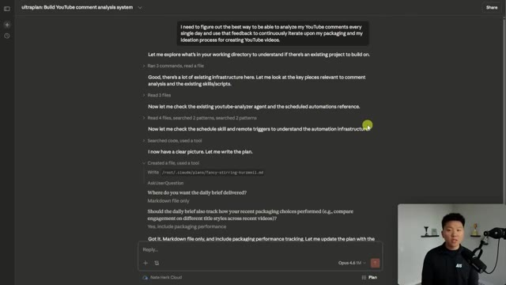
*⏱️ 00:01:43 — Interface web 'ultraplan' montrant l'agent d'IA en train d'explorer le répertoire et de poser des questions interactives sur l'analyse de commentaires YouTube.*

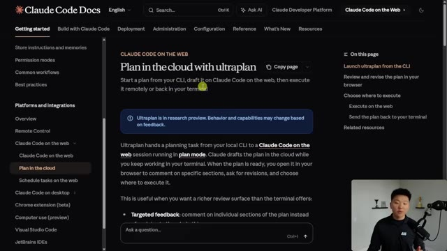
*⏱️ 00:01:52 — Page de documentation officielle 'Claude Code Docs' expliquant la fonctionnalité 'Plan in the cloud with ultraplan'.*

---

### ⏱️ `[00:02:09 - 00:02:27]` | Segment #05

**🔊 Audio (Transcription Intégrale Mot pour Mot en Français) :**
> parce que le plan est si clair que les agents ont beaucoup plus de facilité localement à l'exécuter et à tout construire. Et je vais vous montrer un exemple de cela dans un moment. C'est utile lorsque vous voulez une surface de révision plus riche que ce que le terminal offre en matière de commentaires ciblés, parce que vous pouvez commenter sur des sections individuelles. Vous obtenez également un plan de style document plutôt sympa, plutôt que dans le terminal.

**👁️ Analyse Visuelle d'Écran (gemini-3.5-flash-lite) :**
**Interface & Outils** : Navigateur web affichant la documentation de Claude Code Docs.

**Contenu textuel & Code** : Texte de documentation décrivant la planification cloud avec "ultraplan", les modes de planification, ainsi qu'un encadré d'avertissement sur sa version en préversion de recherche.

**Action / Démonstration** : Navigation et lecture de la documentation officielle présentant la surface de révision web pour les plans d'agents.

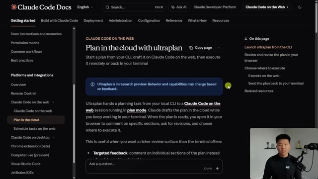
*⏱️ 00:02:13 — Capture d'écran de la documentation officielle de Claude Code affichant la page sur la fonctionnalité "Plan in the cloud with ultraplan".*

---

### ⏱️ `[00:02:27 - 00:02:51]` | Segment #06

**🔊 Audio (Transcription Intégrale Mot pour Mot en Français) :**
> Parfois, ça peut juste ressembler à des lignes de texte. C'est un peu brouillon de voir la structure. Vous avez aussi la rédaction mains libres et une exécution flexible. Donc c'est vraiment simple. Vous faites juste un slash ultra plan, puis votre invite. Ou si vous avez juste le mot ultra plan dedans, il vous demandera si vous voulez faire un ultra plan. Donc si je reviens juste ici et que vous voyez que j'ai littéralement just tapé le mot ultra plan, ça s'allume de la même manière que ça s'allumerait si vous faites quelque chose comme UltraThink.

**👁️ Analyse Visuelle d'Écran (gemini-3.5-flash-lite) :**
**Interface & Outils** : Documentation web Claude Code et éditeur de code / interface en ligne de commande.

**Contenu textuel & Code** : Texte de documentation sur 'Launch ultraplan from the CLI' et interface de terminal affichant 'plan mode on'.

**Action / Démonstration** : Navigation dans la documentation officielle et présentation des options du mode plan et de l'interface en ligne de commande.

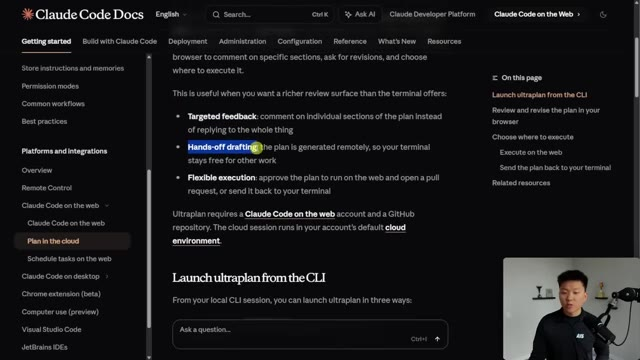
*⏱️ 00:02:33 — Documentation officielle de Claude Code affichant les fonctionnalités de l'outil 'ultraplan' avec des puces explicatives sur les retours ciblés et la rédaction mains libres.*

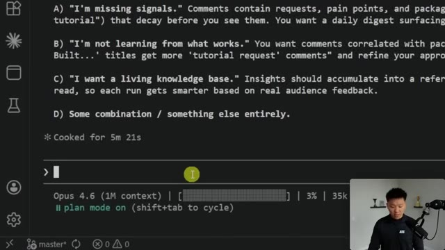
*⏱️ 00:02:45 — Interface d'un éditeur ou terminal affichant du texte généré par l'IA et le mode plan activé avec le modèle Opus 4.6.*

---

### ⏱️ `[00:02:51 - 00:03:10]` | Segment #07

**🔊 Audio (Transcription Intégrale Mot pour Mot en Français) :**
> Donc peut-être que vous utilisez UltraThink et UltraPlan, vous consommez toute votre session en une seule invite. Parce qu'évidemment, l'UltraPlan utilise un tout petit peu plus de jetons. Je vous montrerai un exemple de cela plus tard. Nous ne savons pas exactement combien, mais de la manière dont il se lance et qu'il utilise beaucoup plus de ressources de calcul dans le cloud, il va utiliser plus de jetons que si vous faites simplement un plan normal ici.

**👁️ Analyse Visuelle d'Écran (gemini-3.5-flash-lite) :**
**Interface & Outils** : Éditeur de code (probablement VS Code ou similaire) avec une interface de ligne de commande ou de prompt intégrée.

**Contenu textuel & Code** : Texte listant des options de signaux et retours (A, B, C, D), suivi d'une invite de commande saisie : 'ultraplan ultrathink', et d'informations sur le modèle 'Opus 4.6 (1M context) | plan mode on'.

**Action / Démonstration** : Saisie des commandes ultraplan et ultrathink dans l'interface de l'éditeur pour configurer le mode d'exécution de l'agent.

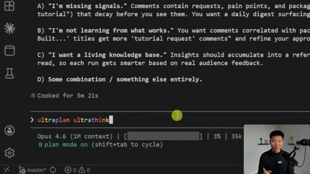
*⏱️ 00:02:56 — Capture d'écran montrant l'interface d'un éditeur de code sombre avec une zone de texte de commande contenant les mots 'ultraplan ultrathink' et des options de modèle en bas.*

---

### ⏱️ `[00:03:10 - 00:03:48]` | Segment #08

**🔊 Audio (Transcription Intégrale Mot pour Mot en Français) :**
> Mais encore une fois, la planification est tellement, tellement importante. Elle met toute la structure et le chemin de votre projet sur la bonne voie. Donc, parfois, cela vaut vraiment la peine de dépenser plus de jetons au départ afin de le lancer. Je pense toujours à cette citation d'Abraham Lincoln : « Donnez-moi six heures pour abattre un arbre, et je passerai les quatre premières à aiguiser la hache. » C'est donc fondamentalement notre planification. Il est également important de savoir que cela doit être fait dans l'interface en ligne de commande. Si nous sommes ici dans l'application de bureau et que nous essayons de faire quelque chose comme un plan ultra, construis-moi un guide d'entraînement de cinq jours. Si nous lançons cela, nous n'allons pas obtenir toute cette fonctionnalité de plan ultra dans le nuage. En fait, cela ne fait tout simplement rien. Et c'est exactement la même chose si nous passons à

**👁️ Analyse Visuelle d'Écran (gemini-3.5-flash-lite) :**
**Interface & Outils** : Éditeur de code (type VS Code ou interface similaire) avec mode plan et modèle Opus 4.6.

**Contenu textuel & Code** : Texte à options (A, B, C, D) et ligne de commande avec "ultraplan ultrathink" sur l'image 1 ; invite de commande "Find a small todo in the codebase and do it" sur l'image 2.

**Action / Démonstration** : Saisie d'une commande de planification et de réflexion pour configurer l'exécution d'un agent IA.

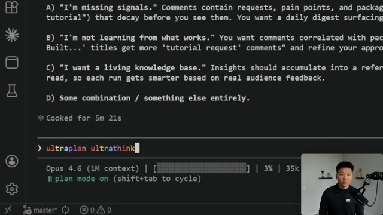
*⏱️ 00:03:20 — Interface d'un éditeur de code affichant du texte généré avec des options de planification et de réflexion ("ultraplan ultrathink").*

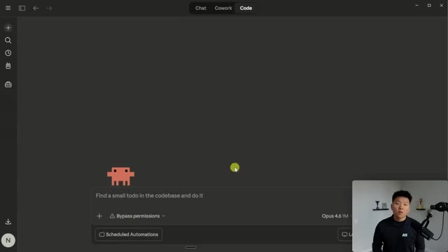
*⏱️ 00:03:29 — Interface de l'application montrant l'onglet "Code" avec un champ de saisie de prompt et une icône de petit personnage pixelisé.*

---

### ⏱️ `[00:03:48 - 00:04:20]` | Segment #09

**🔊 Audio (Transcription Intégrale Mot pour Mot en Français) :**
> to VS Code, if we're doing it in the extension rather than in the terminal, UltraPlan, and then we just, let's just copy in the exact same thing. It's basically just going to do nothing. So you have to use it in the CLI. Okay, so quick explanation of how this actually works. And then we're going to jump into an actual example that I ran and show you guys what it looks like. So we start talking to Cloud Code on our machine. Push an UltraPlan, it sends that to the cloud where that's where Cloud will spin up, you know, different agents there using Opus and it will do a really in-depth plan. Once that's ready, we're able to review and we have this kind of feedback loop,

**👁️ Analyse Visuelle d'Écran (gemini-3.5-flash-lite) :**
**Interface & Outils** : Visual Studio Code (extension Claude), Schéma explicatif (Slide).

**Contenu textuel & Code** : Texte de prompt : "/ultraplan build me a five-day workout guide." / Schéma : Flux "CLI (Launch) -> Cloud (Plan Mode) -> Browser (Review) -> Teleport (Execute)".

**Action / Démonstration** : Démonstration de l'utilisation de l'outil via une interface d'extension VS Code, suivie d'une explication conceptuelle du fonctionnement du pipeline.

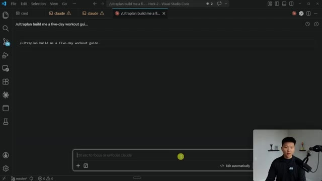
*⏱️ 00:03:56 — Interface de Visual Studio Code affichant une zone de saisie pour l'extension Claude, avec une requête utilisateur en attente.*

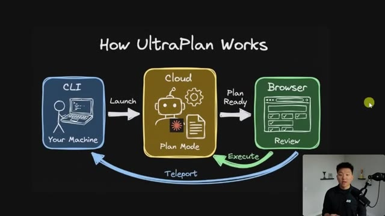
*⏱️ 00:04:04 — Diagramme illustratif intitulé "How UltraPlan Works" expliquant le flux de travail entre la CLI, le Cloud et le navigateur.*

---

### ⏱️ `[00:04:20 - 00:04:43]` | Segment #10

**🔊 Audio (Transcription Intégrale Mot pour Mot en Français) :**
> but then we can teleport it all the way back to our machine if we want that to happen there. Like I said, you can launch it by doing slash ultra plan. You can just have the keyword in there, or you could, you know, from an existing plan, like you already have one written up in locally, you could say, actually, I want to revise this in the cloud with ultra plan. And then of course, you have that review loop. You can do comments and you can do emojis, which is a nice touch.

**👁️ Analyse Visuelle d'Écran (gemini-3.5-flash-lite) :**
**Interface & Outils** : Diagramme explicatif (type tableau blanc/infographie).

**Contenu textuel & Code** : Texte affiché : "/ultraplan", "Keyword", "From Plan", "Cloud Session", "Drafting", "Needs Input", "Ready".

**Action / Démonstration** : Présentation visuelle du concept théorique et des étapes de lancement du processus UltraPlan par l'IA.

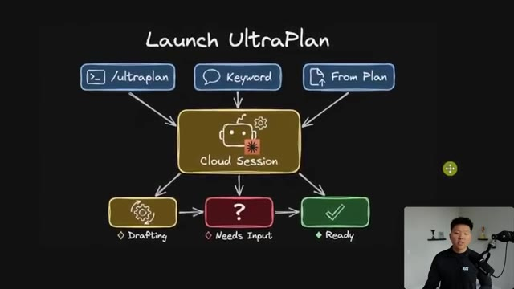
*⏱️ 00:04:26 — Un schéma illustrant le flux de travail "Launch UltraPlan", montrant trois méthodes d'activation (commande, mot-clé, ou plan existant) menant à une "Cloud Session", suivie de trois états de processus possibles : Drafting, Needs Input, et Ready.*

---

### ⏱️ `[00:04:43 - 00:05:11]` | Segment #11

**🔊 Audio (Transcription Intégrale Mot pour Mot en Français) :**
> All right. So let me show you guys an example of this. So I have ultra plan on the right. I have a regular plan on the left and I gave both of these a huge spec about building us a dashboard. So I used ultra plan over here, paste it in. I said, do not use super power skill because I didn't want the local version to use that. I wanted to just get raw, you know, keep the variables the same. And then I wanted to give it to us on a local host. So I'm going to shoot this off. You see on the right hand side, it says, do you want to do this in the cloud? I said, yes. On the left hand side, it just goes straight into plan mode. And once again, they got the exact same prompts.

**👁️ Analyse Visuelle d'Écran (gemini-3.5-flash-lite) :**
**Interface & Outils** : VS Code (fenêtre divisée en deux terminaux), Claude Code CLI.

**Contenu textuel & Code** : Commandes saisies : "/clear" puis "/ultraplan" avec le prompt spécifiant "Do not use superpowers skill" et "Serve on localhost:5112". Informations sur le modèle utilisé (Opus 4.6).

**Action / Démonstration** : Le présentateur exécute une comparaison de performance entre un plan standard et le mode "ultraplan" de l'agent Claude Code pour la création d'un tableau de bord.

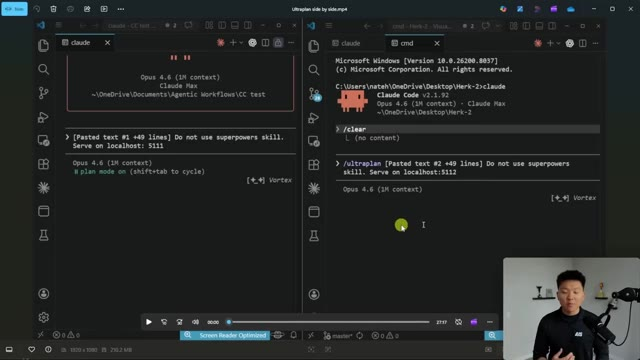
*⏱️ 00:04:50 — Comparaison côte à côte de deux instances de terminal dans VS Code utilisant Claude Code, l'une en mode standard à gauche et l'autre avec la commande "/ultraplan" à droite.*

---

### ⏱️ `[00:05:11 - 00:05:48]` | Segment #12

**🔊 Audio (Transcription Intégrale Mot pour Mot en Français) :**
> So here is the link I open this up and it takes me to the cloud where it's actually going to start building out the plan right here As you can see it's checking the directory to see what's available and then over here It's just you know kind of doing the same thing getting acclimated with the environment Okay So at this point we're about two minutes in right and you can see that I got the plan already on this right hand side So I click through it a bit. We have different tabs We also have like a little diagram and it looks really good So what I do is I end up sending this back to the terminal as you can see right here and then it gets brought back into our local session right here. Okay, so now we're at the 14 minute mark and the ultra plan version is already done. The local host is spun up, so not only did

**👁️ Analyse Visuelle d'Écran (gemini-3.5-flash-lite) :**
**Interface & Outils** : Visual Studio Code (avec extension Claude Code), Navigateur web (Ultraplan).

**Contenu textuel & Code** : Spécifications techniques pour "PulseBoard" (React, Vite, Tailwind, Node.js, SQLite), commandes Bash pour vérifier les versions de Node et npm, et logs d'exploration de répertoire.

**Action / Démonstration** : L'agent IA analyse le répertoire de travail et prépare l'architecture du projet avant de commencer le développement.

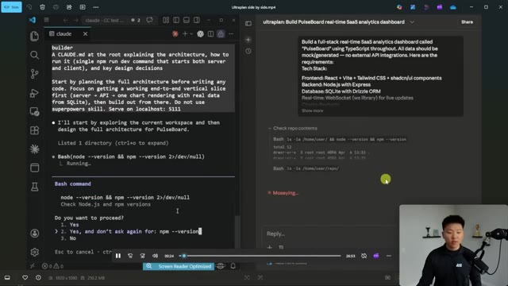
*⏱️ 00:05:21 — Interface divisée en deux colonnes : à gauche l'éditeur VS Code avec une interface de discussion (Claude Code), à droite une interface web de planification (Ultraplan) détaillant la construction d'un tableau de bord SaaS.*

---

### ⏱️ `[00:05:48 - 00:06:21]` | Segment #13

**🔊 Audio (Transcription Intégrale Mot pour Mot en Français) :**
> it create the plan, but it also built everything out. Whereas this regular plan mode has been going for 12 minutes and still hasn't even given me a plan to review yet. Then finally, a few minutes later, we're at the 15 minute mark. This is when we actually finally get the plan from the local session. But you can see at the 26, 27 minute mark, it is still being built out. So I end up stopping this recording to just wait until it's actually done. So now I'm going to switch over to the actual live reaction of me looking at the differences in the two dashboards to see which one really built it out better. Okay. So just the regular plan mode is finally done. It's really

**👁️ Analyse Visuelle d'Écran (gemini-3.5-flash-lite) :**
**Interface & Outils** : VS Code (fenêtre divisée avec terminaux intégrés).

**Contenu textuel & Code** : Commandes bash, logs d'exécution (utilisation d'outils, jetons consommés, temps écoulé), et instructions pour lancer l'application (npm run dev).

**Action / Démonstration** : Comparaison de la vitesse d'exécution entre deux sessions, l'une en attente de plan ("plan mode on") et l'autre ayant déjà lancé le serveur local.

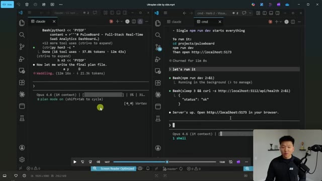
*⏱️ 00:05:56 — Comparaison côte à côte de deux instances de terminal dans VS Code montrant l'exécution et la progression d'un agent IA (Opus 4.6).*

---

### ⏱️ `[00:06:21 - 00:06:56]` | Segment #14

**🔊 Audio (Transcription Intégrale Mot pour Mot en Français) :**
> weird. I normally stand in these videos, but I had to sit because this took honestly like 45 minutes. I'm not sure what was going on, but this thing on the right side, we did ultra plan, the plan finished in like five and then it executed everything and built everything in, you know like another five minutes so about 10 to 15 minutes total over here and on this side it literally took half the time to plan and then half the time to build like it took a long time so anyways we have the two dashboards here let's open up the regular plan mode dashboard so let me open this up you can see we have our pulse board we have a nice little graphic here we have some

**👁️ Analyse Visuelle d'Écran (gemini-3.5-flash-lite) :**
**Interface & Outils** : VS Code avec l'interface de l'agent de développement IA "Opus 4.6".

**Contenu textuel & Code** : Scripts Bash (kill-port, npm run dev, curl santé), modifications de fichiers de configuration (port 5173 vers 5174), et statuts d'exécution de serveur local.

**Action / Démonstration** : L'agent exécute le déploiement du projet "PulseBoard", tue les processus existants sur les ports 5111/5173, met à jour la configuration du serveur et vérifie la disponibilité de l'API via curl.

*⏱️ 00:06:30 — Une capture d'écran montrant une interface VS Code divisée en deux volets, utilisant l'outil "Opus" (agent de développement IA). À gauche, le journal d'exécution d'un workflow, et à droite, une modification de configuration de port et des commandes bash en cours d'exécution.*

---

### ⏱️ `[00:06:56 - 00:07:18]` | Segment #15

**🔊 Audio (Transcription Intégrale Mot pour Mot en Français) :**
> stats like mrr annual run rate total customers churn rate we can change this between all time 30 days, 90 days, six months, one year. We have different tabs on the left. We can do revenue and see different tiers. We can also see enterprise and pro top 20 accounts. Obviously all this is mock data. We've got our customers here with a nice chart and by tier. And then we have support.

**👁️ Analyse Visuelle d'Écran (gemini-3.5-flash-lite) :**
**Interface & Outils** : Application SaaS de reporting et d'analytique financière appelée "PulseBoard".

**Contenu textuel & Code** : Données simulées incluant : Monthly Recurring Revenue ($74,328), Annual Run Rate ($891.9K), Total Customers (1,226), Churn Rate (3.3%), et liste de comptes clients avec MRR et LTV associés.

**Action / Démonstration** : Navigation dans le menu latéral gauche pour basculer entre les sections "Overview" et "Revenue" et démonstration des filtres temporels (30 jours à All Time).

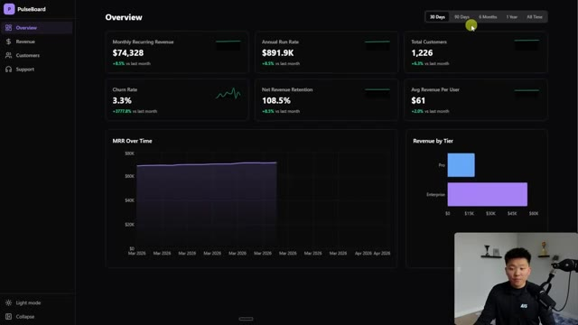
*⏱️ 00:07:01 — Tableau de bord "PulseBoard" montrant une vue d'ensemble (Overview) avec des indicateurs clés (MRR, taux de désabonnement, clients) et des filtres temporels.*

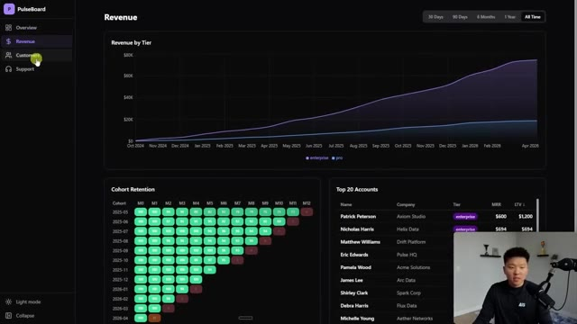
*⏱️ 00:07:12 — Interface "PulseBoard" sur la page Revenue, affichant l'évolution des revenus par niveau (Pro vs Enterprise), une heatmap de rétention de cohorte et une liste des 20 comptes principaux.*

---

### ⏱️ `[00:07:18 - 00:07:49]` | Segment #16

**🔊 Audio (Transcription Intégrale Mot pour Mot en Français) :**
> So resolution time, tickets by category, distribution. We can do light mode or dark mode. And that all looks pretty decent. These charts look a little bit weird in light mode. But anyways, that is the plan version. Let's open up the ultra plan version on a different local host. This one, obviously, they're going to have very similar features as far as what we're looking at with the data. Similar statistics up here, similar charts, everything like that. If we go to 30 days, 90 days, six months, one year, that all loads in good.

**👁️ Analyse Visuelle d'Écran (gemini-3.5-flash-lite) :**
**Interface & Outils** : Application web "PulseBoard" (Tableau de bord SaaS).

**Contenu textuel & Code** : Métriques : CSAT (3.6/5), tickets ouverts (1448), temps moyen de résolution (20.6h), graphiques de tendance, distribution CSAT et feed de tickets en direct. Métriques financières : MRR (141.6K), ARR (1.7M), taux de désabonnement, graphiques de croissance des revenus et revenus par plan (Enterprise, Pro).

**Action / Démonstration** : Navigation et démonstration du tableau de bord PulseBoard, passage du mode clair au mode sombre et comparaison des vues "Plan" vs "Ultra Plan".

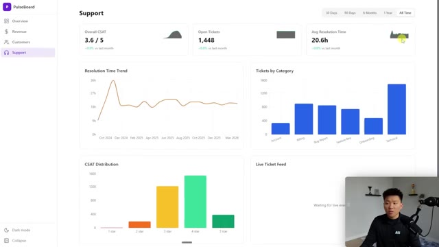
*⏱️ 00:07:26 — Interface tableau de bord "PulseBoard" en mode clair affichant les métriques de support client (CSAT, temps de résolution, tickets par catégorie).*

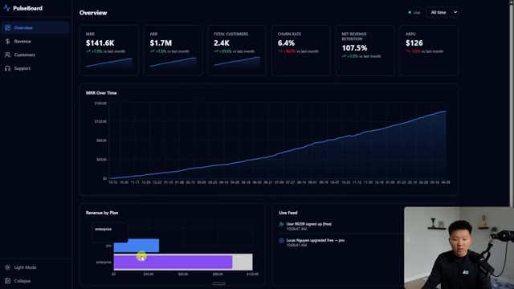
*⏱️ 00:07:41 — Interface tableau de bord "PulseBoard" en mode sombre affichant une vue d'ensemble financière (MRR, ARR, churn) et les revenus par plan.*

---

### ⏱️ `[00:07:49 - 00:08:11]` | Segment #17

**🔊 Audio (Transcription Intégrale Mot pour Mot en Français) :**
> If we go down to revenue, we can see we also have a cohort retention. We have enterprise and pro and we got some our 20 accounts there Customers, obviously we've got the same exact type of layout And the support Over here if we go to light mode, let's see what these look like These all still look Very very solid. So I mean it's not a huge difference, right?

**👁️ Analyse Visuelle d'Écran (gemini-3.5-flash-lite) :**
**Interface & Outils** : Dashboard analytique web nommé "PulseBoard".

**Contenu textuel & Code** : Métriques SaaS : rétention de cohortes, données clients (noms, emails, niveaux d'abonnement), entonnoir de conversion (Signup, Activation, Paid Conversion, Expansion), graphiques de croissance nette (New vs Churned).

**Action / Démonstration** : Navigation dans les différentes sections du dashboard (Revenue vs Customers) et démonstration du changement de thème visuel (Dark Mode vers Light Mode).

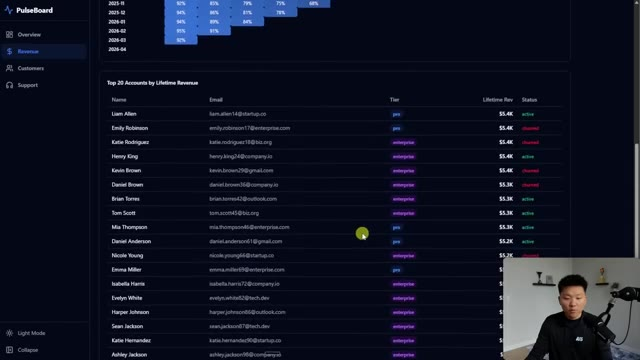
*⏱️ 00:07:55 — Interface sombre "PulseBoard" affichant un tableau de rétention des cohortes et une liste détaillée des "Top 20 Accounts" avec les colonnes Nom, Email, Tier (Pro/Enterprise), Revenu et Statut (Active/Churned).*

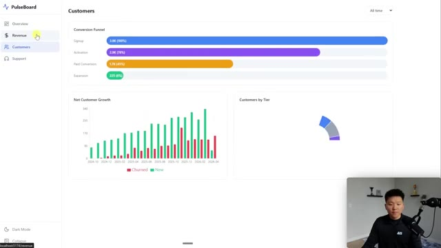
*⏱️ 00:08:05 — Interface claire (Light Mode) "PulseBoard" montrant une page "Customers" avec un entonnoir de conversion, un graphique à barres sur la croissance nette des clients et un diagramme en arc pour la répartition par niveau.*

---

### ⏱️ `[00:08:11 - 00:08:43]` | Segment #18

**🔊 Audio (Transcription Intégrale Mot pour Mot en Français) :**
> And for something like a dashboard like this from an aesthetic point of view It's kind of hard to tell like which one objectively between these two did better if we wanted to look at things like how accurate the data is being pulled in or reflected or how quick things load up or how buggy it is we'd have to do some deeper investigating but also take a look at this in the local plan version it took 131 000 tokens the ultra plan version took 82 000 tokens now of course the bulk of the planning work was done in the cloud so those tokens don't count you guys saw earlier when i was doing this this is the section where we did our

**👁️ Analyse Visuelle d'Écran (gemini-3.5-flash-lite) :**
**Interface & Outils** : Visual Studio Code (utilisant l'extension Claude Code / Opus 4.6).

**Contenu textuel & Code** : Scripts de déploiement (Bash), commandes `kill-port`, logs d'exécution du serveur (`npm run dev`), modifications de ports réseau (5173 vers 5174), et état du health check de l'API.

**Action / Démonstration** : Exécution et débogage de processus d'agent IA pour tester la mise en ligne d'une application dashboard.

*⏱️ 00:08:19 — Comparaison côte à côte de deux instances de l'interface Claude Code dans Visual Studio Code, affichant des logs d'exécution, des modifications de fichiers de configuration (ports) et des interactions système pour le lancement d'un dashboard nommé PulseBoard.*

---

### ⏱️ `[00:08:43 - 00:09:17]` | Segment #19

**🔊 Audio (Transcription Intégrale Mot pour Mot en Français) :**
> ultra plan on the web and I tried to run a slash cost to see how much this took but it wasn't working so we don't know exactly but I will say it's using more tokens than the local so it looks like this is using 50,000 more tokens I'm assuming that the planning section for the ultra plan took at least 50k but it's hard for me to say exactly but I think that the plan was so much better because for some reason it was able to execute on the plan so much quicker and better and they were both using obviously the exact same model. In all the other tests that I've done, Ultraplan has always been quicker. I mean, in the cloud, there's so much more compute compared to what might be going on

**👁️ Analyse Visuelle d'Écran (gemini-3.5-flash-lite) :**
**Interface & Outils** : VS Code avec l'interface Claude Code (CLI).

**Contenu textuel & Code** : Commandes bash pour le nettoyage des ports (npx kill-port), exécution de serveurs de développement (npm run dev), vérification de santé via curl, et modification de configuration de port (port 5174). Affichage des statistiques de contexte (Opus 4.6, 1M context, utilisation en tokens).

**Action / Démonstration** : L'agent exécute le cycle de vie complet de l'application : arrêt des anciens processus, lancement du serveur de développement et validation du déploiement via un appel API local.

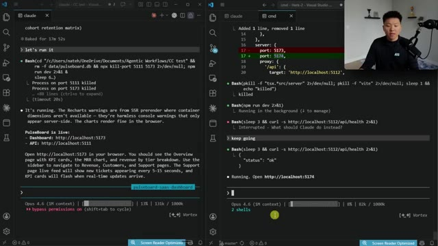
*⏱️ 00:08:52 — Une vue scindée (split-screen) de l'interface VS Code montrant deux sessions de Claude Code en interaction avec un terminal pour la gestion de processus et le déploiement d'une application SaaS.*

---

### ⏱️ `[00:09:17 - 00:09:52]` | Segment #20

**🔊 Audio (Transcription Intégrale Mot pour Mot en Français) :**
> here on my device. But yeah, like this was a noticeable difference, not only with the plan, but when it came to the actual execution. Like I said, the execution over here was maybe maybe 10 minutes. The execution over here was upwards of 30 minutes. Okay. So I tried running some experiments for you guys. I did a session with API billing and I ran a local plan, as you can see. And this ended up costing me about 1.5 million tokens in and 23,000 tokens out and a mix between Haiku and Opus. Now, unfortunately, it doesn't let you do the ultra plan with API billing

**👁️ Analyse Visuelle d'Écran (gemini-3.5-flash-lite) :**
**Interface & Outils** : VS Code, terminal Claude Code (CLI), interface web Claude Console.

**Contenu textuel & Code** : Scripts de déploiement (bash), logs d'exécution, requêtes textuelles de design de workflow, métriques de consommation de tokens (Total tokens in/out).

**Action / Démonstration** : Exécution de scripts de déploiement, analyse des performances des agents et visualisation des données d'utilisation de l'API.

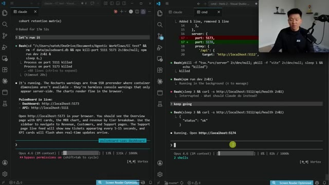
*⏱️ 00:09:26 — Interface VS Code affichant des logs d'exécution de flux de travail agentique et des interactions terminal avec Claude Code.*

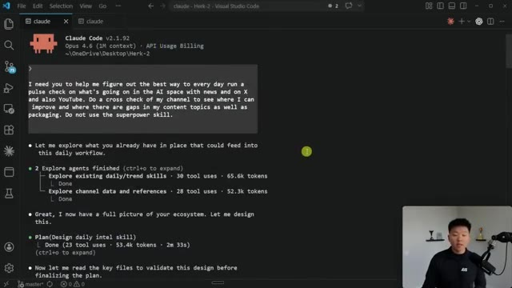
*⏱️ 00:09:35 — Interface VS Code avec Claude Code exécutant une requête pour automatiser une veille quotidienne sur l'IA et les réseaux sociaux.*

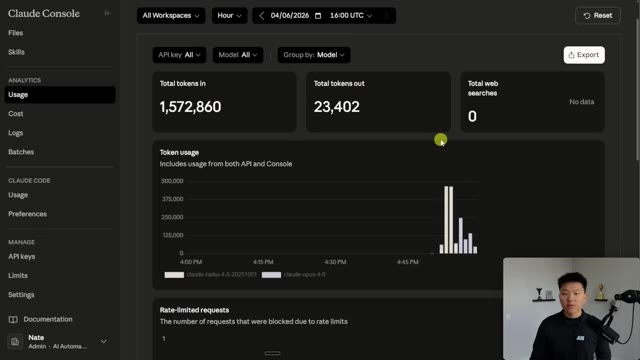
*⏱️ 00:09:43 — Interface "Claude Console" montrant un tableau de bord analytique de l'utilisation des tokens par les modèles IA.*

---

### ⏱️ `[00:09:52 - 00:10:17]` | Segment #21

**🔊 Audio (Transcription Intégrale Mot pour Mot en Français) :**
> because you need basically a pro or max subscription in order to do the cloud code on the web. I tried. It wasn't letting me do that. So anyways, I did do this though. When it came back, what I did is I just checked how much of my usage did it actually go up and it went up 1%. So we don't have an explicit number of tokens that we get allotted within this max 20x plan. So I don't know how many exact tokens it was, but I'm going to estimate that it was more than 1.5 in and 23,000 out.

**👁️ Analyse Visuelle d'Écran (gemini-3.5-flash-lite) :**
**Interface & Outils** : Visual Studio Code, Terminal Claude Code, Interface Web Claude (Settings/Usage).

**Contenu textuel & Code** : - Image 1 : Commande `/ultraplan` avec une requête complexe sur la veille technologique et l'analyse de chaîne YouTube.
- Image 2 : Statistiques de limites ("Current session: 41% used", "All models: 21% used").

**Action / Démonstration** : - Image 1 : Exécution d'un agent via CLI pour monitorer une session web Claude.
- Image 2 : Vérification du compteur de consommation après l'exécution d'une tâche.

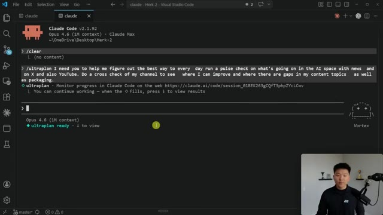
*⏱️ 00:09:58 — Interface de terminal intégrée dans VS Code exécutant Claude Code, montrant une commande utilisateur pour analyser du contenu IA.*

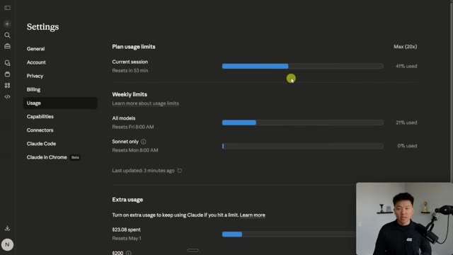
*⏱️ 00:10:05 — Page des paramètres d'utilisation de l'interface Claude affichant les limites du plan "Max" et la consommation actuelle en pourcentage.*

---

### ⏱️ `[00:10:18 - 00:10:50]` | Segment #22

**🔊 Audio (Transcription Intégrale Mot pour Mot en Français) :**
> And it was about 1% of my 20x max plan. So hopefully that gives you guys a little bit of context and just at least gives you a nice baseline. Okay, so let's talk about a few of the things that you need to know about how this works under the hood and what you need to know. So first I'm going to start off with like your project if you want to ultra plan It has to have some sort of git or github, you know Repo synced to it because it has to be pushed to the cloud somehow So if you try to run ultra plan in a project that's only local, it's going to say hey You can't do this on the web yet. It's as simple as just initializing that git pushing it super easy

**👁️ Analyse Visuelle d'Écran (gemini-3.5-flash-lite) :**
**Interface & Outils** : Navigateur web (Console de gestion Anthropic) et logiciel de création de schémas (type Excalidraw).

**Contenu textuel & Code** : - Image #1 : Statistiques d'utilisation (41% session actuelle, 21% hebdomadaire, 0% Sonnet only), dépenses supplémentaires et dates de réinitialisation.
- Image #2 : Diagramme de flux montrant les étapes : /ultraplan -> Cloud VM -> Clones Repo -> Full Context. Section "No Git?" montrant les étapes bloquées et "Min Setup" listant les prérequis (git init, push to GitHub, connect account).

**Action / Démonstration** : Présentation contextuelle des limites de consommation du compte et explication pédagogique des prérequis techniques (Git) pour l'utilisation de l'outil Ultraplan.

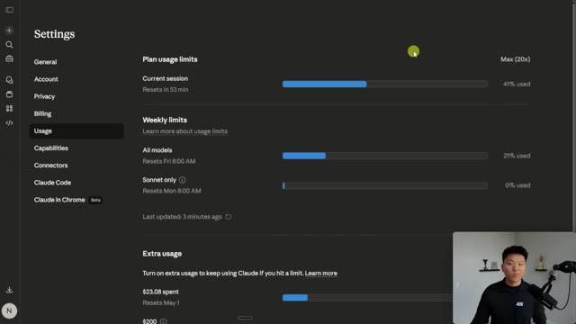
*⏱️ 00:10:26 — Interface des paramètres de compte Anthropic montrant les limites d'utilisation (« Plan usage limits ») pour un plan Max (20x).*

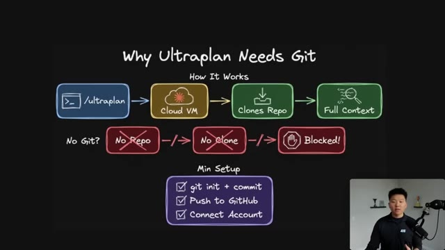
*⏱️ 00:10:34 — Schéma explicatif intitulé « Why Ultraplan Needs Git », détaillant le workflow d'intégration nécessaire au bon fonctionnement de l'outil.*

---

### ⏱️ `[00:10:50 - 00:11:24]` | Segment #23

**🔊 Audio (Transcription Intégrale Mot pour Mot en Français) :**
> And then you can do it because obviously in the cloud When it's doing the ultra plan it needs to look through everything that you have and it needs to be able to Actually work on your code base. Otherwise, it's going to be a very very generic plan Now after that sometimes i've noticed that it's not calling my skills Even though it looks through the skills are things that get invoked So if you're not specific enough on your plan for the ultra plan Then it may not use the skills the first time and actually all of these visualizations here that I made I made using ultra plan so i'll put up a clip here where i'm showing how that worked And what you'll notice is that I had to give it correction on using

**👁️ Analyse Visuelle d'Écran (gemini-3.5-flash-lite) :**
**Interface & Outils** : Diagrammes conceptuels (type mind-map/workflow) sur fond noir utilisés pour expliquer l'architecture technique d'un agent IA.

**Contenu textuel & Code** : Texte technique incluant : "/ultraplan", "Cloud VM", "Clones Repo", "git init + commit", "Deep Planning", "Skill Gap", "CLAUDE.md", "git push first!".

**Action / Démonstration** : Présentation didactique sous forme de schémas explicatifs (flowcharts) pour détailler le fonctionnement interne et les limitations de l'outil Ultraplan.

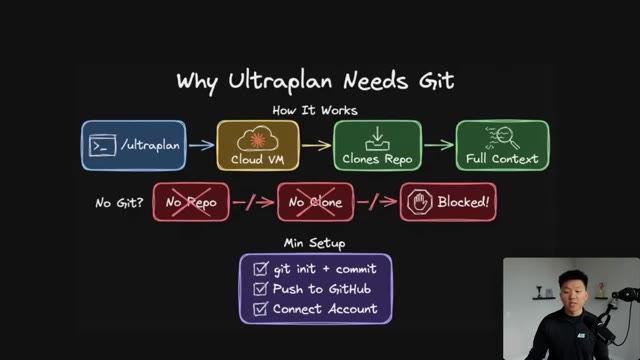
*⏱️ 00:10:59 — Schéma explicatif sur fond noir illustrant pourquoi "Ultraplan" nécessite Git pour fonctionner (clonage de dépôt, contexte complet).*

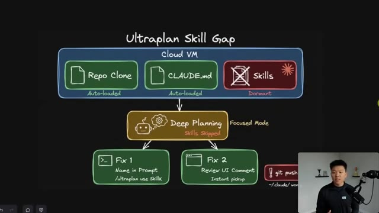
*⏱️ 00:11:07 — Schéma détaillant le "Skill Gap" d'Ultraplan, montrant comment les compétences inactives ("Dormant") affectent le mode "Deep Planning".*

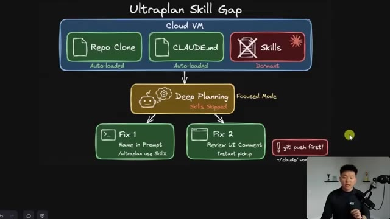
*⏱️ 00:11:15 — Suite du schéma sur le "Skill Gap", mettant en avant la recommandation "git push first!" pour résoudre les problèmes de synchronisation des compétences.*

---

### ⏱️ `[00:11:24 - 00:11:56]` | Segment #24

**🔊 Audio (Transcription Intégrale Mot pour Mot en Français) :**
> My visualization skill because it wasn't pulling that up for some reason Okay, so here is that clip now It says I want you to ultra plan and research cloud codes new feature ultra plan And I kept saying ultra plan because I love when it when it lights up like that But anyways, we shot this off, right? And it goes to the web and now it's doing a fetch on our project and getting an understanding of what we wanted to do But what you'll notice here is that it doesn't actually create the excaljaw style diagrams using my visualization skill Which uses nano banana and it has like a prompting guide and a style guide but it thought that I just wanted like markdown,

**👁️ Analyse Visuelle d'Écran (gemini-3.5-flash-lite) :**
**Interface & Outils** : VS Code (Terminal Claude Code), Application/Interface web d'agent IA.

**Contenu textuel & Code** : Prompt utilisateur : "I want you to ultraplan and research Claude Code's new feature UltraPlan... generate a Claude Code Excalidraw-style visualization". Réponses de l'agent : "Searched the web", "Now I have a thorough understanding of UltraPlan... let me write the plan".

**Action / Démonstration** : Exécution d'une recherche web et structuration d'un plan détaillé pour générer des visualisations (diagrammes) basées sur la documentation officielle.

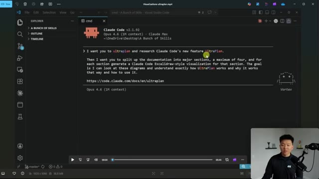
*⏱️ 00:11:32 — Interface VS Code affichant un terminal interactif avec Claude Code (Opus 4.6) où l'utilisateur a soumis une requête complexe concernant la nouvelle fonctionnalité "UltraPlan".*

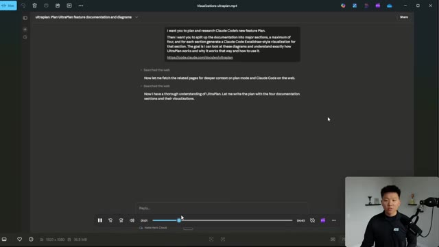
*⏱️ 00:11:40 — Interface web type application IA affichant les étapes de réflexion et d'exécution du modèle suite à la requête précédente (recherche web, analyse de la documentation, planification).*

---

### ⏱️ `[00:11:56 - 00:12:16]` | Segment #25

**🔊 Audio (Transcription Intégrale Mot pour Mot en Français) :**
> you know, mermaid style diagrams, which is what it built as you can see here. So I realized that it was creating these not the right way. I added a comment right here that says, hey, I already have a skill set up that does this. So I want you to do it that way. And then when I shoot off that comment, it basically comes back and says, okay, I didn't see that skill. What's the name of that skill? So I had to tell it explicitly right here, which is the skill that it's looking for.

**👁️ Analyse Visuelle d'Écran (gemini-3.5-flash-lite) :**
**Interface & Outils** : Interface web de Claude (session "Review Claude's plan").

**Contenu textuel & Code** : Texte structuré incluant "Context", "What gets created", et "Section 1: Architecture Overview". On peut y lire des directives sur la création de fichiers avec des diagrammes Mermaid dans un répertoire `/ultraplan-docs/`.

**Action / Démonstration** : Visualisation et revue du plan de travail généré par l'IA avant approbation pour exécution.

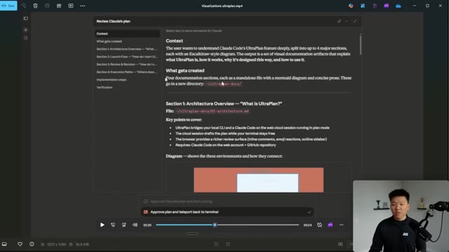
*⏱️ 00:12:01 — Une interface de planification de projet Claude affichant un document structuré avec des sections détaillant la création de fichiers de documentation et de diagrammes Mermaid.*

---

### ⏱️ `[00:12:16 - 00:12:41]` | Segment #26

**🔊 Audio (Transcription Intégrale Mot pour Mot en Français) :**
> So it asked me this question and then I say it's called visualizations. And then once I said that it was able to find it and it was able to use it, which is good. But just something to keep in mind, even though it can see your whole project, sometimes you still have to prompt it in the right way. And once again, this is just in research preview. But anyways, then it came back the right way. So I send it back to the terminal and then I was able to actually have everything be built out from my session here because the plan had been approved.

**👁️ Analyse Visuelle d'Écran (gemini-3.5-flash-lite) :**
**Interface & Outils** : Interface web de Claude.ai (mode Opus).

**Contenu textuel & Code** : Historique de discussion : prompt initial de planification de documentation, logs de recherche web, liste des compétences disponibles de l'agent (update-config, simplify, etc.), et question de l'agent demandant où trouver l'outil de génération de diagrammes.

**Action / Démonstration** : L'utilisateur interagit avec l'IA pour lui fournir le contexte nécessaire (nom du dossier "visualizations") afin que l'agent puisse localiser et utiliser les outils de visualisation.

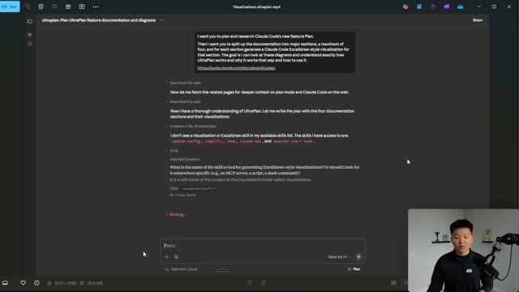
*⏱️ 00:12:22 — Interface de discussion avec une IA (Claude Code/Opus) montrant un échange où l'agent explique qu'il ne trouve pas la compétence de visualisation avant que l'utilisateur ne le guide vers le dossier "visualizations".*

---

### ⏱️ `[00:12:41 - 00:13:13]` | Segment #27

**🔊 Audio (Transcription Intégrale Mot pour Mot en Français) :**
> And then I just go ahead and implement it locally. Okay, so now let's talk about what is actually happening because we're sending it to the cloud and it only works in the cloud. So that makes you think, why? So obviously it's getting more compute, but I wanted to understand why and like what that even means. So I had this agent here do a deep dive into the Ultraplan feature. It looked at source code, it looked at community forums, and it looked at the actual documentation. And here's what it came up with. Ultraplan offloads your planning session to a cloud hosted instance running Opus 4.6. It uses multi-agent exploration to build a deeper plan than the local mode can. Then it

**👁️ Analyse Visuelle d'Écran (gemini-3.5-flash-lite) :**
**Interface & Outils** : Visual Studio Code (éditeur de texte).

**Contenu textuel & Code** : Document Markdown technique intitulé "Ultra Plan: How It Actually Works Under the Hood". Tableau comparatif des différences : "Where it runs", "Model", "Planning approach", "Max compute time", "Your terminal", "Review interface", "Execution options", "Requirements".

**Action / Démonstration** : Présentation comparative et explication technique des différences architecturales entre l'exécution locale et l'utilisation de l'Ultra Plan dans le Cloud via Anthropic.

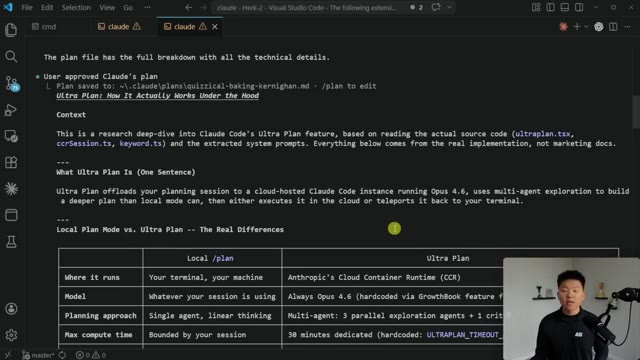
*⏱️ 00:12:49 — Vue d'un éditeur VS Code affichant un document Markdown détaillant le fonctionnement interne de la fonctionnalité "Ultra Plan" de Claude Code, avec un tableau comparatif.*

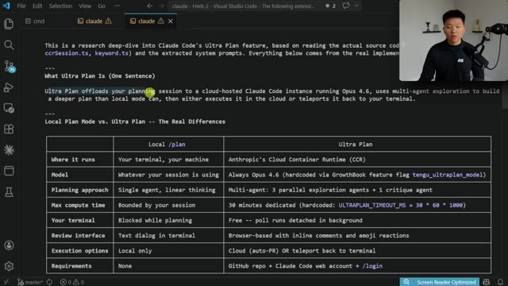
*⏱️ 00:13:05 — Vue agrandie du même document Markdown mettant en évidence le tableau comparatif complet entre "Local /plan" et "Ultra Plan".*

---

### ⏱️ `[00:13:13 - 00:13:36]` | Segment #28

**🔊 Audio (Transcription Intégrale Mot pour Mot en Français) :**
> either executes in the cloud or it goes back to your terminal. So what I thought was interesting is the multi-agent exploration. So here's a quick comparison table. When you do local plan, it runs in your terminal. When you do ultra plan, it runs in Anthropix Cloud Container Runtime. The model is whatever session you're using. Ultra plan always uses Opus 4.6. The planning approach is a single agent and it's linear thinking, whereas ultra plan is multi-agent.

**👁️ Analyse Visuelle d'Écran (gemini-3.5-flash-lite) :**
**Interface & Outils** : Visual Studio Code (éditeur de texte).

**Contenu textuel & Code** : Tableau comparatif détaillé listant les différences sur : lieu d'exécution (terminal local vs Anthropic Cloud Container Runtime), modèle utilisé (session vs Opus 4.6), approche de planification (agent unique vs multi-agents), temps de calcul, état du terminal, interface de revue et options d'exécution.

**Action / Démonstration** : Présentation informative des spécificités techniques et de l'architecture du mode "Ultra Plan" via un document texte ouvert dans l'éditeur.

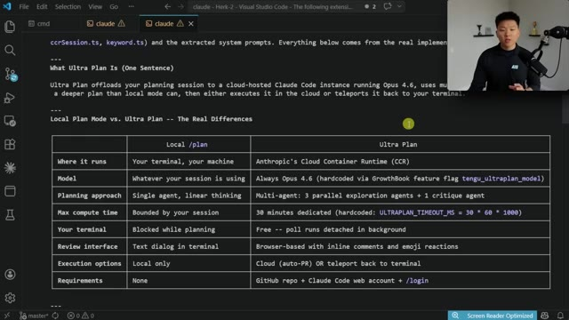
*⏱️ 00:13:19 — Un tableau comparatif affiché dans VS Code présentant les différences techniques entre le mode "Local /plan" et le mode "Ultra Plan" pour l'assistant Claude.*

---

### ⏱️ `[00:13:36 - 00:13:54]` | Segment #29

**🔊 Audio (Transcription Intégrale Mot pour Mot en Français) :**
> It is three parallel exploration agents plus one critique agent. So obviously this is gonna use more tokens, but like we talked about, if you use more tokens upfront, it's definitely worth it. if it's faster and higher quality. Now the max compute time over here is bounded by your session, but on the cloud, it's 30 minutes as a cap.

**👁️ Analyse Visuelle d'Écran (gemini-3.5-flash-lite) :**
**Interface & Outils** : Visual Studio Code (éditeur de texte).

**Contenu textuel & Code** : Tableau comparatif détaillant les spécifications : exécution, modèle (Opus 4.6), approche de planification (3 agents parallèles + 1 critique), temps de calcul (30 minutes), interface de revue, options d'exécution et prérequis.

**Action / Démonstration** : Présentation visuelle et explicative des capacités du mode "Ultra Plan" en opposition au mode "Local".

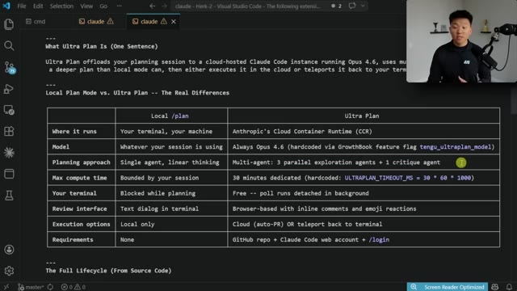
*⏱️ 00:13:40 — Un tableau comparatif affiché dans VS Code présentant les différences techniques entre le mode "Local /plan" et le nouveau mode "Ultra Plan" de Claude Code.*

---

### ⏱️ `[00:13:54 - 00:14:30]` | Segment #30

**🔊 Audio (Transcription Intégrale Mot pour Mot en Français) :**
> I've never hit that and I don't think I will because of how quick it's been, but there is a cap on it there. Now the other interesting thing is your terminal gets blocked while you're in plan mode because your session is focusing on that. But in Ultraplan, if you send your plan to the web, you can continue talking to that terminal session and wait for it to get teleported back. now truthfully I don't know exactly when I would do that I'd probably just spin up a different session because I'd want to keep that context clean so that I can just execute when it comes back but that is something that is a difference and then the review interface you basically get text dialogue in your terminal if you're using VS code with cloud code and you're using like this

**👁️ Analyse Visuelle d'Écran (gemini-3.5-flash-lite) :**
**Interface & Outils** : Visual Studio Code (éditeur de texte).

**Contenu textuel & Code** : Tableau comparatif technique incluant les colonnes « Local /plan » et « Ultra Plan » avec des lignes sur le lieu d'exécution, le modèle (Opus 4.6), l'approche de planification (multi-agents), les limites de temps (timeout), l'état du terminal, l'interface de revue et les options d'exécution.

**Action / Démonstration** : Présentation théorique des capacités et du fonctionnement d'Ultra Plan via un fichier texte affiché dans l'éditeur.

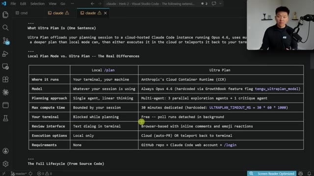
*⏱️ 00:14:03 — Un tableau comparatif affiché dans VS Code détaillant les différences techniques entre le mode « Local /plan » et « Ultra Plan ».*

---

### ⏱️ `[00:14:30 - 00:14:57]` | Segment #31

**🔊 Audio (Transcription Intégrale Mot pour Mot en Français) :**
> extension rather than the terminal then you do get a nice like dock and it looks a little bit better you can leave comments on it but if you're not using that and you're using the terminal then it's definitely going to be better in the ultra plan version. And really the only requirement here is that you have to have it synced to some sort of repo so that cloud code with your web account can actually log in and look at your project before it starts planning things out. So I'm sure that this is going to evolve as more people use it, as more people start to give feedback about it.

**👁️ Analyse Visuelle d'Écran (gemini-3.5-flash-lite) :**
**Interface & Outils** : Visual Studio Code avec l'extension Claude Code.

**Contenu textuel & Code** : Historique de discussion affichant "Ultraplan stopped", des logs d'exécution de 3 agents ("claude-code-guide", "researcher", "Explore") et leurs statistiques de tokens/utilisation d'outils.

**Action / Démonstration** : L'utilisateur visualise les résultats de recherche et l'exécution d'agents IA via le terminal intégré de VS Code.

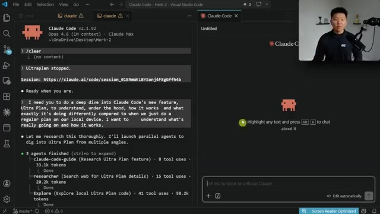
*⏱️ 00:14:37 — Interface de VS Code montrant une session active de Claude Code dans le panneau de gauche et une fenêtre de discussion vide avec le logo de Claude sur la droite.*

---

### ⏱️ `[00:14:58 - 00:15:23]` | Segment #32

**🔊 Audio (Transcription Intégrale Mot pour Mot en Français) :**
> When I was testing it out, I did run into a few issues where I was getting this authentication error. I'm not sure if that was something internal or something I did wrong, but it just seemed to pop up randomly and then I'd run it again and it'd be fine. But it also seems like we'll start to get more clarity around how exactly this works soon, why it's so much better at executing so much faster and the fact that these are parallel exploration agents. So I'd be curious how they're prompted differently. So they're not just duplicating work or maybe they are, maybe that's the point.

**👁️ Analyse Visuelle d'Écran (gemini-3.5-flash-lite) :**
**Interface & Outils** : Interface web de Claude et éditeur VS Code.

**Contenu textuel & Code** : Message d'erreur d'authentification et tableau technique comparatif des fonctionnalités de Claude Code (Modèle Opus 4.6, approche multi-agents, limites de temps).

**Action / Démonstration** : L'utilisateur illustre les erreurs aléatoires rencontrées lors de l'utilisation de la fonctionnalité Ultra Plan et présente une documentation technique comparative.

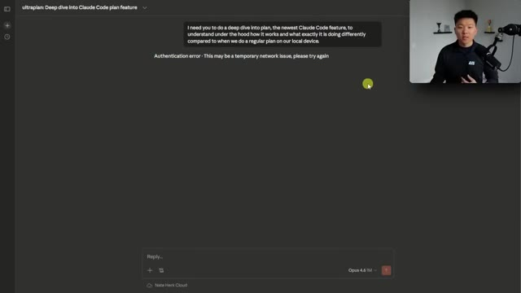
*⏱️ 00:15:04 — Interface web de Claude affichant un prompt utilisateur sur la fonctionnalité "Ultra Plan" et un message d'erreur : "Authentication error · This may be a temporary network issue, please try again".*

*⏱️ 00:15:10 — Éditeur VS Code affichant un tableau comparatif détaillé entre le mode "/plan" local et "Ultra Plan", soulignant les différences techniques, les modèles utilisés et les exigences système.*

---

### ⏱️ `[00:15:23 - 00:15:43]` | Segment #33

**🔊 Audio (Transcription Intégrale Mot pour Mot en Français) :**
> I don't assume that this is some sort of agent team that they can talk to each other and share a task list. And what I'd be curious to know is if we could get more visibility on how many tokens are actually being used in that plan. But yeah, it would be nice to be able to see, hey, the Ultra Plan is finished. And by the way, here's how many tokens it just ran. Anyways, that is going to do it for this one. So if you guys enjoyed the video or learned something new, please give it a like.

**👁️ Analyse Visuelle d'Écran (gemini-3.5-flash-lite) :**
**Interface & Outils** : Visual Studio Code (éditeur de texte ouvert sur un fichier markdown ou texte).

**Contenu textuel & Code** : Tableau structuré détaillant les différences techniques : localisation de l'exécution, modèle utilisé (Opus 4.6), approche de planification (Multi-agent), temps de calcul, gestion du terminal, interface de revue et prérequis techniques.

**Action / Démonstration** : Présentation informative et théorique des capacités de l'Ultra Plan via un tableau de comparaison technique.

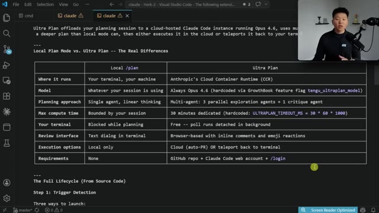
*⏱️ 00:15:28 — Tableau comparatif affiché dans un éditeur de code, opposant le mode "Local /plan" au "Ultra Plan" pour l'utilisation de l'outil Claude Code.*

---

### ⏱️ `[00:15:43 - 00:15:48]` | Segment #34

**🔊 Audio (Transcription Intégrale Mot pour Mot en Français) :**
> It helps me out a ton. And as always, I appreciate you guys making it to the end of the video. I'll see you on the next one. Thanks, everyone.

**👁️ Analyse Visuelle d'Écran (gemini-3.5-flash-lite) :**
**Interface & Outils** : Schéma conceptuel / Diagramme de workflow.

**Contenu textuel & Code** : Le diagramme détaille trois étapes : "CLI (Your Machine)", "Cloud (Plan Mode)" et "Browser (Review)". Les flux sont indiqués par des flèches intitulées "Launch", "Plan Ready", "Execute" et "Teleport".

**Action / Démonstration** : Présentation du flux de travail logique (architecture système) de l'outil UltraPlan.

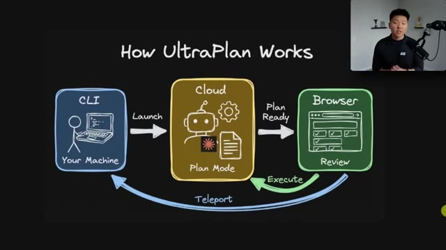
*⏱️ 00:15:44 — Schéma illustrant le workflow "UltraPlan" montrant l'interaction entre une interface CLI locale, un traitement dans le Cloud et une revue via navigateur.*

---

