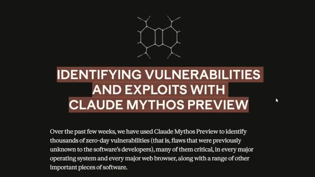
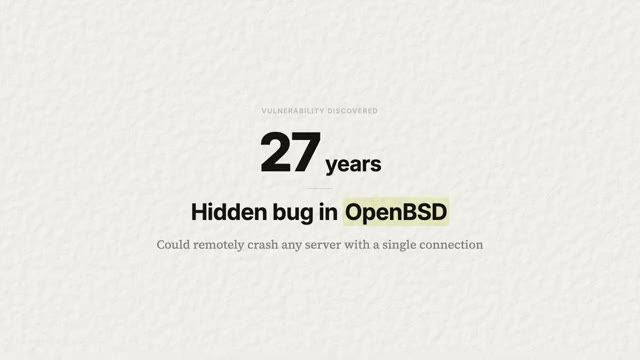

# 🎬 Claude’s New AI Just Changed the Internet Forever

> **Chaîne** : [Nate Herk | AI Automation](https://www.youtube.com/@nateherk/featured)  
> **Lien YouTube** : [https://www.youtube.com/watch?v=DG1wRgEpdO4](https://www.youtube.com/watch?v=DG1wRgEpdO4)  
> **Date de publication** : 20260407  
> **Durée** : 00:07:49  
> **Identifiant vidéo** : `DG1wRgEpdO4`  
> **Transcription & Analyse** : `whisper-v3-large-turbo+gemini-3.5-flash-lite`  

---

## 📌 Synthèse Exécutive & Outils

### 💡 Résumé
Dans cette vidéo intitulée **Claude’s New AI Just Changed the Internet Forever**, Nate Herk décortique les capacités pratiques d'automatisation et de développement propulsées par les modèles de pointe.

### 🛠️ Outils, Modèles & Logiciels Présentés
- **Opus 5.5 & Claude Code** : Modèles d'ingénierie et agents de codage autonome.

### 🔑 Points Clés & Enseignements Stratégiques
- Optimiser le niveau d'effort et le raisonnement des modèles IA pour des résultats industriels.
- Automatiser les cycles de création logicielle de bout en bout.

---

## ⏱️ Chronologie & Transcription Complète Audio & Visuelle (Mot pour Mot)

### ⏱️ `[00:00:00 - 00:00:19]` | Segment #01

**🔊 Audio (Transcription Intégrale Mot pour Mot en Français) :**
> So, Anthropic just built an AI model that found more security bugs in a few weeks than most security researchers find in their entire career. It found a bug in OpenBSD that's been hiding for 27 years. It found a bug in FFmpeg, the software that handles video on basically the entire internet, that 5 million automated tests missed. And the thing is, they're not releasing this model to the public.

**👁️ Analyse Visuelle d'Écran (gemini-3.5-flash-lite) :**
**Interface & Outils** : Présentation officielle / Interface de type site web d'annonce technologique.

**Contenu textuel & Code** : Textes informatifs sur les capacités de "Claude Mythos Preview" à identifier des vulnérabilités zero-day et détails techniques spécifiques sur une faille critique vieille de 27 ans dans OpenBSD.

**Action / Démonstration** : Présentation informative mettant en avant les capacités de recherche de bugs du modèle IA d'Anthropic.

*⏱️ 00:00:05 — Capture d'écran montrant le titre de présentation "IDENTIFYING VULNERABILITIES AND EXPLOITS WITH CLAUDE MYTHOS PREVIEW" sur fond sombre.*

*⏱️ 00:00:10 — Capture d'écran affichant le résultat d'une découverte : "27 years" et "Hidden bug in OpenBSD" avec l'explication qu'il pouvait faire planter des serveurs à distance.*

---

### ⏱️ `[00:00:19 - 00:00:37]` | Segment #02

**🔊 Audio (Transcription Intégrale Mot pour Mot en Français) :**
> And I actually think that that should make you feel way better, not worse. So let me explain. So what is Claude Mythos? It's a new model that Anthropic has been developing internally. A lot of us heard about this during that Claude code leak. But think of this as the next generation of Claude, their most capable model yet. Right now, their best public model is Opus, Opus 4.6.

**👁️ Analyse Visuelle d'Écran (gemini-3.5-flash-lite) :**
**Interface & Outils** : Présentation ou face-caméra explicatif sans interface logicielle partagée.

**Contenu textuel & Code** : Explications orales et mise en contexte méthodologique.

**Action / Démonstration** : Explications face caméra et démonstration conceptuelle.

---

### ⏱️ `[00:00:38 - 00:01:02]` | Segment #03

**🔊 Audio (Transcription Intégrale Mot pour Mot en Français) :**
> And Mythos actually blows past it on basically every single benchmark. And the thing that really caught my attention is they didn't train it to be a hacker. They trained it to just be really, really good at writing code. And being really good at code made it really good at breaking code. And that happened all on its own. It's like training someone to be the world's best locksmith. You don't teach them to break into houses, but now that they understand locks so well, they easily could go break into almost any house. And that skill just came free.

**👁️ Analyse Visuelle d'Écran (gemini-3.5-flash-lite) :**
**Interface & Outils** : Présentation ou face-caméra explicatif sans interface logicielle partagée.

**Contenu textuel & Code** : Explications orales et mise en contexte méthodologique.

**Action / Démonstration** : Explications face caméra et démonstration conceptuelle.

---

### ⏱️ `[00:01:03 - 00:01:36]` | Segment #04

**🔊 Audio (Transcription Intégrale Mot pour Mot en Français) :**
> So let me give you the numbers because they're super, super wild. There's a standard test that the industry uses to measure how well AI can fix real world software bugs. It's called the SWE bench. Opus scores 80.8%, which is really good, but Mythos scores 93.9%. And that's not just like a small incremental jump. That is a huge generational leap. On cybersecurity benchmarks, which is how well can it actually find and exploit vulnerabilities in this code, Opus scores 66.6% and Mythos scores 83.1%. But all of that is just numbers. Let's forget the

**👁️ Analyse Visuelle d'Écran (gemini-3.5-flash-lite) :**
**Interface & Outils** : Présentation ou face-caméra explicatif sans interface logicielle partagée.

**Contenu textuel & Code** : Explications orales et mise en contexte méthodologique.

**Action / Démonstration** : Explications face caméra et démonstration conceptuelle.

---

### ⏱️ `[00:01:36 - 00:02:00]` | Segment #05

**🔊 Audio (Transcription Intégrale Mot pour Mot en Français) :**
> benchmarks. Here's what it actually did in the real world. It found a bug in OpenBSD that's been there for 27 years. It could basically remotely crash any OpenBSD server. It found a bug in FFmpeg, again, the software that handles video all over, that 5 million automated tests never caught. And it's a bug that's been 16 years just sitting there. It found multiple Linux bugs that let a user with zero permissions become the admin. And here's the part that really got me.

**👁️ Analyse Visuelle d'Écran (gemini-3.5-flash-lite) :**
**Interface & Outils** : Présentation ou face-caméra explicatif sans interface logicielle partagée.

**Contenu textuel & Code** : Explications orales et mise en contexte méthodologique.

**Action / Démonstration** : Explications face caméra et démonstration conceptuelle.

---

### ⏱️ `[00:02:00 - 00:02:22]` | Segment #06

**🔊 Audio (Transcription Intégrale Mot pour Mot en Français) :**
> It doesn't just find individual bugs. It's able to chain them together. It can find three, four, five small vulnerabilities and link them together into a full cybersecurity attack. And that's what elite human hackers are doing. Like the ones that you see in the movies that are typing on an old computer like this with their entire arms. So here's the dilemma. Anthropic now has a model that is incredible at finding security flaws that could save the internet.

**👁️ Analyse Visuelle d'Écran (gemini-3.5-flash-lite) :**
**Interface & Outils** : Présentation ou face-caméra explicatif sans interface logicielle partagée.

**Contenu textuel & Code** : Explications orales et mise en contexte méthodologique.

**Action / Démonstration** : Explications face caméra et démonstration conceptuelle.

---

### ⏱️ `[00:02:22 - 00:02:41]` | Segment #07

**🔊 Audio (Transcription Intégrale Mot pour Mot en Français) :**
> But if it gets into the wrong hands, it could also break the entire internet. So imagine if they just dropped this model publicly tomorrow. Every person with bad intentions now has a tool that's better at finding exploits than most professional security teams. That's not hypothetical. That is literally what the benchmarks say that this AI model can do. And this isn't going to be the last model that is this good.

**👁️ Analyse Visuelle d'Écran (gemini-3.5-flash-lite) :**
**Interface & Outils** : Présentation ou face-caméra explicatif sans interface logicielle partagée.

**Contenu textuel & Code** : Explications orales et mise en contexte méthodologique.

**Action / Démonstration** : Explications face caméra et démonstration conceptuelle.

---

### ⏱️ `[00:02:42 - 00:03:16]` | Segment #08

**🔊 Audio (Transcription Intégrale Mot pour Mot en Français) :**
> Every single AI lab is building better coding models as we speak. And if being good at code automatically means being good at hacking, then every frontier model that every company is training right now is going to become a better hacker, whether they want it to be or not. I've watched podcasts where AI researchers who have been in the space for over a decade have said if there was a button right in front of them to stop uncontrolled superintelligence and just start over, they would press it because it kind of feels like a race of which company can create the best models and the capabilities are scaling exponentially. What Mythos does today, smaller open source models

**👁️ Analyse Visuelle d'Écran (gemini-3.5-flash-lite) :**
**Interface & Outils** : Présentation ou face-caméra explicatif sans interface logicielle partagée.

**Contenu textuel & Code** : Explications orales et mise en contexte méthodologique.

**Action / Démonstration** : Explications face caméra et démonstration conceptuelle.

---

### ⏱️ `[00:03:16 - 00:03:40]` | Segment #09

**🔊 Audio (Transcription Intégrale Mot pour Mot en Français) :**
> will probably do in 12 to 24 months. The genie doesn't ever go back into the bottle. So what do you do? You can't uninvent it. You can't keep it secret forever. Someone else will build something just as good. You can't just destroy the knowledge. It's gonna happen. And this is where Project Glasswing comes in. And this is where my opinion on this whole thing actually flips from scary to actually this is exactly what should be happening.

**👁️ Analyse Visuelle d'Écran (gemini-3.5-flash-lite) :**
**Interface & Outils** : Présentation ou face-caméra explicatif sans interface logicielle partagée.

**Contenu textuel & Code** : Explications orales et mise en contexte méthodologique.

**Action / Démonstration** : Explications face caméra et démonstration conceptuelle.

---

### ⏱️ `[00:03:41 - 00:04:16]` | Segment #10

**🔊 Audio (Transcription Intégrale Mot pour Mot en Français) :**
> Because instead of releasing the model publicly or just locking it in a vault, Anthropic chose a third option, which is to give it to the defenders first. They've partnered with AWS, Apple, Google, Microsoft, NVIDIA, Cisco, CrowdStrike, JP Morgan, and a ton of others. Basically the companies that build the software that the entire internet runs on. These partners will get direct access to Mythos to scan their own systems, find the bugs before attackers can, patch them before anyone else even knows that they exist. Anthropic also opened it up to over 40 organizations that maintain critical software infrastructure. They've committed $100 million in usage credits and donated $4 million

**👁️ Analyse Visuelle d'Écran (gemini-3.5-flash-lite) :**
**Interface & Outils** : Présentation ou face-caméra explicatif sans interface logicielle partagée.

**Contenu textuel & Code** : Explications orales et mise en contexte méthodologique.

**Action / Démonstration** : Explications face caméra et démonstration conceptuelle.

---

### ⏱️ `[00:04:16 - 00:04:51]` | Segment #11

**🔊 Audio (Transcription Intégrale Mot pour Mot en Français) :**
> directly to open source security groups. And they've been in discussion with the US government. On top of that, they committed to sharing what they learned publicly within 90 days. And honestly, this may be the first time that a major AI lab has essentially said, we built something too powerful to release, but here is our plan. That is a precedent. Now, whether other labs follow or not is going to define the next few years, the next few decades of AI. But anyways, what does this actually mean for you and for me? Because I know most of you watching this aren't running security at a fortune 500 company. You're probably just a average person who uses a phone, a laptop,

**👁️ Analyse Visuelle d'Écran (gemini-3.5-flash-lite) :**
**Interface & Outils** : Présentation ou face-caméra explicatif sans interface logicielle partagée.

**Contenu textuel & Code** : Explications orales et mise en contexte méthodologique.

**Action / Démonstration** : Explications face caméra et démonstration conceptuelle.

---

### ⏱️ `[00:04:51 - 00:05:11]` | Segment #12

**🔊 Audio (Transcription Intégrale Mot pour Mot en Français) :**
> and build stuff with cloud code. And that's exactly what I am. So here's the practical part. If you use a phone, a browser, or any app, your software is about to get more secure. The bugs that Mythos is finding are in the code that powers your operating system or your video player or your web browser. And these patches are already rolling out. You won't really see it happen, but you'll get a software update one day.

**👁️ Analyse Visuelle d'Écran (gemini-3.5-flash-lite) :**
**Interface & Outils** : Présentation ou face-caméra explicatif sans interface logicielle partagée.

**Contenu textuel & Code** : Explications orales et mise en contexte méthodologique.

**Action / Démonstration** : Explications face caméra et démonstration conceptuelle.

---

### ⏱️ `[00:05:12 - 00:05:30]` | Segment #13

**🔊 Audio (Transcription Intégrale Mot pour Mot en Français) :**
> And behind that update is an AI that found a vulnerability that a human might've never caught. And now it's been made better. This is one of the first times that AI is directly going to make your digital life safer without you having to do anything. Hopefully, at least. Now, if you're a small business owner, this is where it gets interesting because security has always been like a fortune 500 problem.

**👁️ Analyse Visuelle d'Écran (gemini-3.5-flash-lite) :**
**Interface & Outils** : Aucun

**Contenu textuel & Code** : Aucun

**Action / Démonstration** : Le présentateur s'adresse directement aux spectateurs.

---

### ⏱️ `[00:05:30 - 00:05:48]` | Segment #14

**🔊 Audio (Transcription Intégrale Mot pour Mot en Français) :**
> Big companies hire red teams, run penetration tests, pay millions of dollars for security audits, but small businesses might get like an antivirus and just hope for the best. So what Glasswing is doing is essentially trickling down Fortune 500 level security to everyone. When Mythos finds a bug in Linux or in a web framework your website runs on, that fix reaches you too.

**👁️ Analyse Visuelle d'Écran (gemini-3.5-flash-lite) :**
**Interface & Outils** : Présentation ou face-caméra explicatif sans interface logicielle partagée.

**Contenu textuel & Code** : Explications orales et mise en contexte méthodologique.

**Action / Démonstration** : Explications face caméra et démonstration conceptuelle.

---

### ⏱️ `[00:05:49 - 00:06:07]` | Segment #15

**🔊 Audio (Transcription Intégrale Mot pour Mot en Français) :**
> So you will benefit from the same AI scanning that protects Apple and Google's infrastructure. You don't pay for it. You don't even know what's happening, but you're protected by it. And as this technology matures, these tools will eventually become available to smaller companies directly. Imagine being able to scan your own code base with the same AI that found 27-year-old bugs in operating systems. That's where we are headed.

**👁️ Analyse Visuelle d'Écran (gemini-3.5-flash-lite) :**
**Interface & Outils** : Présentation ou face-caméra explicatif sans interface logicielle partagée.

**Contenu textuel & Code** : Explications orales et mise en contexte méthodologique.

**Action / Démonstration** : Explications face caméra et démonstration conceptuelle.

---

### ⏱️ `[00:06:07 - 00:06:28]` | Segment #16

**🔊 Audio (Transcription Intégrale Mot pour Mot en Français) :**
> So let me leave you with what I think this really means. I think that Anthropic just did the right thing, and I think that they do deserve a ton of credit for it. They had a model that probably could have made them a ton of money. They're already making a ton of money, but you know what I mean. It also is going to generate them a lot of hype. If they shipped this tomorrow, it would be absolutely crazy. Everyone on the internet in the AI world would be talking about this.

**👁️ Analyse Visuelle d'Écran (gemini-3.5-flash-lite) :**
**Interface & Outils** : Aucune.

**Contenu textuel & Code** : Aucun.

**Action / Démonstration** : Le présentateur s'exprime verbalement sans manipuler d'interface.

---

### ⏱️ `[00:06:28 - 00:06:49]` | Segment #17

**🔊 Audio (Transcription Intégrale Mot pour Mot en Français) :**
> Instead, they slowed it down. They built a deployment plan and gave Defenders a head start. That's not the easy choice, but that is the right choice. Oh, one more thing. As I was editing this video, Boris Cherney just tweeted, the creator of CloudCode. He said, Mythos is very powerful and should feel terrifying. I am proud of our approach to responsibly preview it with cyber defenders rather than generally releasing it into the wild.

**👁️ Analyse Visuelle d'Écran (gemini-3.5-flash-lite) :**
**Interface & Outils** : Présentation ou face-caméra explicatif sans interface logicielle partagée.

**Contenu textuel & Code** : Explications orales et mise en contexte méthodologique.

**Action / Démonstration** : Explications face caméra et démonstration conceptuelle.

---

### ⏱️ `[00:06:49 - 00:07:09]` | Segment #18

**🔊 Audio (Transcription Intégrale Mot pour Mot en Français) :**
> Tout à fait d'accord. Beau travail, Boris et l'équipe de CloudCode. Voici donc mon avis honnête. Ce que j'attends vraiment de voir, c'est si cela devient réellement le nouveau standard ou si c'est juste un truc qu'un labo a fait une seule fois, parce que la vérité dérangeante, c'est que ce n'est pas un événement unique. Chaque génération de modèles d'IA sera de plus en plus douée pour trouver des failles. La courbe exponentielle ne s'aplatit pas.

**👁️ Analyse Visuelle d'Écran (gemini-3.5-flash-lite) :**
**Interface & Outils** : Présentation ou face-caméra explicatif sans interface logicielle partagée.

**Contenu textuel & Code** : Explications orales et mise en contexte méthodologique.

**Action / Démonstration** : Explications face caméra et démonstration conceptuelle.

---

### ⏱️ `[00:07:09 - 00:07:29]` | Segment #19

**🔊 Audio (Transcription Intégrale Mot pour Mot en Français) :**
> It's going to get steeper. So the question is, will OpenAI do the same? Will Google? Will Meta? The labs that take this seriously, that build safety plans before they need them, are going to be the ones that we trust with the next generation. The ones that don't are going to be the ones that cause the headlines that we all are terrified of. The harder news is that this is an arms race and it may not ever end.

**👁️ Analyse Visuelle d'Écran (gemini-3.5-flash-lite) :**
**Interface & Outils** : Présentation ou face-caméra explicatif sans interface logicielle partagée.

**Contenu textuel & Code** : Explications orales et mise en contexte méthodologique.

**Action / Démonstration** : Explications face caméra et démonstration conceptuelle.

---

### ⏱️ `[00:07:29 - 00:07:49]` | Segment #20

**🔊 Audio (Transcription Intégrale Mot pour Mot en Français) :**
> But for the first time the defenders actually got a real head start and that matters more than most people realize But anyways, that is gonna do it for this one The space moves super fast and I have a lot of fun staying tuned to all of it So let me know what you guys think about this in the comments And if you want to check out my free school community where we nerd out pretty hard about this kind of stuff every single day The link for that is down in the description and i'll see you guys on the next one. Thanks, everyone

**👁️ Analyse Visuelle d'Écran (gemini-3.5-flash-lite) :**
**Interface & Outils** : Présentation ou face-caméra explicatif sans interface logicielle partagée.

**Contenu textuel & Code** : Explications orales et mise en contexte méthodologique.

**Action / Démonstration** : Explications face caméra et démonstration conceptuelle.

---

