# 🎬 Claude’s New AI Just Changed the Internet Forever

> **Chaîne** : [Nate Herk | AI Automation](https://www.youtube.com/@nateherk/featured)  
> **Lien YouTube** : [https://www.youtube.com/watch?v=DG1wRgEpdO4](https://www.youtube.com/watch?v=DG1wRgEpdO4)  
> **Date de publication** : 20260407  
> **Durée** : 00:07:49  
> **Identifiant vidéo** : `DG1wRgEpdO4`  
> **Transcription & Analyse** : `whisper-v3-large-turbo+gemini-3.5-flash-lite`  

---

## 📌 Synthèse Exécutive & Outils

### 💡 Résumé

Anthropic a développé en interne un modèle d'intelligence artificielle de pointe baptisé **Claude Mythos**, dont les capacités de codage et d'analyse dépassent largement celles des modèles publics actuels comme Opus. En s'entraînant simplement à écrire du code avec un niveau d'excellence inédit (atteignant 93,9 % sur le benchmark SWE-bench et 83,1 % sur les tests de cybersécurité), le modèle a acquis une compétence redoutable et naturelle pour identifier des failles logicielles complexes, agissant à la manière d'un serrurier hors pair capable de comprendre instantanément les vulnérabilités de n'importe quel système.

Les performances de Mythos dans le monde réel dépassent l'entendement : il a mis au jour des failles critiques profondément enfouies depuis des décennies, telles qu'un bug de 27 ans dans OpenBSD permettant de planter des serveurs à distance, un dysfonctionnement de 16 ans dans FFmpeg raté par 5 millions de tests automatisés, ainsi que des élévations de privilèges sous Linux. Plus impressionnant encore, le modèle surpasse les chercheurs humains en démontrant une capacité à enchaîner plusieurs vulnérabilités mineures pour concevoir des scénarios d'attaque complets, semblables aux tactiques de hackers d'élite.

Consciente du risque systémique majeur que représenterait une publication publique de ce modèle — capable de sauver Internet entre de bonnes mains ou de le détruire entre de mauvaises —, l'entreprise a choisi de retenir sa diffusion générale. À travers le **projet Glasswing**, Anthropic a opté pour une approche responsable et proactive en donnant un accès exclusif à Mythos aux géants de la tech (AWS, Apple, Google, Microsoft, NVIDIA, Cisco, etc.) et à des organisations d'infrastructure critique. Cette initiative permet aux cyberdéfenseurs de combler les failles de sécurité de l'écosystème numérique mondial avant qu'elles ne soient exploitées par la cybercriminalité, tout en établissant un nouveau standard éthique pour l'industrie de l'IA.

### 🛠️ Outils, Modèles & Logiciels Présentés

* **Claude Mythos** : Modèle d'IA de pointe d'Anthropic développé en interne, affichant des performances exceptionnelles en matière de codage et de découverte de failles de sécurité complexes.
* **Claude (Opus 4.6)** : Meilleur modèle public actuel d'Anthropic, surperformé à la fois sur le plan algorithmique et sur les benchmarks de cybersécurité par la génération Mythos.
* **Claude Code** : Environnement de développement et assistant de codage associé à l'écosystème Claude, piloté notamment par des figures comme Boris Cherney.
* **Projet Glasswing** : Initiative stratégique d'Anthropic visant à restreindre l'accès à Mythos pour le confier exclusivement aux défenseurs, aux grands acteurs technologiques et aux gestionnaires d'infrastructures critiques.
* **OpenBSD** : Système d'exploitation open source dans lequel Mythos a découvert une vulnérabilité critique vieille de 27 ans permettant le plantage à distance de serveurs.
* **FFmpeg** : Logiciel fondamental de gestion vidéo sur Internet, dont les 5 millions de tests automatisés avaient raté un bug critique présent depuis 16 ans, détecté par Mythos.
* **Linux** : Système d'exploitation cible sur lequel le modèle a identifié de multiples failles permettant l'élévation de privilèges non autorisés au niveau administrateur.
* **SWE-bench** : Benchmark standard de l'industrie mesurant la capacité des IA à corriger des bugs logiciels réels, sur lequel Mythos obtient un score record de 93,9 %.

### 🔑 Points Clés & Enseignements Stratégiques

* **L'équivalence intrinsèque entre compétence de codage et piratage** : Entraîner une IA à exceller dans la génération et la correction de code produit inévitablement, par effet de bord naturel, un outil surperformant dans la rétro-ingénierie et la découverte de vulnérabilités, rendant l'émergence de capacités offensives inévitable pour tout modèle de pointe.
* **Un bond générationnel quantitatif et qualitatif** : Le passage d'Opus à Mythos ne représente pas une simple progression linéaire, mais un saut qualitatif massif, illustré par des scores de 93,9 % sur le SWE-bench et la capacité inédite à enchaîner plusieurs micro-failles pour structurer une cyberattaque complexe.
* **La découverte de failles historiques indétectables par l'humain** : L'IA a prouvé sa supériorité opérationnelle en résolvant des anomalies invisibles pendant des décennies, à l'instar du bug d'OpenBSD vieux de 27 ans et de la faille de FFmpeg passée au travers de 5 millions de tests automatisés.
* **Le dilemme existentiel de la double utilisation (Dual-Use)** : Les modèles de pointe se trouvent au carrefour critique entre le sauvetage de l'infrastructure numérique mondiale et son anéantissement total s'ils tombent entre des mains malveillantes, posant la question de leur publication ouverte.
* **Le changement de paradigme du projet Glasswing** : Plutôt que d'enfouir la technologie ou de la libérer sans filtre au grand public, Anthropic instaure un précédent historique en instaurant une tierce voie : donner une longueur d'avance tactique aux défenseurs avant toute divulgation générale.
* **La coalition industrielle de cybersécurité** : L'association ciblée avec des acteurs majeurs (AWS, Apple, Google, Microsoft, NVIDIA, Cisco, CrowdStrike, JP Morgan) et l'allocation de 100 millions de dollars de crédits ainsi que 4 millions pour l'open source démontrent une volonté de sécuriser le socle de l'Internet mondial.
* **Une démocratisation indirecte de la sécurité de niveau *Fortune 500*** : Les correctifs générés grâce à l'analyse de Mythos sur les couches logicielles fondamentales (systèmes d'exploitation, frameworks web) protègent par ricochet l'ensemble des petites entreprises et des utilisateurs finaux sans qu'ils n'aient à intervenir.
* **L'accélération exponentielle de la course aux armements en IA** : La vitesse d'évolution technologique est telle que les capacités des modèles propriétaires actuels se retrouvent généralement répliquées par des modèles open source plus petits dans un délai de 12 à 24 mois.
* **Le rôle pivot de l'éthique et de la responsabilité des laboratoires** : La posture adoptée par Anthropic et saluée par des créateurs comme Boris Cherney redéfinit les standards de l'industrie, obligeant par la pression concurrentielle les autres laboratoires (OpenAI, Google, Meta) à structurer des plans de sécurité rigoureux.
* **L'impératif d'une anticipation proactive** : Face à une courbe exponentielle de performance qui ne s'aplatit pas, la survie de l'écosystème numérique repose sur la capacité à concevoir des protocoles de défense et des garde-fous avant que les capacités des modèles ne dépassent définitivement le contrôle humain.

---

## ⏱️ Chronologie & Transcription Complète Audio & Visuelle (Mot pour Mot)

### ⏱️ `[00:00:00 - 00:00:19]` | Segment #01

**🔊 Audio (Transcription Intégrale Mot pour Mot en Français) :**
> Donc, Anthropic vient de construire un modèle d'intelligence artificielle qui a trouvé plus de bugs de sécurité en quelques semaines que la plupart des chercheurs en sécurité n'en trouvent au cours de toute leur carrière. Il a trouvé un bug dans OpenBSD qui se cachait depuis 27 ans. Il a trouvé un bug dans FFmpeg, le logiciel qui gère la vidéo sur pratiquement tout Internet, que 5 millions de tests automatisés ont raté. Et le fait est qu'ils ne sortent pas ce modèle pour le grand public.

**👁️ Analyse Visuelle d'Écran (gemini-3.5-flash-lite) :**
**Interface & Outils** : Interface web / Présentation visuelle de rapport de vulnérabilité

**Contenu textuel & Code** : Texte descriptif : "Identifying vulnerabilities and exploits with Claude Mythos Preview" et "27 years Hidden bug in OpenBSD - Could remotely crash any server with a single connection"

**Action / Démonstration** : Affichage des résultats d'analyse de sécurité réalisés par le modèle d'IA Anthropic.

*⏱️ 00:00:05 — Capture d'écran d'un article ou d'une interface web intitulée "Identifying vulnerabilities and exploits with Claude Mythos Preview", détaillant la découverte de vulnérabilités zero-day.*

*⏱️ 00:00:10 — Capture d'écran sur fond texturé clair mettant en avant la découverte d'un bug caché depuis "27 years" dans OpenBSD pouvant faire crasher un serveur.*

---

### ⏱️ `[00:00:19 - 00:00:37]` | Segment #02

**🔊 Audio (Transcription Intégrale Mot pour Mot en Français) :**
> Et je pense vraiment que cela devrait vous faire vous sentir beaucoup mieux, et non l'inverse. Laissez-moi donc vous expliquer. Qu'est-ce que Claude Mythos ? C'est un nouveau modèle qu'Anthropic développe en interne. Beaucoup d'entre nous en ont entendu parler lors de cette fuite de code de Claude. Mais pensez-y comme à la prochaine génération de Claude, leur modèle le plus puissant à ce jour. À l'heure actuelle, leur meilleur modèle public est Opus, Opus 4.6.

**👁️ Analyse Visuelle d'Écran (gemini-3.5-flash-lite) :**
**Interface & Outils** : Diapositive de présentation textuelle.

**Contenu textuel & Code** : Texte : « UNRELEASED MODEL », « Claude Mythos Preview », et « Anthropic's next-generation AI — their most capable model yet. Not publicly released. ».

**Action / Démonstration** : Présentation du sujet et du modèle Claude Mythos par le créateur.

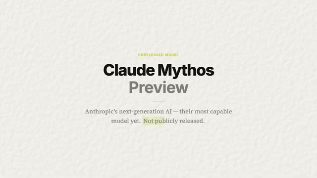
*⏱️ 00:00:24 — Une diapositive textuelle sur fond texturé présentant le titre « Claude Mythos Preview » et la mention « Unreleased Model ».*

---

### ⏱️ `[00:00:38 - 00:01:02]` | Segment #03

**🔊 Audio (Transcription Intégrale Mot pour Mot en Français) :**
> Et Mythos le surpasse en réalité sur pratiquement tous les benchmarks. Et ce qui a vraiment attiré mon attention, c'est qu'ils ne l'ont pas entraîné à être un pirate informatique. Ils l'ont entraîné à être simplement très, très bon en écriture de code. Et être très bon en code l'a rendu très bon pour casser du code. Et c'est arrivé tout seul. C'est comme entraîner quelqu'un à être le meilleur serrurier du monde. On ne lui apprend pas à cambrioler des maisons, mais maintenant qu'il comprend si bien les serrures, il pourrait facilement aller cambrioler n'importe quelle maison. Et cette compétence est arrivée tout simplement gratuitement.

**👁️ Analyse Visuelle d'Écran (gemini-3.5-flash-lite) :**
**Interface & Outils** : Présentation de benchmarks de modèles d'IA.

**Contenu textuel & Code** : Scores de performance : Mythos Preview (87.3% et 93.9%) vs Opus 4.6 (77.8% et 80.8%) sur les benchmarks SWE-bench.

**Action / Démonstration** : Comparaison des capacités de programmation et de performance des modèles d'IA.

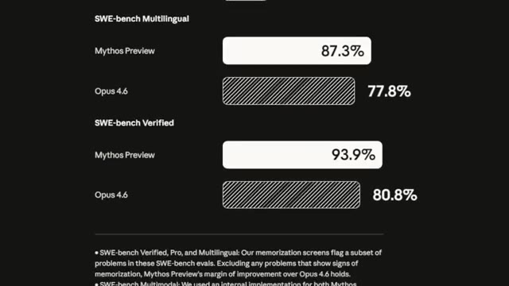
*⏱️ 00:00:44 — Tableau comparatif des performances montrant les scores de 'Mythos Preview' par rapport à 'Opus 4.6' sur les benchmarks SWE-bench Multilingual et SWE-bench Verified.*

---

### ⏱️ `[00:01:03 - 00:01:36]` | Segment #04

**🔊 Audio (Transcription Intégrale Mot pour Mot en Français) :**
> Alors laissez-moi vous donner les chiffres parce qu'ils sont super, super fous. Il y a un test standard que l'industrie utilise pour mesurer à quel point l'IA peut corriger des bugs logiciels du monde réel. Ça s'appelle le SWE bench. Opus obtient un score de 80,8 %, ce qui est vraiment bien, mais Mythos obtient 93,9 %. Et ce n'est pas juste un petit bond progressif. C'est un énorme saut générationnel. Sur les benchmarks de cybersécurité, c'est-à-dire sa capacité réelle à trouver et exploiter des vulnérabilités dans ce code, Opus obtient 66,6 % et Mythos obtient 83,1 %. Mais tout cela n'est que des chiffres. Oublions les

**👁️ Analyse Visuelle d'Écran (gemini-3.5-flash-lite) :**
**Interface & Outils** : Graphiques statistiques comparatifs de benchmarks d'IA sur fond texturé.

**Contenu textuel & Code** : Scores de performance SWE-Bench Verified et CyberGym comparant Opus 4.6 et Mythos Preview.

**Action / Démonstration** : Présentation des résultats de benchmarks comparatifs par le présentateur.

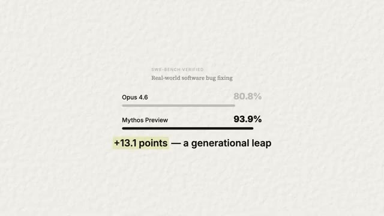
*⏱️ 00:01:11 — Graphique comparatif des performances de SWE-Bench montrant Opus 4.6 à 80,8 % et Mythos Preview à 93,9 %.*

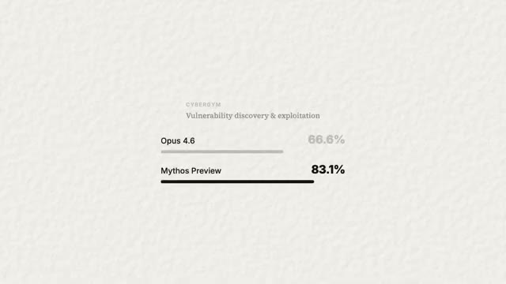
*⏱️ 00:01:28 — Graphique comparatif CyberGym de découverte et d'exploitation de vulnérabilités montrant Opus 4.6 à 66,6 % et Mythos Preview à 83,1 %.*

---

### ⏱️ `[00:01:36 - 00:02:00]` | Segment #05

**🔊 Audio (Transcription Intégrale Mot pour Mot en Français) :**
> benchmarks. Voici ce qu'il a réellement fait dans le monde réel. Il a trouvé un bug dans OpenBSD qui était là depuis 27 ans. Il pouvait fondamentalement faire planter à distance n'importe quel serveur OpenBSD. Il a trouvé un bug dans FFmpeg, encore une fois, le logiciel qui gère la vidéo partout, que 5 millions de tests automatisés n'avaient jamais détecté. Et c'est un bug qui était là depuis 16 ans, sans bouger. Il a trouvé de multiples bugs sous Linux qui permettent à un utilisateur sans aucune permission de devenir administrateur. Et voici la partie qui m'a vraiment marqué.

**👁️ Analyse Visuelle d'Écran (gemini-3.5-flash-lite) :**
**Interface & Outils** : Présentation vidéo / diapositive graphique

**Contenu textuel & Code** : Texte affiché : "REAL-WORLD FINDING", "27 years hidden", "OpenBSD", et "Remote crash vulnerability — a single connection could take down any server"

**Action / Démonstration** : Affichage de la diapositive pour illustrer la découverte d'une faille de sécurité vieille de 27 ans dans OpenBSD.

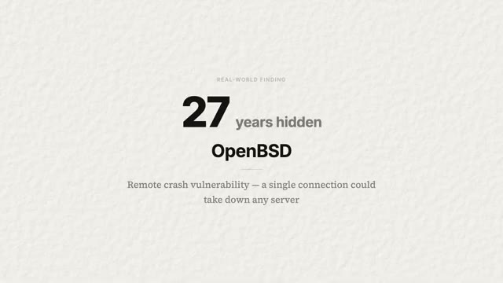
*⏱️ 00:01:42 — Une diapositive textuelle sur fond texturé présentant une découverte dans le monde réel concernant une vulnérabilité critique sous OpenBSD.*

---

### ⏱️ `[00:02:00 - 00:02:22]` | Segment #06

**🔊 Audio (Transcription Intégrale Mot pour Mot en Français) :**
> Il ne se contente pas de trouver des bugs individuels. Il est capable de les enchaîner. Il peut trouver trois, four, cinq petites vulnérabilités et les relier entre elles pour en faire une attaque de cybersécurité complète. Et c'est exactement ce que font les hackers humains d'élite. Comme ceux que l'on voit dans les films qui tapent sur un vieux ordinateur comme ça avec la totalité de leurs bras. Voici donc le dilemme. Anthropic dispose désormais d'un modèle qui est incroyable pour trouver des failles de sécurité qui pourraient sauver Internet.

**👁️ Analyse Visuelle d'Écran (gemini-3.5-flash-lite) :**
**Interface & Outils** : Diapositive de présentation graphique sur fond blanc texturé.

**Contenu textuel & Code** : Texte à l'écran : 'VULNERABILITY CHAINING', 'Linking small flaws into full exploits', et le schéma 'Bug 1 -> Bug 2 -> Bug 3 -> Full Attack'.

**Action / Démonstration** : Illustration visuelle du concept de chaînage de bugs pour former une attaque complète, accompagnant les explications audio.

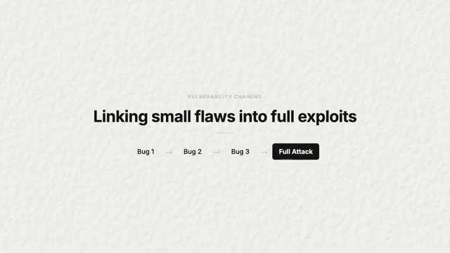
*⏱️ 00:02:06 — Diapositive montrant un schéma textuel expliquant le concept de chaînage de vulnérabilités (Vulnerability Chaining) avec le texte 'Linking small flaws into full exploits' et un flux menant de Bug 1 à Full Attack.*

---

### ⏱️ `[00:02:22 - 00:02:41]` | Segment #07

**🔊 Audio (Transcription Intégrale Mot pour Mot en Français) :**
> Mais si elle tombe entre de mauvaises mains, elle pourrait aussi détruire tout l'Internet. Alors imaginez s'ils sortaient tout simplement ce modèle publiquement demain. Chaque personne ayant de mauvaises intensions dispose désormais d'un outil qui est plus performant pour trouver des failles que la plupart des équipes de sécurité professionnelles. Ce n'est pas hypothétique. C'est littéralement ce que les benchmarks disent que ce modèle d'intelligence artificielle est capable de faire. Et ce ne sera pas le dernier modèle aussi performant.

**👁️ Analyse Visuelle d'Écran (gemini-3.5-flash-lite) :**
**Interface & Outils** : Aucune interface visible.

**Contenu textuel & Code** : Aucun contenu technique ou graphique visible.

**Action / Démonstration** : Le présentateur s'exprime face caméra.

---

### ⏱️ `[00:02:42 - 00:03:16]` | Segment #08

**🔊 Audio (Transcription Intégrale Mot pour Mot en Français) :**
> Tous les laboratoires d'IA construisent des modèles de codage meilleurs en ce moment même. Et si être bon en code signifie automatiquement être bon en piratage, alors chaque modèle de pointe que chaque entreprise entraîne en train de le faire est sur le point de devenir un meilleur hacker, qu'ils le veuillent ou non. J'ai regardé des podcasts où des chercheurs en IA qui sont dans le domaine depuis plus d'une décennie ont dit que s'il y avait un bouton juste devant eux pour arrêter la superintelligence non contrôlée et tout recommencer, ils l'appuieraient parce qu'on dirait un peu une course pour savoir quelle entreprise peut créer les meilleurs modèles et les capacités évoluent de manière exponentielle. Ce que Mythos fait aujourd'hui, des modèles open source plus petits

**👁️ Analyse Visuelle d'Écran (gemini-3.5-flash-lite) :**
**Interface & Outils** : AUCUNE

**Contenu textuel & Code** : Texte à l'écran résumant le propos sur les modèles d'IA et le piratage.

**Action / Démonstration** : Présentation orale du sujet sans manipulation de code ou d'interface logicielle.

---

### ⏱️ `[00:03:16 - 00:03:40]` | Segment #09

**🔊 Audio (Transcription Intégrale Mot pour Mot en Français) :**
> qu'on fera probablement en 12 à 24 mois. Le génie ne retourne jamais dans sa bouteille. Alors qu'est-ce qu'on fait ? On ne peut pas le désinventer. On ne peut pas garder le secret éternellement. Quelqu'un d'autre construira quelque chose tout aussi bien. On ne peut pas simplement détruire la connaissance. Ça va arriver. Et c'est là que le projet Glasswing entre en jeu. Et c'est là que mon avis sur toute cette affaire bascule vraiment, passant de effrayant à c'est exactement ce qui devrait se passer.

**👁️ Analyse Visuelle d'Écran (gemini-3.5-flash-lite) :**
**Interface & Outils** : Présentation / Diapositive textuelle

**Contenu textuel & Code** : "Anthropic Initiative - Project Glasswing: Securing critical software for the AI era. Give the defenders a head start - instead of releasing publicly or locking it away"

**Action / Démonstration** : Affichage de la diapositive présentant l'initiative d'Anthropic pour illustrer le sujet de la sécurité logicielle à l'ère de l'IA.

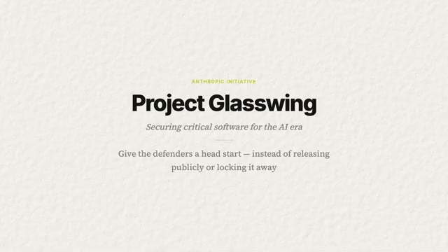
*⏱️ 00:03:34 — Diapositive de présentation affichant le titre "Project Glasswing" et le sous-titre "Securing critical software for the AI era".*

---

### ⏱️ `[00:03:41 - 00:04:16]` | Segment #10

**🔊 Audio (Transcription Intégrale Mot pour Mot en Français) :**
> Parce qu'au lieu de sortir le modèle publiquement ou simplement de l'enfermer dans un coffre-fort, Anthropic a choisi une troisième option, qui consiste à le donner d'abord aux défenseurs. Ils se sont associés avec AWS, Apple, Google, Microsoft, NVIDIA, Cisco, CrowdStrike, JP Morgan, et une tonne d'autres. En gros, les entreprises qui construisent les logiciels sur lesquels tourne tout l'internet. Ces partenaires auront un accès direct à Mythos pour analyser leurs propres systèmes, trouver les bugs avant que les attaquants ne le puissent, et les corriger avant même que quiconque sache qu'ils existent. Anthropic l'a également ouvert à plus de 40 organisations qui gèrent des infrastructures logicielles critiques. Ils ont engagé 100 millions de dollars de crédits d'utilisation et ont fait don de 4 millions

**👁️ Analyse Visuelle d'Écran (gemini-3.5-flash-lite) :**
**Interface & Outils** : Diapositive de présentation textuelle.

**Contenu textuel & Code** : Noms des partenaires de la coalition Project Glasswing (AWS, Apple, Google, Microsoft, NVIDIA, Cisco, CrowdStrike, JPMorganChase, Linux Foundation, Palo Alto Networks, Broadcom).

**Action / Démonstration** : Affichage des entreprises partenaires impliquées dans le projet de sécurité d'Anthropic.

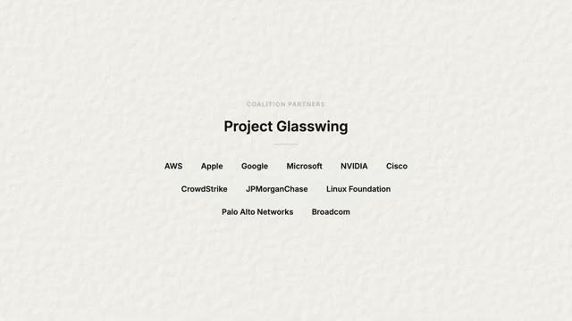
*⏱️ 00:03:49 — Une diapositive graphique présentant le titre "Project Glasswing" et la liste des partenaires de la coalition, incluant AWS, Apple, Google, Microsoft, NVIDIA, Cisco, CrowdStrike, JPMorganChase, Linux Foundation, Palo Alto Networks et Broadcom.*

---

### ⏱️ `[00:04:16 - 00:04:51]` | Segment #11

**🔊 Audio (Transcription Intégrale Mot pour Mot en Français) :**
> directement à des groupes de sécurité open source. Et ils ont été en discussion avec le gouvernement américain. En plus de cela, ils se sont engagés à partager publiquement ce qu'ils ont appris dans les 90 jours. Et honnêtement, c'est peut-être la première fois qu'un grand laboratoire d'intelligence artificielle a essentiellement dit, nous avons construit quelque chose de trop puissant pour être publié, mais voici notre plan. C'est un précédent. Maintenant, que d'autres laboratoires suivent ou non va définir les prochaines années, les prochaines décennies de l'IA. Mais de toute façon, qu'est-ce que cela signifie réellement pour vous et pour moi ? Parce je sais que la plupart d'entre vous qui regardent ceci ne gèrent pas la sécurité dans une entreprise du classement Fortune 500. Vous êtes probablement juste une personne moyenne qui utilise un téléphone, un ordinateur portable,

**👁️ Analyse Visuelle d'Écran (gemini-3.5-flash-lite) :**
**Interface & Outils** : AUCUNE

**Contenu textuel & Code** : AUCUNE

**Action / Démonstration** : AUCUNE

---

### ⏱️ `[00:04:51 - 00:05:11]` | Segment #12

**🔊 Audio (Transcription Intégrale Mot pour Mot en Français) :**
> et à coder des trucs avec Cloud Code. Et c'est exactement ce que je suis. Voici donc la partie pratique. Si vous utilisez un téléphone, un navigateur ou n'importe quelle application, votre logiciel est sur le point de devenir plus sûr. Les bugs que Mythos trouve se trouvent dans le code qui fait fonctionner votre système d'exploitation, votre lecteur vidéo ou votre navigateur web. Et ces correctifs sont déjà en train d'être déployés. Vous ne le verrez pas vraiment se produire, mais vous recevrez une mise à jour logicielle un jour.

**👁️ Analyse Visuelle d'Écran (gemini-3.5-flash-lite) :**
**Interface & Outils** : Présentation vidéo / Diapositive textuelle

**Contenu textuel & Code** : Texte à l'écran : "WHAT IT MEANS FOR YOU", "Your software is about to get more secure", et "Patches already rolling out to operating systems, video players, and web browsers you use every day"

**Action / Démonstration** : Le présentateur illustre ses propos avec une diapositive montrant l'impact de la sécurité sur les logiciels.

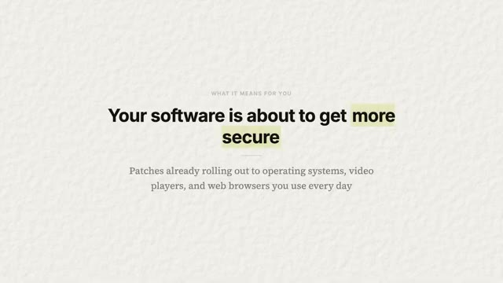
*⏱️ 00:05:01 — Une diapositive textuelle sur fond blanc texturé avec le titre "Your software is about to get more secure".*

---

### ⏱️ `[00:05:12 - 00:05:30]` | Segment #13

**🔊 Audio (Transcription Intégrale Mot pour Mot en Français) :**
> Et derrière cette mise à jour se trouve une intelligence artificielle qui a découvert une vulnérabilité qu'un humain n'aurait peut-être jamais détectée. Et maintenant, elle a été améliorée. C'est l'une des premières fois que l'IA va directement rendre votre vie numérique plus sûre sans que vous ayez à faire quoi que ce soit. Espérons-le, du moins. Maintenant, si vous êtes propriétaire d'une petite entreprise, c'est là que ça devient intéressant, car la sécurité a toujours été un problème digne du Fortune 500.

**👁️ Analyse Visuelle d'Écran (gemini-3.5-flash-lite) :**
**Interface & Outils** : Aucun

**Contenu textuel & Code** : Aucun

**Action / Démonstration** : Présentation orale face caméra

---

### ⏱️ `[00:05:30 - 00:05:48]` | Segment #14

**🔊 Audio (Transcription Intégrale Mot pour Mot en Français) :**
> Les grandes entreprises embauchent des équipes rouges, effectuent des tests d'intrusion, paient des millions de dollars pour des audits de sécurité, mais les petites entreprises se contentent parfois d'un antivirus en croisant les doigts. Ce que fait Glasswing, c'est essentiellement démocratiser la sécurité de niveau Fortune 500 pour tout le monde. Lorsque Mythos trouve un bogue dans Linux ou dans un framework web sur lequel tourne votre site Internet, ce correctif vous parvient aussi.

**👁️ Analyse Visuelle d'Écran (gemini-3.5-flash-lite) :**
**Interface & Outils** : Navigateur web affichant une interface minimaliste de présentation produit.

**Contenu textuel & Code** : Le texte 'SECURITY DEMOCRATIZED', 'Fortune 500 Security', 'Everyone', et 'When Mythos finds a bug in Linux or a web framework, that fix reaches you too'.

**Action / Démonstration** : Présentation visuelle de la proposition de valeur de l'entreprise Glasswing / Mythos concernant la démocratisation de la sécurité informatique.

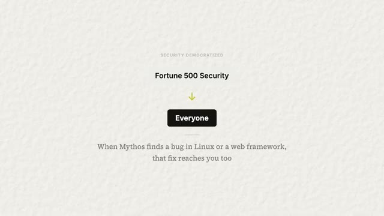
*⏱️ 00:05:39 — Capture d'écran d'une page web montrant le texte 'Fortune 500 Security' avec une flèche menant au mot 'Everyone'.*

---

### ⏱️ `[00:05:49 - 00:06:07]` | Segment #15

**🔊 Audio (Transcription Intégrale Mot pour Mot en Français) :**
> Vous bénéficierez donc de la même analyse par IA qui protège l'infrastructure d'Apple et de Google. Vous ne payez pas pour cela. Vous ne savez même pas ce qui se passe, mais vous en êtes protégés. Et à mesure que cette technologie mûrira, ces outils finiront par devenir directement accessibles aux plus petites entreprises. Imaginez pouvoir analyser votre propre code source avec la même IA qui a trouvé des bugs vieux de 27 ans dans des systèmes d'exploitation. C'est vers cela que nous nous dirigeons.

**👁️ Analyse Visuelle d'Écran (gemini-3.5-flash-lite) :**
**Interface & Outils** : Aucune interface logicielle visible.

**Contenu textuel & Code** : Aucun code, terminal ou donnée affiché à l'écran.

**Action / Démonstration** : Aucune action technique ou démonstration en cours.

---

### ⏱️ `[00:06:07 - 00:06:28]` | Segment #16

**🔊 Audio (Transcription Intégrale Mot pour Mot en Français) :**
> Donc, laissez-moi vous laisser avec ce que je pense que cela signifie vraiment. Je pense qu'Anthropic vient de faire la bonne chose, et je pense qu'ils méritent vraiment beaucoup de crédit pour cela. Ils avaient un modèle qui aurait probablement pu leur rapporter énormément d'argent. Ils gagnent déjà énormément d'argent, mais vous voyez ce que je veux dire. Cela va aussi générer beaucoup de buzz pour eux. S'ils sortaient ça demain, ce serait absolument fou. Tout le monde sur Internet dans le monde de l'IA en parlerait.

**👁️ Analyse Visuelle d'Écran (gemini-3.5-flash-lite) :**
**Interface & Outils** : Aucun logiciel ou interface affiché.

**Contenu textuel & Code** : Aucun code, terminal ou donnée visible.

**Action / Démonstration** : Le présentateur parle directement à la caméra sans manipulation technique ni démonstration.

---

### ⏱️ `[00:06:28 - 00:06:49]` | Segment #17

**🔊 Audio (Transcription Intégrale Mot pour Mot en Français) :**
> Au lieu de cela, ils ont ralenti le processus. Ils ont élaboré un plan de déploiement et ont donné une longueur d'avance aux défenseurs. Ce n'est pas le choix le plus facile, mais c'est le bon choix. Oh, encore une chose. Au moment où je montais cette vidéo, Boris Cherney venait de tweeter, le créateur de CloudCode. Il a dit : « Mythos est très puissant et devrait sembler terrifiant. Je suis fier de notre approche qui consiste à le présenter de manière responsable aux cyberdéfenseurs plutôt que de le lancer généralement dans la nature. »

**👁️ Analyse Visuelle d'Écran (gemini-3.5-flash-lite) :**
**Interface & Outils** : Capture d'écran textuelle d'un tweet ou d'une citation.

**Contenu textuel & Code** : Citation de Boris Cherney : "Mythos is very powerful and should feel terrifying. I am proud of our approach to responsibly preview it with cyber defenders rather than generally releasing it into the wild."

**Action / Démonstration** : Affichage à l'écran d'une citation externe pour illustrer le propos du présentateur sur les mesures de sécurité et les retours de Boris Cherney.

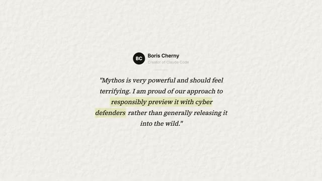
*⏱️ 00:06:39 — Une citation de Boris Cherney (Creator of Claude Code) affichée sur fond blanc texturé avec le texte surligné concernant l'outil Mythos.*

---

### ⏱️ `[00:06:49 - 00:07:09]` | Segment #18

**🔊 Audio (Transcription Intégrale Mot pour Mot en Français) :**
> Tout à fait d'accord. Beau travail, Boris et l'équipe de CloudCode. Voici donc mon avis honnête. Ce que j'attends vraiment de voir, c'est si cela devient réellement le nouveau standard ou si c'est juste un truc qu'un labo a fait une seule fois. Car la vérité inconfortable, c'est que ce n'est pas un événement unique. Chaque génération de modèles d'IA sera de plus en plus douée pour trouver des failles. La courbe exponentielle ne s'aplatit pas.

**👁️ Analyse Visuelle d'Écran (gemini-3.5-flash-lite) :**
**Interface & Outils** : Aucune interface visible

**Contenu textuel & Code** : Aucun code source, terminal ou donnée affiché

**Action / Démonstration** : Le présentateur s'exprime face caméra

---

### ⏱️ `[00:07:09 - 00:07:29]` | Segment #19

**🔊 Audio (Transcription Intégrale Mot pour Mot en Français) :**
> Ça va devenir de plus en plus raide. Donc la question est, est-ce qu'OpenAI fera de même ? Est-ce que Google le fera ? Est-ce que Meta le fera ? Les laboratoires qui prennent cela au sérieux, qui élaborent des plans de sécurité avant d'en avoir besoin, seront ceux auxquels nous ferons confiance pour la prochaine génération. Ceux qui ne le font pas seront ceux qui feront les grands titres qui nous terrifient tous. La nouvelle la plus dure, c'est qu'il s'agit d'une course aux armements et qu'elle ne se terminera peut-être jamais.

**👁️ Analyse Visuelle d'Écran (gemini-3.5-flash-lite) :**
**Interface & Outils** : Aucune interface logicielle ou de programmation visible.

**Contenu textuel & Code** : Texte graphique posant la question des actions futures d'OpenAI, Google et Meta.

**Action / Démonstration** : Le présentateur s'exprime face caméra pour introduire une question clé.

---

### ⏱️ `[00:07:29 - 00:07:49]` | Segment #20

**🔊 Audio (Transcription Intégrale Mot pour Mot en Français) :**
> Mais pour la première fois, les défenseurs ont réellement pris une bonne longueur d'avance, et cela compte plus que la plupart des gens ne le réalisent. Mais bref, c'est tout pour celui-ci. Le domaine évolue super vite et je m'amuse beaucoup à rester à l'affût de tout cela. Alors dites-moi ce que vous en pensez dans les commentaires. Et si vous voulez rejoindre ma communauté School gratuite où l'on discute intensément de ce genre de sujets chaque jour, le lien est dans la description et je vous dis à la prochaine. Merci à tous.

**👁️ Analyse Visuelle d'Écran (gemini-3.5-flash-lite) :**
**Interface & Outils** : Aucun éditeur ou outil technique affiché.

**Contenu textuel & Code** : Texte de conclusion sur la sécurité et les défenseurs.

**Action / Démonstration** : Conclusion de la vidéo par le présentateur.

---

