# 🎬 I Tested Claude's New Managed Agents... What You Need To Know

> **Chaîne** : [Nate Herk | AI Automation](https://www.youtube.com/@nateherk/featured)  
> **Lien YouTube** : [https://www.youtube.com/watch?v=27Y44JYXZJ8](https://www.youtube.com/watch?v=27Y44JYXZJ8)  
> **Date de publication** : 20260408  
> **Durée** : 00:16:32  
> **Identifiant vidéo** : `27Y44JYXZJ8`  
> **Transcription & Analyse** : `whisper-v3-large-turbo+gemini-3.5-flash-lite`  

---

## 📌 Synthèse Exécutive & Outils

### 💡 Résumé

Cette vidéo signée Nate Herk explore le lancement par Anthropic des « agents gérés » (Managed Agents) au sein de la console Claude, une fonctionnalité conçue pour permettre aux équipes de déployer des agents IA autonomes en production beaucoup plus rapidement en s'affranchissant des complexités d'infrastructure. L'analyse met en lumière la stratégie d'Anthropic visant à simplifier l'hébergement cloud sécurisé, la gestion des environnements bac à sable (sandboxes) et l'intégration d'outils tiers via des serveurs MCP (Model Context Protocol). L'auteur détaille un cas pratique de création d'un agent de veille concurrentielle, depuis la configuration initiale via une interface conversationnelle ou des modèles, jusqu'à l'authentification OAuth et le paramétrage des coffres-forts d'identifiants partagés.

Au fil du test, l'analyste soulève des nuances importantes concernant l'ergonomie et la rigueur nécessaire dans la gestion des versions d'agents. Bien que la solution s'adresse en priorité aux utilisateurs de Claude Chat peu familiers avec les environnements de développement complexes comme Claude Code, elle offre une interface visuelle épurée pour suivre l'exécution des tâches en temps réel (recherches web, scripts Bash, outils de manipulation de code). Le modèle économique repose sur un coût de session horaire actif combiné à la consommation de jetons API, rendant l'approche flexible mais nécessitant une surveillance attentive des flux de travail automatisés.

### 🛠️ Outils, Modèles & Logiciels Présentés

* **Claude (Agents gérés)** : Nouvelle solution d'Anthropic permettant d'héberger, configurer et exécuter des agents IA autonomes sur une infrastructure cloud gérée sans effort d'infrastructure préalable.
* **Claude Code / SDK d'agent** : Environnement de développement avancé pour les ingénieurs, partageant les mêmes capacités sous-jacentes (bash, grep, lectures, écritures) que les agents gérés, mais destiné à un public technique.
* **Opus 4.6 (et mentions d'Opus 5.5)** : Modèles de pointe d'Anthropic sélectionnés pour exécuter des tâches complexes de raisonnement et d'analyse concurrentielle au sein des agents.
* **Sonnet 4.6** : Modèle intermédiaire d'Anthropic utilisé pour des agents secondaires ou des configurations de test plus légères.
* **Notion** : Plateforme tierce illustrant l'intégration native des agents gérés, permettant aux équipes de déléguer du travail à Claude directement via des statuts de tâches.
* **ClickUp** : Outil de gestion de projet connecté aux agents via des serveurs MCP et une authentification OAuth sécurisée stockée dans des coffres-forts d'équipe.
* **OpenClaw** : Interface tierce mentionnée dans le contexte des restrictions d'abonnement et de l'évolution des usages des modèles Anthropic.

### 🔑 Points Clés & Enseignements Stratégiques

* **Démocratisation du déploiement d'agents** : Les agents gérés permettent de s'affranchir de mois de travail d'infrastructure en encapsulant l'exécution dans des conteneurs cloud bac à sable préconfigurés.
* **Modèle d'accès simplifié** : Aucun abonnement spécifique n'est requis ; il suffit de configurer une clé API avec un dépôt initial d'environ cinq dollars pour accéder à la création d'agents.
* **Expérience utilisateur conversationnelle** : L'interface de démarrage rapide permet de décrire simplement un objectif en langage naturel pour générer automatiquement la configuration, le nom, la description et le prompt système.
* **Séparation des rôles selon l'expertise** : Les utilisateurs évoluant déjà dans Claude Code jugeront l'outil redondant, tandis que les utilisateurs de Claude Chat y trouvent un pont puissant et accessible vers l'automatisation.
* **Isolation et sécurité des environnements** : Chaque agent opère dans un conteneur cloud dédié (environnement) avec des règles de réseau personnalisables (ex. accès sans restriction pour la veille web).
* **Intégration fluide via MCP et OAuth** : La connexion aux outils SaaS (comme ClickUp) s'effectue en quelques clics via des flux OAuth sécurisés et centralisés dans des coffres-forts d'équipe (Vaults).
* **Nécessité d'une révision rigoureuse des prompts** : Lors des modifications itératives (comme l'ajout de contexte métier), il est primordial de vérifier la bonne mise à jour des versions de prompts système pour garantir la pertinence des livrables.
* **Observabilité en temps réel** : La console offre une vue séquentielle détaillée (barre horizontale et journaux d'exécution) permettant de suivre chaque étape de l'agent (recherches web, appels d'outils).
* **Parallélisme technologique** : Les agents gérés partagent la même boîte à outils technique que Claude Code (commandes bash, lectures, greps, requêtes web), garantissant une puissance d'exécution équivalente.
* **Modèle de tarification transparent** : La facturation dissocie les environnements (inactifs et gratuits au repos) des sessions actives, facturées à l'heure (0,08 $ par heure) en sus de la consommation réelle de jetons API.
* **Assistance contextuelle intégrée** : Le bouton « Demander à Claude » permet d'interagir directement avec l'assistant pour auditer la configuration, comprendre le comportement de l'agent ou ajuster les paramètres.

---

## ⏱️ Chronologie & Transcription Complète Audio & Visuelle (Mot pour Mot)

### ⏱️ `[00:00:00 - 00:00:31]` | Segment #01

**🔊 Audio (Transcription Intégrale Mot pour Mot en Français) :**
> Il y a quatre jours, Claude est sorti et a dit, hé, vous n'avez plus le droit d'utiliser votre abonnement dans des interfaces tierces comme OpenClaw. Et les gens étaient contrariés parce que maintenant ils payent beaucoup plus cher pour l'IA à moins d'utiliser quelque chose de local. Et puis hier, Anthropics dit, hé, nous avons littéralement un modèle qui est trop dangereux pour être publié. Il écrase Opus 4.6. Alors aujourd'hui, ils sortent un truc appelé Agents gérés avec le slogan d'arriver en production 10 fois plus vite. Et honnêtement, j'ai passé les trois dernières heures à jouer avec, et je suis un peu déçu. Parce qu'après avoir annoncé ça et après avoir annoncé ça, on se dit, ok, ils s'attaquent vraiment à OpenClaw cette fois-ci.

**👁️ Analyse Visuelle d'Écran (gemini-3.5-flash-lite) :**
**Interface & Outils** : Présentation vidéo avec captures d'écran de communiqués et publications textuelles.

**Contenu textuel & Code** : Texte d'annonces officielles d'Anthropic et graphiques de performance comparative (SWE-bench).

**Action / Démonstration** : Présentation chronologique des actualités récentes de Claude par le présentateur.

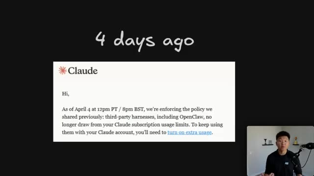
*⏱️ 00:00:08 — Capture d'écran montrant un message de notification de Claude daté de 4 jours auparavant concernant les limites d'utilisation des abonnements dans les interfaces tierces.*

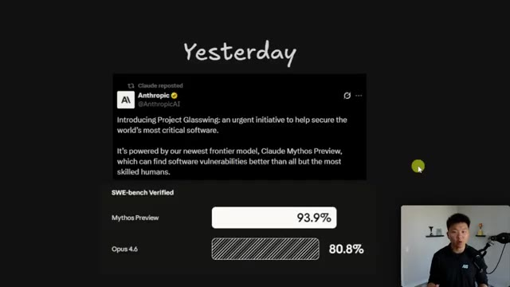
*⏱️ 00:00:16 — Capture d'écran montrant une publication d'Anthropic de la veille introduisant le projet Glasswing et le modèle Claude Mythos Preview avec ses performances sur SWE-bench Verified.*

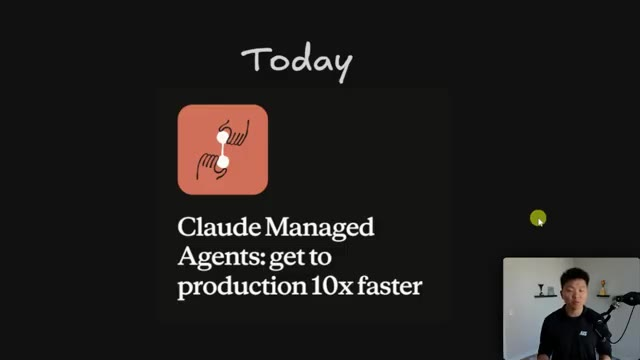
*⏱️ 00:00:23 — Capture d'écran affichant l'annonce d'aujourd'hui concernant "Claude Managed Agents" pour accélérer le développement vers la production.*

---

### ⏱️ `[00:00:32 - 00:00:53]` | Segment #02

**🔊 Audio (Transcription Intégrale Mot pour Mot en Français) :**
> Il s'agit fondamentalement pour eux de dire, hé, nous vous permettons désormais d'héberger un agent sur notre cloud et notre propre infrastructure, afin que vous n'ayez pas à passer tout ce temps à configurer tout cela. Déployer un agent en production signifiait auparavant des mois de travail d'infrastructure d'abord, mais maintenant les agents gérés s'en occupent pour vous, où vous définissez simplement les tâches, les outils et les garde-fous de votre agent. Et ensuite, ils configurent une sorte d'environnement de bac à sable cloud pour que tout cela puisse s'exécuter.

**👁️ Analyse Visuelle d'Écran (gemini-3.5-flash-lite) :**
**Interface & Outils** : Interface web de X (Twitter).

**Contenu textuel & Code** : Texte du tweet officiel de Claude et diagramme technique illustrant l'infrastructure des agents gérés.
[DESC_IMAGE_2] Le présentateur commente l'annonce des agents managés de Claude sur le cloud et l'infrastructure d'Anthropic.

**Action / Démonstration** : Explications face caméra et démonstration conceptuelle.

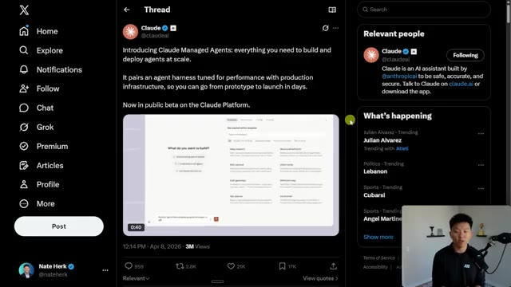
*⏱️ 00:00:37 — Capture d'écran montrant un tweet de Claude annonçant "Introducing Claude Managed Agents: everything you need to build and deploy agents at scale."*

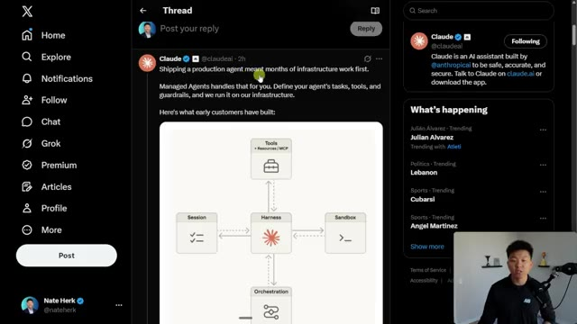
*⏱️ 00:00:42 — Capture d'écran montrant la suite du thread Twitter de Claude avec un diagramme explicatif sur l'architecture des Managed Agents (Harness, Sandbox, Tools, Session, Orchestration).*

---

### ⏱️ `[00:00:53 - 00:01:16]` | Segment #03

**🔊 Audio (Transcription Intégrale Mot pour Mot en Français) :**
> Et c'est pour cela qu'ils disent fondamentalement de construire et de déployer des agents 10 fois plus rapidement. Maintenant, ils font vraiment des choses très cool pour certaines entreprises. Nous pouvons voir que Notion propose une configuration d'agent géré où les équipes peuvent déléguer du travail à Claude directement à l'intérieur de Notion même. Elles font fondamentalement glisser certaines tâches vers un statut différent, puis l'agent Claude les récupère et les traite. Et si vous venez dans la documentation, vous pouvez voir beaucoup d'autres preuves concrètes de ce que les équipes construisent avec des agents gérés.

**👁️ Analyse Visuelle d'Écran (gemini-3.5-flash-lite) :**
**Interface & Outils** : Navigateur web affichant le site web de Claude (Anthropic).

**Contenu textuel & Code** : Texte descriptif sur les agents gérés de Claude, incluant des mentions sur Notion et Rakuten.
[SCROLLING] Le présentateur fait défiler la page web du blog pour illustrer les cas d'utilisation des agents.

**Action / Démonstration** : Explications face caméra et démonstration conceptuelle.

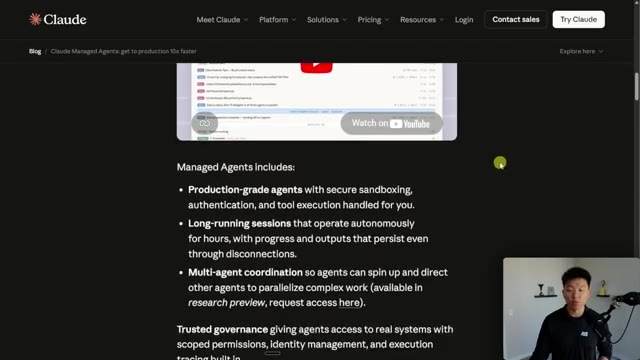
*⏱️ 00:00:59 — Capture d'écran du blog de Claude montrant les fonctionnalités des agents gérés (Managed Agents Includes).*

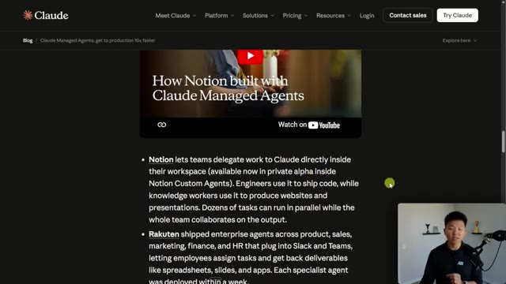
*⏱️ 00:01:05 — Capture d'écran du blog de Claude détaillant l'utilisation par Notion et Rakuten des agents gérés.*

---

### ⏱️ `[00:01:17 - 00:01:39]` | Segment #04

**🔊 Audio (Transcription Intégrale Mot pour Mot en Français) :**
> Donc, dans la vidéo d'aujourd'hui, je vais faire une brève analyse sur la façon dont ils fonctionnent réellement, ce qu'ils coûtent, quand vous devriez les utiliser, et un peu mes avis honnêtes et pourquoi c'est un peu décevant pour moi. Donc, si vous vous rendez dans la console Claude, vous pouvez voir sur ce côté gauche que nous avons quelque chose appelé des agents gérés ici. Et si je clique simplement sur démarrage rapide, nous pouvons essentiellement voir une petite interface où nous avons des modèles parmi lesquels choisir, ou nous avons une interface semblable à un chat où nous pouvons simplement décrire le type d'agent que nous voulons et il va simplement le construire.

**👁️ Analyse Visuelle d'Écran (gemini-3.5-flash-lite) :**
**Interface & Outils** : Console Claude (interface web) et Twitter/X.

**Contenu textuel & Code** : Menu latéral de la console Claude avec les sections Build, Managed Agents (Quickstart, Agents, Sessions, Environments, Credential vaults), Analytics, Claude Code.

**Action / Démonstration** : Navigation et présentation de la console Claude par le présentateur en lien avec le sujet des agents gérés.

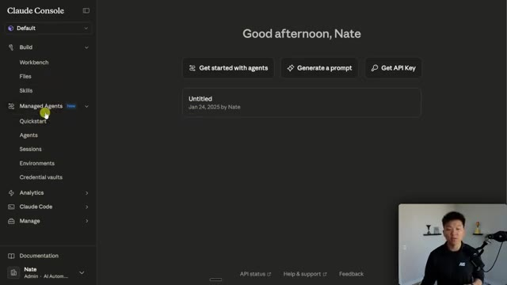
*⏱️ 00:01:28 — Capture d'écran de l'interface de la console Claude affichant le tableau de bord avec le menu latéral 'Managed Agents'.*

---

### ⏱️ `[00:01:39 - 00:01:58]` | Segment #05

**🔊 Audio (Transcription Intégrale Mot pour Mot en Français) :**
> Maintenant, la bonne nouvelle, c'est que vous n'avez pas vraiment besoin d'abonnement. Donc, ceux d'entre vous qui n'ont peut-être pas d'abonnement Cloud Code, tout ce que vous avez à faire, c'est de venir ici et de configurer simplement une clé API, pour laquelle vous devez déposer environ cinq dollars pour commencer. Disons donc que je veux créer un agent capable d'analyser les concurrents et qui fera essentiellement des recherches, puis me donnera une analyse sur ce que nous pouvons faire différemment en tantentreprise afin de garder une longueur d'avance.

**👁️ Analyse Visuelle d'Écran (gemini-3.5-flash-lite) :**
**Interface & Outils** : Navigateur web affichant Claude Console (Anthropic)

**Contenu textuel & Code** : Interface utilisateur avec des options de configuration d'agents (« Quickstart », « Agents », « Sessions », « Credential vaults »), une barre de recherche de templates et une boîte de saisie « Describe your agent... ».

**Action / Démonstration** : Navigation dans l'interface de la console Claude pour présenter les différentes options de création d'agents sans nécessité d'abonnement.

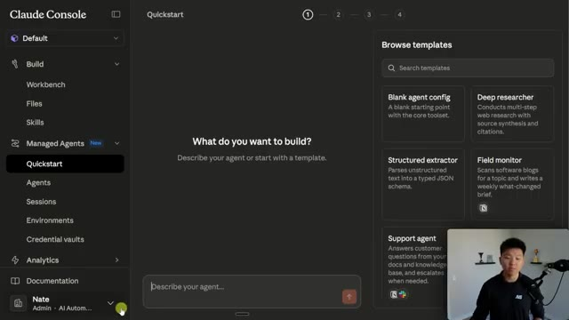
*⏱️ 00:01:44 — Capture d'écran de la console Claude affichant l'interface Quickstart pour configurer ou créer un agent IA, avec le présentateur visible en médaillon dans le coin inférieur droit.*

---

### ⏱️ `[00:01:59 - 00:02:21]` | Segment #06

**🔊 Audio (Transcription Intégrale Mot pour Mot en Français) :**
> Donc ce qui se passe, c'est qu'automatiquement ici sur ce côté droit, ça rédige ce prompt. Vous pouvez voir que nous avons un nom, une description, un modèle, un prompt système, et ensuite nous avons d'autres choses comme un serveur MCP et quelques outils. Nous avons aussi la possibilité de donner à ces agents des compétences, ce qui est génial, bien sûr. Maintenant, je pourrais aller de l'avant et créer cet agent ou continuer à l'affiner. Donc si je clique dessus, ça dira du genre, hé, qu'est-ce que tu veux ajouter d'autre ? Ici, ce que je fais, c'est lui demander de changer le modèle pour Opus 4.6 au lieu de Sonnet 4.6.

**👁️ Analyse Visuelle d'Écran (gemini-3.5-flash-lite) :**
**Interface & Outils** : Claude Console (interface web)

**Contenu textuel & Code** : Code YAML contenant la configuration d'un agent (`name: Competitor Intelligence Agent`, `description`, `model`, `system`, `mcp_servers`, `tools`).

**Action / Démonstration** : Génération automatique du prompt YAML et de la configuration de l'agent dans le panneau de droite suite à la demande textuelle.

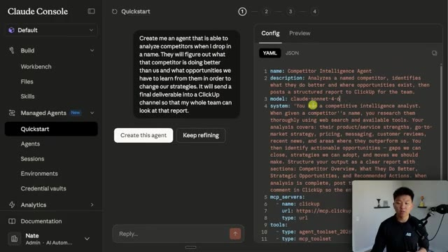
*⏱️ 00:02:04 — Interface de Claude Console montrant un panneau de configuration YAML avec un prompt système pour un agent d'intelligence concurrentielle.*

---

### ⏱️ `[00:02:22 - 00:02:57]` | Segment #07

**🔊 Audio (Transcription Intégrale Mot pour Mot en Français) :**
> Et vous pouvez voir que ça change juste cette configuration juste là. Et maintenant je vais cliquer sur créer cet agent. Donc ce que je veux que vous pensiez pendant qu'on avance là-dedans, c'est votre point de vue si vous êtes quelqu'un qui vit déjà dans cloud code, alors ça ne vous paraît pas vraiment grand-chose et ce n'est pas super utile, mais si vous êtes quelqu'un qui vit principalement dans cloud chat et que vous n'avez jamais utilisé co-work ou code, alors c'est un énorme, énorme apport de valeur pour vous et vous pouvez créer des agents vraiment très rapidement en décrivant simplement un objectif. Et c'est littéralement juste un processus en cinq étapes. Vous pouvez voir qu'on vient juste de finir l'étape un qui était de créer l'agent réel et maintenant nous devons créer l'environnement qui est notre conteneur cloud qu'Anthropic héberge,

**👁️ Analyse Visuelle d'Écran (gemini-3.5-flash-lite) :**
**Interface & Outils** : Claude Console et Claude API Docs (interfaces web de la plateforme Anthropic).

**Contenu textuel & Code** : Code de configuration YAML définissant le nom, la description, le modèle (claude-opus-4-6), le prompt système, les serveurs MCP (ClickUp) et les outils d'un agent, ainsi qu'une requête cURL POST vers l'API.
[DESC_IMAGE_2] La documentation officielle montrant les étapes clés de création et d'exécution d'un agent managé.

**Action / Démonstration** : Configuration et création d'un agent via l'interface de la console Claude.

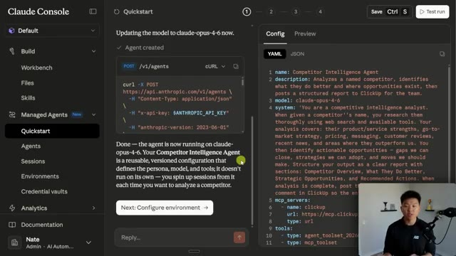
*⏱️ 00:02:30 — L'interface de la Claude Console affichant la création d'un agent nommé "Competitor Intelligence Agent" avec un panneau de configuration YAML à droite et un aperçu cURL à gauche.*

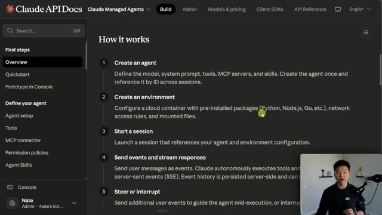
*⏱️ 00:02:48 — La page de documentation "Claude API Docs" décrivant le fonctionnement des agents gérés (How it works : Create an agent, Create an environment, Start a session).*

---

### ⏱️ `[00:02:57 - 00:03:18]` | Segment #08

**🔊 Audio (Transcription Intégrale Mot pour Mot en Français) :**
> et il a des paquets préinstallés. Donc nous donnons fondamentalement à cet agent son propre petit ordinateur sur le web. Donc il est dit ici, ensuite, nous devons configurer l'environnement. Super, nous allons continuer et cliquer sur suivant. Un environnement est comme un conteneur cloud, bla, bla, bla. Il définit les règles de réseau et dit fondamentalement, qu'est-ce que votre agent peut réellement faire ? J'ai donc trois environnements configurés, mais je vais simplement continuer et dire, d'accord, créons un nouvel environnement pour cet agent spécifique.

**👁️ Analyse Visuelle d'Écran (gemini-3.5-flash-lite) :**
**Interface & Outils** : Claude Console (interface web d'Anthropic)

**Contenu textuel & Code** : Code de configuration YAML définissant un agent de veille concurrentielle (Competitor Intelligence Agent) avec son modèle, son prompt système et ses serveurs MCP (ClickUp).

**Action / Démonstration** : Le créateur montre la création et la configuration de l'agent, en survolant le bouton pour configurer l'environnement.

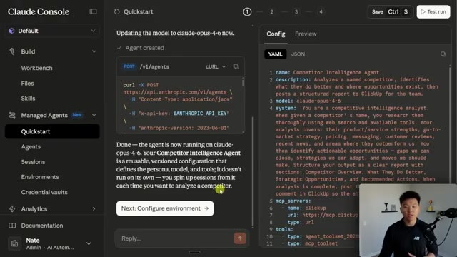
*⏱️ 00:03:02 — Capture d'écran de l'interface Claude Console montrant la configuration rapide (Quickstart) d'un agent de veille concurrentielle avec un panneau de code YAML à droite et le présentateur en médaillon en bas à droite.*

---

### ⏱️ `[00:03:18 - 00:03:43]` | Segment #09

**🔊 Audio (Transcription Intégrale Mot pour Mot en Français) :**
> Donc c'est ce que j'ai dit. Il est écrit, quel accès réseau cet agent a-t-il besoin ? Je vais simplement continuer pour les besoins de la démo et dire sans restriction. Et maintenant, il crée cet environnement super rapidement pour nous. Encore une fois, nous ne faisons rien. Tout ce que j'ai à faire maintenant, c'est de cliquer sur démarrer la session. Donc il est dit qu'une session est en direct, mais avant de tester réellement, nous devons nous connecter à ClickUp. Maintenant, c'est là que ça devient intéressant. Tout ce que vous avez to faire pour vous connecter, c'est un peu comme une connexion OAuth parce que cela utilise des serveurs MCP et des choses comme ça.

**👁️ Analyse Visuelle d'Écran (gemini-3.5-flash-lite) :**
**Interface & Outils** : Claude Console (interface web d'Anthropic pour la gestion d'agents)

**Contenu textuel & Code** : Code YAML de configuration de l'agent (Competitor Intelligence Agent) et requêtes cURL pour la création d'environnements d'agents managés.

**Action / Démonstration** : Création automatique de l'environnement d'agent avec accès réseau sans restriction suite à la sélection dans la console.

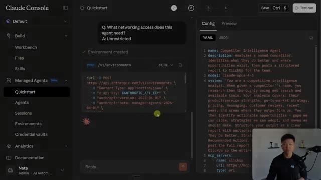
*⏱️ 00:03:24 — Image montrant Claude Console avec la question sur l'accès réseau de l'agent et la requête cURL générée pour la création d'environnement.*

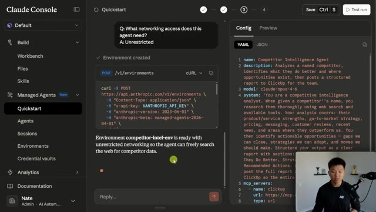
*⏱️ 00:03:31 — Image montrant Claude Console avec la confirmation que l'environnement 'competitor-intel-env' est prêt avec un accès réseau sans restriction.*

---

### ⏱️ `[00:03:43 - 00:04:05]` | Segment #10

**🔊 Audio (Transcription Intégrale Mot pour Mot en Français) :**
> Donc encore une fois, la proposition de valeur ici, si vous n'avez jamais construit d'agent et que vous êtes sur Cloud Code ou quelque chose du genre, vous pourriez vous perdre quand vous commencez à penser aux clés API ou aux accès. Mais ici, c'est aussi simple que de se connecter, et ensuite c'est stocké dans votre coffre. Nous avons donc un coffre qui peut être partagé entre différentes personnes de votre équipe. J'en ai créé un appelé Test Vault. Pour les besoins de la démonstration, disons que je veux créer un nouveau coffre afin de stocker cette différente information d'identification ClickUp.

**👁️ Analyse Visuelle d'Écran (gemini-3.5-flash-lite) :**
**Interface & Outils** : Claude Console (interface web d'Anthropic pour la gestion d'agents et de coffres d'identifiants)

**Contenu textuel & Code** : Configuration YAML d'un "Competitor Intelligence Agent" (nom, description, modèle claude-opus-4-6, prompt système et mcp_servers pour ClickUp) ainsi qu'un assistant de configuration interactif pour les identifiants ClickUp.

**Action / Démonstration** : Configuration des identifiants (Credential vaults) pour l'agent géré (Managed Agent) via l'assistant de démarrage rapide (Quickstart).

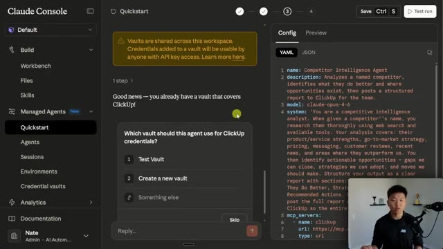
*⏱️ 00:03:49 — Capture d'écran de l'interface Claude Console montrant le panneau de configuration Quickstart avec la sélection des coffres d'identifiants (Credential vaults) et un éditeur de configuration YAML sur le côté droit.*

---

### ⏱️ `[00:04:05 - 00:04:27]` | Segment #11

**🔊 Audio (Transcription Intégrale Mot pour Mot en Français) :**
> Il est indiqué qu'une autorisation est requise pour utiliser ce MCP. Je pourrais utiliser un jeton d'accès, ou des identifiants OAuth. Ou bien ici, cela m'a simplement invité à effectuer l'authentification unique, et ensuite nous devrions être parés. Je vais cliquer sur Connecter, comme vous pouvez le voir. Et ensuite, tout ce que j'ai à faire, c'est de choisir l'espace de travail auquel je veux réellement me connecter. Je choisis donc « up at AI ». C'est aussi simple que cela. N'importe qui peut pratiquement suivre cette procédure et créer un agent, et voilà, c'est déjà fait.

**👁️ Analyse Visuelle d'Écran (gemini-3.5-flash-lite) :**
**Interface & Outils** : Claude Console (interface web)

**Contenu textuel & Code** : Configuration YAML d'un agent de veille concurrentielle (Competitor Intelligence Agent) utilisant un serveur MCP clickup, et invite d'autorisation pour ClickUp.

**Action / Démonstration** : Configuration de l'authentification et des identifiants requis pour connecter l'agent au service ClickUp via un serveur MCP.

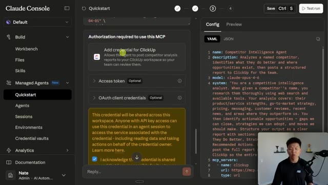
*⏱️ 00:04:11 — L'interface de Claude Console affichant une invite d'autorisation pour utiliser le MCP ClickUp, avec des options pour ajouter des identifiants, un jeton d'accès ou des informations d'identification OAuth.*

---

### ⏱️ `[00:04:28 - 00:04:52]` | Segment #12

**🔊 Audio (Transcription Intégrale Mot pour Mot en Français) :**
> Donc il est dit que notre session est en direct et nous pouvons commencer à discuter ici, mais la seule chose que je viens de réaliser c'est que ceci n'a aucune idée de notre véritable entreprise, alors comment pourrait-il nous donner un bon rapport ? Donc maintenant je lui donne un peu plus de contexte sur notre véritable entreprise et cela va nous aider à changer la façon dont cet agent est programmé. Donc si je bascule ici vers l'onglet des agents, vous pouvez voir que nous avons cet agent mais vous devez être vraiment prudent ici parce que dans l'onglet des agents nous pouvons voir que j'ai deux versions, n'est-ce pas ?

**👁️ Analyse Visuelle d'Écran (gemini-3.5-flash-lite) :**
**Interface & Outils** : Interface web Claude Console (Quickstart, Managed Agents)

**Contenu textuel & Code** : Commande cURL pour l'API Anthropic (/v1/sessions) et prompt de test : "Analyze Notion as a competitor and post report to our ClickUp team chat"

**Action / Démonstration** : Configuration et test en direct d'un agent géré dans la console Claude.

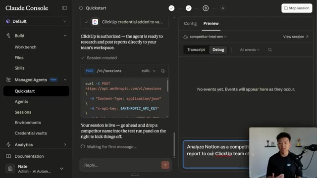
*⏱️ 00:04:34 — Interface de la console Claude affichant le panneau Quickstart d'un agent géré avec un bloc de code cURL et une zone de test en bas à droite où le présentateur tape un prompt.*

---

### ⏱️ `[00:04:52 - 00:05:10]` | Segment #13

**🔊 Audio (Transcription Intégrale Mot pour Mot en Français) :**
> Voici le prompt système pour la version un, et voici le prompt système pour la version deux. Ils n'ont même pas changé. Je ne pense donc pas que cela ait réellement implémenté cette connaissance. Donc ce que je ferais ici, c'est que je viendrais et je cliquerais sur modification guidée. Et ensuite, je pourrais essentiellement dire, vous devez ajouter au prompt système que nous dirigeons une entreprise de plateforme de codage par IA.

**👁️ Analyse Visuelle d'Écran (gemini-3.5-flash-lite) :**
**Interface & Outils** : Claude Console (interface web d'agents IA)

**Contenu textuel & Code** : Le prompt système pour l'agent de veille concurrentielle ("You are a competitive intelligence analyst...") et les options de configuration.

**Action / Démonstration** : Consultation et révision des configurations et des prompts système des versions v1 et v2 de l'agent dans la console.

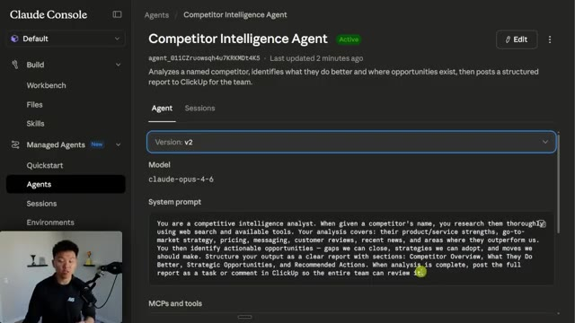
*⏱️ 00:04:57 — Capture d'écran montrant l'interface de la console Claude avec les détails d'un agent de veille concurrentielle (Competitor Intelligence Agent), affichant sa version active (v2), le modèle utilisé (claude-opus-4-6) et le prompt système correspondant.*

---

### ⏱️ `[00:05:11 - 00:05:29]` | Segment #14

**🔊 Audio (Transcription Intégrale Mot pour Mot en Français) :**
> Donc tout notre objectif est d'aider les gens à transformer une requête en langage naturel en logiciels ou en agents IA ou en sites web, des choses comme ça. C'est important pour que vous puissiez réellement me donner une bonne analyse. Et maintenant vous pouvez voir qu'il a effectivement été capable de modifier les invites système ici. Les sorties de l'agent devraient donc être beaucoup mieux maintenant. Allons-y donc et cliquons sur test d'exécution.

**👁️ Analyse Visuelle d'Écran (gemini-3.5-flash-lite) :**
**Interface & Outils** : Interface web "Claude Console"

**Contenu textuel & Code** : Fichier de configuration YAML d'un agent nommé "Competitor Intelligence Agent" définissant son rôle d'analyste de veille stratégique, son prompt système et l'intégration du serveur MCP ClickUp.

**Action / Démonstration** : Configuration et visualisation des paramètres d'un agent IA spécialisé dans l'analyse de la concurrence.

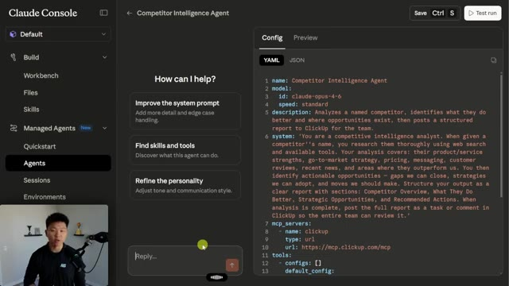
*⏱️ 00:05:15 — Interface de la console Claude affichant la configuration YAML d'un agent de veille concurrentielle (Competitor Intelligence Agent), avec le présentateur en médaillon en bas à gauche.*

---

### ⏱️ `[00:05:29 - 00:05:50]` | Segment #15

**🔊 Audio (Transcription Intégrale Mot pour Mot en Français) :**
> Nous devons choisir l'environnement réel pour exécuter cette chose. Nous allons donc faire de la veille concurrentielle. Et maintenant, je pourrais insérer un message du genre "analyser le code cloud" et cela lancerait et démarrerait réellement cette session. Maintenant, ce que nous pouvons faire ici, c'est voir étape par étape ce qui se passe et combien de temps prend réellement chaque étape. Si je clique sur "voir la session", nous obtenons une vue d'ensemble un peu meilleure car nous avons cette barre horizontale, qui nous montre en quelque sorte le chemin réel.

**👁️ Analyse Visuelle d'Écran (gemini-3.5-flash-lite) :**
**Interface & Outils** : Claude Console (interface web)

**Contenu textuel & Code** : Prompt "Analyze Claude Code" saisi dans le panneau de test d'un agent de veille concurrentielle.

**Action / Démonstration** : Le présentateur s'apprête à envoyer le prompt pour lancer la session de l'agent.

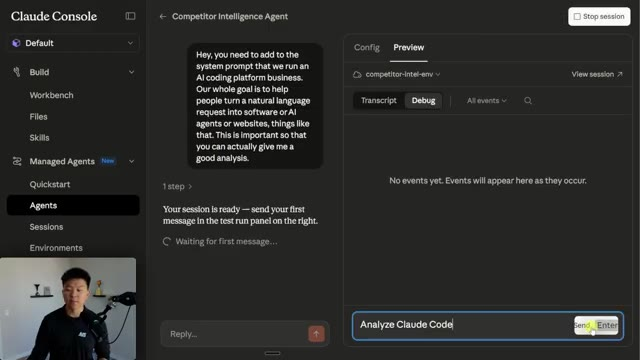
*⏱️ 00:05:35 — Capture d'écran de l'interface Claude Console montrant le panneau d'un agent de veille concurrentielle avec une zone de saisie contenant le texte "Analyze Claude Code".*

---

### ⏱️ `[00:05:50 - 00:06:12]` | Segment #16

**🔊 Audio (Transcription Intégrale Mot pour Mot en Français) :**
> Vous pouvez voir en ce moment, il vient de faire quatre recherches web différentes. Et il a fondamentalement tous les mêmes outils que CloudCode. Donc, quand vous pensez à vos bashes, vos lectures, vos greps, vos recherches ou vos récupérations, c'est fondamentalement ce que font ces agents. C'est essentiellement, vous savez, CloudCode, vous savez, le SDK d'agent, mais il a juste une belle interface autour. Mais cela offre aux personnes qui ont peur de regarder quelque chose comme CloudCode, une interface Cloud régulière beaucoup plus agréable.

**👁️ Analyse Visuelle d'Écran (gemini-3.5-flash-lite) :**
**Interface & Outils** : Claude Console (interface web d'administration et de supervision d'agents IA)

**Contenu textuel & Code** : Journal de session affichant des erreurs MCP (ClickUp), un prompt utilisateur « Analyze Claude Code », une réponse d'agent et l'exécution d'une recherche web (Web Search x4).

**Action / Démonstration** : Suivi et visualisation des événements d'une session d'agent en cours d'exécution dans la console.

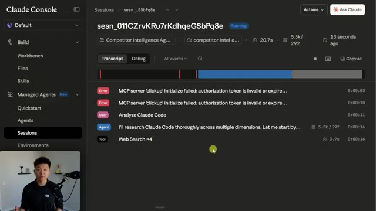
*⏱️ 00:05:56 — Capture d'écran de l'interface Claude Console montrant une session active d'agent avec l'historique des actions et des erreurs d'initialisation MCP.*

---

### ⏱️ `[00:06:13 - 00:06:34]` | Segment #17

**🔊 Audio (Transcription Intégrale Mot pour Mot en Français) :**
> Et nous avons aussi la possibilité d'utiliser ce bouton Demander à Claude, ce qui signifie que nous pouvons discuter avec Claude pour comprendre comment tout cela est configuré, ou ce que nous regardons, ou ce que nous devons faire pour apporter des modifications. Bref, pendant que ça s'exécute, parlons de ce que nous avons d'autre par ici. Nous venons de voir le démarrage rapide où nous pouvions utiliser des modèles ou simplement utiliser une conversation pour démarrer un agent. Évidemment, tous ces modèles ne sont fondamentalement que des invites avec peut-être quelques serveurs connectés auxquels nous devrions relier nos identifiants.

**👁️ Analyse Visuelle d'Écran (gemini-3.5-flash-lite) :**
**Interface & Outils** : Interface web de Claude Console (Managed Agents, Sessions)

**Contenu textuel & Code** : Journaux de session, erreurs de serveur MCP, transcriptions d'actions d'agent et options de discussion 'Ask Claude'.

**Action / Démonstration** : Navigation dans l'interface de la console Claude et interaction avec le panneau d'assistance contextuelle 'Ask Claude'.

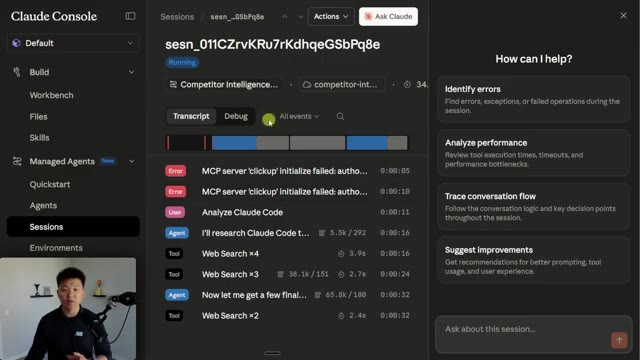
*⏱️ 00:06:18 — Vue de Claude Console montrant le panneau latéral, la session active avec des journaux d'événements et le panneau latéral 'Ask Claude' ouvert à droite.*

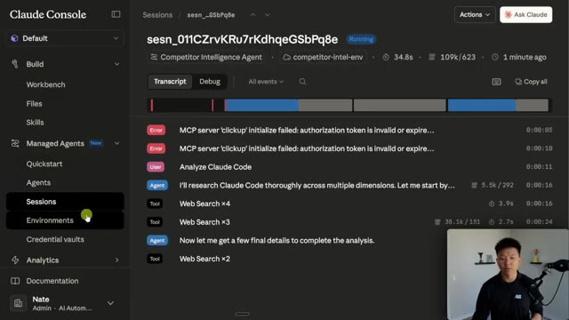
*⏱️ 00:06:24 — Vue de Claude Console montrant la session d'agent active et les options du menu latéral gauche.*

---

### ⏱️ `[00:06:35 - 00:07:09]` | Segment #18

**🔊 Audio (Transcription Intégrale Mot pour Mot en Français) :**
> Mais ensuite, nous avons nos agents. Donc ici, vous pouvez voir que j'en ai lancé quatre différents. J'ai celui sur la veille concurrentielle qui utilise Opus. J'ai ces trois autres qui utilisent Sonnet, et quelques autres que j'ai déjà supprimés. Mais chaque agent doit essentiellement travailler dans un environnement. Et c'est pourquoi, dans ce cas, j'ai essentiellement un environnement pour chacun de ces agents. Maintenant, ce sur quoi vous êtes facturé, ce ne sont pas ces environnements, vous êtes en fait facturé sur les sessions qui sont actives. Donc toutes celles-ci sont inactives. Elles ne me coûtent rien, même si les environnements fonctionnent. Et ce sur quoi vous êtes facturé, c'est 0,08 $ par heure où ces sessions sont réellement actives et en cours d'exécution, ainsi que pour l'un quelconque des

**👁️ Analyse Visuelle d'Écran (gemini-3.5-flash-lite) :**
**Interface & Outils** : Claude Console (interface web de gestion d'agents)

**Contenu textuel & Code** : Liste des agents : 'Competitor Intelligence Agent' (claude-opus-4-6, statut Actif), 'Field monitor' (claude-sonnet-4-6, statut Actif), 'ClickUp Research Agent' (claude-sonnet-4-6, statut Actif), et 'Deep researcher' (claude-sonnet-4-6, statut Actif).

**Action / Démonstration** : Présentation et visualisation des différents agents IA en cours d'exécution dans la console.

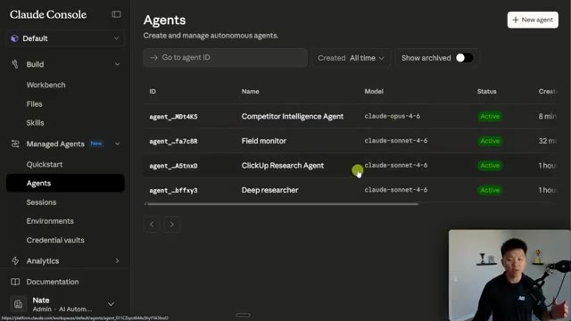
*⏱️ 00:06:43 — Tableau de bord Claude Console montrant une liste de quatre agents IA actifs avec leurs identifiants, noms et modèles associés.*

---

### ⏱️ `[00:07:09 - 00:07:32]` | Segment #19

**🔊 Audio (Transcription Intégrale Mot pour Mot en Français) :**
> les coûts réels des jetons que vous acquérez via l'API. Et puis bien sûr, en bas, vous avez votre coffre-fort d'identifiants réel où vous pouvez les partager avec différentes personnes. Et dans chacun de ces coffres-forts, vous avez différentes connexions. Comme ici, vous pouvez voir que j'ai fait l'OAuth pour me connecter à ClickUp. En cliquant sur ajouter un identifiant, nous avons tous ces autres exemples qui sont déjà configurés. Et la plupart d'entre eux sont plutôt standard où vous avez fondamentalement juste à vous connecter. Vous pouvez voir que cette session est maintenant inactive. Donc si nous cliquons dedans, nous pouvons voir ce qui s'est passé.

**👁️ Analyse Visuelle d'Écran (gemini-3.5-flash-lite) :**
**Interface & Outils** : Interface web de la Claude Console (gestion des coffres-forts d'identifiants et registres MCP).

**Contenu textuel & Code** : Listes des coffres-forts avec ID, nom, statut (Active) et date de création, suivies d'une liste de registres MCP Anthropic.

**Action / Démonstration** : Navigation et présentation des options de configuration des coffres-forts d'identifiants et des connexions MCP.

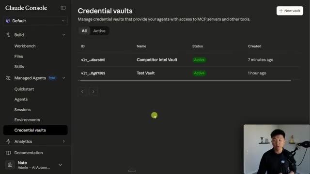
*⏱️ 00:07:14 — Vue d'ensemble de la section 'Credential vaults' dans la Claude Console, montrant deux coffres-forts existants : 'Competitor Intel Vault' et 'Test Vault'.*

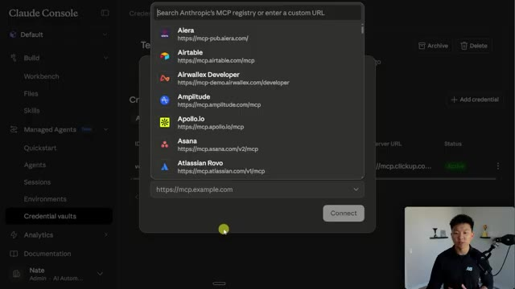
*⏱️ 00:07:26 — Affichage d'une fenêtre modale de sélection de services MCP (Model Context Protocol) avec une liste déroulante proposant des intégrations comme Airtable, Asana, Amplitude, etc.*

---

### ⏱️ `[00:07:32 - 00:07:51]` | Segment #20

**🔊 Audio (Transcription Intégrale Mot pour Mot en Français) :**
> Vous pouvez voir que cela a pris environ trois minutes. Cela a utilisé ce nombre de jetons. Et nous pouvons voir en quelque sorte chaque étape individuelle que l'agent a prise ici. Nous avons donc notre véritable résumé de veille concurrentielle sur Cloud Code. Comme vous pouvez le voir en bas, cela aborde des éléments tels que l'échelle et les revenus, les points forts clés. Mais gardez à l'esprit que l'ensemble de ces instructions système a été créé par Cloud lui-même, nous devrions donc probablement intervenir et le rendre un peu plus spécifique.

**👁️ Analyse Visuelle d'Écran (gemini-3.5-flash-lite) :**
**Interface & Outils** : Claude Console (interface web) et incrustation vidéo du présentateur en bas à droite.

**Contenu textuel & Code** : Historique des actions de l'agent (Transcript), métriques d'utilisation (durée d'environ 3 minutes, nombre de jetons), et message de l'agent affichant le résumé de la veille concurrentielle sur Claude Code.

**Action / Démonstration** : Consultation de l'historique d'exécution et des étapes de l'agent par l'utilisateur.

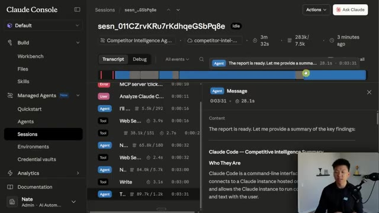
*⏱️ 00:07:37 — Capture d'écran de l'interface Claude Console montrant le détail d'une session d'agent IA, incluant la chronologie des étapes, la consommation de jetons et le rapport de synthèse sur la veille concurrentielle.*

---

### ⏱️ `[00:07:52 - 00:08:11]` | Segment #21

**🔊 Audio (Transcription Intégrale Mot pour Mot en Français) :**
> Maintenant, ce que vous remarquerez, cependant, c'est que cela n'a même pas été envoyé à ClickUp, même si nous avions réellement connecté ceci. C'est donc un autre cas où moi, l'utilisateur, je devrais y retourner et le corriger là-bas. Laissez-moi donc vous parler d'autres choses que j'ai essayées. J'en ai fait un appelé Field Monitor, qui, essentiellement, examine ce qui se passe dans le secteur technologique et m'envoie ensuite un signal dans mon canal ClickUp. Et voici à quoi ressemblait ce résultat.

**👁️ Analyse Visuelle d'Écran (gemini-3.5-flash-lite) :**
**Interface & Outils** : Claude Console (interface web)

**Contenu textuel & Code** : Historique de session, journalisation des appels d'outils et recommandations d'actions d'agent (« Top Recommended Actions »)

**Action / Démonstration** : Navigation et analyse des journaux d'exécution d'une session d'agent d'intelligence artificielle.

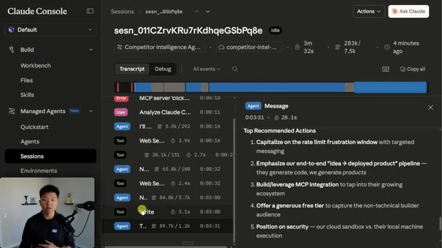
*⏱️ 00:07:56 — Interface de Claude Console affichant l'historique des sessions et un panneau de message avec des actions recommandées, ainsi que la vidéo du présentateur en bas à gauche.*

---

### ⏱️ `[00:08:11 - 00:08:44]` | Segment #22

**🔊 Audio (Transcription Intégrale Mot pour Mot en Français) :**
> Celle-ci m'a pris environ deux minutes à configurer. Je clique sur exécuter et c'est plutôt bien, non ? J'obtiens toutes ces informations de la semaine. Cela me donne différents groupes d'informations avec toutes ces sources. Et cela a effectivement été capable de me l'envoyer dans mon ClickUp. Et puis j'en ai fait un autre juste ici appelé l'agent de recherche ClickUp, dont toute l'idée était que je serais fondamentalement capable d'arriver dans cette zone de file d'attente de recherche dans mon ClickUp. Je serais capable de créer une nouvelle tâche à faire ici en bas pour un type différent de fournisseur d'IA vocale. Et puis quand je la déplace vers à faire, l'agent géré prendrait la tâche et ensuite il ferait des recherches et il me laisserait un commentaire par ici. Comme vous pouvez le voir, j'ai un résumé, des conclusions clés, des informations comme celle-ci, et

**👁️ Analyse Visuelle d'Écran (gemini-3.5-flash-lite) :**
**Interface & Outils** : Interface web de gestion de projet (ClickUp / outil de notes)

**Contenu textuel & Code** : Texte de synthèse sur les architectures d'inférence (DualPath, PLENA), sources web et tableau "Who to Follow This Week" avec les noms de Sean Goedecke et Simon Willison.

**Action / Démonstration** : Présentation des résultats agrégés et structurés automatiquement par l'automatisation IA dans l'outil de gestion.

*⏱️ 00:08:19 — Capture d'écran montrant l'interface d'une application (semblable à ClickUp ou un outil de gestion de projet) affichant des informations synthétisées avec des sources et un tableau de personnalités à suivre, tandis que le présentateur apparaît en bas à gauche de la vidéo.*

---

### ⏱️ `[00:08:44 - 00:09:17]` | Segment #23

**🔊 Audio (Transcription Intégrale Mot pour Mot en Français) :**
> ensuite je récupère toutes les sources en bas et ensuite ça passe à complet. Maintenant, le truc avec ça, c'est que comme nos agents doivent être déclenchés par un appel à leur API, ce n'est tout simplement pas super automatique et cela demande beaucoup de bricolage pour mettre réellement l'infrastructure en place. Parce que ce que j'ai dû faire ici, c'est que j'ai dû aller dans l'agent et dire, hé, va vérifier ClickUp et ensuite vois si tu as des tâches à faire et ensuite exécute-les. Et parfois, ça va. Mais ce que je voulais vraiment faire, c'est que je voudrais qu'il récupère les tâches automatiquement, ce qui signifie que j'aurais besoin de quelque chose de ClickUp pour dire à quelque chose d'envoyer un appel API à mon agent de recherche ClickUp. Et je me suis dit,

**👁️ Analyse Visuelle d'Écran (gemini-3.5-flash-lite) :**
**Interface & Outils** : Claude Console (interface web de gestion d'agents).

**Contenu textuel & Code** : Tableau répertoriant plusieurs agents (ex: "Competitor Intelligence Agent", "Field monitor", "ClickUp Research Agent") utilisant les modèles "claude-opus-4-6" et "claude-sonnet-4-6" avec un statut "Active".

**Action / Démonstration** : Navigation dans le panneau de gestion des agents pour visualiser et surveiller l'état opérationnel des différents agents déployés.

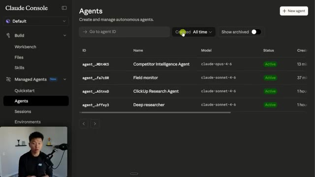
*⏱️ 00:08:52 — Capture d'écran de l'interface "Claude Console" montrant la liste des agents autonomes créés, avec leurs IDs, noms, modèles utilisés et statuts respectifs.*

---

### ⏱️ `[00:09:17 - 00:09:50]` | Segment #24

**🔊 Audio (Transcription Intégrale Mot pour Mot en Français) :**
> D'accord, super. Donc si je ne peux pas faire ça via les webhooks ClickUp, alors je vais peut-être simplement faire une automatisation planifiée. Donc je vais peut-être simplement faire en sorte que cet agent de recherche ClickUp se réveille toutes les 30 minutes, vérifie les tâches à faire. S'il y en a une, il la traitera. S'il n' y en a pas, il se rendormira tout simplement et c'est très bien. Mais il ne peut même pas faire ça. Il ne peut même pas se réveiller sur une tâche cron. Et c'est donc cela qui m'a fait réaliser que ce truc d'agent géré, ça sert vraiment un objectif pour un type de personne spécifique. Pour moi personnellement, je ne vais probablement jamais utiliser ça parce que je peux simplement utiliser du code cloud et rendre les choses meilleures et plus personnalisées pour mes besoins. Parce que si je voulais exactement ce type d'agent, ce que j'ai d'ailleurs déjà fait et j'ai fait une vidéo à ce sujet, j'utiliserais simplement trigger.dev. Et si

**👁️ Analyse Visuelle d'Écran (gemini-3.5-flash-lite) :**
**Interface & Outils** : Claude Console (interface de gestion d'agents IA).

**Contenu textuel & Code** : Le prompt système définit le rôle de l'agent : rechercher des sujets via des tâches ClickUp et poster un résumé structuré en commentaire. Le workflow étape par étape est détaillé (lecture via cURL, extraction d'URLs, recherche web, analyse et publication du commentaire).

**Action / Démonstration** : Visualisation et explication de la configuration de l'agent IA par le présentateur.

*⏱️ 00:09:25 — Interface de la "Claude Console" affichant la configuration et le prompt système du "ClickUp Research Agent".*

---

### ⏱️ `[00:09:50 - 00:10:22]` | Segment #25

**🔊 Audio (Transcription Intégrale Mot pour Mot en Français) :**
> vous voulez regarder cette vidéo, allez simplement la voir ici en haut. Parce que trigger.dev me permet tout simplement d'héberger mon code sur le cloud et il peut configurer des tâches cron et des choses comme ça. Et il peut déléguer à différents scripts. Donc je préfère largement utiliser trigger.dev plutôt que d'utiliser cet environnement d'agent géré. Et c'est aussi beaucoup moins cher sur trigger.dev. Parce que je veux dire, vous me dites qu'Anthropic a un modèle qui est si bon qu'il ne peut pas être publié, mais ils ne peuvent pas simplement nous donner des tâches cron planifiées dans le cloud ? Parce qu'à ce stade, je pourrais littéralement assembler le tout en ayant un déclencheur planifié dans nnn ou en ayant un déclencheur clickup dans nnn, et ensuite simplement faire en sorte que cela envoie une requête HTTP

**👁️ Analyse Visuelle d'Écran (gemini-3.5-flash-lite) :**
**Interface & Outils** : Claude Console, Trigger.dev

**Contenu textuel & Code** : Workflow d'agent IA (lecture de tâche ClickUp, extraction d'URL, recherche web, analyse, publication de commentaire) ; configuration de déclencheurs d'automatisation (ClickUp, planification temporelle).

**Action / Démonstration** : Configuration d'un agent de recherche dans la console Claude et visualisation de la structure d'automatisation dans Trigger.dev.

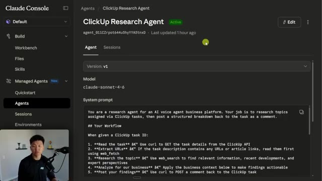
*⏱️ 00:09:58 — Interface de "Claude Console" affichant la configuration d'un "ClickUp Research Agent" avec son prompt système détaillant un flux de travail en 5 étapes.*

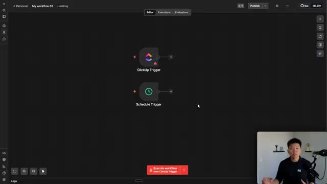
*⏱️ 00:10:14 — Éditeur de workflow de la plateforme Trigger.dev montrant deux types de déclencheurs : "ClickUp Trigger" et "Schedule Trigger" (tâche cron).*

---

### ⏱️ `[00:10:22 - 00:10:58]` | Segment #26

**🔊 Audio (Transcription Intégrale Mot pour Mot en Français) :**
> à mon agent géré sur le cloud d'Anthropic. Mais c'est un peu de la suringénierie. Pourquoi est-ce qu'on ne peut pas simplement avoir un déclencheur ClickUp de manière native ici, ou un déclencheur planifié de manière native ici. Je sais juste qu'il y a d'autres choses qui arrivent, et je pense que ça va rendre ça un peu plus sympa. Il y a trois fonctionnalités qui ont été teasées, mais tout cela n'est pas encore disponible. Il faut en gros faire une demande pour l'accès anticipé. Il va donc y avoir les "outcomes", ce qui consiste à définir des critères de réussite spécifiques pour une tâche. Et l'agent va auto-évaluer son travail et itérer jusqu'à ce qu'il réponde aux critères. C'est donc un peu comme utiliser l'auto-recherche de Karpathy, mais intégré directement dans la phase de construction. Et je trouve que c'est plutôt cool. Il va y avoir aussi

**👁️ Analyse Visuelle d'Écran (gemini-3.5-flash-lite) :**
**Interface & Outils** : - Image 1 : Plateforme d'automatisation de workflow (type n8n).
- Image 2 : Éditeur de code (VS Code) affichant un fichier Markdown.

**Contenu textuel & Code** : - Image 1 : Nœuds de workflow "ClickUp Trigger", "HTTP Request" et "Schedule Trigger".
- Image 2 : Texte descriptif sur les fonctionnalités "Outcomes", "Multi-agent orchestration" (mention de `callable_agents`) et "Memory".

**Action / Démonstration** : - Image 1 : Visualisation de l'architecture d'un processus d'automatisation.
- Image 2 : Consultation de la documentation technique pour expliquer les prochaines évolutions des agents gérés.

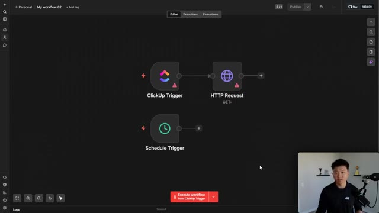
*⏱️ 00:10:31 — Interface de conception de workflow montrant deux déclencheurs (ClickUp Trigger et Schedule Trigger) avec des icônes d'avertissement, et un nœud HTTP Request.*

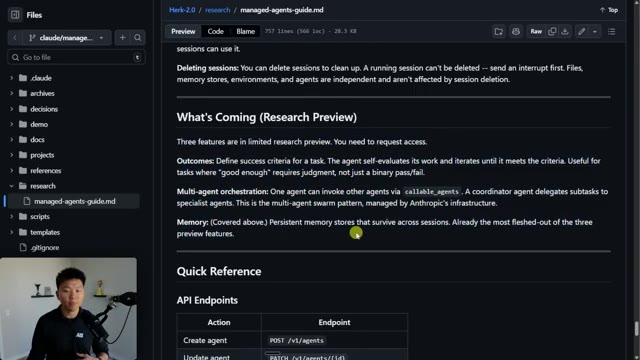
*⏱️ 00:10:40 — Éditeur de texte affichant une documentation technique intitulée "managed-agents-guide.md" détaillant les futures fonctionnalités de recherche d'Anthropic (Outcomes, Multi-agent orchestration, Memory).*

---

### ⏱️ `[00:10:58 - 00:11:33]` | Segment #27

**🔊 Audio (Transcription Intégrale Mot pour Mot en Français) :**
> être une orchestration multi-agents où un agent peut appeler d'autres agents via un outil d'agents appelables et un agent coordinateur délègue des sous-tâches à des agents spécialisés. Et c'est le modèle d'essaim multi-agents qui est géré par l'infrastructure d'Anthropix. Et ensuite, ce qui me semble également très cool, c'est la mémoire persistante. Donc, une mémoire qui survit d'une session à l'autre. En gros, cela signifie que si je vais dans mes sessions, disons que, vous savez, nous avons ces deux-là qui ont été exécutées par l'agent d'intelligence concurrentielle. Chaque fois que l'agent d'intelligence concurrentielle se réveille à nouveau, il est complètement sans état. Tout ce qu'il regarde, c'est son invite système. Mais ce qu'ils vont faire, c'est en gros dire, cet agent aura une mémoire à travers toutes les sessions qu'il exécute. Et cela va être

**👁️ Analyse Visuelle d'Écran (gemini-3.5-flash-lite) :**
**Interface & Outils** : Éditeur de code (VS Code / interface web) et Claude Console (Managed Agents)

**Contenu textuel & Code** : Documentation Markdown sur l'orchestration multi-agents et prompt système d'un agent de recherche configuré sur Claude Console.

**Action / Démonstration** : Navigation dans la documentation technique et consultation des paramètres d'un agent géré dans la console Anthropic.

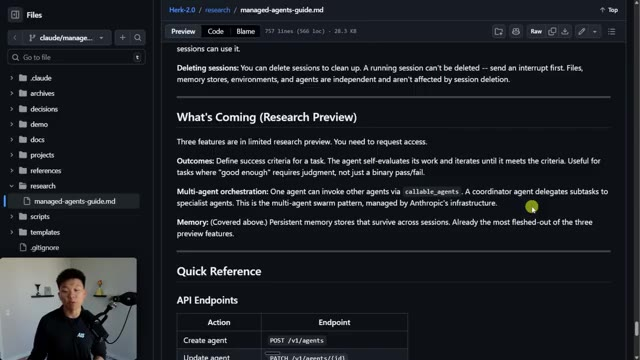
*⏱️ 00:11:06 — Visualisation d'un fichier Markdown dans un éditeur montrant la section sur l'orchestration multi-agents et les 'callable_agents'.*

*⏱️ 00:11:15 — Interface de la console Claude affichant les détails, le modèle et le prompt système d'un agent de recherche nommé 'ClickUp Research Agent'.*

---

### ⏱️ `[00:11:33 - 00:12:06]` | Segment #28

**🔊 Audio (Transcription Intégrale Mot pour Mot en Français) :**
> Plutôt cool. Maintenant, je pense vraiment qu'il y a un moyen de bricoler ça en l'état si vous lui donnez simplement les bonnes choses à examiner et que vous lui faites écrire des journaux de ce qu'il fait. Mais avoir ça comme fonctionnalité native sera plutôt sympa. Mais ne vous inquiétez pas, j'ai déjà postulé pour ça. J'ai postulé pour ça dès que j'ai vu le formulaire, il y a plusieurs heures. Donc si j'obtiens l'accès, je ferai certainement une vidéo sur la façon dont tout cela fonctionne. Maintenant, l'autre chose qui est intéressante et qui vaut la peine d'être mentionnée, c'est l'interface en ligne de commande, car elle vous permet de créer et d'utiliser vos agents gérés directement depuis CloudCode. Il y a donc peut-être aussi une certaine valeur là-dedans, car dans certains cas, ce que vous pourriez faire, c'est non seulement créer un agent géré

**👁️ Analyse Visuelle d'Écran (gemini-3.5-flash-lite) :**
**Interface & Outils** : Interface web de Claude Console et page de documentation/plateforme Claude Managed Agents.

**Contenu textuel & Code** : Tableaux de sessions avec ID, statuts ("Idle"), noms d'agents ("Competitor Intelligence", "Field monitor", "ClickUp Research Agent", "Deep researcher") et texte de présentation de la plateforme.

**Action / Démonstration** : Navigation et présentation des sessions de débogage et des fonctionnalités de Claude Managed Agents par le présentateur.

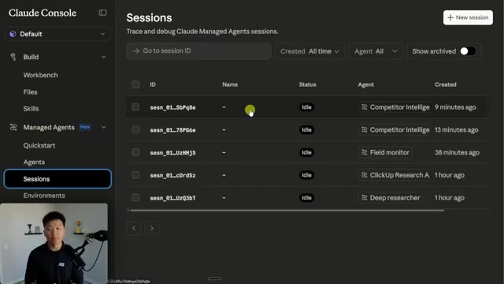
*⏱️ 00:11:41 — L'interface de la console Claude affichant l'onglet "Sessions" avec le suivi et le débogage des agents gérés (Claude Managed Agents), montrant différents identendants de sessions, statuts au repos et agents associés.*

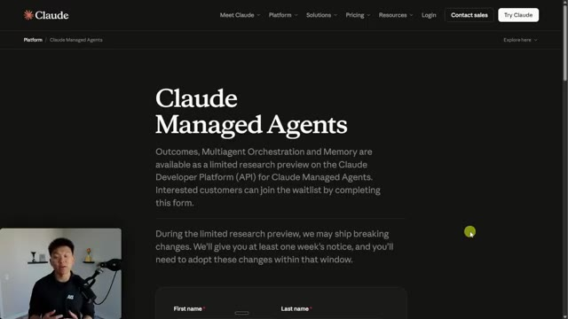
*⏱️ 00:11:49 — La page web officielle de Claude présentant "Claude Managed Agents" et mentionnant l'aperçu de recherche limité pour les fonctionnalités d'orchestration multi-agents et de mémoire.*

---

### ⏱️ `[00:12:06 - 00:12:41]` | Segment #29

**🔊 Audio (Transcription Intégrale Mot pour Mot en Français) :**
> agent dans CloudCode dans un projet qui contient déjà une tonne d'informations sur vous, mais vous pourriez aussi ensuite créer des interfaces pour celui-ci parce qu'il comprend déjà la configuration et ce dont il a besoin. Et cela signifie aussi que si vous vouliez déléguer certaines choses à des sous-agents, vous pourriez le faire depuis Cloud Code et ne pas les stocker ici. Vous savez, parfois si vous avez un dossier point Cloud et un dossier d'agents, cela va consommer un peu de contexte et peut-être qu'ils ne sont pas invoqués de la bonne manière. Mais si vous avez chaque agent pointé vers un point de terminaison d'API spécifique que vous pourriez ensuite appeler depuis Cloud Code, il y a peut-être un certain intérêt. Mais de toute façon, ce que j'ai fait dans ce projet, c'est que j'ai essentiellement configuré un agent géré dans les agents gérés. Donc disons que je voulais construire ceci

**👁️ Analyse Visuelle d'Écran (gemini-3.5-flash-lite) :**
**Interface & Outils** : Visual Studio Code avec le terminal intégré Claude Code.

**Contenu textuel & Code** : Commande `/clear` exécutée, mention du modèle Opus 4.6 (1M context) et indicateur de mode plan activé (`plan mode on`).

**Action / Démonstration** : Nettoyage de l'historique du terminal avec la commande `/clear` dans l'interface de l'agent Claude Code.

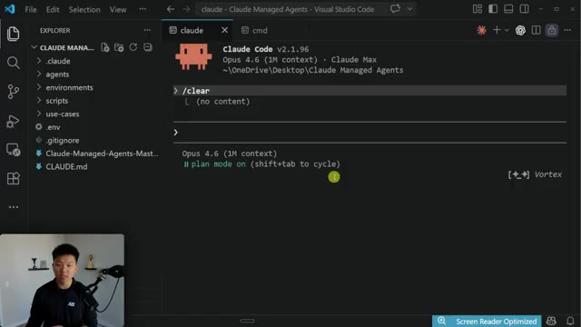
*⏱️ 00:12:14 — Interface de Visual Studio Code affichant l'explorateur de fichiers à gauche et un terminal intégré exécutant l'outil Claude Code v2.1.96.*

---

### ⏱️ `[00:12:41 - 00:13:16]` | Segment #30

**🔊 Audio (Transcription Intégrale Mot pour Mot en Français) :**
> l'automatisation, n'est-ce pas ? Et je suis dans Cloud Code, donc je lance simplement ceci et je lui dis d'utiliser l'interface en ligne de commande d'Anthropic pour me construire un agent géré. Le but de ceci serait de pouvoir insérer la transcription d'une vidéo YouTube et ensuite de pouvoir lui faire faire des choses pour moi dans mon ClickUp, comme m'envoyer un résumé ainsi que potentiellement des tâches à accomplir à partir de cette vidéo si je découvre, hé tu sais, je veux implémenter certaines de ces stratégies dans mon flux de travail ou peu importe. C'est génial parce que je pourrais insérer la transcription ici. Elle pourrait envoyer cet appel d'API à mon agent géré dans le Cloud d'Anthropic. Et ensuite, là-bas, il s'occuperait de tout ce qui concerne ClickUp. Et je pourrais juste continuer à coder dans Cloud Code ici même. Et comme je l'ai dit, il peut aussi utiliser tout le contexte.

**👁️ Analyse Visuelle d'Écran (gemini-3.5-flash-lite) :**
**Interface & Outils** : Visual Studio Code, Claude Code CLI (v2.1.96)

**Contenu textuel & Code** : Commande `/clear`, prompt utilisateur demandant de créer un agent géré pour analyser des transcriptions YouTube et créer des tâches sur ClickUp, chargement de compétence de brainstorming et statut du modèle Opus 4.6.

**Action / Démonstration** : Saisie d'un prompt dans l'interface en ligne de commande de Claude Code pour initialiser la création d'un agent géré d'automatisation.

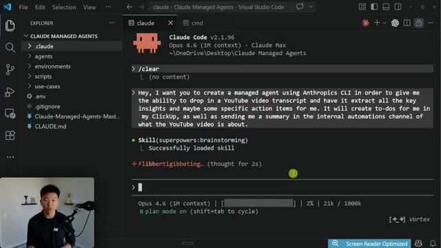
*⏱️ 00:12:49 — Interface de Visual Studio Code affichant Claude Code (CLI) dans un terminal intégré avec un prompt textuel détaillé et le présentateur visible en incrustation vidéo en bas à gauche.*

---

### ⏱️ `[00:13:16 - 00:13:49]` | Segment #31

**🔊 Audio (Transcription Intégrale Mot pour Mot en Français) :**
> Donc, disons que j'ai une tonne d'informations en ce moment sur mon entreprise, sur mes objectifs trimestriels, sur nos projets actuels. Il serait fondamentalement capable de les utiliser dans les instructions système lors de la création de cet agent géré, de sorte que l'agent géré réel soit beaucoup plus spécifique et adapté à nous. C'est donc là que je vois une grande partie de cette valeur avec l'interface en ligne de commande. Maintenant, une chose à laquelle vous devez faire très attention si vous développez dans Cloud Code, ce sont les identifiants, car il pourrait essayer par défaut d'envoyer, potentiellement dans les instructions système, les clés d'API pour certains points de terminaison dont vous avez besoin. Plutôt que si vous le construisez à l'intérieur de cet environnement ici, c'est fondamentalement

**👁️ Analyse Visuelle d'Écran (gemini-3.5-flash-lite) :**
**Interface & Outils** : Visual Studio Code, terminal intégré Claude Code.

**Contenu textuel & Code** : Commande `/clear`, puis un prompt demandant de créer un agent géré via l'interface en ligne de commande d'Anthropic pour analyser une transcription YouTube, créer des tâches dans ClickUp et envoyer un résumé.

**Action / Démonstration** : Saisie d'un prompt détaillé pour la création et la configuration d'un agent géré personnalisé.

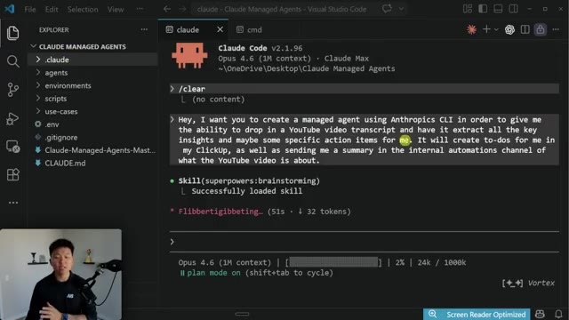
*⏱️ 00:13:24 — Interface de Visual Studio Code affichant un terminal Claude Code (v2.1.96) avec une invite de commande et le présentateur visible en incrustation vidéo en bas à gauche.*

---

### ⏱️ `[00:13:49 - 00:14:17]` | Segment #32

**🔊 Audio (Transcription Intégrale Mot pour Mot en Français) :**
> vont par défaut utiliser des serveurs MCP. Donc gardez simplement cela à l'esprit et faites attention lorsque vous faites des choses comme ça, car d'autres personnes pourraient être capables de voir ces clés. Et bien sûr, si c'est hébergé par Anthropic et dans l'historique de conversation, alors c'est là aussi. Mais vraiment, si vous êtes curieux, ce que je ferais, et fondamentalement la manière dont je m'apprends tout, c'est que j'ai créé un projet de code Claude pour ça. Ça m'a créé ce guide principal sur ce que sont les agents gérés par Claude, comment ils fonctionnent. Et je lui ai juste fait faire des recherches par lui-même afin qu'il puisse m'expliquer les choses et m'aider à comprendre comment l'utiliser. Et ensuite dire simplement, Hé, vous savez, genre, j'ai aussi utilisé trigger.dev.

**👁️ Analyse Visuelle d'Écran (gemini-3.5-flash-lite) :**
**Interface & Outils** : Claude Console (interface web) et Visual Studio Code (éditeur de code avec terminal intégré).

**Contenu textuel & Code** : Liste d'agents IA dans la console Claude et plan d'exécution étape par étape dans un terminal VS Code avec des tâches cochées ou en cours.

**Action / Démonstration** : Navigation et gestion des agents autonomes dans l'interface Claude Console, puis suivi de l'exécution de tâches de développement dans le terminal VS Code.

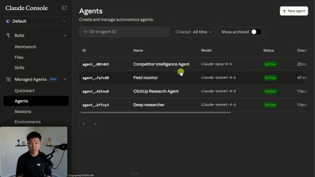
*⏱️ 00:13:56 — La console Claude affichant une liste d'agents autonomes gérés avec leurs identifiants, noms, modèles associés et statuts actifs.*

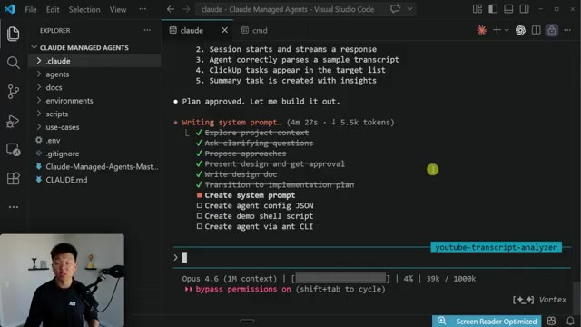
*⏱️ 00:14:03 — L'interface de Visual Studio Code affichant un terminal intégré où un agent exécute un plan de développement avec des étapes validées.*

---

### ⏱️ `[00:14:17 - 00:14:53]` | Segment #33

**🔊 Audio (Transcription Intégrale Mot pour Mot en Français) :**
> J'ai aussi utilisé, vous savez, les automatisations planifiées sur le bureau et Claude Code. Quel est réellement le meilleur ensemble technologique pour moi selon les objectifs X, Y, Z que je souhaite atteindre, parce qu'il ne s'agit jamais de savoir quel outil est le meilleur. Il s'agit de savoir quel outil est le meilleur pour ce cas d'utilisation spécifique. Et je pense que c'est tout simplement la mentalité la plus saine à avoir concernant la création d'automations et d'agents. Et maintenant, vous pouvez voir que nous venons de créer cet agent dans notre tableau de bord d'agents gérés, qui est l'analyseur de transcription YouTube. Et je peux cliquer ici et je peux voir le prompt système réel qui a été créé, que vous remarquerez être beaucoup plus robuste que ceux que la version de démarrage rapide nous a fait créer. Donc, quelques petites choses avant de conclure ici,

**👁️ Analyse Visuelle d'Écran (gemini-3.5-flash-lite) :**
**Interface & Outils** : Visual Studio Code, Terminal de commande intégré, Console web Claude (Managed Agents).

**Contenu textuel & Code** : Arborescence du projet dans VS Code, liste des étapes de création d'un script de démonstration, et règles de configuration d'agent dans la console Claude (v1, summary task, rules, MCPs).

**Action / Démonstration** : Développement et configuration guidée d'un agent IA géré via l'environnement de code et l'interface console de Claude.

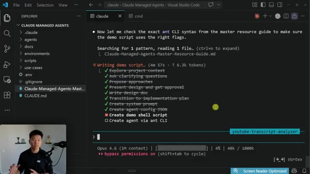
*⏱️ 00:14:26 — Interface de VS Code avec un terminal interactif affichant l'exécution de l'agent Claude Code et une liste de tâches en cours.*

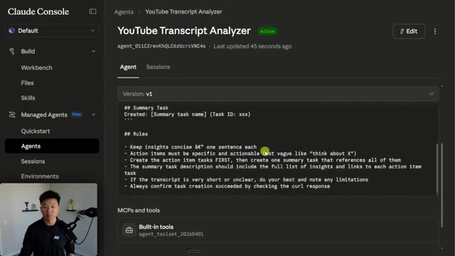
*⏱️ 00:14:44 — Interface de la console Claude affichant les détails d'un agent configuré pour l'analyse de transcriptions YouTube (YouTube Transcript Analyzer).*

---

### ⏱️ `[00:14:53 - 00:15:27]` | Segment #34

**🔊 Audio (Transcription Intégrale Mot pour Mot en Français) :**
> quand vous comparez cet agent managé au SDK d'agent plus trigger.dev ou quelque chose comme OpenClaw, c'est là que vous remarquerez qu'il y a tellement de différences. Et je ne vais pas tout lire, mais si vous voulez mettre sur pause et y jetter un œil, n'hésitez pas. Mais comme je l'ai dit, il y a vraiment deux choses dans OpenClaw que j'adore et qui font que je l'utilise encore personnellement, ce sont les Heartbeats et la possibilité de lui parler depuis Telegram si facilement. Et je pense que c'est exactement ce qu'Anthropic devrait faire avec Claude Code, ça en ferait une véritable machine de guerre. Heartbeats signifie simplement un cron toutes les 30 minutes, toutes les cinq minutes, vous pouvez faire en sorte qu'OpenClaw se réveille et fasse des choses. Et c'est essentiellement pour cela qu'on a l'impression qu'il est toujours actif

**👁️ Analyse Visuelle d'Écran (gemini-3.5-flash-lite) :**
**Interface & Outils** : Éditeur de code ou de documents avec arborescence de fichiers et panneau de prévisualisation Markdown.

**Contenu textuel & Code** : Document Markdown 'managed-agents-guide.md' comparant l'infrastructure, la planification, les modèles et les coûts de différentes architectures d'agents IA.

**Action / Démonstration** : Le présentateur commente le tableau comparatif affiché à l'écran concernant les différentes options d'agents managés.

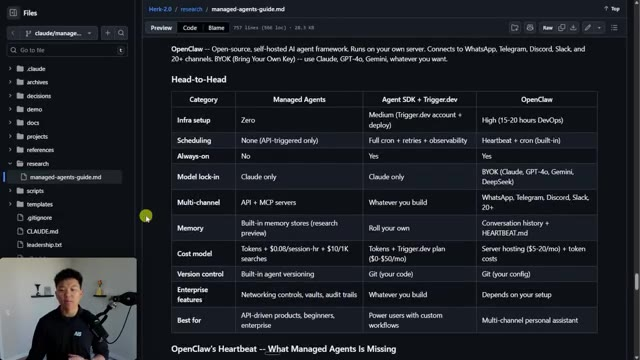
*⏱️ 00:15:02 — Un tableau comparatif détaillé dans un fichier Markdown affichant les différences entre 'Managed Agents', 'Agent SDK + Trigger.dev' et 'OpenClaw'.*

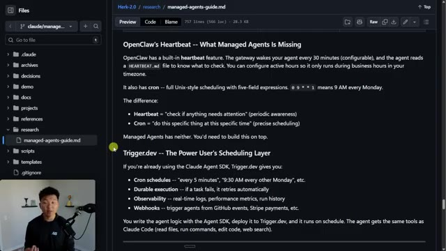
*⏱️ 00:15:10 — La suite du fichier Markdown présentant les sections 'OpenClaw's Heartbeat' et 'Trigger.dev -- The Power User's Scheduling Layer'.*

---

### ⏱️ `[00:15:27 - 00:16:00]` | Segment #35

**🔊 Audio (Transcription Intégrale Mot pour Mot en Français) :**
> assistant. Outre le fait qu'à chaque fois que vous envoyez un message, il se réactive également automatiquement. Maintenant, bien sûr, vous pouvez planifier des tâches dans l'application de bureau de CloudCode, ce que je fais. Et j'en ai des tonnes en cours d'exécution et j'en ai d'autres sur mon autre compte également, mais ce n'est tout simplement pas la même chose que de pouvoir effectuer une vérification de type "heartbeat" toutes les cinq minutes pour simplement surveiller quelque chose. Et c'est pourquoi je disais plus tôt, à ce stade, je préférerais utiliser CloudCode pour me construire quelque chose avec le SDK d'agent, ce qui est très similaire. Et ensuite, je dirais simplement, hé, trigger.dev, exécute ceci toutes les cinq minutes. Donc, pour ce qui est de savoir qui doit utiliser quoi, si vous débutez tout juste avec les agents IA, c'est là que vous voudrez peut-être essayer les agents gérés, tellement plus faciles, non

**👁️ Analyse Visuelle d'Écran (gemini-3.5-flash-lite) :**
**Interface & Outils** : Application de bureau et éditeur de code de type VS Code / IDE.

**Contenu textuel & Code** : Liste de tâches planifiées (Skool wins engagement, AI news roundup, Notification responses, Youtube comment replies) et documentation sur les agents et le scheduling (OpenClaw's Heartbeat, Trigger.dev).

**Action / Démonstration** : Présentation des options de planification de tâches et des guides de gestion d'agents par le présentateur.

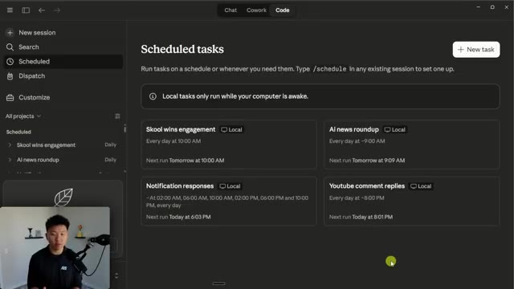
*⏱️ 00:15:35 — Interface de l'application montrant la section des tâches planifiées (Scheduled tasks) avec plusieurs automatisations configurées.*

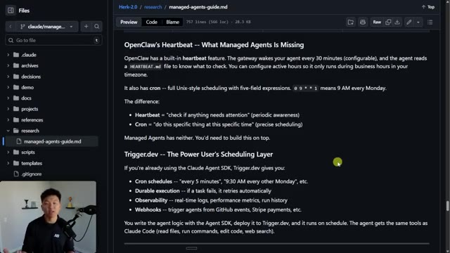
*⏱️ 00:15:44 — Éditeur de code affichant un fichier Markdown (managed-agents-guide.md) détaillant la gestion des agents et la planification par cron.*

---

### ⏱️ `[00:16:00 - 00:16:32]` | Segment #36

**🔊 Audio (Transcription Intégrale Mot pour Mot en Français) :**
> infrastructure à laquelle s'occuper. Presque aucune clé d'API à laquelle s'occuper. Mais si vous avez déjà commencé à construire, alors il n'y a peut-être pas autant de valeur que vous pourriez le penser. Mais de toute façon, tout ce document que nous avons examiné ici, il fait des recherches et des comparaisons assez approfondies sur la valeur réelle des agents gérés. Et je vais le mettre dans ma communauté School gratuite tout à fait gratuitement. Le lien pour cela sera en bas dans la description. Tout ce que vous aurez à faire, c'est de trouver la publication associée à cette vidéo, et il y aura le PDF complet juste là-dedans. Mais de toute façon, j'espère que vous avez apprécié la vidéo, si vous avez appris quelque chose de nouveau, alors veuillez lui donner un J'aime, ça m'aide énormément et, comme toujours, je vous remercie d'être arrivés jusqu'à la fin de la vidéo et je vous vois dans la prochaine, merci tout le monde.

**👁️ Analyse Visuelle d'Écran (gemini-3.5-flash-lite) :**
**Interface & Outils** : Éditeur de code (VS Code ou similaire) et outil de présentation visuelle (type canvas/miro).

**Contenu textuel & Code** : Documentation Markdown sur les agents managés Claude, Trigger.dev, OpenClaw et les approches d'architecture d'agents IA.

**Action / Démonstration** : Le présentateur commente le document de recherche comparant les différentes solutions d'agents gérés et leur infrastructure.

*⏱️ 00:16:08 — Vue d'un éditeur de texte avec le fichier Markdown `managed-agents-guide.md` ouvert, comparant les approches Claude Managed Agents, Agent SDK + Trigger.dev et OpenClaw.*

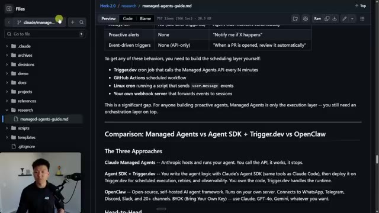
*⏱️ 00:16:16 — Gros plan sur la barre latérale et l'arborescence de fichiers de l'éditeur de code, montrant le projet Herk-2.0.*

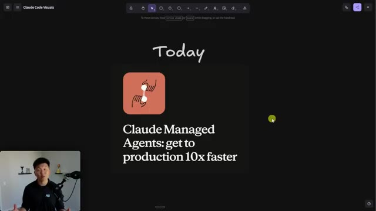
*⏱️ 00:16:24 — Présentation visuelle sur fond sombre intitulée "Today" avec le titre "Claude Managed Agents: get to production 10x faster".*

---

