# 🎬 Claude Just Told Us to Stop Using Their Best Model

> **Chaîne** : [Nate Herk | AI Automation](https://www.youtube.com/@nateherk/featured)  
> **Lien YouTube** : [https://www.youtube.com/watch?v=1EPsUXSManU](https://www.youtube.com/watch?v=1EPsUXSManU)  
> **Date de publication** : 20260409  
> **Durée** : 00:14:50  
> **Identifiant vidéo** : `1EPsUXSManU`  
> **Transcription & Analyse** : `whisper-v3-large-turbo+gemini-3.5-flash-lite`  

---

## 📌 Synthèse Exécutive & Outils

### 💡 Résumé

La vidéo de Nate Herk aborde la stratégie dite de l'« Conseiller » (ou *Advisor Strategy*), introduite par Anthropic pour optimiser les coûts et les performances des agents IA et des flux de travail automatisés. Plutôt que de systématiquement mobiliser le modèle le plus intelligent, le plus lourd et le plus onéreux — tel qu'Opus — pour l'intégralité d'une tâche, cette architecture hiérarchique associe un modèle rapide et économique (comme Haiku ou Sonnet) en tant qu'« Exécuteur » et un modèle de pointe (Opus) en tant que « Conseiller ». L'exécuteur gère les étapes courantes et ne fait appel au conseiller qu'en cas de complexité avérée, réduisant drastiquement les coûts opérationnels tout en maintenant un niveau d'intelligence proche de celui d'un modèle haut de gamme.

Pour illustrer concrètement cette approche, le présentateur a développé une application de démonstration dotée d'une interface front-end communiquant avec l'API Messages d'Anthropic. Cette application permet de basculer dynamiquement entre différentes configurations (Haiku+Opus, Sonnet+Opus, Sonnet seul, Opus seul) et de soumettre des requêtes de complexité variable. Les tests comparatifs démontrent qu'pour des requêtes simples (comme la recherche d'horaires d'ouverture ou d'intégrations), l'exécuteur léger (Haiku) traite la demande seul, générant des coûts minimes (environ 21 fois moins chers qu'avec Opus en solo) tout en conservant une précision équivalente. 

Au-delà des simples chatbots, l'analyse approfondit les distinctions architecturales entre l'API Messages (point de terminaison HTTP brut pour concevoir des applications sur mesure) et Claude Code (l'assistant de programmation intégré au terminal), tout en soulignant l'importance de paramètres comme le nombre maximal d'appels (`max uses`) pour maîtriser le budget. Les benchmarks d'Anthropic cités appuient cette démarche, affichant des gains notables de performance sur des benchmarks exigeants (tels que SWB et Browse Comp) pour une fraction du coût global par tâche agentique.

### 🛠️ Outils, Modèles & Logiciels Présentés

* **Opus** : Le modèle le plus puissant, intelligent et coûteux d'Anthropic, utilisé ici principalement comme « Conseiller » pour les tâches de raisonnement complexe.
* **Sonnet** : Modèle intermédiaire équilibré d'Anthropic, employé soit seul, soit comme exécuteur ou conseiller selon la configuration architecturale choisie.
* **Haiku** : Le modèle le plus rapide et le plus économique d'Anthropic, idéal pour servir d'exécuteur sur les étapes de routine d'un agent.
* **API Messages** : Le point de terminaison HTTP officiel d'Anthropic permettant d'intégrer les modèles et la stratégie de l'conseiller dans des applications, chatbots et automatisations personnalisées.
* **Claude Code** : L'assistant de programmation officiel d'Anthropic s'exécutant directement dans le terminal pour interagir avec le code local et l'environnement de développement.
* **SDK Agent** : Un kit de développement logiciel pour concevoir des comportements agentiques avancés et structurés.
* **Managed Agents** : Une solution gérée récemment lancée par Anthropic pour simplifier le déploiement et la gestion d'agents IA.

### 🔑 Points Clés & Enseignements Stratégiques

* **Principe de l'architecture hiérarchique** : Associer un modèle économique (exécuteur) à un modèle de pointe (conseiller) permet d'injecter une intelligence de niveau supérieur uniquement là où elle est strictement nécessaire, évitant le gaspillage de jetons.
* **Optimisation granulaire des coûts** : Les jetons de sortie étant considérablement plus chers que les jetons d'entrée pour l'ensemble des modèles, réduire l'utilisation d'Opus sur les phases de génération prolixe génère des économies massives.
* **Déclenchement conditionnel intelligent** : L'exécuteur n'invoque le conseiller que s'il évalue que la tâche dépasse ses capacités, automatisant ainsi le arbitrage coût/performance sans intervention humaine.
* **Gains mesurés sur les benchmarks** : Selon les données d'Anthropic, l'utilisation de Sonnet avec Opus comme conseiller augmente la précision de 2,7 points de pourcentage sur le benchmark SWB tout en réduisant le coût par tâche de près de 12 %.
* **Performances multipliées sur des tâches complexes** : Coupler Haiku à Opus sur des évaluations exigeantes comme Browse Comp permet de doubler le score par rapport à l'utilisation de Haiku en solo, tout en restant moins cher qu'un traitement 100 % Opus.
* **Maîtrise budgétaire via les paramètres d'API** : L'utilisation de configurations comme `max uses` dans l'API Messages permet de plafonner le nombre d'appels au conseiller, garantissant un contrôle strict des dépenses.
* **Distinction entre API Messages et Claude Code** : L'API Messages est un point de terminaison sans état destiné au développement d'applications sur mesure, tandis que Claude Code est un produit fini clé en main orienté vers l'assistance au développement dans le terminal.
* **Adaptabilité des cas d'usage** : Pour les requêtes simples (informations factuelles, FAQ), Haiku seul ou couplé suffit amplement, affichant des coûts jusqu'à 21 fois inférieurs à ceux d'un traitement intégral par Opus pour un résultat fonctionnellement identique.
* **Validation empirique par les tests** : Les démonstrations en direct montrent que les modèles légers gèrent parfaitement les requêtes basiques sans déclencher le conseiller, préservant le budget pour les scénarios ambigus ou complexes.
* **Accessibilité des ressources** : Le code source et les configurations du projet de démonstration présenté dans la vidéo sont mis à disposition de la communauté via un dépôt GitHub dédié.

---

## ⏱️ Chronologie & Transcription Complète Audio & Visuelle (Mot pour Mot)

### ⏱️ `[00:00:00 - 00:00:37]` | Segment #01

**🔊 Audio (Transcription Intégrale Mot pour Mot en Français) :**
> Donc, Anthropic vient de nous donner la stratégie de l'Conseiller. Cela vous permet d'associer Opus en tant qu'Conseiller avec un modèle moins cher comme Sonnet ou Haiku en tant qu'Exécuteur. Et ce que cela fait, c'est que cela nous permet d'avoir une intelligence proche du niveau d'Opus dans vos agents pour une fraction du coût. Parce qu'il ne s'agit pas de savoir quel modèle est le meilleur. Évidemment, Opus 4.6 est le plus capable. La question est donc : pour cette tâche spécifique, quel modèle dois-je utiliser ? Parce que si vous avez une tâche qui comporte trois étapes, A, B et C, mais que seule l'étape A est suffisamment difficile pour que vous ayez besoin d'un modèle de raisonnement coûteux comme Opus, alors pourquoi gaspilleriez-vous de l'argent en faisant faire les étapes B et C par Opus si Haiku pouvait faire les étapes B et C tout aussi efficacement pour un tiers du coût ? Donc, la stratégie de l'conseiller vient juste

**👁️ Analyse Visuelle d'Écran (gemini-3.5-flash-lite) :**
**Interface & Outils** : Navigateur web / Article de blog / Schéma explicatif

**Contenu textuel & Code** : Texte sur la stratégie de l'conseiller ('The advisor strategy: Give agents an intelligence boost') et diagramme de coûts des modèles (Opus vs Haiku).

**Action / Démonstration** : Présentation théorique du concept de couplage de modèles d'IA par le présentateur.

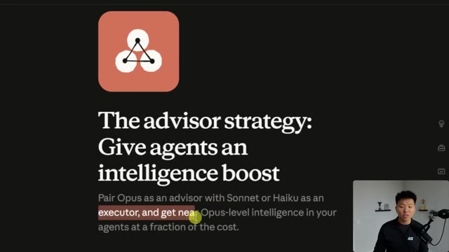
*⏱️ 00:00:09 — Capture d'écran d'un article montrant le titre 'The advisor strategy: Give agents an intelligence boost' avec une vidéo du présentateur en bas à droite.*

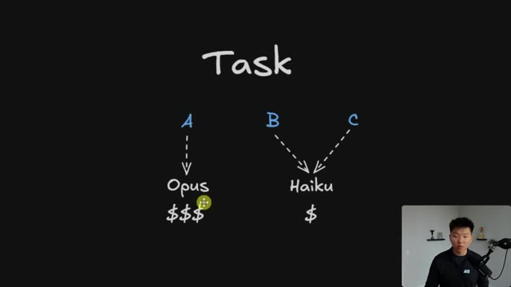
*⏱️ 00:00:27 — Schéma explicatif dessiné comparant les coûts des modèles d'IA avec des tâches A routées vers Opus ($$$) et B/C routées vers Haiku ($).*

---

### ⏱️ `[00:00:37 - 00:01:11]` | Segment #02

**🔊 Audio (Transcription Intégrale Mot pour Mot en Français) :**
> le fait automatiquement sans que vous n'ayez même à y penser. Nous avons l'exécuteur, qui est Sonnet ou Haiku, et il n'appelle le conseiller que s'il a réellement besoin d'une intelligence de niveau conseiller. Dans les évaluations d'Anthropic, Sonnet avec Opus comme conseiller a montré une augmentation de 2,7 points de pourcentage sur le banc SWB, qui est fondamentalement une évaluation standard pour les modèles d'IA afin de résoudre des problèmes de code, par rapport à l'utilisation de Sonnet seul, et cela a également réduit le coût par tâche agentique de près de 12 %, comme vous pouvez le voir avec ce visuel ici même. Et vous pouvez aller encore plus loin en utilisant Haiku comme exécuteur, puis Opus comme conseiller une fois de plus, et ils ont constaté avec ce

**👁️ Analyse Visuelle d'Écran (gemini-3.5-flash-lite) :**
**Interface & Outils** : Présentation web / documentation d'Anthropic sur l'architecture des agents IA.

**Contenu textuel & Code** : Schéma d'architecture d'agent avec blocs 'Executor', 'Advisor', et 'Shared context' ; Graphique de performance évaluant le coût par tâche agentique par rapport au score.

**Action / Démonstration** : Explication visuelle et mise en avant des gains de performance et de réduction des coûts de la stratégie d'agent 'Advisor'.

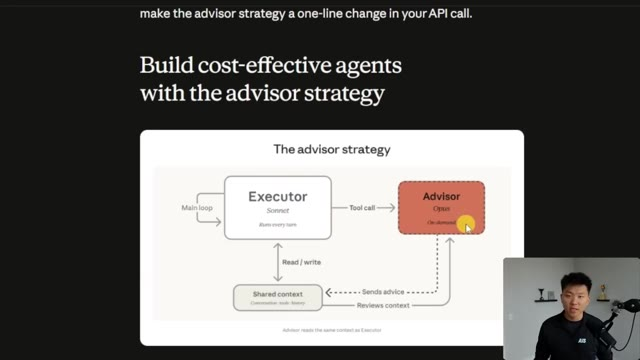
*⏱️ 00:00:45 — Schéma explicatif de la stratégie de l'agent 'Advisor' montrant l'interaction entre l'Exécuteur (Sonnet), le Conseiller (Opus) et le contexte partagé.*

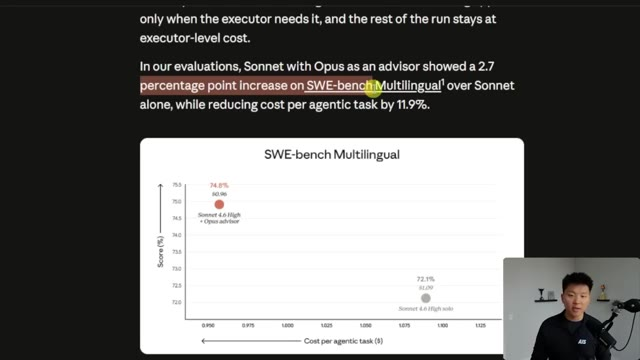
*⏱️ 00:00:54 — Graphique de résultats d'évaluation sur le benchmark SWE-bench Multilingual comparant Sonnet avec un conseiller Opus et Sonnet seul.*

---

### ⏱️ `[00:01:11 - 00:01:30]` | Segment #03

**🔊 Audio (Transcription Intégrale Mot pour Mot en Français) :**
> configuration, il a obtenu un score de 41,2 %, ce qui représente plus du double de son score en solo de 19,7 % sur Browse Comp. Dans ce cas, cela coûte plus cher que d'utiliser Haiku seul, évidemment, mais vous obtenez de bien meilleures performances. Et c'est toujours moins cher que si vous aviez effectué cette tâche avec seulement Opus. Donc, dans cette vidéo, je vais vous montrer des tests sur la façon dont cela fonctionne réellement. Je vais expliquer quand vous pourriez vouloir l'utiliser.

**👁️ Analyse Visuelle d'Écran (gemini-3.5-flash-lite) :**
**Interface & Outils** : Interface web montrant un article explicatif et un tableau de données de performance.

**Contenu textuel & Code** : Texte descriptif de la stratégie d'advisor et tableau comparatif des scores (Agentic search BrowseComp, coûts en dollars).

**Action / Démonstration** : Le présentateur explique les performances et les coûts d'une configuration d'agent IA par rapport à une autre.

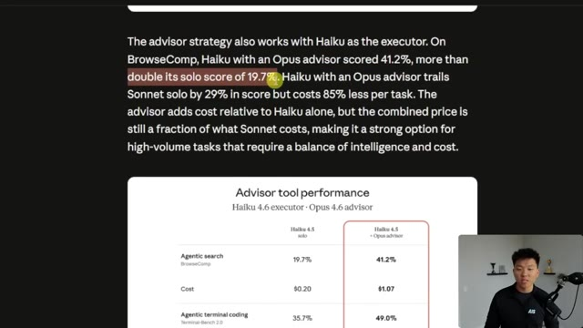
*⏱️ 00:01:16 — Capture montrant un article avec du texte en anglais sur la stratégie d'advisor, ainsi qu'un tableau de performance comparant les scores (41.2% contre 19.7%) et les coûts.*

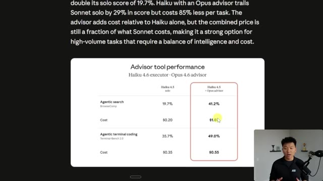
*⏱️ 00:01:20 — Vue zoomée sur le tableau de performance des outils advisor, mettant en évidence les scores de recherche et les coûts associés.*

---

### ⏱️ `[00:01:30 - 00:02:06]` | Segment #04

**🔊 Audio (Transcription Intégrale Mot pour Mot en Français) :**
> Et je vais vous montrer comment vous pouvez commencer à utiliser cette stratégie dès maintenant pour économiser des jetons dans Claude code. Ne perdons donc pas de temps et entrons directement dans la vidéo. Il y a donc quelques trucs que je voulais vous montrer les gars avant qu'on ne plonge dedans. Le premier est simplement la différence réelle de coût entre les versions les plus récentes de ces modèles, Opus, Sonnet et Haiku. Et si vous entendez des coups de marteau en arrière-plan, je m'excuse, l'appartement au-dessus de moi est apparemment en train de construire un parc aquatique. Donc Opus tout à fait à gauche, vous pouvez voir qu'on paie 5 dollars par million d'entrées et 25 dollars par million de sorties. Et c'est représenté ici par le vert pour la sortie et le violet pour l'entrée. Notez donc que pour tous les modèles d'IA, à peu près, les jetons de sortie vous coûtent beaucoup plus cher que les jetons d'entrée. Sonnet coûte 3 dollars pour l'entrée, 15 dollars pour la sortie.

**👁️ Analyse Visuelle d'Écran (gemini-3.5-flash-lite) :**
**Interface & Outils** : Présentation graphique / Interface web de tarification des modèles IA

**Contenu textuel & Code** : Tarifs des jetons : Opus 4.6 ($5/$25), Sonnet 4.6 ($3/$15), Haiku 4.5 ($1/$5) par million de jetons (input/output per MTok) avec histogrammes en barres.

**Action / Démonstration** : Comparaison visuelle des coûts des différents modèles de langage de Claude.

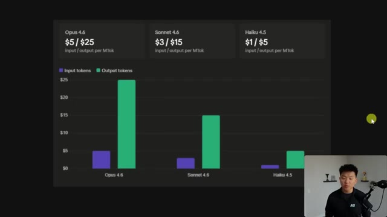
*⏱️ 00:01:39 — Un graphique comparatif affichant les coûts des jetons d'entrée et de sortie pour les modèles Opus 4.6, Sonnet 4.6 et Haiku 4.5.*

---

### ⏱️ `[00:02:07 - 00:02:29]` | Segment #05

**🔊 Audio (Transcription Intégrale Mot pour Mot en Français) :**
> et Haiku coûte 1 dollar pour l'entrée, et 5 dollars pour la sortie. J'espère donc que cela vous montre combien d'argent vous allez pouvoir économiser si vous commencez réellement à mettre en œuvre la stratégie de l'conseiller. La première chose dont je veux parler est donc la différence entre l'API Messages et CloudCode. Parce que la fonction de stratégie de l'conseiller proprement dite est quelque chose qui n'existe que dans l'API Messages. C'est un point de terminaison HTTP qui permet à nos automatisations de faire appel à Cloud et d'utiliser les mêmes modèles, Opus, Son et Haiku.

**👁️ Analyse Visuelle d'Écran (gemini-3.5-flash-lite) :**
**Interface & Outils** : Présentation graphique / Diapositive explicative.

**Contenu textuel & Code** : Comparaison des tarifs des modèles d'IA par million de tokens et définitions textuelles des outils d'IA.

**Action / Démonstration** : Le présentateur explique les coûts des différents modèles et introduit la différence entre l'API et Claude Code.

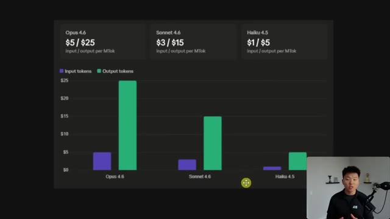
*⏱️ 00:02:12 — Graphique montrant les coûts des tokens d'entrée et de sortie pour les modèles Opus 4.6, Sonnet 4.6 et Haiku 4.5.*

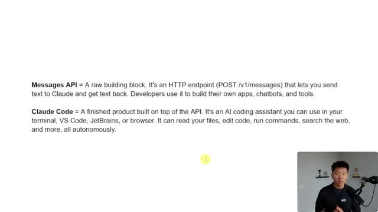
*⏱️ 00:02:18 — Texte explicatif définissant la différence entre 'Messages API' et 'Claude Code'.*

---

### ⏱️ `[00:02:29 - 00:02:47]` | Segment #06

**🔊 Audio (Transcription Intégrale Mot pour Mot en Français) :**
> Donc, les gens pourraient utiliser ceci pour créer leurs propres applications, leurs propres chatbots, leurs propres outils et automatisations. Alors que CloudCode est en réalité le produit fini qui est construit sur l'API. C'est votre assistant de programmation IA que vous utilisez dans votre terminal. Il peut toucher vos locaux, des choses comme ça. Ils sont donc similaires, mais ils ont des cas d'utilisation différents. Cloud Code est plutôt un produit fini. Alors, que peut faire l'API Messages ?

**👁️ Analyse Visuelle d'Écran (gemini-3.5-flash-lite) :**
**Interface & Outils** : Présentation textuelle (slide).

**Contenu textuel & Code** : Texte explicatif décrivant "Messages API" comme un composant brut (POST /v1/messages) et "Claude Code" comme un assistant de programmation IA.

**Action / Démonstration** : Présentation de définitions textuelles à l'écran par le présentateur.

---

### ⏱️ `[00:02:47 - 00:03:10]` | Segment #07

**🔊 Audio (Transcription Intégrale Mot pour Mot en Français) :**
> Il peut envoyer une question, il peut obtenir une réponse. Il peut envoyer des images, des PDF et des documents pour que Claude les analyse, mais ce n'est pas seulement un chatbot. Il peut aussi définir des outils. Et de cette façon, ce sont en quelque sorte les scripts que Claude peut exécuter. Mais ce qu'il ne peut pas faire, c'est lire des fichiers sur votre ordinateur, modifier du code, exécuter des commandes de terminal ou naviguer sur le Web. Il est également sans état, donc il ne se souvient de rien entre les requêtes. Donc, si vous vouliez obtenir cette fonctionnalité, vous le pourriez, mais vous devriez en quelque sorte bricoler votre propre solution et la construire vous-même.

**👁️ Analyse Visuelle d'Écran (gemini-3.5-flash-lite) :**
**Interface & Outils** : Présentation vidéo / Diapositive texte

**Contenu textuel & Code** : Liste des fonctionnalités de l'API : Send a question, Send images/PDFs, Define tools, etc., ainsi que ce qu'elle ne peut pas faire seule.

**Action / Démonstration** : Le présentateur explique les capacités et les limites de l'API de Claude.

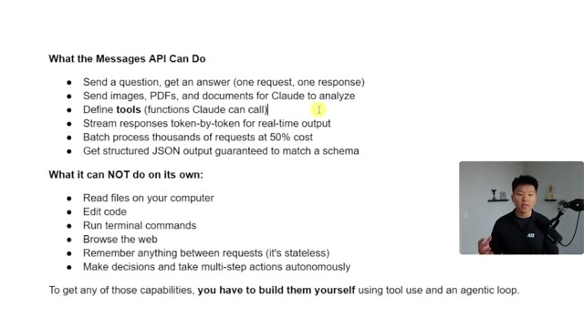
*⏱️ 00:02:53 — Une diapositive explicative listant les capacités de l'API Messages de Claude, avec le présentateur incrusté en bas à droite.*

---

### ⏱️ `[00:03:10 - 00:03:32]` | Segment #08

**🔊 Audio (Transcription Intégrale Mot pour Mot en Français) :**
> Alors, en quoi est-ce similaire à Cloud Code ? Eh bien, ils utilisent tous les deux les mêmes modèles, bien sûr. Ils ont la même capacité fondamentale de comprendre et de générer du texte, du code et du raisonnement. Et ils peuvent tous les deux appeler des outils, car l'API vous permet de définir les outils, et Cloud Code en a évidemment quelques-uns intégrés, et ensuite vous pouvez en ajouter d'autres aux deux. Et le point numéro quatre ici, je devrais honnêtement juste le supprimer parce qu'il dit à peu près la même chose que le numéro un, c'est-à-dire le même cerveau et la même capacité de réflexion.

**👁️ Analyse Visuelle d'Écran (gemini-3.5-flash-lite) :**
**Interface & Outils** : Présentation vidéo avec texte à puces.

**Contenu textuel & Code** : Titre "How They're Similar" listant : 1. Same brain, 2. Same core capability, 3. Tool use, 4. Thinking.

**Action / Démonstration** : Présentation des points de comparaison textuels.

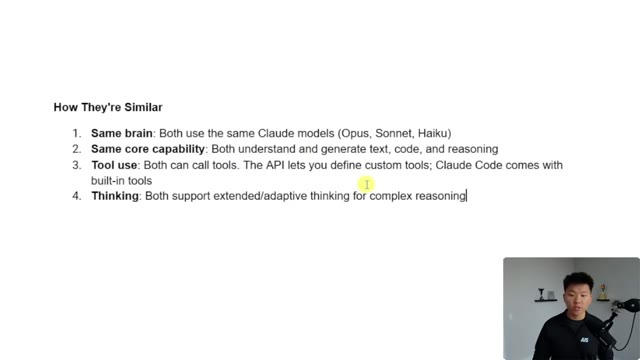
*⏱️ 00:03:16 — Une diapositive montrant les similitudes entre les outils, avec le présentateur en médaillon dans le coin inférieur droit.*

---

### ⏱️ `[00:03:32 - 00:03:57]` | Segment #09

**🔊 Audio (Transcription Intégrale Mot pour Mot en Français) :**
> Donc je sais que c'est un peu déroutant parce que vous avez quelque chose comme l'API Messages, vous avez Cloud Code, vous avez le SDK Agent, et maintenant Cloud vient aussi de lancer quelque chose comme Managed Agents l'autre jour. L'API Messages est conçue pour lorsque vous construisez une application ou un produit qui utilise l'IA quelque part dans cette automatisation. Si vous construisez cela et que vous avez besoin d'un contrôle total sur l'expérience, alors vous utiliseriez également l'API Messages. Ou si vous avez déjà un logiciel et que vous voulez simplement avoir, genre, un bouton qui envoie un message à Claude et renvoie une réponse ou quelque chose comme ça.

**👁️ Analyse Visuelle d'Écran (gemini-3.5-flash-lite) :**
**Interface & Outils** : Présentation de diapositives / Éditeur de texte explicatif.

**Contenu textuel & Code** : Texte listant les critères de choix : "Use the Messages API when", "Use Claude Code when", et "Use the Agent SDK when" avec des puces explicatives.

**Action / Démonstration** : Le présentateur explique les différents outils et les contextes dans lesquels il faut les utiliser.

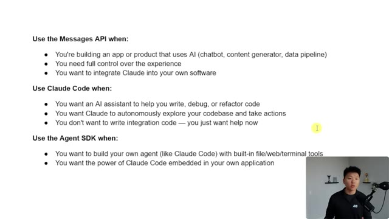
*⏱️ 00:03:38 — Une diapositive explicative listant les différents cas d'utilisation pour l'API Messages, Claude Code et l'Agent SDK, avec le présentateur en bas à droite.*

---

### ⏱️ `[00:03:57 - 00:04:33]` | Segment #10

**🔊 Audio (Transcription Intégrale Mot pour Mot en Français) :**
> Vous savez tous déjà quand vous utiliseriez Claude Code, donc je vais simplement laisser ces points ici. Et maintenant, il y a quelque chose comme le SDK Agent, qui est aussi un peu différent. Mais fondamentalement, j'aime voir les choses comme si j'avais ma propre application et que je voulais en quelque sorte y intégrer quelque chose comme Claude Code. Bon, alors passons aux choses sérieuses. Je veux vous montrer ce que j'ai préparé ici pour nous donner un beau visuel de la façon dont la stratégie de l'conseiller fonctionne réellement. J'ai donc lancé ce projet Claude Code pour m'aider à construire une application, une interface front-end qui communique avec l'API de messagerie. Et si vous allez voir la documentation sur la façon dont cela fonctionne réellement dans une requête vers l'endpoint de l'API de messagerie, vous devez essentiellement ajouter ces quelques éléments qui sont le type, et c'est là que vous mettez conseiller.

**👁️ Analyse Visuelle d'Écran (gemini-3.5-flash-lite) :**
**Interface & Outils** : Visual Studio Code, Claude Code CLI, SDK Agent

**Contenu textuel & Code** : Texte comparatif sur les cas d'usage des outils Claude (Messages API, Claude Code, Agent SDK) et interface VS Code avec arborescence du projet et terminal Claude Code.

**Action / Démonstration** : Présentation des différents cas d'utilisation des outils de développement Anthropic et transition vers l'environnement de code.

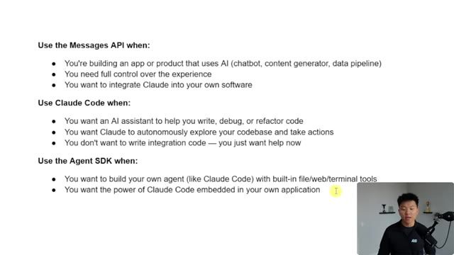
*⏱️ 00:04:06 — Diapositive listant les critères d'utilisation de l'API Messages, de Claude Code et du SDK Agent avec le présentateur en bas à droite.*

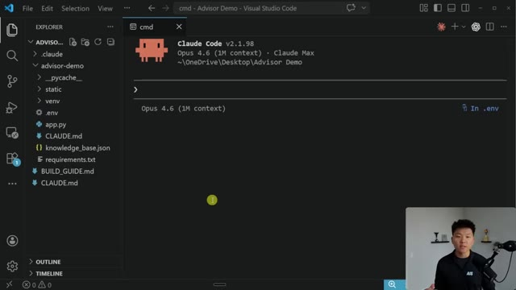
*⏱️ 00:04:15 — Interface de Visual Studio Code affichant un terminal intégré avec Claude Code v2.1.98 et la structure du projet "Advisor Demo".*

---

### ⏱️ `[00:04:33 - 00:05:07]` | Segment #11

**🔊 Audio (Transcription Intégrale Mot pour Mot en Français) :**
> 2026 0301 et ensuite vous définissez le nom qui est advisor. Et vous pouvez aussi faire quelque chose comme max uses, qui correspond fondamentalement au nombre maximum de fois que nous pouvons faire appel à l'advisor via l'automatisation. Et c'est ainsi que vous pouvez avoir un peu plus de contrôle sur votre prix pour vous assurer que vous n'utilisez pas trop Opus. Maintenant, ce que nous avons, c'est ce tableau de bord plutôt sympa où je peux, ici en haut, basculer le type de conseiller stratégique que je veux, qu'il s'agisse de Haiku plus Opus ou de Sonnet plus Opus, ou de Sonnet seul, ou d'Opus seul. Je vais donc exécuter différents exemples avec tout cela pour que vous puissiez voir combien d'argent nous économisons. Et bien sûr, sans sacrifier la qualité. J'ai donc quelques prompts en bas

**👁️ Analyse Visuelle d'Écran (gemini-3.5-flash-lite) :**
**Interface & Outils** : Navigateur web affichant un article de blog de la plateforme Claude.

**Contenu textuel & Code** : Extrait de code Python montrant l'utilisation de `client.messages.create` avec un outil de type `advisor_20260301`, le nom `advisor`, le modèle `claude-opus-4-6`, et la limite `max_uses: 3` en surbrillance.

**Action / Démonstration** : Le présentateur explique la configuration du paramètre 'max_uses' pour limiter les appels à l'advisor dans l'automatisation.

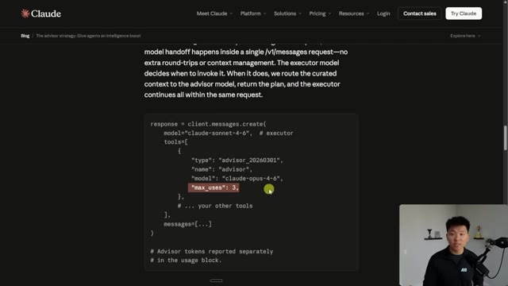
*⏱️ 00:04:42 — Capture d'écran montrant une page web de documentation technique de Claude avec un extrait de code Python illustrant la configuration d'un outil de type 'advisor' avec le paramètre 'max_uses'.*

---

### ⏱️ `[00:05:07 - 00:05:37]` | Segment #12

**🔊 Audio (Transcription Intégrale Mot pour Mot en Français) :**
> ici. Vous pouvez voir que le vert représente en quelque sorte les plus faciles, et ensuite ça devient de plus en plus difficile. Et parfois, même si vous êtes en mode conseiller, il n'appellera pas le conseiller parce qu'il ne le fait que s'il réalise, hé, c'est un peu plus difficile. Donc ici, je suis sur Haiku plus Opus, et je vais juste dire quelque chose comme, quels sont vos horaires d'ouverture ? Cela appelle l'API des messages en arrière-plan. Vous pouvez voir que nous obtenons cette réponse ici, et il a répondu avec Haiku 4.5. Et du côté de l'activité, nous pouvons voir que ces deux types de requêtes ne nous ont presque rien coûté, 0,0016 $ et 0,0020 $.

**👁️ Analyse Visuelle d'Écran (gemini-3.5-flash-lite) :**
**Interface & Outils** : Interface web de chatbot / application de support (TechFlow Support).

**Contenu textuel & Code** : Messages de bienvenue du système, sélection de modèles d'IA (Haiku + Opus, Sonnet + Opus, etc.) et liste de prompts d'échantillon colorés (vert, jaune, orange, rouge) selon leur complexité.

**Action / Démonstration** : Le présentateur explique les différents niveaux de difficulté des prompts et le comportement du mode conseiller selon la complexité des requêtes.

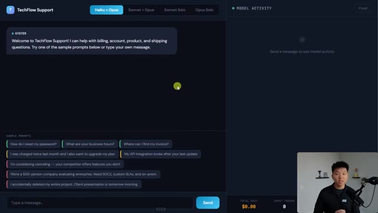
*⏱️ 00:05:14 — Interface web de l'application TechFlow Support montrant un panneau de chat avec des prompts d'exemple classés par couleur selon la difficulté, et un panneau latéral de suivi de l'activité du modèle.*

---

### ⏱️ `[00:05:38 - 00:05:57]` | Segment #13

**🔊 Audio (Transcription Intégrale Mot pour Mot en Français) :**
> Juste ici, c'est là qu'il a appelé un outil, qui consistait à interroger la base de connaissances. Et juste ici, c'est probablement là qu'il nous a simplement répondu. Maintenant, si je posais exactement la même question avec, disons, Opus seul, quelles sont vos heures d'ouverture ? Cela va évidemment nous coûter beaucoup plus cher. Et la réponse sera probablement exactement la même. Ce récapitulatif ici avec Opus a en fait coûté 21 fois plus cher que Haiku.

**👁️ Analyse Visuelle d'Écran (gemini-3.5-flash-lite) :**
**Interface & Outils** : Interface web de test d'agents IA (panneau Model Activity avec les exécutions de Haiku 4.5).

**Contenu textuel & Code** : Historique de conversation avec la question "What are your business hours?" et journal d'activité affichant les exécutions de Haiku 4.5 et l'outil "search_knowledge_base".

**Action / Démonstration** : Examen des journaux d'activité et des appels d'outils pour analyser le comportement du modèle IA.

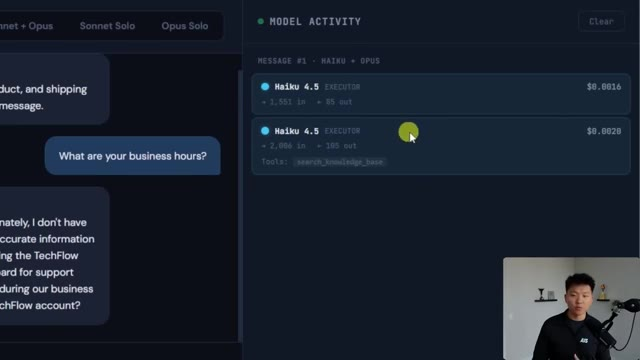
*⏱️ 00:05:42 — Interface de démonstration montrant l'activité du modèle avec les appels d'outils et l'historique du chat.*

---

### ⏱️ `[00:05:57 - 00:06:18]` | Segment #14

**🔊 Audio (Transcription Intégrale Mot pour Mot en Français) :**
> Mais on peut dire qu'Opus a mieux performé ici parce que dans les deux cas, il n'y avait aucune information dans la base de connaissances. Mais ce qu'Opus a fait, c'est qu'il a appelé son outil de recherche dans la base de connaissances, mais il a aussi appelé l'outil de création de ticket, ce qui, comme je l'ai dit, est sans doute un meilleur résultat pour le client ici. Et je suis allé voir dans mon projet pour voir ce qu'il y a réellement à l'intérieur de la base de connaissances pour m'assurer qu'il n'avait rien inventé de tout cela. Et il a dit, ouais, il n'y a effectivement aucune entrée sur les heures d'ouverture dans la base de connaissances.

**👁️ Analyse Visuelle d'Écran (gemini-3.5-flash-lite) :**
**Interface & Outils** : Interface web d'évaluation d'agents IA, Visual Studio Code, terminal intégré.

**Contenu textuel & Code** : Logs d'activité des modèles IA (Haiku 4.5, Opus 4.6), appels d'outils (search_knowledge_base, create_ticket), structure de projet Python.

**Action / Démonstration** : Démonstration de l'utilisation de l'outil de recherche dans la base de connaissances et de création de ticket par l'agent IA Opus.

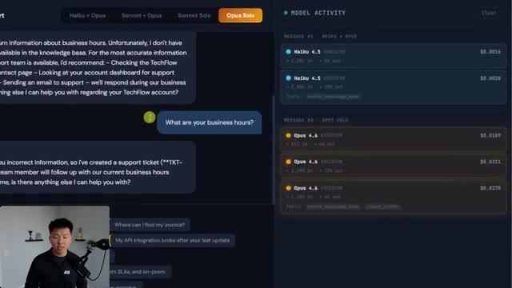
*⏱️ 00:06:02 — Interface web montrant les messages du chat et l'activité des modèles (Haiku et Opus) avec les outils utilisés.*

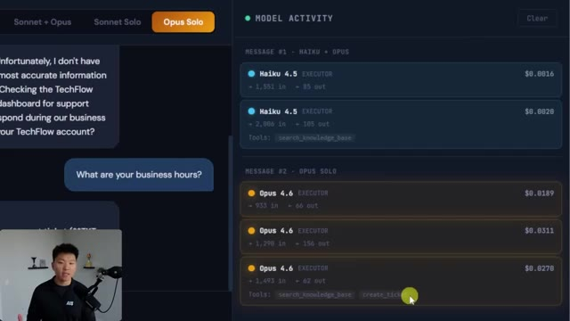
*⏱️ 00:06:08 — Gros plan sur le panneau 'Model Activity' illustrant les appels d'outils comme 'search_knowledge_base' et 'create_ticket' par Opus 4.6.*

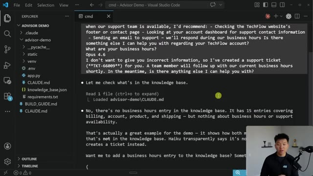
*⏱️ 00:06:13 — Éditeur de code Visual Studio Code affichant le terminal intégré avec les résultats d'exécution et le code source de l'application.*

---

### ⏱️ `[00:06:18 - 00:06:39]` | Segment #15

**🔊 Audio (Transcription Intégrale Mot pour Mot en Français) :**
> Donc ces réponses étaient exactes. Et d'ailleurs, si vous voulez essayer cela pour tester comment cela fonctionne par vous-même, alors je vais essentiellement créer ce projet sous forme de dépôt GitHub, et ensuite je vous donnerai à tous l'accès dans ma communauté FreeSchool. Le lien pour cela se trouve dans la description. Essayons donc un autre avec Haiku et Opus. Nous allons en faire un autre facile. Quelles intégrations prenez-vous en charge ? Vous pouvez voir que cela renvoie la bonne réponse après que Haiku a pu rechercher dans la base de connaissances et répondre.

**👁️ Analyse Visuelle d'Écran (gemini-3.5-flash-lite) :**
**Interface & Outils** : Visual Studio Code et interface web de l'application TechFlow Support.

**Contenu textuel & Code** : Code source, fichiers Markdown, structure JSON d'une base de connaissances et interface de chat d'un agent de support technique.

**Action / Démonstration** : Navigation dans l'explorateur de code et démonstration de l'interface utilisateur de l'application d'assistance client.

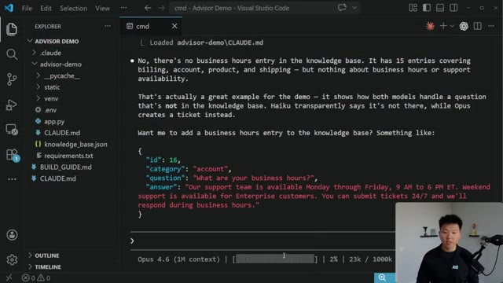
*⏱️ 00:06:23 — Capture d'écran de l'éditeur Visual Studio Code montrant l'arborescence du projet et le terminal intégré avec une réponse d'analyse sur l'absence d'entrées d'horaires dans la base de connaissances.*

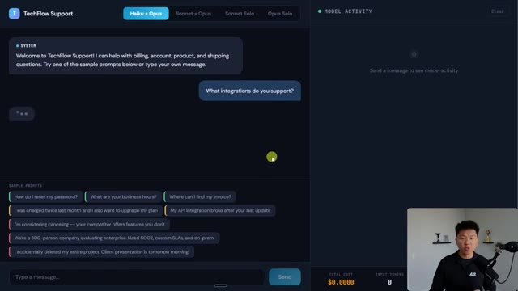
*⏱️ 00:06:34 — Interface web de l'application 'TechFlow Support' avec un panneau de chat interactif à gauche et le panneau d'activité du modèle à droite.*

---

### ⏱️ `[00:06:39 - 00:07:01]` | Segment #16

**🔊 Audio (Transcription Intégrale Mot pour Mot en Français) :**
> Et encore une fois, c'était assez simple pour qu'il n'ait pas à faire appel au conseiller. Et si nous faisions quelque chose comme Sonnet Solo, et que nous envoyions exactement cette même requête, cela nous a donné exactement la même réponse que Haiku. La seule différence réelle, ce sont les emojis. Mais encore une fois, cela va nous coûter beaucoup plus cher. Cette exécution avec Sonnet a coûté environ 2,8 fois plus cher que l'exécution avec uniquement Haiku. Mais de toute façon, effaçons cela et posons vraiment des questions difficiles afin de voir le conseiller être intégré dans la boucle.

**👁️ Analyse Visuelle d'Écran (gemini-3.5-flash-lite) :**
**Interface & Outils** : Interface web de chat et tableau de bord d'activité des modèles d'IA

**Contenu textuel & Code** : Invite de chat "What integrations do you support?", réponse de l'assistant sur les intégrations (Slack, Jira, GitHub, etc.), et panneau de droite "Model Activity" avec Haiku 4.5

**Action / Démonstration** : Consultation de l'interface de test du chatbot pour comparer les réponses entre les différents modes (Haiku, Sonnet Solo)

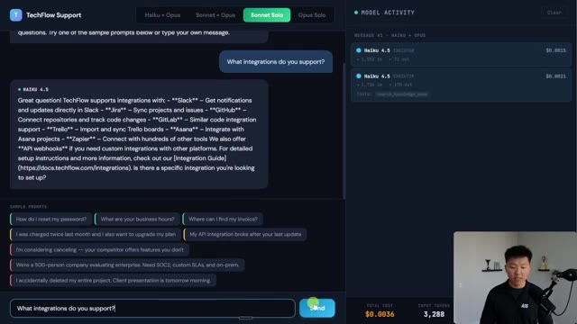
*⏱️ 00:06:45 — Interface de l'application TechFlow Support montrant un chatbot avec le modèle Sonnet Solo sélectionné, et un panneau latéral affichant l'activité du modèle et les coûts.*

---

### ⏱️ `[00:07:01 - 00:07:20]` | Segment #17

**🔊 Audio (Transcription Intégrale Mot pour Mot en Français) :**
> J'ai donc simplement demandé à ce projet de me donner une question difficile, puis ce que la réponse correcte devrait inclure. La question va donc être : « J'ai acheté un appareil matériel il y a trois semaines et j'ai également acheté une licence logicielle, et je souhaite retourner les deux. Quelles sont mes options ? » Et nous devrions rechercher le fait qu'ils peuvent le retourner sous 30 jours, emballage d'origine, contacter l'assistance pour obtenir une étiquette de retour, remboursement sous cinq à sept jours ouvrés.

**👁️ Analyse Visuelle d'Écran (gemini-3.5-flash-lite) :**
**Interface & Outils** : Visual Studio Code (éditeur de code avec terminal intégré).

**Contenu textuel & Code** : Question : « I bought a hardware device 3 weeks ago and also purchased a software license. I want to return both – what are my options? » et les critères pour une réponse correcte.

**Action / Démonstration** : Affichage de la question difficile générée pour tester l'agent et du contexte associé dans l'éditeur.

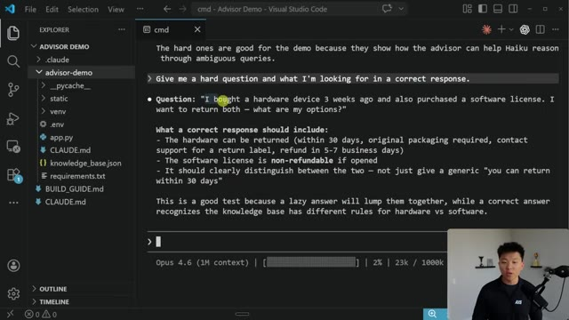
*⏱️ 00:07:06 — Un terminal intégré dans Visual Studio Code montrant une question générée et sa réponse attendue concernant le retour d'un appareil matériel et d'une licence logicielle.*

---

### ⏱️ `[00:07:20 - 00:07:53]` | Segment #18

**🔊 Audio (Transcription Intégrale Mot pour Mot en Français) :**
> la licence logicielle n'est pas remboursable, bla, bla, bla. Donc essayons d'abord Haiku plus Opus, et nous allons envoyer cette question et voir ce qui se passe. D'accord, intéressant. Donc il n'a finalement pas appelé le conseiller ici. Il a parlé du fait qu'ils sont dans la période de 30 jours. Vous avez besoin de l'emballage d'origine. Vous pouvez nous contacter pour une étiquette de retour. La licence logicielle n'est pas remboursable. Tout cela semble correct. Voyons si nous faisons exactement la même chose avec Sonnet plus Opus. Waouh, c'est vraiment intéressant. Dans ce cas, Sonnet a décidé pour une raison quelconque d'appeler le conseiller, même si Haiku ne l'a pas fait. Donc on peut se demander, est-ce parce que Haiku n'a tout simplement pas réalisé que c'était

**👁️ Analyse Visuelle d'Écran (gemini-3.5-flash-lite) :**
**Interface & Outils** : Interface web de test de chatbot (TechFlow Support) avec panneau de suivi de l'activité des modèles d'IA (Haiku 4.5, Sonnet 4.6, Opus 4.6).

**Contenu textuel & Code** : Échange de messages concernant les conditions de remboursement de matériel et de logiciels, et journal d'exécution des modèles d'IA affichant les coûts et les jetons.

**Action / Démonstration** : Interaction avec le chatbot pour tester les politiques de retour et observation de l'activité des modèles d'intelligence artificielle.

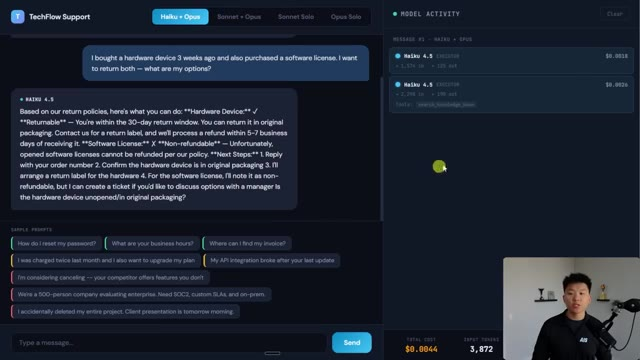
*⏱️ 00:07:28 — Interface de l'application TechFlow Support montrant une discussion sur le retour d'un appareil et d'une licence logicielle, avec le panneau d'activité des modèles IA à droite.*

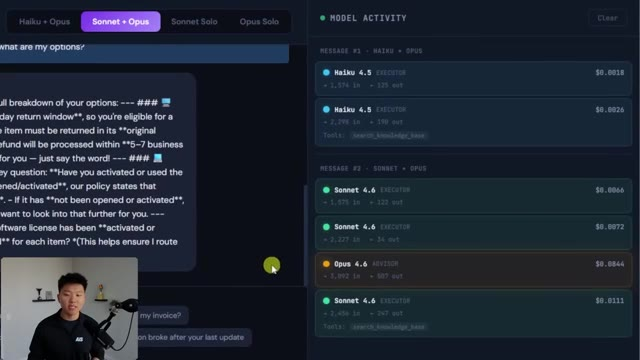
*⏱️ 00:07:44 — Vue rapprochée de l'application TechFlow Support montrant l'activité détaillée des différents modèles IA (Haiku, Sonnet, Opus) dans le panneau latéral droit.*

---

### ⏱️ `[00:07:53 - 00:08:26]` | Segment #19

**🔊 Audio (Transcription Intégrale Mot pour Mot en Français) :**
> difficile et peut-être mal comprise, et Sonnet a été capable de comprendre qu'il avait besoin du conseiller ou, vous savez, qu'est-ce qui s'est passé là ? Parce que cette réponse, encore une fois, est correcte. Délai de retour de 30 jours, doit être retourné dans son emballage d'origine. Je dirais quand même que cette réponse est probablement plus alignée avec ce que je voudrais envoyer à un client comparé à celle-ci. Celle-ci semble juste un peu plus claire. D'accord, on va en essayer une autre. Tout d'abord, c'est Haiku plus le conseiller Opus. Parce que vous pourriez être sceptiques quant au fait que cela fonctionne vraiment correctement, ce sélecteur pointe directement vers la stratégie Advisor avec Haiku et Opus. Donc, on a juste besoin d'avoir une question qui est

**👁️ Analyse Visuelle d'Écran (gemini-3.5-flash-lite) :**
**Interface & Outils** : Interface web TechFlow Support, tableau de bord de suivi des modèles d'IA (Haiku, Sonnet, Opus).

**Contenu textuel & Code** : Réponse du chatbot détaillant la politique de retour matériel (dans la fenêtre de 30 jours, emballage d'origine) et l'activité des appels de modèles d'IA avec les coûts associés.

**Action / Démonstration** : Analyse de la réponse du chatbot générée par Sonnet 4.6 concernant la politique de retour et affichage des logs d'exécution des différents modèles.

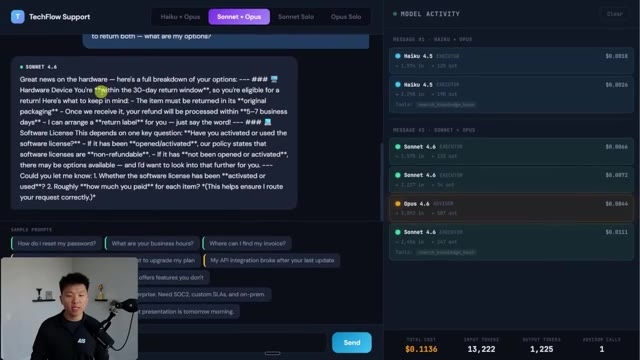
*⏱️ 00:08:01 — Interface de l'application TechFlow Support montrant un chatbot avec une réponse détaillée sur le délai de retour de 30 jours et un panneau latéral affichant l'activité des modèles d'IA.*

---

### ⏱️ `[00:08:26 - 00:08:59]` | Segment #20

**🔊 Audio (Transcription Intégrale Mot pour Mot en Français) :**
> ... suffisamment difficile pour que Haiku réalise qu'il a besoin de l'aide de l'Advisor. D'accord, c'est parti. On peut voir que l'Advisor a été appelé avec Opus. Il a appelé deux outils, mais l'appelant des outils était Haiku lui-même. L'outil de recherche dans la base de connaissances ainsi que l'outil de création de ticket. Et la réponse a fini par être : « J'ai créé le ticket bla bla bla pour vous rediriger vers votre équipe commerciale entreprise ». Alors envoyons exactement la même question maintenant à Sonnet plus Opus et voyons si on obtient une réponse différente. D'accord, pratiquement la même réponse. Un ticket a été créé et l'équipe devrait assurer le suivi. Et vous savez ce qui est marrant ? Dans ce cas, je préfère en fait la réponse de Haiku parce qu'elle dit qu'ils vous contacteront d'ici un ou deux jours ouvrés plutôt que de simplement dire, hé, notre équipe assurera le suivi avec vous.

**👁️ Analyse Visuelle d'Écran (gemini-3.5-flash-lite) :**
**Interface & Outils** : Interface web de démonstration 'TechFlow Support' avec panneau de journalisation des modèles d'IA (Model Activity).

**Contenu textuel & Code** : Activité des modèles : Haiku 4.5 (Executor) et Opus 4.6 (Advisor), détails des coûts ($0.1120), tokens d'entrée (14,977) et de sortie (1,350), ainsi que les outils appelés (search_knowledge_base, create_ticket).

**Action / Démonstration** : Présentation du panneau d'activité montrant l'orchestration dynamique entre les modèles Haiku et Opus pour gérer une requête complexe de support client.

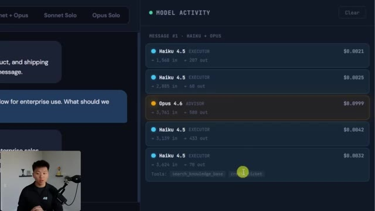
*⏱️ 00:08:34 — Gros plan sur le panneau de droite 'Model Activity' montrant l'historique d'exécution des modèles Haiku 4.5 et l'appel à Opus 4.6 en tant qu'Advisor avec les outils 'search_knowledge_base' et 'create_ticket'.*

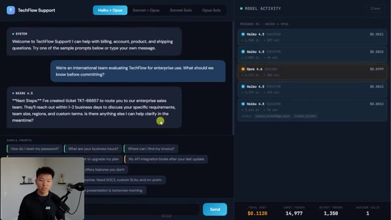
*⏱️ 00:08:42 — Vue complète de l'application 'TechFlow Support' montrant à gauche la conversation client avec la réponse de Haiku 4.5 et à droite le panneau d'activité des modèles avec les coûts et tokens.*

---

### ⏱️ `[00:08:59 - 00:09:32]` | Segment #21

**🔊 Audio (Transcription Intégrale Mot pour Mot en Français) :**
> bientôt. Et encore une fois, ici, vous pouvez voir que Opus 4.6, comme l'conseiller était appelé, et Sonnet ont utilisé la base de connaissances de recherche ainsi que l'outil de création de ticket. Nous avons donc obtenu une meilleure réponse avec Haiku et Opus, et c'était bien moins cher que Sonnet et Opus. D'accord, ensuite, parce que je suis juste curieux, je l'ai fait à nouveau avec Sonnet Solo et Opus Solo. Et Sonnet m'a donné une réponse assez intéressante. Il m'a donné bien plus de détails. Et il s'est terminé par la recommandation de parler à l'équipe commerciale afin qu'elle puisse créer un ticket pour eux. Mais ensuite, Opus m'a donné pratiquement la même réponse que Haiku tout à l'heure, à savoir : J'ai créé le ticket pour vous mettre en relation avec notre équipe commerciale.

**👁️ Analyse Visuelle d'Écran (gemini-3.5-flash-lite) :**
**Interface & Outils** : Application web "TechFlow Support" avec panneau "Model Activity" et le présentateur en bas à gauche.

**Contenu textuel & Code** : Historique de chat avec des réponses automatisées et panneau latéral affichant l'activité des modèles Haiku, Sonnet et Opus avec les coûts associés.

**Action / Démonstration** : Analyse comparative des coûts et des performances des différents modèles d'IA (Haiku, Sonnet, Opus) lors d'une requête de support client.

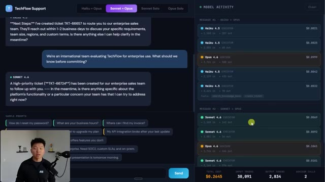
*⏱️ 00:09:07 — Interface d'une application de support client montrant une conversation à gauche et un panneau d'activité des modèles d'IA à droite, avec le présentateur en médaillon.*

---

### ⏱️ `[00:09:33 - 00:10:05]` | Segment #22

**🔊 Audio (Transcription Intégrale Mot pour Mot en Français) :**
> Donc je ne sais pas exactement quoi en penser. D'ailleurs, pour votre cas d'usage spécifique, si vous avez une application comme celle-ci et que vous vous demandez : devrais-je implémenter la stratégie du conseiller ? Je dirais, ne le faites pas simplement tout de suite. Testez des centaines de prompts avec chacun d'eux pour voir ce qui, selon vous, est systématiquement le plus performant. Parce qu'encore une fois, faire des économies sur les tokens, c'est formidable, mais seulement si vous ne sacrifiez pas la qualité. Il semble que chaque fois qu'Opus est dans la boucle avec Haiku ou Sonnet, vous obtenez un meilleur résultat que si c'est juste Sonnet tout seul. Mais gardez à l'esprit que j'ai fait genre 10 à 20 tests ici. C'est loin, très loin du nombre dont vous auriez besoin.

**👁️ Analyse Visuelle d'Écran (gemini-3.5-flash-lite) :**
**Interface & Outils** : Application web TechFlow Support avec panneau de suivi latéral « Model Activity ».

**Contenu textuel & Code** : Historique de discussion utilisateur/IA concernant une évaluation entreprise, et journal des coûts d'exécution des modèles (Sonnet 4.6 et Opus 4.6) avec les coûts en dollars ($0.0053, $0.8313, etc.).

**Action / Démonstration** : Affichage des performances et des coûts en temps réel des différents modèles d'IA suite à une interaction de support client.

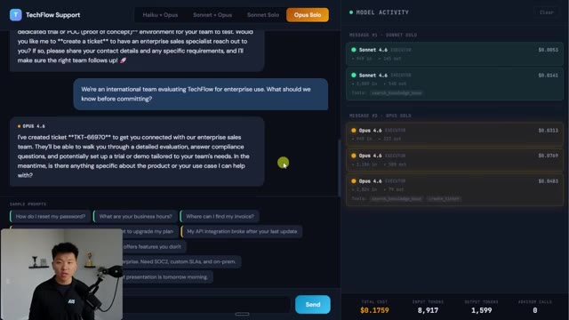
*⏱️ 00:09:41 — Interface de l'application TechFlow Support montrant une discussion avec l'IA à gauche et un panneau de suivi de l'activité des modèles à droite.*

---

### ⏱️ `[00:10:05 - 00:10:43]` | Segment #23

**🔊 Audio (Transcription Intégrale Mot pour Mot en Français) :**
> pour mettre quelque chose en production. Bref, une petite démo rapide, un petit tableau de bord sympa que vous pouvez voir. Et comme je l'ai dit, vous pouvez lancer ça si vous voulez vous amuser avec de votre côté. Et donc, la façon dont cela fonctionne, évidemment, c'est que lorsque je clique sur envoyer, nous envoyons une requête à l'API messages. En fonction du sélecteur, nous avons un mode différent. Et ensuite, lorsque la réponse revient sur ce tableau de bord, elle est affichée ici en indiquant quel modèle a été appelé et, pour ce modèle, combien de tokens ont été appelés. Bref, la question maintenant est : comment fait-on quelque chose comme ça ? Comment prenez-vous cette stratégie pour l'utiliser dans Claude Code afin de vous assurer de ne pas atteindre votre limite de session ? Parce que dans Claude Code, lorsque nous utilisons ces différents modèles, même si nous ne sommes pas facturés par token de la même manière qu'avec la facturation par API, Opus va consommer une plus grande partie de

**👁️ Analyse Visuelle d'Écran (gemini-3.5-flash-lite) :**
**Interface & Outils** : Interface web TechFlow Support et Visual Studio Code / Claude Code CLI

**Contenu textuel & Code** : Interface de chat support client avec historique des messages, panneau latéral affichant les coûts ($0.1759) et les jetons, et terminal VS Code affichant 'Claude Code v2.1.98' avec le modèle Opus 4.6.

**Action / Démonstration** : Navigation et présentation de l'application de démonstration et du tableau de bord d'activité des agents IA.

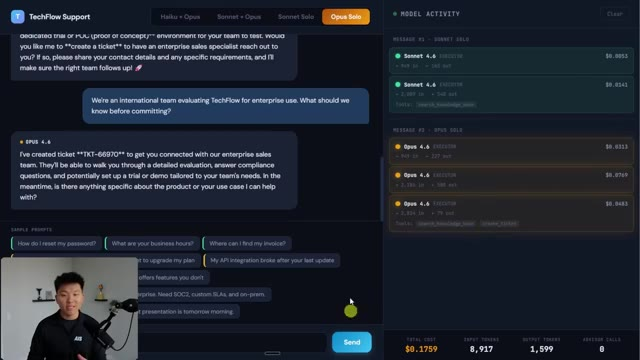
*⏱️ 00:10:14 — Capture d'écran montrant l'interface utilisateur de l'application 'TechFlow Support' avec un panneau latéral affichant l'activité du modèle d'IA et les coûts en temps réel.*

*⏱️ 00:10:33 — Capture d'écran montrant l'éditeur Visual Studio Code avec le terminal intégré exécutant Claude Code v2.1.98.*

---

### ⏱️ `[00:10:43 - 00:11:15]` | Segment #24

**🔊 Audio (Transcription Intégrale Mot pour Mot en Français) :**
> votre utilisation de session que Sonnet ne le fera. Et Sonnet consomme plus de votre limite que Haiku ne le fera. Donc, si vous optimisez pour Haiku, vous pourrez faire durer la limite de votre session plus longtemps. Donc, la réponse est quelque chose de super simple. Utilisez simplement Opus uniquement quand vous avez besoin d'Opus, puis tenez-vous-en à Sonnet quand vous le pouvez. Et pour de très petites choses comme l'exploration, la recherche, la recherche documentaire, la synthèse, utilisez simplement Haiku. Donc, ce que vous pouvez faire, c'est utiliser un modèle appelé opus plan. Si vous allez ici et que vous faites slash model, vous pouvez voir les différents modèles, n'est-ce pas ? Vous avez le modèle par défaut, vous avez Sonnet, vous avez Sonnet avec 1 million de contexte, vous avez Haiku, mais il y a fondamentalement ceci de caché

**👁️ Analyse Visuelle d'Écran (gemini-3.5-flash-lite) :**
**Interface & Outils** : Visual Studio Code, terminal Claude Code

**Contenu textuel & Code** : Commande `/clear` exécutée et indication du modèle Opus 4.6 (1M context) dans le terminal Claude Code.

**Action / Démonstration** : Nettoyage de l'historique du terminal dans l'interface de Claude Code au sein de VS Code.

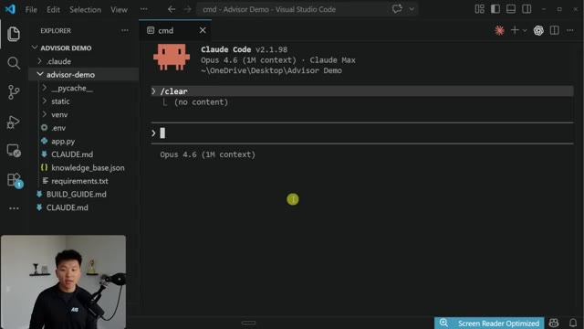
*⏱️ 00:10:59 — L'éditeur Visual Studio Code affichant un terminal avec l'interface de Claude Code v2.1.98 utilisant Opus 4.6.*

---

### ⏱️ `[00:11:15 - 00:11:42]` | Segment #25

**🔊 Audio (Transcription Intégrale Mot pour Mot en Français) :**
> celui où si vous faites le plan du modèle Opus et que vous l'atteignez, il est dit de régler le modèle sur Opus 4.6 en mode plan. Partout ailleurs, je vais utiliser Sonnet 4.6. Donc sur ma barre d'état, j'ai configuré ceci pour qu'il me montre quel modèle il utilise. Il va utiliser Sonnet. Mais si je bascule ici en mode plan, il passe automatiquement à Opus. Et ensuite, lorsque je sors du mode plan, il va automatiquement repasser à Sonnet. Donc cela à lui seul va vous faire économiser une tonne de votre session.

**👁️ Analyse Visuelle d'Écran (gemini-3.5-flash-lite) :**
**Interface & Outils** : Visual Studio Code, Terminal Claude Code CLI

**Contenu textuel & Code** : Commandes saisies : `/clear`, `/model`, `/model opusplan` avec le retour confirmant "Set model to Opus 4.6 in plan mode, else Sonnet 4.6", et la barre d'état indiquant "Sonnet 4.6".

**Action / Démonstration** : Le présentateur configure l'outil Claude Code pour utiliser le modèle Opus 4.6 en mode plan et Sonnet 4.6 par défaut.

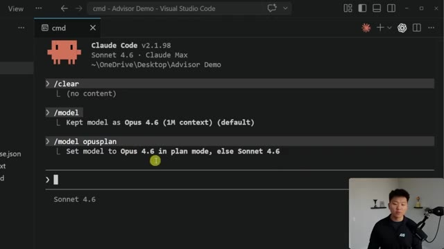
*⏱️ 00:11:22 — Un terminal intégré dans Visual Studio Code exécutant Claude Code v2.1.98 avec des commandes pour configurer les modèles d'IA.*

---

### ⏱️ `[00:11:43 - 00:12:19]` | Segment #26

**🔊 Audio (Transcription Intégrale Mot pour Mot en Français) :**
> Très bien. Donc, juste comme un exemple rapide, j'envoie ce message en mode plan, ce qui, encore une fois, va utiliser Opus 4.6 pour s'assurer que nous sommes parfaitement alignés et que le modèle comprend ce que nous voulons faire avant que nous ne demandions réellement à Sonnet de l'exécuter. Et ce que je vais faire, c'est en fait copier ce prompt et je vais ouvrir une nouvelle session de Claude et je vais faire tout le processus en mode plan et en mode d'exécution normal avec Opus 4.6 pour voir la différence de résultat. D'accord, donc dans le terminal 1, nous avons le plan et si je clique sur acceptation automatique, nous devrions voir que cela vient de basculer automatiquement sur sonnet juste là, et pendant que cela s'exécute, Claude vient d'annoncer une autre fonctionnalité juste ici sur X. Celle-ci s'appelle l'outil de surveillance. Allez vraiment voir ça, c'est vraiment

**👁️ Analyse Visuelle d'Écran (gemini-3.5-flash-lite) :**
**Interface & Outils** : Visual Studio Code avec terminal intégré exécutant Claude Code (v2.1.98, Sonnet 4.6, mode plan actif).

**Contenu textuel & Code** : Commandes terminal, prompt utilisateur demandant un plan de recherche sur la stratégie 'advisor' et la création d'une sortie HTML, avec des barres de progression de tokens (Opus 4.6).

**Action / Démonstration** : Exécution d'une requête en mode plan dans Claude Code pour analyser la base de code et concevoir une page explicative visuelle.

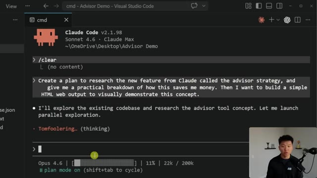
*⏱️ 00:11:52 — Interface de Claude Code dans Visual Studio Code montrant la saisie d'un prompt utilisateur pour créer un plan de recherche sur la stratégie 'advisor' de Claude.*

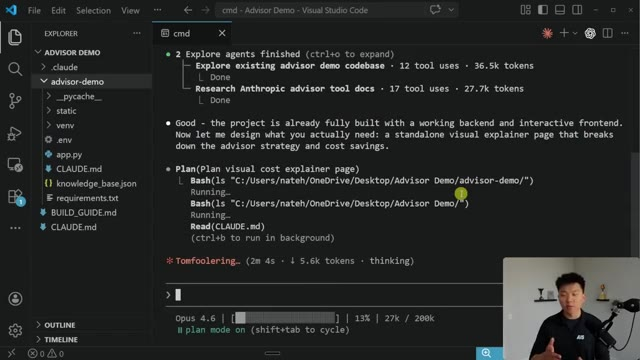
*⏱️ 00:12:01 — Interface de Claude Code affichant les résultats d'exploration des agents et la formulation d'un plan pour créer une page visuelle d'explication des coûts.*

---

### ⏱️ `[00:12:19 - 00:12:53]` | Segment #27

**🔊 Audio (Transcription Intégrale Mot pour Mot en Français) :**
> rapidement et voir de quoi il s'agit, et maintenant le terminal Opus a terminé le plan et quand je l'exécute, il va rester dans Opus, comme vous pouvez le voir juste là. D'accord, donc nos deux visualisations sont terminées. C'est celle qui était avec Opus puis Sonnet pour l'exécution. Nous avons la stratégie du conseiller, laisser un modèle bon marché s'occuper du travail facile, faire appel à l'expert uniquement quand cela compte, la même qualité sur les problèmes difficiles, une fraction du coût global. Nous avons un petit diagramme ici, nous avons les couleurs, et alors que je fais défiler vers le bas, vous pouvez voir que nous avons une escalade intelligente, pas de la force brute. Nous avons deux petits diagrammes ici avec une requête simple, aucun conseiller nécessaire, et avec un

**👁️ Analyse Visuelle d'Écran (gemini-3.5-flash-lite) :**
**Interface & Outils** : Visual Studio Code (VS Code), interface web de démonstration.

**Contenu textuel & Code** : Terminal intégré affichant les étapes de lecture de fichiers et le statut du modèle Opus 4.6 (1M context), ainsi que la page web de stratégie.

**Action / Démonstration** : Exécution d'un plan d'agent IA dans le terminal et présentation visuelle du résultat sur une interface web.

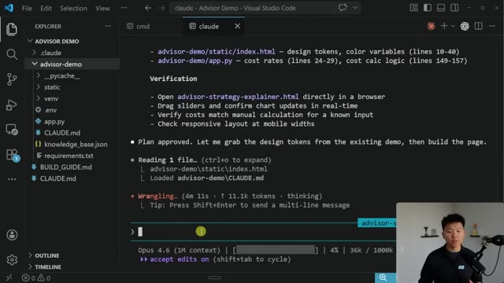
*⏱️ 00:12:28 — Vue de l'éditeur VS Code affichant l'interface de terminal Claude avec un plan en cours d'exécution par Opus 4.6.*

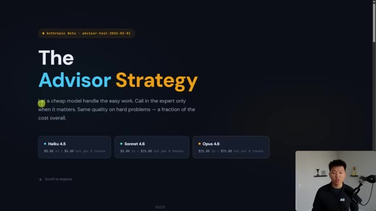
*⏱️ 00:12:36 — Interface web sombre intitulée 'The Advisor Strategy' montrant les différents modèles IA (Haiku, Sonnet, Opus).*

---

### ⏱️ `[00:12:53 - 00:13:24]` | Segment #28

**🔊 Audio (Transcription Intégrale Mot pour Mot en Français) :**
> requête complexe, le conseiller est appelé, ce qui fait que Haiku appelle Opus, et ensuite Haiku va répondre. Nous avons "voir les économies pour votre charge de travail". C'est donc un joli tableau de bord ici. Nous pouvons même modifier ces curseurs, ce qui est une fonctionnalité plutôt agréable pour voir comment une différence dans l'utilisation des jetons, des requêtes ou du mélange de charges de travail affecte la stratégie du conseiller et combien cela nous coûte. Nous pouvons continuer à faire défiler vers le bas pour voir quel modèle gérera quoi. D'accord, c'est très cool. Et il fait aussi évidemment référence à ce qui se trouvait dans notre projet. Le tableau de bord qu'il a construit et pourquoi la stratégie du conseiller l'emporte.

**👁️ Analyse Visuelle d'Écran (gemini-3.5-flash-lite) :**
**Interface & Outils** : Interface web de calcul et d'optimisation des coûts de modèles de langage (LLM).

**Contenu textuel & Code** : Graphiques de coûts mensuels par mode (Sonnet Solo, Haiku + Opus Advisor, Sonnet + Opus Advisor, Opus Solo), curseurs de volume de requêtes, de mix de charge de travail et d'utilisation des tokens.

**Action / Démonstration** : Ajustement des curseurs interactifs du tableau de bord pour simuler et comparer les économies réalisées selon la complexité des requêtes.

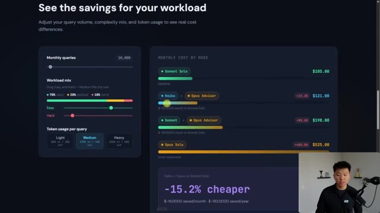
*⏱️ 00:13:01 — Un tableau de bord interactif affichant l'estimation des coûts pour différentes charges de travail de modèles d'IA avec des curseurs ajustables.*

---

### ⏱️ `[00:13:25 - 00:13:58]` | Segment #29

**🔊 Audio (Transcription Intégrale Mot pour Mot en Français) :**
> Nous avons quelques statistiques ici et ensuite nous pouvons même lancer la démo interactive, qui malheureusement ne nous amène pas vraiment au bon endroit, mais c'est quand même plutôt cool et pas trop mal. Alors maintenant, ouvrons celle qu'Opus a construite. Donc même ambiance, sensation similaire, la stratégie du conseiller. Nous avons les différents modèles ici avec leurs différents prix. Et si nous faisons défiler vers le bas, nous pouvons voir comment cela fonctionne. Et honnêtement, je n'aime déjà pas vraiment la façon dont ce site web se sent. Il n'a pas d'éléments de défilement dynamique. Et aussi cette visualisation n'a pas vraiment autant de sens pour moi par rapport à si nous remontons ici et que nous voyons ces deux-là, ils semblent juste un peu plus clairs.

**👁️ Analyse Visuelle d'Écran (gemini-3.5-flash-lite) :**
**Interface & Outils** : Navigateur web affichant une application ou un tableau de bord analytique.

**Contenu textuel & Code** : Texte et graphiques statistiques : "Why the advisor strategy wins", "70% of queries never need the advisor", "~500 token burst when Opus is called", "-15.2% cheaper than Sonnet Solo", et un bouton "Launch Interactive Demo".

**Action / Démonstration** : Le présentateur commente les statistiques affichées à l'écran avant de s'apprêter à lancer la démonstration interactive.

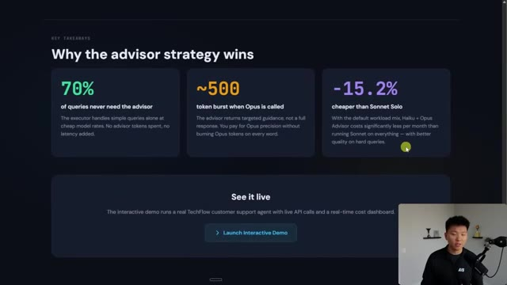
*⏱️ 00:13:33 — Une page web sombre présentant des statistiques et des arguments clés sur une stratégie d'IA, avec le présentateur visible en incrustation vidéo dans le coin inférieur droit.*

---

### ⏱️ `[00:13:58 - 00:14:17]` | Segment #30

**🔊 Audio (Transcription Intégrale Mot pour Mot en Français) :**
> Il possède bien un calculateur de coût interactif, ce qui est agréable. Nous avons des requêtes faciles, des requêtes moyennes, des requêtes difficiles, des requêtes par mois, que nous pouvons modifier, ainsi que des jetons d'entrée moyens et des jetons de sortie moyens. C'est donc une délicate attention. On pourrait soutenir que ce tableau de bord est un peu meilleur. Et puis, les informations clés sont à peu près les mêmes. Et il y a tout simplement beaucoup moins d'informations sur la version réservée à Opus.

**👁️ Analyse Visuelle d'Écran (gemini-3.5-flash-lite) :**
**Interface & Outils** : Interface web d'application interactive / tableau de bord de calcul de coûts.

**Contenu textuel & Code** : Paramètres de requêtes (Easy 35%, Medium 38%, Hard 27%), 10000 requêtes par mois, 1000 jetons d'entrée, 500 jetons de sortie, graphiques comparatifs des coûts et tableau de stratégie.

**Action / Démonstration** : Le présentateur modifie les paramètres du calculateur interactif pour montrer l'impact sur les coûts des différents modèles d'IA.

*⏱️ 00:14:03 — Interface web montrant un calculateur de coût interactif (Interactive Cost Calculator) avec des curseurs pour le mix de requêtes (Easy, Medium, Hard), le nombre de requêtes par mois et les jetons moyens, ainsi qu'un graphique à barres comparant différents modèles (Haiku Solo, Advisor Mode, Sonnet Solo, Opus Solo).*

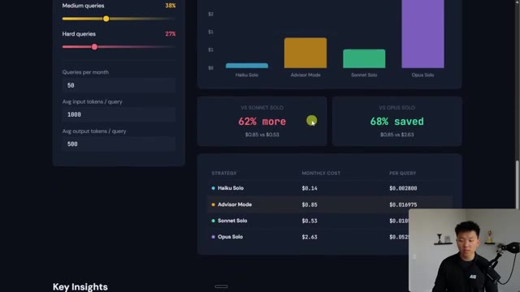
*⏱️ 00:14:08 — Suite du calculateur de coût interactif montrant le tableau des coûts mensuels et par requête pour chaque stratégie, avec le comparatif de performance et d'économies.*

---

### ⏱️ `[00:14:18 - 00:14:50]` | Segment #31

**🔊 Audio (Transcription Intégrale Mot pour Mot en Français) :**
> Donc c'est l'un de ces cas où je dirais que je suis satisfait des deux résultats. Je dirais même que j'préfère celui-ci, qui a encore une fois utilisé le plan Opus dans Claude Code. C'était donc aussi moins cher pour nous. Bref, voici l'outil de conseil. J'espère que cela a éclairé la façon dont cela fonctionne et dissipé certaines confusions. Je vous rappelle que c'est en version bêta, mais vous pouvez tout à fait aller l'essayer, mais c'est tout pour celui-ci. Donc si vous avez aimé ou si vous avez appris quelque chose de nouveau, n'hésitez pas à mettre un pouce bleu. Ça m'aide énormément. Et comme toujours, je vous remercie d'être arrivés jusqu'à la fin de la vidéo et d'avoir toléré les bruits de marteau que vous avez peut-être entendus en arrière-plan. Donc merci à vous. Et voilà, passez une bonne journée.

**👁️ Analyse Visuelle d'Écran (gemini-3.5-flash-lite) :**
**Interface & Outils** : Navigateur web affichant la documentation et le blog officiels d'Anthropic / Claude.

**Contenu textuel & Code** : Texte explicatif sur l'utilisation combinée d'un modèle d'exécution rapide et d'un modèle de conseil plus intelligent (Opus).

**Action / Démonstration** : Navigation et présentation visuelle des fonctionnalités et de la documentation de l'API Anthropic concernant l'Advisor tool.

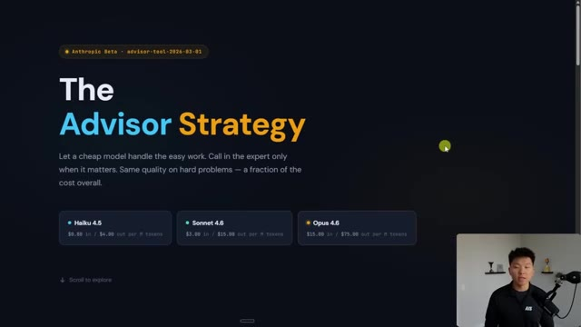
*⏱️ 00:14:26 — Présentation de la stratégie d'aide (The Advisor Strategy) montrant les différents modèles Haiku 4.5, Sonnet 4.6 et Opus 4.6.*

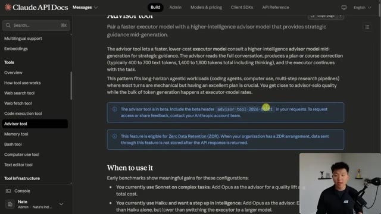
*⏱️ 00:14:34 — Documentation de l'API Claude affichant les détails sur l'outil de conseil (Advisor tool) et ses prérequis d'intégration.*

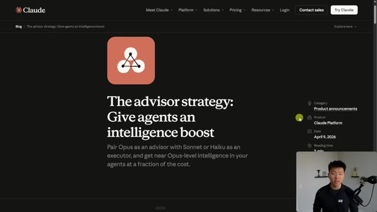
*⏱️ 00:14:42 — Article de blog officiel de Claude intitulé 'The advisor strategy: Give agents an intelligence boost'.*

---

