# 🎬 Seedance 2.0 + Claude Code Creates $10k Websites in Minutes

> **Chaîne** : [Nate Herk | AI Automation](https://www.youtube.com/@nateherk/featured)  
> **Lien YouTube** : [https://www.youtube.com/watch?v=NvxiSG34mPU](https://www.youtube.com/watch?v=NvxiSG34mPU)  
> **Date de publication** : 20260411  
> **Durée** : 00:23:02  
> **Identifiant vidéo** : `NvxiSG34mPU`  
> **Transcription & Analyse** : `whisper-v3-large-turbo+gemini-3.5-flash-lite`  

---

## 📌 Synthèse Exécutive & Outils

### 💡 Résubo

La vidéo de la chaîne Nate Herk | AI Automation explore l'intersection de la génération vidéo de pointe et du développement web autonome grâce à l'utilisation combinée du modèle **Seedance 2.0** (via l'interface de Higgsfield) et de l'assistant de code **Claude Code** d'Anthropic. L'objectif démontré est de concevoir, en quelques minutes et sans compétences initiales requises en production audiovisuelle, des sites web haut de gamme (au rendu luxueux et moderne s'inspirant de standards exigeants comme le style Apple) valant de 10 000 $. Le flux de travail s'articule autour d'une approche itérative rigoureuse : création d'une image de départ sur mesure, génération d'une vidéo en boucle fluide et infinie via Seedance grâce à des invites textuelles structurées, puis intégration directe de ces actifs visuels par Claude Code pour échafauder l'architecture et le code complet d'un site web interactif de haute conversion.

Sur le plan pratique, l'intervenant guide le spectateur pas à pas dans l'installation de l'écosystème technique, depuis la configuration de Visual Studio Code jusqu'à l'injection de compétences personnalisées (*skills*) dans l'environnement de travail de Claude Code. En exploitant des plateformes unifiées d'API pour mobiliser des modèles de pointe (comme Nano Banana 2 pour l'imagerie et Seedance 2.0 pour la vidéo), le processus élimine les barrières de coûts et de temps traditionnellement associées à la production de médias cinématographiques et au design web de luxe. Le résultat final illustre la puissance des agents IA autonomes capables non seulement d'assister la programmation, mais de piloter une chaîne de valeur créative complète pour produire des interfaces utilisateur immersives et captivantes.

---

### 🛠️ Outils, Modèles & Logiciels Présentés

* **Claude Code** : Agent de développement et assistant conversationnel d'Anthropic intégré directement dans l'environnement de code pour automatiser la création de sites web et structurer des invites complexes.
* **Visual Studio Code (VS Code)** : Environnement de développement intégré (IDE) open-source utilisé comme plateforme centrale pour exécuter Claude Code et gérer la structure des fichiers du projet.
* **Seedance 2.0 (Higgsfield)** : Modèle et générateur de vidéo par IA de pointe permettant de créer des séquences visuelles dynamiques et des boucles fluides à partir d'images fixes, de consignes textuelles et de vidéos de référence.
* **Higgsfield (Marketplace API)** : Plateforme unifiée comparable à un "Open Router" pour l'IA, offrant un accès centralisé via une clé API unique à une multitude de modèles multimodaux (texte, image, vidéo, musique).
* **Nano Banana 2** : Modèle de génération d'images haute fidélité utilisé pour concevoir les plans graphiques initiaux et les ressources visuelles au format 16:9.

---

### 🔑 Points Clés & Enseignements Stratégiques

* **Convergence des technologies génératives** : La fusion d'un générateur de vidéo cinématique (Seedance 2.0) et d'un agent de code autonome (Claude Code) permet de diviser par un facteur exponentiel le temps et le budget nécessaires pour concevoir des expériences web de niveau professionnel.
* **Psychologie de conversion et immersion visuelle** : L'intégration d'éléments visuels dynamiques et animés (comme des arrière-plans inclinés ou des objets en mouvement) capte durablement l'attention de l'utilisateur et favorise un meilleur taux de conversion.
* **Paradigme de la boucle vidéo infinie** : Pour concevoir des arrière-plans web parfaits, l'utilisation de la même image clé au début et à la fin de la génération Seedance garantit une transition fluide sans saccade lors de la lecture en boucle.
* **Utilisation des *Skills* personnalisées** : L'injection de dossiers de compétences spécifiques (`.claude/skills`) dans l'environnement de développement permet d'inculquer à l'agent IA des instructions contextuelles précises pour le prompt engineering vidéo.
* **Optimisation financière des abonnements** : L'utilisation d'un abonnement direct à Claude (20 $/mois) est recommandée pour les flux de travail quotidiens intensifs par rapport à la consommation directe de crédits d'API, assurant une meilleure prédictibilité des coûts.
* **Centralisation des flux via les routeurs d'API** : Des plateformes comme Higgsfield simplifient drastiquement l'ingénierie en évitant la multiplication des abonnements fragmentés, permettant d'appeler des modèles variés (Wan, Qwen, Gemini, Nano Banana) depuis une interface unique.
* **Cohérence des formats visuels** : Il est impératif d'aligner le ratio d'aspect de l'image de départ (ex. 16:9 généré par Nano Banana 2) avec les paramètres de sortie du modèle vidéo pour éviter les distorsions et maximiser la qualité du rendu final.
* **Architecture de projet structurée** : L'organisation rigoureuse des répertoires de travail dans VS Code (création d'un dossier dédié par projet, configuration du sous-dossier invisible `.claude`) est indispensable pour que l'agent IA lise et manipule efficacement les actifs multimédias.
* **Immersion contextuelle par référence** : L'utilisation du symbole arobase (`@`) dans Claude Code permet de cibler directement des fichiers spécifiques (comme `blueprint.jpg`), offrant à l'agent une vision parfaite de l'actif visuel pour rédiger des prompts textuels sur mesure.
* **Démocratisation de la production haut de gamme** : Des projets facturés traditionnellement des dizaines de milliers de dollars et nécessitant des mois de travail peuvent désormais être prototypés et mis en ligne en quelques minutes grâce à l'automatisation intégrale.

---

## ⏱️ Chronologie & Transcription Complète Audio & Visuelle (Mot pour Mot)

### ⏱️ `[00:00:00 - 00:00:33]` | Segment #01

**🔊 Audio (Transcription Intégrale Mot pour Mot en Français) :**
> Aujourd'hui, je vais vous montrer comment créer des sites exactement comme celui-ci, qui font ultra luxueux, super super professionnels et très modernes. Des sites comme celui-ci sont beaucoup plus captivants parce qu'il y a différentes choses à regarder pour les gens, et capter leur attention les pousse en fait à mieux convertir. Tout est question de donner à l'utilisateur une certaine sensation, un certain parcours lorsqu'il navigue sur un site réel. Et ce qui est génial, c'est que je n'ai pas eu besoin d'aller dans le désert à traverser ces canyons en conduisant une voiture pour obtenir ce plan. Je n'ai pas eu besoin de dépenser tout cet argent pour obtenir un plan comme celui-ci d'un moteur ou un plan comme celui-ci de la voiture qui tourne. Je peux littéralement faire en sorte que l'IA crée tout cela pour moi. Et ce n'est pas une exagération quand les gens disent que ces trucs utilisés

**👁️ Analyse Visuelle d'Écran (gemini-3.5-flash-lite) :**
**Interface & Outils** : Navigateur web affichant un site internet au design moderne et épuré.

**Contenu textuel & Code** : Pages web de présentation automobile haut de gamme "APEX" avec sections dynamiques, visuels de moteurs et spécifications techniques.
[DESC_IMAGE_1] Démonstration visuelle de sites web modernes et captivants orientés luxe.

**Action / Démonstration** : Explications face caméra et démonstration conceptuelle.

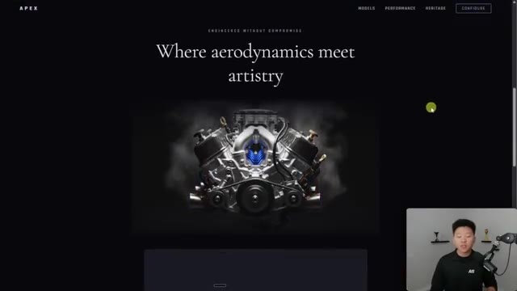
*⏱️ 00:00:08 — Capture d'écran d'un site web au design luxueux et sombre nommé "APEX", présentant un moteur de voiture détaillé avec de la fumée et le titre "Where aerodynamics meet artistry".*

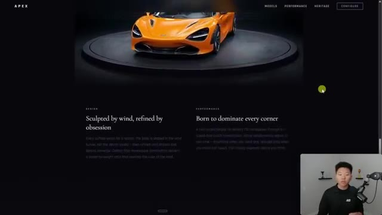
*⏱️ 00:00:17 — Capture d'écran du site "APEX" montrant une voiture de sport orange haut de gamme sur un podium tournant, accompagnée de descriptions textuelles soignées sur le design et les performances.*

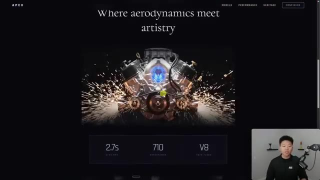
*⏱️ 00:00:25 — Capture d'écran du site "APEX" affichant des statistiques de performance (2.7s, 710 chevaux, moteur V8) sous l'animation du moteur avec des étincelles.*

---

### ⏱️ `[00:00:33 - 00:01:06]` | Segment #02

**🔊 Audio (Transcription Intégrale Mot pour Mot en Français) :**
> pour prendre des centaines de milliers de dollars et des mois. Mais maintenant, quelque chose comme ça peut être fait en minutes simplement en téléversant une photo de départ et une consigne. Les gens sont capables d'utiliser 100 % d'IA pour faire de vrais films et émissions de télévision. Mais de toute façon, je ne suis pas vraiment dans le domaine de l'IA créative. J'aime prêter attention, mais je suis plutôt impliqué dans le domaine de l'automatisation. Je vais donc vous montrer comment vous pouvez utiliser Higgsfield pour créer des sites Web comme celui-ci ou pour faire un site Web comme celui-ci, qui est plutôt de style Apple. Les AirPods Max se démontent. Nous avons différents mots qui défilent à l'écran. Encore une fois, tout cela a été généré par IA grâce à des consignes. Ou quelque chose d'un peu différent comme celui-ci. Au fur et à mesure que nous faisons défiler vers le bas, l'arrière-plan change légèrement d'inclinaison. Nous voyons ces

**👁️ Analyse Visuelle d'Écran (gemini-3.5-flash-lite) :**
**Interface & Outils** : Interface web de X (Twitter) et sites web vitrines/produits.

**Contenu textuel & Code** : Publications sur les réseaux sociaux concernant la création de films par IA et visuels de sites web.
[DESC_IMAGE_1] Navigation sur le fil d'actualité X et lecture d'un post sur les films générés par IA.

**Action / Démonstration** : Explications face caméra et démonstration conceptuelle.

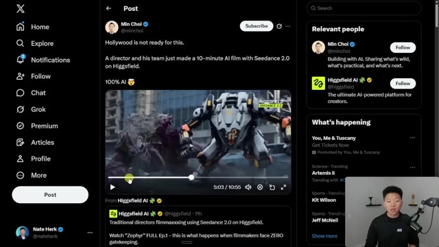
*⏱️ 00:00:41 — Capture d'écran montrant un flux X (Twitter) avec un post de Min Choi sur la création d'un film de 10 minutes entièrement par IA avec Seedance 2.0 sur Higgsfield.*

---

### ⏱️ `[00:01:06 - 00:01:39]` | Segment #03

**🔊 Audio (Transcription Intégrale Mot pour Mot en Français) :**
> des flèches sortent et puis elles apparaissent et il est écrit, ne soyez pas gris, soyez verts, choisissez le groupe Herc advisory. Et puis bien sûr, vous pouvez ajouter d'éléments supplémentaires comme un petit tableau de bord ici en bas qui est complètement animé et c'est juste un petit peu plus captivant. Donc d'ici la fin de cette vidéo, vous les gars, vous serez capables de passer du fait de n'avoir jamais touché à un générateur de vidéo IA auparavant jusqu'à avoir un site en ligne sur le web. Donc ce que nous allons faire aujourd'hui, c'est que nous allons utiliser CloudCode pour nous aider à créer ces prompts vidéo. Nous allons les injecter dans le générateur de vidéo, et ensuite nous allons récupérer cette vidéo, revenir dans CloudCode et dire, hé, CloudCode, construis-moi un site web pour ceci. Et puis c'est super, super simple à partir de là. Maintenant, si vous n'avez jamais utilisé CloudCode auparavant,

**👁️ Analyse Visuelle d'Écran (gemini-3.5-flash-lite) :**
**Interface & Outils** : Navigateur web (site web Herk Advisory), Visual Studio Code, Terminal Claude Code

**Contenu textuel & Code** : Interface du site web d'une entreprise financière, statistiques (Assets Under Management, etc.), et interface CLI Claude Code v2.1.101

**Action / Démonstration** : Navigation et présentation du site web généré avec un tableau de bord financier, puis bascule vers l'éditeur de code et le terminal.

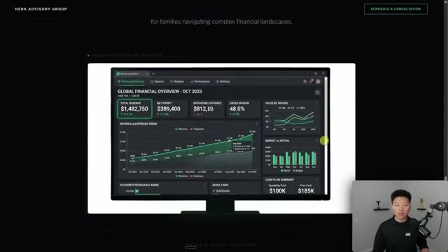
*⏱️ 00:01:14 — Capture montrant l'interface web de Herk Advisory Group avec un aperçu de tableau de bord financier animé.*

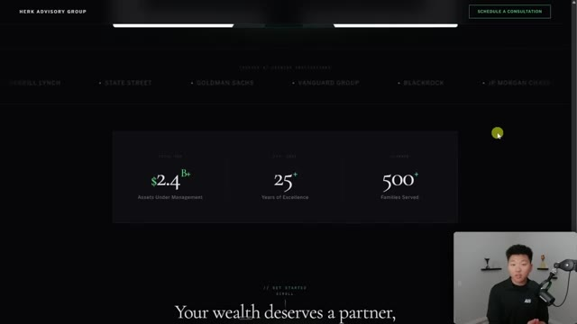
*⏱️ 00:01:23 — Capture montrant la suite de la page web avec des statistiques financières et des mentions de partenaires.*

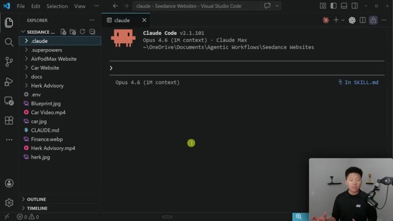
*⏱️ 00:01:31 — Capture montrant l'éditeur VS Code avec le terminal intégré Claude Code (Opus 4.6).*

---

### ⏱️ `[00:01:39 - 00:01:58]` | Segment #04

**🔊 Audio (Transcription Intégrale Mot pour Mot en Français) :**
> C'est très, très similaire à l'utilisation de Claude. Je vais vous montrer. C'est super, super facile. La première chose que vous allez vouloir faire pour suivre cette vidéo est d'aller sur Google, de taper Visual Studio Code, puis de télécharger Visual Studio Code pour votre système d'exploitation. C'est fondamentalement juste l'environnement comme vous l'avez vu juste ici, qui nous permet de voir nos fichiers sur le côté gauche et de parler à Claude juste ici au milieu.

**👁️ Analyse Visuelle d'Écran (gemini-3.5-flash-lite) :**
**Interface & Outils** : Visual Studio Code, Navigateur web (site de VS Code), Terminal Claude Code

**Contenu textuel & Code** : Explorateur de fichiers du projet Seedance Websites et interface du terminal Claude Code (Opus 4.6).

**Action / Démonstration** : Présentation de l'environnement de développement et du site de téléchargement de Visual Studio Code.

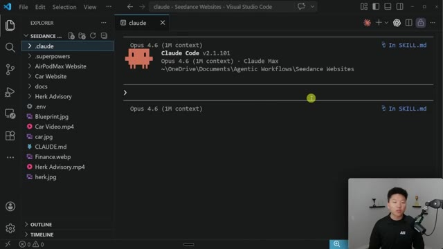
*⏱️ 00:01:44 — Interface de Visual Studio Code affichant l'explorateur de fichiers à gauche et un terminal intégré montrant Claude Code v2.1.101 en fonctionnement.*

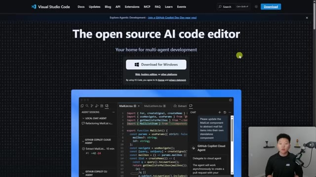
*⏱️ 00:01:49 — Page web officielle de téléchargement de Visual Studio Code avec le titre « The open source AI code editor ».*

---

### ⏱️ `[00:01:58 - 00:02:17]` | Segment #05

**🔊 Audio (Transcription Intégrale Mot pour Mot en Français) :**
> C'est juste la façon dont je préfère utiliser Cloud Code. Maintenant, c'est le projet où vous pouvez voir sur ce côté gauche, nous avons construit le site web AirPods Max, nous avons construit ce site web de voitures, et nous avons construit ce site web Herc Advisory. Mais je vais juste démarrer un tout nouveau projet pour que vous puissiez regarder exactement ce que je regarde. D'accord, donc quand vous installez pour la première fois Visual Studio Code et que vous l'ouvrez, ça ressemblera probablement à ça.

**👁️ Analyse Visuelle d'Écran (gemini-3.5-flash-lite) :**
**Interface & Outils** : Visual Studio Code, Claude Code CLI (Terminal)

**Contenu textuel & Code** : Arborescence du projet 'Seedance Websites' incluant les dossiers AirPodMax Website, Car Website, Herk Advisory, et l'interface de démarrage de Claude Code v2.1.101 avec le modèle Opus 4.6.

**Action / Démonstration** : Le présentateur survole le dossier 'AirPodMax Website' dans le panneau de l'explorateur de fichiers de l'éditeur de code.

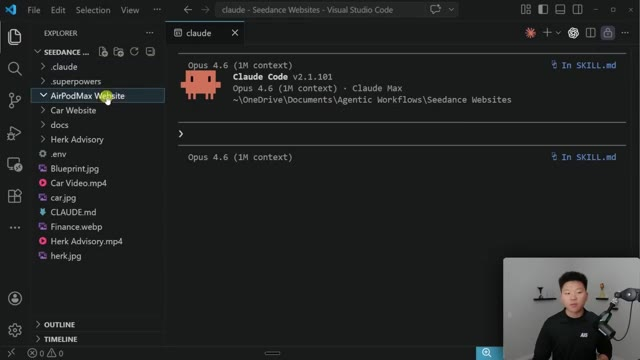
*⏱️ 00:02:03 — L'éditeur Visual Studio Code ouvert montrant l'arborescence des dossiers sur la gauche avec les projets AirPods Max Website, Car Website, et Herk Advisory, et l'interface de Claude Code v2.1.101 en cours d'exécution dans un terminal intégré sur la droite.*

---

### ⏱️ `[00:02:17 - 00:02:52]` | Segment #06

**🔊 Audio (Transcription Intégrale Mot pour Mot en Français) :**
> Ce que vous allez faire, c'est que vous allez aller sur le côté gauche et vous allez cliquer sur ce bouton juste ici qui dit extensions et vous allez taper Claude code et vous allez voir ça juste ici et vous allez l'installer. Maintenant, une fois que vous l'aurez installé, vous cliquerez sur ce bouton en haut qui dit Claude code open et il vous demandera de vous connecter avec votre abonnement Claude ou de saisir votre clé API. Si j'étais vous, je prendrais simplement l'abonnement à 20 dollars par mois et je le mettrais là-dedans. Ça va vous faire économiser plus d'argent que la clé API et si vous atteignez votre limite et que vous voulez passer au niveau supérieur, alors passez simplement au niveau supérieur. Donc ensuite, ce que vous allez faire, c'est que vous allez aller en haut à gauche et cliquer sur explorateur. Cela signifie essentiellement que nous devons ouvrir un dossier, qui va se trouver, vous savez, dans notre explorateur de fichiers ou notre

**👁️ Analyse Visuelle d'Écran (gemini-3.5-flash-lite) :**
**Interface & Outils** : Visual Studio Code (Marketplace des extensions)

**Contenu textuel & Code** : Recherche du terme "claude" dans le marketplace, affichage de l'extension "Claude Code for VS Code" par Anthropic avec ses détails et options d'installation.

**Action / Démonstration** : Recherche et installation de l'extension Claude Code dans l'éditeur de code VS Code.

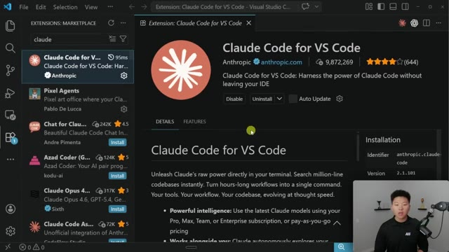
*⏱️ 00:02:26 — L'interface de Visual Studio Code affichant le panneau des extensions avec la recherche "claude" et les détails de l'extension "Claude Code for VS Code" développée par Anthropic.*

---

### ⏱️ `[00:02:52 - 00:03:28]` | Segment #07

**🔊 Audio (Transcription Intégrale Mot pour Mot en Français) :**
> chercheur. C'est tout ce qu'on fait, on est en train d'ouvrir un dossier pour que CloudCode puisse y travailler. Donc je vais cliquer sur ouvrir le dossier et je vais en ouvrir un tout nouveau. Donc ici, vous pouvez voir que j'en choisis un juste ici appelé C-Dance demo, et je vais le sélectionner parce qu'il n'y a rien dedans. Donc voilà à quoi votre écran devrait maintenant ressembler. Je vais fermer le chat sur la droite. C'est comme l'agent IA de VS Code. Je vais cliquer sur ce bouton juste ici, qui est CloudCode. Et ensuite, maintenant, votre écran devrait ressembler à ceci, où vous avez vos fichiers sur la gauche. Il n'y a rien là. Et ensuite, vous avez Cloud Code juste ici. Maintenant, tout au long de cette vidéo, si vous avez jamais l'impression que je vais un peu trop vite et que vous voulez ralentir un petit peu, alors je vous recommanderais vraiment de regarder cette vidéo. C'est fondamentalement de zéro absolu jusqu'à votre premier flux de travail, et ensuite vous

**👁️ Analyse Visuelle d'Écran (gemini-3.5-flash-lite) :**
**Interface & Outils** : Explorateur de fichiers Windows et interface Claude Code.

**Contenu textuel & Code** : Liste des dossiers du répertoire Agentic Workflows incluant Seedance Demo.

**Action / Démonstration** : L'utilisateur sélectionne le dossier Seedance Demo pour l'ouvrir dans l'application.

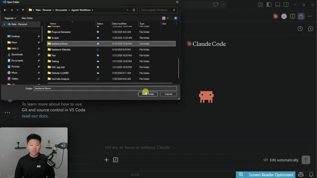
*⏱️ 00:03:01 — Une fenêtre système "Open Folder" superposée sur une interface Claude Code montrant la sélection du dossier "Seedance Demo".*

---

### ⏱️ `[00:03:28 - 00:04:01]` | Segment #08

**🔊 Audio (Transcription Intégrale Mot pour Mot en Français) :**
> on peut revenir ici et les choses vont peut-être devenir un peu plus claires. Donc la toute première fois que nous allons faire une fois que nous serons dans Cloud Code, c'est que nous allons aller sur le côté gauche. Nous allons cliquer sur ce bouton qui s'appelle nouveau dossier. Et dans ce dossier, je vais simplement appeler celui-ci point Cloud. Maintenant, pourquoi est-ce que je sais comment faire cela ? Parce que j'ai beaucoup utilisé Cloud Code. Mais en gros, c'est juste un peu comme le petit endroit de Claude Code pour chercher des choses comme des compétences ou des agents ou des paramètres. Donc ce que vous allez faire ensuite, c'est que vous allez aller sur le lien dans la description, qui est ma communauté School gratuite, et vous allez demander à rejoindre celle-ci. Parce que là-dedans, je vais vous donner les gars la compétence, qui va vous aider à pouvoir réellement prompter pour

**👁️ Analyse Visuelle d'Écran (gemini-3.5-flash-lite) :**
**Interface & Outils** : Visual Studio Code avec l'extension Claude Code

**Contenu textuel & Code** : Explorateur de fichiers avec le projet "SEEDANCE DE...", interface Claude Code active avec le logo et une zone de texte en bas ("ctrl esc to focus or unfocus Claude").

**Action / Démonstration** : Le présentateur clique sur le bouton "New Folder" (nouveau dossier) dans l'explorateur de fichiers de l'éditeur.

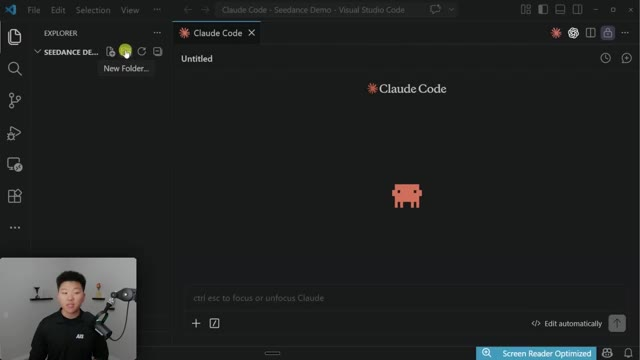
*⏱️ 00:03:36 — Capture d'écran de l'éditeur de code montrant VS Code avec l'interface de Claude Code active, et le curseur de la souris pointant sur le bouton de création de nouveau dossier dans l'explorateur de fichiers.*

---

### ⏱️ `[00:04:01 - 00:04:20]` | Segment #09

**🔊 Audio (Transcription Intégrale Mot pour Mot en Français) :**
> les vidéos que vous obtiendrez ici. Donc ce sera un dossier. Maintenant, une fois que vous aurez récupéré ce dossier de compétence, vous n'aurez fondamentalement qu'à le glisser dans le dossier point Claude, et ça devrait ressembler à ceci. Vous verrez l'invite de boucle cdance, vous verrez des références, puis vous verrez le fichier skill.md. Maintenant, comme je l'ai dit, une compétence est littéralement juste une instruction en langage naturel pour Claude Code sur la façon de faire quelque chose.

**👁️ Analyse Visuelle d'Écran (gemini-3.5-flash-lite) :**
**Interface & Outils** : Visual Studio Code avec l'extension ou interface intégrée Claude Code.

**Contenu textuel & Code** : Explorateur montrant le dossier ".claude" sous "SEEDANCE DEMO" ; interface de Claude Code avec logo et champ de saisie en bas ("ctrl esc to focus or unfocus Claude").

**Action / Démonstration** : Navigation et présentation de l'arborescence du projet et de l'intégration de Claude Code dans VS Code.

*⏱️ 00:04:06 — L'éditeur de code Visual Studio Code ouvert sur un projet nommé "SEEDANCE DEMO", affichant un dossier caché ".claude" dans l'explorateur de fichiers à gauche et une fenêtre de terminal ou extension Claude Code active au centre avec l'interface graphique de l'outil d'IA.*

---

### ⏱️ `[00:04:20 - 00:04:39]` | Segment #10

**🔊 Audio (Transcription Intégrale Mot pour Mot en Français) :**
> Donc, dans ce cas, utilisez ceci lors de la génération d'une invite vidéo cdance2 pour une vidéo d'arrière-plan en boucle fluide. Et ensuite, cela passe simplement par un langage naturel. Vous pouvez lire ceci si vous voulez, mais cela explique comment créer réellement l'invite vidéo. Et cela devrait s'exécuter automatiquement, mais je vais vous montrer la meilleure pratique qui consiste simplement à dire, hé, utilise la compétence d'invite de boucle cdance et aide-moi avec ceci.

**👁️ Analyse Visuelle d'Écran (gemini-3.5-flash-lite) :**
**Interface & Outils** : Visual Studio Code

**Contenu textuel & Code** : Fichier Markdown contenant des métadonnées YAML décrivant l'utilisation et le déclenchement d'un générateur de prompts vidéo pour Seedance 2, ainsi qu'une description textuelle des instructions.

**Action / Démonstration** : Le présentateur commente le contenu du fichier SKILL.md qui explique comment créer l'invite vidéo pour une vidéo d'arrière-plan en boucle fluide.

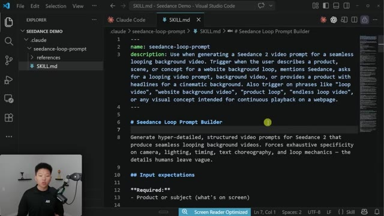
*⏱️ 00:04:25 — Vue de l'éditeur de code Visual Studio Code affichant un fichier Markdown nommé SKILL.md pour le projet "seedance-loop-prompt".*

---

### ⏱️ `[00:04:39 - 00:05:08]` | Segment #11

**🔊 Audio (Transcription Intégrale Mot pour Mot en Français) :**
> Maintenant que vous avez configuré l'infrastructure générale, la prochaine chose que nous devons faire, c'est obtenir une image et transformer cette image en vidéo. Dans cette vidéo, je vais utiliser key.ai, que j'ai énormément utilisé par le passé. Je l'utilise pour ainsi dire tous les jours. C'est fondamentalement comme un Open Router pour différents modèles lorsqu'il s'agit de vidéo, d'image et de musique. Donc, si je vais sur le marché des API, vous pouvez voir qu'il y a des tonnes et des tonnes de modèles différents. Nous avons Wan, nous avons Qwen, nous avons GPT, nous avons Nano Banana, Gemini 3. C'est en gros du genre, hé, une seule clé API et vous pouvez accéder à n'importe quel modèle que vous voulez. C'est donc pour cela que j'aime l'utiliser dans mes automatisations.

**👁️ Analyse Visuelle d'Écran (gemini-3.5-flash-lite) :**
**Interface & Outils** : Navigateur web affichant la plateforme KIE API et la webcam du présentateur en bas à gauche.

**Contenu textuel & Code** : Interface utilisateur avec des boutons de navigation (Pricing, API Keys, Billing, Logs) et des vignettes de modèles d'IA (Wan 2.7 Video, Claude Sonnet 4.6, Claude Opus 4.6, Gemini 3.1 Pro).

**Action / Démonstration** : Présentation de la plateforme KIE API utilisée pour accéder à différents modèles d'IA de génération de vidéo et d'image.

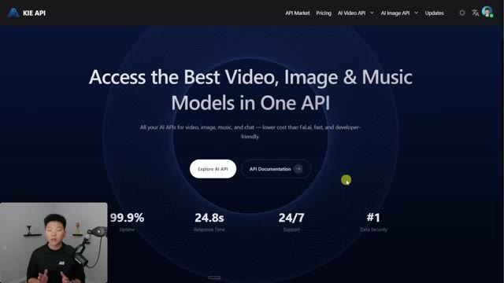
*⏱️ 00:04:46 — La page d'accueil de la plateforme KIE API avec le slogan 'Access the Best Video, Image & Music Models in One API'.*

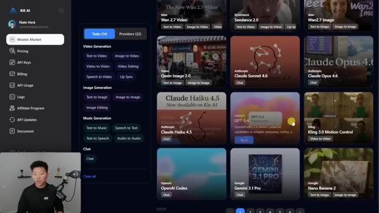
*⏱️ 00:05:01 — Le tableau de bord de KIE API affichant le catalogue des modèles d'IA disponibles (vidéo, image, musique, chat).*

---

### ⏱️ `[00:05:09 - 00:05:33]` | Segment #12

**🔊 Audio (Transcription Intégrale Mot pour Mot en Français) :**
> mais nous pouvons aussi l'utiliser directement dans l'interface. Donc si je reviens ici, vous pouvez voir que C-Dance 2 est mis en avant parce qu'il est très récent. Donc je vais cliquer sur en savoir plus et nous pouvons en fait utiliser C-Dance directement ici dans l'interface. Nous pouvons y ajouter nos images, nous pouvons y ajouter nos instructions, nous pouvons y ajouter n'importe quelle image de référence. Nous pouvons également y ajouter des vidéos de référence, ce qui est super, super cool. Donc comme dans cet exemple, ils ont ajouté une vidéo de référence de deux personnages qui se battent en gros, l'un saute par-dessus, bla, bla, bla, ils se battent.

**👁️ Analyse Visuelle d'Écran (gemini-3.5-flash-lite) :**
**Interface & Outils** : Interface web KIE AI (Models Market / Playground)

**Contenu textuel & Code** : Catalogue de modèles d'IA (Seedance 2.0, Wan 2.7 Video, Claude Sonnet 4.6) et champ de prompt avec des références d'images (@Image1, @Image2).

**Action / Démonstration** : Navigation dans l'interface et clic sur le bouton d'information/utilisation d'un modèle vidéo.

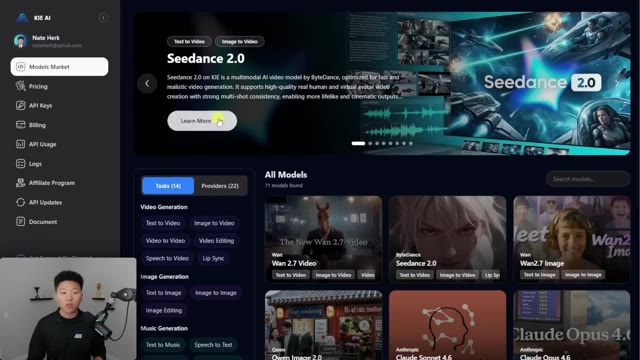
*⏱️ 00:05:15 — Interface web montrant la place de marché des modèles d'IA avec Seedance 2.0 mis en avant en haut.*

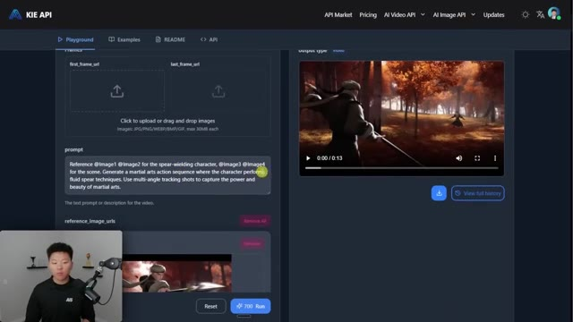
*⏱️ 00:05:21 — Interface de playground avec un champ de prompt, des options d'importation d'images et un lecteur vidéo de prévisualisation à droite.*

---

### ⏱️ `[00:05:33 - 00:05:52]` | Segment #13

**🔊 Audio (Transcription Intégrale Mot pour Mot en Français) :**
> Il intègre également toutes ces différentes références et images à utiliser, puis il lui a donné un petit peu de prompt. Et ce que nous obtenons, c'est ce résultat final qui suit en quelque sorte cette vidéo de référence et qui utilise toutes les images de référence. Vous avez donc tellement de contrôle sur les vidéos réelles que vous voulez de C-Dance. Maintenant, je vais parler un peu plus de C-Dance dans une seconde, mais d'abord ce que nous devons faire, c'est obtenir une image.

**👁️ Analyse Visuelle d'Écran (gemini-3.5-flash-lite) :**
**Interface & Outils** : Interface web (KIE API Playground) et incrustation vidéo du présentateur en bas à gauche.

**Contenu textuel & Code** : Un prompt textuel utilisant des références d'images (@Image1, @Image2, etc.) pour générer une séquence d'action avec un personnage maniant une lance.

**Action / Démonstration** : Démonstration du fonctionnement de l'API de génération vidéo par IA en combinant des images de référence et un prompt.

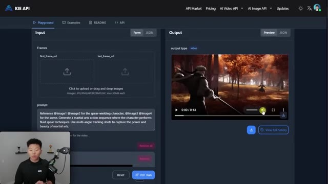
*⏱️ 00:05:38 — Interface web de KIE API montrant le playground avec les zones d'entrée pour les images et le prompt à gauche, et le résultat vidéo généré à droite.*

---

### ⏱️ `[00:05:53 - 00:06:15]` | Segment #14

**🔊 Audio (Transcription Intégrale Mot pour Mot en Français) :**
> Donc ce que vous feriez, c'est que vous viendriez ici sur le marché des API. Vous cliquez sur quelque chose comme texte image ou si vous avez déjà une image, c'est parfait. Et ce que je ferais, c'est que j'irais sur Nano Banana 2 et je ferais une invite pour tout ce que vous voulez que votre site concerne. Maintenant, je vais aller de l'avant et choisir un format d'image 16 par 9 parce que je vais vouloir que ma vidéo soit également en 16 par 9. Et c'est tout simplement plus facile si l'image de référence correspond à la sortie pour la vidéo.

**👁️ Analyse Visuelle d'Écran (gemini-3.5-flash-lite) :**
**Interface & Outils** : KIE AI (Plateforme Web / API Market / Playground)

**Contenu textuel & Code** : Modèles de génération d'images (Nano Banana 2, Wan2.7, Seedream 5.0), champ de prompt « translation of all the text to Hindi »

**Action / Démonstration** : Navigation dans le catalogue des modèles d'API et utilisation du playground pour modifier/traduire du texte sur une image.

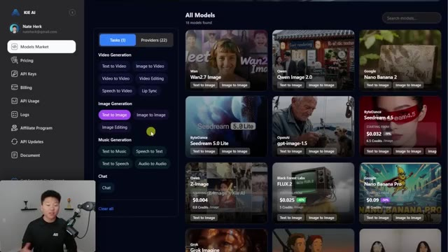
*⏱️ 00:05:58 — Vue d'un catalogue de modèles d'IA (KIE AI) avec différents générateurs d'images et de vidéos disponibles.*

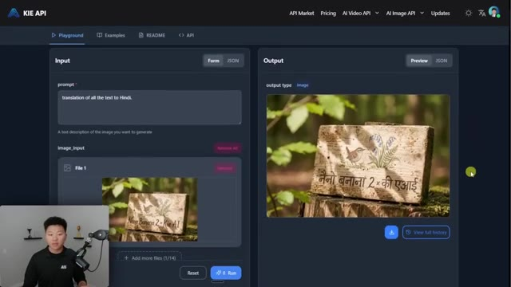
*⏱️ 00:06:04 — Interface de test (Playground) montrant un prompt textuel, une image en entrée et le résultat généré à droite.*

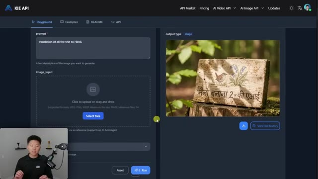
*⏱️ 00:06:10 — Interface de test (Playground) avec une zone de téléchargement d'image vide et le résultat de la génération affiché à droite.*

---

### ⏱️ `[00:06:16 - 00:06:49]` | Segment #15

**🔊 Audio (Transcription Intégrale Mot pour Mot en Français) :**
> Donc ce que je vais faire, c'est simplement dire : j'ai besoin d'une image d'un plan d'architecte. Elle doit donner l'impression d'être sur du papier à croquis. Ce doit être un gratte-ciel qui est esquissé à environ 75 %. Et c'est en fait tout ce que je voulais dire. Donc je vais lancer l'exécution et je reviendrai vous voir dans environ une minute ou un peu plus une fois que nous aurons récupéré cette image. Bon, maintenant ce que nous allons faire, c'est que nous allons aller dans celui de C-dance et je vais glisser l'image que nous venons d'enregistrer et je vais la placer dans la première image-clé et dans la dernière image-clé, car en fin de compte, ce que je veux qu'il se produise, c'est que je veux que la première image et la dernière image soient les mêmes pour que cette vidéo soit fondamentalement

**👁️ Analyse Visuelle d'Écran (gemini-3.5-flash-lite) :**
**Interface & Outils** : Interface web KIE API (Playground).

**Contenu textuel & Code** : "I need an image of a blueprint, it should look like it is on sketch paper. It should be a skyscraper that is about 75% of the way sketched out"

**Action / Démonstration** : Saisie du prompt textuel décrivant un gratte-ciel en cours de esquisse, suivie du lancement de l'exécution pour générer l'image.

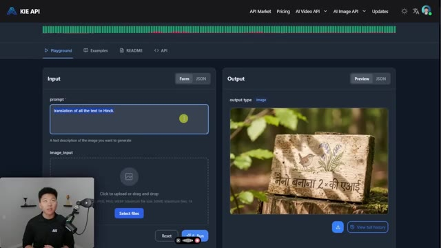
*⏱️ 00:06:24 — Interface web de KIE API montrant un champ de saisie de prompt à gauche et une image générée en sortie à droite, avec la webcam du présentateur en bas à gauche.*

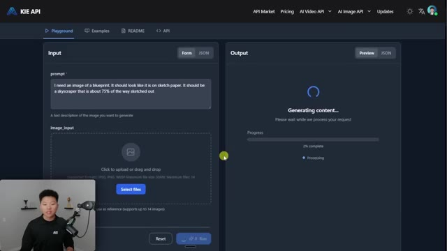
*⏱️ 00:06:32 — Interface web de KIE API montrant le prompt saisi pour générer un plan d'architecte et une barre de progression indiquant "Generating content..." dans le volet de droite.*

---

### ⏱️ `[00:06:49 - 00:07:22]` | Segment #16

**🔊 Audio (Transcription Intégrale Mot pour Mot en Français) :**
> exactement comme une boucle infinie et cela semble très fluide pour l'utilisateur sur notre site. Je vais également supprimer toutes ces images de référence parce qu'en fait nous n'en avons pas besoin puisqu'elles ne s'appliquent pas à nous. Et je vais désactiver la génération audio parce que je n'ai pas besoin d'audio pour notre site. Et maintenant, parlons de la façon dont nous allons réellement obtenir notre prompt. Je vais donc retourner dans notre session Claude Code ici, et je vais glisser notre image de plan que nous venons d'obtenir sur le côté gauche. Et vous pouvez voir que cela s'affiche ici, ce qui signifie que Claude devrait pouvoir la regarder. Et si j'utilise le symbole arobase, je peux effectivement mentionner ce blueprint.jpg et m'assurer que

**👁️ Analyse Visuelle d'Écran (gemini-3.5-flash-lite) :**
**Interface & Outils** : Navigateur web (Kie API Playground) et Visual Studio Code.
[DESC_IMAGE_1 CONTENU] Options de configuration : generate_audio (activé/désactivé), résolution (480p, 720p), formats d'image (16:9, 4:3, 1:1, etc.) et bouton Run.
[DESC_IMAGE_2 CONTENU] Explorateur de fichiers avec les dossiers .claude et le fichier Blueprint.jpg affichant l'élévation d'un gratte-ciel sur plan.

**Contenu textuel & Code** : Explications orales et mise en contexte méthodologique.

**Action / Démonstration** : Configuration des paramètres de l'API vidéo dans le playground web, puis visualisation d'une image de référence dans VS Code.

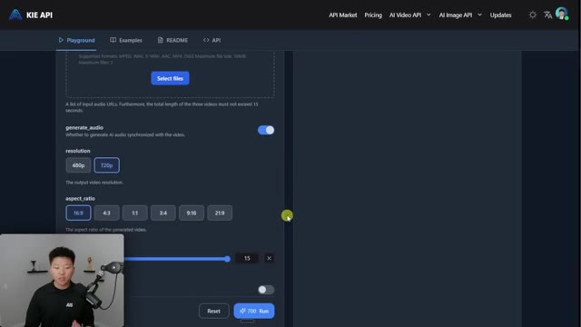
*⏱️ 00:06:57 — Interface web d'une application (Kie API) montrant les paramètres de configuration vidéo (génération audio, résolution 720p, formats) avec la webcam du présentateur en bas à gauche.*

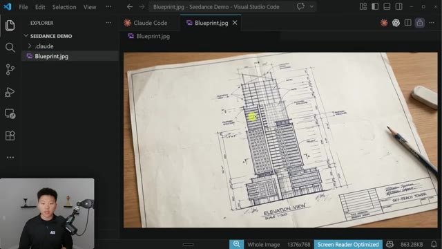
*⏱️ 00:07:14 — Éditeur de code Visual Studio Code affichant un fichier image (Blueprint.jpg) représentant un plan architectural de bâtiment, avec le dossier de projet SEEDANCE DEMO dans l'explorateur et la webcam du présentateur en bas à gauche.*

---

### ⏱️ `[00:07:22 - 00:07:47]` | Segment #17

**🔊 Audio (Transcription Intégrale Mot pour Mot en Français) :**
> Claude peut regarder directement dedans. Donc maintenant, nous allons utiliser la compétence. Je vais dire : Hé Claude, je veux que tu regardes l'image de référence que j'ai jointe appelée Blueprint. Je veux que tu m'aides à créer une vidéo en boucle C-Dance pour mon site web. Donc pour cette vidéo, je veux que le sketch commence par se remplir un peu, peut-être avec plus de lignes qui sont dessinées, et ensuite je veux qu'il zoome sur une vraie ville où l'on voit le bâtiment en construction.

**👁️ Analyse Visuelle d'Écran (gemini-3.5-flash-lite) :**
**Interface & Outils** : Visual Studio Code (extension Claude Code)

**Contenu textuel & Code** : Mention de l'image jointe `@Blueprint.jpg` dans le champ de prompt de Claude Code.

**Action / Démonstration** : Le présentateur montre comment intégrer une image de référence pour générer du code.

*⏱️ 00:07:28 — Interface de VS Code montrant l'onglet Claude Code avec un champ de saisie incluant l'image de référence `@Blueprint.jpg`.*

---

### ⏱️ `[00:07:48 - 00:08:21]` | Segment #18

**🔊 Audio (Transcription Intégrale Mot pour Mot en Français) :**
> Et nous voyons cela monter tout en haut, et c'est un bâtiment terminé à la fin. Et pendant qu'il est construit, nous voyons du texte arriver par le côté gauche, qui dit transformez vos idées en réalité. Le texte doit occuper une grande partie de l'écran, il doit être le focus principal de la vidéo, donc il doit être là assez longtemps pour s'assurer que le spectateur peut réellement lire le texte. Et puis pour terminer la vidéo, nous allons dézoomer et finalement nous allons refondre dans l'image de plan originale. Donc allez-y et créez-moi ce prompt pour la vidéo.

**👁️ Analyse Visuelle d'Écran (gemini-3.5-flash-lite) :**
**Interface & Outils** : Visual Studio Code / Claude Code

**Contenu textuel & Code** : Texte du prompt : "@Blueprint.jpg Hey Claude, I want you to look at the reference image that I have attached called Blueprint. I want you to help me create a Seedance loop video for my website."

**Action / Démonstration** : Saisie d'une instruction à l'assistant IA intégrant une image de référence (Blueprint.jpg).

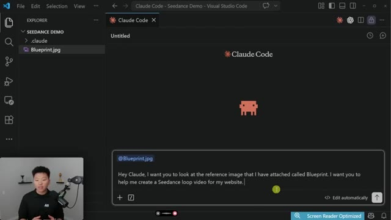
*⏱️ 00:07:56 — Interface de Visual Studio Code avec un panneau Claude Code affichant un prompt textuel lié à une image de référence.*

---

### ⏱️ `[00:08:22 - 00:08:56]` | Segment #19

**🔊 Audio (Transcription Intégrale Mot pour Mot en Français) :**
> Ok, donc j'ai un peu testé ce prompt. Je devais m'assurer qu'il récupérait les bons éléments. Nous devions nous assurer qu'il ne faisait rien d'bizarre. Et nous devions aussi nous assurer qu'il respectait la limite de caractères sur K.ai. Maintenant, oui, si vous vouliez réellement que cette compétence crée l'image pour vous en utilisant K.ai, vous le pourriez, vous devriez aller sur K.ai. Vous iriez ici pour obtenir votre clé API, et vousisseriez simplement de la copier pour la mettre dans votre code cloud ici dans un fichier .env. Et ensuite, le code cloud serait capable d'interroger l'API de K.ai afin de générer cela automatiquement pour vous. Mais généralement, quand il s'agit de ces visuels créatifs, j'aime plutôt garder un peu plus le contrôle, car une fois que vous les avez réussis et qu'après quelques itérations,

**👁️ Analyse Visuelle d'Écran (gemini-3.5-flash-lite) :**
**Interface & Outils** : VS Code (extension Claude) et interface web KIE AI

**Contenu textuel & Code** : @Blueprint.jpg, Read c:\Users\nateh\...\Blueprint.jpg, seedance-loop-prompt skill, example-prompts.md, modèles KIE AI

**Action / Démonstration** : Exécution d'un prompt par l'agent Claude dans VS Code pour analyser une image et parcourir des exemples de prompts, tout en naviguant sur la plateforme KIE AI.

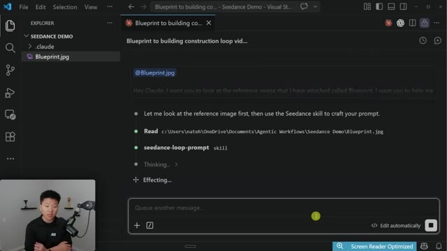
*⏱️ 00:08:31 — Interface VS Code montrant une interaction avec l'assistant Claude utilisant le fichier Blueprint.jpg et exécutant le skill seedance-loop-prompt.*

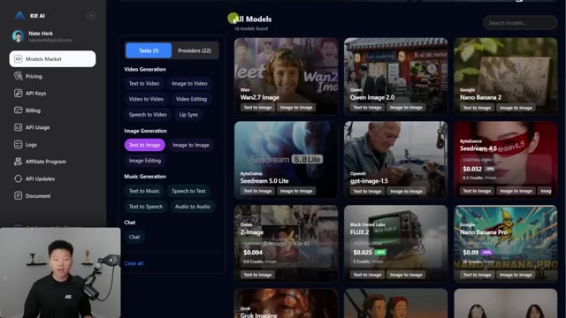
*⏱️ 00:08:39 — Interface web de KIE AI affichant le marché des modèles d'intelligence artificielle avec différentes options de génération de vidéo, d'image et de texte.*

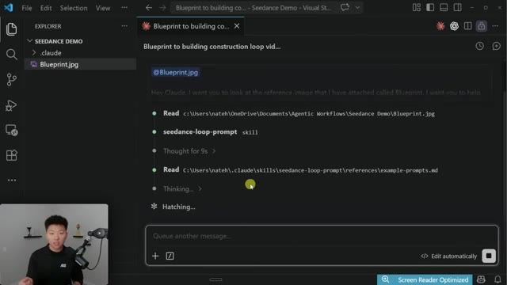
*⏱️ 00:08:48 — Interface VS Code montrant l'agent Claude en train de lire un fichier de référence d'exemples de prompts pour le skill seedance-loop-prompt.*

---

### ⏱️ `[00:08:56 - 00:09:29]` | Segment #20

**🔊 Audio (Transcription Intégrale Mot pour Mot en Français) :**
> ensuite, vous pouvez simplement créer le site et le code cloud, et c'est super facile. Mais vous pouvez voir qu'il a bien réussi à lire la compétence de prompt "C dance loop" juste ici. Donc voici notre prompt. Il fait 981 caractères. Je ne vais pas lire tout ça, mais si vous voulez mettre sur pause et le lire, vous pouvez. Je vais juste copier ça et nous allons le mettre ici dans le prompt à l'intérieur de key pour "C dance", et juste s'assurer que tout a l'air bien. Nous avons, à trois secondes, un grand texte blanc en gras qui dit "turn your ideas into reality" et pour s'assurer que tout est bon, je vais cliquer sur "run". Maintenant, vous pouvez voir ici que cela me coûte 615 crédits, et si je remonte

**👁️ Analyse Visuelle d'Écran (gemini-3.5-flash-lite) :**
**Interface & Outils** : Visual Studio Code, KIE API Playground (Interface web)

**Contenu textuel & Code** : Prompt de 981 caractères généré par l'IA pour créer une boucle vidéo à partir d'un plan d'architecte ("Blueprint to building construction loop").

**Action / Démonstration** : Saisie et consultation du prompt dans VS Code, puis report et exécution sur la plateforme de génération vidéo KIE API.

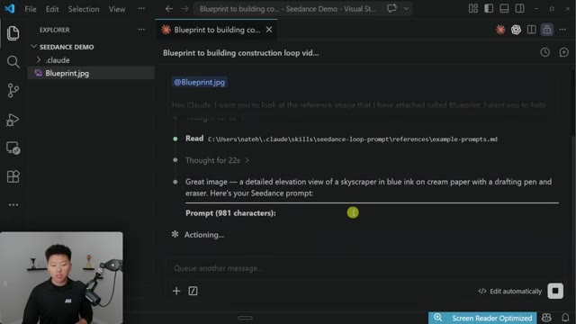
*⏱️ 00:09:05 — VS Code affichant un prompt généré par l'IA de 981 caractères pour la compétence "seedance-loop-prompt".*

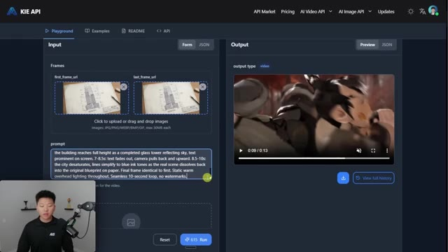
*⏱️ 00:09:13 — Interface KIE API (Playground) affichant des images d'entrée (frames) et le champ de prompt pour la génération de vidéo IA.*

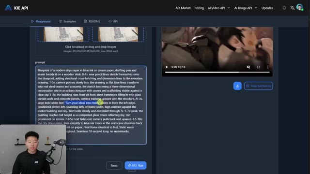
*⏱️ 00:09:21 — Interface KIE API avec un zoom sur le contenu détaillé du prompt textuel de génération vidéo.*

---

### ⏱️ `[00:09:29 - 00:10:02]` | Segment #21

**🔊 Audio (Transcription Intégrale Mot pour Mot en Français) :**
> ici je génère ceci en 720p ce qui va coûter 25 crédits par seconde, d'accord, alors je viens de réaliser que j'ai fait une petite erreur dans la compétence qui écrit ce prompt, celui-ci est fondamentalement optimisé pour une vidéo de 10 secondes mais en bas j'ai oublié de changer le paramètre vidéo, il était à 15 donc assurez-vous de venir changer ceci à 10. Donc ce que je vais faire c'est que je vais laisser celui-ci se terminer, mais ensuite je vais en lancer un autre de 10 secondes et je vais les comparer pour voir lequel est le meilleur et nous prendrons celui qui est le meilleur. Et maintenant quand je le mets à 10 secondes, ça ne fait que 410 crédits au lieu de 625. Ils ont tous les deux terminé. Ça c'est celui de 15 secondes. Voyons voir celui-ci

**👁️ Analyse Visuelle d'Écran (gemini-3.5-flash-lite) :**
**Interface & Outils** : Navigateur web (KIE API Playground)

**Contenu textuel & Code** : Un prompt détaillé décrivant une animation de gratte-ciel en blueprint (bleu sur papier crème) évoluant vers une construction 3D.

**Action / Démonstration** : Configuration d'un prompt pour la génération de vidéo par IA avec un coût affiché de 615 crédits avant exécution.

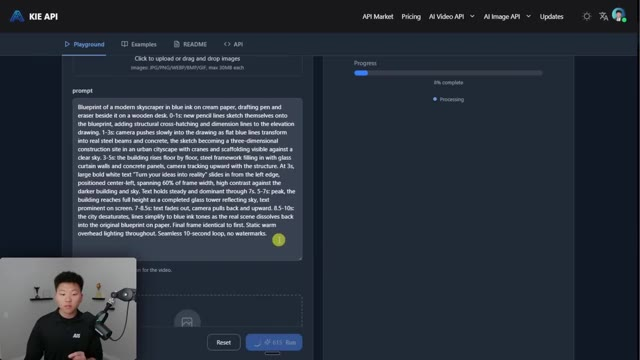
*⏱️ 00:09:37 — Interface web de KIE API montrant un champ de prompt textuel à gauche et un panneau de progression de génération vidéo à droite, avec le présentateur en médaillon en bas à gauche.*

---

### ⏱️ `[00:10:02 - 00:10:35]` | Segment #22

**🔊 Audio (Transcription Intégrale Mot pour Mot en Français) :**
> Le résultat est là. Donc ça a fait un petit peu de croquis. Ça fond dans la ville. On voit un bâtiment en construction ici. Transformez vos idées en réalité. Fin de la construction. On dézoome pour revenir au plan. C'est celui de 10 secondes. Très similaire. Je pense en fait que j'aime bien celui-ci, il est un peu plus rapide. Le verre monte vraiment bien. Ouais. Je préfère définitivement celui de 10 secondes. Donc on va utiliser celui-là. Donc on va prendre cette vidéo. On va revenir dans Cloud Code et on va glisser ça sur le côté gauche comme ça. Et maintenant vous pouvez voir

**👁️ Analyse Visuelle d'Écran (gemini-3.5-flash-lite) :**
**Interface & Outils** : Interface web de génération vidéo (Kling AI).

**Contenu textuel & Code** : Fichiers vidéo générés affichant un bâtiment en construction et un plan architectural.
[DESC_IMAGE_1] Visualisation d'une vidéo générée par IA présentant un bâtiment terminé.
[DESC_IMAGE_2] Visualisation d'une vidéo générée par IA montrant des croquis architecturaux.

**Action / Démonstration** : Explications face caméra et démonstration conceptuelle.

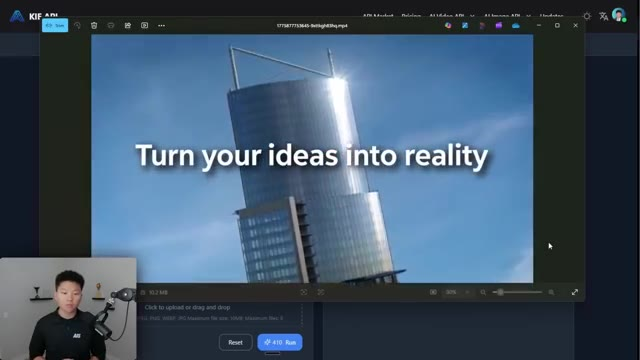
*⏱️ 00:10:10 — Aperçu vidéo montrant un gratte-ciel moderne avec le texte « Turn your ideas into reality ».*

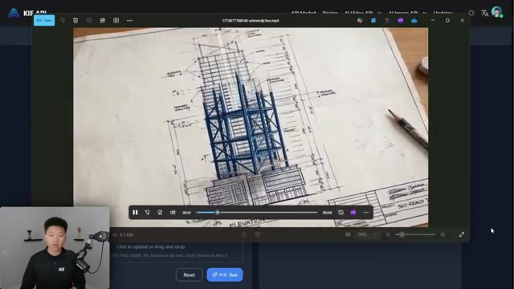
*⏱️ 00:10:19 — Aperçu vidéo montrant un plan architectural de bâtiment avec des structures métalliques en 3D.*

---

### ⏱️ `[00:10:35 - 00:11:10]` | Segment #23

**🔊 Audio (Transcription Intégrale Mot pour Mot en Français) :**
> que qui vit juste ici. Et maintenant ce que je vais faire, c'est que je vais ouvrir mon terminal dans VS Code. Je vais taper Claude pour que nous puissions commencer à travailler ici au lieu d'utiliser l'extension. Fondamentalement, la différence entre l'extension et le terminal, c'est que vous obtenez une visibilité un peu différente sur mon terminal. Je peux voir mon modèle et je peux voir mon utilisation. Donc j'aime mieux l'utiliser dans le terminal, mais dans l'extension, il est plus facile de copier et coller des choses. C'est donc pour cela que j'aime utiliser l'extension lorsque je copie et colle des prompts. Ils font donc fondamentalement exactement la même chose. Ils ont juste l'air un peu différents. Nous utilisons donc maintenant le terminal. Et ce que je vais faire, c'est que je vais aller de l'avant et basculer ici en mode plan. Le mode plan nous permet de parler de

**👁️ Analyse Visuelle d'Écran (gemini-3.5-flash-lite) :**
**Interface & Outils** : Visual Studio Code, Claude Code (CLI/Terminal intégré)

**Contenu textuel & Code** : Message de bienvenue "Welcome back Nate!", logo ASCII, informations sur le modèle (Opus 4.6, 1M context), et invite de commande active.

**Action / Démonstration** : Ouverture du terminal intégré dans VS Code pour lancer l'outil en ligne de commande Claude Code.

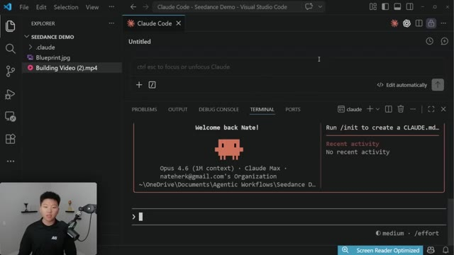
*⏱️ 00:10:44 — Interface de VS Code avec le terminal intégré affichant l'interface de commande de Claude Code.*

---

### ⏱️ `[00:11:10 - 00:11:37]` | Segment #24

**🔊 Audio (Transcription Intégrale Mot pour Mot en Français) :**
> ce que nous voulons faire avec Cloud Code pour s'assurer qu'il comprenne exactement tout ce que nous voulons avant qu'il ne commence réellement à construire. Donc la première chose que vous allez devoir faire très rapidement avant de commencer à planifier, c'est d'aller taper /plugins. Et quand vous ouvrez ceci, cela vous permet de chercher parmi quelques plugins, qui sont fondamentalement tout simplement des compétences officielles, pour ainsi dire. Et ce que je veux que vous fassiez, c'est de vous assurer que vous avez celui-ci juste ici, la compétence de design front-end. Et si j'étais vous, je ferais simplement en sorte de l'installer globalement. Donc appuyez juste ici, installer pour vous.

**👁️ Analyse Visuelle d'Écran (gemini-3.5-flash-lite) :**
**Interface & Outils** : Visual Studio Code, Claude Code CLI, Terminal

**Contenu textuel & Code** : Texte de bienvenue de Claude Code v2.1.101, mention d'Opus 4.6 (1M context), invite de commande avec plan mode on.

**Action / Démonstration** : L'utilisateur se prépare à interagir avec l'assistant Claude Code dans le terminal de l'éditeur.

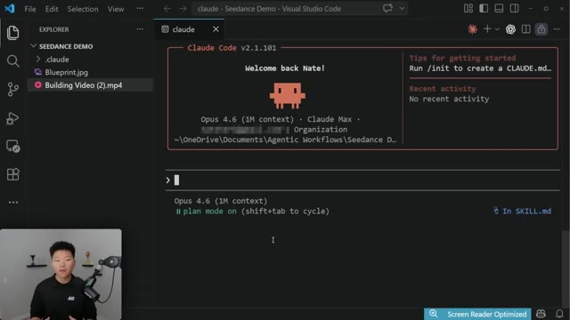
*⏱️ 00:11:17 — Interface de Visual Studio Code affichant l'outil Claude Code v2.1.101 intégré dans un terminal, avec une invite de commande vide en bas et une incitation à lancer "/init".*

---

### ⏱️ `[00:11:37 - 00:12:14]` | Segment #25

**🔊 Audio (Transcription Intégrale Mot pour Mot en Français) :**
> Et ensuite, ça va essentiellement récupérer cette compétence. Et après, vous pouvez faire un slash reload plugins pour vous assurer qu'elle est bien là. Et ensuite, si vous faites ceci, vous devriez voir slash front end design. Et ça va aider Claude Code à être capable de comprendre et d'avoir un peu plus de goût lorsqu'il nous construit des sites web. D'accord. Mais maintenant que c'est fait, passons réellement à la planification. Donc, je vais très rapidement faire référence à la vidéo de construction réelle, juste pour qu'il sache de laquelle je parle. Hé, Claude Code. Je viens de vous donner une vidéo de référence, qui va être la vidéo que nous voulons sur notre site web. Ce que je veux, c'est que toute la section héroïque soit juste cette vidéo. Nous n'avons besoin d'aucun texte ni sous-texte héroïque. C'est pour mon cabinet d'architecture, donc ça

**👁️ Analyse Visuelle d'Écran (gemini-3.5-flash-lite) :**
**Interface & Outils** : Visual Studio Code, terminal intégré Claude Code.

**Contenu textuel & Code** : Commandes affichées : /plugin, /reload-plugins, et la liste des commandes disponibles (/brainstorming, /frontend-design, /init, etc.).

**Action / Démonstration** : Exécution de la commande /reload-plugins et affichage des commandes de l'assistant Claude Code dans l'éditeur.

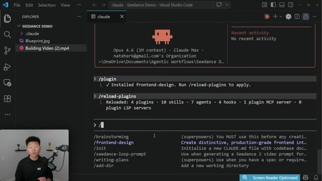
*⏱️ 00:11:47 — Interface de Visual Studio Code affichant un terminal intégré avec Claude Code montrant l'utilisation des commandes de plugins et la liste des commandes disponibles incluant /frontend-design.*

---

### ⏱️ `[00:12:14 - 00:12:36]` | Segment #26

**🔊 Audio (Transcription Intégrale Mot pour Mot en Français) :**
> devrait inspirer une grande confiance et paraître très professionnel, en quelque sorte sur l'ensemble du site. Il devrait paraître moderne. Et pour l'instant, après la vidéo, lorsqu'on fait défiler la page vers le bas en la dépassant, je veux que tu remplisses simplement le texte et le design, mais la vidéo elle-même devrait simplement tourner en permanence en boucle infinie. Pose-moi donc toutes les questions que tu as sur mon entreprise ou sur l'ambiance du site web afin de le rendre vraiment esthétique.

**👁️ Analyse Visuelle d'Écran (gemini-3.5-flash-lite) :**
**Interface & Outils** : Visual Studio Code, Claude terminal intégré

**Contenu textuel & Code** : Commandes `/plugin`, `/reload-plugins` et mention de la vidéo `@\"Building Video (2).mp4\"`

**Action / Démonstration** : Interaction avec l'assistant Claude pour configurer l'interface et analyser les fichiers du projet.

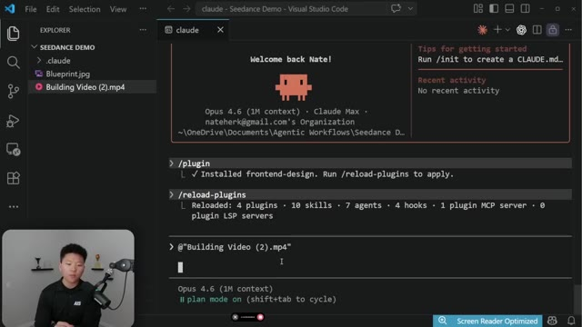
*⏱️ 00:12:20 — Interface de Visual Studio Code affichant l'extension Claude avec une invite de commande et un fichier vidéo sélectionné dans l'explorateur.*

---

### ⏱️ `[00:12:36 - 00:12:55]` | Segment #27

**🔊 Audio (Transcription Intégrale Mot pour Mot en Français) :**
> Et puis, vous savez, ne passez pas à autre chose tant que vous n'êtes pas à 95 % sûr de comprendre ce que nous voulons. Génial. C'est donc mon plan. Je vais l'envoyer. Si vous êtes curieux de savoir comment je parle et comment les mots disparaissent, consultez simplement l'outil que j'utilise dans la description. Et je dois dire qu'dans ce cas, nous faisons l'un des exemples où la vidéo va simplement tourner en continu.

**👁️ Analyse Visuelle d'Écran (gemini-3.5-flash-lite) :**
**Interface & Outils** : Visual Studio Code avec l'extension Claude (Opus 4.6).

**Contenu textuel & Code** : Commandes terminal affichées : "/plugin", "/reload-plugins" (avec confirmation de rechargement), et la référence au fichier "@Building Video (2).mp4" dans la zone de saisie du prompt.

**Action / Démonstration** : L'utilisateur a chargé un fichier vidéo dans le contexte de l'agent IA et effectue une maintenance des plugins avant de lancer une instruction.

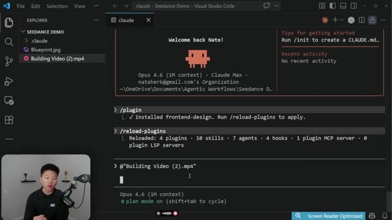
*⏱️ 00:12:41 — Interface de l'extension Claude dans VS Code montrant l'exécution de commandes de gestion de plugins et l'ajout d'un fichier vidéo en contexte.*

---

### ⏱️ `[00:12:55 - 00:13:18]` | Segment #28

**🔊 Audio (Transcription Intégrale Mot pour Mot en Français) :**
> Un peu comme ce site web automobile où la vidéo va tourner en boucle infinie. Pas comme celui de Herc Advisory Group où nous faisions défiler la page et c'est ce qui faisait réellement changer la vidéo. C'est parce qu'il a tout simplement extrait toutes les images de la vidéo, puis les a associées à un modèle de défilement ou à une position de défilement. C'est super facile à faire. Il suffirait de dire : « Hé, au lieu de simplement lire la vidéo, je veux en fait faire défiler et faire en sorte que la vidéo continue de progresser. »

**👁️ Analyse Visuelle d'Écran (gemini-3.5-flash-lite) :**
**Interface & Outils** : Site web de "Herk Advisory Group" (animation de défilement).

**Contenu textuel & Code** : Texte marketing ("Don't be gray, be green", "Choose Herk Advisory Group") et titre de l'entreprise.

**Action / Démonstration** : Démonstration visuelle de l'effet de défilement (scrolling) qui déclenche l'animation des éléments graphiques sur le site web.

---

### ⏱️ `[00:13:18 - 00:13:40]` | Segment #29

**🔊 Audio (Transcription Intégrale Mot pour Mot en Français) :**
> Et ensuite, il serait capable d'extraire les images et de faire tout ça pour vous. Donc, si vous voulez voir un vrai pas-à-pas où j'ai fait ça, alors regardez cette vidéo. C'est un concept très similaire. J'utilise Nano Banana, je transforme une image en vidéo, et ensuite on fait ça comme ça. Comme vous pouvez le voir dans cette vidéo, c'était comme pour une Apple Watch. Et lorsque je défile, ça bouge en quelque sorte et ça commence à s'ouvrir un petit peu. Mais bref, comme nous sommes dans la phase de planification, ce qui se passe, c'est qu'il revient et nous pose quelques questions.

**👁️ Analyse Visuelle d'Écran (gemini-3.5-flash-lite) :**
**Interface & Outils** : Plateforme web "1of10.com" (interface de type éditeur ou visualiseur de contenu vidéo/web).

**Contenu textuel & Code** : Interface utilisateur avec des outils de gestion de vidéo, des statistiques (6.2K likes) et une visualisation centrale d'une page produit Apple Watch.

**Action / Démonstration** : Le présentateur illustre le résultat final du processus d'automatisation ou de génération de contenu en montrant une page web complète intégrée dans son flux de travail.

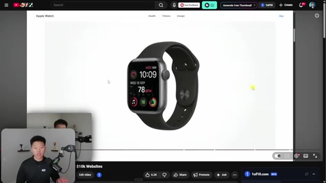
*⏱️ 00:13:23 — Une capture d'écran montrant l'interface de la plateforme "1of10.com" affichant une page web de démonstration présentant un Apple Watch. Le présentateur est visible dans une fenêtre incrustée en bas à gauche.*

---

### ⏱️ `[00:13:40 - 00:14:02]` | Segment #30

**🔊 Audio (Transcription Intégrale Mot pour Mot en Français) :**
> Donc c'était écrit : « Quel est le nom de votre cabinet d'architecture et avez-vous des couleurs de marque ou des logos existants ? » C'est ici que vous pourriez faire glisser votre logo, votre charte graphique, vos combinaisons de couleurs, tout ce genre de choses. Donc là, tout ce que je vais faire, c'est juste dire : pas encore d'image de marque. J'ai besoin que tu crées un nom et une marque à partir de zéro. La question suivante est : sur quel type d'architecture votre cabinet se concentre-t-il principalement ? Et nous allons juste dire : gratte-ciel commercial.

**👁️ Analyse Visuelle d'Écran (gemini-3.5-flash-lite) :**
**Interface & Outils** : Visual Studio Code avec extension Claude.

**Contenu textuel & Code** : Questions de l'assistant : « What is the name of your architecture firm and do you have any existing brand colors or logo? » avec des options de sélection (1. I have branding, 2. No branding yet, etc.).

**Action / Démonstration** : Sélection des options de branding pour configurer l'identité visuelle du site web en cours de génération.

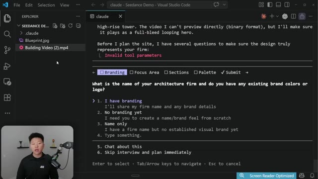
*⏱️ 00:13:46 — Interface de VS Code montrant un assistant textuel interactif posant des questions sur le cabinet d'architecture et l'image du projet (branding, logo).*

---

### ⏱️ `[00:14:02 - 00:14:37]` | Segment #31

**🔊 Audio (Transcription Intégrale Mot pour Mot en Français) :**
> Quelles sections voulez-vous sous le hero ? On va simplement dire tout le site. Donc on va choisir ce qui est recommandé et quelle palette de couleurs correspond le mieux à votre marque. On va continuer et choisir... enfin, voyons voir dans la vidéo, ça commence par un thème clair plutôt qu'un mode sombre. Donc je suppose qu'ici, on va juste choisir un style clair et minimaliste au lieu de quelque chose de sombre. Voilà donc nos questions. On va les soumettre. Si Claude a d'autres questions, il les posera, mais sinon il va simplement continuer à élaborer le plan. Encore quelques questions. Comme il n'y a pas encore d'image de marque, devrais-je créer un nom de cabinet fictif ou en avez-vous un en tête ? Je vais simplement dire d'en créer un. Quelle impression doit ressentir quelqu'un lorsqu'il arrive sur le site ? Prestigieux et bien établi.

**👁️ Analyse Visuelle d'Écran (gemini-3.5-flash-lite) :**
**Interface & Outils** : Visual Studio Code

**Contenu textuel & Code** : Menu de sélection de palette de couleurs : 1. Dark & Dramatic, 2. Light & Minimal, 3. Warm Neutral, 4. Monochrome + Accent, 5. Type something, 6. Chat about this, 7. Skip interview and plan immediately.

**Action / Démonstration** : Sélection de la palette de couleurs et de l'ambiance visuelle du site par l'assistant.

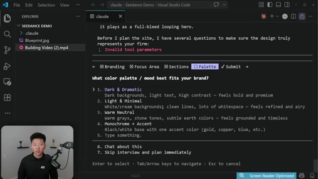
*⏱️ 00:14:11 — Interface de Visual Studio Code affichant un assistant textuel interactif proposant différentes palettes de couleurs pour un site web.*

---

### ⏱️ `[00:14:37 - 00:14:57]` | Segment #32

**🔊 Audio (Transcription Intégrale Mot pour Mot en Français) :**
> Et pour l'image du plan dans votre dossier de projet, est-ce que je dois l'incorporer dans la conception du site ? Non, ignorez-la simplement. Et je vais continuer et soumettre ces réponses. Parce que si vous vous souvenez, la seule raison pour laquelle nous avons mis cette image de plan ici était pour que Claude ait plus de contexte pour nous aider à rédiger le prompt, mais en réalité, tout ce que nous voulons dans le site web proprement dit, c'est la vidéo. Nous ne voulons pas d'image en plus.

**👁️ Analyse Visuelle d'Écran (gemini-3.5-flash-lite) :**
**Interface & Outils** : Visual Studio Code avec extension Claude et terminal intégré.

**Contenu textuel & Code** : Questions/réponses d'interview interactive de l'agent IA et affichage d'un fichier image de plan architectural.

**Action / Démonstration** : Soumission des réponses à l'agent IA et ouverture de l'image de plan dans l'éditeur.

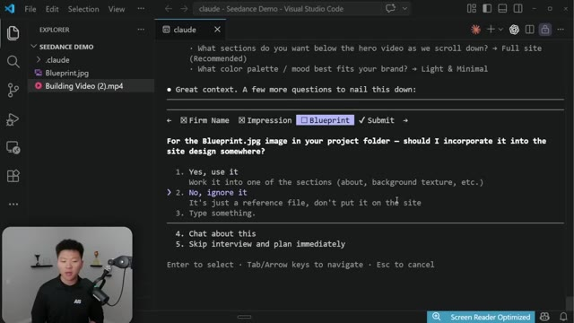
*⏱️ 00:14:42 — L'interface de VS Code montrant une question posée par l'agent IA à propos de l'image 'Blueprint.jpg'.*

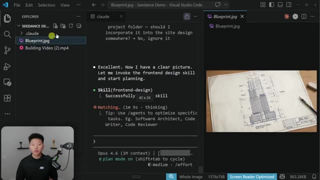
*⏱️ 00:14:47 — L'agent IA valide les réponses et invoque la compétence 'frontend-design' dans le terminal Claude.*

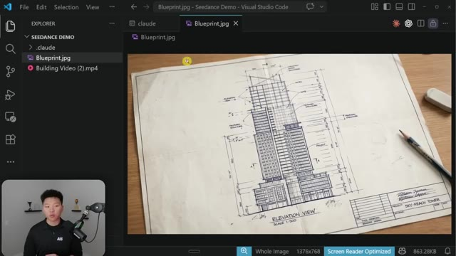
*⏱️ 00:14:52 — Visualisation dans l'éditeur VS Code de l'image 'Blueprint.jpg' représentant un plan architectural.*

---

### ⏱️ `[00:14:57 - 00:15:16]` | Segment #33

**🔊 Audio (Transcription Intégrale Mot pour Mot en Français) :**
> Et là, maintenant que ça commence à concevoir, ça regarde la compétence, qui est la compétence de conception front-end. C'est donc pour ça que vous voulez mettre ça là-dedans. Bon, alors à ce stade, Claude a rédigé un plan complet. Nous pourrions donc aller de l'avant et lire ceci si nous voulions vérifier que tout est correct, ce que je recommanderais. Mais pour les besoins de la démo, je ne vais pas lire tout ça et je vais simplement continuer et dire : oui, commencez à construire le site pour nous.

**👁️ Analyse Visuelle d'Écran (gemini-3.5-flash-lite) :**
**Interface & Outils** : Visual Studio Code avec le terminal Claude Code intégré.

**Contenu textuel & Code** : Texte montrant l'invocation de la compétence "frontend-design" et l'état de réflexion de l'agent.

**Action / Démonstration** : L'agent charge la compétence front-end pour concevoir l'interface utilisateur.

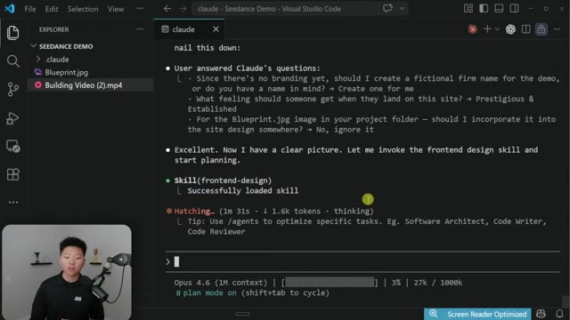
*⏱️ 00:15:01 — Vue de l'interface de Visual Studio Code affichant un terminal Claude Code montrant le chargement de la compétence de conception front-end et le plan en cours.*

---

### ⏱️ `[00:15:16 - 00:15:36]` | Segment #34

**🔊 Audio (Transcription Intégrale Mot pour Mot en Français) :**
> Maintenant, à ce stade, ce qui va se passer, c'est que ça va probablement commencer à dire, hé, suis-je autorisé à faire ça ? suis-je autorisé à faire ça ? Et vous pouvez simplement continuer à dire oui. Si vous vouliez activer le mode de contournement des autorisations, vous le pourriez, et cela ne vous demanderait pas la permission. Ça s'exécuterait tout simplement. Ou vous pourriez aussi faire quelque chose comme ça, où je glisse un fichier settings.local dans mon cloud, qui dit, hé, tu es autorisé à faire automatiquement toutes ces choses. Tu n'as pas à demander la permission.

**👁️ Analyse Visuelle d'Écran (gemini-3.5-flash-lite) :**
**Interface & Outils** : Visual Studio Code / Terminal Claude CLI

**Contenu textuel & Code** : Texte de vérification (Verification: Open index.html in browser, Verify video plays...) et options de configuration de l'agent.

**Action / Démonstration** : Exécution de commandes par l'agent et affichage des instructions de vérification dans l'éditeur.

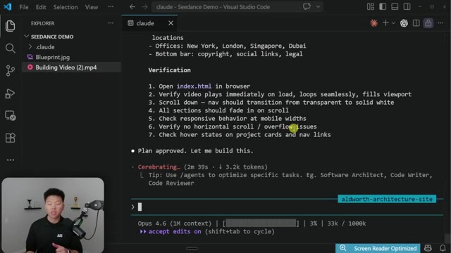
*⏱️ 00:15:21 — Vue de l'éditeur Visual Studio Code affichant un terminal intégré avec une session en cours de Claude.*

---

### ⏱️ `[00:15:36 - 00:15:57]` | Segment #35

**🔊 Audio (Transcription Intégrale Mot pour Mot en Français) :**
> Et c'est quelque chose de sympa que vous pouvez faire. Si vous voulez ce fichier settings.local.json, alors rejoignez mon école gratuite. Je vais aussi l'attacher dans la publication associée à cette vidéo. Donc vous pourrez récupérer cette ressource également. Mais bref, nous avons approuvé le plan. Je vais juste vérifier avec vous une fois que nous aurons récupéré notre site terminé. Très bien, donc soit il va vous créer un fichier HTML, que vous pourrez ouvrir dans votre navigateur juste pour le voir, soit il va le créer sur un serveur local.

**👁️ Analyse Visuelle d'Écran (gemini-3.5-flash-lite) :**
**Interface & Outils** : Visual Studio Code (éditeur de code).

**Contenu textuel & Code** : Fichier JSON contenant des configurations d'environnement et de permissions, notamment 'CLAUDE_CODE_EXPERIMENTAL_AGENT_TEAMS' et diverses autorisations d'outils (Bash, WebSearch, Edit, Write, outils MCP, etc.).

**Action / Démonstration** : Visualisation du fichier de configuration pour l'assistant Claude Code dans l'éditeur.

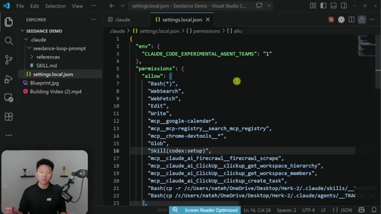
*⏱️ 00:15:41 — Capture d'écran de l'éditeur Visual Studio Code affichant le contenu d'un fichier de configuration JSON nommé settings.local.json.*

---

### ⏱️ `[00:15:58 - 00:16:16]` | Segment #36

**🔊 Audio (Transcription Intégrale Mot pour Mot en Français) :**
> Mais dans les deux cas, ce que cela signifie, c'est que ce n'est pas encore vraiment en ligne nulle part, et vous pouvez simplement itérer, et ensuite plus loin dans la vidéo, je vous montrerai comment vous le mettez réellement en ligne. Mais allons jeter un œil. Très bien, le voilà. Nous pouvons voir que le croquis se fond en quelque sorte dans le bâtiment réel, comme vous pouvez le voir. Nous avons le texte "transformez vos idées en réalité", puis cela zoome à nouveau sur le croquis. Donc je trouve que ça rend vraiment bien.

**👁️ Analyse Visuelle d'Écran (gemini-3.5-flash-lite) :**
**Interface & Outils** : Visual Studio Code et navigateur web (aperçu du site).

**Contenu textuel & Code** : Spécifications du site web (Hero, Nav, About, Projects, Services, etc.) et rendu visuel du site.

**Action / Démonstration** : Présentation du code source puis visualisation du résultat du site web généré.

*⏱️ 00:16:02 — Visual Studio Code affichant un fichier de configuration et de notes (projet "claude - Seedance Demo") détaillant la structure d'un site web.*

*⏱️ 00:16:07 — Aperçu du site web généré "ALDWORTH & PARTNERS" montrant une vidéo de chantier en arrière-plan avec un crayon à dessin sur le côté droit.*

*⏱️ 00:16:11 — Aperçu du site web avec la vidéo de fond et le texte "Turn your ideas into reality" affiché au centre.*

---

### ⏱️ `[00:16:16 - 00:16:46]` | Segment #37

**🔊 Audio (Transcription Intégrale Mot pour Mot en Français) :**
> Ça recommence à faire une boucle. On peut voir qu'on a aussi un peu une barre de navigation, Aldworth et partenaires, à propos, projets, services, contact. Et en faisant défiler vers leは大, on commence à voir d'autres textes apparaître, façonner l'environnement bâti, 58 ans d'excellence, plus de 340 projets réalisés. Ça a donc vraiment une belle ambiance de cabinet d'architecture professionnel. Ces images ne sont pas intégrées, mais c'est plutôt une belle touche si nous avions eu des images dedans, notre pratique et une certaine reconnaissance, une citation. Donc dans l'ensemble, pour le peu d'informations que je lui ai données, ce qui était pratiquement rien.

**👁️ Analyse Visuelle d'Écran (gemini-3.5-flash-lite) :**
**Interface & Outils** : Navigateur web affichant le site de l'agence d'architecture Aldworth & Partners

**Contenu textuel & Code** : Textes de présentation, statistiques (58 ans d'excellence, 340+ projets), portfolio de projets et menus de navigation

**Action / Démonstration** : Défilement vertical (scroll) à travers les différentes sections de la page web du site d'architecture

*⏱️ 00:16:23 — Défilement sur le site web d'architecture montrant la section philosophie avec le titre 'Shaping the Built Environment' et des statistiques d'excellence.*

*⏱️ 00:16:31 — Suite du défilement sur le site web montrant la section portfolio 'Selected Work' avec des vignettes de projets architecturaux.*

*⏱️ 00:16:38 — Poursuite du défilement sur le site web affichant la section 'Our Practice' détaillant les services d'architecture et de design.*

---

### ⏱️ `[00:16:46 - 00:17:05]` | Segment #38

**🔊 Audio (Transcription Intégrale Mot pour Mot en Français) :**
> C'est une sensation très agréable. Et maintenant, tout ce qu'on aurait à faire, c'est de commencer à apporter quelques modifications et itérations sur le texte. Et peut-être qu'on voudrait plus de vidéos ici en bas ou des éléments plus dynamiques, des choses comme ça. Donc, par exemple, avec cette voiture, j'ai fait ça comme premier essai. Et ensuite, j'ai fait défiler vers le bas et je me suis dit, ok, super. Peut-être que je voudrais ajouter une petite vidéo ici d'un moteur pour aller avec ces statistiques.

**👁️ Analyse Visuelle d'Écran (gemini-3.5-flash-lite) :**
**Interface & Outils** : Navigateur web affichant des maquettes de sites web professionnels (portfolio d'architecture et page de présentation automobile).

**Contenu textuel & Code** : Textes descriptifs, statistiques d'entreprise, titres de projets et visuels de design web moderne.

**Action / Démonstration** : Navigation et défilement (scroll) à travers différentes sections de sites web pour en évaluer le design et le contenu.

*⏱️ 00:16:51 — Aperçu du site web 'Aldworth & Partners' montrant du texte de présentation et des statistiques chiffrées sur le cabinet d'architecture.*

*⏱️ 00:16:55 — Suite de la page web 'Aldworth & Partners' avec la section 'Selected Work' présentant une grille de projets en images.*

*⏱️ 00:17:00 — Aperçu d'un autre site web au thème sombre ('Apex') mettant en avant un moteur et le slogan 'Where aerodynamics meet artistry'.*

---

### ⏱️ `[00:17:05 - 00:17:40]` | Segment #39

**🔊 Audio (Transcription Intégrale Mot pour Mot en Français) :**
> Donc j'ai fait le même processus. Je suis allé sur Nano Banana, j'ai fait générer une image d'un moteur. Et ensuite je suis allé sur Sea Dance et j'ai dit, hé, est-ce que tu peux animer ça un petit peu ? Fais en sorte qu'on dirait qu'il vrombit, mets des flammes qui sortent, fais en sorte que ça ait l'air cool. Et ensuite j'ai pris cette vidéo pour l'emmener sur Cloud Code et j'ai dit, hé, est-ce que tu peux s'il te plaît mettre cette vidéo sous ce texte et au-dessus de ces statistiques et juste la rendre un peu plus petite ? Je ne veux pas qu'elle soit en plein écran. Et boum, voilà. Et ensuite j'ai fait exactement la même chose avec cette vidéo ici. Et d'autres choses que vous pouvez faire qui sont vraiment, vraiment cool, c'est que vous pouvez aller sur quelque chose comme Dribbble ou awards avec 3W, ou il y a des tonnes de sites pour le design, n'est-ce pas ? Et je pourrais aller ici et dire du genre site web d'architecture, parce que je ne sais pas vraiment

**👁️ Analyse Visuelle d'Écran (gemini-3.5-flash-lite) :**
**Interface & Outils** : Navigateur web (pages d'applications et site Dribbble)

**Contenu textuel & Code** : Interface utilisateur d'un site web de présentation de moteur avec spécifications techniques (2.7s, 710 horsepower, V8 twin turbo).

**Action / Démonstration** : Navigation et présentation visuelle d'un exemple de site web généré avec une image de moteur.

*⏱️ 00:17:14 — Capture montrant la page web d'une application générée ('Apex') affichant l'image d'un moteur et des statistiques de performance, avec le présentateur en incrustation.*

*⏱️ 00:17:31 — Capture montrant le site web Dribbble avec la page d'accueil de découverte de designers et le présentateur en bas à gauche.*

---

### ⏱️ `[00:17:40 - 00:18:03]` | Segment #40

**🔊 Audio (Transcription Intégrale Mot pour Mot en Français) :**
> à quoi cela ressemble. Je ne les regarde pas très souvent. Et disons que nous en trouvons un qu'on aime vraiment, vraiment. D'accord, super. Donc celui-ci, j'ai l'impression qu'il correspond un tout petit peu à l'ambiance du nôtre. Et voici le design complet réel. Donc ce que je viens de faire, c'est que j'ai enregistré l'image, qui était la capture d'écran complète, tu sais, de cet exemple de site ici. Et je vais donner ceci à un code cloud et dire : Hé, est-ce que tu peux faire en sorte que tout ce qui se trouve sous la vidéo ressemble un peu plus à ce style-là ?

**👁️ Analyse Visuelle d'Écran (gemini-3.5-flash-lite) :**
**Interface & Outils** : Navigateur web / Visionneuse d'images

**Contenu textuel & Code** : Maquettes et concepts de design de site web d'architecture (Bhoomi)

**Action / Démonstration** : Navigation et consultation d'exemples de design d'interface utilisateur web

*⏱️ 00:17:46 — Navigation sur un site de design web montrant l'interface d'un concept "Architecture Website UI Design".*

*⏱️ 00:17:52 — Défilement vers le bas de la page web montrant une description du concept de design épuré et moderne.*

*⏱️ 00:17:57 — Affichage du design complet d'une page web au format vertical dans une visionneuse d'images.*

---

### ⏱️ `[00:18:03 - 00:18:37]` | Segment #41

**🔊 Audio (Transcription Intégrale Mot pour Mot en Français) :**
> Et maintenant vous pouvez voir, je viens de lancer un prompt super simple et il va faire ces changements pour nous. Très bien, le site a été redessiné pour correspondre à cette image de référence. Si nous retournons sur le site, nous lui donnons un petit rafraîchissement. Tout ceci est toujours pareil. J'aime vraiment, en fait, j'aime vraiment ça. Et maintenant, ceci a été complètement redessiné pour correspondre à cette référence. Comme nous pouvons le voir, nous avons ces formes sympas ici. Ça arrive toujours de manière très agréable. Ça fait juste un peu plus géométrique, je suppose, si ce mot convient ici. Et vous pouvez voir que ça a été redessiné. J'aime vraiment cette petite touche en arrière-plan, le A&P. Ça fait très professionnel et nous avons toujours notre style et

**👁️ Analyse Visuelle d'Écran (gemini-3.5-flash-lite) :**
**Interface & Outils** : Visual Studio Code et navigateur web affichant le site refondu.

**Contenu textuel & Code** : Liste textuelle des changements structurels (Intro band, Stats row, About section, Projects, Services, Contact) et design épuré du site « Aldworth & Partners ».

**Action / Démonstration** : Présentation des modifications apportées automatiquement par l'IA pour correspondre à l'image de référence.

*⏱️ 00:18:12 — Visual Studio Code affichant une liste détaillée des modifications apportées par l'IA au site web (redesign, sections de statistiques, mise en page asymétrique).*

*⏱️ 00:18:20 — Aperçu du site web généré montrant l'en-tête, la section des statistiques chiffrées et la section « About » avec des images de placeholder.*

*⏱️ 00:18:29 — Suite de la page web générée montrant la section « Services » avec une liste numérotée et une typographie soignée.*

---

### ⏱️ `[00:18:37 - 00:19:12]` | Segment #42

**🔊 Audio (Transcription Intégrale Mot pour Mot en Français) :**
> notre ressenti unique sur le sujet. Donc je pense que c'est assez bien au point où je me dirais, ok, super. Je veux mettre ça sur le vrai web. Maintenant, comment on fait ça ? Parce que pour l'instant, ça réside juste localement sur notre machine. Donc ce qu'on doit faire, c'est qu'on doit utiliser deux outils différents. On doit en utiliser un qui s'appelle GitHub et on doit en utiliser un qui s'appelle Vercel. Maintenant, GitHub, c'est fondamentalement juste, voyez ça plutôt comme un disque partagé ou un Google Drive. Vous pouvez travailler sur un document Word sur votre ordinateur, mais si vous vouliez l'ouvrir sur un autre ordinateur, vous ne l'auriez pas à moins de vous l'être envoyé par e-mail ou quelque chose comme ça. Donc si nous envoyons notre code ou notre projet sur GitHub, alors nous pourrons le récupérer depuis GitHub n'importe où ailleurs, ou quelqu'un d'autre pourra aussi le récupérer. Donc ce que je vais

**👁️ Analyse Visuelle d'Écran (gemini-3.5-flash-lite) :**
**Interface & Outils** : Navigateur web et diagramme explicatif illustré.

**Contenu textuel & Code** : Schéma de workflow : Claude Code -> git push -> GitHub -> auto-deploy on push -> Vercel -> CDN serve -> Live Site.

**Action / Démonstration** : Présentation du processus de publication d'un site web local vers une infrastructure de production en ligne.

*⏱️ 00:18:55 — Schéma explicatif montrant le flux de déploiement de Claude Code vers GitHub, Vercel et le site en ligne.*

---

### ⏱️ `[00:19:12 - 00:19:48]` | Segment #43

**🔊 Audio (Transcription Intégrale Mot pour Mot en Français) :**
> ce que nous allons faire, c'est que je vais en pousser un vers un dépôt GitHub privé que seul moi peut voir. Et ensuite, je vais faire en sorte que Vercel se synchronise avec ce GitHub. Et Vercel est ce qui met réellement notre site sur un vrai domaine pour que n'importe qui puisse y accéder. Et ce qui est vraiment cool, c'est une fois que nous synchronisons ce dépôt GitHub avec Vercel, chaque fois que nous poussons une modification sur notre version locale du site, Vercel la détecte automatiquement. Et donc c'est vraiment comme, on a l'impression qu'on ne travaille qu'avec un seul outil, mais en réalité il y a deux outils en jeu. Donc la première chose que nous allons faire, c'est que vous allez simplement aller sur GitHub. Vous pouvez voir ici, c'est mon profil. Et si je vais ici dans mes dépôts, lesquels

**👁️ Analyse Visuelle d'Écran (gemini-3.5-flash-lite) :**
**Interface & Outils** : Schéma explicatif / illustration visuelle de workflow.

**Contenu textuel & Code** : Diagramme textuel et visuel montrant les étapes : Claude Code, GitHub, Vercel et Live Site avec les actions associées (git push, auto-deploy on push, CDN serve).

**Action / Démonstration** : Présentation conceptuelle et schématique du pipeline de déploiement automatisé du projet web.

*⏱️ 00:19:21 — Schéma explicatif illustrant le flux de déploiement : de Claude Code vers GitHub (via git push), puis vers Vercel (auto-deploy) pour aboutir au site en ligne (Live Site).*

---

### ⏱️ `[00:19:48 - 00:20:17]` | Segment #44

**🔊 Audio (Transcription Intégrale Mot pour Mot en Français) :**
> c'est comme ça qu'on les appelle sur GitHub, un repo, un dépôt, vous pouvez voir que j'ai configuré d'autres dépôts. Et ce qui est vraiment génial, c'est que Cloud Code peut en fait vous aider à créer, éditer et faire tout ce dont vous avez besoin pour vos dépôts GitHub. Donc si vous le vouliez, vous n'auriez même pas vraiment besoin d'aller dans cette interface. Vous pouvez tout faire directement via Cloud Code. Et puis le deuxième endroit où vous allez aller, c'est Vercel. Et c'est celui où vous voulez vous connecter avec le même e-mail que celui que vous avez utilisé sur GitHub, ou vous pouvez faire ceci : continuer avec GitHub et vous pouvez vous connecter immédiatement avec votre compte GitHub. C'est juste plus facile de synchroniser de cette façon. Alors faites-le absolument de cette façon.

**👁️ Analyse Visuelle d'Écran (gemini-3.5-flash-lite) :**
**Interface & Outils** : Navigateur web (GitHub)

**Contenu textuel & Code** : Liste des dépôts GitHub de l'utilisateur avec des informations sur les langages utilisés (Python, TypeScript, CSS) et la date de dernière mise à jour.

**Action / Démonstration** : Navigation et présentation des différents dépôts GitHub configurés par le créateur.

*⏱️ 00:19:55 — Capture d'écran montrant la page des dépôts GitHub de Nate Herk avec une liste de plusieurs projets privés (Herk-2.0, claude-workflow-builder, etc.).*

---

### ⏱️ `[00:20:17 - 00:20:53]` | Segment #45

**🔊 Audio (Transcription Intégrale Mot pour Mot en Français) :**
> Maintenant, une chose que vous remarquerez à propos de ce projet, c'est que nous n'avons pas encore de fichier cloud.md configuré. Donc, si vous le vouliez vraiment, vous pourriez venir ici et faire un slash init et cela lirait pratiquement tout et cela vous créerait un fichier cloud.md. Donc, faites-le sans faute. Mais de toute façon, pendant que cela s'exécute, je vais ouvrir un autre terminal parce que nous pouvons travailler dans plusieurs en même temps. Et je vais simplement dire, Hé, j'ai besoin que tu m'aides à pousser cette base de code, ce site Web vers un dépôt GitHub. Alors, crée-en un nouveau pour moi. Appelle-le comme tu veux. Assure-toi juste qu'il est privé et utilise mon e-mail GitHub, qui est fais-moi savoir si tu rencontres des problèmes ou si tu as besoin d'aide pour configurer cela. D'accord. Donc, ce que ça va faire pour vous, si vous n'avez jamais connecté votre

**👁️ Analyse Visuelle d'Écran (gemini-3.5-flash-lite) :**
**Interface & Outils** : Visual Studio Code (éditeur de code) intégrant une interface de terminal Claude.

**Contenu textuel & Code** : Commande `/init` saisie dans le terminal, suivie d'une recherche de fichiers et de la création d'éléments pour le projet "Seedance Demo". Le volet de gauche affiche l'arborescence des fichiers du dossier de travail (notamment .claude, references, SKILL.md, settings.local.json, Blueprint.jpg, index.html).

**Action / Démonstration** : Exécution de la commande d'initialisation (`/init`) par l'assistant pour configurer automatiquement le projet et générer les fichiers nécessaires.

*⏱️ 00:20:26 — Vue de l'éditeur Visual Studio Code avec un panneau de terminal intégré affichant l'exécution de la commande '/init' via l'interface Claude, ainsi que la structure du projet visible dans l'explorateur à gauche.*

---

### ⏱️ `[00:20:53 - 00:21:25]` | Segment #46

**🔊 Audio (Transcription Intégrale Mot pour Mot en Français) :**
> Cloud Code vers GitHub, c'est essentiellement juste l'exécution d'une commande, puis il va vous demander de vous connecter. Donc il va littéralement ouvrir un navigateur, vous vous connectez, et ensuite vous êtes connecté. Et après, vous dites simplement, ok, super, construis-moi un dépôt, rends-le privé, et ensuite pousse tout là-bas. Et il fera exactement cela. Maintenant, il soulève de bons points ici, à savoir le fait qu'on ne souhaite peut-être pas tout pousser dans ce dépôt. Parce que si vous poussez des éléments, vous devez juste faire attention au cas où ils seraient publics. C'est donc juste quelque chose à garder à l'esprit, je ne vais pas approfondir cela énormément pour l'instant. Nous n'avons pas non plus mis de mots de passe ou de clés API dans ce projet. Et c'est généralement ce dont vous voulez vous assurer de ne pas exposer dans un dépôt GitHub. Donc

**👁️ Analyse Visuelle d'Écran (gemini-3.5-flash-lite) :**
**Interface & Outils** : Visual Studio Code / Éditeur de code avec terminal intégré.

**Contenu textuel & Code** : Texte de l'agent IA demandant de l'aide pour pousser le code vers un dépôt GitHub et interface de terminal en bas.

**Action / Démonstration** : L'agent IA analyse le répertoire du projet pour configurer le dépôt GitHub.

*⏱️ 00:21:01 — Un éditeur de code avec un terminal intégré où un agent IA discute et interagit, tandis que le présentateur apparaît en incrustation (PIP) dans le coin inférieur gauche.*

---

### ⏱️ `[00:21:25 - 00:22:00]` | Segment #47

**🔊 Audio (Transcription Intégrale Mot pour Mot en Français) :**
> en ce moment tout va bien. Donc de toute façon, nous avons ce dépôt GitHub configuré. Il est privé. Il s'appelle cdansdemo. Laisse-moi ouvrir ceci et voir s'il existe vraiment. Oui, nous avons notre .clod, nous avons nos éléments de blueprint, et nous avons notre site réel. Maintenant, la partie amusante, c'est que nous allons sur Vercel. Nous allons tout en haut ici et nous cliquons sur ajouter un nouveau. Nous voulons ajouter un nouveau projet. Et ici, nous pouvons simplement importer un dépôt Git. C'est donc littéralement juste là. Tout ce que j'ai à faire est de cliquer sur ce bouton d'importation et je peux simplement dire déployer. Et il va tout récupérer et il va déployer cela sur un vrai site web. Donc il est dit, félicitations, vous venez de déployer un nouveau projet dans vos projets. Je suis

**👁️ Analyse Visuelle d'Écran (gemini-3.5-flash-lite) :**
**Interface & Outils** : GitHub (Dépôt de code) et Vercel (Plateforme de déploiement).

**Contenu textuel & Code** : Structure de fichiers d'un projet web (.claude, Blueprint.jpg, Building Video, CLAUDE.md, Site.webp) sur GitHub et aperçu des projets actifs sur Vercel.

**Action / Démonstration** : Présentation de l'environnement technique : vérification du contenu du dépôt GitHub, suivie d'une navigation sur le tableau de bord de déploiement Vercel.

*⏱️ 00:21:34 — Vue d'un dépôt GitHub privé nommé "seedance-demo" listant les fichiers du projet, incluant le dossier .claude, Blueprint.jpg et Site.webp.*

*⏱️ 00:21:43 — Tableau de bord Vercel affichant la liste des projets, les statistiques d'utilisation (Edge Requests, Image Optimization) et le menu "Add New" ouvert.*

---

### ⏱️ `[00:22:00 - 00:22:36]` | Segment #48

**🔊 Audio (Transcription Intégrale Mot pour Mot en Français) :**
> je vais aller sur mon tableau de bord. Et juste ici, nous pouvons voir que nous avons un domaine réel à visiter. Donc si je clique sur ce domaine, nous ne sommes plus sur un hôte local, nous sommes réellement sur le web. Et ce site web est désormais visible pour n'importe qui qui, vous savez, tape ce domaine et l'entre. Et nous pouvons voir que nous avons toujours tout ce que nous avons vu localement. Juste parce que vous déployez, rien ne va changer. Cela signifie simplement que maintenant il est accessible. Donc le déroulement serait que si vous voulez changer le site réel, disons que vous voulez changer ce nombre à 60 ans, vous viendriez dans CloudCode, vous diriez, hé, est-ce que tu peux changer notre site pour qu'il dise 60 ans ? Il vous donnerait la version locale à examiner. Et puis si vous aimez, vous dites, super, pousse ça vers GitHub. Et puis GitHub

**👁️ Analyse Visuelle d'Écran (gemini-3.5-flash-lite) :**
**Interface & Outils** : Navigateur web affichant un site internet d'architecture

**Contenu textuel & Code** : Page web en ligne, en-tête avec navigation (About, Projects, Services, Contact), sections visuelles et statistiques

**Action / Démonstration** : Navigation et exploration du site web déployé sur Internet en conditions réelles

*⏱️ 00:22:09 — Vue d'un site web déployé nommé 'Aloworth & Partners' avec une vidéo d'arrière-plan de gratte-ciels en construction et le texte 'Turn your ideas into reality'.*

*⏱️ 00:22:18 — Navigation sur la page du projet 'Aloworth & Partners' montrant une section de galerie avec des aperçus de projets architecturaux.*

*⏱️ 00:22:27 — Section statistiques du site web 'Aloworth & Partners' affichant des chiffres clés ('58+ years', '340+ projects', etc.) et du texte de présentation.*

---

### ⏱️ `[00:22:36 - 00:22:55]` | Segment #49

**🔊 Audio (Transcription Intégrale Mot pour Mot en Français) :**
> serait pris en compte par Vercel. Et ensuite, en 30 secondes à 60 secondes, votre vrai site serait mis à jour. C'est donc très simple. Mais de toute façon, c'est tout pour cette vidéo. N'oubliez pas d'aller dans ma communauté FreeSchool pour récupérer toutes ces ressources et toutes les autres ressources que j'ai dans n'importe laquelle de mes autres vidéos. Et maintenant, si vous voulez aller encore plus loin dans vos compétences en création de sites Web, alors consultez absolument cette vidéo juste ici où je passe en revue quelques autres astuces.

**👁️ Analyse Visuelle d'Écran (gemini-3.5-flash-lite) :**
**Interface & Outils** : Éditeur de code (VS Code) et navigateur web affichant le site finalisé.

**Contenu textuel & Code** : Commandes Git, configuration de projet et page web avec le texte "Turn your ideas into reality".

**Action / Démonstration** : Démonstration du résultat final du site web mis à jour et déployé.

*⏱️ 00:22:41 — Image floue d'un éditeur de code source (type VS Code) affichant des commandes Git et de configuration.*

*⏱️ 00:22:46 — Page web d'un site généré avec le slogan "Turn your ideas into reality" et des images de gratte-ciels en construction.*

*⏱️ 00:22:50 — Vue légèrement modifiée de la même page web montrant le défilement et le design du site web mis en ligne.*

---

### ⏱️ `[00:22:56 - 00:23:01]` | Segment #50

**🔊 Audio (Transcription Intégrale Mot pour Mot en Français) :**
> J'espère vous y voir les gars, mais sinon, veuillez laisser un pouce bleu si vous avez aimé, si vous avez appris quelque chose de nouveau, et je vous vois dans la prochaine. Merci tout le monde.

**👁️ Analyse Visuelle d'Écran (gemini-3.5-flash-lite) :**
**Interface & Outils** : Navigateur web affichant le site web 'Aldworth & Partners'

**Contenu textuel & Code** : Texte 'Turn your ideas into reality' et visuels de gratte-ciel en construction

**Action / Démonstration** : Navigation et défilement sur le site web de présentation dans le cadre de la conclusion de la vidéo

*⏱️ 00:22:57 — Capture d'écran montrant le site web 'Aldworth & Partners' avec le texte 'Turn your ideas into reality' et une vidéo en arrière-plan d'un chantier, avec la webcam du présentateur en bas à gauche.*

*⏱️ 00:22:58 — Capture d'écran montrant la même page web avec la vidéo en arrière-plan d'un immeuble en verre et le texte superposé 'Turn your ideas into reality'.*

*⏱️ 00:23:00 — Capture d'écran similaire avec la vidéo de l'immeuble et un crayon dessiné sur le côté droit, illustrant la fin de la vidéo.*

---

