# 🎬 This One Plugin Just 10x’d Claude Code

> **Chaîne** : [Nate Herk | AI Automation](https://www.youtube.com/@nateherk/featured)  
> **Lien YouTube** : [https://www.youtube.com/watch?v=4XqVR6xI6Kw](https://www.youtube.com/watch?v=4XqVR6xI6Kw)  
> **Date de publication** : 20260412  
> **Durée** : 00:15:14  
> **Identifiant vidéo** : `4XqVR6xI6Kw`  
> **Transcription & Analyse** : `whisper-v3-large-turbo+gemini-3.5-flash-lite`  

---

## 📌 Synthèse Exécutive & Outils

### 💡 Résumé

Cette vidéo de la chaîne Nate Herk | AI Automation explore l'impact révolutionnaire du plugin open-source **Superpowers** sur l'efficacité de l'outil de développement **Claude Code**, affirmant qu'il multiplie par dix la productivité et la qualité des livrables. Créé par Jesse Vincent, ce plugin d'ingénierie logicielle introduit un cadre de compétences agentiques structuré qui force l'IA à adopter une démarche rigoureuse et disciplinée, s'opposant à l'écriture impulsive de code généralement observée avec les agents conversationnels. Au lieu de répondre instantanément à une requête par de l'implémentation brute, le système orchestre un workflow méthodique en plusieurs phases : clarification, conception, planification, codage et vérification.

La démonstration pratique présentée dans la vidéo met en lumière la phase de découverte interactive. Grâce à l'utilisation de compétences de remue-méninges (*brainstorming*), l'agent génère un compagnon visuel local permettant de comparer plusieurs approches de design (comme un graphe de forces interactif ou une grille de cartes recherchables) avec leurs avantages et inconvénients respectifs. Cette interface visuelle permet à l'utilisateur de valider, corriger ou orienter l'architecture logicielle *avant* que de lourds volumes de jetons ne soient consommés sur des fonctionnalités non désirées. Le processus intègre également des mécanismes de questionnement ciblé pour combler les angles morts du cahier des charges initial.

Au-delà de la simple planification, Superpowers orchestre l'exécution des tâches à travers des sous-agents spécialisés, des lancements en parallèle pour des problématiques indépendantes et des portes de qualité rigoureuses. Bien que ce niveau de raffinement puisse s'avérer initialement gourmand en jetons, les gains en termes de pertinence fonctionnelle, d'alignement avec les attentes du développeur et de réduction des boucles de correction erronées justifient pleinement son adoption. Le plugin s'installe en quelques secondes et fonctionne en arrière-plan comme un répartiteur autonome, transformant Claude Code en un véritable ingénieur logiciel méthodique.

### 🛠️ Outils, Modèles & Logiciels Présentés

* **Claude Code** : Outil de développement assisté par IA d'Anthropic conçu pour concevoir, planifier et écrire du code directement depuis l'environnement de travail.
* **Superpowers** : Plugin open-source gratuit créé par Jesse Vincent, agissant comme un cadre de compétences agentiques pour structurer et discipliner le flux de travail des agents de code.
* **Opus 5.5** : Modèle linguistique de pointe d'Anthropic (mentionné dans le contexte de l'ingénierie et des performances globales de la chaîne).
* **FreeSchool** : Communauté en ligne de Nate Herk servant de plateforme de partage pour documenter gratuitement les ressources et configurations présentées.

### 🔑 Points Clés & Enseignements Stratégiques

* **Transition de l'impulsion à la méthode** : Le principal écueil des agents de code est leur tendance à coder immédiatement après une requête ; Superpowers impose une discipline de fer en bloquant l'implémentation tant que les phases de clarification et de conception ne sont pas validées.
* **Architecture du plugin en 14 compétences** : Le système repose sur un répartiteur principal (*Superpowers Use*) qui évalue dynamiquement et en arrière-plan la compétence requise parmi 14 modules spécialisés selon l'état d'avancement du projet.
* **Phase de découverte et de clarification proactive** : Plutôt que d'attendre passivement des instructions, l'agent pose une série de questions stratégiques pour extraire de l'esprit du développeur les spécifications implicites et les besoins cachés.
* **Prototypage visuel interactif** : L'utilisation d'un serveur local pour afficher des options de design visuel (ex. : graphes, cartes de recherche) permet à l'humain de valider concrètement l'approche ergonomique et fonctionnelle avant toute génération de code de production.
* **Planification granulaire et traçable** : Les plans d'implémentation sont découpés en micro-tâches de deux à cinq minutes associées à des chemins de fichiers précis, avec des tests de blocs de code et des sauvegardes d'états.
* **Développement piloté par des sous-agents** : Le système délègue des tâches spécifiques à des sous-agents dédiés et déclenche des exécutions en parallèle lorsque les problèmes techniques identifiés sont totalement indépendants.
* **Portes de qualité et TDD (Test-Driven Development)** : L'intégration rigoureuse du développement piloté par les tests garantit que l'agent rédige d'abord les tests (en les observant échouer), puis implémente le code minimal nécessaire pour valider le succès.
* **Débogage systématique en 4 phases** : Face à une anomalie, l'agent applique une méthodologie structurée : enquête sur la cause racine, analyse des symptômes, formulation d'hypothèses et mise en œuvre chirurgicale du correctif.
* **Optimisation du ratio jetons/valeur** : Bien que l'approche multi-agents et les phases de design interactif augmentent la consommation initiale de jetons, elle réduit drastiquement les coûts cachés liés aux réécritures massives de code non conforme.
* **Méta-compétence et extensibilité** : Le système intègre des compétences rédactionnelles permettant à l'utilisateur d'étendre les capacités de Superpowers en écrivant de nouveaux modules testés selon les principes du développement dirigé par les tests.
* **Fonctionnement « Configurer et Oublier »** : Hormis pour des cas hautement situationnels de débogage ou de tests, le framework s'exécute de manière totalement autonome sans nécessiter de mémorisation complexe des commandes par le développeur.
* **Sécurité des points d'arrêt** : Le plugin s'interrompt immédiatement et demande l'assistance humaine en cas de blocage technique, évitant ainsi aux modèles de s'enfermer dans des boucles d'hallucination ou de suppositions erronées.

---

## ⏱️ Chronologie & Transcription Complète Audio & Visuelle (Mot pour Mot)

### ⏱️ `[00:00:00 - 00:00:21]` | Segment #01

**🔊 Audio (Transcription Intégrale Mot pour Mot en Français) :**
> Donc ce seul plugin a véritablement multiplié par 10 mon code Cloud ces derniers mois alors que je jouais avec. Donc dans la vidéo d'aujourd'hui, je vais passer en revue absolument tout ce que vous devez savoir à ce sujet, ce que c'est, comment il fonctionne, comment vous les configurez, tout ce genre de choses. Et je ne vais pas seulement parler, je vais vous montrer de vraies comparaisons, de vrais résultats comme vous pouvez le voir ici, et vous montrer comment il a réellement pu m'économiser des jetons et augmenter la qualité de mes résultats.

**👁️ Analyse Visuelle d'Écran (gemini-3.5-flash-lite) :**
**Interface & Outils** : VS Code, navigateur web et interface de tableau de bord analytique.

**Contenu textuel & Code** : Commandes bash (`find`, `ls -la`), blocs de texte Markdown et graphiques comparatifs de coûts et d'utilisation de tokens.

**Action / Démonstration** : Navigation dans l'éditeur de code, présentation du sommaire des sujets et affichage de graphiques de performance.

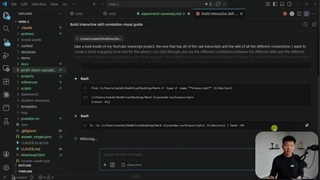
*⏱️ 00:00:05 — Interface VS Code affichant un fichier Markdown de guide visuel avec des blocs de commandes Bash exécutées.*

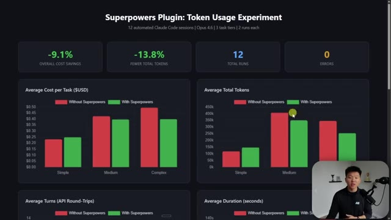
*⏱️ 00:00:16 — Tableau de bord analytique sombre affichant les résultats d'une expérience sur l'utilisation des tokens avec le plugin Superpowers.*

---

### ⏱️ `[00:00:21 - 00:00:40]` | Segment #02

**🔊 Audio (Transcription Intégrale Mot pour Mot en Français) :**
> Donc je ne veux pas perdre de temps, je veux creuser tout ça, alors allons directement dans la vidéo. Donc le plugin que nous examinons aujourd'hui s'appelle Superpowers, et il donne vraiment des super-pouvoirs à Claude Code. Vous pouvez voir ici, il est écrit un cadre de compétences agentiques et une méthodologie de développement logiciel qui fonctionne vraiment. Alors allons-y directement. Tout ce document va être joint gratuitement dans ma communauté FreeSchool.

**👁️ Analyse Visuelle d'Écran (gemini-3.5-flash-lite) :**
**Interface & Outils** : Navigateur web affichant GitHub.

**Contenu textuel & Code** : Liste des dossiers du projet (.claude-plugin, .codex, .cursor-plugin, agents, commands, docs) et description "An agentic skills framework & software development methodology that works." dans la section About.

**Action / Démonstration** : Navigation sur la page GitHub du dépôt open-source pour présenter le plugin.

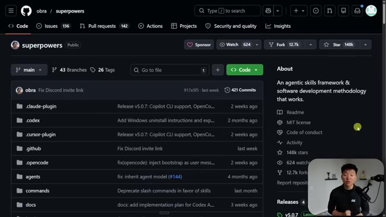
*⏱️ 00:00:26 — Capture d'écran montrant la page du dépôt GitHub du projet "superpowers" (obra/superpowers), affichant l'arborescence des fichiers et la description du projet.*

---

### ⏱️ `[00:00:40 - 00:01:00]` | Segment #03

**🔊 Audio (Transcription Intégrale Mot pour Mot en Français) :**
> Donc je ne vais pas lire chaque mot qui est ici. Donc si vous voulez le récupérer, allez là-bas et obtenez-le gratuitement, mais je vais passer en revue ce qui me semble important. Alors, qu'est-ce que c'est ? Superpowers est un plugin open source gratuit créé par Jesse Vincent qui installe un ensemble de compétences dans votre Cloud Code. Donc au lieu de laisser Cloud Code commencer simplement à coder quand vous lui demandez de construire quelque chose, il passe par un ensemble de phases hyper, hyper discipliné.

**👁️ Analyse Visuelle d'Écran (gemini-3.5-flash-lite) :**
**Interface & Outils** : Page de présentation textuelle avec incrustation vidéo du présentateur.

**Contenu textuel & Code** : Texte décrivant 'Superpowers', un plugin open-source par Jesse Vincent, et listant des sections comme 'How Does It Work?', 'The 14 Skills and What They Do', 'Do They Invoke Automatically?', et 'The Full Chain for Building Something New'.

**Action / Démonstration** : Le présentateur introduit les concepts clés du plugin en affichant la page de documentation à l'écran.

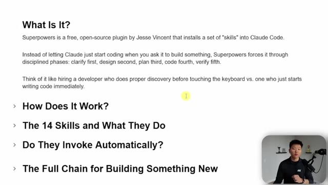
*⏱️ 00:00:45 — Une page de présentation contenant du texte explicatif sur le plugin 'Superpowers' pour Claude Code, avec le présentateur en médaillon dans le coin inférieur droit.*

---

### ⏱️ `[00:01:01 - 00:01:24]` | Segment #04

**🔊 Audio (Transcription Intégrale Mot pour Mot en Français) :**
> Maintenant, nous savons tous dans Cloud Code combien il est important de planifier avant de commencer à construire quoi que ce soit, mais c'est bien plus que de l'aider simplement pour la planification. C'est également l'aider pour la mise en œuvre réelle. Les phases sont donc essentiellement : clarifier, concevoir, planifier, coder, puis vérifier. Pensez donc à cela comme à l'embauche d'un développeur qui fait une bonne phase de découverte avant de toucher à quoi que ce soit et de construire quoi que ce soit, par opposition à quelqu'un qui prend simplement votre demande et se met à écrire du code immédiatement.

**👁️ Analyse Visuelle d'Écran (gemini-3.5-flash-lite) :**
**Interface & Outils** : Page web de documentation / Présentation textuelle

**Contenu textuel & Code** : Texte expliquant le plugin Superpowers, développé par Jesse Vincent, et ses phases de développement (clarify first, design second, plan third, code fourth, verify fifth).

**Action / Démonstration** : Présentation théorique du fonctionnement du plugin et des différentes étapes du processus de développement guidé par l'IA.

*⏱️ 00:01:07 — Capture d'écran montrant une page de documentation ou de présentation expliquant ce qu'est le plugin Superpowers pour Claude Code, avec du texte décrivant les différentes phases (clarify, design, plan, code, verify) et le présentateur visible en incrustation vidéo dans le coin inférieur droit.*

---

### ⏱️ `[00:01:25 - 00:01:49]` | Segment #05

**🔊 Audio (Transcription Intégrale Mot pour Mot en Français) :**
> D'accord, alors comment est-ce que ça fonctionne ? Il y a une compétence principale appelée l'utilisation de super-pouvoirs et celle-ci se déclenche au début de chaque conversation et agit en quelque sorte comme un répartiteur. Donc avant de commencer à faire quoi que ce soit, elle examine toutes les autres compétences de super-pouvoirs, qui, comme vous pouvez le voir, sont au nombre de 14, et elle décide lesquelles utiliser. C'est donc littéralement comme si vous installiez le plugin, ce qui prend cinq secondes, et ensuite vous n'avez même plus à y penser. Il s'exécute simplement en arrière-plan et il vous aide pour tout. Alors maintenant vous vous demandez quelles sont ces 14 compétences ?

**👁️ Analyse Visuelle d'Écran (gemini-3.5-flash-lite) :**
**Interface & Outils** : Logiciel de présentation ou document texte à l'écran.

**Contenu textuel & Code** : Titres et texte explicatif en anglais : "What Is It?", "How Does It Work?", "The master skill (using-superpowers) fires at the start of every conversation and acts as a dispatcher...", "The 14 Skills and What They Do", "Do They Invoke Automatically?", "The Full Chain for Building Something New", "What a Beginner Needs to Know".

**Action / Démonstration** : Le présentateur explique le fonctionnement de la compétence principale ("using-superpowers") qui agit comme un répartiteur au début de chaque conversation.

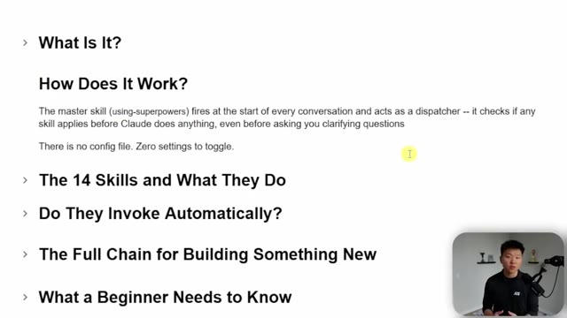
*⏱️ 00:01:31 — Une diapositive de présentation avec du texte explicatif sur le fonctionnement des compétences, avec la vidéo du présentateur incrustée en bas à droite.*

---

### ⏱️ `[00:01:50 - 00:02:10]` | Segment #06

**🔊 Audio (Transcription Intégrale Mot pour Mot en Français) :**
> Nous avons quelques types ou catégories de compétences différents. Nous avons l'orchestrateur qui utilise des super-pouvoirs comme nous en avons parlé, nous avons la phase de conception, qui est une compétence de remue-méninges. Et si nous retournons dans ce prompt qui s'exécutait tout à l'heure, vous pouvez voir qu'il a commencé par utiliser la compétence de remue-méninges des super-pouvoirs afin d'avoir une bonne compréhension de ce que nous devons faire. Et maintenant, il est descendu ici et il dit : d'accord, laissez-moi configurer la liste de contrôle du remue-méninges.

**👁️ Analyse Visuelle d'Écran (gemini-3.5-flash-lite) :**
**Interface & Outils** : Présentation textuelle (Image 1) et éditeur de code VS Code avec affichage d'un agent IA en cours d'exécution (Image 2).

**Contenu textuel & Code** : Liste détaillée des compétences d'IA (using-superpowers, brainstorming, writing-plans) et interface de chat/terminal dans VS Code exécutant une tâche de brainstorming.

**Action / Démonstration** : Le présentateur explique les différentes catégories de compétences puis bascule vers l'éditeur de code pour montrer le prompt et l'agent en action.

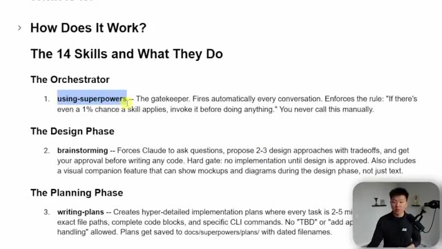
*⏱️ 00:01:55 — Présentation textuelle listant les 14 compétences, montrant les sections 'The Orchestrator' avec 'using-superpowers' et 'The Design Phase' avec 'brainstorming'.*

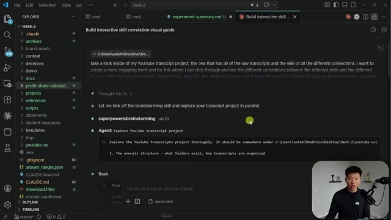
*⏱️ 00:02:00 — Interface de VS Code montrant l'exécution d'un prompt Markdown avec la compétence 'superpowers:brainstorming' en action sur un projet de transcription YouTube.*

---

### ⏱️ `[00:02:10 - 00:02:31]` | Segment #07

**🔊 Audio (Transcription Intégrale Mot pour Mot en Français) :**
> Et vous pouvez voir qu'il y a tellement de tâches différentes par rapport à un plan ordinaire. Cela doit offrir un compagnon visuel, ce qui est super cool. Une partie de ce sur quoi nous travaillons pourrait être plus facile à expliquer si je peux vous le montrer dans un navigateur web. Combien de fois avez-vous essayé de construire quelque chose et Cloud Code le fait ? Et puis vous vous dites, ce n'est pas du tout ce que je voulais. Donc, ce que fait le brainstorming et ce que font les super-pouvoirs, c'est que cela le met réellement dans un tableau de bord à regarder et dit, hé, est-ce que tu veux l'option A, B ou C ?

**👁️ Analyse Visuelle d'Écran (gemini-3.5-flash-lite) :**
**Interface & Outils** : Visual Studio Code (VS Code) avec l'extension Claude.

**Contenu textuel & Code** : Texte du prompt dans l'interface de l'assistant : "take a look inside of my YouTube transcript project..." et une liste de tâches détaillée incluant "Explore project context", "Offer visual companion", "Ask clarifying questions", etc.

**Action / Démonstration** : Le présentateur montre l'interface de développement et la liste des tâches en cours de traitement dans l'éditeur de code.

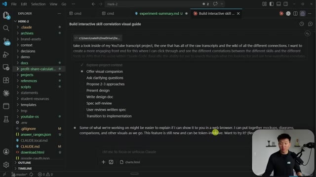
*⏱️ 00:02:15 — Capture d'écran de l'éditeur VS Code montrant un fichier Markdown (experiment-summary.md) avec une liste de tâches pour un projet YouTube et une conversation avec l'assistant Claude.*

---

### ⏱️ `[00:02:31 - 00:02:49]` | Segment #08

**🔊 Audio (Transcription Intégrale Mot pour Mot en Français) :**
> Genre, lequel résonne le plus avec vous ? Maintenant, gardez à l'esprit que cette fonctionnalité est encore nouvelle et qu'elle peut être gourmande en jetons. Je vais parler beaucoup plus des jetons plus tard, mais je pense que c' vraiment génial. Alors pardonnez-moi, je vais continuer à faire des va-et-vient entre cet exemple et ce qui se passe dans ce document. Mais j'espère que vous arrivez à suivre. Ensuite, nous avons la phase de planification. Donc, il commence à rédiger le plan.

**👁️ Analyse Visuelle d'Écran (gemini-3.5-flash-lite) :**
**Interface & Outils** : Visual Studio Code / Éditeur de texte markdown.

**Contenu textuel & Code** : Texte descriptif des phases de développement assistées par IA et interactions textuelles avec Claude.

**Action / Démonstration** : Navigation et explication des différentes étapes et fonctionnalités de l'outil d'IA (mentionnant l'aspect gourmand en jetons).

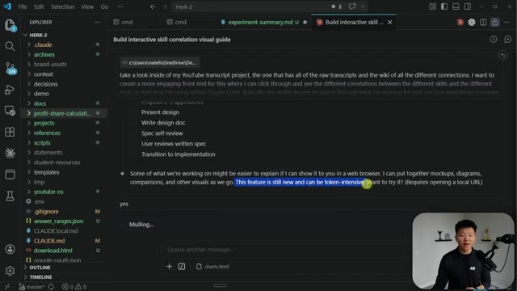
*⏱️ 00:02:36 — Interface de VS Code montrant un échange avec Claude Code dans l'éditeur, avec un avertissement sur l'utilisation des tokens.*

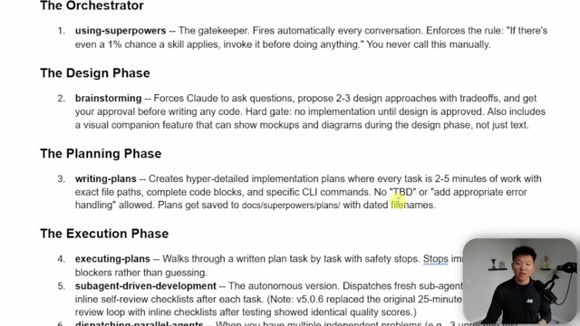
*⏱️ 00:02:45 — Un document Markdown affiché à l'écran détaillant les différentes phases du workflow d'un agent IA (Orchestrator, Design, Planning, Execution).*

---

### ⏱️ `[00:02:49 - 00:03:22]` | Segment #09

**🔊 Audio (Transcription Intégrale Mot pour Mot en Français) :**
> Il crée des plans d'implémentation hyper détaillés où chaque tâche représente environ deux à cinq minutes de travail avec des chemins de fichiers exacts. Il teste des blocs de code et il sauvegarde le plan afin que vous puissiez y revenir si nécessaire. Ensuite, nous avons la phase d'exécution, ce qui est vraiment cool parce que, comme je l'ai dit, cela va au-delà de la simple planification, et oui, cette petite ligne bleue ondulée allait me déranger pendant toute la vidéo. Nous avons donc un outil appelé exécution des plans, qui passe en revue tâche par tâche avec des arrêts de sécurité. Il s'arrête immédiatement en cas de blocage au lieu de deviner. Nous avons le développement piloté par des sous-agents, ce qui est vraiment cool. Il envoie essentiellement de nouveaux sous-agents pour chaque tâche, et ils ont des révisions.

**👁️ Analyse Visuelle d'Écran (gemini-3.5-flash-lite) :**
**Interface & Outils** : Document textuel ou présentation listant les phases d'un framework d'automatisation IA, avec incrustation vidéo du présentateur en bas à droite.

**Contenu textuel & Code** : Texte décrivant les étapes : The Design Phase, The Planning Phase (writing-plans, 2-5 minutes of work with exact file paths), The Execution Phase (executing-plans, subagent-driven-development, dispatching-parallel-agents), The Quality Gates (test-driven-development, systematic-debugging).

**Action / Démonstration** : Le document défile pour présenter les différentes phases et règles du processus d'implémentation automatisé.

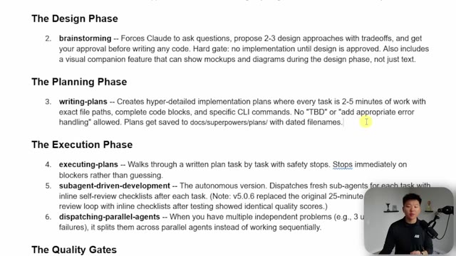
*⏱️ 00:02:57 — Capture montrant les phases de design, de planification et d'exécution avec des listes à puces détaillées décrivant les étapes du workflow de développement par IA.*

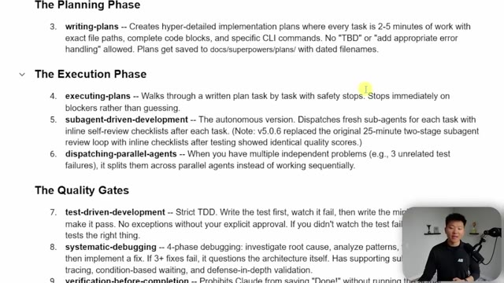
*⏱️ 00:03:06 — Capture montrant les phases d'exécution et de contrôle qualité (Quality Gates) avec les règles de développement dirigé par les tests (TDD) et de débogage systématique.*

---

### ⏱️ `[00:03:22 - 00:03:43]` | Segment #10

**🔊 Audio (Transcription Intégrale Mot pour Mot en Français) :**
> Et puis il y en a un autre appelé le déclenchement d'agents en parallèle. Quand Superpowers réalise que vous avez des problèmes indépendants qui n'ont pas besoin de se produire de manière séquentielle, il lance simplement des agents en parallèle pour travailler sur chacun d'eux. Ensuite, nous avons les portes de qualité. Celui-ci est donc le développement piloté par les tests, ce qui est souvent appelé TDD, ce qui signifie qu'il va d'abord écrire les tests, le regarder échouer, puis écrire le code minimum pour s'assurer qu'il réussit réellement.

**👁️ Analyse Visuelle d'Écran (gemini-3.5-flash-lite) :**
**Interface & Outils** : Document texte ou page web listant les fonctionnalités et phases du système d'agents.

**Contenu textuel & Code** : Texte listant les différentes étapes : The Planning Phase, The Execution Phase (avec 'dispatching-parallel-agents'), The Quality Gates, et The Review Phase.

**Action / Démonstration** : Le présentateur explique et commente les différentes fonctionnalités du workflow d'agents, notamment le déclenchement d'agents en parallèle.

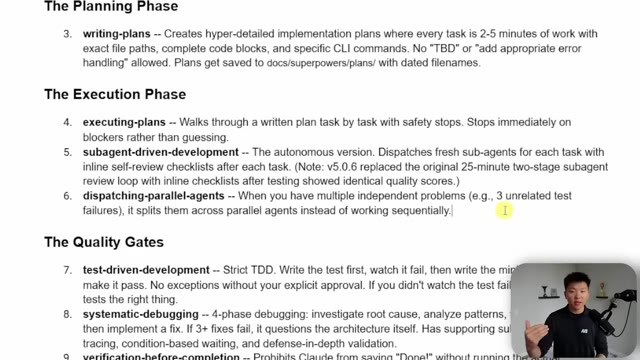
*⏱️ 00:03:27 — L'écran affiche une liste de phases et de fonctionnalités, avec en surbrillance le point 6 sur le 'dispatching-parallel-agents', tandis que le présentateur apparaît en bas à droite.*

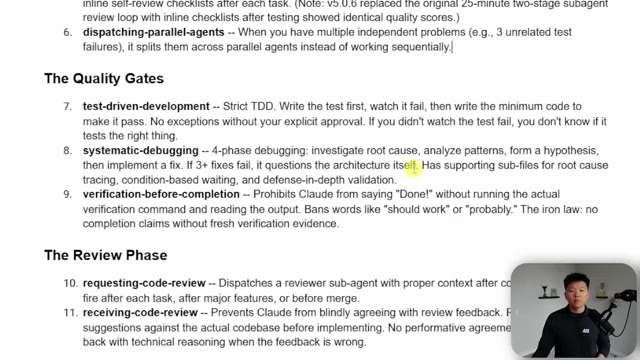
*⏱️ 00:03:32 — L'écran fait défiler le document pour présenter 'The Quality Gates' et 'The Review Phase' (points 7 à 11), avec toujours le présentateur en médaillon.*

---

### ⏱️ `[00:03:43 - 00:04:07]` | Segment #11

**🔊 Audio (Transcription Intégrale Mot pour Mot en Français) :**
> Nous avons le débogage systématique, qui est une approche de débogage en quatre phases, qui consiste à enquêter sur la cause racine, à analyser les problèmes, à formuler une hypothèse, puis à mettre en œuvre un correctif. Nous avons la vérification avant la fin et tout cela commence maintenant à devenir un peu plus technique. C'est donc là que je vais m'arrêter et que je vais vous laisser aller lire le document si vous le voulez. Encore une fois, c'est gratuit. Mais la méta-compétence, qui s'appelle les compétences rédactionnelles, apprend à Claude comment créer de nouvelles compétences de super-pouvoir en utilisant les principes de déploiement piloté par les tests.

**👁️ Analyse Visuelle d'Écran (gemini-3.5-flash-lite) :**
**Interface & Outils** : Document texte ou éditeur affichant des spécifications techniques et des listes de contrôle.

**Contenu textuel & Code** : Texte décrivant des processus de développement logiciel automatisés, des règles de qualité et des méta-compétences.

**Action / Démonstration** : Défilement du document et surbrillance de lignes textuelles spécifiques (debugging, writing-skills).

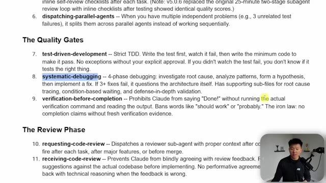
*⏱️ 00:03:49 — Capture montrant une liste de règles de qualité incluant le débogage systématique et la vérification avant achèvement, avec le présentateur en médaillon.*

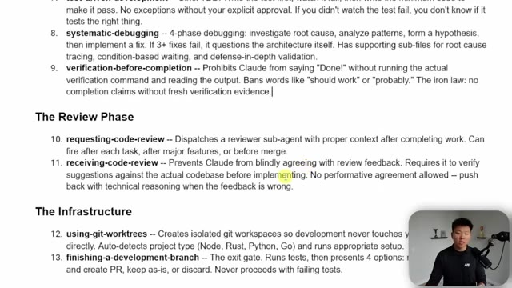
*⏱️ 00:03:55 — Capture montrant la phase de revue et l'infrastructure de développement, avec le présentateur en médaillon.*

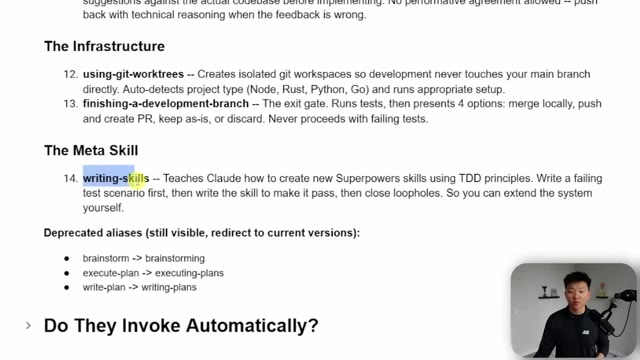
*⏱️ 00:04:01 — Capture montrant la méta-compétence et les alias obsolètes, avec le présentateur en médaillon.*

---

### ⏱️ `[00:04:07 - 00:04:29]` | Segment #12

**🔊 Audio (Transcription Intégrale Mot pour Mot en Français) :**
> Ou désolé, le développement dirigé par les tests. Où vous écririez d'abord un scénario de test qui échoue, puis vous écririez une compétence pour le faire réussir, et ensuite vous fermez la faille. Vous pouvez donc fondamentalement vraiment personnaliser le système de super-pouvoirs et l'étendre. D'accord, donc je voulais revenir sur cet exemple. Donc il disait, d'accord, le compagnon visuel est en cours d'exécution, mais d'abord, laissez-moi commencer par vous poser quelques questions. Voici donc ce que j'ai rassemblé jusqu'à présent, et voici ce que vous voulez, mais j'ai besoin de vous poser des questions.

**👁️ Analyse Visuelle d'Écran (gemini-3.5-flash-lite) :**
**Interface & Outils** : VS Code

**Contenu textuel & Code** : Document Markdown 'experiment-summary.md' détaillant un projet avec Obsidian, des scripts, et un outil de visualisation locale sur http://localhost:60012.

**Action / Démonstration** : Navigation et affichage d'un document de synthèse de projet au sein de VS Code pendant l'explication sur le développement dirigé par les tests et les compétences.

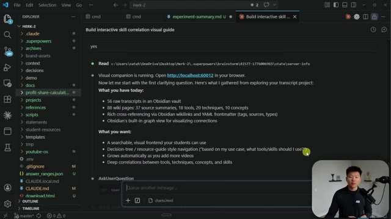
*⏱️ 00:04:18 — Capture d'écran de l'éditeur de code VS Code affichant un document Markdown de résumé d'expérimentation et une discussion avec un assistant IA, avec la vidéo du présentateur en bas à droite.*

---

### ⏱️ `[00:04:29 - 00:04:52]` | Segment #13

**🔊 Audio (Transcription Intégrale Mot pour Mot en Français) :**
> Donc il ne m'en a pas seulement posé une. Il m'a posé une, deux, trois, quatre, cinq questions, et ces questions étaient vraiment, vraiment bonnes. Elles ont extrait de ma tête une grande partie des informations concernant ce que j'imagine ici, sans que j'aie à les communiquer, car il a réalisé qu'il pouvait y avoir des lacunes et qu'il avait besoin d'obtenir des réponses à ces questions. Voici donc le serveur local. Laissez-moi ouvrir ceci. Maintenant, nous pouvons voir trois approches pour l'Explorateur de connaissances, et c'est fondamentalement ce qui nous montre ce que nous recherchons.

**👁️ Analyse Visuelle d'Écran (gemini-3.5-flash-lite) :**
**Interface & Outils** : Visual Studio Code (VS Code) et Google Docs.

**Contenu textuel & Code** : Fichier Markdown montrant les étapes de développement ('Update Todos', 'Explore project context', 'Offer visual companion', 'Propose 2-3 approaches') et la liste des tâches cochées.

**Action / Démonstration** : Le présentateur commente le déroulement des tâches et l'interaction avec l'agent de code dans l'interface de l'éditeur.

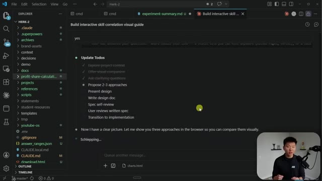
*⏱️ 00:04:35 — L'éditeur de code VS Code affichant un fichier de résumé d'expérience avec une liste de tâches (To-Do list) mise à jour par l'agent.*

---

### ⏱️ `[00:04:52 - 00:05:15]` | Segment #14

**🔊 Audio (Transcription Intégrale Mot pour Mot en Français) :**
> Bon, maintenant ce n'est pas exactement la démo que je pensais vous montrer. Parfois, ça vous montre genre de vrais éléments ou, vous savez, des modèles de design visuel. Donc je ferai ça à nouveau dans un autre exemple plus tard, mais cela vous prouve juste que c'est capable de vous montrer les choses d'une manière différente et d'essayer de vraiment s'assurer qu'il comprend ce que vous voulez avant de passer à autre chose. Et nous savons tous à quel point cette étape est importante lorsqu'il s'agit de faire des trucs avec CloudCode ou tout simplement n'importe quel outil de codage agentique d'ailleurs.

**👁️ Analyse Visuelle d'Écran (gemini-3.5-flash-lite) :**
**Interface & Outils** : Application web / Interface de brainstorming en ligne

**Contenu textuel & Code** : Texte comparatif divisé en sections (Pros et Cons) pour différentes approches de design d'interface (ex: Interactive Force Graph, Searchable Card Grid).

**Action / Démonstration** : Présentation et explication visuelle des différentes options de design générées par l'outil.

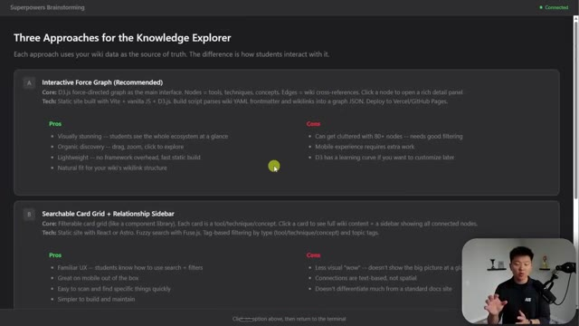
*⏱️ 00:04:58 — Interface web sombre présentant trois approches comparatives pour un projet (« Three Approaches for the Knowledge Explorer »), avec le présentateur visible en vignette dans le coin inférieur droit.*

---

### ⏱️ `[00:05:16 - 00:05:35]` | Segment #15

**🔊 Audio (Transcription Intégrale Mot pour Mot en Français) :**
> Donc nous pourrions avoir un graphe de forces interactif, nous pourrions avoir une grille de cartes recherchables, ou nous pourrions avoir un graphe principal avec des détails de cartes. Cela nous donne les pour et les contre pour chacune de ces options. Et maintenant, nous pourrions cliquer là-dessus et notre agent dans CloudCode verrait laquelle nous avons choisie et il pourrait continuer pour nous. Vous pouvez voir ici qu'il recommande cette approche. Donc je vais simplement aller de l'avant et cliquer dessus et dire, d'accord, ça me va.

**👁️ Analyse Visuelle d'Écran (gemini-3.5-flash-lite) :**
**Interface & Outils** : Application web / Interface de brainstorming

**Contenu textuel & Code** : Texte listant les options (Searchable Card Grid + Relationship Sidebar, Hybrid: Graph Hero + Card Detail Pages) avec une analyse des avantages et inconvénients.

**Action / Démonstration** : Présentation des différentes options de design et de leurs caractéristiques par le présentateur.

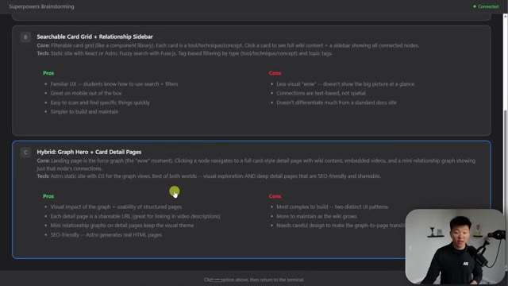
*⏱️ 00:05:21 — Interface web 'Superpowers Brainstorming' affichant des options de conception avec leurs avantages (Pros) et inconvénients (Cons).*

---

### ⏱️ `[00:05:36 - 00:06:10]` | Segment #16

**🔊 Audio (Transcription Intégrale Mot pour Mot en Français) :**
> Donc, continuons à parcourir ce document ici. Est-ce qu'ils s'activent automatiquement ? Oui. Fondamentalement, celui qui est toujours automatique, ce sont les super-pouvoirs, celui pour le brainstorming va pratiquement toujours se déclencher lorsqu'il s'agit de planification, et puis quand vous arrivez aux endroits où vous devez réellement commencer à construire, il va fondamentalement en activer un de développement. Donc, si nous revenons ici en haut, il va parfois simplement exécuter celui-ci automatiquement, parfois il va prendre celui-ci automatiquement ou celui-ci, et cela dépend un peu de la situation, mais au fond, la morale de l'histoire ici, c'est oui, c'est un peu du genre « on configure et on oublie », à moins d'avoir des cas super, super situationnels comme le débogage systématique ou le développement piloté par les tests, ou si vous

**👁️ Analyse Visuelle d'Écran (gemini-3.5-flash-lite) :**
**Interface & Outils** : Document texte / Éditeur de notes ou de documentation (type Notion ou Google Docs).

**Contenu textuel & Code** : Tableau détaillant les 14 compétences ("The 14 Skills and What They Do") et leurs types de déclenchement (Always automatic, Auto-chains from other skills, Situational auto-trigger, User-chosen).

**Action / Démonstration** : Le présentateur parcourt et lit le document à l'écran pour expliquer le fonctionnement automatique des compétences.

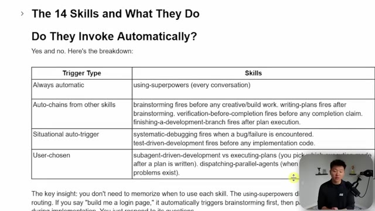
*⏱️ 00:05:44 — Document affichant un tableau intitulé "The 14 Skills and What They Do" avec la section "Do They Invoke Automatically?" et le présentateur dans un encadré vidéo en bas à droite.*

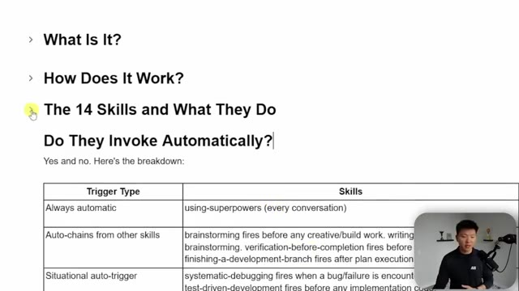
*⏱️ 00:05:53 — Vue rapprochée du document textuel montrant les sections "What Is It?", "How Does It Work?" et "The 14 Skills and What They Do".*

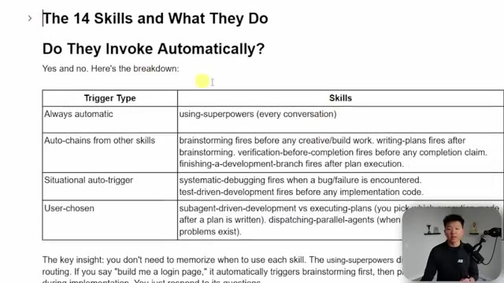
*⏱️ 00:06:02 — Gros plan sur le tableau détaillé des 14 compétences avec les types de déclenchement (Always automatic, Auto-chains, Situational, User-chosen).*

---

### ⏱️ `[00:06:10 - 00:06:44]` | Segment #17

**🔊 Audio (Transcription Intégrale Mot pour Mot en Français) :**
> voulons faire des choses comme des avis. Mais l'idée clé, c'est que vous n'avez pas besoin de mémoriser chacune de ces compétences. Vous pouvez l'interroger à leur sujet, ou vous pouvez aussi simplement vaquer à votre planification habituelle, et elle devrait les invoquer aux bons moments. Vous pouvez également dire à la fin de votre invite quelque chose comme, hé, assurez-vous d'utiliser toutes les compétences de super-pouvoir qui pourraient être pertinentes ici, juste au cas où vous voudriez une assurance supplémentaire. La chaîne complète est fondamentalement que vous envoyez une requête, les super-pouvoirs en choisissent une, elle passe par les différentes compétences, puis elle commence à s'exécuter. Donc, comme je l'ai dit, vous n'avez pas à y penser. Très bien, alors en revenant à cet exemple. Maintenant que nous avons choisi en quelque sorte la manière dont nous cherchons à construire ceci, cela nous donne un exemple. Donc je vais ouvrir ceci, et ce

**👁️ Analyse Visuelle d'Écran (gemini-3.5-flash-lite) :**
**Interface & Outils** : Document textuel ou présentation avec des tableaux et des diagrammes de flux textuels.

**Contenu textuel & Code** : Tableau classant les déclencheurs en "Always automatic", "Auto-chains from other skills", "Situational auto-trigger", et "User-chosen", suivi d'un diagramme de flux textuel montrant l'enchaînement des actions pour "Add a dark mode toggle".

**Action / Démonstration** : Présentation des mécanismes d'invocation automatique des compétences et de la chaîne de développement d'un agent IA.

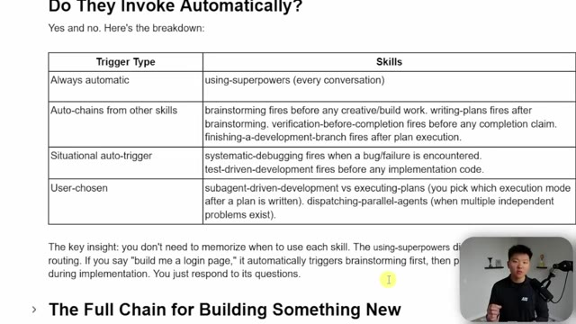
*⏱️ 00:06:19 — Tableau montrant les différents types de déclenchement des compétences (Trigger Type) avec les compétences associées (Skills) et le présentateur en médaillon en bas à droite.*

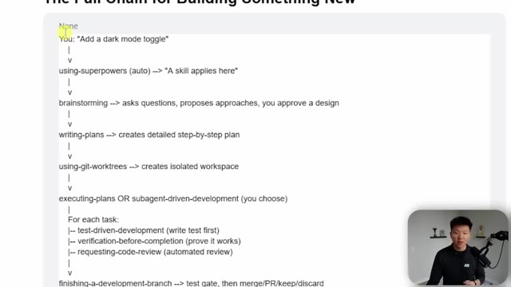
*⏱️ 00:06:36 — Schéma textuel représentant la chaîne complète d'événements pour la création d'une nouvelle fonctionnalité (The Full Chain for Building Something New), avec le présentateur en encadré.*

---

### ⏱️ `[00:06:44 - 00:07:19]` | Segment #18

**🔊 Audio (Transcription Intégrale Mot pour Mot en Français) :**
> est vraiment bien parce que disons que c'était complètement à côté de la plaque là-dessus. Ce n'est pas du tout ce qu'on voulait voir ou construire. C'est là qu'on corrigerait ça avant que ça ne brûle tous ces jetons, en nous donnant quelque chose dont on ne veut pas vraiment. Donc vous pouvez voir que ça imagine ce tableau de bord avec des outils, des techniques, des concepts. On aurait la possibilité de les parcourir, et ensuite ça montre qu'on pourrait survoler un nœud, le mettre en surbrillance. On pourrait cliquer sur un nœud, faire glisser un nœud, barre de recherche, puces de filtrage, tailles de nœuds, épaisseur des arêtes. Donc à ce stade, disons que je suis totalement en phase avec ça. Je retournerais dans le flux de travail et je dirais oui, ou je dirais non. Maintenant, la seule chose que je dirais, c'est que ça a l'air un peu bon marché. Donc je pourrais revenir ici et dire, oui, dans l'ensemble, ça a l'air bien.

**👁️ Analyse Visuelle d'Écran (gemini-3.5-flash-lite) :**
**Interface & Outils** : Navigateur web affichant une application interactive et éditeur de code VS Code.

**Contenu textuel & Code** : Graphe de données interactif avec des nœuds reliés, spécifications textuelles de design et code source Markdown.

**Action / Démonstration** : Navigation et présentation de l'interface utilisateur et du code source du projet.

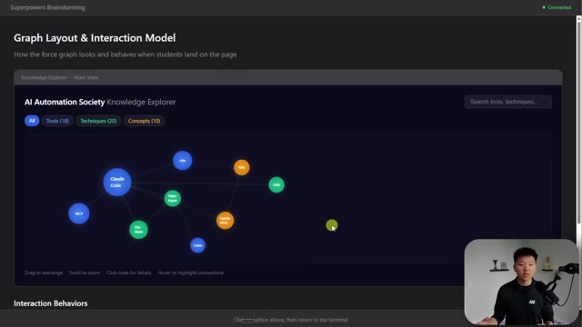
*⏱️ 00:06:53 — Interface web montrant un modèle de disposition et d'interaction de graphe (Knowledge Explorer) avec des nœuds colorés interconnectés.*

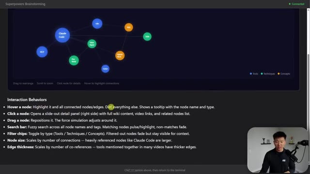
*⏱️ 00:07:02 — Interface web listant les comportements d'interaction détaillés (Hover, Click, Drag, Search, Filter) associés au graphe de connaissances.*

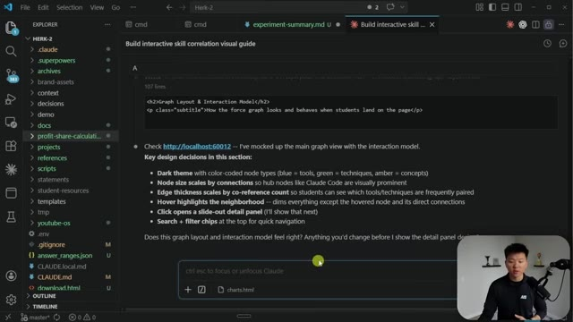
*⏱️ 00:07:11 — Éditeur de code (VS Code / Cursor) affichant un document Markdown décrivant le guide visuel du modèle d'interaction.*

---

### ⏱️ `[00:07:19 - 00:07:53]` | Segment #19

**🔊 Audio (Transcription Intégrale Mot pour Mot en Français) :**
> J'aime bien l'idée. Je trouve quand même que ça fait un peu bas de gamme. Et je veux que ça ait l'air un peu plus moderne. Je veux que ce soit soigné et en mode sombre. Alors, pendant que ça tourne, je veux vous montrer un autre exemple. Voici donc un projet où je lui demande de nous créer un site. Vous pouvez voir qu'il dit : « D'accord, une partie de ce sur quoi nous travaillons serait peut-être plus facile à expliquer si je peux vous le montrer dans un navigateur web. Je peux concevoir des maquettes, des diagrammes, des comparaisons. Voulez-vous faire cela ? » Alors allons-y et disons oui ici, pour voir si cela nous donne un autre type de visuel. Au passage, désolé si vous n'aimez pas regarder la version terminal par rapport à quand nous sommes vraiment

**👁️ Analyse Visuelle d'Écran (gemini-3.5-flash-lite) :**
**Interface & Outils** : Visual Studio Code (éditeur de code avec terminal intégré Claude Code).

**Contenu textuel & Code** : Texte de l'assistant IA listant l'exploration du contexte, l'analyse du site existant, et une liste de 9 tâches de développement (dont l'exploration, l'offre d'un compagnon visuel, et des questions de clarification).

**Action / Démonstration** : Exécution d'un agent IA en mode plan (plan mode on) qui analyse le projet et liste les étapes de développement.

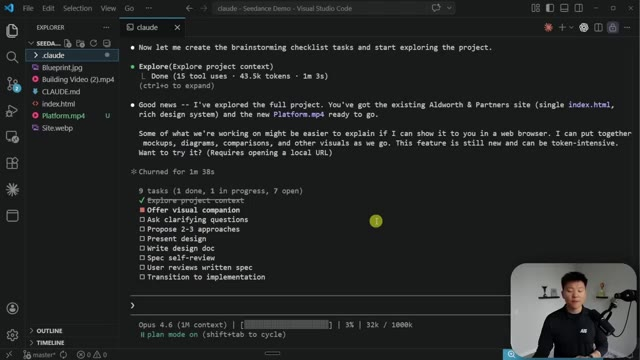
*⏱️ 00:07:28 — Interface de Visual Studio Code affichant une session de Claude Code (CLI) listant des tâches de brainstorming et un plan d'exploration de projet.*

---

### ⏱️ `[00:07:53 - 00:08:14]` | Segment #20

**🔊 Audio (Transcription Intégrale Mot pour Mot en Français) :**
> en utilisant par exemple l'extension VS Code. Je sais que l'extension VS Code a l'air un peu plus normale, mais croyez-moi, commencez à utiliser le terminal. C'est tellement mieux. Vous avez beaucoup plus de visibilité, surtout lorsque vous configurez cette ligne d'état comme vous avez vu que j'ai, c'est tout simplement mieux. Mais encore une fois, avant que cela n'ouvre ce localhost, nous devons répondre à quelques questions de clarification. Et cela va encore une fois aider à s'assurer que c'est aligné avec nous avant qu'il ne dépense plus de jetons.

**👁️ Analyse Visuelle d'Écran (gemini-3.5-flash-lite) :**
**Interface & Outils** : Visual Studio Code

**Contenu textuel & Code** : Liste de tâches interactives ("9 tasks (2 done, 1 in progress, 6 open)") et questionnaire à choix multiples (Product landing page, Company / brand site, Portfolio, etc.).

**Action / Démonstration** : Navigation dans un fichier de tâches et de questions géré par l'assistant Claude dans l'éditeur de code.

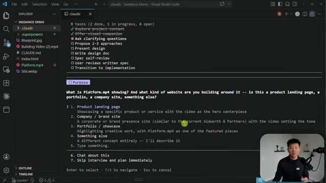
*⏱️ 00:07:58 — Interface de Visual Studio Code affichant un fichier Markdown interactif avec Claude, listant des tâches (tasks) et posant des questions de clarification à choix multiples.*

---

### ⏱️ `[00:08:14 - 00:08:33]` | Segment #21

**🔊 Audio (Transcription Intégrale Mot pour Mot en Français) :**
> Donc je vais simplement aller de l'avant et répondre à ceux-ci, et ensuite je vais vous montrer le tableau de bord qu'il génère pour nous. D'accord, donc maintenant il a poussé trois concepts différents vers ce localhost. Ouvrons ceci et voyons. Donc c'est de ça que je parle. Vous pouvez voir que ça va nous donner un exemple de l'ambiance, du style et de la palette de couleurs du site web avant que nous ne partions réellement le créer.

**👁️ Analyse Visuelle d'Écran (gemini-3.5-flash-lite) :**
**Interface & Outils** : Visual Studio Code, terminal intégré et navigateur web affichant une application locale sur localhost.

**Contenu textuel & Code** : Code HTML de maquette, messages de l'agent listant trois options de design (A - Cinematic Full-Bleed Hero, B - Split-Screen Hero, C - Centered Text + Floating Video Card) et liste des tâches du projet.

**Action / Démonstration** : Navigation et présentation des concepts de mise en page générés par l'IA sur le serveur local.

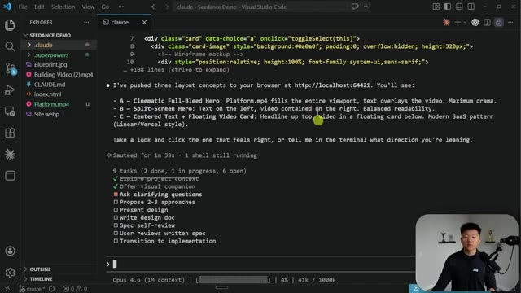
*⏱️ 00:08:19 — Visualisation de l'interface de l'éditeur de code VS Code montrant un terminal intégré où l'assistant IA liste les concepts de mise en page proposés et les tâches en cours.*

*⏱️ 00:08:24 — Affichage dans le navigateur du tableau de bord interactif 'Superpowers Brainstorming' présentant les trois concepts de design (A, B, C) pour la page de destination.*

---

### ⏱️ `[00:08:33 - 00:08:55]` | Segment #22

**🔊 Audio (Transcription Intégrale Mot pour Mot en Français) :**
> Maintenant, il se passe manifestement quelque chose d'bizarre ici. Je ne sais pas trop ce que c'est, mais nous pouvons voir que nous pouvons obtenir soit un "hero" cinématique en plein écran, soit un "hero" en écran partagé, soit du texte centré et une vidéo flottante. Donc maintenant, je pourrais lui donner une réponse ici quant à celui que je préfère. Et maintenant, il va continuer à nous poser des questions. Il va probablement nous donner quelques autres éléments différents. Quand je construisais un autre site web avec ça, il affichait littéralement un tableau de bord pour les différents types de boutons.

**👁️ Analyse Visuelle d'Écran (gemini-3.5-flash-lite) :**
**Interface & Outils** : Interface web de brainstorming et éditeur de code Visual Studio Code avec terminal intégré (Claude Code).

**Contenu textuel & Code** : Options de design de landing page SaaS (Cinematic, Split-Screen, Centered Text) et interface de commande interactive de l'agent IA.

**Action / Démonstration** : Présentation des maquettes de design générées par l'IA dans le navigateur et interaction avec l'agent dans le terminal VS Code.

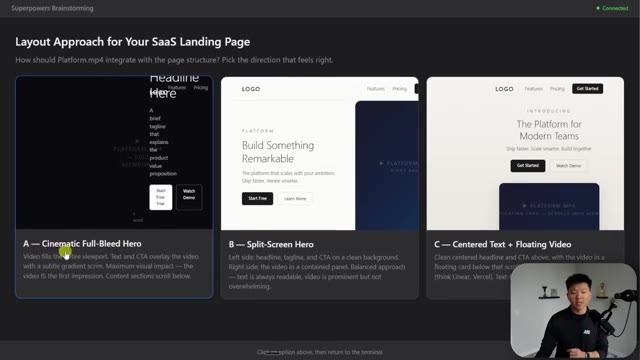
*⏱️ 00:08:38 — Interface web montrant un brainstorming avec trois options de design pour une page d'accueil de SaaS : A - Cinematic Full-Bleed Hero, B - Split-Screen Hero, et C - Centered Text + Floating Video.*

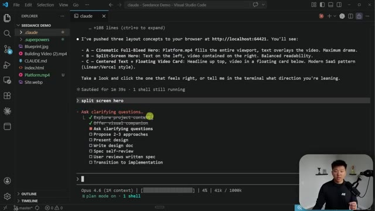
*⏱️ 00:08:44 — Éditeur VS Code affichant un terminal interactif avec Claude Code (mode plan, tâches en cours et questions de clarification) et l'arborescence du projet dans la barre latérale.*

---

### ⏱️ `[00:08:55 - 00:09:18]` | Segment #23

**🔊 Audio (Transcription Intégrale Mot pour Mot en Français) :**
> et les différents types d'options de menu, et les différents types de cartes. Maintenant, oui, je sais que ces exemples que je vous montre sont plutôt d'ordre visuel, mais c'est tellement, tellement utile pour vous aider réellement à créer des rapports ou à créer des automatisations en raison des questions de clarification qu'il pose, et aussi en raison de l'exécution. Parce que je sais que beaucoup de gens vont demander, du genre, bon, quelle est la différence entre utiliser ceci et utiliser, disons, Ultraplan, qui est l'une des autres fonctionnalités que Claude Code vient de lancer.

**👁️ Analyse Visuelle d'Écran (gemini-3.5-flash-lite) :**
**Interface & Outils** : Visual Studio Code, Claude CLI

**Contenu textuel & Code** : Propositions textuelles de mise en page (Cinematic Full-Bleed Hero, Split-Screen Hero, Centered Text) et liste de tâches de clarification ("Ask clarifying questions").

**Action / Démonstration** : Sélection d'une option de design via le terminal et déroulement des étapes de planification par l'agent IA.

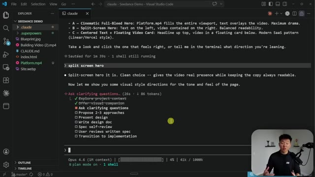
*⏱️ 00:09:01 — Interface de Visual Studio Code affichant un terminal interactif avec Claude proposant différentes options de design et de mise en page.*

---

### ⏱️ `[00:09:18 - 00:09:38]` | Segment #24

**🔊 Audio (Transcription Intégrale Mot pour Mot en Français) :**
> Mais Ultraplan vous aide seulement pour la planification. Genre, je pense même que le brainstorming de Superpowers est peut-être meilleur qu'Ultraplan quand il s'agit de la planification. Mais ensuite, si vous utilisez Ultraplan, eh bien, c'est pratiquement juste que vous êtes livré à vous-même à nouveau une fois que vous commencez à mettre en œuvre ce plan. Mais Superpowers est avec vous tout du long. Mais regardez, comme vous pouvez le voir encore, ça a fait the surgir un autre local host et maintenant ça nous donne encore plus de choses parmi lesquelles choisir.

**👁️ Analyse Visuelle d'Écran (gemini-3.5-flash-lite) :**
**Interface & Outils** : Visual Studio Code, Terminal intégré, arborescence de fichiers du projet Seedance Demo.

**Contenu textuel & Code** : Liste de tâches (9 tasks : 2 done, 1 in progress, 6 open) incluant 'Explore project context', 'Offer visual companion', 'Ask clarifying questions', ainsi que des propositions de styles visuels (Dark & Technical, Light & Warm Luxury, Bold & Minimal).

**Action / Démonstration** : Exécution d'un outil en mode plan (plan mode on) dans le terminal de l'éditeur montrant l'avancement des tâches et l'URL locale du serveur de test.

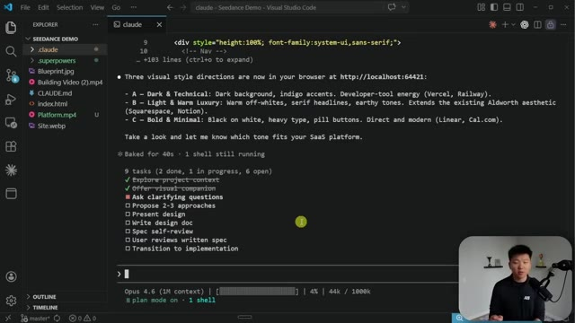
*⏱️ 00:09:23 — Interface de Visual Studio Code affichant le projet 'Seedance Demo' avec un terminal intégré montrant l'exécution d'un plan de tâches et l'arborescence des fichiers à gauche.*

---

### ⏱️ `[00:09:38 - 00:09:56]` | Segment #25

**🔊 Audio (Transcription Intégrale Mot pour Mot en Français) :**
> Bon, et je sais que je saute un peu partout, mais on revient en quelque sorte à la première carte mentale et ça a changé certaines choses. Et maintenant, on pourrait cliquer dessus, l'examiner à nouveau, et enfin s'assurer qu'on l'aime bien avant de l'envoyer. Donc de toute façon, je vais arrêter de sauter partout pendant un petit moment. Parlons de la façon dont vous installez réellement ceci parce que c'est super, super simple.

**👁️ Analyse Visuelle d'Écran (gemini-3.5-flash-lite) :**
**Interface & Outils** : VS Code et application Web personnalisée 'Knowledge Explorer'

**Contenu textuel & Code** : Documentation Markdown (experiment-summary.md) détaillant une refonte de design et l'interface de carte mentale interactive.

**Action / Démonstration** : Navigation entre l'éditeur de code et la première carte mentale interactive mise à jour.

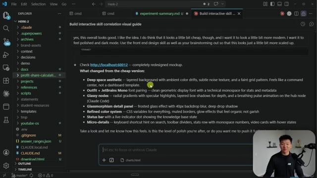
*⏱️ 00:09:43 — VS Code affichant un fichier Markdown de résumé d'expérience avec des instructions de design frontend.*

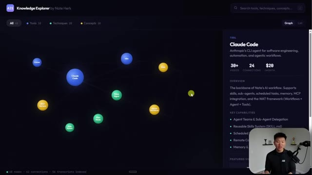
*⏱️ 00:09:47 — Interface web 'Knowledge Explorer by Nate Herk' montrant un graphique interactif de nœuds colorés interconnectés.*

---

### ⏱️ `[00:09:56 - 00:10:16]` | Segment #26

**🔊 Audio (Transcription Intégrale Mot pour Mot en Français) :**
> Je vais ouvrir très rapidement une nouvelle session Claude dans mon terminal VS Code ici. Et vous pouvez voir que tout ce que j'ai à faire, c'est d'aller ici et de faire plugin. Et vous pouvez voir que je l'ai déjà installé juste ici, le plugin superpowers. Maintenant, voici le dépôt GitHub. Je laisserai un lien vers celui-ci dans la description en bas, mais c'est tellement simple. Tout ce que vous avez réellement à faire, c'est de venir ici et d'installer le plugin depuis le marketplace Claude code.

**👁️ Analyse Visuelle d'Écran (gemini-3.5-flash-lite) :**
**Interface & Outils** : VS Code, terminal intégré, interface GitHub (README)

**Contenu textuel & Code** : Interface terminal avec Claude Code v2.1.104 et texte du README GitHub concernant les super-pouvoirs des agents de codage.

**Action / Démonstration** : Navigation entre l'interface de développement dans VS Code et la documentation du plugin superpowers sur GitHub.

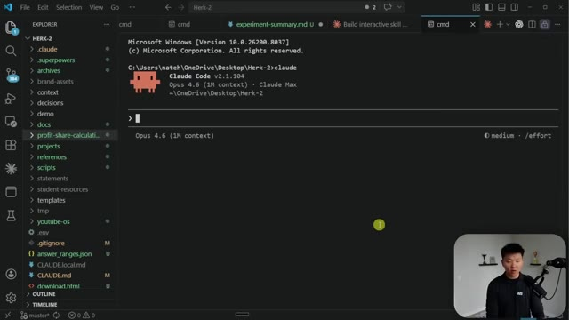
*⏱️ 00:10:01 — Interface VS Code avec l'explorateur de fichiers à gauche et un terminal intégré affichant Claude Code v2.1.104.*

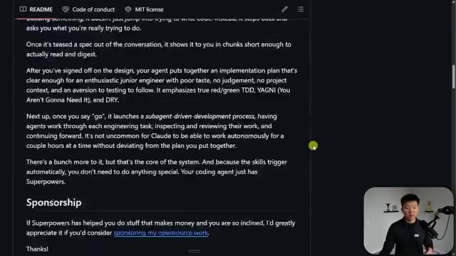
*⏱️ 00:10:11 — Page de documentation GitHub (README) du dépôt superpowers décrivant le fonctionnement du processus de développement piloté par sous-agents.*

---

### ⏱️ `[00:10:16 - 00:10:51]` | Segment #27

**🔊 Audio (Transcription Intégrale Mot pour Mot en Français) :**
> Donc vous pouvez simplement copier cette ligne juste ici. Je vais retourner dans ce terminal VS Code, coller ça dedans, et il va dire que je l'ai déjà installé globalement, mais c'est exactement comme ça que vous l'isseriez. Il vous demanderait ensuite, est-ce que vous voulez ceci au niveau de chaque projet, ou au niveau de votre utilisateur ? Je l'installerais définitivement de manière globale au niveau de l'utilisateur, parce qu'ainsi vous n'avez pas à vous soucier de chaque projet qui dit, oh mince, j'ai besoin de récupérer la compétence super-pouvoir. Ça fonctionne tout simplement tout le temps, pour n'importe quel projet de code cloud. C'est donc ce que je recommanderais de faire. Maintenant, ce qui est particulier avec ça, c'est que je pensais que ça utiliserait plus de jetons parce que ça fait des analyses plus approfondies. Et parfois c'est le cas. Mais si vous y pensez de cette façon. Quand vous faites la phase de planification et, vous savez, le brainstorming,

**👁️ Analyse Visuelle d'Écran (gemini-3.5-flash-lite) :**
**Interface & Outils** : VS Code, terminal Claude Code v2.1.104, tableau de bord analytique web.

**Contenu textuel & Code** : Commandes terminal `/plugin install superpowers@claude-plugins-official` et messages de confirmation ; graphiques de performance et métriques (-9.1% d'économies de coûts).

**Action / Démonstration** : Exécution d'une commande d'installation de plugin dans le terminal de l'éditeur de code, puis présentation de graphiques comparatifs de performance.

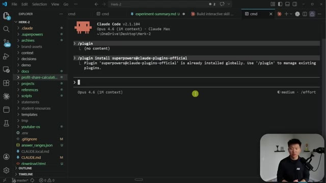
*⏱️ 00:10:25 — Interface VS Code avec le terminal Claude Code affichant la commande d'installation globale du plugin superpowers.*

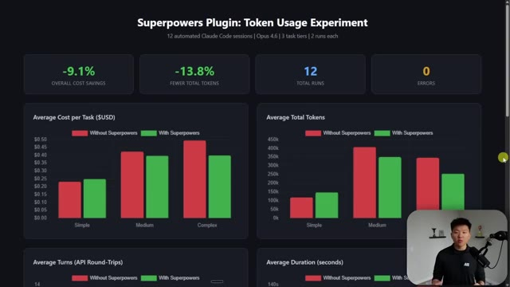
*⏱️ 00:10:43 — Tableau de bord d'expérimentation affichant les statistiques d'utilisation des tokens et de coûts avec le plugin Superpowers.*

---

### ⏱️ `[00:10:52 - 00:11:14]` | Segment #28

**🔊 Audio (Transcription Intégrale Mot pour Mot en Français) :**
> Tu veux qu'il utilise plus de jetons s'il peut y arriver plus rapidement. Parce que sinon, à long terme, tu utilises plus de jetons si tu dois faire quatre ou cinq révisions plutôt que de prendre plus de temps et plus de jetons pour planifier et ensuite réussir du premier coup. J'ai donc décidé de mener ces expériences où j'ai fait, tu sais, différents essais avec des super-pouvoirs et sans super-pouvoirs. Nous avons fait 12 essais au total. Nous avons réalisé une variété de types de tâches, simples, moyennes et complexes. Et c'est vraiment intéressant.

**👁️ Analyse Visuelle d'Écran (gemini-3.5-flash-lite) :**
**Interface & Outils** : Tableau de bord d'analyse de données (UI web sur fond sombre)

**Contenu textuel & Code** : Graphiques statistiques comparant 'Without Superpowers' et 'With Superpowers' sur le coût moyen, le total des jetons et la durée des tâches.

**Action / Démonstration** : Visualisation des performances et des économies de jetons et de coûts générées par l'utilisation du plugin.

*⏱️ 00:10:57 — Un tableau de bord comparatif des résultats d'une expérience sur l'utilisation des jetons avec un plugin 'Superpowers', affichant des graphiques sur le coût, le nombre de jetons, et la durée des tâches.*

---

### ⏱️ `[00:11:15 - 00:11:33]` | Segment #29

**🔊 Audio (Transcription Intégrale Mot pour Mot en Français) :**
> Globalement, nous avons constaté que nous avons obtenu environ 9 % d'économies sur les coûts, environ 14 % de tokens totaux en moins, et voilà à quoi cela ressemble. Pour les cas simples, "avec des super-pouvoirs" utilisait plus de tokens. Et cela est tout à fait logique, car quand c'est si simple, vous n'avez pas besoin de sur-concevoir et vous n'avez pas besoin de toutes ces questions s'il s'agit d'une requête très, très simple.

**👁️ Analyse Visuelle d'Écran (gemini-3.5-flash-lite) :**
**Interface & Outils** : Tableau de bord analytique web personnalisé.

**Contenu textuel & Code** : Graphiques statistiques comparant les performances "Without Superpowers" et "With Superpowers" (coûts, tokens, tours API, durée).

**Action / Démonstration** : Le présentateur survole les graphiques pour détailler les performances sur les tâches simples.

*⏱️ 00:11:19 — Tableau de bord affichant les résultats de l'expérience d'utilisation des tokens avec le plugin Superpowers, montrant un graphique des coûts moyens par tâche.*

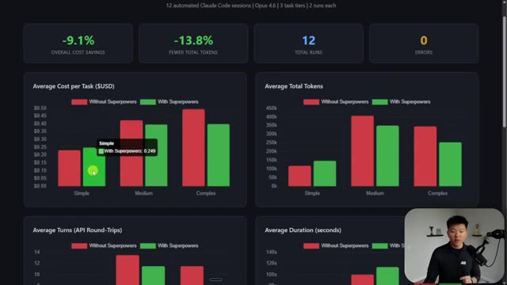
*⏱️ 00:11:24 — Le même tableau de bord avec une info-bulle interactive survolant les données pour les tâches simples.*

---

### ⏱️ `[00:11:34 - 00:11:57]` | Segment #30

**🔊 Audio (Transcription Intégrale Mot pour Mot en Français) :**
> Mais ensuite, quand nous sommes passés à des tâches plus moyennes et complexes, nous avons vu que l'utilisation de super-pouvoirs nous donnait en fait des exécutions moins chères et moins de jetons. Maintenant, gardez à l'esprit que, quand je dis complexe, je ne dis pas genre, vous savez, ça a codé pendant cinq heures d'affilée et ça nous a construit un produit SaaS entier. Je voulais dire, vous savez, relativement complexe. Et à mesure que vous devenez de plus en plus complexe, je suppose que vous commencez à voir cette tendance où les super-pouvoirs vous font économiser plus de temps et de jetons.

**👁️ Analyse Visuelle d'Écran (gemini-3.5-flash-lite) :**
**Interface & Outils** : Tableau de bord personnalisé affichant des statistiques de performance d'IA.

**Contenu textuel & Code** : Graphiques à barres comparant "Without Superpowers" (en rouge) et "With Superpowers" (en vert) selon la complexité des tâches (Simple, Medium, Complex) pour le coût ($USD) et le nombre total de tokens.

**Action / Démonstration** : Présentation visuelle des résultats statistiques comparatifs par le présentateur pour illustrer l'efficacité et la réduction des coûts sur les tâches moyennes et complexes.

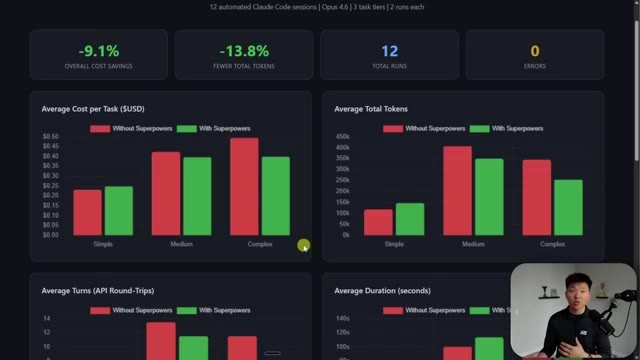
*⏱️ 00:11:39 — Un tableau de bord analytique présentant des graphiques comparatifs sur les coûts, les tokens et les performances d'exécutions automatisées avec ou sans "super-pouvoirs".*

---

### ⏱️ `[00:11:57 - 00:12:33]` | Segment #31

**🔊 Audio (Transcription Intégrale Mot pour Mot en Français) :**
> L'autre chose à garder à l'esprit ici, c'est que Superpowers est en quelque sorte censé impliquer un humain dans la boucle et être un processus itératif, car il vous pose énormément de questions. Mais quand j'ai utilisé Superpowers ici, j'ai fait en sorte que Cloud Code automatise toute cette expérience. Elle a tourné pendant quelques heures. Et ce qui a fini par se produire, c'est que je n'étais pas du tout dans la boucle. C'est pourquoi certains de ces résultats doivent être pris avec des pincettes. Mais vous pouvez voir ici que le nombre total moyen de jetons est nettement plus élevé sans Superpowers. Vous pouvez voir en bas que nous avions un nombre de tours moyen, c'est-à-dire des allers-retours avec l'API, et une fois de plus, avec Superpowers, nous en avions moins, et la durée moyenne a varié en quelque sorte. Je dirais que rien de tout cela n'est suffisamment super, super concluant pour que je puisse faire une déclaration définitive.

**👁️ Analyse Visuelle d'Écran (gemini-3.5-flash-lite) :**
**Interface & Outils** : Dashboard d'analyse de données (type interface de reporting web).

**Contenu textuel & Code** : Graphiques en barres comparatifs ("Without Superpowers" vs "With Superpowers") pour les tâches simples, moyennes et complexes. Données chiffrées : économies de coûts (-9,1%), réduction de tokens (-13,8%), 12 exécutions au total.

**Action / Démonstration** : Analyse visuelle des performances du plugin "Superpowers" automatisé via Cloud Code, illustrant l'optimisation des ressources par rapport à un processus manuel ou standard.

*⏱️ 00:12:06 — Tableau de bord analytique présentant les résultats de l'expérience "Superpowers Plugin : Token Usage Experiment", comparant les coûts et la consommation de tokens avec et sans le plugin.*

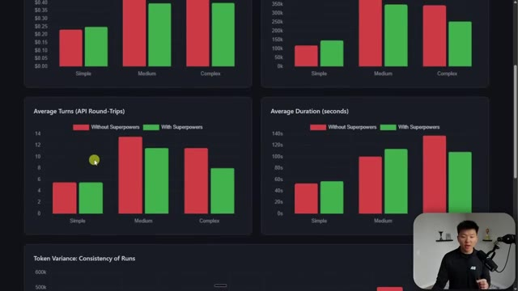
*⏱️ 00:12:24 — Suite du tableau de bord affichant les métriques de performance : nombre moyen d'allers-retours API ("Average Turns") et durée d'exécution des tâches selon leur complexité.*

---

### ⏱️ `[00:12:33 - 00:12:52]` | Segment #32

**🔊 Audio (Transcription Intégrale Mot pour Mot en Français) :**
> Mais je pense tout de même que c'est important et plutôt intéressant à examiner, et puis bien sûr, nous avons la qualité réelle. Il a donc fait une évaluation sur les points de terminaison, l'exactitude du code et des choses de ce genre. Et vous pouvez voir qu'globalement, avec les super-pouvoirs, nous obtenons un résultat de bien meilleure qualité en ce qui concerne l'exactitude, la structure du code, la couverture des tests et la gestion des erreurs.

**👁️ Analyse Visuelle d'Écran (gemini-3.5-flash-lite) :**
**Interface & Outils** : Tableau de bord d'analyse comparative et de visualisation de données.

**Contenu textuel & Code** : Graphique radar comparant 'Without Superpowers' (rouge) et 'With Superpowers' (vert) selon les critères de Correctness, Code Structure, Test Coverage, Error Handling et Robustness.

**Action / Démonstration** : Présentation des résultats d'évaluation de la qualité du code et des performances des modèles.

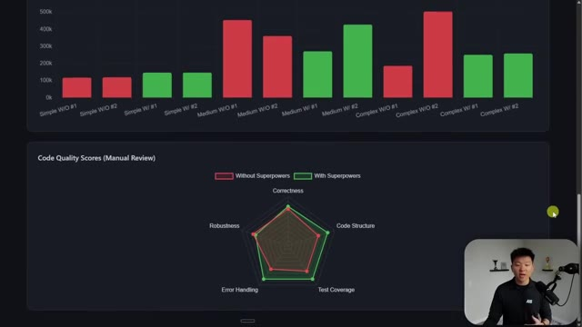
*⏱️ 00:12:38 — Un graphique en barres en haut et un graphique radar en bas montrant les scores de qualité du code avec et sans les « super-pouvoirs ».*

---

### ⏱️ `[00:12:53 - 00:13:19]` | Segment #33

**🔊 Audio (Transcription Intégrale Mot pour Mot en Français) :**
> Et la seule fois où il semble ici que sans super-pouvoirs bat les super-pouvoirs, c'est la robustesse, dont je ne sais pas exactement comment cela a été évalué. C'est peut-être un peu subjectif, mais dans l'ensemble, le pentagone vert occupe une surface plus grande que le pentagone rouge. Je choisirais donc le vert plutôt que le rouge tous les jours, surtout si cela nous fait économiser des jetons. Et pendant que j'étais en train de monter cette vidéo, j'ai eu l'impression que vous seriez peut-être curieux de savoir comment j'ai réellement obtenu ces résultats ici et comment j'ai exécuté cette expérience de manière automatisée avec CloudCode.

**👁️ Analyse Visuelle d'Écran (gemini-3.5-flash-lite) :**
**Interface & Outils** : Dashboard de données personnalisé (web), Visual Studio Code.

**Contenu textuel & Code** : - Graphique en radar : axes "Correctness", "Code Structure", "Test Coverage", "Error Handling", "Robustness".
- Fichier markdown : commandes `claude --disable-slash-commands` (sans super-pouvoirs) vs `claude -p` (avec super-pouvoirs), explication du workflow d'automatisation des tests.

**Action / Démonstration** : Analyse visuelle comparative des scores de qualité de code (Image 1) et revue de la documentation technique sur la méthodologie de test (Image 2).

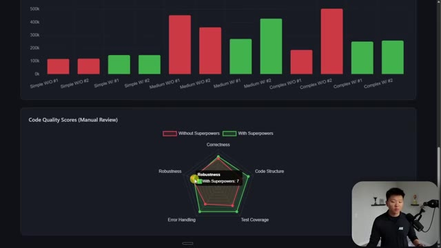
*⏱️ 00:12:59 — Un tableau de bord affichant un graphique à barres comparant les performances et un graphique en radar intitulé "Code Quality Scores (Manual Review)" qui compare "Without Superpowers" (rouge) et "With Superpowers" (vert).*

*⏱️ 00:13:12 — L'interface de Visual Studio Code affichant un fichier Markdown nommé "experiment-summary.md" qui explique méthodiquement l'exécution des tests via Claude Code en ligne de commande.*

---

### ⏱️ `[00:13:20 - 00:13:44]` | Segment #34

**🔊 Audio (Transcription Intégrale Mot pour Mot en Français) :**
> Alors je suis entré ici et j'ai dit, hé, donne-moi juste une brève explication de ce que nous venions réellement de faire. Et ça m'a fondamentalement juste créé ces différents scripts pour moi qui ont appelé CloudCode, l'un d'eux avec des super-pouvoirs et l'un d'eux sans. Et ensuite, ça les a simplement exécutés à travers toutes ces différentes tâches. Et ça se passe réellement ici même dans ce terminal bash que j'ai ouvert et j'ai exécuté le script et ensuite vous pouvez voir que ça a commencé à exécuter cette expérience et ça a plafonné le budget à 2 dollars par exécution pour chacune des exécutions.

**👁️ Analyse Visuelle d'Écran (gemini-3.5-flash-lite) :**
**Interface & Outils** : Éditeur de code VS Code avec explorateur de fichiers, panneau Markdown et terminal intégré, ainsi qu'une incrustation webcam du présentateur.

**Contenu textuel & Code** : Fichier Markdown expliquant l'appel à Claude Code avec et sans super-pouvoirs, et commandes bash pour lancer l'expérience avec affichage des résultats par lots (Batch ID, budget cap, etc.).

**Action / Démonstration** : Explication et exécution de scripts automatisés pour comparer les performances de Claude Code avec et sans fonctionnalités activées.

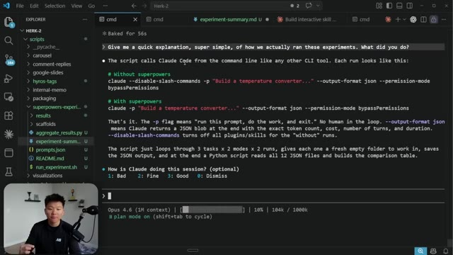
*⏱️ 00:13:26 — L'éditeur VS Code affichant un fichier Markdown 'experiment-summary.md' décrivant les scripts de test Claude Code, avec le présentateur en incrustation vidéo en bas à gauche.*

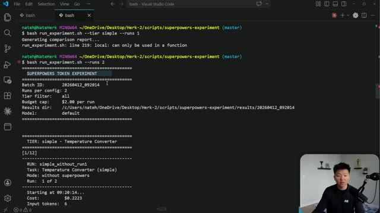
*⏱️ 00:13:38 — Le terminal intégré de VS Code montrant l'exécution d'un script Bash 'run_experiment.sh' pour lancer l'expérience sur les super-pouvoirs des jetons.*

---

### ⏱️ `[00:13:44 - 00:14:10]` | Segment #35

**🔊 Audio (Transcription Intégrale Mot pour Mot en Français) :**
> Voici donc le premier essai sur 12. Celui-ci était sans super-pouvoirs. Nous avions le coût, nous avions les jetons d'entrée, nous avions la lecture de cache, tout ce genre de choses, la durée de l'API. Et puis, à mesure que nous devenons plus complexes, vous pouvez voir que le coût et les jetons commencent à augmenter et à augmenter. Mais c'est comme ça que je l'ai fait. C'était super, super simple. Donc, en gros, juste un tout petit récapitulatif rapide. Nous avons exécuté 12 sessions de code dans le cloud, six avec des super-pouvoirs, six sans, mêmes instructions, même modèle, Opus 4.1 6 et zéro interaction humaine.

**👁️ Analyse Visuelle d'Écran (gemini-3.5-flash-lite) :**
**Interface & Outils** : Visual Studio Code (Terminal Bash)

**Contenu textuel & Code** : Commandes bash exécutées (`bash run_experiment.sh --runs 2`) et métriques d'exécution de l'IA (Coût, jetons d'entrée/sortie, lecture/création de cache, durée de l'API).

**Action / Démonstration** : Exécution d'un script de test mesurant les performances d'un modèle d'IA sans super-pouvoirs (premier essai).

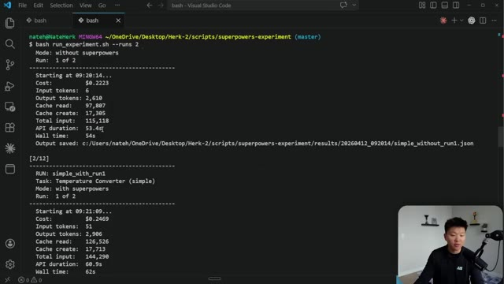
*⏱️ 00:13:50 — Capture d'écran montrant un terminal Bash intégré à Visual Studio Code affichant les résultats d'un script d'expérimentation d'IA, avec le présentateur en médaillon dans le coin inférieur droit.*

---

### ⏱️ `[00:14:10 - 00:14:44]` | Segment #36

**🔊 Audio (Transcription Intégrale Mot pour Mot en Français) :**
> Nous avions des tâches simples, des tâches moyennes et des tâches complexes. Encore une fois, je voulais juste insister sur le fait que ceci n'est pas concluant. 12 exécutions sur trois petites tâches ne constituent que des données indicatives, pas une preuve. Mais ce qui est important, c'est que la plupart des gens pensent probablement que l'utilisation d'une telle compétence entraîne une surcharge massive de jetons, mais ce n'est en fait pas du tout le cas. La valeur ne réside pas dans les étapes supplémentaires. Elle réside dans la prévention des nouvelles tentatives coûteuses et des retours en arrière. La cohérence importe, bien que sans les super-pouvoirs, les exécutions aient présenté deux à trois fois plus de variance dans l'utilisation des jetons, tandis que les exécutions avec les super-pouvoirs étaient beaucoup plus resserrées. La structure du code et la gestion des erreurs étaient nettement meilleures avec les super-pouvoirs sur la tâche moyenne. Connaissance du domaine

**👁️ Analyse Visuelle d'Écran (gemini-3.5-flash-lite) :**
**Interface & Outils** : VS Code (Visual Studio Code).

**Contenu textuel & Code** : Fichier Markdown contenant des points de synthèse : "This is not conclusive", "12 runs across 3 small tasks", "What we can say", incluant 6 conclusions numérotées sur l'efficacité des "Superpowers" en termes de gestion de tokens, de structure de code et de gestion d'erreurs.

**Action / Démonstration** : Lecture et présentation des conclusions de l'expérience par l'utilisateur à l'écran.

*⏱️ 00:14:19 — Une vue de l'éditeur VS Code montrant un fichier Markdown nommé "experiment-summary.md" détaillant les conclusions d'une expérimentation sur l'utilisation des tokens par un agent IA.*

---

### ⏱️ `[00:14:44 - 00:15:11]` | Segment #37

**🔊 Audio (Transcription Intégrale Mot pour Mot en Français) :**
> et le respect des spécifications n'a pas été amélioré. Cela dépend toujours du modèle. Et pour les tâches simples, n'hésitez pas à passer cette étape. Le surcoût de 8 % ne fait pas vraiment grand-chose avec les super-pouvoirs. Ce sera tout pour aujourd'hui. Si vous souhaitez approfondir un peu plus ce document, vous pouvez l'obtenir tout à fait gratuitement dans ma communauté Skool gratuite. Le lien se trouve ci-dessous dans la description et vous pourrez le trouver ici. Quand vous trouverez ce post, allez simplement jeter un œil à toutes mes ressources YouTube à cet endroit. Mais si vous avez apprécié la vidéo ou si vous avez appris quelque chose de nouveau, laissez un j'aime s'il vous plaît. Ça m'aide énormément. Et comme toujours, je vous remercie d'être allés jusqu'à la fin de la vidéo.

**👁️ Analyse Visuelle d'Écran (gemini-3.5-flash-lite) :**
**Interface & Outils** : VS Code et le navigateur web affichant la plateforme Skool.

**Contenu textuel & Code** : Fichier Markdown contenant des conclusions sur l'utilisation des super-pouvoirs ("For simple tasks, skip it...").

**Action / Démonstration** : Le présentateur conclut sa présentation en montrant le résumé textuel de l'expérience puis sa communauté en ligne.

*⏱️ 00:14:51 — VS Code ouvert sur un fichier Markdown résumant l'expérience sur les super-pouvoirs de Claude.*

*⏱️ 00:14:58 — Interface web de la communauté "AI Automation Society" sur Skool.*

---

### ⏱️ `[00:15:11 - 00:15:13]` | Segment #38

**🔊 Audio (Transcription Intégrale Mot pour Mot en Français) :**
> Je vous dis à la prochaine. Merci à tous.

**👁️ Analyse Visuelle d'Écran (gemini-3.5-flash-lite) :**
**Interface & Outils** : Tableau de bord analytique web.

**Contenu textuel & Code** : Graphiques en barres comparant les coûts, le nombre de tokens et la durée des tâches avec et sans le plugin Superpowers.

**Action / Démonstration** : Présentation des résultats finaux de l'expérience et conclusion de la vidéo.

*⏱️ 00:15:12 — Tableau de bord affichant les résultats d'une expérimentation sur l'utilisation des tokens avec le plugin Superpowers.*

---

