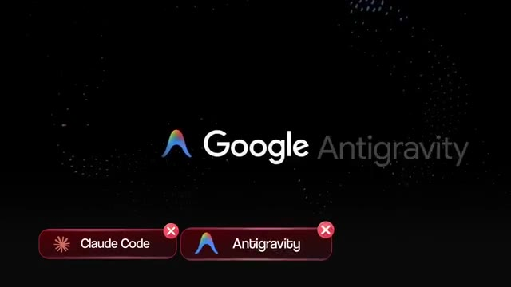
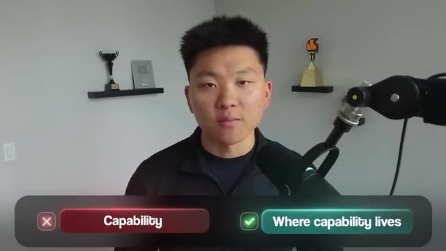
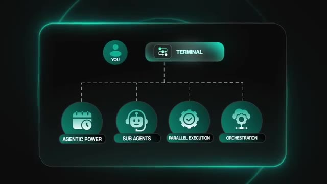
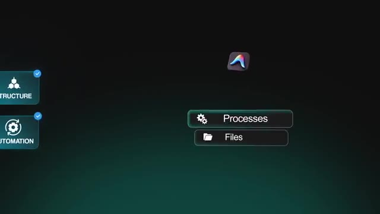
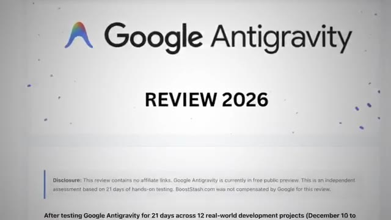
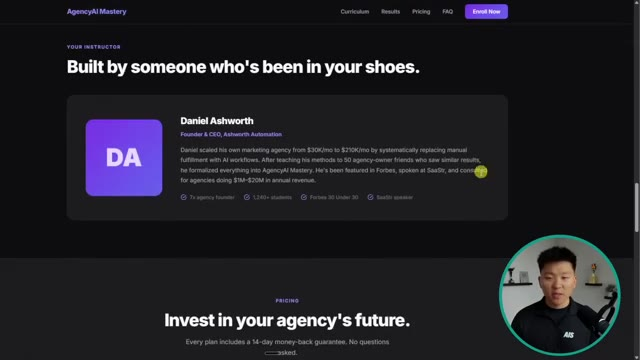

# 🎬 100 Hours Testing Claude Code vs Antigravity (honest results)

> **Chaîne** : [Nate Herk | AI Automation](https://www.youtube.com/@nateherk/featured)  
> **Lien YouTube** : [https://www.youtube.com/watch?v=99VHENEKA9o](https://www.youtube.com/watch?v=99VHENEKA9o)  
> **Date de publication** : 20260413  
> **Durée** : 00:23:32  
> **Identifiant vidéo** : `99VHENEKA9o`  
> **Transcription & Analyse** : `whisper-v3-large-turbo+gemini-3.5-flash-lite`  

---

## 📌 Synthèse Exécutive & Outils

### 💡 Résumé
Dans cette vidéo intitulée **100 Hours Testing Claude Code vs Antigravity (honest results)**, Nate Herk décortique les capacités pratiques d'automatisation et de développement propulsées par les modèles de pointe.

### 🛠️ Outils, Modèles & Logiciels Présentés
- **Opus 5.5 & Claude Code** : Modèles d'ingénierie et agents de codage autonome.

### 🔑 Points Clés & Enseignements Stratégiques
- Optimiser le niveau d'effort et le raisonnement des modèles IA pour des résultats industriels.
- Automatiser les cycles de création logicielle de bout en bout.

---

## ⏱️ Chronologie & Transcription Complète Audio & Visuelle (Mot pour Mot)

### ⏱️ `[00:00:00 - 00:00:30]` | Segment #01

**🔊 Audio (Transcription Intégrale Mot pour Mot en Français) :**
> Right now, there are two tools that are leading the market when it comes to building with AI. We've got Cloud Code and Google Antigravity. And for the past few months, there's been a debate on which one of these tools is actually the best. So if you're trying to figure out which AI tool to learn and use right now, this video is going to save you a ton of time. After hundreds of hours testing both of these tools, the truth is that each one is better for different tasks. And even though the answer isn't super obvious, I still think there's one tool that you should learn over the other. So in this video, we'll go into their key differences and I'll test them in front of you guys live with different workflows so you can see where they shine and where they fall short.

**👁️ Analyse Visuelle d'Écran (gemini-3.5-flash-lite) :**
**Interface & Outils** : VS Code (Visual Studio Code), interface de plateforme communautaire Skool.

**Contenu textuel & Code** : Commandes de terminal (bash), initialisation de dépôt Git (`git init`), messages système "Claude Code" concernant l'analyse contradictoire.

**Action / Démonstration** : Initialisation d'un projet Git et exécution de scripts d'automatisation dans l'environnement de développement.

*⏱️ 00:00:07 — Une capture d'écran d'un forum communautaire (AI Automation Society) affichant un sujet de discussion intitulé "Claude Code vs AntiGravity".*

*⏱️ 00:00:15 — Une interface d'éditeur de code (type VS Code) montrant une exécution en ligne de commande avec des logs de développement et des directives pour initialiser un dépôt Git.*

---

### ⏱️ `[00:00:30 - 00:00:50]` | Segment #02

**🔊 Audio (Transcription Intégrale Mot pour Mot en Français) :**
> Then I'll give you guys my thoughts on which one is the best overall. So by the end of this video, you'll have a clear picture on which tool that you should learn and use this year. So let's get into it. All right. So before we get into the actual tests, you need to understand what these tools are and how they're actually different. Both CloudCode and Antigravity are agentic coding platforms. They can take a large mission, break it into a plan, spin up subagents to work in parallel.

**👁️ Analyse Visuelle d'Écran (gemini-3.5-flash-lite) :**
**Interface & Outils** : Claude Code, Open Agent Manager.

**Contenu textuel & Code** : Texte de prompt : "Build me a full-stack habit tracker app...".

**Action / Démonstration** : Présentation et comparaison visuelle des outils de développement assistés par IA.

*⏱️ 00:00:35 — Logo et titre "CLAUDE CODE" affichés sur un fond sombre avec une bordure néon.*

*⏱️ 00:00:45 — Comparaison en écran divisé montrant les interfaces de deux agents IA : Claude Code (à gauche) et Open Agent Manager avec Antigravity (à droite), affichant des invites de construction d'application.*

---

### ⏱️ `[00:00:51 - 00:01:09]` | Segment #03

**🔊 Audio (Transcription Intégrale Mot pour Mot en Français) :**
> They can manage your files and your folders, run terminal commands and execute across your entire code base. CloudCode is powered by Anthropix Cloud Models. Anti-Gravity defaults to Google's Gemini models. You can switch out the model for both of these different tools, but sometimes it just takes a little bit of extra configuration. But the power ceiling on both of these tools is extremely high.

**👁️ Analyse Visuelle d'Écran (gemini-3.5-flash-lite) :**
**Interface & Outils** : Interface de workflow visuel (type schéma conceptuel), Interface de configuration de modèles IA (Router settings).

**Contenu textuel & Code** : Liste de modèles Gemini (gemini-3.1-flash-lite-preview, gemini-2.5-flash, etc.), paramètres de "Context Threshold" (60000).

**Action / Démonstration** : Sélection et configuration des modèles IA pour des tâches spécifiques au sein d'une application.

*⏱️ 00:00:55 — Schéma de workflow illustrant les capacités d'un "Sub agent" : gestion de fichiers, exécution de commandes terminal et manipulation de codebase.*

*⏱️ 00:01:04 — Interface de configuration logicielle ("Router") permettant de sélectionner des modèles Gemini spécifiques pour différentes fonctions (Default, Background, Think, Long Context, Web Search).*

---

### ⏱️ `[00:01:09 - 00:01:29]` | Segment #04

**🔊 Audio (Transcription Intégrale Mot pour Mot en Français) :**
> And because of this, both tools are free to use. You're not paying for Cloud Code or you're not paying for Anti-Gravity. What you end up paying for is the model usage, the actual AI behind the scenes that's doing the thinking. You're paying for the tokens. So the difference isn't capability. It's where those capabilities live and how you access them. Cloud Code is terminal first. It's a CLI tool that plugs into whatever environment that you're already working in.

**👁️ Analyse Visuelle d'Écran (gemini-3.5-flash-lite) :**
**Interface & Outils** : Graphiques d'incrustation vidéo (superposition de texte et d'icônes).

**Contenu textuel & Code** : Textes comparatifs : "Claude Code", "Antigravity", "Capability" vs "Where capability lives".

**Action / Démonstration** : Présentation visuelle des concepts de différenciation des outils IA par le présentateur.

*⏱️ 00:01:14 — Titre affichant "Google Antigravity" avec deux badges en bas indiquant "Claude Code" et "Antigravity" barrés d'une croix.*

*⏱️ 00:01:24 — Infographie comparative à l'écran avec deux boutons : "Capability" barré d'une croix et "Where capability lives" validé par une coche.*

---

### ⏱️ `[00:01:29 - 00:01:48]` | Segment #05

**🔊 Audio (Transcription Intégrale Mot pour Mot en Français) :**
> So you can keep your editor, your key bindings, your extensions. All of it stays the same. The agentic power, the subagents, parallel execution, the orchestration, it's all there. But it's surfaced through your terminal and configured by you. You build the workflow on top of the tool. Now, anti-gravity is its own standalone IDE. Some think it's a fork of VS Code. So your extensions and shortcuts can carry over.

**👁️ Analyse Visuelle d'Écran (gemini-3.5-flash-lite) :**
**Interface & Outils** : Diagramme de flux logique (schéma), interface d'agent IA (type CLI ou assistant web).

**Contenu textuel & Code** : Texte du diagramme : "Agentic Power", "Sub Agents", "Parallel Execution", "Orchestration" ; Texte terminal : "Agent is searching the web".

**Action / Démonstration** : Représentation visuelle de l'architecture d'un agent ; exécution d'une recherche web par un agent via une interface utilisateur.

*⏱️ 00:01:38 — Diagramme conceptuel montrant l'utilisateur (YOU) connectant son terminal à quatre capacités clés : Agentic Power, Sub Agents, Parallel Execution et Orchestration.*

*⏱️ 00:01:43 — Interface scindée en deux volets : à gauche une zone de saisie de prompt, à droite un terminal ou une interface d'agent affichant "Agent is searching the web".*

---

### ⏱️ `[00:01:48 - 00:02:20]` | Segment #06

**🔊 Audio (Transcription Intégrale Mot pour Mot en Français) :**
> But you are opening a different application entirely. It's got a manager view where you can see multiple agents working in parallel across different workspaces and a built-in browser agent that can navigate real web pages. The simplest way to think about it, CloudCode gives you the primitives and lets you work the way you already work. Antigravity packages the whole agentic workflow thing into a purpose-built environment that you kind of move into. All right, so let's talk about what it actually feels like to use them, starting with getting set up. So CloudCode gives you multiple entry points. The terminal CLI is the original and most powerful mode. You install it with npm and you type Cloud in any terminal

**👁️ Analyse Visuelle d'Écran (gemini-3.5-flash-lite) :**
**Interface & Outils** : CloudCode (Agent Manager interface).

**Contenu textuel & Code** : Noms de projets (Project 01, Project 02), noms de sous-agents, options de modèle (Gemini 1.5 Pro), labels de fonctions (Processes, Files, Structure, Automation).

**Action / Démonstration** : Présentation des fonctionnalités de gestion multi-agents et navigation web intégrée de la plateforme CloudCode.

*⏱️ 00:01:56 — Interface "Agent Manager" affichant une liste de projets et de sous-agents, avec une zone de saisie pour une nouvelle conversation liée à la navigation web.*

*⏱️ 00:02:04 — Interface de gestion de workflow montrant des modules interactifs "Structure", "Automation", "Processes" et "Files".*

---

### ⏱️ `[00:02:20 - 00:02:46]` | Segment #07

**🔊 Audio (Transcription Intégrale Mot pour Mot en Français) :**
> and CloudCode pops up. There's also a VS Code extension with inline diffs, plan review, file visibility, at mentions, and all of that can be right inside your editor. Cloud also gives us a desktop app if you don't wanna use the VS Code version at all, and it's a lot more, I'd say, user-friendly, and a web version that you can run straight from your browser with no install. So in pretty much every single video on my channel you might've seen with me using CloudCode, I've been using it inside of VS Code, either through the extension or just running it in my VS Code terminal.

**👁️ Analyse Visuelle d'Écran (gemini-3.5-flash-lite) :**
**Interface & Outils** : VS Code (Visual Studio Code), Navigateur Web.

**Contenu textuel & Code** : Documentation technique sur l'ingestion de fichiers (data/), liste de fonctionnalités d'IA, informations sur l'extension Claude Code pour VS Code.

**Action / Démonstration** : Navigation dans le marketplace des extensions VS Code, présentation des fonctionnalités de l'agent Claude.

*⏱️ 00:02:26 — Interface d'un navigateur affichant la documentation de Gemini API avec une superposition listant les fonctionnalités clés : Inline diffs, Plan review, File visibility et @ mentions.*

*⏱️ 00:02:33 — Capture de VS Code montrant la page d'installation de l'extension "Claude Code for VS Code" dans le marketplace, avec les détails du plugin Anthropic.*

---

### ⏱️ `[00:02:46 - 00:03:19]` | Segment #08

**🔊 Audio (Transcription Intégrale Mot pour Mot en Français) :**
> Now, I do that because I like being able to see all of my files on that left-hand side while I'm working with CloudCode rather than just staring at a terminal window. One thing worth noting though is that the terminal CLI is technically the most feature complete mode. The VS Code extension covers pretty much everything, but there are a few advanced features that are CLI only. So for most people getting started, the extension is definitely more than enough. Now, Antigravity has only one front door. You download the app and you have to run it through there. There is a CLI command to launch it from your terminal, but that basically just opens up the Antigravity IDE. So there's no run Antigravity inside of VS Code option. So now let's actually

**👁️ Analyse Visuelle d'Écran (gemini-3.5-flash-lite) :**
**Interface & Outils** : Navigateur web / Interface CLI (Gemini Code Assist).

**Contenu textuel & Code** : Commande `npm install -g @google/gemini-cli` et interface terminal interactive avec des instructions de prise en main.

**Action / Démonstration** : Présentation des outils d'installation et de l'interface en ligne de commande de l'assistant de code Gemini.

*⏱️ 00:03:11 — Capture d'écran montrant le site web ou l'interface de démarrage de "Gemini Code Assist" (CLI), avec une commande d'installation npm et une fenêtre de terminal stylisée présentant le logo Gemini.*

---

### ⏱️ `[00:03:19 - 00:03:52]` | Segment #09

**🔊 Audio (Transcription Intégrale Mot pour Mot en Français) :**
> get into what matters the most, which is the quality of what the tools produce. The model you use inside the tool matters so much. If you're running CloudCode with Haiku, it's going to be a completely different experience than running CloudCode with Opus. Running anti-gravity with Gemini Flash is not going to be the same as running anti-gravity with Gemini Pro. The harness shapes how the model works, but the model determines the ceiling. So when we talk about output quality, a lot of it comes down to which model you're running under the hood. Now, CloudCode's biggest strength is how it thinks before it acts. It has a dedicated planning mode, which anti-gravity does as well, but in this planning mode, it maps out multi-file work before touching anything. It'll

**👁️ Analyse Visuelle d'Écran (gemini-3.5-flash-lite) :**
**Interface & Outils** : Interface web d'un assistant IA (probablement Claude.ai).

**Contenu textuel & Code** : Menu déroulant affichant : "Opus 4.6", "Sonnet 4.6", "Haiku 4.5" ainsi qu'un bouton "Extended thinking" désactivé.

**Action / Démonstration** : Une main déplace le curseur vers l'option "Haiku 4.5" pour la sélectionner.

*⏱️ 00:03:27 — Une capture d'écran de l'interface de sélection de modèles IA montrant les options Opus 4.6, Sonnet 4.6, et Haiku 4.5 avec une option d'activation "Extended thinking".*

---

### ⏱️ `[00:03:52 - 00:04:18]` | Segment #10

**🔊 Audio (Transcription Intégrale Mot pour Mot en Français) :**
> be read-only, no code changes, just strategy and asking clarification questions. You can control how deep it reasons, all the way up to what Anthropic calls their ultra-think for really complex problems. Like I said, anti-gravity also has a plan mode, but I think that cloud code just does it better. You'll see exactly what I mean when we jump into all of the live tests later. Both tools let you also set project-level rules, conventions, and custom instructions that persist across sessions. Both support plugins, custom commands, and integrations with external tools.

**👁️ Analyse Visuelle d'Écran (gemini-3.5-flash-lite) :**
**Interface & Outils** : Logiciels d'IA non explicitement nommés mais suggérés par les icônes (interface de configuration de projet).

**Contenu textuel & Code** : Boutons d'interaction utilisateur : "SET RULES" et "CONVENTIONS".

**Action / Démonstration** : Présentation visuelle des options de configuration de workflow pour les agents IA.

*⏱️ 00:04:12 — Overlay graphique affichant deux icônes de logiciels (probablement Cursor et un autre outil d'IA) surmontant deux boutons légendés "SET RULES" et "CONVENTIONS".*

---

### ⏱️ `[00:04:19 - 00:04:54]` | Segment #11

**🔊 Audio (Transcription Intégrale Mot pour Mot en Français) :**
> The extensibility is there on both sides, but CloudCode feels extremely hackable to me because I just feel like I have so much more control over how I want this individual project to behave. Where CloudCode also stands out is how well it understands your existing project and file structure. It reads everything, it picks up on your patterns and naming conventions, and it builds on top of what you've already got there. So generated code fits your code base rather than just feeling kind of bolted on. Antigravity's major strength is building full apps and front ends from scratch. In an independent 21-day test across 12 real projects, 94% of the code it generated was clean, passing, limiting, with no errors or style issues. It completed about 73%

**👁️ Analyse Visuelle d'Écran (gemini-3.5-flash-lite) :**
**Interface & Outils** : Navigateur web (image 3), Éditeur de code (image 2 - suggéré par le contexte).

**Contenu textuel & Code** : Texte à l'écran : "CLAUDE CODE", "BUILDS ON TOP", "Google Antigravity - REVIEW 2026", mention d'une période de test de 21 jours sur 12 projets.

**Action / Démonstration** : Le présentateur discute des capacités d'intégration et de compréhension de projet des outils de développement.

*⏱️ 00:04:36 — Plan sombre montrant le présentateur travaillant de nuit sur son ordinateur, avec le texte "BUILDS ON TOP" à l'écran.*

*⏱️ 00:04:45 — Capture d'une page web présentant un article de revue intitulé "Google Antigravity - REVIEW 2026".*

---

### ⏱️ `[00:04:54 - 00:05:13]` | Segment #12

**🔊 Audio (Transcription Intégrale Mot pour Mot en Français) :**
> of tasks without any human intervention and delivered a 60-70% reduction in development time. Now, when I've used Antigravity, I've mainly used it for designing things, UI, UX elements, websites, web apps, things like that. I just think that it does a much better job compared to CloudCode and Opus for like having actual taste and making things just look and feel more real.

**👁️ Analyse Visuelle d'Écran (gemini-3.5-flash-lite) :**
**Interface & Outils** : Navigateur web (Booststash).

**Contenu textuel & Code** : Texte technique listant des statistiques de performance : "60-70% faster development compared to manual coding", temps d'indexation, et évaluation de stabilité.

**Action / Démonstration** : Affichage de données comparatives pour illustrer l'efficacité de l'outil Antigravity mentionné par le présentateur.

*⏱️ 00:04:59 — Capture d'écran montrant une page web "BOOSTSTASH" avec une analyse technique des performances d'un IDE assisté par IA, soulignant un gain de productivité de 60-70%.*

---

### ⏱️ `[00:05:13 - 00:05:33]` | Segment #13

**🔊 Audio (Transcription Intégrale Mot pour Mot en Français) :**
> But there is a trade-off because on longer projects, anti-gravity can start to drift away from the rules that you set at the beginning. Now, this is a documented pattern. Google's own developer forums have a thread about this. It might build something perfectly to spec on day one and then gradually start ignoring your original guidelines by day three. Now, to be fair, this is generally true for any coding agent with any coding model, but I did want to call this out here.

**👁️ Analyse Visuelle d'Écran (gemini-3.5-flash-lite) :**
**Interface & Outils** : Interface de type chat/assistant IA.

**Contenu textuel & Code** : "Build me a", "Day 1", "Day 3", "TYPOGRAPHY", "HERO SECTION", "PRICING", "Searching context...".

**Action / Démonstration** : Démonstration visuelle de la dégradation de la mémoire ou de la pertinence d'un agent IA sur le long terme ("Day 3").

*⏱️ 00:05:23 — Capture d'écran d'une interface de chat IA montrant une zone de saisie avec le message partiel "Build me a...".*

*⏱️ 00:05:28 — Illustration sous forme de liste de tâches montrant la progression d'un projet sur deux jours, avec les étapes "TYPOGRAPHY", "HERO SECTION" et "PRICING" validées le jour 1, et une mention "Searching context..." pour le jour 3.*

---

### ⏱️ `[00:05:33 - 00:06:01]` | Segment #14

**🔊 Audio (Transcription Intégrale Mot pour Mot en Français) :**
> Now let's look at some benchmarks. The SWE Bench Verified is the industry standard test for AI coding tools. It takes real GitHub issues from real open source projects, and it measures how many get fully resolved by the AI model. Cloud Opus 4.6 inside of Cloud Code scored an 80.9%. Gemini 3 Pro inside of Antigravity came in at around 76.2%. Both of these scores involve the full harness, which is the tool plus the model, together. But Google hasn't published the exact testing methodology the way Anthropik has, so it's not a perfect apples-to-apples comparison.

**👁️ Analyse Visuelle d'Écran (gemini-3.5-flash-lite) :**
**Interface & Outils** : Graphiques animés de présentation de données (benchmarks).

**Contenu textuel & Code** : Texte affiché : "SWE BENCHMARK TEST", "GitHub Issues", "AI MODEL", "80.9%", "Opus 4.6".

**Action / Démonstration** : Illustration visuelle des capacités de performance d'un modèle IA sur des tests de résolution de problèmes GitHub.

*⏱️ 00:05:40 — Schéma illustrant le concept de "SWE Benchmark Test" avec un groupe de "GitHub Issues" traitées par un modèle IA.*

*⏱️ 00:05:47 — Graphique en barres montrant le score de performance "80.9%" attribué à "Opus 4.6".*

---

### ⏱️ `[00:06:01 - 00:06:20]` | Segment #15

**🔊 Audio (Transcription Intégrale Mot pour Mot en Français) :**
> But at the top tier model level, these tools are remarkably close on paper. Now, real world results. Anthropics engineering team reported that Cloud Code gave them a 50% productivity gain and 67% more pull requests merged per engineer per day. On the anti-gravity side, the independent 21-day test showed 60-70% faster development. Both numbers are extremely impressive.

**👁️ Analyse Visuelle d'Écran (gemini-3.5-flash-lite) :**
**Interface & Outils** : Navigateur web / Document de rapport technique.

**Contenu textuel & Code** : Texte technique mentionnant : "67% increase in merged pull requests", "50% productivity gains", "21 days of intensive testing", "INP scores of 80-120ms".

**Action / Démonstration** : Présentation de preuves factuelles et de statistiques pour appuyer les arguments sur l'efficacité des outils IA dans le développement logiciel.

*⏱️ 00:06:11 — Gros plan sur un document textuel détaillant les statistiques de productivité liées à l'utilisation de Claude Code (hausse de 50% de productivité et 67% de pull requests).*

*⏱️ 00:06:15 — Gros plan sur un document textuel détaillant les résultats d'un test de 21 jours sur les performances, la stabilité et le temps de développement des applications.*

---

### ⏱️ `[00:06:21 - 00:06:39]` | Segment #16

**🔊 Audio (Transcription Intégrale Mot pour Mot en Français) :**
> Neither is a controlled scientific study, but directionally, they tell you both tools are making developers significantly faster. But now let's talk about speed and reliability. Remember, what you're paying for when you're using these tools is not the tool, you're paying for the model. And these models will burn through kind of your usage or your limits faster than you may expect, especially if you're not being careful.

**👁️ Analyse Visuelle d'Écran (gemini-3.5-flash-lite) :**
**Interface & Outils** : Aucune interface logicielle ou de programmation n'est visible.

**Contenu textuel & Code** : Texte informatif/titre de segment uniquement.

**Action / Démonstration** : Aucune action technique ou démonstration logicielle n'est effectuée.

---

### ⏱️ `[00:06:39 - 00:06:58]` | Segment #17

**🔊 Audio (Transcription Intégrale Mot pour Mot en Français) :**
> Cloud Code recently in March of 26 had a caching bug that inflated token costs by maybe 10 to 20x. For MaxPlan users, they were draining their entire session in under two hours. Anthropic has acknowledged this and seems to be constantly working on token optimization, which is obviously going to be an ongoing kind of project. Anti-gravity has its own issues as well.

**👁️ Analyse Visuelle d'Écran (gemini-3.5-flash-lite) :**
**Interface & Outils** : Navigateur web (The Register, Reddit).

**Contenu textuel & Code** : Texte journalistique sur les bugs de Claude Code (facteur 10-20x des coûts) ; post Reddit sur la consommation rapide des limites d'utilisation.

**Action / Démonstration** : Présentation de preuves contextuelles tirées de rapports en ligne sur les problèmes techniques rencontrés par les utilisateurs de Claude.

*⏱️ 00:06:44 — Une capture d'écran d'un article de presse "The Register" détaillant les bugs de mise en cache de Claude Code qui augmentent les coûts.*

*⏱️ 00:06:49 — Une capture d'écran d'une discussion sur Reddit (r/ClaudeAI) où un utilisateur se plaint de la consommation excessive de ses limites d'utilisation.*

---

### ⏱️ `[00:06:58 - 00:07:22]` | Segment #18

**🔊 Audio (Transcription Intégrale Mot pour Mot en Français) :**
> Google's quota system has been all over the place, with pro users getting locked out for a full week after hitting limits, and a credit-based pricing system that still doesn't clearly explain what a credit actually buys you. So, in general, learning how to manage your context and tokens is one of the most important skills that you can be building right now, because it translates to whatever coding agent you end up using. I made a full video on 18 token management hacks that I found while experimenting with these tools, and I will link that one right up here.

**👁️ Analyse Visuelle d'Écran (gemini-3.5-flash-lite) :**
**Interface & Outils** : Reddit (interface web).

**Contenu textuel & Code** : Post utilisateur intitulé "Can someone please explain the Gemini pricing model?" détaillant les difficultés de compréhension des coûts liés à l'utilisation de l'API Gemini 2.5 Pro via Google Cloud/AI Studio.

**Action / Démonstration** : Illustration visuelle du problème de communication et d'opacité tarifaire de Google, servant de support à l'explication du présentateur.

*⏱️ 00:07:04 — Capture d'écran d'un post Reddit sur le subreddit r/Bard concernant une interrogation sur le modèle de tarification de Google Gemini.*

---

### ⏱️ `[00:07:22 - 00:07:43]` | Segment #19

**🔊 Audio (Transcription Intégrale Mot pour Mot en Français) :**
> Now, in terms of task speed, An independent test found that CloudCode completed a representative task in about 4 minutes versus Antigravity's 8 minutes. Which I thought was interesting because in my testing, Antigravity's always felt faster. And you guys will see that later in the video when we do these real tests. Now, the real difference in reliability right now is about maturity. CloudCode is production-released with multiple updates shipping per week.

**👁️ Analyse Visuelle d'Écran (gemini-3.5-flash-lite) :**
**Interface & Outils** : Graphique de présentation synthétique.

**Contenu textuel & Code** : "REPRESENTATIVE TASK", "CLAUDE CODE", "4".

**Action / Démonstration** : Présentation visuelle comparative des performances de vitesse entre les outils IA.

*⏱️ 00:07:27 — Un graphique montrant une comparaison de vitesse pour une tâche représentative, affichant le résultat de 4 minutes pour "Claude Code".*

---

### ⏱️ `[00:07:43 - 00:08:08]` | Segment #20

**🔊 Audio (Transcription Intégrale Mot pour Mot en Français) :**
> Antigravity is still in public preview as of today, April 2026, but it is improving very fast. It still does, though, carry the instability that comes with this stage of public preview. Some people are reporting login issues, there's occasional bugs on Windows, and agents are getting stuck in loops. Now, context loss is real for both of these tools. Even with CloudCode's 1 million context window with Opus, there can be issues when you're loading real code bases, running lots of tool calls, and going back and forth for 40-plus prompts.

**👁️ Analyse Visuelle d'Écran (gemini-3.5-flash-lite) :**
**Interface & Outils** : Éditeur de code (VS Code), Navigateur web (site de recherche AI).

**Contenu textuel & Code** : Liste de tâches de développement ("UI Updates", "Automated Tests"), et scores de benchmarking (72.0, 38.7, 50.2, 25.6).

**Action / Démonstration** : Revue de code/journalisation de bugs dans l'éditeur et présentation de données de performance analytique.

*⏱️ 00:07:56 — Capture d'écran d'un éditeur de code (type VS Code) affichant des notes de travail sur un projet, avec le texte superposé "AGENTS ARE GETTING STUCK".*

*⏱️ 00:08:02 — Graphique en barres comparatif sur une interface web, illustrant les performances de "Long-context reasoning" pour différents modèles (Opus 4.6, Sonnet 4.5).*

---

### ⏱️ `[00:08:08 - 00:08:30]` | Segment #21

**🔊 Audio (Transcription Intégrale Mot pour Mot en Français) :**
> At that point, the AI starts to just lose track of earlier instructions. Antigravity's own troubleshooting docs recommends starting a new chat once the agent takes more than 10 seconds to respond. CloudCode has a compact command that compresses your conversation history. But the best practice for both of these tools is the same. Keep your sessions focused, one task per session, start fresh often. Now, one more thing that I did want to mention is the pace of development is just crazy.

**👁️ Analyse Visuelle d'Écran (gemini-3.5-flash-lite) :**
**Interface & Outils** : Graphisme d'interface personnalisée (Overlay vidéo).

**Contenu textuel & Code** : Texte affiché : "ANTI-DRIFT PROTOCOL", "Focused sessions" (icône cible), "1 task per session" (icône liste de tâches).

**Action / Démonstration** : Présentation visuelle des bonnes pratiques pour maintenir la précision d'un agent IA afin d'éviter la dérive des instructions.

*⏱️ 00:08:25 — Une interface graphique animée sur fond noir présentant le "ANTI-DRIFT PROTOCOL" avec deux points clés : "Focused sessions" et "1 task per session".*

---

### ⏱️ `[00:08:31 - 00:09:04]` | Segment #22

**🔊 Audio (Transcription Intégrale Mot pour Mot en Français) :**
> CloudCode has been shipping at an insane rate. In quarter one of 2026 alone, they dropped six major platform level features with multiple releases per week. And at one point, there was three different releases in the span of five days. Antigravity has also been improving and updating, but the cadence is notably different. From launch in November through March of 2026, so, you know, about four or five months, the version numbers went from 1.11 to 1.21, with most updates being a handful of improvements and minor bug fixes and optimizations. So both are actively being developed, but cloud code is moving significantly faster. And when you're choosing a tool to invest your time in, I think that that

**👁️ Analyse Visuelle d'Écran (gemini-3.5-flash-lite) :**
**Interface & Outils** : Tableau de suivi des versions (Release Log).

**Contenu textuel & Code** : Détail des publications : Feb 24 (v0.2.x), Feb 27 (v0.2.x patch), Mar 1 (v0.3.0).

**Action / Démonstration** : Présentation visuelle de la cadence de mise à jour rapide (3 releases en 5 jours).

*⏱️ 00:08:39 — Un tableau informatif semi-transparent affichant le titre "RAPID RELEASE" avec une liste de dates (Feb 24, 2026 à Mar 1, 2026) et les versions logicielles correspondantes.*

---

### ⏱️ `[00:09:04 - 00:09:36]` | Segment #23

**🔊 Audio (Transcription Intégrale Mot pour Mot en Français) :**
> matters a lot. All right, so let's talk about integrations, because a coding tool is truly only as useful as what it can actually connect to. Both of these coding tools support MCP, Model Context Protocol, the open standard that lets AI tools plug into external services. GitHub, databases, is Supabase, Playwright, Firecrawl, design tools, monitoring platforms. Over 1,500 MCP servers are out there at this point, and that number is growing. The difference is setup. CloudCode's MCP integration is CLI-driven. You add servers with a single command, or by prompting CloudCode to do so, or by editing a JSON config file scoped globally, per project, or maybe per user.

**👁️ Analyse Visuelle d'Écran (gemini-3.5-flash-lite) :**
**Interface & Outils** : Schéma conceptuel du protocole MCP (Model Context Protocol).

**Contenu textuel & Code** : Diagramme montrant les connexions entre l'IA, le MCP et les services tiers (GitHub, Databses, Supabase, Playwright, Firecrawl, Monitoring).

**Action / Démonstration** : Visualisation des capacités d'intégration du protocole MCP pour les outils d'IA.

*⏱️ 00:09:20 — Schéma illustrant le protocole MCP connectant une IA à divers services externes comme GitHub, Supabase, Playwright et Firecrawl.*

---

### ⏱️ `[00:09:37 - 00:10:12]` | Segment #24

**🔊 Audio (Transcription Intégrale Mot pour Mot en Français) :**
> Whereas Antigravity has more of a visual MCP panel built into it, where you can kind of like browse through a marketplace and click to install MCPs and things like that. It's a little bit more beginner friendly to start with, but for advanced setups, you're still going to need to end up editing that config file, which also is not very difficult at all. Because with both of these tools, you could say, hey, here's the MCP server URL that I want to download. Help me figure out how I actually do this. Both tools also have direct terminal access, meaning they can use any other CLIs, which is huge. Git, NPM, Docker, Playwright, Google Workspace. If it has a CLI and it runs in a terminal, then either tool can actually use it. You can even run Cloud Code CLI inside

**👁️ Analyse Visuelle d'Écran (gemini-3.5-flash-lite) :**
**Interface & Outils** : Interface utilisateur de l'application Antigravity (chat interactif).

**Contenu textuel & Code** : "Hey, here's the MCP server URL [ https://:firecrawl ] that I want to download."

**Action / Démonstration** : Saisie d'une URL de serveur MCP dans le champ de dialogue de l'interface pour déclencher son installation/téléchargement.

*⏱️ 00:09:54 — Interface de chat minimaliste sur fond sombre permettant de saisir une URL de serveur MCP pour installation via une icône de téléchargement.*

---

### ⏱️ `[00:10:12 - 00:10:45]` | Segment #25

**🔊 Audio (Transcription Intégrale Mot pour Mot en Français) :**
> anti-gravities terminal if you want both tools in one environment. All right, so now let's talk about pricing. First, let me reframe real quick how you think about this. Because even if you're paying for Claude's most expensive plan right now, $200 a month, for the level of output that you can get from either of these tools, you would never be able to hire a human to do that same amount of work for that same price. Meaning what human would give you all of this productivity and output for only $200 a month. So no matter which tool you choose or how much money you're investing into these subscriptions, you're getting an insane amount of leverage for the money. It's a steal right now. Now, CloudCode requires a paid CloudPan. So if you start with CloudCode's lowest

**👁️ Analyse Visuelle d'Écran (gemini-3.5-flash-lite) :**
**Interface & Outils** : Site web officiel de Claude (Anthropic).

**Contenu textuel & Code** : Tableau comparatif des tarifs : Pro (17$), Max 5x (100$), Max 20x (200$).

**Action / Démonstration** : Présentation informative des options de coût pour accéder aux capacités de codage IA de Claude.

*⏱️ 00:10:20 — Page web de tarification "Claude Code" présentant trois niveaux d'abonnement : Pro, Max 5x et Max 20x.*

---

### ⏱️ `[00:10:45 - 00:11:21]` | Segment #26

**🔊 Audio (Transcription Intégrale Mot pour Mot en Français) :**
> subscription, that is Pro, and that's $20 a month, which gives you access to the platform. You could also use your API key, but that might end up being more expensive than just a subscription. But most heavy users end up on the max, which is either $100 a month for five times more usage than Pro, or $200 a month for 20 times more usage than Pro. When you're actively building, you burn through the Pro limit pretty quickly. You can always just start on Pro, and then you could upgrade later if you need to. And you can pay for extra usage beyond your plan on standard API rates. Or of course, you could plug in some sort of open source model or a much cheaper model if you wanted to do so. But you're going to lose a lot of the value of Opus, of course, because that's like one of the smartest models right now. Anti-gravity is tied to the Google's AI

**👁️ Analyse Visuelle d'Écran (gemini-3.5-flash-lite) :**
**Interface & Outils** : Site web Ollama (ollama.com).

**Contenu textuel & Code** : Commande affichée : "ollama run codellama". Mentions des tailles de paramètres : 7b, 13b, 34b, 70b.

**Action / Démonstration** : Illustration visuelle de l'utilisation de modèles locaux via Ollama pour réduire les coûts d'utilisation des API.

*⏱️ 00:11:12 — Interface web du site Ollama affichant la page du modèle "codellama" avec la commande d'exécution associée et un encart textuel "Plug cheaper model".*

---

### ⏱️ `[00:11:21 - 00:11:56]` | Segment #27

**🔊 Audio (Transcription Intégrale Mot pour Mot en Français) :**
> subscription plans. So there is a free tier with basic access and weekly rate limits. Everyone gets Gemini 3 Pro, unlimited code completions, and all features regardless of the tier. But the free limit runs out fast if you're doing real work. Google AI Pro is 20 bucks a month with higher rate limits that refresh every five hours, plus two terabytes of Google storage and $10 in monthly Google Cloud credits. Google AI Ultra is $250 a month, and it gives you the highest rate limits. Now, one important note, some users report that even on Pro, the rate limits for premium models like Cloud Opus inside of Antigravity are very restrictive, like getting locked out after a single session. So if you're planning to use non-Gemini models heavily inside of Antigravity,

**👁️ Analyse Visuelle d'Écran (gemini-3.5-flash-lite) :**
**Interface & Outils** : Aucune interface logicielle montrée, uniquement une présentation graphique stylisée.

**Contenu textuel & Code** : Texte affiché : "Higher rate limits that refresh every five hours", "2 terabytes of Google storage", "$10 in monthly Google Cloud credits".

**Action / Démonstration** : Présentation des avantages offerts par le forfait "Google AI Pro".

*⏱️ 00:11:39 — Graphique informatif présentant trois avantages de l'abonnement : limites de taux plus élevées, 2 To de stockage Google et 10 $ de crédits Google Cloud mensuels.*

---

### ⏱️ `[00:11:56 - 00:12:31]` | Segment #28

**🔊 Audio (Transcription Intégrale Mot pour Mot en Français) :**
> just keep that in mind. But the bottom line here on cost is that if you're just getting started and you want to experiment, Antigravity's free tier lets you try it out for $0. So if you want reliable daily production level use, you're going to probably want to pay for something, whether that's CloudCode on Macs, which gives you the most consistent experience right now. At the highest tiers, 200 bucks for CloudCode and 250 bucks for Antigravity. They're in a similar range. Now, you might think of that as a not very cheap subscription, but with heavy usage, you're still getting way more output than you would than hiring a developer and so much cheaper. All right, so we've covered all of the key differences. Let's do a side-by-side build comparison. Now, real quick, before we get into the testing, I'm going to put all of this information that we've

**👁️ Analyse Visuelle d'Écran (gemini-3.5-flash-lite) :**
**Interface & Outils** : Page de tarification web pour les services Claude Code et Antigravity.

**Contenu textuel & Code** : Détails des prix, intitulés des offres ("Max 20x" et "Google AI Ultra") et boutons d'appel à l'action ("Try Claude", "Get started").

**Action / Démonstration** : Affichage comparatif des coûts d'abonnement pour des outils IA professionnels.

*⏱️ 00:12:14 — Comparatif visuel présentant les plans tarifaires de "Claude Code" (200$/mois) et "Antigravity" pour "Google AI Ultra" (en promotion à 124,99$/mois).*

---

### ⏱️ `[00:12:31 - 00:13:07]` | Segment #29

**🔊 Audio (Transcription Intégrale Mot pour Mot en Français) :**
> talked about today, including kind of the results and the tests into a free resource guide, which you can access for completely free in my free school community. The link for that is down in the description. But anyways, let's get into the live builds. All right. So we have a couple of tests to run here. And the way I'm going to do this is I have anti-gravity pull up on the left and I've cloud code pulled up right here on the right. So we're going to do three different tests. The first one is going to be me shooting off just basically this one shot prompt, not in plan mode. So I'm going to change this to fast mode and make sure this is on bypass permissions. And the idea is I want to see how well each of these two agent coding platforms work for us just giving them a pretty vague request and we'll see what happens. The second one is going to be we do something

**👁️ Analyse Visuelle d'Écran (gemini-3.5-flash-lite) :**
**Interface & Outils** : Open Agent Manager, Claude Code (intégrés dans un environnement VS Code/Cursor).

**Contenu textuel & Code** : Prompt utilisateur : "Build me a full-stack habit tracker app with a dashboard that shows streaks, a calendar heatmap, and the ability to add/edit/delete habits. Do not use the superpower skill and do not ask me any questions. Just build me version one of this app on a localhost 5235 for me to view."

**Action / Démonstration** : Lancement d'un test de build automatisé via un agent IA pour générer une application de suivi d'habitudes.

*⏱️ 00:12:49 — Capture d'écran divisée en deux panneaux : à gauche, l'interface "Open Agent Manager" pour "Antigravity" ; à droite, une interface "Claude Code" au sein d'un éditeur, avec un prompt détaillé pour la création d'une application de suivi d'habitudes (habit tracker).*

---

### ⏱️ `[00:13:07 - 00:13:42]` | Segment #30

**🔊 Audio (Transcription Intégrale Mot pour Mot en Français) :**
> similar but we use plan mode to see how their planning works and then the third one is going to be sort of like a website design and we're kind of purely basing it off of design output at that point as well as like kind of the planning and everything. So let's just go ahead and shoot off both of these. Like I said this one's running over here in anti-gravity with Gemini 3.1 Pro and this one's running over here in CloudCode with Opus 4.6. So what I said was to build a full stack habit tracker app with a dashboard that shows streaks, a calendar heat map, and the ability to add, edit, and delete habits. I said to not use the superpower skill because that's something I have in CloudCode that makes its outputs much better. And if you want to watch that video that I made about the

**👁️ Analyse Visuelle d'Écran (gemini-3.5-flash-lite) :**
**Interface & Outils** : VS Code (avec les extensions/outils Antigravity et Claude Code intégrés).

**Contenu textuel & Code** : Prompts de création d'application : "Build me a full-stack habit tracker app with a dashboard that shows streaks, a calendar heatmap, and the ability to add/edit/delete habits."

**Action / Démonstration** : L'utilisateur configure des requêtes pour générer une application de suivi d'habitudes ("habit tracker") en utilisant deux agents IA différents pour comparer leurs outputs.

*⏱️ 00:13:16 — Capture d'écran montrant une interface divisée en deux colonnes : à gauche l'outil "Antigravity" et à droite l'interface de "Claude Code" dans VS Code, avec le présentateur en médaillon.*

---

### ⏱️ `[00:13:42 - 00:14:17]` | Segment #31

**🔊 Audio (Transcription Intégrale Mot pour Mot en Français) :**
> superpower skill, I will link it right up here. But I told it not to use that because I want this to be as fair as possible. So I'm gonna let these two things run and I'll let you guys know when we have our outputs. All right, as far as a speed component, you can see here that anti-gravity has finished and CloudCode is still running. So before we click into it, let's actually see what they did from a file perspective. So if I open up the files over here for both of these, you can see that CloudCode made a folder called .superpowers with content and state. Then we have docs with plans and specs. And then we have habit tracker with all of the actual folders for what's going on inside the actual site. And over here, we can see that anti-gravity did something not very similar.

**👁️ Analyse Visuelle d'Écran (gemini-3.5-flash-lite) :**
**Interface & Outils** : Éditeurs de code (VS Code / environnements intégrés Antigravity et Cursor).

**Contenu textuel & Code** : Prompt commun : "Build me a full-stack habit tracker app with a dashboard that shows streaks, a calendar heatmap... Do not use the superpower skill". Fenêtre de droite montrant des logs de terminal (npm install) et du code JavaScript (require express, better-sqlite3).

**Action / Démonstration** : Exécution parallèle de deux agents IA pour comparer leur vitesse et leur capacité à suivre des instructions complexes de développement d'application full-stack.

*⏱️ 00:13:51 — Comparaison côte à côte de deux interfaces d'agents IA (Antigravity à gauche, Cursor/CC test à droite) en train de générer une application de suivi d'habitudes.*

---

### ⏱️ `[00:14:17 - 00:14:42]` | Segment #32

**🔊 Audio (Transcription Intégrale Mot pour Mot en Français) :**
> We have node modules with a ton of folders in here. And all of these, I'm sure, are very populated with more folders and more files. We can see we've got a public. Looks like these are images. And then we've got the SRC with some more assets and components inside. You may have looked at what I just showed you with the folders and been like, that is completely foreign language. And to me, I don't really know what's going on there either, right? But the reason I wanted to show you that is because the harnesses, the models, they're just designed to, yes, achieve the end goal we're looking for, but they're doing it in a different way.

**👁️ Analyse Visuelle d'Écran (gemini-3.5-flash-lite) :**
**Interface & Outils** : VS Code (éditeur de code) avec interfaces de chat IA intégrées.

**Contenu textuel & Code** : Arborescence de fichiers (node_modules, public, src, etc.), prompts de développement d'application "Habit Tracker" (dashboard, heatmap, persistance SQLite), liens vers localhost:5234.

**Action / Démonstration** : Exploration des fichiers du projet et interaction avec l'assistant IA pour la construction d'une application de suivi d'habitudes.

*⏱️ 00:14:23 — Capture d'écran montrant deux instances de VS Code côte à côte. À gauche, l'explorateur de fichiers du projet "Antigravity" avec les dossiers 'node_modules', 'public', et 'src'. À droite, un chat avec une IA dans VS Code présentant le projet "habit-tracker" avec un résumé des fonctionnalités développées.*

---

### ⏱️ `[00:14:42 - 00:15:03]` | Segment #33

**🔊 Audio (Transcription Intégrale Mot pour Mot en Français) :**
> With that out of the way, let's open up anti-gravity's version first. Okay, so here's anti-gravity. There's nothing here. Let me just go ahead and say the localhost is open, but I can't see anything. The page is just completely blank white. So we'll shoot that off. And while it's working on that, let me open up Cloud Code and we'll go to this version right here on the localhost. Okay, cool. We've got a habit tracker. We've got a calendar. We have our streaks, stuff like this up here, total check-ins.

**👁️ Analyse Visuelle d'Écran (gemini-3.5-flash-lite) :**
**Interface & Outils** : Cursor (éditeur de code), Interface web (application Habit Tracker).

**Contenu textuel & Code** : Configuration Vite, logs de compilation, interface utilisateur de suivi d'habitudes (statistiques, graphiques).

**Action / Démonstration** : Diagnostic d'une erreur d'affichage (page blanche) sur localhost, suivi de la démonstration de l'interface réussie de l'application "Habit Tracker".

*⏱️ 00:14:53 — Interface de l'éditeur Cursor affichant le fichier 'vite.config.ts' et un panneau de chat avec l'IA indiquant que l'application est compilée mais que la page web reste blanche.*

*⏱️ 00:14:58 — Interface de l'application "Habit Tracker" fonctionnelle, avec un tableau de bord sombre affichant les statistiques, un calendrier d'activité et un champ pour ajouter des habitudes.*

---

### ⏱️ `[00:15:03 - 00:15:23]` | Segment #34

**🔊 Audio (Transcription Intégrale Mot pour Mot en Français) :**
> We've got today's date. I can add a habit. So let's just say we do a walk and I can add the day. I could edit it. I could change the color. It looks like, okay, that's pretty nice. I could delete it. And we can change the color over here as well. If I wanted to do a green habit for YouTube and you can change the day. So here's, you can see, giving us our streak and everything. So for a V1 with no planning, that's pretty solid.

**👁️ Analyse Visuelle d'Écran (gemini-3.5-flash-lite) :**
**Interface & Outils** : Application web "Habit Tracker" (interface utilisateur personnalisée).

**Contenu textuel & Code** : Dashboard avec des indicateurs de statistiques (Today, Best Active Streak, Longest Streak Ever, Total Check-ins), un calendrier d'activité, un champ d'ajout d'habitude et des composants de sélection de couleur (RGB).

**Action / Démonstration** : Démonstration des fonctionnalités de modification et de personnalisation (nom, couleur) d'une habitude au sein de l'application.

*⏱️ 00:15:08 — Interface d'un "Habit Tracker" avec une fenêtre modale "Edit Habit" ouverte, permettant de renommer une habitude ("Walk") et de modifier sa couleur.*

*⏱️ 00:15:13 — Interface d'un "Habit Tracker" affichant un sélecteur de couleurs (color picker) flottant au-dessus de la zone d'ajout d'habitudes.*

---

### ⏱️ `[00:15:23 - 00:15:42]` | Segment #35

**🔊 Audio (Transcription Intégrale Mot pour Mot en Français) :**
> It's what we asked for. It looks pretty vibe coded, but that's all right. Let's go back into anti-gravity, see what happened here. So apparently it fixed those changes. Let's reopen the app now. Wow. Okay. So this is anti-gravities. From a design perspective, I already like this one better. We have our active habits. We have, we completed today, our daily score. New habit. We can say, yep, we went on a, I was about to say run, but I typed a read.

**👁️ Analyse Visuelle d'Écran (gemini-3.5-flash-lite) :**
**Interface & Outils** : Cursor IDE, interface web de l'application HabitForge.

**Contenu textuel & Code** : Code de configuration `vite.config.ts`, réponse de l'agent IA concernant le Hot Module Replacement (HMR) et les imports TypeScript, métriques de suivi d'habitudes (Active Habits, Completed Today, Daily Score).

**Action / Démonstration** : L'agent IA confirme la résolution du bug de l'écran blanc et le rechargement automatique de l'application ; transition vers la démonstration visuelle de l'interface utilisateur.

*⏱️ 00:15:28 — Interface de développement Cursor affichant une conversation avec un agent IA expliquant la résolution d'une erreur de compilation TypeScript, avec un aperçu de l'application en arrière-plan.*

*⏱️ 00:15:32 — Interface utilisateur finale de l'application "HabitForge" montrant un tableau de bord sombre et moderne de suivi des habitudes.*

---

### ⏱️ `[00:15:42 - 00:16:00]` | Segment #36

**🔊 Audio (Transcription Intégrale Mot pour Mot en Français) :**
> So we read, I read money models for 10 minutes. We'll go ahead and create the habits. We can see it right there. And that's where we're able to check it off per day. So this is a bit of a different way that it actually functions, but still delete things and stuff like that. So both of these are doing what we asked, but they're doing it in different ways. All right, test number two. We are doing basically the exact same thing, right?

**👁️ Analyse Visuelle d'Écran (gemini-3.5-flash-lite) :**
**Interface & Outils** : Application web "HabitForge" (interface utilisateur personnalisée).

**Contenu textuel & Code** : Cartes d'habitudes ("Drink Water", "Read"), compteurs de "Current Streak" et "Best Streak", indicateurs de performance (Active habits, Completed today, Daily score).

**Action / Démonstration** : Démonstration de l'interface de suivi d'habitudes où l'utilisateur peut visualiser et interagir (cocher ou supprimer) avec ses tâches quotidiennes.

*⏱️ 00:15:47 — L'interface web de l'application "HabitForge" montrant un tableau de bord de suivi d'habitudes avec des cartes pour "Drink Water" et "Read", des statistiques de progression et des icônes d'action pour la gestion des habitudes.*

---

### ⏱️ `[00:16:00 - 00:16:20]` | Segment #37

**🔊 Audio (Transcription Intégrale Mot pour Mot en Français) :**
> I'm gonna shoot this off in plan mode on both sides. And this time I'm saying, I need you to do research on AI trends in the small and medium-sized business market. And I need you to create a PDF report that should be no more than three pages that gives me a holistic breakdown. So they're going to take different approaches here in order to create an implementation plan and build this out for us. They might ask us some questions, they might not.

**👁️ Analyse Visuelle d'Écran (gemini-3.5-flash-lite) :**
**Interface & Outils** : VS Code avec extension Antigravity (Open Agent Manager).

**Contenu textuel & Code** : Prompt utilisateur : "I need you to do research on AI trends in the small and medium-sized business market and create a PDF report that should be no more than three pages..." ; État de l'agent : "Prioritizing Tool Selection" et "Meandering...".

**Action / Démonstration** : L'utilisateur lance simultanément deux instances d'agents IA (en mode "Planning") pour effectuer une recherche de marché et préparer un rapport PDF.

*⏱️ 00:16:05 — Interface divisée en deux fenêtres "Antigravity" dans VS Code montrant l'exécution parallèle d'une tâche de recherche sur les tendances IA pour les PME.*

---

### ⏱️ `[00:16:20 - 00:16:38]` | Segment #38

**🔊 Audio (Transcription Intégrale Mot pour Mot en Français) :**
> And we're going to basically compare. We didn't tell them anything about our tech stack, anything. We didn't even tell them like, who was this report for? So let's see which one is able to ask us the better questions and give us the better output. All right, from a speed perspective this time, we got our plan first with Cloud Code. So let's see what we got. Three-page report, generate an HTML file styled for PDF outputs.

**👁️ Analyse Visuelle d'Écran (gemini-3.5-flash-lite) :**
**Interface & Outils** : Éditeur de code (probablement Cursor ou VS Code avec l'extension Antigravity), affichant deux fenêtres de chat distinctes pour des agents IA.

**Contenu textuel & Code** : Les deux fenêtres affichent le même prompt : "I need you to do research on AI trends in the small and medium-sized business market and create a PDF report...". La fenêtre de gauche montre une planification ("Exploring 3 pages", "Thought for 6s"), tandis que celle de droite affiche une progression de recherche Web ("Web Search AI trends...").

**Action / Démonstration** : Exécution simultanée d'une requête de recherche et de planification par deux agents IA différents pour comparer leurs capacités de traitement.

*⏱️ 00:16:24 — Comparaison côte à côte de deux interfaces d'agents IA au sein d'un éditeur de code, avec le présentateur en médaillon.*

---

### ⏱️ `[00:16:38 - 00:17:01]` | Segment #39

**🔊 Audio (Transcription Intégrale Mot pour Mot en Français) :**
> We'll have an exec summary, adoption landscape. We will have use cases and business impact. We'll have challenges, workforce impact, and outlook. and here is basically the plan to turn this into a PDF. So the point of this is just to see how well they plan. So I'm just gonna go ahead and say yes, auto accept. Now over here on the anti-gravity side, it says I have completed the research on AI trends in the small and medium-sized business market and converted them into a concise readable PDF report.

**👁️ Analyse Visuelle d'Écran (gemini-3.5-flash-lite) :**
**Interface & Outils** : Visual Studio Code (avec extension de chat/agent IA intégrée).

**Contenu textuel & Code** : Contenu Markdown détaillé sur le marché SMB (Small and Medium-sized Business) : Executive Summary, Use Cases, Business Impact, Challenges, Workforce Impact, Outlook, ainsi que des instructions techniques pour la génération d'un PDF via Python (weasyprint).

**Action / Démonstration** : L'agent IA génère et structure le contenu d'un rapport de 3 pages sur les tendances IA en 2026, tout en proposant un plan d'implémentation pour l'exportation en PDF.

*⏱️ 00:16:44 — Interface divisée en deux panneaux dans Visual Studio Code affichant un document Markdown de recherche sur les tendances IA et un brouillon de rapport PDF.*

---

### ⏱️ `[00:17:01 - 00:17:28]` | Segment #40

**🔊 Audio (Transcription Intégrale Mot pour Mot en Français) :**
> So I actually was wrong on the whole speed thing. It looks like that anti-gravity actually came back and already finished this. So in the files over here, you can see that it actually did already create a PDF. So let me pull that up real quick. All right, so here is what the result from anti-gravity looks like. It's not really styled at all, but it does have stuff like the AI trends in the market for 2026, executive summary, keyed option trends, from standalone tools to embedded systems, data driven decision making, strategic implementation over trial and error, ROI and business impact.

**👁️ Analyse Visuelle d'Écran (gemini-3.5-flash-lite) :**
**Interface & Outils** : VS Code (avec extension d'agent IA), lecteur de PDF intégré.

**Contenu textuel & Code** : Texte du rapport : "AI Trends in the SMB Market (2026)", "Executive Summary", "Key Adoption Trends in 2026" (1. From Standalone Tools to Embedded Systems, 2. Marketing and Customer Engagement Dominance, etc.).

**Action / Démonstration** : Présentation du résultat final (un rapport PDF) créé par l'agent IA après exécution de ses recherches et commandes bash.

*⏱️ 00:17:08 — Interface de VS Code montrant l'explorateur de fichiers avec un document PDF généré et le panneau de chat de l'agent IA affichant les étapes de recherche effectuées.*

*⏱️ 00:17:14 — Visualisation du rapport PDF généré intitulé "AI Trends in the SMB Market (2026)" affiché dans un lecteur intégré.*

*⏱️ 00:17:21 — Gros plan sur le contenu textuel du rapport PDF généré, détaillant les tendances d'adoption de l'IA pour 2026.*

---

### ⏱️ `[00:17:28 - 00:18:02]` | Segment #41

**🔊 Audio (Transcription Intégrale Mot pour Mot en Français) :**
> So we've got some other tools and stuff. And what's interesting is it didn't cite any of its sources. I didn't tell it to, but that's something that I probably wish that it would have done. So it didn't cite sources. We have to just trust that all of this stuff is credible. And it also gave us some strategic implementation advice. advice. So what I don't like is that it didn't really ask us questions about what we were looking for specifically. And it just basically gave us an output. Now we obviously could go back and forth with it and have it help us out with, you know, researching more things in depth or giving it some more information. But that is something that I did notice. Now over here on the Claude Code side, we're not using the brainstorm skills, so it doesn't plan as good. And I do think though,

**👁️ Analyse Visuelle d'Écran (gemini-3.5-flash-lite) :**
**Interface & Outils** : VS Code (avec extension de type Agent/Copilot intégrée).

**Contenu textuel & Code** : Commandes Bash pour tester la disponibilité de bibliothèques (weasyprint, pdfkit, fpdf2, reportlab) et contenu textuel sur les tendances IA pour les PME.

**Action / Démonstration** : Un agent IA recherche des bibliothèques de génération de PDF dans un environnement de développement, valide l'utilisation de 'reportlab', puis commence la création du document.

*⏱️ 00:17:53 — Interface de l'éditeur VS Code montrant deux volets : à gauche le document texte généré, à droite un terminal exécutant des commandes Bash pour vérifier les bibliothèques Python nécessaires à la création du PDF.*

---

### ⏱️ `[00:18:02 - 00:18:20]` | Segment #42

**🔊 Audio (Transcription Intégrale Mot pour Mot en Français) :**
> I wish that this side would have also asked like, hey, how do you want this to be created? Audience you're trying to give this to? Those types of questions are really helpful. All right. So The Cloud Code just came back. It said that it's done. You can see that it is right here in our files. So let me go ahead and open this up from my folder. Boom, here is the Cloud Code report. You can already tell it's stylized a little bit better. It's got better headers and some colors.

**👁️ Analyse Visuelle d'Écran (gemini-3.5-flash-lite) :**
**Interface & Outils** : VS Code (avec extension d'agent IA), visionneuse PDF intégrée.

**Contenu textuel & Code** : Scripts de génération de rapports (generate_report.py), bibliothèque ReportLab, données statistiques sur l'adoption de l'IA (taux d'investissement, gains de productivité par semaine, croissance du marché).

**Action / Démonstration** : L'agent IA a terminé l'exécution des commandes techniques et le rendu du document PDF complet, prêt à être consulté.

*⏱️ 00:18:07 — Interface VS Code affichant un agent de développement (Antigravity) en train d'exécuter des scripts Python et des commandes Bash pour générer un rapport PDF sur les tendances IA.*

*⏱️ 00:18:16 — Visualisation du résultat final : un document PDF de 3 pages intitulé "AI Trends in the Small & Medium Business Market" ouvert dans l'éditeur.*

---

### ⏱️ `[00:18:20 - 00:18:53]` | Segment #43

**🔊 Audio (Transcription Intégrale Mot pour Mot en Français) :**
> It's got some tables. It did say that the stats might be messed up, as you can see right here. One thing to note, the stat highlight boxes on pages one and two have a minor layout issue, blah, blah, blah. But I would say from a planning and execution perspective here, I would definitely give this test to Cloud Code as the winner. Oh no, it did. It did give sources down here, ICIC report, business.com, LinkedIn economic graph. So it did cite the sources, which I also think is much better than anti-gravity's report. Okay. So before we shoot off this next one, or actually I'll just go ahead and shoot it off. And then I'll, what I want to talk about the way that you get good outputs from these tools is by understanding how they work and using them better. So

**👁️ Analyse Visuelle d'Écran (gemini-3.5-flash-lite) :**
**Interface & Outils** : Visionneuse PDF (Image 1), IDE (Image 2) avec extensions/agents Antigravity et Claude Code.

**Contenu textuel & Code** : Texte de rapport sur l'adoption de l'IA par les PME (Image 1) ; prompt de génération de page de destination IA incluant hero section, preuve sociale, tableau de prix et CTA (Image 2).

**Action / Démonstration** : Présentation des résultats d'une étude de marché (Image 1) suivie de la saisie d'un prompt complexe pour la création automatisée d'un site web (Image 2).

*⏱️ 00:18:29 — Rapport d'intelligence de marché intitulé "AI Trends in the Small & Medium Business Market", affichant des données sur l'adoption de l'IA par les PME avec des tableaux et des statistiques.*

*⏱️ 00:18:45 — Interface de développement divisée en deux panneaux, montrant "Antigravity Open Agent Manager" à gauche et "Claude Code" à droite, avec un prompt détaillé pour la conception d'une page de destination.*

---

### ⏱️ `[00:18:53 - 00:19:26]` | Segment #44

**🔊 Audio (Transcription Intégrale Mot pour Mot en Français) :**
> ultimately, if you learn Claude code really well, I'm pretty confident you could hop over to anti-gravity and be able to use it pretty well because you understand a lot of the things about how agents work together and planning and specific outputs, blah, blah, blah. So this last one, what I wanted to do is I wanted to do another one where we're not planning and we're not steering it as much. We're seeing how capable are these coding assistants with the right models in order to actually get what we want. Here, what I asked it to do is to design a landing page for a premium AI automation course targeted at agency owners. Include a hero section, social proof, a pricing table, and a CTA. Do not use the brainstorm skill or front-end design skill because that's something

**👁️ Analyse Visuelle d'Écran (gemini-3.5-flash-lite) :**
**Interface & Outils** : VS Code (extension Antigravity)

**Contenu textuel & Code** : Prompt utilisateur : "Design a landing page for a premium AI automation course targeted at agency owners. Include a hero section, social proof, a pricing table, and a CTA." Réponse de l'agent : "Thinking for 11s", "My plan is to serve the webpage locally on port 5233".

**Action / Démonstration** : L'agent IA analyse la requête utilisateur et planifie la création des fichiers `index.html` et `styles.css` pour une landing page.

*⏱️ 00:19:02 — Interface divisée en deux panneaux montrant l'utilisation de l'agent "Antigravity" dans un environnement de type VS Code, avec un prompt détaillé pour la création d'une landing page.*

---

### ⏱️ `[00:19:26 - 00:19:59]` | Segment #45

**🔊 Audio (Transcription Intégrale Mot pour Mot en Français) :**
> that I gave Claude Code that basically helps it design UI, UX. And do not ask me any questions, just give me an output. Now, I am suspecting here that anti-gravity is going to come back with a better looking page. You could already sort of see that in the habit tracker app. But typically whenever I've tested these two tools out, the way that I felt is like CloudCode is better for building automations and skills and products. But anti-gravity has been better with like the web app design and the websites and things like that. So I'm gonna let this run and I'll show you guys when we have our two final outputs. Okay, once again, anti-gravity from a speed perspective is already done. I'm not going to show you guys the result yet. Let's wait to see when CloudCode

**👁️ Analyse Visuelle d'Écran (gemini-3.5-flash-lite) :**
**Interface & Outils** : Visual Studio Code (avec extension d'agent IA intégrée).

**Contenu textuel & Code** : Prompt détaillé : "Design a landing page for a premium AI automation course targeted at agency owners. Include a hero section, social proof, a pricing table, and a CTA. Do not use brainstorm skill or front end design skill. Do not ask me any questions; just give me an output."

**Action / Démonstration** : L'agent traite la requête (statut "Finagling...") pour générer et déployer la page web sur un hôte local.

*⏱️ 00:19:35 — Interface VS Code scindée en deux volets affichant l'outil "Antigravity" et une interaction avec un agent IA pour la création d'une landing page.*

---

### ⏱️ `[00:19:59 - 00:20:32]` | Segment #46

**🔊 Audio (Transcription Intégrale Mot pour Mot en Français) :**
> finishes up. All right, there we go. These are both done. So let's actually pull up CloudCodes first. Although the issue is actually this is the same local host as the habit tracker. So it basically just pulled this up. So what I have to do real quick is tell it to overwrite the habit tracker with this new site. That local host is still showing us the habit tracker. Can you please update it to show the new website that you just built? Okay, so it looks like it should have fixed that issue. Let's open up Cloud Code site. Here we go. We've got agency AI mastery, stop trading time for money, automate your agency, join cohort seven. You can see we got some statistics here. We have some brands that might trust us. Eight weeks, zero fluff, pure implementation. We've got a bit

**👁️ Analyse Visuelle d'Écran (gemini-3.5-flash-lite) :**
**Interface & Outils** : Navigateur web (application locale et site vitrine).

**Contenu textuel & Code** : Éléments UI : compteurs (0/1, streaks, check-ins), calendrier d'activité, sections "Add Habit" et "YouTube". Page de vente avec CTA "Join Cohort 7" et statistiques de résultats.

**Action / Démonstration** : Le présentateur explique la confusion entre deux applications locales tournant sur le même port localhost, nécessitant une mise à jour pour écraser le contenu.

*⏱️ 00:20:08 — Interface web d'un tableau de bord de suivi d'habitudes (Habit Tracker) avec des statistiques de performance et une vue calendaire.*

*⏱️ 00:20:24 — Page d'atterrissage du programme "AgencyAI Mastery", présentant une offre de formation sur l'automatisation par l'IA.*

---

### ⏱️ `[00:20:32 - 00:21:05]` | Segment #47

**🔊 Audio (Transcription Intégrale Mot pour Mot en Français) :**
> of a curriculum here with some background elements when you highlight these boxes. Don't take our word for it. We have our testimonials down here and some stats float in built by someone who's been in your shoes. You've got a pricing. Okay. So this doesn't look awful, right? For one prompt, it's not bad. You can definitely tell it was vibe coded, but it's not horrible. Let's go ahead and look at anti-gravity's version, which on first glance, I think is already going to be better. It still looks a little bit vibe codey, but we've got a really nice, I mean, look at that animation there. That panel is nice. This thing is floating. We've got some nice colors. We've got some dynamic elements going on in the background here. It feels like there's more depth to it.

**👁️ Analyse Visuelle d'Écran (gemini-3.5-flash-lite) :**
**Interface & Outils** : Navigateur web (pages marketing), éditeur de code (VS Code / Cursor).

**Contenu textuel & Code** : Code HTML (`<!DOCTYPE html>`, balises meta), prompts de génération de page web, dashboard d'IA avec diagrammes de flux et métriques.

**Action / Démonstration** : Présentation du résultat final d'une génération de site par IA, affichage du code source sous-jacent et démonstration de l'interface utilisateur.

*⏱️ 00:20:40 — Page web "AgencyAI Mastery" présentant la biographie de l'instructeur Daniel Ashworth et une section tarification.*

*⏱️ 00:20:48 — Éditeur de code (probablement VS Code avec Cursor ou un agent similaire) montrant le code source HTML d'une page de destination.*

*⏱️ 00:20:56 — Page web "AURA.AI" présentant une interface de dashboard d'automatisation de workflow avec des statistiques de performance (+842% efficacité).*

---

### ⏱️ `[00:21:05 - 00:21:37]` | Segment #48

**🔊 Audio (Transcription Intégrale Mot pour Mot en Français) :**
> Even these are floating up as well. Let's keep on going. We've got the two prices down here. We've got some nice colors. So wait, actually, let's see if we click in the success story. Okay. So this is still all just a one page landing page. Very nice. Okay. So when we think about these two, I would probably say that I prefer the Aura.ai. Think about the fact that we only just said this much. We said, Hey, give us a landing page for a premium AI automation course. And that was basically it. So at this point, you guys have seen them go back and forth and we've seen them compared across three different tests. So it's time for the final verdict. I'm sure you guys already kind of can see the way that I'm leaning, but let's dive in. So after that, let's talk about

**👁️ Analyse Visuelle d'Écran (gemini-3.5-flash-lite) :**
**Interface & Outils** : VS Code (avec extension Claude Code), Navigateur Web (Landing page Aura.AI).

**Contenu textuel & Code** : Code HTML, commandes `taskkill` pour arrêter des processus sur un port spécifique, commandes `npx http-server` pour servir la page web, et prompts de création de landing page.

**Action / Démonstration** : L'agent IA exécute des commandes système pour corriger un conflit de port et redéployer la landing page, tout en affichant le rendu visuel en temps réel à côté du code.

*⏱️ 00:21:13 — Interface web "Aura.AI" affichant une section de tarification avec deux plans : "Operator" et "Architect".*

*⏱️ 00:21:21 — Interface divisée en deux : à gauche la landing page "Aura.AI" et à droite l'interface de l'agent Claude Code dans VS Code montrant des commandes Bash pour tuer et redémarrer un serveur local.*

*⏱️ 00:21:29 — Éditeur VS Code montrant le code source HTML (index.html) à gauche et l'historique de discussion/exécution de l'agent Claude Code à droite.*

---

### ⏱️ `[00:21:37 - 00:22:10]` | Segment #49

**🔊 Audio (Transcription Intégrale Mot pour Mot en Français) :**
> the results. In test one, I preferred Claude Code's logic, but I preferred anti-gravity's design. I think Claude Code did a better job of thinking through what we wanted and thinking through kind of the user journey and experience, and then giving us that tool that felt a little bit better compared to anti-gravity's felt a little bit more limited. But like I said, I liked the way that anti-gravity's design looks much more. In test two, Claude Code definitely won. It was way more thoughtful. It had sources. I thought the research even looks better. So test two, I'm going to give to Cloud Code. And then in the last test, Cloud Code had better copy and structure. But once again, anti-gravity's design and overall feel were much stronger. So what's interesting here is there's a

**👁️ Analyse Visuelle d'Écran (gemini-3.5-flash-lite) :**
**Interface & Outils** : Interface de comparaison de données (Dashboard comparatif).

**Contenu textuel & Code** : - Claude Code : [Test 1] Logic, [Test 2] Source Links, Better Research.
- Antigravity : [Test 1] Good design, [Test 2] Limited research.
- Système de notation : Claude Code (2 étoiles), Antigravity (1 étoile).

**Action / Démonstration** : Présentation des résultats de l'évaluation comparative entre les deux agents.

*⏱️ 00:22:02 — Une comparaison visuelle sous forme de tableau comparant "Claude Code" et "Antigravity" sur deux tests (No plan mode et Plan mode) avec des notes attribuées (étoiles).*

---

### ⏱️ `[00:22:10 - 00:22:35]` | Segment #50

**🔊 Audio (Transcription Intégrale Mot pour Mot en Français) :**
> pattern, right? I think that Cloud Code thinks better, but I think that anti-gravity makes things look better. And Gemini is also noticeably faster. You know, I'm not typically working on things where I'm extremely, you know, time sensitive. So I don't mind if Opus is a little slower, especially if it means that the output is higher quality. And especially with community skills and custom instructions that you can give and push into Claude Code's design, then everything else that you're doing with Claude Code can kind of fill those gaps that Gemini might be able to give you.

**👁️ Analyse Visuelle d'Écran (gemini-3.5-flash-lite) :**
**Interface & Outils** : VS Code (Visual Studio Code), interface logicielle personnalisée.

**Contenu textuel & Code** : Code source dans l'éditeur, menus "Claude Code Design" et "Custom Instructions".

**Action / Démonstration** : Navigation et présentation de l'interface de configuration pour l'automatisation du code avec Claude.

*⏱️ 00:22:23 — Vue de profil du présentateur devant deux moniteurs affichant une interface de développement (VS Code) et YouTube.*

*⏱️ 00:22:29 — Interface graphique stylisée affichant "CLAUDE CODE DESIGN" avec une option active "CUSTOM INSTRUCTIONS".*

---

### ⏱️ `[00:22:35 - 00:23:08]` | Segment #51

**🔊 Audio (Transcription Intégrale Mot pour Mot en Français) :**
> So kind of my rule of thumb would be use anti-gravity if design and speed are your priority, or if you want to test out something for free before you commit, and use Claude Code if you care about real code quality, configurability, and production reliability. Personally, I use Claude Code. The output quality and the pace that they're shipping at right now is just really hard to beat. What I think is interesting is it's not always a matter of which tool is better. You know, this versus this, this kills this. I think the real question that we should be answering and asking is for this job, which tool does this job the best or which combination of different tools can I use for different pieces of this job? So anyways, I hope that you guys found this one

**👁️ Analyse Visuelle d'Écran (gemini-3.5-flash-lite) :**
**Interface & Outils** : Éditeur de code (type VS Code ou Cursor) sur un écran ultra-large.

**Contenu textuel & Code** : Code source non lisible (flou dû à la profondeur de champ).

**Action / Démonstration** : Le présentateur est en train de coder sur son ordinateur.

*⏱️ 00:23:00 — Vue latérale du présentateur travaillant sur un écran large affichant un éditeur de code avec une interface sombre.*

---

### ⏱️ `[00:23:08 - 00:23:32]` | Segment #52

**🔊 Audio (Transcription Intégrale Mot pour Mot en Français) :**
> helpful. I put everything that we talked about today into a full resource guide that you can grab for completely free inside of my free school community. The link for that is down in the description. And if you're looking to dive deeper and connect with thousands of other people who are building AI businesses and check out my plus community also linked in the description. But anyways that is going to do it for this one if you guys enjoyed you learned something new please give it a like it definitely helps me out a ton and as always i appreciate you guys making it to the end of the video i'll see you on the next one thanks everyone

**👁️ Analyse Visuelle d'Écran (gemini-3.5-flash-lite) :**
**Interface & Outils** : Plateforme communautaire Skool, interface YouTube.

**Contenu textuel & Code** : Noms d'utilisateurs, badges de statut ("Online now"), statistiques de membres (156k membres), titres de vidéos YouTube.

**Action / Démonstration** : Navigation au sein d'une plateforme communautaire (défilement de liste de membres) et interaction passive sur une page de lecture vidéo.

*⏱️ 00:23:14 — Interface web de la plateforme Skool montrant la communauté "AI Automation Society" (AIS) avec les onglets de discussion et les statistiques de membres.*

*⏱️ 00:23:20 — Liste des membres de la communauté Skool, affichant les profils des utilisateurs, leur statut de connexion et une option de chat.*

---

