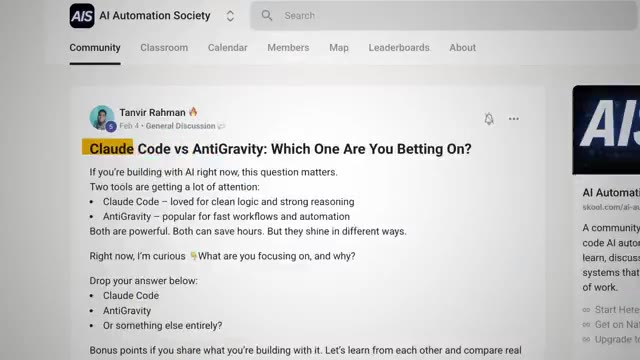
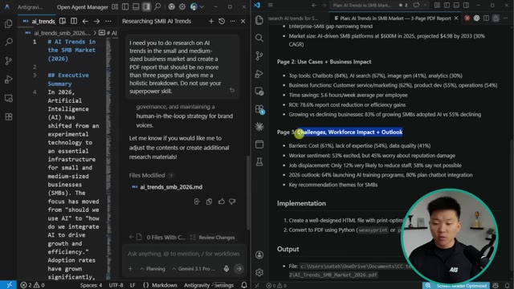

# 🎬 100 Hours Testing Claude Code vs Antigravity (honest results)

> **Chaîne** : [Nate Herk | AI Automation](https://www.youtube.com/@nateherk/featured)  
> **Lien YouTube** : [https://www.youtube.com/watch?v=99VHENEKA9o](https://www.youtube.com/watch?v=99VHENEKA9o)  
> **Date de publication** : 20260413  
> **Durée** : 00:23:32  
> **Identifiant vidéo** : `99VHENEKA9o`  
> **Transcription & Analyse** : `whisper-v3-large-turbo+gemini-3.5-flash-lite`  

---

## 📌 Synthèse Exécutive & Outils

### 💡 Résumé
Le paysage du développement logiciel assisté par l'intelligence artificielle est actuellement dominé par deux solutions agentiques majeures : **Claude Code** d'Anthropic et **Antigravity** de Google. Bien que ces deux outils reposent sur des modèles haut de gamme aux performances proches sur le papier — comme en témoignent leurs scores élevés sur le benchmark de référence *SWE Bench Verified* —, ils se distinguent fondamentalement par leur architecture et leur philosophie d'utilisation. D'un côté, Claude Code s'impose comme un outil CLI (Interface de Ligne de Commande) axé sur le terminal, hautement modifiable, qui s'intègre nativement dans l'écosystème de travail habituel du développeur (comme VS Code) tout en excellant dans le raisonnement séquentiel et la planification multi-fichiers. De l'autre, Antigravity se présente comme un IDE autonome et unifié, doté d'une vue gestionnaire pour le travail en parallèle et d'un agent de navigation web intégré, s'avérant redoutable pour concevoir rapidement des interfaces front-end et des applications web complètes à partir de zéro. 

Au terme de centaines d'heures de tests pratiques, il apparaît clairement que le choix d'un outil dépend autant de la nature du projet que du modèle d'IA sollicité en arrière-plan. Les deux plateformes offrent des gains de productivité spectaculaires — rapportés entre 50 % et 70 % — et permettent d'automatiser une part significative des tâches complexes sans intervention humaine. Néanmoins, l'utilisation intensive de ces agents met en lumière des défis opérationnels cruciaux, notamment la gestion rigoureuse des fenêtres de contexte, l'optimisation des jetons (tokens) pour maîtriser les coûts financiers, ainsi que la nécessité de surveiller la dérive potentielle des instructions lors de développements au long cours.

---

### 🛠️ Outils, Modèles & Logiciels Présentés
* **Claude Code** : Plateforme de codage agentique d'Anthropic, principalement conçue pour le terminal (CLI) et s'intégrant fluidement aux environnements de développement existants via une extension VS Code ou des applications de bureau et web.
* **Google Antigravity** : Environnement de développement intégré (IDE) autonome et agentique proposé par Google, doté d'une vue gestionnaire pour orchestrer plusieurs agents en parallèle et d'un agent de navigation web intégré.
* **Claude (modèles Anthropic, ex. Opus 5.5 / 4.6)** : Famille de modèles de pointe alimentant Claude Code, reconnue pour sa capacité de planification rigoureuse en lecture seule et son niveau de raisonnement élevé.
* **Gemini (modèles Google, ex. Flash / Pro 3)** : Famille de modèles multimodaux de Google propulsant Antigravity, particulièrement performants pour la création rapide d'interfaces front-end et d'applications web visuelles.
* **SWE Bench Verified** : Test de référence standard de l'industrie mesurant la capacité des outils de programmation IA à résoudre entièrement de vrais problèmes issus de projets open source GitHub.

---

### 🔑 Points Clés & Enseignements Stratégiques
* **Divergence architecturale (CLI vs IDE)** : Claude Code s'intègre sans friction dans les outils préférés du développeur en se positionnant dans le terminal, tandis qu'Antigravity impose un environnement IDE autonome et centralisé, pensé pour emménager dans un nouveau flux de travail unifié.
* **Supériorité méthodologique du mode plan** : Claude Code se distingue par un mode de planification dédié très strict qui analyse la structure du projet en lecture seule et élabore une stratégie multi-fichiers avant d'écrire la moindre ligne de code.
* **Efficacité front-end d'Antigravity** : Antigravity excelle dans la conception rapide d'applications complètes et d'éléments d'interface utilisateur (UI/UX) à partir de zéro, avec des taux de réussite élevés sur la propreté du code généré.
* **Impact déterminant du modèle sous-jacent** : La puissance et la qualité des résultats ne dépendent pas uniquement de l'interface de l'outil, mais du plafond de capacité du modèle d'IA sélectionné (par exemple, Haiku ou Gemini Flash par rapport à Opus ou Gemini Pro).
* **Alignement avec la base de code existante** : Claude Code démontre une capacité supérieure à s'imprégner des motifs, des conventions de nommage et de la structure d'un projet existant pour produire du code intégré et organique plutôt que greffé.
* **Gestion critique du contexte et des jetons** : L'utilisation de ces agents consomme rapidement les limites d'utilisation ; maîtriser la gestion du contexte et des jetons est devenu une compétence indispensable pour éviter l'explosion des coûts ou l'épuisement prématuré des quotas.
* **Risque de dérive contextuelle à long terme** : Sur des projets s'étalant sur plusieurs jours, les agents de codage — en particulier Antigravity — ont tendance à s'éloigner progressivement des règles initiales et des conventions fixées au premier jour, nécessitant une supervision humaine.
* **Gains de productivité quantifiés** : Les retours d'expérience réels indiquent des gains de productivité substantiels oscillant entre 50 % et 70 %, se traduisant par une augmentation significative des demandes de tirage (PR) fusionnées par ingénieur et par jour.
* **Stabilité des quotas et tarification** : Les deux écosystèmes font face à des défis opérationnels liés à la tarification, illustrés par des bugs de mise en cache chez Anthropic ou des systèmes de quotas basés sur des crédits parfois opaques chez Google.
* **Priorisation stratégique des apprentissages** : Bien que chaque outil réponde à des besoins spécifiques, la maîtrise prioritaire de Claude Code offre aux développeurs un contrôle granulaire et modifiable supérieur pour l'ingénierie logicielle complexe au sein de leurs environnements familiers.

---

## ⏱️ Chronologie & Transcription Complète Audio & Visuelle (Mot pour Mot)

### ⏱️ `[00:00:00 - 00:00:30]` | Segment #01

**🔊 Audio (Transcription Intégrale Mot pour Mot en Français) :**
> En ce moment, il y a deux outils qui dominent le marché en matière de développement avec l'IA. Nous avons Cloud Code et Google Antigravity. Et ces derniers mois, il y a eu un débat sur celui de ces outils qui est réellement le meilleur. Donc, si vous essayez de déterminer quel outil d'IA apprendre et utiliser dès maintenant, cette vidéo va vous faire gagner un temps fou. Après des centaines d'heures à tester ces deux outils, la vérité est que chacun d'eux est meilleur pour des tâches différentes. Et même si la réponse n'est pas ultra évidente, je pense tout de même qu'il y a un outil que vous devriez apprendre en priorité par rapport à l'autre. Donc, dans cette vidéo, nous allons aborder leurs principales différences et je vais les tester devant vous en direct avec différents flux de travail afin que vous puissiez voir où ils brillent et où ils pèchent.

**👁️ Analyse Visuelle d'Écran (gemini-3.5-flash-lite) :**
**Interface & Outils** : Visual Studio Code, interface de la communauté en ligne.

**Contenu textuel & Code** : Publication de discussion sur Claude Code vs AntiGravity et commandes bash de l'agent Claude Code dans l'éditeur.

**Action / Démonstration** : Navigation sur une page communautaire et exécution d'une revue de code dans l'éditeur.

*⏱️ 00:00:07 — Capture d'écran montrant une publication de la communauté "AI Automation Society" intitulée "Claude Code vs AntiGravity: Which One Are You Betting On?".*

*⏱️ 00:00:15 — Capture d'écran d'un éditeur de code VS Code affichant l'interface de Claude Code avec des lignes de commande bash et un encadré vidéo du présentateur en bas à gauche.*

---

### ⏱️ `[00:00:30 - 00:00:50]` | Segment #02

**🔊 Audio (Transcription Intégrale Mot pour Mot en Français) :**
> Ensuite, je vous donnerai mon avis sur lequel est le meilleur dans l'ensemble. Donc, d'ici la fin de cette vidéo, vous aurez une idée claire de l'outil que vous devriez apprendre et utiliser cette année. Alors, entrons dans le vif du sujet. Très bien. Donc, avant d'aborder les tests proprement dits, vous devez comprendre ce que sont ces outils et en quoi ils sont réellement différents. Tant CloudCode qu'Antigravity sont des plateformes de codage agentiques. Elles peuvent prendre une grande mission, la diviser en un plan, et lancer des sous-agents pour travailler en parallèle.

**👁️ Analyse Visuelle d'Écran (gemini-3.5-flash-lite) :**
**Interface & Outils** : Éditeurs de code et environnements de développement (Claude Code, Antigravity)

**Contenu textuel & Code** : Prompt utilisateur pour construire une application full-stack de suivi d'habitudes ('habit tracker app') avec tableau de bord, calendrier thermique et fonctionnalités CRUD.

**Action / Démonstration** : Configuration et affichage côte à côte des interfaces de développement Claude Code et Antigravity avant le lancement des tests.

*⏱️ 00:00:35 — Animation graphique affichant le titre 'CLAUDE CODE' avec une icône stylisée sur fond sombre.*

*⏱️ 00:00:45 — Capture d'écran double divisée montrant l'interface de l'éditeur de code 'Claude Code' à gauche et l'outil 'Antigravity' à droite avec un prompt détaillé pour créer une application de suivi d'habitudes.*

---

### ⏱️ `[00:00:51 - 00:01:09]` | Segment #03

**🔊 Audio (Transcription Intégrale Mot pour Mot en Français) :**
> Ils peuvent gérer vos fichiers et vos dossiers, exécuter des commandes de terminal et s'exécuter dans l'ensemble de votre base de code. CloudCode est alimenté par les modèles Cloud d'Anthropic. Anti-Gravity utilise par défaut les modèles Gemini de Google. Vous pouvez changer de modèle pour ces deux outils différents, mais cela demande parfois un peu de configuration supplémentaire. Cependant, le plafond de puissance de ces deux outils est extrêmement élevé.

**👁️ Analyse Visuelle d'Écran (gemini-3.5-flash-lite) :**
**Interface & Outils** : Interface web de configuration et diagramme animé de workflow.

**Contenu textuel & Code** : Paramètres de routage avec sélection de modèles Gemini (gemini-3-flash-preview, gemini-2.5-flash, etc.) et options de configuration.

**Action / Démonstration** : Configuration des modèles d'IA sous-jacents et illustration des capacités des agents.

*⏱️ 00:00:55 — Schéma graphique illustrant les fonctionnalités d'un sous-agent (gestion de fichiers, commandes terminal, base de code).*

*⏱️ 00:01:04 — Interface de configuration web montrant les paramètres de routage des différents modèles d'IA (Default, Background, Think, Long Context, Web Search).*

---

### ⏱️ `[00:01:09 - 00:01:29]` | Segment #04

**🔊 Audio (Transcription Intégrale Mot pour Mot en Français) :**
> Et à cause de cela, les deux outils sont gratuits. Vous ne payez pas pour Cloud Code ou vous ne payez pas pour Anti-Gravity. Ce que vous finissez par payer, c'est l'utilisation du modèle, la véritable IA en arrière-plan qui fait le travail de réflexion. Vous payez pour les jetons. La différence ne réside donc pas dans les capacités, mais dans l'endroit où ces capacités résident et dans la manière dont vous y accédez. Cloud Code est d'abord conçu pour le terminal. C'est un outil CLI qui s'intègre dans l'environnement dans lequel vous travaillez déjà.

**👁️ Analyse Visuelle d'Écran (gemini-3.5-flash-lite) :**
**Interface & Outils** : AUCUNE

**Contenu textuel & Code** : AUCUN

**Action / Démonstration** : AUCUNE

---

### ⏱️ `[00:01:29 - 00:01:48]` | Segment #05

**🔊 Audio (Transcription Intégrale Mot pour Mot en Français) :**
> Donc vous pouvez garder votre éditeur, vos raccourcis clavier, vos extensions. Tout reste identique. La puissance agentique, les sous-agents, l'exécution parallèle, l'orchestration, tout y est. Mais c'est exposé via votre terminal et configuré par vous. Vous construisez le flux de travail par-dessus l'outil. Maintenant, anti-gravity est son propre IDE autonome. Certains pensent que c'est une copie de VS Code. Vos extensions et raccourcis peuvent donc être transférés.

**👁️ Analyse Visuelle d'Écran (gemini-3.5-flash-lite) :**
**Interface & Outils** : Interface sombre d'outil de développement / éditeur de code.

**Contenu textuel & Code** : Texte de prompt utilisateur et message d'état d'un agent IA en cours de recherche web.

**Action / Démonstration** : Exécution d'une requête par un agent IA dans l'interface de développement.

*⏱️ 00:01:43 — Capture d'écran divisée en deux fenêtres montrant une interface sombre avec du texte et un agent IA effectuant une recherche web ("Agent is searching the web").*

---

### ⏱️ `[00:01:48 - 00:02:20]` | Segment #06

**🔊 Audio (Transcription Intégrale Mot pour Mot en Français) :**
> Mais vous ouvrez une application complètement différente. Elle dispose d'une vue gestionnaire où vous pouvez voir plusieurs agents travailler en parallèle sur différents espaces de travail et d'un agent de navigation intégré capable de parcourir de vraies pages web. La façon la plus simple de le concevoir, c'est que CloudCode vous fournit les éléments de base et vous permet de travailler de la manière dont vous avez déjà l'habitude de le faire. Antigravity regroupe tout le processus de travail des agents dans un environnement spécialement conçu dans lequel vous emménagez en quelque sorte. Très bien, parlons donc de ce que l'on ressent réellement en les utilisant, en commençant par la configuration. CloudCode vous offre donc plusieurs points d'entrée. L'interface en ligne de commande, le terminal CLI, est le mode original et le plus puissant. Vous l'installez avec npm et vous tapez Cloud dans n'importe quel terminal.

**👁️ Analyse Visuelle d'Écran (gemini-3.5-flash-lite) :**
**Interface & Outils** : Application de gestion d'agents IA (Agent Manager Preview).

**Contenu textuel & Code** : Menus d'espaces de travail (Project 01, Project 02, Sub agent #1 à #3) et options de configuration de conversation.

**Action / Démonstration** : Navigation et présentation de l'interface de gestion multi-agents avec prise en charge du navigateur.

*⏱️ 00:01:56 — Interface d'une application de gestion d'agents IA montrant la barre latérale avec les espaces de travail (Project 01, Project 02) et une zone de chat pour configurer les conversations.*

---

### ⏱️ `[00:02:20 - 00:02:46]` | Segment #07

**🔊 Audio (Transcription Intégrale Mot pour Mot en Français) :**
> et CloudCode apparaît. Il y a aussi une extension VS Code avec des diffs en ligne, une révision de plan, la visibilité des fichiers, des mentions at, et tout cela peut se trouver directement dans votre éditeur. Cloud nous offre également une application de bureau si vous ne voulez pas du tout utiliser la version VS Code, et c'est beaucoup plus, je dirais, convivial, ainsi qu'une version web que vous pouvez exécuter directement depuis votre navigateur sans aucune installation. Donc dans presque toutes les vidéos de ma chaîne où vous m'avez peut-être vu utiliser CloudCode, je l'ai utilisé à l'intérieur de VS Code, soit via l'extension, soit en l'exécutant simplement dans mon terminal VS Code.

**👁️ Analyse Visuelle d'Écran (gemini-3.5-flash-lite) :**
**Interface & Outils** : VS Code (Visual Studio Code), extension "Claude Code for VS Code"

**Contenu textuel & Code** : Documentation technique, descriptions des fonctionnalités de l'extension Claude Code pour VS Code, informations de version et d'installation de l'extension.

**Action / Démonstration** : Présentation des fonctionnalités de l'extension VS Code Claude Code (diffs en ligne, révision de plan, visibilité des fichiers, mentions at).

*⏱️ 00:02:26 — Interface VS Code présentant la documentation Gemini API avec une superposition de texte listant 4 fonctionnalités (Inline diffs, Plan review, File visibility, @ mentions) et un lecteur vidéo montrant un chien jouant de la guitare.*

*⏱️ 00:02:33 — Marketplace de VS Code affichant la page de l'extension "Claude Code for VS Code" développée par Anthropic.*

---

### ⏱️ `[00:02:46 - 00:03:19]` | Segment #08

**🔊 Audio (Transcription Intégrale Mot pour Mot en Français) :**
> Maintenant, je fais ça parce que j'aime pouvoir voir tous mes fichiers sur ce côté gauche pendant que je travaille avec CloudCode plutôt que de simplement fixer une fenêtre de terminal. Une chose qui vaut la peine d'être notée cependant, c'est que l'interface de ligne de commande du terminal est techniquement le mode le plus complet en termes de fonctionnalités. L'extension VS Code couvre à peu près tout, mais il y a quelques fonctionnalités avancées qui sont réservées à la ligne de commande. Donc pour la plupart des gens qui débutent, l'extension est vraiment largement suffisante. Maintenant, Antigravity n'a qu'une seule porte d'entrée. Vous téléchargez l'application et vous devez l'exécuter par ce biais. Il y a une commande de ligne de commande pour la lancer depuis votre terminal, mais cela ouvre fondamentalement juste l'IDE Antigravity. Il n'y a donc pas d'option pour exécuter Antigravity à l'intérieur de VS Code. Alors maintenant, passons vraiment

**👁️ Analyse Visuelle d'Écran (gemini-3.5-flash-lite) :**
**Interface & Outils** : Gemini CLI / Terminal

**Contenu textuel & Code** : Commande d'installation npm et interface interactive du terminal Gemini avec logo pixel art et champ de saisie de prompt.

**Action / Démonstration** : Présentation visuelle de l'interface de ligne de commande Gemini CLI sur le site web.

*⏱️ 00:03:11 — Capture d'écran de l'interface du terminal de l'outil Gemini CLI affichant le logo en pixel art et la ligne de commande.*

---

### ⏱️ `[00:03:19 - 00:03:52]` | Segment #09

**🔊 Audio (Transcription Intégrale Mot pour Mot en Français) :**
> entrons dans ce qui compte le plus, c'est-à-dire la qualité de ce que les outils produisent. Le modèle que vous utilisez à l'intérieur de l'outil compte énormément. Si vous utilisez CloudCode avec Haiku, ce sera une expérience complètement différente que d'utiliser CloudCode avec Opus. Utiliser Anti-Gravity avec Gemini Flash ne sera pas la même chose que d'utiliser Anti-Gravity avec Gemini Pro. L'environnement façonne la façon dont le modèle fonctionne, mais le modèle détermine la limite maximale. Donc, lorsque nous parlons de la qualité des résultats, cela dépend en grande partie du modèle que vous faites tourner sous le capot. Maintenant, la plus grande force de CloudCode est la façon dont il réfléchit avant d'agir. Il possède un mode de planification dédié, ce qu'Anti-Gravity a également, mais dans ce mode de planification, il planifie un travail sur plusieurs fichiers avant de toucher à quoi que ce soit. Il va

**👁️ Analyse Visuelle d'Écran (gemini-3.5-flash-lite) :**
**Interface & Outils** : Interface web de sélection de modèles d'IA (type interface Claude/Anthropic).

**Contenu textuel & Code** : Menus déroulants affichant Opus 4.6, Sonnet 4.6, Haiku 4.5 et l'option Extended thinking.

**Action / Démonstration** : Sélection d'un modèle d'IA dans l'interface utilisateur.

*⏱️ 00:03:27 — Menu déroulant de sélection de modèles d'IA (Opus 4.6, Sonnet 4.6, Haiku 4.5) avec options de réflexion prolongée.*

---

### ⏱️ `[00:03:52 - 00:04:18]` | Segment #10

**🔊 Audio (Transcription Intégrale Mot pour Mot en Français) :**
> soit en lecture seule, sans modification de code, juste de la stratégie et des questions de clarification. Vous pouvez contrôler la profondeur de son raisonnement, jusqu'à ce qu'Anthropic appelle leur super-réflexion pour les problèmes vraiment complexes. Comme je l'ai dit, anti-gravity a aussi un mode plan, mais je pense que cloud code le fait tout simplement mieux. Vous verrez exactement ce que je veux dire quand nous passerons à tous les tests en direct plus tard. Les deux outils vous permettent également de définir des règles au niveau du projet, des conventions et des instructions personnalisées qui persistent d'une session à l'autre. Les deux prennent en charge les plugins, les commandes personnalisées et les intégrations avec des outils externes.

**👁️ Analyse Visuelle d'Écran (gemini-3.5-flash-lite) :**
**Interface & Outils** : Aucune interface logicielle interactive ou de programmation affichée.

**Contenu textuel & Code** : Aucun code source, terminal ou prompt visible à l'écran.

**Action / Démonstration** : Le présentateur s'exprime face caméra sans manipulation technique ni démonstration en direct.

---

### ⏱️ `[00:04:19 - 00:04:54]` | Segment #11

**🔊 Audio (Transcription Intégrale Mot pour Mot en Français) :**
> L'extensibilité est présente des deux côtés, mais CloudCode me semble extrêmement modifiable parce que j'ai l'impression d'avoir beaucoup plus de contrôle sur la façon dont je veux que ce projet individuel se comporte. Là où CloudCode se démarque également, c'est dans sa capacité à comprendre votre projet existant et votre structure de fichiers. Il lit tout, il capte vos motifs et vos conventions de nommage, et il s'appuie sur ce que vous avez déjà. Ainsi, le code généré s'intègre à votre base de code au lieu d'avoir l'air simplement greffé. La force majeure d'Antigravity est de créer des applications complètes et des interfaces front-end à partir de zéro. Lors d'un test indépendant de 21 jours sur 12 projets réels, 94 % du code généré était propre, valide, limitatif, sans aucune erreur ni problème de style. Il a complété environ 73 %

**👁️ Analyse Visuelle d'Écran (gemini-3.5-flash-lite) :**
**Interface & Outils** : Présentation vidéo avec incrustations graphiques et page web textuelle.

**Contenu textuel & Code** : Textes textuels et marketing sur les outils d'IA (Claude Code, Google Antigravity).
[DESC_IMAGE_1]
[DESC_IMAGE_2]
[DESC_IMAGE_3]
[INTERFACE] Aucune interface de développement active ou IDE.

**Action / Démonstration** : Aucune action de programmation ou d'exécution d'agent.

---

### ⏱️ `[00:04:54 - 00:05:13]` | Segment #12

**🔊 Audio (Transcription Intégrale Mot pour Mot en Français) :**
> de tâches sans aucune intervention humaine et a permis une réduction de 60 à 70 % du temps de développement. Maintenant, lorsque j'ai utilisé Antigravity, je l'ai principalement utilisé pour concevoir des choses, des éléments d'interface, d'expérience utilisateur, des sites web, des applications web, des choses de ce genre. Je trouve simplement qu'il fait un bien meilleur travail par rapport à CloudCode and Opus pour ce qui est d'avoir un véritable goût et de faire en sorte que les choses aient l'air et se ressentent de manière plus réelle.

**👁️ Analyse Visuelle d'Écran (gemini-3.5-flash-lite) :**
**Interface & Outils** : Navigateur web (BoostStash) et incrustations graphiques vidéo.

**Contenu textuel & Code** : Texte descriptif sur l'IDE et statistiques de réduction du temps de développement (60-70 %).

**Action / Démonstration** : Présentation orale des retours d'expérience et des cas d'usage par le créateur.

---

### ⏱️ `[00:05:13 - 00:05:33]` | Segment #13

**🔊 Audio (Transcription Intégrale Mot pour Mot en Français) :**
> Mais il y a un inconvénient car, sur les projets plus longs, l'anti-gravité peut commencer à s'éloigner des règles que vous avez fixées au début. C'est un schéma documenté. Les forums de développeurs de Google ont un fil de discussion à ce sujet. Il peut construire quelque chose de parfaitement conforme aux spécifications le premier jour, puis commencer à ignorer progressivement vos directives initiales d'ici le troisième jour. Pour être juste, cela est généralement vrai pour tout agent de codage avec n'importe quel modèle de codage, mais je tenais tout de même à le souligner ici.

**👁️ Analyse Visuelle d'Écran (gemini-3.5-flash-lite) :**
**Interface & Outils** : Interface de chat type chatbot/agent IA conversationnel (style interface épurée).

**Contenu textuel & Code** : Texte de prompt "Build me a...", suivi d'une liste de tâches validées (Day 1) et d'un indicateur d'état "Searching context..." (Day 3).

**Action / Démonstration** : Démonstration de l'évolution séquentielle des tâches accomplies par un agent IA sur plusieurs jours.

*⏱️ 00:05:23 — Interface de chat sombre d'un agent IA affichant une bulle de message "Build me a...".*

*⏱️ 00:05:28 — Interface de chat montrant une progression par étapes ("Day 1" validé avec Typography, Hero Section, Pricing) et un état "Searching context..." sous la mention "Day 3".*

---

### ⏱️ `[00:05:33 - 00:06:01]` | Segment #14

**🔊 Audio (Transcription Intégrale Mot pour Mot en Français) :**
> Maintenant, regardons quelques repères. Le SWE Bench Verified est le test standard de l'industrie pour les outils de programmation IA. Il prend de vrais problèmes GitHub de véritables projets open source, et il mesure combien sont entièrement résolus par le modèle d'IA. Claude Opus 4.6 à l'intérieur de Claude Code a obtenu un score de 80,9 %. Gemini 3 Pro à l'intérieur d'Antigravity a atteint environ 76,2 %. Ces deux scores impliquent l'environnement complet, c'est-à-dire l'outil plus le modèle, ensemble. Mais Google n'a pas publié la méthodologie de test exacte de la même manière qu'Anthropic l'a fait, ce n'est donc pas une comparaison parfaitement équitable.

**👁️ Analyse Visuelle d'Écran (gemini-3.5-flash-lite) :**
**Interface & Outils** : Graphique explicatif animé du benchmark SWE Bench

**Contenu textuel & Code** : Texte "SWE BENCHMARK TEST", icônes GitHub Issues, badge "AI MODEL", score de 80.9% pour Opus 4.6

**Action / Démonstration** : Animation graphique illustrant le fonctionnement et les résultats du benchmark des modèles d'IA sur des problèmes GitHub.

*⏱️ 00:05:40 — Schéma animé illustrant le test de benchmark SWE, montrant des problèmes GitHub traités par un modèle d'IA.*

*⏱️ 00:05:47 — Graphique à barres montrant les performances de Claude Opus 4.6 atteignant 80,9% au test SWE Benchmark.*

---

### ⏱️ `[00:06:01 - 00:06:20]` | Segment #15

**🔊 Audio (Transcription Intégrale Mot pour Mot en Français) :**
> Mais au niveau des modèles haut de gamme, ces outils sont remarquablement proches sur le papier. Maintenant, les résultats dans le monde réel. L'équipe d'ingénierie d'Anthropic a rapporté que Claude Code leur a donné un gain de productivité de 50 % et 67 % de demandes de tirage fusionnées en plus par ingénieur et par jour. Du côté d'Anti-Gravity, le test indépendant de 21 jours a montré un développement 60 à 70 % plus rapide. Les deux chiffres sont extrêmement impressionnants.

**👁️ Analyse Visuelle d'Écran (gemini-3.5-flash-lite) :**
**Interface & Outils** : Rapport technique ou article de blog sur les performances d'ingénierie (Anthropic/Claude Code).

**Contenu textuel & Code** : Statistiques sur l'usage de Claude (+50% de gain de productivité, +67% de pull requests fusionnées), temps de démarrage de l'IDE (8-12 secondes), temps de développement (5-45 minutes) et scores de stabilité (INP 80-120ms).

**Action / Démonstration** : Présentation factuelle de données chiffrées issues de rapports internes sur l'efficacité des agents de codage.

*⏱️ 00:06:11 — Capture d'écran d'un document texte détaillant les gains de productivité liés à l'usage de Claude, avec le chiffre "67%" surligné.*

*⏱️ 00:06:15 — Capture d'écran d'un rapport de performance indiquant des statistiques sur le temps de développement et la stabilité du système (INP scores, tests sur 21 jours).*

---

### ⏱️ `[00:06:21 - 00:06:39]` | Segment #16

**🔊 Audio (Transcription Intégrale Mot pour Mot en Français) :**
> Aucune de ces deux méthodes n'est une étude scientifique contrôlée, mais de manière générale, elles vous indiquent toutes les deux que ces outils rendent les développeurs nettement plus rapides. Mais parlons maintenant de la vitesse et de la fiabilité. N'oubliez pas que ce pour quoi vous payez lorsque vous utilisez ces outils, ce n'est pas l'outil, vous payez pour le modèle. Et ces modèles vont épuiser votre consommation ou vos limites plus vite que vous ne le pensez, surtout si vous ne faites pas attention.

**👁️ Analyse Visuelle d'Écran (gemini-3.5-flash-lite) :**
**Interface & Outils** : Aucune interface de développement, de terminal ou d'outil IA visible.

**Contenu textuel & Code** : Texte à l'écran illustrant les propos audio (« BOTH TOOLS ARE MAKING DEVELOPERS » puis « 2 SPEED AND RELIABILITY »).

**Action / Démonstration** : Aucune action technique, de programmation ou de démonstration n'est effectuée.

---

### ⏱️ `[00:06:39 - 00:06:58]` | Segment #17

**🔊 Audio (Transcription Intégrale Mot pour Mot en Français) :**
> Cloud Code a eu récemment, en mars 26, un bug de mise en cache qui a fait gonfler les coûts des jetons de peut-être 10 à 20 fois. Pour les utilisateurs de MaxPlan, ils épuisaient toute leur session en moins de deux heures. Anthropic a reconnu ce problème et semble travailler constamment sur l'optimisation des jetons, ce qui va évidemment être une sorte de projet en cours. Anti-gravity a ses propres problèmes également.

**👁️ Analyse Visuelle d'Écran (gemini-3.5-flash-lite) :**
**Interface & Outils** : Navigateur web affichant un article de presse (The Register) et un forum (Reddit).

**Contenu textuel & Code** : Texte d'un article de presse et message de forum abordant les problèmes de surconsommation de jetons et de bogues de cache sur Claude Code.

**Action / Démonstration** : Présentation visuelle de témoignages et d'articles de presse concernant le bug de coût de Claude Code.

*⏱️ 00:06:44 — Capture d'écran d'un article de The Register détaillant un bug de mise en cache dans Claude Code qui fait exploser les coûts en jetons de 10 à 20 fois.*

*⏱️ 00:06:49 — Capture d'écran d'une publication sur Reddit (r/ClaudeAI) où un utilisateur se plaint de l'épuisement rapide de ses quotas d'utilisation avec Claude.*

---

### ⏱️ `[00:06:58 - 00:07:22]` | Segment #18

**🔊 Audio (Transcription Intégrale Mot pour Mot en Français) :**
> Le système de quotas de Google a été complètement chaotique, les utilisateurs pro se retrouvant bloqués pendant toute une semaine après avoir atteint les limites, avec un système de tarification basé sur des crédits qui n'explique toujours pas clairement ce qu'achète réellement un crédit. Donc, en général, apprendre à gérer votre contexte et vos jetons est l'une des compétences les plus importantes que vous puissiez développer en ce moment, car elle s'applique à n'importe quel agent de codage que vous finirez par utiliser. J'ai fait une vidéo complète sur 18 astuces de gestion des jetons que j'ai trouvées en expérimentant avec ces outils, et je mettrai un lien vers celle-ci juste ici.

**👁️ Analyse Visuelle d'Écran (gemini-3.5-flash-lite) :**
**Interface & Outils** : Navigateur web affichant un fil de discussion Reddit.

**Contenu textuel & Code** : Texte de la publication Reddit détaillant les confusions liées aux appels API de Gemini, aux limites de quotas et au modèle de tarification.

**Action / Démonstration** : Affichage d'un témoignage textuel illustrant les problèmes de tarification et de quotas de Google Gemini.

*⏱️ 00:07:04 — Capture d'écran d'une publication sur Reddit (r/Bard) intitulée "Can someone please explain the Gemini pricing model?" montrant les interrogations d'un utilisateur sur les coûts de l'API Gemini 2.5 Pro.*

---

### ⏱️ `[00:07:22 - 00:07:43]` | Segment #19

**🔊 Audio (Transcription Intégrale Mot pour Mot en Français) :**
> Maintenant, en termes de vitesse d'exécution, un test indépendant a montré que CloudCode a accompli une tâche représentative en environ 4 minutes contre 8 minutes pour Antigravity. Ce que j'ai trouvé intéressant, car lors de mes tests, Antigravity a toujours semblé plus rapide. Et vous verrez cela plus tard dans la vidéo lorsque nous ferons ces tests réels. Maintenant, la vraie différence en matière de fiabilité en ce moment concerne la maturité. CloudCode est sorti en version de production avec de nombreuses mises à jour publiées chaque semaine.

**👁️ Analyse Visuelle d'Écran (gemini-3.5-flash-lite) :**
**Interface & Outils** : Interface graphique de présentation vidéo (graphique comparatif).

**Contenu textuel & Code** : Mention de "REPRESENTATIVE TASK" et "CLAUDE CODE" avec la durée de 4 minutes.

**Action / Démonstration** : Affichage d'un graphique illustrant les résultats des tests de vitesse d'exécution.

*⏱️ 00:07:27 — Un graphique textuel et visuel indiquant "REPRESENTATIVE TASK" avec une carte pour Claude Code affichant un temps de 4 minutes.*

---

### ⏱️ `[00:07:43 - 00:08:08]` | Segment #20

**🔊 Audio (Transcription Intégrale Mot pour Mot en Français) :**
> Antigravity est toujours en version d'évaluation publique à ce jour, en avril 2026, mais il s'améliore très rapidement. Il conserve toutefois l'instabilité inhérente à ce stade d'évaluation publique. Certaines personnes signalent des problèmes de connexion, il y a des bugs occasionnels sur Windows, et des agents se bloquent dans des boucles. Maintenant, la perte de contexte est bien réelle pour ces deux outils. Même avec la fenêtre de contexte d'un million de jetons de CloudCode avec Opus, il peut y avoir des problèmes lorsque vous chargez de véritables bases de code, que vous exécutez de nombreux appels d'outils et que vous faites des allers-retours pendant plus de quarante requêtes.

**👁️ Analyse Visuelle d'Écran (gemini-3.5-flash-lite) :**
**Interface & Outils** : Éditeur de code (VS Code ou similaire) et page de résultats de recherche/benchmarking IA.

**Contenu textuel & Code** : Texte de spécifications techniques de développement et graphique en barres de performance comparative de modèles IA.
[DESC_IMAGE_1] supprimée car plan fixe sans élément graphique.

**Action / Démonstration** : Présentation des bugs et limites des agents IA ainsi que comparaison de performances des modèles de langage.

*⏱️ 00:07:56 — Capture d'un éditeur de code affichant un plan de travail de développement avec le texte rouge superposé « AGENTS ARE GETTING STUCK ».*

*⏱️ 00:08:02 — Graphique de performance montrant les résultats de raisonnement à long contexte (Long-context reasoning) pour différents modèles, avec « Opus 4.6 » en tête à 72.0.*

---

### ⏱️ `[00:08:08 - 00:08:30]` | Segment #21

**🔊 Audio (Transcription Intégrale Mot pour Mot en Français) :**
> À ce moment-là, l'intelligence artificielle commence tout simplement à perdre le fil des instructions précédentes. Les documents de dépannage d'Antigravity recommandent de commencer une nouvelle conversation dès que l'agent met plus de 10 secondes à répondre. CloudCode dispose d'une commande compacte qui compresse l'historique de votre conversation. Mais la meilleure pratique pour ces deux outils est la même. Gardez vos sessions ciblées, une tâche par session, recommencez à neuf souvent. Maintenant, une dernière chose que je voulais mentionner, c'est que le rythme du développement est tout simplement fou.

**👁️ Analyse Visuelle d'Écran (gemini-3.5-flash-lite) :**
**Interface & Outils** : Graphique de présentation animé (overlay vidéo).

**Contenu textuel & Code** : Texte 'ANTI-DRIFT PROTOCOL', 'Focused sessions', '1 task per session' et étapes 1 et 2.

**Action / Démonstration** : Affichage d'un schéma explicatif de l'Anti-Drift Protocol pour les agents IA.

*⏱️ 00:08:25 — Un écran graphique présente le titre 'ANTI-DRIFT PROTOCOL' avec deux étapes numérotées ('Focused sessions' et '1 task per session').*

---

### ⏱️ `[00:08:31 - 00:09:04]` | Segment #22

**🔊 Audio (Transcription Intégrale Mot pour Mot en Français) :**
> CloudCode a progressé à un rythme effréné. Rien qu'au premier trimestre 2026, ils ont lancé six fonctionnalités majeures au niveau de la plateforme avec plusieurs versions par semaine. Et à un moment donné, il y a eu trois versions différentes en l'espace de cinq jours. Antigravity s'est également amélioré et mis à jour, mais la cadence est nettement différente. Du lancement en novembre jusqu'en mars 2026, soit, vous savez, environ quatre ou cinq mois, les numéros de version sont passés de 1.11 à 1.21, la plupart des mises à jour consistant en une poignée d'améliorations, de corrections de bugs mineurs et d'optimisations. Les deux sont donc activement développés, mais CloudCode avance beaucoup plus rapidement. Et lorsque vous choisissez un outil dans lequel investir votre temps, je pense que cela

**👁️ Analyse Visuelle d'Écran (gemini-3.5-flash-lite) :**
**Interface & Outils** : Graphique de présentation de type tableau de versions.

**Contenu textuel & Code** : Tableau avec colonnes Date (Feb 24, 2026 / Feb 27, 2026 / Mar 1, 2026) et Releases (v0.2.x / v0.2.x (patch) / v0.3.0).

**Action / Démonstration** : Affichage graphique illustrant le rythme rapide des versions logicielles.

*⏱️ 00:08:39 — Un tableau affichant le calendrier des versions (Rapid Release) avec les dates de février et mars 2026.*

---

### ⏱️ `[00:09:04 - 00:09:36]` | Segment #23

**🔊 Audio (Transcription Intégrale Mot pour Mot en Français) :**
> compte énormément. Très bien, alors parlons des intégrations, car un outil de codage n'est vraiment utile que par ce auquel il peut réellement se connecter. Ces deux outils de codage prennent en charge le MCP, le Model Context Protocol, le standard ouvert qui permet aux outils d'IA de se connecter à des services externes. GitHub, des bases de données comme Supabase, Playwright, Firecrawl, des outils de design, des plateformes de surveillance. Plus de 1 500 serveurs MCP existent à l'heure actuelle, et ce nombre ne cesse de croître. La différence réside dans la configuration. L'intégration MCP de CloudCode est pilotée par la ligne de commande. Vous ajoutez des serveurs avec une seule commande, ou en demandant à CloudCode de le faire, ou en modifiant un fichier de configuration JSON défini au niveau global, par projet, ou peut-être par utilisateur.

**👁️ Analyse Visuelle d'Écran (gemini-3.5-flash-lite) :**
**Interface & Outils** : Schéma graphique de présentation des intégrations MCP.

**Contenu textuel & Code** : Diagramme illustrant les connexions entre l'IA, le protocole MCP et divers services externes (GitHub, Supabase, Firecrawl, etc.).

**Action / Démonstration** : Présentation visuelle du fonctionnement et des intégrations du Model Context Protocol (MCP).

*⏱️ 00:09:20 — Schéma explicatif montrant le Model Context Protocol (MCP) connectant l'IA à diverses intégrations (GitHub, Bases de données, Supabase, Playwright, Firecrawl, Monitoring).*

---

### ⏱️ `[00:09:37 - 00:10:12]` | Segment #24

**🔊 Audio (Transcription Intégrale Mot pour Mot en Français) :**
> Alors qu’Antigravity intègre plutôt un panneau MCP visuel, où l’on peut en quelque sorte parcourir un catalogue et cliquer pour installer des MCP et des choses de ce genre. C'est un peu plus simple pour les débutants au départ, mais pour les configurations avancées, vous finirez de toute façon par devoir modifier ce fichier de configuration, ce qui n’est pas très difficile non plus. Car avec ces deux outils, vous pouvez dire, hé, voici l’URL du serveur MCP que je veux télécharger. Aide-moi à comprendre comment faire concrètement. Les deux outils disposent également d’un accès direct au terminal, ce qui signifie qu’ils peuvent utiliser n’importe quelle autre interface en ligne de commande, ce qui est énorme. Git, NPM, Docker, Playwright, Google Workspace. S’il y a une interface en ligne de commande et que cela s’exécute dans un terminal, alors l’un ou l’autre des outils peut réellement l’utiliser. Vous pouvez même exécuter Cloud Code CLI à l’intérieur

**👁️ Analyse Visuelle d'Écran (gemini-3.5-flash-lite) :**
**Interface & Outils** : Interface de chat textuel / Application avec champ de saisie sombre

**Contenu textuel & Code** : "Hey, here's the MCP server URL [ https://firecrawl ] that I want to download."

**Action / Démonstration** : Saisie d'une URL de serveur MCP dans l'interface de discussion de l'application.

*⏱️ 00:09:54 — Une interface de chat sombre avec une bulle de message indiquant un exemple de lien de serveur MCP Firecrawl.*

---

### ⏱️ `[00:10:12 - 00:10:45]` | Segment #25

**🔊 Audio (Transcription Intégrale Mot pour Mot en Français) :**
> anti-gravities terminal si vous voulez les deux outils dans le même environnement. Très bien, alors maintenant parlons des tarifs. D'abord, laissez-moi recadrer très rapidement votre façon de voir les choses. Parce que même si vous payez pour l'abonnement le plus cher de Claude en ce moment, 200 dollars par mois, pour le niveau de production que vous pouvez obtenir de l'un ou l'autre de ces outils, vous ne pourrions jamais embaucher un humain pour faire cette même quantité de travail pour ce même prix. C'est-à-dire, quel humain vous donnerait toute cette productivité et ce rendement pour seulement 200 dollars par mois ? Donc peu importe l'outil que vous choisissez ou combien d'argent vous investissez dans ces abonnements, vous obtenez un effet de levier insensé pour votre argent. C'est une véritable aubaine en ce moment. Maintenant, CloudCode nécessite un abonnement payant à Claude. Donc si vous commencez avec le plus bas de CloudCode

**👁️ Analyse Visuelle d'Écran (gemini-3.5-flash-lite) :**
**Interface & Outils** : Page web (Claude Code Pricing)

**Contenu textuel & Code** : Tarifs affichés : Pro ($17), Max 5x ($100), Max 20x ($200) avec descriptions des fonctionnalités incluses.

**Action / Démonstration** : Navigation et présentation des différents plans tarifaires de l'outil Claude Code.

*⏱️ 00:10:20 — Capture d'écran de la page de tarification officielle de Claude Code montrant les différents abonnements (Pro, Max 5x, Max 20x).*

---

### ⏱️ `[00:10:45 - 00:11:21]` | Segment #26

**🔊 Audio (Transcription Intégrale Mot pour Mot en Français) :**
> abonnement, c'est Pro, et ça coûte 20 dollars par mois, ce qui vous donne accès à la plateforme. Vous pourriez aussi utiliser votre clé API, mais cela pourrait finir par vous coûter plus cher qu'un simple abonnement. Mais la plupart des gros utilisateurs finissent par opter pour le forfait max, qui coûte soit 100 dollars par mois pour cinq fois plus d'utilisation que le Pro, soit 200 dollars par mois pour 20 fois plus d'utilisation que le Pro. Lorsque vous construisez activement, vous épuisez la limite du Pro assez rapidement. Vous pouvez toujours commencer par le Pro, puis vous pourrez passer à une formule supérieure plus tard si nécessaire. Et vous pouvez payer pour une utilisation supplémentaire au-delà de votre forfait aux tarifs standards de l'API. Ou bien sûr, vous pourriez intégrer une sorte de modèle open source ou un modèle beaucoup moins cher si vous le souhaitiez. Mais vous allez perdre une grande partie de la valeur d'Opus, bien sûr, parce que c'est l'un des modèles les plus intelligents en ce moment. Anti-gravity est lié à l'IA de Google

**👁️ Analyse Visuelle d'Écran (gemini-3.5-flash-lite) :**
**Interface & Outils** : Navigateur web affichant la plateforme Ollama.

**Contenu textuel & Code** : Commande `ollama run codellama` visible dans un encadré de code, avec le texte "Plug cheaper model".

**Action / Démonstration** : Présentation des options de modèles alternatifs et de l'utilisation d'une clé API ou d'un modèle local moins cher.

*⏱️ 00:11:12 — Capture d'écran du site web d'Ollama montrant la page du modèle CodeLlama avec une commande CLI et un encadré explicatif.*

---

### ⏱️ `[00:11:21 - 00:11:56]` | Segment #27

**🔊 Audio (Transcription Intégrale Mot pour Mot en Français) :**
> plans d'abonnement. Il y a donc une version gratuite avec un accès de base et des limites de taux hebdomadaires. Tout le monde obtient Gemini 3 Pro, des complétions de code illimitées et toutes les fonctionnalités, quel que soit le niveau. Mais la limite gratuite s'épuise rapidement si vous faites du vrai travail. Google AI Pro coûte 20 dollars par mois avec des limites de taux plus élevées qui se réinitialisent toutes les cinq heures, plus deux téraoctets de stockage Google et 10 dollars de crédits Google Cloud par mois. Google AI Ultra coûte 250 dollars par mois et vous offre les limites de taux les plus élevées. Maintenant, une remarque importante, certains utilisateurs signalent que même sur la version Pro, les limites de taux pour les modèles premium comme Claude Opus à l'intérieur d'Antigravity sont très restrictives, comme se faire bloquer après une seule session. Donc, si vous prévoyez d'utiliser intensivement des modèles autres que Gemini à l'intérieur d'Antigravity,

**👁️ Analyse Visuelle d'Écran (gemini-3.5-flash-lite) :**
**Interface & Outils** : Présentation graphique (slides animées)

**Contenu textuel & Code** : Texte listant les fonctionnalités et avantages des plans d'abonnement payants.

**Action / Démonstration** : Présentation des détails des offres d'abonnement.

*⏱️ 00:11:39 — Graphique affichant les avantages du niveau d'abonnement : limites de taux plus élevées, 2 To de stockage Google et 10 $ de crédits Google Cloud mensuels.*

---

### ⏱️ `[00:11:56 - 00:12:31]` | Segment #28

**🔊 Audio (Transcription Intégrale Mot pour Mot en Français) :**
> Gardez cela à l'esprit. Mais l'essentiel ici en matière de coût, c'est que si vous ne faites que débuter et que vous voulez expérimenter, le niveau gratuit d'Antigravity vous permet de l'essayer pour 0 dollar. Donc, si vous voulez une utilisation quotidienne fiable de niveau de production, vous allez probablement vouloir payer pour quelque chose, que ce soit CloudCode sur Mac, ce qui vous offre l'expérience la plus cohérente à l'heure actuelle. Aux niveaux les plus élevés, 200 balles pour CloudCode et 250 balles pour Antigravity. Ils sont dans une gamme similaire. Maintenant, vous pourriez considérer cela comme un abonnement pas très bon marché, mais avec une utilisation intensive, vous obtenez quand même beaucoup plus de résultats que si vous embauchiez un développeur et c'est tellement moins cher. Très bien, nous avons donc couvert toutes les différences clés. Faisons une comparaison de construction côte à côte. Maintenant, très vite, avant d'entrer dans les tests, je vais mettre toutes ces informations que nous avons

**👁️ Analyse Visuelle d'Écran (gemini-3.5-flash-lite) :**
**Interface & Outils** : Pages de tarification de Claude Code et Antigravity.

**Contenu textuel & Code** : Claude Code Max 20x à 200 $ par mois et Antigravity Google AI Ultra 3 à 124.99 $ par mois.

**Action / Démonstration** : Comparaison des coûts des abonnements entre les deux plateformes d'IA.

*⏱️ 00:12:14 — Graphique comparatif affichant les offres de tarification de Claude Code et Antigravity, avec des prix en dollars par mois.*

---

### ⏱️ `[00:12:31 - 00:13:07]` | Segment #29

**🔊 Audio (Transcription Intégrale Mot pour Mot en Français) :**
> dont nous avons parlé aujourd'hui, y compris en quelque sorte les résultats et les tests dans un guide de ressources gratuit, auquel vous pouvez accéder tout à fait gratuitement dans ma communauté School gratuite. Le lien pour cela se trouve dans la description. Mais bref, passons aux créations en direct. Très bien. Nous avons donc quelques tests à effectuer ici. Et la façon dont je vais m'y prendre, c'est que j'ai Anti-Gravity ouvert sur la gauche et j'ai Cloud Code ouvert juste ici sur la droite. Nous allons donc faire trois tests différents. Le premier consistera pour moi à lancer simplement ce prompt unique, pas en mode plan. Je vais donc passer en mode rapide et m'assurer que les autorisations sont contournées. Et l'idée est de voir dans quelle mesure chacune de ces deux plateformes de codage d'agents fonctionne pour nous en leur donnant une requête assez vague et nous verrons bien ce qui se passe. Le deuxième test consistera à faire quelque chose

**👁️ Analyse Visuelle d'Écran (gemini-3.5-flash-lite) :**
**Interface & Outils** : Open Agent Manager, Claude Code (VS Code)

**Contenu textuel & Code** : Prompt de test : "Build me a full-stack habit tracker app with a dashboard that shows streaks..."

**Action / Démonstration** : Configuration et lancement d'un agent IA pour générer une application de suivi d'habitudes.

*⏱️ 00:12:49 — Interface divisée en deux fenêtres montrant d'un côté Open Agent Manager avec un prompt pour créer une application de suivi d'habitudes, et de l'autre l'interface de Claude Code.*

---

### ⏱️ `[00:13:07 - 00:13:42]` | Segment #30

**🔊 Audio (Transcription Intégrale Mot pour Mot en Français) :**
> similaire mais on utilise le mode plan pour voir comment leur planification fonctionne et ensuite le troisième va être en quelque sorte basé sur la conception d'un site web et on se base un peu purement sur le résultat de la conception à ce moment-là ainsi que sur la planification et tout le reste. Donc allons-y et lançons les deux. Comme je l'ai dit celui-ci tourne ici dans anti-gravity avec Gemini 3.1 Pro et celui-ci tourne ici dans CloudCode avec Opus 4.6. Donc ce que j'ai dit c'était de construire une application de suivi des habitudes full-stack avec un tableau de bord qui montre les séries, une carte thermique de calendrier, et la possibilité d'ajouter, modifier et supprimer des habitudes. J'ai dit de ne pas utiliser la compétence super-pouvoir parce que c'est quelque chose que j'ai dans CloudCode qui rend ses résultats bien meilleurs. Et si vous voulez regarder cette vidéo que j'ai faite sur le

**👁️ Analyse Visuelle d'Écran (gemini-3.5-flash-lite) :**
**Interface & Outils** : Interface de l'éditeur de code VS Code avec les extensions Open Agent Manager et Claude Code, divisée en deux volets de discussion.

**Contenu textuel & Code** : Le prompt de l'utilisateur visible dans les deux volets : « Build me a full-stack habit tracker app with a dashboard that shows streaks, a calendar heatmap, and the ability to add/edit/delete habits. Do not use the superpower skill and do not ask me any questions. Just build me version one of this app on a localhost 5235 for me to view. »

**Action / Démonstration** : Configuration d'un prompt pour générer une application complète de suivi des habitudes (« habit tracker ») en utilisant des agents d'IA.

*⏱️ 00:13:16 — Capture d'écran montrant une interface divisée en deux fenêtres côte à côte avec un panneau de discussion d'agent d'IA (« Antigravity » et « Claude Code ») et une incrustation vidéo du présentateur en bas à droite.*

---

### ⏱️ `[00:13:42 - 00:14:17]` | Segment #31

**🔊 Audio (Transcription Intégrale Mot pour Mot en Français) :**
> compétence suprême, je vais la mettre en lien juste ici. Mais je lui ai dit de ne pas l'utiliser parce que je veux que ce soit aussi équitable que possible. Je vais donc laisser tourner ces deux éléments et je vous ferai savoir quand nous aurons nos résultats. Très bien, en ce qui concerne la vitesse, vous pouvez voir ici qu'Anti-Gravity a terminé et que CloudCode est toujours en train de tourner. Donc, avant de cliquer dessus, voyons ce qu'ils ont fait du point de vue des fichiers. Si j'ouvre les fichiers ici pour les deux, vous pouvez voir que CloudCode a créé un dossier appelé .superpowers avec du contenu et un état. Ensuite, nous avons des documents avec des plans et des spécifications. Et puis nous avons un suivi d'habitudes avec tous les vrais dossiers pour ce qui se passe à l'intérieur du site réel. Et ici, nous pouvons voir qu'Anti-Gravity a fait quelque chose de très différent.

**👁️ Analyse Visuelle d'Écran (gemini-3.5-flash-lite) :**
**Interface & Outils** : Éditeur de code (VS Code / extensions d'agents)

**Contenu textuel & Code** : Prompts demandant de construire une application de suivi d'habitudes (habit tracker) full-stack avec des consignes explicites concernant les compétences ("Do not use the superpower skill").

**Action / Démonstration** : Exécution simultanée de deux agents IA comparant leur vitesse et leur progression sur le même prompt.

*⏱️ 00:13:51 — Comparatif côte à côte de deux interfaces d'agents IA dans des fenêtres d'éditeur de code, avec la webcam du présentateur en incrustation.*

---

### ⏱️ `[00:14:17 - 00:14:42]` | Segment #32

**🔊 Audio (Transcription Intégrale Mot pour Mot en Français) :**
> Nous avons des modules de nœuds avec une tonne de dossiers ici. Et tout cela, j'en suis sûr, est très peuplé de plus de dossiers et de plus de fichiers. Nous pouvons voir que nous avons un dossier public. On dirait que ce sont des images. Et ensuite, nous avons le SRC avec d'autres ressources et composants à l'intérieur. Vous avez peut-être regardé ce que je viens de vous montrer avec les dossiers et vous êtes dit, c'est du chinois complet. Et pour moi, je ne sais pas vraiment ce qui s'y passe non plus, n'est-ce pas ? Mais la raison pour laquelle je voulais vous montrer cela, c'est parce que les environnements, les modèles, sont simplement conçus pour, oui, atteindre l'objectif final que nous recherchons, mais ils le font d'une manière différente.

**👁️ Analyse Visuelle d'Écran (gemini-3.5-flash-lite) :**
**Interface & Outils** : Visual Studio Code (VS Code) avec panneau Explorateur et extension de chat IA.

**Contenu textuel & Code** : Arborescence de fichiers du projet (node_modules, public, src, package.json, vite.config.ts) et prompt/réponse de l'IA concernant une application de suivi d'habitudes.

**Action / Démonstration** : Navigation et survol des dossiers du projet dans l'explorateur VS Code.

*⏱️ 00:14:23 — Capture d'écran montrant une interface VS Code divisée en deux fenêtres, avec l'explorateur de fichiers d'un projet React/Vite sur la gauche et une conversation avec un assistant IA sur la droite.*

---

### ⏱️ `[00:14:42 - 00:15:03]` | Segment #33

**🔊 Audio (Transcription Intégrale Mot pour Mot en Français) :**
> Cela étant dit, ouvrons d'abord la version d'anti-gravity. D'accord, alors voici anti-gravity. Il n'y a rien ici. Laissez-moi simplement dire que le localhost est ouvert, mais je ne vois rien. La page est juste complètement blanche. Donc on va fermer ça. Et pendant que ça travaille là-dessus, laissez-moi ouvrir Cloud Code et nous allons aller sur cette version juste ici sur le localhost. D'accord, super. Nous avons un suivi d'habitudes. Nous avons un calendrier. Nous avons nos séries, des choses comme ça en haut, le total des enregistrements.

**👁️ Analyse Visuelle d'Écran (gemini-3.5-flash-lite) :**
**Interface & Outils** : VS Code avec assistant IA intégré et navigateur web.

**Contenu textuel & Code** : Code TypeScript de configuration Vite et message de l'utilisateur signalant une page blanche.

**Action / Démonstration** : Interaction avec l'assistant de code et affichage de l'application de suivi d'habitudes.

*⏱️ 00:14:53 — Interface de l'éditeur de code affichant un assistant IA et le fichier vite.config.ts.*

*⏱️ 00:14:58 — Interface web de l'application 'Habit Tracker' générée localement.*

---

### ⏱️ `[00:15:03 - 00:15:23]` | Segment #34

**🔊 Audio (Transcription Intégrale Mot pour Mot en Français) :**
> Nous avons la date d'aujourd'hui. Je peux ajouter une habitude. Disons donc que nous faisons une marche et je peux ajouter le jour. Je pourrais l'modifier. Je pourrais changer la couleur. On dirait que, d'accord, c'est plutôt sympa. Je pourrais la supprimer. Et nous pouvons changer la couleur par ici également. Si je voulais faire une habitude verte pour YouTube et vous pouvez changer le jour. Donc voilà, vous pouvez voir, cela nous donne notre série et tout le reste. Donc pour une V1 sans planification, c'est plutôt solide.

**👁️ Analyse Visuelle d'Écran (gemini-3.5-flash-lite) :**
**Interface & Outils** : Application web "Habit Tracker" affichée dans un navigateur.

**Contenu textuel & Code** : Tableau de bord de suivi d'habitudes avec statistiques, graphique d'activité annuelle, formulaire d'ajout et modale d'édition avec sélecteur de couleur RVB.

**Action / Démonstration** : Démonstration des fonctionnalités de modification du nom et de la couleur d'une habitude existante dans l'application.

*⏱️ 00:15:08 — Interface d'un tableau de bord 'Habit Tracker' affichant une modale 'Edit Habit' permettant de modifier le nom et la couleur d'une habitude ('Walk').*

*⏱️ 00:15:13 — Interface de l'application 'Habit Tracker' affichant un sélecteur de couleur (palette RGB) pour personnaliser les habitudes.*

---

### ⏱️ `[00:15:23 - 00:15:42]` | Segment #35

**🔊 Audio (Transcription Intégrale Mot pour Mot en Français) :**
> C'est ce qu'on a demandé. Ça a l'air plutôt branché, mais c'est pas grave. Retournons dans Anti-Gravity, voyons ce qui s'est passé ici. Donc apparemment, ça a corrigé ces modifications. Rouvrons l'application maintenant. Waouh. Bon. Alors, voici Anti-Gravity. D'un point de vue design, j'aime déjà plus celui-ci. Nous avons nos habitudes actives. Nous avons, nous avons complété aujourd'hui, notre score quotidien. Nouvelle habitude. On peut dire, ouais, on est allés faire une, j'allais dire course, mais j'ai tapé lecture.

**👁️ Analyse Visuelle d'Écran (gemini-3.5-flash-lite) :**
**Interface & Outils** : VS Code (avec extension/fenêtre d'agent IA intégrée) et navigateur web affichant l'application HabitForge.

**Contenu textuel & Code** : - Image 1 : Configuration Vite, logs d'erreurs TypeScript, explication sur le Hot Module Replacement (HMR).
- Image 2 : Interface utilisateur de suivi d'habitudes avec widgets de score, streaks, et données temporelles.

**Action / Démonstration** : L'agent IA confirme la résolution d'un bug d'affichage (écran blanc) et le rechargement automatique de l'application HabitForge, qui est ensuite présentée dans sa version fonctionnelle.

*⏱️ 00:15:28 — Interface de développement intégrée montrant le code 'vite.config.ts' à gauche et une fenêtre de chat d'agent IA à droite expliquant la résolution d'une erreur de compilation TypeScript.*

*⏱️ 00:15:32 — Interface de l'application "HabitForge" en plein écran, affichant un tableau de bord sombre avec des statistiques sur les habitudes (score quotidien, séries, habitudes actives).*

---

### ⏱️ `[00:15:42 - 00:16:00]` | Segment #36

**🔊 Audio (Transcription Intégrale Mot pour Mot en Français) :**
> Donc nous avons lu, j'ai lu Money Models pendant 10 minutes. Nous allons continuer et créer les habitudes. Nous pouvons le voir juste là. Et c'est là que nous pouvons le cocher par jour. C'est donc une façon un peu différente dont cela fonctionne réellement, mais cela permet toujours de supprimer des choses et ce genre de trucs. Donc ces deux-là font ce que nous avons demandé, mais ils le font de manières différentes. Très bien, test numéro deux. Nous faisons en gros exactement la même chose, n'est-ce pas ?

**👁️ Analyse Visuelle d'Écran (gemini-3.5-flash-lite) :**
**Interface & Outils** : Application Web "HabitForge" (SaaS).

**Contenu textuel & Code** : Métriques : 2 habitudes actives, 1 complétée aujourd'hui, score quotidien de 50%. Cartes d'habitudes avec suivi des "streaks" (séries) et un calendrier visuel des 90 derniers jours.

**Action / Démonstration** : Présentation de l'interface utilisateur de l'application et démonstration du suivi des habitudes quotidiennes.

*⏱️ 00:15:47 — Interface de l'application de suivi d'habitudes "HabitForge" affichant un tableau de bord avec des statistiques globales et deux cartes individuelles pour les habitudes "Drink Water" et "Read".*

---

### ⏱️ `[00:16:00 - 00:16:20]` | Segment #37

**🔊 Audio (Transcription Intégrale Mot pour Mot en Français) :**
> Je vais lancer ça en mode plan des deux côtés. Et cette fois, je dis : j'ai besoin que tu fasses des recherches sur les tendances de l'IA sur le marché des petites et moyennes entreprises. Et j'ai besoin que tu crées un rapport PDF qui ne devrait pas faire plus de trois pages et qui me donne une analyse globale. Ils vont donc adopter différentes approches ici afin de créer un plan de mise en œuvre et de développer tout ça pour nous. Ils nous poseront peut-être quelques questions, ou peut-être pas.

**👁️ Analyse Visuelle d'Écran (gemini-3.5-flash-lite) :**
**Interface & Outils** : Visual Studio Code avec l'extension/outil "Antigravity".

**Contenu textuel & Code** : Le panneau de gauche affiche le processus de réflexion de l'agent ("Prioritizing Tool Selection") concernant la recherche sur les tendances IA pour les PME. Le panneau de droite affiche le prompt de l'utilisateur répété ("Research AI trends for SMB market report") avec l'état "Meandering..." indiquant une phase de réflexion ou d'exploration.

**Action / Démonstration** : L'utilisateur a initié une requête complexe à deux agents simultanément pour comparer ou approfondir la recherche sur les tendances IA dans le marché des PME.

*⏱️ 00:16:05 — Interface divisée en deux panneaux (split-screen) dans VS Code montrant l'interaction avec deux instances distinctes d'un agent IA nommé "Antigravity".*

---

### ⏱️ `[00:16:20 - 00:16:38]` | Segment #38

**🔊 Audio (Transcription Intégrale Mot pour Mot en Français) :**
> Et on va en gros comparer. On ne leur a rien dit sur notre stack technique, rien. On ne leur a même pas dit, genre, pour qui était ce rapport. Alors voyons lequel est capable de nous poser les meilleures questions et de nous donner le meilleur résultat. D'accord, du point de vue de la vitesse cette fois, on a obtenu notre plan en premier avec Claude Code. Alors voyons ce qu'on a. Rapport de trois pages, générer un fichier HTML stylisé pour des sorties PDF.

**👁️ Analyse Visuelle d'Écran (gemini-3.5-flash-lite) :**
**Interface & Outils** : VS Code avec l'extension/outil Antigravity et une interface d'agent IA intégrée.

**Contenu textuel & Code** : Le prompt commun est affiché : "I need you to do research on AI trends in the small and medium-sized business market and create a PDF report...". On voit le processus de réflexion ("Thought for 6s") et les actions de recherche web en cours ("Web Search AI trends...").

**Action / Démonstration** : Les agents IA traitent le prompt et génèrent un plan d'action de recherche automatisé.

*⏱️ 00:16:24 — Comparaison côte à côte de deux interfaces d'agents IA (Antigravity et une autre instance) effectuant une recherche sur les tendances IA pour les PME.*

---

### ⏱️ `[00:16:38 - 00:17:01]` | Segment #39

**🔊 Audio (Transcription Intégrale Mot pour Mot en Français) :**
> Nous aurons un résumé exécutif, un panorama de l'adoption. Nous aurons des cas d'usage et l'impact business. Nous aurons les défis, l'impact sur la main-d'œuvre et les perspectives. Et voici en gros le plan pour transformer cela en PDF. Le but de ceci est donc simplement de voir à quel point ils planifient bien. Je vais donc simplement continuer et dire oui, accepter automatiquement. Maintenant, ici du côté d'Anti-Gravity, il est indiqué : j'ai terminé les recherches sur les tendances de l'IA sur le marché des petites et moyennes entreprises et je les ai converties en un rapport PDF concis et lisible.

**👁️ Analyse Visuelle d'Écran (gemini-3.5-flash-lite) :**
**Interface & Outils** : VS Code (Visual Studio Code)

**Contenu textuel & Code** : Fichier Markdown contenant un résumé exécutif sur l'adoption de l'IA en 2026 et un aperçu structuré du rapport incluant : "Use Cases + Business Impact" (statistiques sur les chatbots, ROI, gain de temps) et "Challenges, Workforce Impact + Outlook" (barrières à l'adoption, sentiment des travailleurs, perspectives 2026).

**Action / Démonstration** : Édition et revue de contenu généré par IA pour la structuration d'un rapport PDF professionnel.

*⏱️ 00:16:44 — Interface VS Code divisée en deux panneaux : à gauche, l'édition du fichier Markdown 'ai_trends_smb_2026.md' et à droite, un aperçu du rapport PDF sur les tendances IA, avec la webcam du présentateur en incrustation en bas à droite.*

---

### ⏱️ `[00:17:01 - 00:17:28]` | Segment #40

**🔊 Audio (Transcription Intégrale Mot pour Mot en Français) :**
> Donc en fait, je me suis trompé sur toute cette histoire de vitesse. On dirait bien qu'Anti-Gravity est déjà revenu et a déjà terminé ça. Donc dans les fichiers ici, vous pouvez voir qu'il a en fait déjà créé un PDF. Laissez-moi donc ouvrir ça très rapidement. Très bien, voici donc à quoi ressemble le résultat d'Anti-Gravity. Ce n'est pas vraiment mis en forme du tout, mais cela contient des éléments comme les tendances de l'IA sur le marché pour 2026, le résumé exécutif, les tendances clés d'adoption, des outils autonomes aux systèmes embarqués, la prise de décision basée sur les données, la mise en œuvre stratégique plutôt que par tâtonnements, le ROI et l'impact commercial.

**👁️ Analyse Visuelle d'Écran (gemini-3.5-flash-lite) :**
**Interface & Outils** : IDE VS Code et visionneuse de documents PDF intégrée.

**Contenu textuel & Code** : Rapport structuré intitulé "AI Trends in the SMB Market (2026)" avec des sections sur l'Executive Summary et les Key Adoption Trends.

**Action / Démonstration** : Ouverture et consultation d'un rapport PDF généré automatiquement par l'agent IA.

*⏱️ 00:17:08 — Interface d'un IDE (type VS Code) montrant les fichiers du projet et l'agent IA en train de rédiger un rapport sur les tendances de l'IA pour les PME.*

*⏱️ 00:17:14 — Visualisation d'un document PDF généré automatiquement, intitulé "AI Trends in the SMB Market (2026)", affiché à 80% de zoom.*

*⏱️ 00:17:21 — Gros plan sur le même document PDF avec un niveau de zoom augmenté à 150%, détaillant l'introduction et les tendances clés.*

---

### ⏱️ `[00:17:28 - 00:18:02]` | Segment #41

**🔊 Audio (Transcription Intégrale Mot pour Mot en Français) :**
> Donc, on a d'autres outils et tout le reste. Et ce qui est intéressant, c'est que ça n'a cité aucune de ses sources. Je ne lui avais pas demandé, mais c'est quelque chose que j'aurais probablement aimé qu'il fasse. Donc, il n'a pas cité de sources. Nous devons simplement supposer que tout cela est crédible. Et cela nous a aussi donné quelques conseils de mise en œuvre stratégique. des conseils. Donc, ce que je n'aime pas, c'est que ça ne nous a pas vraiment posé de questions sur ce que nous recherchions spécifiquement. Et ça nous a simplement fourni un résultat. Maintenant, on pourrait évidemment faire des allers-retours avec et lui demander de nous aider, vous savez, à faire des recherches plus approfondies sur d'autres sujets ou à lui donner un peu plus d'informations. Mais c'est quelque chose que j'ai remarqué. Maintenant, de ce côté-ci, avec Claude Code, on n'utilise pas les compétences de brainstorming, donc ça planifie moins bien. Et je pense quand même que,

**👁️ Analyse Visuelle d'Écran (gemini-3.5-flash-lite) :**
**Interface & Outils** : Visionneuse PDF et éditeur de code VS Code avec interface d'agent IA.

**Contenu textuel & Code** : Texte de rapport sur les tendances IA en 2026 (SMB Market) et interactions avec un assistant IA.
[DESC_IMAGE_3_ACTION] Affichage des commandes Bash et vérification des bibliothèques Python pour la création de PDF.

**Action / Démonstration** : Explications face caméra et démonstration conceptuelle.

*⏱️ 00:17:36 — Visualisation d'un document PDF montrant la fin des tendances IA pour les PME en 2026, avec le présentateur en incrustation.*

*⏱️ 00:17:45 — Visualisation d'un document PDF affichant le résumé exécutif et les tendances d'adoption de l'IA pour les PME en 2026.*

*⏱️ 00:17:53 — Interface de l'éditeur de code (VS Code / Agent AI) montrant un chat avec un agent IA générant un rapport sur les tendances IA.*

---

### ⏱️ `[00:18:02 - 00:18:20]` | Segment #42

**🔊 Audio (Transcription Intégrale Mot pour Mot en Français) :**
> J'aimerais que ce côté-là ait aussi demandé, genre, hé, comment est-ce que tu veux que ça soit créé ? Le public à qui tu essaies de donner ça ? Ce genre de questions est vraiment utile. Très bien. Donc Cloud Code vient de revenir. Ça a dit que c'est terminé. Vous pouvez voir que c'est juste ici dans nos fichiers. Donc laissez-moi aller ouvrir ça depuis mon dossier. Boum, voici le rapport Cloud Code. Vous pouvez déjà dire qu'il est un peu mieux stylisé. Il a de meilleurs en-têtes et quelques couleurs.

**👁️ Analyse Visuelle d'Écran (gemini-3.5-flash-lite) :**
**Interface & Outils** : Éditeur de code (VS Code / interface de développement) et lecteur de PDF.

**Contenu textuel & Code** : Scripts de recherche et de génération de rapports, code Python pour la création de PDF (Reportlab), et rapport PDF complet avec résumés exécutifs et tableaux de données.

**Action / Démonstration** : Présentation du code source généré par l'agent IA et visualisation du résultat final sous forme de rapport PDF formaté.

*⏱️ 00:18:07 — Vue d'un éditeur de code de type VS Code avec plusieurs panneaux affichant des scripts de génération de rapport et une vignette vidéo du présentateur en bas à droite.*

*⏱️ 00:18:16 — Affichage d'un rapport PDF généré intitulé 'AI Trends in the Small & Medium Business Market' avec des graphiques et tableaux de données, et la vignette vidéo du présentateur en bas à droite.*

---

### ⏱️ `[00:18:20 - 00:18:53]` | Segment #43

**🔊 Audio (Transcription Intégrale Mot pour Mot en Français) :**
> Il y a quelques tableaux. Ça disait bien que les statistiques pourraient être fausses, comme vous pouvez le voir juste ici. Une chose à noter, les boîtes de mise en valeur des statistiques sur les pages un et deux ont un petit problème de mise en page, bla, bla, bla. Mais je dirais que d'un point de vue de la planification et de l'exécution, je donnerais définitivement ce test à Cloud Code comme gagnant. Oh non, il l'a fait. Il a bien donné des sources en bas, rapport ICIC, business.com, graphique économique LinkedIn. Il a donc cité les sources, ce qui, je pense, est aussi bien meilleur que le rapport d'Anti-Gravity. D'accord. Alors avant de lancer le suivant, ou en fait je vais juste aller de l'avant et le lancer. Et puis je, ce dont je veux parler, la façon d'obtenir de bons résultats avec ces outils, c'est de comprendre comment ils fonctionnent et de les utiliser mieux. Donc

**👁️ Analyse Visuelle d'Écran (gemini-3.5-flash-lite) :**
**Interface & Outils** : Lecteur PDF, VS Code, Antigravity, Claude Code CLI

**Contenu textuel & Code** : Rapport de marché PDF sur les tendances de l'IA et prompt de conception de page de destination pour un cours d'automatisation IA

**Action / Démonstration** : Présentation et analyse des rapports générés et du code dans l'interface de développement

*⏱️ 00:18:29 — Capture d'écran montrant un rapport de marché PDF intitulé 'AI Trends in the Small & Medium Business Market' avec le présentateur en médaillon.*

*⏱️ 00:18:45 — Interface divisée en deux montrant Antigravity et Claude Code dans VS Code avec un prompt pour concevoir une page de destination.*

---

### ⏱️ `[00:18:53 - 00:19:26]` | Segment #44

**🔊 Audio (Transcription Intégrale Mot pour Mot en Français) :**
> en fin de compte, si vous maîtrisez vraiment bien Claude Code, je suis plutôt convaincu que vous pourriez passer à Anti-Gravity et réussir à l'utiliser assez facilement, parce que vous comprenez beaucoup de choses sur la façon dont les agents travaillent ensemble, sur la planification et sur les résultats spécifiques, bla, bla, bla. Donc, pour ce dernier point, ce que je voulais faire, c'est en faire un autre où nous ne faisons pas de planification et où nous ne le guidons pas autant. Nous voulons voir dans quelle mesure ces assistants de codage sont capables, avec les bons modèles, d'obtenir réellement ce que nous voulons. Ici, ce que je lui ai demandé de faire, c'est de concevoir une page de destination pour un cours d'automatisation par IA de niveau supérieur destiné aux propriétaires d'agences. Incluez une section principale, de la preuve sociale, un tableau des tarifs et un appel à l'action. N'utilisez pas la compétence de remue-méninges ni la compétence de conception front-end, car c'est quelque chose

**👁️ Analyse Visuelle d'Écran (gemini-3.5-flash-lite) :**
**Interface & Outils** : Interface Antigravity (Open Agent Manager)

**Contenu textuel & Code** : Prompt utilisateur : "Design a landing page for a premium AI automation course targeted at agency owners..."

**Action / Démonstration** : L'agent IA réfléchit et génère le plan de création des fichiers index.html et styles.css.

*⏱️ 00:19:02 — Interface d'Antigravity en écran partagé montrant des discussions avec des agents d'IA, avec la webcam du présentateur en bas à droite.*

---

### ⏱️ `[00:19:26 - 00:19:59]` | Segment #45

**🔊 Audio (Transcription Intégrale Mot pour Mot en Français) :**
> que j'ai donné à Claude Code qui l'aide essentiellement à concevoir l'UI, l'UX. Et ne me pose aucune question, donne-moi juste un résultat. Maintenant, je soupçonne ici qu'Anti-Gravity va revenir avec une page plus belle. On pouvait déjà s'en apercevoir en quelque sorte dans l'application de suivi des habitudes. Mais généralement, chaque fois que j'ai testé ces deux outils, ce que j'ai ressenti, c'est que Claude Code est meilleur pour créer des automatisations, des compétences et des produits. Mais Anti-Gravity a été meilleur pour la conception d'applications web, les sites web et des choses comme ça. Donc je vais laisser tourner ceci et je vous montrerai quand nous aurons nos deux résultats finaux. D'accord, encore une fois, Anti-Gravity, du point de vue de la vitesse, a déjà terminé. Je ne vais pas encore vous montrer le résultat. Attendons de voir quand Claude Code

**👁️ Analyse Visuelle d'Écran (gemini-3.5-flash-lite) :**
**Interface & Outils** : Interface de l'application Antigravity (Open Agent Manager) en double affichage.

**Contenu textuel & Code** : Prompts textuels demandant de concevoir une page de destination pour un cours d'automatisation IA, avec des messages de réflexion et de statut d'exécution ("Finagling...").

**Action / Démonstration** : Exécution simultanée de requêtes d'agents IA pour générer du contenu web.

*⏱️ 00:19:35 — Capture d'écran montrant une vue partagée (split screen) de deux interfaces d'agents IA, avec la vidéo du présentateur en médaillon rond en bas à droite.*

---

### ⏱️ `[00:19:59 - 00:20:32]` | Segment #46

**🔊 Audio (Transcription Intégrale Mot pour Mot en Français) :**
> se termine. Très bien, voilà. Les deux sont terminés. Alors, allons chercher CloudCodes en premier. Bien que le problème soit en fait qu'il s'agit du même hôte local que le suivi d'habitudes. Donc, ça a pratiquement juste affiché ça. Alors, ce que je dois faire rapidement, c'est lui dire de remplacer le suivi d'habitudes par ce nouveau site. Cet hôte local nous montre toujours le suivi d'habitudes. Peux-tu s'il te plaît le mettre à jour pour afficher le nouveau site web que tu viens de construire ? D'accord, donc on dirait que ça devrait avoir réglé ce problème. Ouvrons le site de Cloud Code. Et voilà. Nous avons Agency AI Mastery, arrêtez d'échanger du temps contre de l'argent, automatisez votre agence, rejoignez la cohorte sept. Vous pouvez voir que nous avons quelques statistiques ici. Nous avons quelques marques qui pourraient nous faire confiance. Huit semaines, zéro bla-bla, pure implémentation. Nous avons un peu

**👁️ Analyse Visuelle d'Écran (gemini-3.5-flash-lite) :**
**Interface & Outils** : Interface web d'applications / sites web (Habit Tracker et AgencyAI Mastery) avec incrustation vidéo du présentateur en bas à droite.

**Contenu textuel & Code** : Tableaux de bord de suivi d'habitudes (statistiques, graphiques mensuels) et page de vente de programme de formation (AgencyAI Mastery).

**Action / Démonstration** : Navigation et présentation des interfaces web générées ou des sites présentés par le créateur.

*⏱️ 00:20:08 — Interface web d'un tableau de bord 'Habit Tracker' en mode sombre avec des statistiques et un calendrier d'activités.*

*⏱️ 00:20:24 — Page d'accueil du site web 'AgencyAI Mastery' avec le titre 'Stop Trading Time for Money. Automate Your Agency.'*

---

### ⏱️ `[00:20:32 - 00:21:05]` | Segment #47

**🔊 Audio (Transcription Intégrale Mot pour Mot en Français) :**
> d'un cursus ici avec quelques éléments d'arrière-plan quand vous mettez ces boîtes en valeur. Ne vous contentez pas de notre parole. Nous avons nos témoignages ici en bas et quelques statistiques flottantes créées par quelqu'un qui a été à votre place. Vous avez une tarification. D'accord. Donc ça n'a pas l'air horrible, n'est-ce pas ? Pour un seul prompt, ce n'est pas mal. On peut clairement voir que ça a été codé au feeling, mais ce n'est pas horrible. Allons voir la version d'Anti-Gravity, qui, à première vue, je pense est déjà meilleure. Ça a encore l'air un tout petit peu codé au feeling, mais nous avons vraiment une très belle, je veux dire, regardez cette animation là. Ce panneau est sympa. Cette chose flotte. Nous avons de jolies couleurs. Nous avons des éléments dynamiques qui se passent en arrière-plan ici. On a l'impression qu'il y a plus de profondeur.

**👁️ Analyse Visuelle d'Écran (gemini-3.5-flash-lite) :**
**Interface & Outils** : Éditeur de code (VS Code) avec panneau de chat intégré et prévisualisation web.

**Contenu textuel & Code** : Code source HTML (`index.html`), balises de structure de page web et prompt de génération de landing page avec affichage d'un lien local (`http://localhost:5233`).

**Action / Démonstration** : Développement en direct et génération automatique d'une landing page via un assistant IA intégré dans l'éditeur.

*⏱️ 00:20:48 — Capture d'écran d'un éditeur de code de type VS Code montrant le code HTML et le chat de génération d'une landing page pour un cours d'IA.*

---

### ⏱️ `[00:21:05 - 00:21:37]` | Segment #48

**🔊 Audio (Transcription Intégrale Mot pour Mot en Français) :**
> Même ceux-là remontent également. Continuons. Nous avons les deux prix ici en bas. Nous avons de jolies couleurs. Alors attendez, en fait, voyons si nous cliquons dans l'histoire à succès. D'accord. Donc tout ceci n'est toujours qu'une simple page de destination. Très bien. D'accord. Donc, quand nous pensons à ces deux-là, je dirais probablement que je préfère l'Aura.ai. Pensez au fait que nous venons juste de dire tout cela. Nous avons dit : Hé, donne-nous une page de destination pour un cours d'automatisation par IA de premier plan. Et c'était pratiquement tout. Donc, à ce stade, vous les avez vus faire des va-et-vient et nous les avons vus comparés à travers trois tests différents. Il est donc temps pour le verdict final. Je suis sûr que vous voyez déjà un peu vers quoi je penche, mais plongeons-dedans. Alors après cela, parlons de

**👁️ Analyse Visuelle d'Écran (gemini-3.5-flash-lite) :**
**Interface & Outils** : VS Code / Interface web / Éditeur de code et terminal intégré

**Contenu textuel & Code** : Code HTML de la page de destination (index.html), interface de l'assistant IA (Claude Code / Cursor) et aperçu de la landing page "AURA.AI"

**Action / Démonstration** : Présentation et navigation sur la page de destination générée par IA, avec affichage du code source et des commandes de serveur local.

*⏱️ 00:21:13 — Capture montrant la page web générée "AURA.AI" avec les plans tarifaires (Operator et Architect) et le présentateur en médaillon.*

*⏱️ 00:21:21 — Capture en écran partagé montrant à gauche la page web "AURA.AI" et à droite l'interface de l'éditeur de code/terminal (VS Code/Cursor).*

*⏱️ 00:21:29 — Capture en écran partagé montrant à gauche le code source HTML d'une page web et à droite l'assistant IA exécutant des commandes terminal.*

---

### ⏱️ `[00:21:37 - 00:22:10]` | Segment #49

**🔊 Audio (Transcription Intégrale Mot pour Mot en Français) :**
> les résultats. Dans le test un, j'ai préféré la logique de Claude Code, mais j'ai préféré le design d'anti-gravity. Je pense que Claude Code a fait un meilleur travail en réfléchissant à ce que nous voulions et en réfléchissant en quelque sorte au parcours utilisateur et à l'expérience, et en nous donnant ensuite cet outil qui semblait un peu mieux par rapport à celui d'anti-gravity qui semblait un peu plus limité. Mais comme je l'ai dit, j'ai beaucoup plus aimé l'apparence du design d'anti-gravity. Dans le test deux, Claude Code a définitivement gagné. C'était bien plus réfléchi. Il y avait des sources. Je pensais que la recherche avait même l'air meilleure. Donc le test deux, je vais le donner à Claude Code. Et puis dans le dernier test, Claude Code avait un meilleur texte et une meilleure structure. Mais encore une fois, le design et l'ambiance générale d'anti-gravity étaient beaucoup plus forts. Donc ce qui est intéressant ici, c'est qu'il y a un

**👁️ Analyse Visuelle d'Écran (gemini-3.5-flash-lite) :**
**Interface & Outils** : Présentation graphique comparative affichée à l'écran.

**Contenu textuel & Code** : Tableau comparatif des tests 1 et 2 évaluant les performances de Claude Code et Antigravity.

**Action / Démonstration** : Comparaison et résumé des résultats des tests par le présentateur.

*⏱️ 00:22:02 — Un graphique comparatif détaillant les résultats entre 'Claude Code' (Test 1: Logic, Test 2: Source Links, Better Research) et 'Antigravity' (Test 1: Good design, Test 2: Limited research).*

---

### ⏱️ `[00:22:10 - 00:22:35]` | Segment #50

**🔊 Audio (Transcription Intégrale Mot pour Mot en Français) :**
> modèle, n'est-ce pas ? Je pense que Cloud Code réfléchit mieux, mais je pense qu'anti-gravity donne un meilleur aspect aux choses. Et Gemini est aussi sensiblement plus rapide. Vous savez, je ne travaille généralement pas sur des projets où je suis extrêmement, vous savez, pressé par le temps. Donc ça ne me dérange pas si Opus est un peu plus lent, surtout si cela signifie que le résultat est de meilleure qualité. Et en particulier avec les compétences de la communauté et les instructions personnalisées que vous pouvez donner et intégrer dans la conception de Claude Code, alors tout le reste de ce que vous faites avec Claude Code peut en quelque sorte combler ces lacunes que Gemini pourrait être capable de vous combler.

**👁️ Analyse Visuelle d'Écran (gemini-3.5-flash-lite) :**
**Interface & Outils** : Éditeur de code, YouTube, Interface Claude Code Design

**Contenu textuel & Code** : Code source sur l'écran de droite et interface de design pour Claude Code avec instructions personnalisées.

**Action / Démonstration** : Navigation et présentation des outils de développement et de design d'IA.

*⏱️ 00:22:23 — Vue de dos du présentateur face à deux grands écrans d'ordinateur affichant YouTube à gauche et un éditeur de code à droite.*

*⏱️ 00:22:29 — Interface graphique affichant le logo 'CLAUDE CODE DESIGN' et un bloc 'CUSTOM INSTRUCTIONS'.*

---

### ⏱️ `[00:22:35 - 00:23:08]` | Segment #51

**🔊 Audio (Transcription Intégrale Mot pour Mot en Français) :**
> Donc, pour ainsi dire, ma règle générale serait d'utiliser Anti-Gravity si le design et la vitesse sont votre priorité, ou si vous voulez tester quelque chose gratuitement avant de vous engager, et d'utiliser Claude Code si vous vous souciez de la vraie qualité du code, de la configurabilité et de la fiabilité en production. Personnellement, j'utilise Claude Code. La qualité du résultat et le rythme auquel ils sortent des nouveautés en ce moment sont vraiment difficiles à battre. Ce que je trouve intéressant, c'est qu'il ne s'agit pas toujours de savoir quel outil est le meilleur. Vous savez, ceci contre cela, ceci tue cela. Je pense que la vraie question que nous devrions nous poser et à laquelle nous devrions répondre est : pour cette tâche, quel outil fait le mieux ce travail ou quelle combinaison de différents outils puis-je utiliser pour les différentes parties de ce travail ? Donc de toute façon, j'espère que vous avez apprécié celui-ci

**👁️ Analyse Visuelle d'Écran (gemini-3.5-flash-lite) :**
**Interface & Outils** : AUCUNE

**Contenu textuel & Code** : AUCUNE

**Action / Démonstration** : AUCUNE

---

### ⏱️ `[00:23:08 - 00:23:32]` | Segment #52

**🔊 Audio (Transcription Intégrale Mot pour Mot en Français) :**
> utile. J'ai rassemblé tout ce dont nous avons parlé aujourd'hui dans un guide de ressources complet que vous pouvez obtenir tout à fait gratuitement au sein de ma communauté School gratuite. Le lien pour cela se trouve dans la description. Et si vous cherchez à aller plus loin et à vous connecter avec des milliers d'autres personnes qui construisent des entreprises d'IA, venez jeter un œil à ma communauté Plus, également liée dans la description. Mais bref, c'est tout pour celui-ci. Si vous avez apprécié, si vous avez appris quelque chose de nouveau, n'hésitez pas à laisser un pouce bleu, ça m'aide vraiment énormément, et comme toujours, je vous remercie d'être arrivés jusqu'à la fin de la vidéo. Je vous vois dans la prochaine, merci à tous.

**👁️ Analyse Visuelle d'Écran (gemini-3.5-flash-lite) :**
**Interface & Outils** : Navigateur web (plateforme Skool et YouTube)

**Contenu textuel & Code** : Interface utilisateur de la communauté en ligne "AI Automation Society" (AIS) sur Skool.

**Action / Démonstration** : Navigation et présentation de la communauté Skool gratuite et de ses ressources.

*⏱️ 00:23:14 — Capture d'écran montrant l'interface d'une communauté Skool avec le titre textuel "FREE SKOOL COMMUNITY".*

---

