# 🎬 100 Hours Testing Claude Code vs Antigravity (honest results)

> **Chaîne** : [Nate Herk | AI Automation](https://www.youtube.com/@nateherk/featured)  
> **Lien YouTube** : [https://www.youtube.com/watch?v=99VHENEKA9o](https://www.youtube.com/watch?v=99VHENEKA9o)  
> **Date de publication** : 20260413  
> **Durée** : 00:23:32  
> **Identifiant vidéo** : `99VHENEKA9o`  
> **Transcription & Analyse** : `whisper-v3-large-turbo+gemini-3.5-flash-lite`  

---

## 📌 Synthèse Exécutive & Outils

### 💡 Résumé
Le paysage du développement piloté par l'IA est actuellement dominé par deux plateformes de codage agentiques majeures : **Claude Code** d'Anthropic et **Google Antigravity**. Issus de centaines d'heures de tests intensifs en conditions réelles, ces outils redéfinissent l'ingénierie logicielle en prenant en charge des missions d'envergure, en les décomposant en plans structurés et en orchestrant des sous-agents en parallèle. Bien que leurs capacités maximales soient extrêmement élevées et qu'ils reposent sur un modèle économique basé sur la consommation de jetons, leurs philosophies d'intégration diffèrent radicalement. D'un côté, Claude Code privilégie une approche flexible centrée sur le terminal et s'intègre nativement dans les environnements existants, excellant dans le raisonnement stratégique et la compréhension fine des bases de code complexes. De l'autre, Antigravity propose un environnement de développement indépendant (IDE) doté d'une vue gestionnaire multi-agents et d'un agent de navigation web, se révélant redoutable pour concevoir rapidement des interfaces front-end et des applications complètes à partir de zéro. 

À travers l'analyse de flux de travail en direct et de benchmarks de l'industrie, la vidéo met en lumière les forces et les faiblesses opérationnelles de chaque solution. Claude Code s'impose par sa rigueur en matière de planification en lecture seule et son contrôle granulaire via des niveaux d'effort ajustables (comme la « super-réflexion »), affichant un score de 80,9 % sur le SWE Bench Verified avec Claude Opus 4.6. Antigravity, quant à lui, séduit par sa productivité visuelle — réduisant le temps de développement de 60 à 70 % et générant 94 % de code propre lors de tests indépendants — tout en faisant face à des défis inhérents aux projets longs, tels que la dérive potentielle par rapport aux règles initiales du projet. Les deux solutions génèrent des gains de productivité spectaculaires (estimés entre 50 % et 67 % de demandes de tirage supplémentaires), mais soulignent également des problématiques critiques liées à la gestion des jetons, à l'explosion des coûts et à la volatilité des systèmes de quotas.

La conclusion de cette analyse comparative guide les ingénieurs et développeurs vers le choix de l'outil le plus adapté à leurs priorités stratégiques, tout en soulignant que la maîtrise de la fenêtre de contexte et de la consommation des jetons demeure la compétence fondamentale à acquérir pour exploiter pleinement le potentiel des agents de codage actuels.

### 🛠️ Outils, Modèles & Logiciels Présentés
* **Claude Code** : Plateforme de codage agentique axée sur le terminal et développée par Anthropic, offrant une intégration transparente dans les environnements de travail existants et des capacités d'orchestration de sous-agents en parallèle.
* **Google Antigravity** : IDE indépendant et agentique proposé par Google, doté d'une vue gestionnaire multi-agents et d'un agent de navigation web intégré, optimisé pour la génération rapide d'interfaces front-end et d'applications complètes.
* **Claude Opus 4.6 / Opus 5.5** : Modèles haut de gamme d'Anthropic alimentant Claude Code, reconnus pour leurs capacités de raisonnement avancé et leur score de 80,9 % sur le SWE Bench Verified.
* **Gemini 3 Pro / Flash** : Modèles de Google servant de moteur par défaut à Antigravity, offrant de hautes performances en matière de génération de code et de design d'applications.
* **Claude Haiku** : Modèle plus léger et rapide d'Anthropic, utilisable au sein de Claude Code pour des tâches moins complexes mais modifiant drastiquement l'expérience utilisateur.
* **VS Code** : Éditeur de code de référence dont l'écosystème (extensions et raccourcis) est soit conservé et complété via l'extension Claude Code, soit partiellement hérité par l'architecture d'Antigravity.

### 🔑 Points Clés & Enseignements Stratégiques
* **Architecture d'intégration vs Environnement dédié** : Claude Code s'intègre directement dans le terminal et l'éditeur de l'utilisateur (via une extension VS Code ou une application de bureau/web), tandis qu'Antigravity impose l'adoption d'un IDE indépendant et unifié.
* **Supériorité du mode de planification** : Claude Code se distingue par une phase de planification en lecture seule extrêmement rigoureuse sur plusieurs fichiers, permettant de concevoir la stratégie avant d'exécuter la moindre modification de code.
* **Contrôle granulaire du raisonnement** : Les utilisateurs de Claude Code peuvent ajuster la profondeur de réflexion de l'agent, allant jusqu'à l'utilisation de la « super-réflexion » pour résoudre des problèmes algorithmiques ou architecturaux complexes.
* **Maîtrise du contexte existant** : Claude Code excelle dans l'analyse des structures de fichiers existantes, capturant les conventions de nommage et les motifs de conception pour que le code généré s'intègre naturellement à la base de code en place.
* **Puissance de conception front-end** : Antigravity s'avère supérieur pour concevoir de zéro des interfaces utilisateur, des expériences web et des applications complètes, affichant un taux de 94 % de code propre et valide lors de tests indépendants.
* **Dérive comportementale sur les projets longs** : Il est documenté qu'Antigravity peut, au fil des jours sur un projet étendu, s'éloigner progressivement des directives et des règles initialement fixées par le développeur.
* **Performances benchmarks comparables** : Sur le plan académique et standard (SWE Bench Verified), Claude Opus 4.6 atteint 80,9 % de résolution de problèmes réels GitHub, talonné de près par Gemini 3 Pro sous Antigravity à 76,2 %.
* **Gains de productivité quantifiés** : Les retours d'expérience réels indiquent des augmentations de productivité spectaculaires, évaluées à un gain de 50 % à 67 % de pull requests fusionnées par ingénieur chez Anthropic, et de 60 à 70 % de réduction du temps de développement avec Antigravity.
* **Gestion critique des jetons et de la tarification** : L'utilisation intensive de ces agents de codage expose les utilisateurs à une consommation rapide des quotas et des limites d'utilisation, aggravée par des bugs de mise en cache ou des systèmes de tarification par crédits parfois opaques.
* **Nécessité d'une compétence en ingénierie de contexte** : Apprendre à optimiser la fenêtre de contexte et à maîtriser la consommation des jetons constitue aujourd'hui la compétence indispensable pour tout développeur souhaitant industrialiser l'usage des agents IA sans épuiser ses ressources financières ou ses quotas de session.

---

## ⏱️ Chronologie & Transcription Complète Audio & Visuelle (Mot pour Mot)

### ⏱️ `[00:00:00 - 00:00:30]` | Segment #01

**🔊 Audio (Transcription Intégrale Mot pour Mot en Français) :**
> En ce moment, il y a deux outils qui dominent le marché en matière de développement avec l'IA. Nous avons Cloud Code et Google Antigravity. Et ces derniers mois, il y a eu un débat sur celui de ces outils qui est réellement le meilleur. Donc, si vous essayez de déterminer quel outil d'IA vous devez apprendre et utiliser en ce moment, cette vidéo va vous faire gagner énormément de temps. Après des centaines d'heures à tester ces deux outils, la vérité est que chacun d'eux est meilleur pour des tâches différentes. Et même si la réponse n'est pas ultra évidente, je pense quand même qu'il y a un outil que vous devriez apprendre en priorité par rapport à l'autre. Donc dans cette vidéo, nous allons aborder leurs principales différences et je vais les tester devant vous en direct avec différents flux de travail afin que vous puissiez voir où ils brillent et où ils pèchent.

**👁️ Analyse Visuelle d'Écran (gemini-3.5-flash-lite) :**
**Interface & Outils** : Visual Studio Code (VS Code) / Interface de terminal intégré

**Contenu textuel & Code** : Commandes de terminal Bash, initialisation Git et messages d'interaction de l'agent IA de codage.

**Action / Démonstration** : Initialisation d'un dépôt Git et exécution d'une revue contradictoire de code par un agent IA.

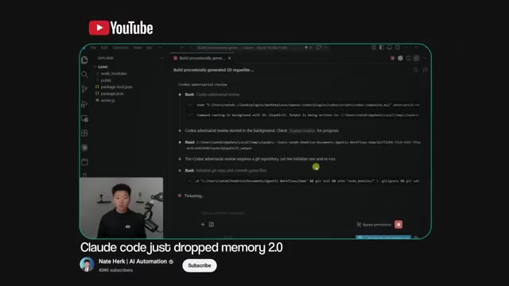
*⏱️ 00:00:15 — Capture d'écran de l'interface de l'éditeur de code VS Code affichant des commandes d'agent et de terminal pour le projet de développement.*

---

### ⏱️ `[00:00:30 - 00:00:50]` | Segment #02

**🔊 Audio (Transcription Intégrale Mot pour Mot en Français) :**
> Ensuite, je vous donnerai mon avis sur lequel est le meilleur dans l'ensemble. Donc, d'ici la fin de cette vidéo, vous aurez une idée claire de l'outil que vous devriez apprendre et utiliser cette année. Entrons donc dans le vif du sujet. Très bien. Alors, avant d'aborder les tests proprement dits, vous devez comprendre ce que sont ces outils et en quoi ils diffèrent réellement. CloudCode et Antigravity sont tous deux des plateformes de codage agentiques. Ils peuvent prendre une grande mission, la décomposer en un plan, et lancer des sous-agents pour travailler en parallèle.

**👁️ Analyse Visuelle d'Écran (gemini-3.5-flash-lite) :**
**Interface & Outils** : Claude Code, VS Code / Agent Antigravity

**Contenu textuel & Code** : Prompt utilisateur : 'Build me a full-stack habit tracker app with a dashboard that shows streaks...'

**Action / Démonstration** : Présentation comparative des interfaces de développement d'agents IA (Claude Code et Antigravity) avec saisie d'un prompt complet.

*⏱️ 00:00:35 — Animation graphique de transition affichant le logo et le texte 'CLAUDE CODE'.*

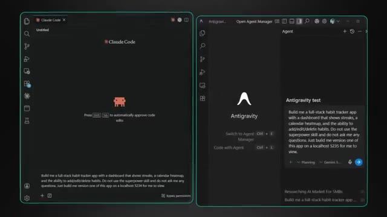
*⏱️ 00:00:45 — Capture d'écran divisée montrant à gauche l'interface 'Claude Code' et à droite l'agent 'Antigravity' avec un prompt détaillé pour créer une application de suivi d'habitudes.*

---

### ⏱️ `[00:00:51 - 00:01:09]` | Segment #03

**🔊 Audio (Transcription Intégrale Mot pour Mot en Français) :**
> Ils peuvent gérer vos fichiers et vos dossiers, exécuter des commandes de terminal et s'exécuter dans l'ensemble de votre base de code. CloudCode est propulsé par les modèles Cloud d'Anthropic. Anti-Gravity utilise par défaut les modèles Gemini de Google. Vous pouvez changer de modèle pour ces deux outils différents, mais cela demande parfois un peu de configuration supplémentaire. Cependant, le plafond de puissance de ces deux outils est extrêmement élevé.

**👁️ Analyse Visuelle d'Écran (gemini-3.5-flash-lite) :**
**Interface & Outils** : Interface web de configuration et schémas d'architecture d'agents.

**Contenu textuel & Code** : Options de routage de modèles (Gemini 3, Flash-lite, etc.), listes de configurations et options de sélection de fournisseurs d'IA.

**Action / Démonstration** : Navigation et configuration des différents modèles d'IA pour le routeur dans l'interface web.

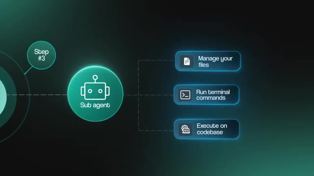
*⏱️ 00:00:55 — Schéma animé illustrant les capacités d'un sous-agent : gestion des fichiers, exécution de commandes terminal et action sur la base de code.*

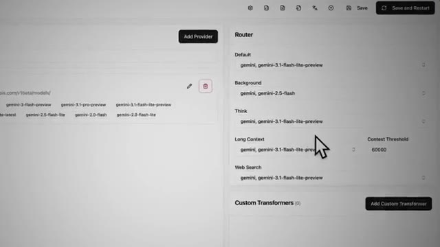
*⏱️ 00:01:04 — Capture d'écran d'une interface de configuration affichant les paramètres de routage des modèles IA (Default, Background, Think, Long Context, Web Search) avec un curseur de souris.*

---

### ⏱️ `[00:01:09 - 00:01:29]` | Segment #04

**🔊 Audio (Transcription Intégrale Mot pour Mot en Français) :**
> Et à cause de cela, les deux outils sont gratuits. Vous ne payez pas pour Cloud Code ou vous ne payez pas pour Anti-Gravity. Ce que vous finissez par payer, c'est l'utilisation du modèle, la véritable IA en arrière-plan qui fait le travail de réflexion. Vous payez pour les jetons. La différence ne réside donc pas dans les capacités, mais dans l'endroit où ces capacités résident et dans la manière dont vous y accédez. Cloud Code est d'abord axé sur le terminal. C'est un outil de ligne de commande qui s'intègre dans l'environnement dans lequel vous travaillez déjà.

**👁️ Analyse Visuelle d'Écran (gemini-3.5-flash-lite) :**
**Interface & Outils** : AUCUNE

**Contenu textuel & Code** : AUCUNE

**Action / Démonstration** : AUCUNE

---

### ⏱️ `[00:01:29 - 00:01:48]` | Segment #05

**🔊 Audio (Transcription Intégrale Mot pour Mot en Français) :**
> Donc vous pouvez garder votre éditeur, vos raccourcis clavier, vos extensions. Tout reste identique. La puissance agentique, les sous-agents, l'exécution parallèle, l'orchestration, tout y est. Mais c'est accessible via votre terminal et configuré par vous. Vous construisez le flux de travail par-dessus l'outil. Maintenant, anti-gravity est son propre IDE indépendant. Certains pensent que c'est une version dérivée (fork) de VS Code. Vos extensions et raccourcis peuvent donc être transférés.

**👁️ Analyse Visuelle d'Écran (gemini-3.5-flash-lite) :**
**Interface & Outils** : Interface sombre d'application ou de terminal avec panneau de configuration d'agent IA.

**Contenu textuel & Code** : Texte flou et indicateur d'activité de l'agent IA effectuant une recherche web.

**Action / Démonstration** : Exécution d'un agent IA recherchant des informations sur le web et affichant le statut dans une interface sombre.

*⏱️ 00:01:43 — Capture d'écran divisée montrant une interface de terminal ou d'application sombre avec du texte et un agent IA en cours d'exécution.*

---

### ⏱️ `[00:01:48 - 00:02:20]` | Segment #06

**🔊 Audio (Transcription Intégrale Mot pour Mot en Français) :**
> Mais vous ouvrez une application entièrement différente. Elle dispose d'une vue gestionnaire où vous pouvez voir plusieurs agents travailler en parallèle sur différents espaces de travail et d'un agent de navigation intégré qui peut naviguer sur de vraies pages web. La façon la plus simple de l'envisager, c'est que CloudCode vous donne les éléments de base et vous permet de travailler de la manière dont vous le faites déjà. Antigravity regroupe tout le processus de travail des agents dans un environnement spécialement conçu dans lequel vous emménagez en quelque sorte. Très bien, parlons maintenant de ce que l'on ressent réellement en les utilisant, en commençant par la configuration. CloudCode vous offre donc plusieurs points d'entrée. L'interface en ligne de commande du terminal est le mode original et le plus puissant. Vous l'installez avec npm et vous tapez Cloud dans n'importe quel terminal.

**👁️ Analyse Visuelle d'Écran (gemini-3.5-flash-lite) :**
**Interface & Outils** : Application de gestion d'agents IA (Agent Manager).

**Contenu textuel & Code** : Menus de l'application : "Inbox", "Workspaces" (Project 01, Sub agent #1, #2, Project 02, Sub agent #3), "Opening URL in browser", modèles (Gemini 1.5 Pro).

**Action / Démonstration** : Présentation de l'interface de gestion multi-agents et des fonctionnalités de navigation web intégrées.

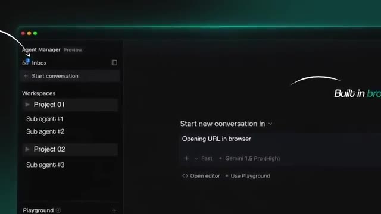
*⏱️ 00:01:56 — Interface d'une application montrant un tableau de bord de gestion d'agents IA (Agent Manager Preview) avec des espaces de travail et des options de conversation.*

---

### ⏱️ `[00:02:20 - 00:02:46]` | Segment #07

**🔊 Audio (Transcription Intégrale Mot pour Mot en Français) :**
> et CloudCode s'ouvre. Il y a aussi une extension VS Code avec des diffs en ligne, une révision de plan, la visibilité des fichiers, des mentions avec arobase, et tout cela peut se trouver directement à l'intérieur de votre éditeur. Cloud nous propose également une application de bureau si vous ne voulez pas du tout utiliser la version VS Code, et elle est beaucoup plus, je dirais, conviviale, ainsi qu'une version web que vous pouvez exécuter directement depuis votre navigateur sans aucune installation. Donc, dans pratiquement toutes les vidéos de ma chaîne où vous avez pu me voir utiliser CloudCode, je l'ai utilisé à l'intérieur de VS Code, soit via l'extension, soit simplement en l'exécutant dans mon terminal VS Code.

**👁️ Analyse Visuelle d'Écran (gemini-3.5-flash-lite) :**
**Interface & Outils** : Visual Studio Code (Marketplace et interface d'extension)

**Contenu textuel & Code** : Documentation de l'extension Claude Code pour VS Code, informations sur la version (2.1.72), marketplace, et description des fonctionnalités.

**Action / Démonstration** : Navigation et présentation de l'extension d'intelligence artificielle dans l'éditeur de code.

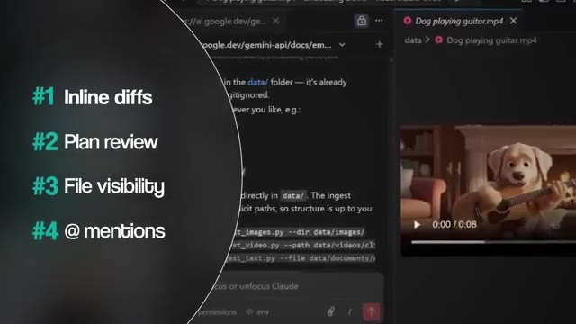
*⏱️ 00:02:26 — Capture d'écran montrant l'interface d'un éditeur avec du code et une liste de fonctionnalités clés listées à gauche (#1 Inline diffs, #2 Plan review, #3 File visibility, #4 @ mentions).*

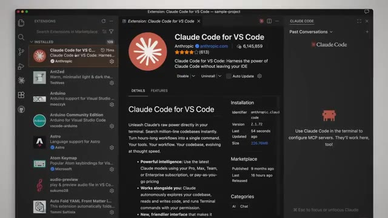
*⏱️ 00:02:33 — Capture d'écran du marketplace de Visual Studio Code affichant l'extension "Claude Code for VS Code" développée par Anthropic.*

---

### ⏱️ `[00:02:46 - 00:03:19]` | Segment #08

**🔊 Audio (Transcription Intégrale Mot pour Mot en Français) :**
> Maintenant, je fais ça parce que j'aime pouvoir voir tous mes fichiers sur ce côté gauche pendant que je travaille avec CloudCode plutôt que de simplement fixer une fenêtre de terminal. Une chose qui vaut la peine d'être notée cependant, c'est que l'interface en ligne de commande du terminal est techniquement le mode le plus complet en fonctionnalités. L'extension VS Code couvre à peu près tout, mais il y a quelques fonctionnalités avancées qui sont réservées à la ligne de commande. Donc pour la plupart des gens qui débutent, l'extension est vraiment largement suffisante. Maintenant, Antigravity n'a qu'une seule porte d'entrée. Vous téléchargez l'application et vous devez l'exécuter par ce biais. Il y a une commande en ligne de commande pour la lancer depuis votre terminal, mais cela ouvre fondamentalement juste l'EDI Antigravity. Il n'y a donc pas d'option pour exécuter Antigravity à l'intérieur de VS Code. Alors maintenant, passons réellement

**👁️ Analyse Visuelle d'Écran (gemini-3.5-flash-lite) :**
**Interface & Outils** : Interface Web / Terminal CLI Gemini

**Contenu textuel & Code** : Logo pixel art de Gemini, instructions de démarrage et invite de commande interactive de l'outil CLI.

**Action / Démonstration** : Présentation visuelle de l'interface de ligne de commande Gemini.

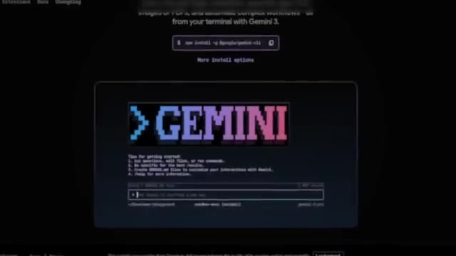
*⏱️ 00:03:11 — Interface sombre présentant la CLI Gemini avec le logo pixelisé "GEMINI" et une invite de commande interactive.*

---

### ⏱️ `[00:03:19 - 00:03:52]` | Segment #09

**🔊 Audio (Transcription Intégrale Mot pour Mot en Français) :**
> passons à ce qui compte le plus, c'est-à-dire la qualité de ce que les outils produisent. Le modèle que vous utilisez à l'intérieur de l'outil compte énormément. Si vous utilisez CloudCode avec Haiku, ce sera une expérience complètement différente que d'utiliser CloudCode avec Opus. Utiliser antigravity avec Gemini Flash ne sera pas la même chose que d'utiliser antigravity avec Gemini Pro. L'environnement façonne la façon dont le modèle fonctionne, mais le modèle détermine la limite maximale. Donc, lorsque nous parlons de la qualité du résultat, cela dépend en grande partie du modèle que vous utilisez sous le capot. Maintenant, la plus grande force de CloudCode est sa façon de réfléchir avant d'agir. Il possède un mode de planification dédié, qu'antigravity possède également, mais dans ce mode de planification, il planifie le travail sur plusieurs fichiers avant de toucher à quoi que ce soit. Il va

**👁️ Analyse Visuelle d'Écran (gemini-3.5-flash-lite) :**
**Interface & Outils** : Interface utilisateur de chatbot avec menu de sélection de modèles IA.

**Contenu textuel & Code** : Menu déroulant affichant les modèles Opus 4.6, Sonnet 4.6, Haiku 4.5 et l'option "Extended thinking".

**Action / Démonstration** : Sélection d'un modèle d'intelligence artificielle dans l'interface de l'application.

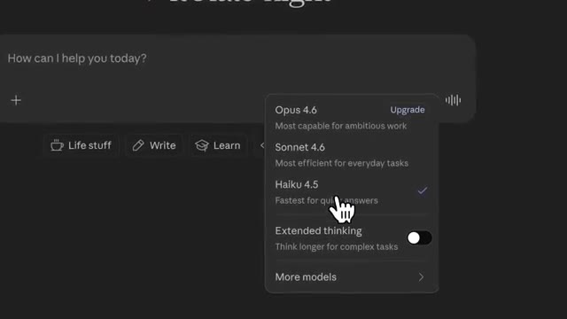
*⏱️ 00:03:27 — Capture d'écran montrant une interface de chat avec un menu déroulant de sélection de modèles (Opus 4.6, Sonnet 4.6, Haiku 4.5).*

---

### ⏱️ `[00:03:52 - 00:04:18]` | Segment #10

**🔊 Audio (Transcription Intégrale Mot pour Mot en Français) :**
> être en lecture seule, pas de modifications de code, juste de la stratégie et des questions de clarification. Vous pouvez contrôler la profondeur de son raisonnement, jusqu'à ce qu'Anthropic appelle leur super-réflexion pour les problèmes vraiment complexes. Comme je l'ai dit, anti-gravity a aussi un mode plan, mais je pense que cloud code le fait tout simplement mieux. Vous verrez exactement ce que je veux dire quand nous passerons à tous les tests en direct plus tard. Les deux outils vous permettent également de définir des règles au niveau du projet, des conventions et des instructions personnalisées qui persistent d'une session à l'autre. Les deux prennent en charge les plugins, les commandes personnalisées et les intégrations avec des outils externes.

**👁️ Analyse Visuelle d'Écran (gemini-3.5-flash-lite) :**
**Interface & Outils** : Incrustations graphiques (boutons "SET RULES", "CONVENTIONS" et icônes logicielles) à l'écran.

**Contenu textuel & Code** : Éléments textuels et visuels superposés liés à la configuration et aux conventions des agents IA.

**Action / Démonstration** : Le présentateur explique la stratégie de configuration et de règles à suivre pour l'automatisation IA.

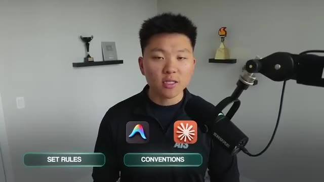
*⏱️ 00:04:12 — Présentateur face caméra avec l'apparition de deux icônes de logiciels et de boutons superposés ("SET RULES" et "CONVENTIONS").*

---

### ⏱️ `[00:04:19 - 00:04:54]` | Segment #11

**🔊 Audio (Transcription Intégrale Mot pour Mot en Français) :**
> L'extensibilité est présente des deux côtés, mais CloudCode me semble extrêmement modifiable parce que j'ai l'impression d'avoir tellement plus de contrôle sur la façon dont je veux que ce projet individuel se comporte. Là où CloudCode se démarque également, c'est dans sa capacité à comprendre votre projet existant et votre structure de fichiers. Il lit tout, il capte vos motifs et vos conventions de nommage, et il s'appuie sur ce que vous avez déjà sur place. Le code généré s'intègre donc à votre base de code plutôt que d'avoir l'air simplement ajouté de force. La force majeure d'Antigravity est de construire des applications complètes et des interfaces front-end à partir de zéro. Lors d'un test indépendant de 21 jours sur 12 vrais projets, 94 % du code qu'il a généré était propre, valide, limitant, sans aucune erreur ni problème de style. Il a complété environ 73 %

**👁️ Analyse Visuelle d'Écran (gemini-3.5-flash-lite) :**
**Interface & Outils** : AUCUNE

**Contenu textuel & Code** : AUCUN

**Action / Démonstration** : AUCUNE

---

### ⏱️ `[00:04:54 - 00:05:13]` | Segment #12

**🔊 Audio (Transcription Intégrale Mot pour Mot en Français) :**
> de tâches sans aucune intervention humaine et a permis une réduction de 60 à 70 % du temps de développement. Maintenant, lorsque j'ai utilisé Antigravity, je l'ai principalement utilisé pour concevoir des choses, des éléments d'interface, d'expérience utilisateur, des sites Web, des applications Web, des choses de ce genre. Je pense simplement qu'il fait un bien meilleur travail par rapport à CloudCode et Opus pour avoir un véritable sens du design et donner aux choses un aspect et une sensation plus réels.

**👁️ Analyse Visuelle d'Écran (gemini-3.5-flash-lite) :**
**Interface & Outils** : Site web BoostStash affichant un rapport textuel de performances.

**Contenu textuel & Code** : Texte technique décrivant un gain de 60-70 % de vitesse de développement, des tests sur MacBook Pro M2 et des scores d'évaluation d'interface.

**Action / Démonstration** : Affichage à l'écran d'un article de référence analysant les performances et la réduction du temps de développement.

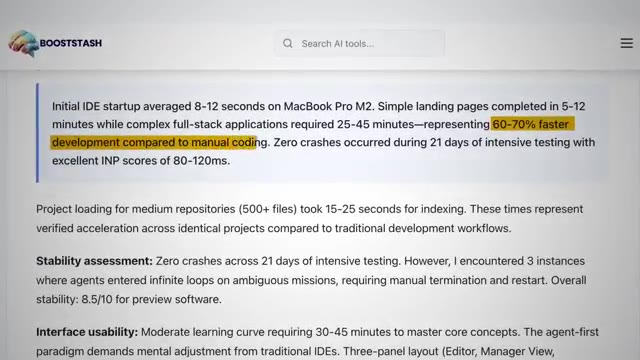
*⏱️ 00:04:59 — Capture d'écran montrant un article de test/revue de logiciel sur le site Booststash, détaillant les performances d'un outil d'IA avec des sections sur le temps de développement et la stabilité.*

---

### ⏱️ `[00:05:13 - 00:05:33]` | Segment #13

**🔊 Audio (Transcription Intégrale Mot pour Mot en Français) :**
> Mais il y a un inconvénient car, sur les projets plus longs, l'anti-gravité peut commencer à s'éloigner des règles que vous avez fixées au début. Il s'agit là d'un schéma documenté. Les forums de développeurs de Google ont une discussion à ce sujet. Il peut construire quelque chose de parfaitement conforme aux spécifications le premier jour, puis commencer progressivement à ignorer vos directives initiales d'ici le troisième jour. Pour être fair, c'est généralement vrai pour n'importe quel agent de codage avec n'importe quel modèle de codage, mais je tenais tout de même à le souligner ici.

**👁️ Analyse Visuelle d'Écran (gemini-3.5-flash-lite) :**
**Interface & Outils** : Interface de chat / assistant IA.

**Contenu textuel & Code** : "Build me a...", "Day 1", "TYPOGRAPHY", "HERO SECTION", "PRICING", "Day 3", "Searching context...".

**Action / Démonstration** : Affichage des étapes de développement d'un projet par l'agent IA avec recherche de contexte.

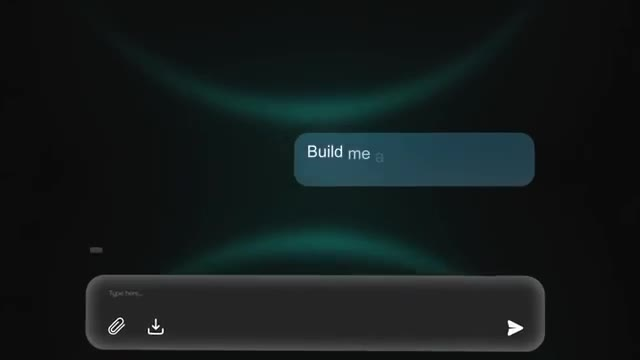
*⏱️ 00:05:23 — Interface de chat sombre montrant un message de prompt "Build me a...".*

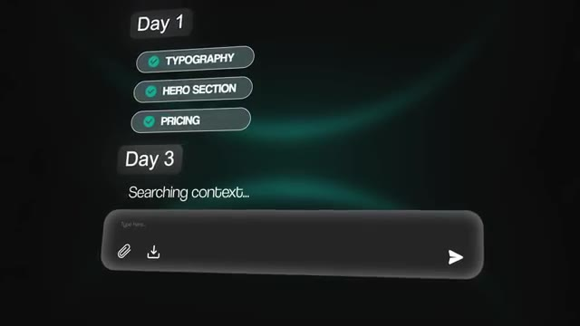
*⏱️ 00:05:28 — Interface de suivi de projet montrant les étapes "Day 1" (Typography, Hero Section, Pricing validés) et "Day 3" avec le statut "Searching context...".*

---

### ⏱️ `[00:05:33 - 00:06:01]` | Segment #14

**🔊 Audio (Transcription Intégrale Mot pour Mot en Français) :**
> Maintenant, penchons-nous sur quelques repères. Le SWE Bench Verified est le test standard de l'industrie pour les outils de codage par IA. Il prend de vrais problèmes GitHub de véritables projets open source, et il mesure combien sont entièrement résolus par le modèle d'IA. Claude Opus 4.6 au sein de Claude Code a obtenu un score de 80,9 %. Gemini 3 Pro au sein d'Antigravity a atteint environ 76,2 %. Ces deux scores impliquent l'infrastructure complète, c'est-à-dire l'outil et le modèle, ensemble. Mais Google n'a pas publié la méthodologie de test exacte de la même manière qu'Anthropic l'a fait, ce n'est donc pas une comparaison parfaite à 100 %.

**👁️ Analyse Visuelle d'Écran (gemini-3.5-flash-lite) :**
**Interface & Outils** : Graphiques animés et présentation vidéo.

**Contenu textuel & Code** : Texte "SWE BENCHMARK TEST", "AI MODEL" et score "80.9% Opus 4.6".

**Action / Démonstration** : Présentation des repères et des performances des modèles d'IA sur le benchmark SWE.

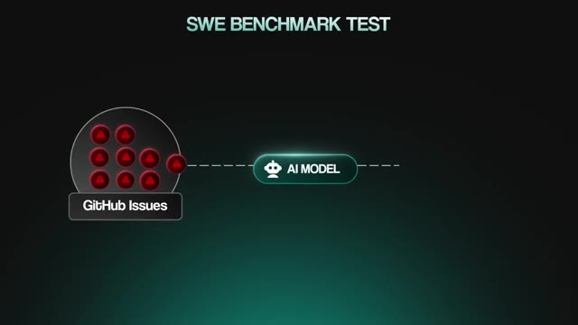
*⏱️ 00:05:40 — Animation graphique illustrant le "SWE BENCHMARK TEST" avec les problèmes GitHub connectés à un modèle d'IA.*

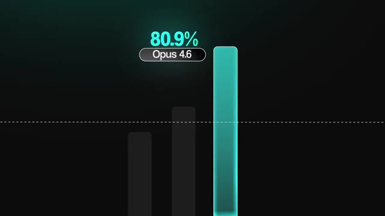
*⏱️ 00:05:47 — Graphique à barres montrant le score de 80.9% pour Opus 4.6.*

---

### ⏱️ `[00:06:01 - 00:06:20]` | Segment #15

**🔊 Audio (Transcription Intégrale Mot pour Mot en Français) :**
> Mais au niveau des modèles haut de gamme, ces outils sont remarquablement proches sur le papier. Maintenant, les résultats dans le monde réel. L'équipe d'ingénierie d'Anthropic a rapporté que Claude Code leur a donné un gain de productivité de 50 % et 67 % de demandes de tirage fusionnées en plus par ingénieur et par jour. Du côté d'Anti-Gravity, le test indépendant de 21 jours a montré un développement 60 à 70 % plus rapide. Ces deux chiffres sont extrêmement impressionnants.

**👁️ Analyse Visuelle d'Écran (gemini-3.5-flash-lite) :**
**Interface & Outils** : Document textuel / Rapport d'ingénierie web.

**Contenu textuel & Code** : Texte sur l'usage et la productivité, mentionnant Claude Code et les gains de performance en ingénierie logicielle.

**Action / Démonstration** : Affichage de statistiques et de données d'évaluation d'outils d'IA pour le développement.

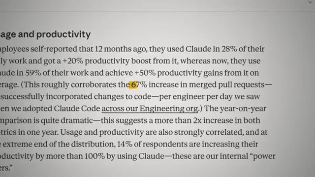
*⏱️ 00:06:11 — Un article ou un rapport technique montrant des statistiques de productivité (+50% de gain, +67% de demandes de tirage fusionnées).*

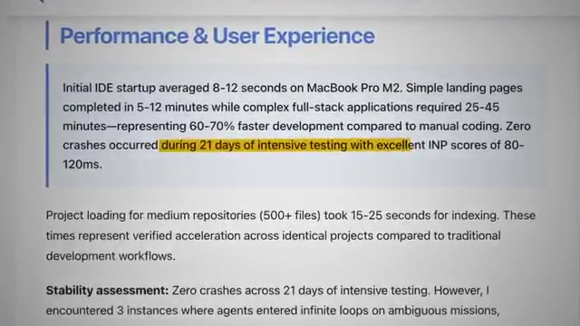
*⏱️ 00:06:15 — Un rapport textuel détaillant les performances et l'expérience utilisateur, notamment la vitesse de développement et les tests.*

---

### ⏱️ `[00:06:21 - 00:06:39]` | Segment #16

**🔊 Audio (Transcription Intégrale Mot pour Mot en Français) :**
> Aucune de ces deux méthodes n'est une étude scientifique contrôlée, mais de manière générale, elles vous indiquent toutes les deux que ces outils rendent les développeurs nettement plus rapides. Mais parlons maintenant de la vitesse et de la fiabilité. N'oubliez pas que ce pour quoi vous payez lorsque vous utilisez ces outils, ce n'est pas l'outil, vous payez pour le modèle. Et ces modèles vont épuiser votre utilisation ou vos limites plus vite que vous ne le pensez, surtout si vous ne faites pas attention.

**👁️ Analyse Visuelle d'Écran (gemini-3.5-flash-lite) :**
**Interface & Outils** : AUCUNE

**Contenu textuel & Code** : AUCUNE

**Action / Démonstration** : AUCUNE

---

### ⏱️ `[00:06:39 - 00:06:58]` | Segment #17

**🔊 Audio (Transcription Intégrale Mot pour Mot en Français) :**
> Cloud Code, récemment en mars 26, a eu un bug de mise en cache qui a multiplié les coûts de jetons par 10 ou 20. Pour les utilisateurs de MaxPlan, ils épuisaient toute leur session en moins de deux heures. Anthropic l'a reconnu et semble travailler constamment sur l'optimisation des jetons, ce qui va évidemment être un projet continu. Anti-gravity a ses propres problèmes également.

**👁️ Analyse Visuelle d'Écran (gemini-3.5-flash-lite) :**
**Interface & Outils** : Navigateur web (The Register, Reddit)

**Contenu textuel & Code** : Texte d'article de presse et post de forum discutant des problèmes de bugs de mise en cache et de consommation excessive de jetons de Claude Code.

**Action / Démonstration** : Affichage à l'écran de captures d'articles de presse et de forums pour illustrer le problème discuté.

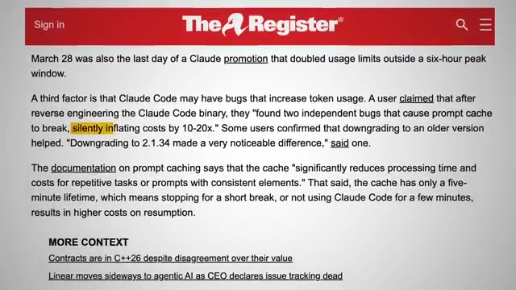
*⏱️ 00:06:44 — Article de presse du site The Register montrant un texte sur les bugs de Claude Code et l'augmentation des coûts de jetons.*

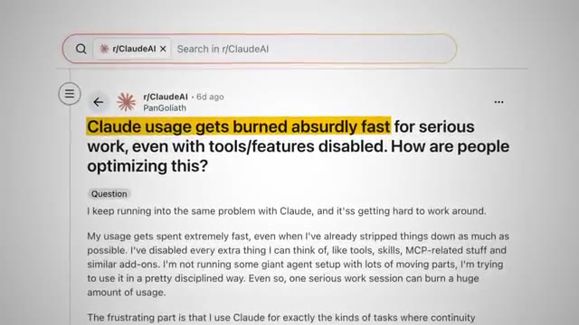
*⏱️ 00:06:49 — Publication sur le forum Reddit (r/ClaudeAI) abordant l'épuisement rapide de l'utilisation de Claude.*

---

### ⏱️ `[00:06:58 - 00:07:22]` | Segment #18

**🔊 Audio (Transcription Intégrale Mot pour Mot en Français) :**
> Le système de quotas de Google a été complètement chaotique, les utilisateurs pro se retrouvant bloqués pendant toute une semaine après avoir atteint les limites, et avec un système de tarification basé sur des crédits qui n'explique toujours pas clairement ce qu'un crédit vous permet réellement d'acheter. Donc, en général, apprendre à gérer son contexte et ses jetons est l'une des compétences les plus importantes que vous puissiez développer en ce moment, car cela s'applique à n'importe quel agent de codage que vous finirez par utiliser. J'ai fait une vidéo complète sur 18 astuces de gestion des jetons que j'ai découvertes en expérimentant avec ces outils, et je mettrai le lien vers celle-ci juste ici.

**👁️ Analyse Visuelle d'Écran (gemini-3.5-flash-lite) :**
**Interface & Outils** : Navigateur web affichant une discussion Reddit.

**Contenu textuel & Code** : Texte d'un utilisateur Reddit posant des questions sur le modèle de tarification de Gemini, les appels API et les crédits Google One.

**Action / Démonstration** : Affichage d'un témoignage utilisateur pour illustrer les problèmes de tarification et de quotas de Google.

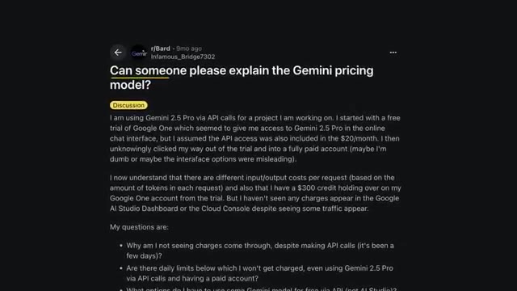
*⏱️ 00:07:04 — Capture d'écran d'une publication Reddit du subreddit r/Bard intitulée 'Can someone please explain the Gemini pricing model?' détaillant la confusion autour des coûts et des quotas de l'API Gemini 2.5 Pro.*

---

### ⏱️ `[00:07:22 - 00:07:43]` | Segment #19

**🔊 Audio (Transcription Intégrale Mot pour Mot en Français) :**
> Maintenant, en termes de vitesse d'exécution, un test indépendant a montré que CloudCode a accompli une tâche représentative en environ 4 minutes contre 8 minutes pour Antigravity. Ce que j'ai trouvé intéressant, car lors de mes tests, Antigravity a toujours semblé plus rapide. Et vous verrez cela plus tard dans la vidéo lorsque nous ferons ces vrais tests. Maintenant, la vraie différence en matière de fiabilité actuellement, c'est la maturité. CloudCode est sorti en version de production avec plusieurs mises à jour déployées chaque semaine.

**👁️ Analyse Visuelle d'Écran (gemini-3.5-flash-lite) :**
**Interface & Outils** : Interface graphique de présentation (overlay de statistiques).

**Contenu textuel & Code** : Texte "REPRESENTATIVE TASK", "CLAUDE CODE" et le chiffre "4".

**Action / Démonstration** : Affichage d'un graphique de performance comparatif entre outils d'IA.

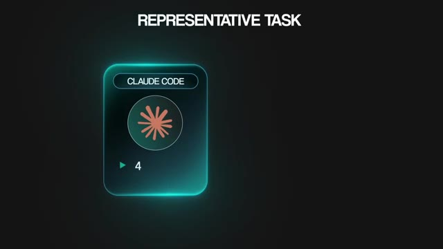
*⏱️ 00:07:27 — Un graphique représentant la tâche comparative avec le nom "Claude Code" et un score de 4.*

---

### ⏱️ `[00:07:43 - 00:08:08]` | Segment #20

**🔊 Audio (Transcription Intégrale Mot pour Mot en Français) :**
> Antigravity est toujours en version d'évaluation publique à ce jour, en avril 2026, mais il s'améliore très rapidement. Il présente toutefois encore l'instabilité inhérente à ce stade de version d'évaluation publique. Certaines personnes signalent des problèmes de connexion, il y a des bugs occasionnels sous Windows, et des agents se bloquent dans des boucles. Maintenant, la perte de contexte est bien réelle pour ces deux outils. Même avec la fenêtre de contexte d'un million de tokens de CloudCode avec Opus, il peut y avoir des problèmes lorsque vous chargez de véritables bases de code, que vous exécutez de nombreux appels d'outils et que vous faites des aller-retours pendant plus de 40 invites.

**👁️ Analyse Visuelle d'Écran (gemini-3.5-flash-lite) :**
**Interface & Outils** : Éditeur de code (VS Code / Cursor) et interface web de benchmark ou rapport technique.

**Contenu textuel & Code** : Code source structuré et histogramme de performance comparative (ex: Opus 4.6 à 72.0, Sonnet 4.5 à 50.2, etc.).

**Action / Démonstration** : Illustration des problèmes d'instabilité des agents IA et présentation de graphiques de performance comparative.

*⏱️ 00:07:56 — Capture sombre d'un éditeur de code affichant du code et le texte superposé "AGENTS ARE GETTING STUCK".*

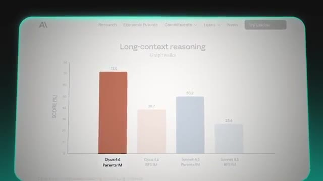
*⏱️ 00:08:02 — Graphique de performance comparant différents modèles d'IA sur le raisonnement à long contexte (Long-context reasoning / Graphwalks).*

---

### ⏱️ `[00:08:08 - 00:08:30]` | Segment #21

**🔊 Audio (Transcription Intégrale Mot pour Mot en Français) :**
> À ce moment-là, l'intelligence artificielle commence tout simplement à perdre le fil des instructions précédentes. Les propres documents de dépannage d'Antigravity recommandent de démarrer un nouveau chat dès que l'agent met plus de 10 secondes à répondre. CloudCode dispose d'une commande de compactage qui compresse l'historique de votre conversation. Mais la meilleure pratique pour ces deux outils est la même. Gardez vos sessions ciblées, une tâche par session, et recommencez à neuf souvent. Maintenant, une dernière chose que je voulais mentionner, c'est que le rythme du développement est tout simplement fou.

**👁️ Analyse Visuelle d'Écran (gemini-3.5-flash-lite) :**
**Interface & Outils** : Graphique de présentation animé (overlay vidéo)

**Contenu textuel & Code** : Texte 'ANTI-DRIFT PROTOCOL', 'Focused sessions', '1 task per session' avec numérotation 1 et 2

**Action / Démonstration** : Présentation visuelle des bonnes pratiques et du protocole anti-dérive pour les agents IA

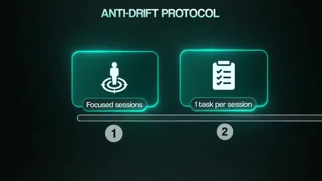
*⏱️ 00:08:25 — Un graphique animé en plein écran intitulé 'ANTI-DRIFT PROTOCOL' montrant les étapes 'Focused sessions' et '1 task per session'.*

---

### ⏱️ `[00:08:31 - 00:09:04]` | Segment #22

**🔊 Audio (Transcription Intégrale Mot pour Mot en Français) :**
> CloudCode a livré des nouveautés à un rythme effréné. Rien qu'au premier trimestre 2026, ils ont lancé six fonctionnalités majeures au niveau de la plateforme avec plusieurs versions par semaine. Et à un moment donné, il y a eu trois versions différentes en l'espace de cinq jours. Antigravity s'est également amélioré et mis à jour, mais le rythme est notablement différent. Du lancement en novembre jusqu'en mars 2026, donc, vous savez, environ quatre ou cinq mois, les numéros de version sont passés de 1.11 à 1.21, la plupart des mises à jour consistant en une poignée d'améliorations, de corrections de bugs mineurs et d'optimisations. Les deux sont donc activement développés, mais CloudCode avance beaucoup plus rapidement. Et lorsque vous choisissez un outil dans lequel investir votre temps, je pense que cela

**👁️ Analyse Visuelle d'Écran (gemini-3.5-flash-lite) :**
**Interface & Outils** : Graphique de présentation de versions logicielles (overlay vidéo).

**Contenu textuel & Code** : Tableau des dates de sortie et des versions (v0.2.x, v0.3.0).

**Action / Démonstration** : Illustration visuelle du rythme rapide des mises à jour logicielles abordé dans le commentaire audio.

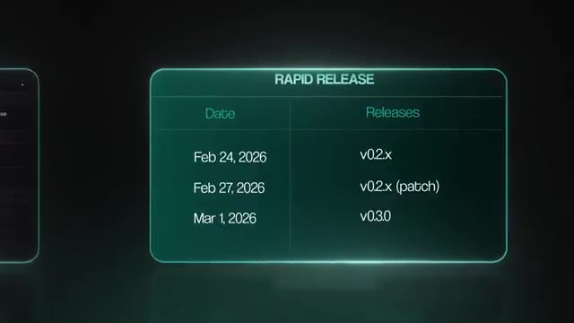
*⏱️ 00:08:39 — Un tableau affichant les dates et les versions ('Rapid Release' avec 'Feb 24, 2026 - v0.2.x', 'Feb 27, 2026 - v0.2.x (patch)', 'Mar 1, 2026 - v0.3.0').*

---

### ⏱️ `[00:09:04 - 00:09:36]` | Segment #23

**🔊 Audio (Transcription Intégrale Mot pour Mot en Français) :**
> compte énormément. Très bien, alors parlons des intégrations, car un outil de codage n'est vraiment utile qu'en fonction de ce auquel il peut réellement se connecter. Ces deux outils de codage prennent en charge le MCP, le Model Context Protocol, le standard ouvert qui permet aux outils d'IA de se connecter à des services externes. GitHub, des bases de données, comme Supabase, Playwright, Firecrawl, des outils de design, des plateformes de surveillance. Plus de 1 500 serveurs MCP existent à l'heure actuelle, et ce nombre ne cesse de croître. La différence réside dans la configuration. L'intégration MCP de CloudCode est pilotée par la ligne de commande. Vous ajoutez des serveurs avec une simple commande, ou en demandant à CloudCode de le faire, ou en modifiant un fichier de configuration JSON défini globalement, par projet, ou peut-être par utilisateur.

**👁️ Analyse Visuelle d'Écran (gemini-3.5-flash-lite) :**
**Interface & Outils** : Schéma explicatif animé représentant l'architecture du Model Context Protocol (MCP).

**Contenu textuel & Code** : Diagramme montrant le flux entre un outil IA, un serveur MCP et divers services connectés (GitHub, bases de données, Supabase, etc.).

**Action / Démonstration** : Illustration visuelle du protocole MCP expliquée par le présentateur pour montrer les capacités d'intégration des outils d'IA.

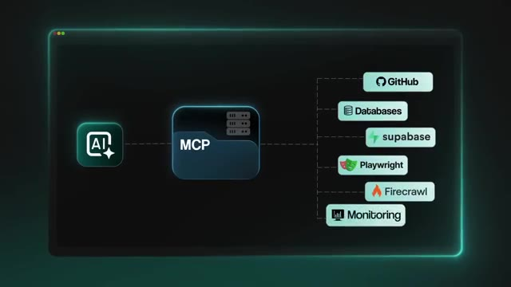
*⏱️ 00:09:20 — Un schéma illustrant le fonctionnement du protocole MCP (Model Context Protocol), connectant une IA à différents services tiers (GitHub, Databases, Supabase, Playwright, Firecrawl, Monitoring).*

---

### ⏱️ `[00:09:37 - 00:10:12]` | Segment #24

**🔊 Audio (Transcription Intégrale Mot pour Mot en Français) :**
> Alors qu'Antigravity intègre plutôt un panneau MCP visuel, où vous pouvez en quelque sorte parcourir un marché et cliquer pour installer des MCP et des choses de ce genre. C'est un peu plus adapté aux débutants pour commencer, mais pour les configurations avancées, vous finirez quand même par devoir modifier ce fichier de configuration, ce qui n'est pas très difficile du tout non plus. Parce qu'avec ces deux outils, vous pouvez dire, hé, voici l'URL du serveur MCP que je veux télécharger. Aide-moi à comprendre comment faire cela en réalité. Les deux outils ont également un accès direct au terminal, ce qui signifie qu'ils peuvent utiliser n'importe quelle autre CLI, ce qui est énorme. Git, NPM, Docker, Playwright, Google Workspace. S'il possède une CLI et qu'il s'exécute dans un terminal, alors l'un ou l'autre des outils peut réellement l'utiliser. Vous pouvez même exécuter la CLI de Cloud Code à l'intérieur

**👁️ Analyse Visuelle d'Écran (gemini-3.5-flash-lite) :**
**Interface & Outils** : Interface de chat / application de messagerie textuelle.

**Contenu textuel & Code** : "Hey, here's the MCP server URL [ https://firecrawl ] that I want to download." et barre de saisie avec boutons d'attachement et d'envoi.

**Action / Démonstration** : Saisie et envoi d'une instruction textuelle pour télécharger un serveur MCP via son URL.

*⏱️ 00:09:54 — Interface de chat sombre illustrant une invite de commande concernant le téléchargement d'un serveur MCP avec une URL Firecrawl.*

---

### ⏱️ `[00:10:12 - 00:10:45]` | Segment #25

**🔊 Audio (Transcription Intégrale Mot pour Mot en Français) :**
> anti-gravities terminal si vous voulez les deux outils dans le même environnement. Très bien, alors maintenant parlons des prix. D'abord, laissez-moi recadrer très rapidement la façon dont vous y pensez. Parce que même si vous payez pour le plan le plus cher de Claude en ce moment, 200 dollars par mois, pour le niveau de production que vous pouvez obtenir de l'un ou l'autre de ces outils, vous ne pourriez jamais embaucher un humain pour faire cette même quantité de travail pour ce même prix. C'est-à-dire, quel humain vous donnerait toute cette productivité et cette production pour seulement 200 dollars par mois. Donc peu importe l'outil que vous choisissez ou combien d'argent vous investissez dans ces abonnements, vous obtenez une quantité folle de levier pour votre argent. C'est une aubaine en ce moment. Maintenant, CloudCode nécessite un plan Cloud payant. Donc si vous commencez avec le plus bas de CloudCode

**👁️ Analyse Visuelle d'Écran (gemini-3.5-flash-lite) :**
**Interface & Outils** : Page Web de tarification Claude (Anthropic).

**Contenu textuel & Code** : Tableau comparatif des plans : Pro (17$), Max 5x (100$), Max 20x (200$) incluant l'accès aux modèles Sonnet 4.6 et Opus 4.6.

**Action / Démonstration** : Affichage des options d'abonnement pour illustrer les coûts comparatifs des outils d'IA.

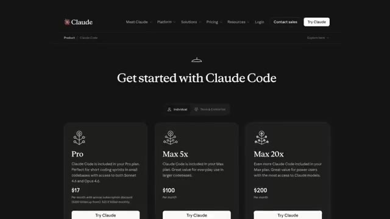
*⏱️ 00:10:20 — Capture d'écran de la page de tarification officielle de Claude Code présentant les trois plans : Pro, Max 5x et Max 20x.*

---

### ⏱️ `[00:10:45 - 00:11:21]` | Segment #26

**🔊 Audio (Transcription Intégrale Mot pour Mot en Français) :**
> abonnement, c'est-à-dire Pro, et ça coûte 20 dollars par mois, ce qui vous donne accès à la plateforme. Vous pouvez aussi utiliser votre clé API, mais cela pourrait finir par vous coûter plus cher qu'un simple abonnement. Mais la plupart des gros utilisateurs finissent par prendre le forfait max, qui coûte soit 100 dollars par mois pour cinq fois plus d'utilisation que le Pro, soit 200 dollars par mois pour 20 fois plus d'utilisation que le Pro. Lorsque vous construisez activement, vous épuisez la limite du Pro assez rapidement. Vous pouvez toujours commencer par le Pro, et vous pourrez ensuite passer à un niveau supérieur si vous en avez besoin. Et vous pouvez payer pour une utilisation supplémentaire au-delà de votre forfait aux tarifs standard des API. Ou bien sûr, vous pouvez brancher une sorte de modèle open source ou un modèle beaucoup moins cher si vous le souhaitez. Mais vous allez perdre une grande partie de la valeur d'Opus, bien sûr, parce que c'est l'un des modèles les plus intelligents en ce moment. Anti-gravity est lié à l'IA de Google

**👁️ Analyse Visuelle d'Écran (gemini-3.5-flash-lite) :**
**Interface & Outils** : Site web Ollama (interface de documentation et de téléchargement de modèles).

**Contenu textuel & Code** : Commande affichée : "ollama run codellama" ; informations sur le modèle (5.1M de téléchargements, variantes 7b, 13b, 34b, 70b).

**Action / Démonstration** : Illustration de l'utilisation d'un modèle local comme alternative plus économique (mentionnée par l'incrustation texte "Plug cheaper model").

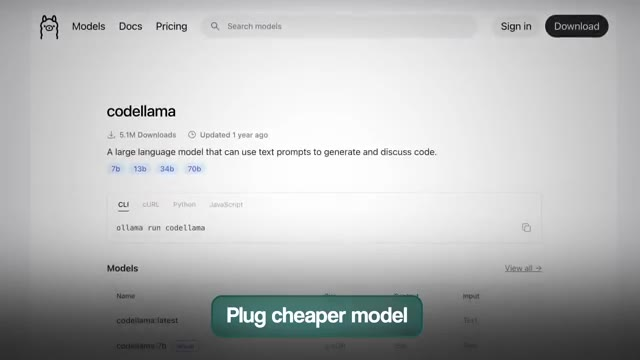
*⏱️ 00:11:12 — Interface web du site Ollama présentant la page du modèle "codellama", avec une commande d'exécution visible au centre.*

---

### ⏱️ `[00:11:21 - 00:11:56]` | Segment #27

**🔊 Audio (Transcription Intégrale Mot pour Mot en Français) :**
> plans d'abonnement. Il y a donc une version gratuite avec un accès de base et des limites de taux hebdomadaires. Tout le monde obtient Gemini 3 Pro, des complétions de code illimitées, et toutes les fonctionnalités quel que soit le niveau. Mais la limite gratuite s'épuise rapidement si vous faites du vrai travail. Google AI Pro coûte 20 balles par mois avec des limites de taux plus élevées qui se réinitialisent toutes les cinq heures, plus deux téraoctets de stockage Google et 10 dollars de crédits Google Cloud mensuels. Google AI Ultra coûte 250 dollars par mois, et il vous donne les limites de taux les plus élevées. Maintenant, une remarque importante, certains utilisateurs rapportent que même sur Pro, les limites de taux pour les modèles premium comme Claude Opus à l'intérieur d'Antigravity sont très restrictives, comme se faire bloquer après une seule session. Donc si vous prévoyez d'utiliser massivement des modèles autres que Gemini à l'intérieur d'Antigravity,

**👁️ Analyse Visuelle d'Écran (gemini-3.5-flash-lite) :**
**Interface & Outils** : Interface graphique promotionnelle (Google One / AI Premium).

**Contenu textuel & Code** : "Higher rate limits that refresh every five hours", "2 terabytes of Google storage", "$10 in monthly Google Cloud credits".

**Action / Démonstration** : Présentation visuelle des bénéfices inclus dans l'offre premium.

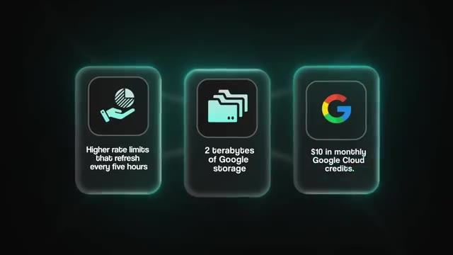
*⏱️ 00:11:39 — Graphique informatif présentant les avantages d'un plan payant : limites de débit plus élevées (toutes les 5 heures), 2 To de stockage Google et 10 $ de crédits Google Cloud mensuels.*

---

### ⏱️ `[00:11:56 - 00:12:31]` | Segment #28

**🔊 Audio (Transcription Intégrale Mot pour Mot en Français) :**
> gardez simplement cela à l'esprit. Mais ce qu'il faut retenir ici au niveau des coûts, c'est que si vous débutez tout juste et que vous souhaitez expérimenter, l'offre gratuite d'Antigravity vous permet de l'essayer pour 0 $. Donc, si vous voulez une utilisation quotidienne fiable de niveau production, vous allez probablement vouloir payer pour quelque chose, que ce soit CloudCode sur Mac, qui vous offre l'expérience la plus constante à l'heure actuelle. Aux paliers les plus élevés, 200 dollars pour CloudCode et 250 dollars pour Antigravity. Ils sont dans une fourchette similaire. Maintenant, vous pourriez considérer cela comme un abonnement pas vraiment bon marché, mais avec une utilisation intensive, vous obtenez quand même bien plus de résultats que vous n'en auriez en embauchant un développeur, et pour tellement moins cher. Très bien, nous avons donc couvert toutes les différences clés. Faisons une comparaison de build côte à côte. Maintenant, très rapidement, avant de passer aux tests, je vais mettre toutes ces informations que nous avons

**👁️ Analyse Visuelle d'Écran (gemini-3.5-flash-lite) :**
**Interface & Outils** : Pages de tarification de Claude Code et d'Antigravity

**Contenu textuel & Code** : Plans tarifaires : "Max 20x" à 200 $/mois pour Claude Code et "Google AI Ultra" à 124,99 $/mois pour Antigravity

**Action / Démonstration** : Comparaison visuelle des abonnements et des coûts des deux services d'IA

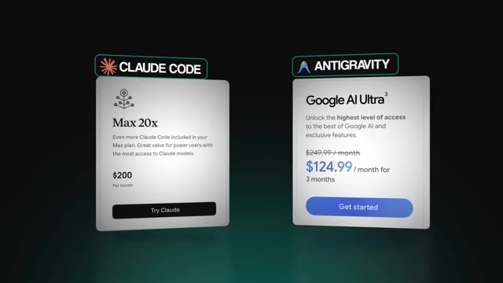
*⏱️ 00:12:14 — Capture d'écran comparant les tarifs de deux plateformes : Claude Code affichant une offre à 200 $ par mois et Antigravity affichant une offre Google AI Ultra à 124,99 $ par mois au lieu de 249,99 $.*

---

### ⏱️ `[00:12:31 - 00:13:07]` | Segment #29

**🔊 Audio (Transcription Intégrale Mot pour Mot en Français) :**
> dont nous avons parlé aujourd'hui, y compris en quelque sorte les résultats et les tests, dans un guide de ressources gratuit, auquel vous pouvez accéder tout à fait gratuitement dans ma communauté School gratuite. Le lien pour cela se trouve dans la description. Mais bref, passons aux créations en direct. Très bien. Nous avons donc quelques tests à effectuer ici. Et la façon dont je vais m'y prendre, c'est que j'ai Anti-Gravity d'ouvert à gauche et j'ai Cloud Code d'ouvert juste ici à droite. Nous allons donc faire trois tests différents. Le premier consistera pour moi à lancer simplement, pour ainsi dire, ce prompt en un seul coup, sans être en mode plan. Je vais donc passer en mode rapide et m'assurer que les autorisations sont contournées. Et l'idée est de voir dans quelle mesure chacune de ces deux plateformes de codage par agent fonctionne pour nous en leur donnant une requête assez vague, et nous verrons ce qui se passe. Le deuxième test consistera à faire quelque chose

**👁️ Analyse Visuelle d'Écran (gemini-3.5-flash-lite) :**
**Interface & Outils** : VS Code (avec extensions Antigravity et Claude Code).

**Contenu textuel & Code** : Un prompt textuel demandant la création d'une application de suivi d'habitudes ("full-stack habit tracker app") incluant un tableau de bord avec des statistiques et un calendrier thermique, à déployer sur localhost 5235.

**Action / Démonstration** : Saisie d'une instruction de développement complexe destinée à un agent IA pour automatiser la création d'une application complète.

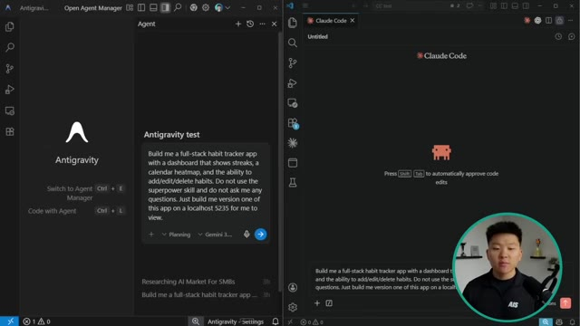
*⏱️ 00:12:49 — Une vue en écran scindé montre à gauche l'interface de "Open Agent Manager" (Antigravity) et à droite l'interface de "Claude Code" dans un éditeur de type VS Code, avec le présentateur en médaillon circulaire en bas à droite.*

---

### ⏱️ `[00:13:07 - 00:13:42]` | Segment #30

**🔊 Audio (Transcription Intégrale Mot pour Mot en Français) :**
> similaire, mais on utilise le mode plan pour voir comment fonctionne leur planification, et puis le troisième va être en quelque sorte comme le design d'un site web, et on se base un peu purement sur le résultat du design à ce stade, ainsi que sur le genre de planification et tout le reste. Alors allons-y et lançons directement ces deux-là. Comme je l'ai dit, celui-ci tourne ici dans Anti-Gravity avec Gemini 3.1 Pro et celui-là tourne par là dans CloudCode avec Opus 4.6. Donc ce que j'ai dit, c'était de créer une application full stack de suivi des habitudes avec un tableau de bord qui montre les séries, une carte thermique sous forme de calendrier, et la possibilité d'ajouter, modifier et supprimer des habitudes. J'ai dit de ne pas utiliser la compétence « superpower » parce que c'est quelque chose que j'ai dans CloudCode qui rend ses résultats bien meilleurs. Et si vous voulez regarder cette vidéo que j'ai faite sur le

**👁️ Analyse Visuelle d'Écran (gemini-3.5-flash-lite) :**
**Interface & Outils** : Open Agent Manager (Antigravity) et Visual Studio Code (avec extension Claude Code)

**Contenu textuel & Code** : Un prompt textuel demandant de construire une application full-stack de suivi des habitudes (habit tracker) avec un tableau de bord.

**Action / Démonstration** : Comparaison de deux outils de développement assistés par IA côte à côte pendant que le présentateur explique le fonctionnement des agents.

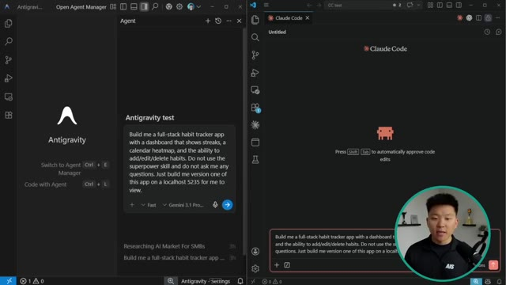
*⏱️ 00:13:16 — Comparatif d'interfaces de développement avec d'un côté l'Open Agent Manager (Antigravity) et de l'autre VS Code avec Claude Code, et la vidéo incrustée du présentateur en bas à droite.*

---

### ⏱️ `[00:13:42 - 00:14:17]` | Segment #31

**🔊 Audio (Transcription Intégrale Mot pour Mot en Français) :**
> compétence superpower, je vais la mettre en lien juste ici. Mais je lui ai dit de ne pas l'utiliser parce que je veux que ce soit aussi équitable que possible. Donc je vais laisser tourner ces deux éléments et je vous préviendrai quand on aura nos résultats. Très bien, en ce qui concerne la vitesse, vous pouvez voir ici qu'Anti-Gravity a terminé et que CloudCode est toujours en cours d'exécution. Donc avant de cliquer dessus, regardons concrètement ce qu'ils ont fait du point de vue des fichiers. Donc si j'ouvre les fichiers par ici pour les deux, vous pouvez voir que CloudCode a créé un dossier appelé .superpowers avec content et state. Ensuite, nous avons docs avec plans et specs. Et ensuite, nous avons habit tracker avec tous les dossiers réels pour ce qui se passe à l'intérieur du véritable site. Et par ici, on peut voir qu'Anti-Gravity a fait quelque chose de pas très similaire.

**👁️ Analyse Visuelle d'Écran (gemini-3.5-flash-lite) :**
**Interface & Outils** : Éditeurs de code avec interfaces d'agents IA intégrées (Open Agent Manager, Antigravity)

**Contenu textuel & Code** : Prompt utilisateur : "Build me a full-stack habit tracker app with a dashboard that shows streaks, a calendar heatmap, and the ability to add/edit/delete habits. Do not use the superpower skill and do not ask me any questions..."

**Action / Démonstration** : Exécution simultanée de deux agents IA pour comparer leur vitesse et leur comportement sur le même prompt.

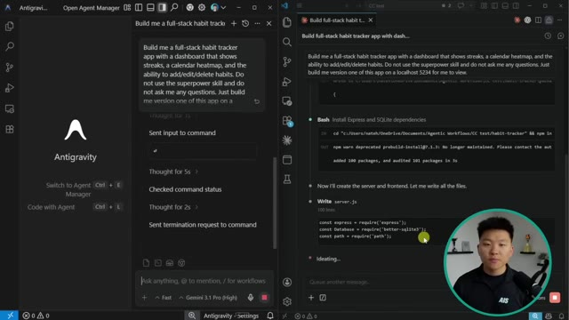
*⏱️ 00:13:51 — Comparaison côte à côte de deux interfaces d'agents IA (Antigravity à gauche et un autre outil à droite) exécutant le même prompt pour créer une application de suivi d'habitudes.*

---

### ⏱️ `[00:14:17 - 00:14:42]` | Segment #32

**🔊 Audio (Transcription Intégrale Mot pour Mot en Français) :**
> Nous avons node modules avec une tonne de dossiers là-dedans. Et tous ceux-là, j'en suis sûr, sont très remplis avec encore plus de dossiers et plus de fichiers. On peut voir que nous avons un public. On dirait que ce sont des images. Et puis nous avons le SRC avec encore d'autres ressources et composants à l'intérieur. Vous avez peut-être regardé ce que je viens de vous montrer avec les dossiers et vous vous êtes dit : c'est complètement une langue étrangère. Et pour ma part, je ne sais pas vraiment ce qui s'y passe non plus, pas vrai ? Mais la raison pour laquelle je voulais vous montrer ça, c'est parce que les harnais, les modèles, sont simplement conçus pour, oui, atteindre l'objectif final que nous recherchons, mais ils le font d'une manière différente.

**👁️ Analyse Visuelle d'Écran (gemini-3.5-flash-lite) :**
**Interface & Outils** : VS Code / Éditeur de code avec panneau latéral d'exploration de fichiers et interface de chat pour l'IA.

**Contenu textuel & Code** : Arborescence de projet (node_modules, public, src, package.json, vite.config.ts) et instructions textuelles pour construire une application de suivi d'habitudes.

**Action / Démonstration** : Navigation dans l'explorateur de fichiers du projet Antigravity pour inspecter la structure des dossiers générés par l'IA.

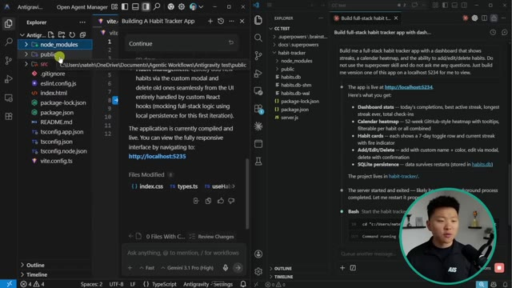
*⏱️ 00:14:23 — Vue partagée d'un éditeur de code montrant l'explorateur de fichiers avec les dossiers node_modules, public et src, ainsi qu'un panneau de discussion avec un agent IA.*

---

### ⏱️ `[00:14:42 - 00:15:03]` | Segment #33

**🔊 Audio (Transcription Intégrale Mot pour Mot en Français) :**
> Ceci étant réglé, ouvrons d'abord la version d'Anti-Gravity. D'accord, alors voici Anti-Gravity. Il n'y a rien ici. Laissez-moi simplement dire que le serveur local est ouvert, mais je ne vois rien. La page est juste complètement blanche. Donc, nous allons fermer ça. Et pendant que ça travaille là-dessus, laissez-moi ouvrir Cloud Code et nous irons sur cette version juste ici sur le serveur local. D'accord, super. Nous avons un suivi d'habitudes. Nous avons un calendrier. Nous avons nos séries, des trucs comme ça en haut, le total des enregistrements.

**👁️ Analyse Visuelle d'Écran (gemini-3.5-flash-lite) :**
**Interface & Outils** : Cursor (éditeur de code), Navigateur Web (interface de l'application Habit Tracker).

**Contenu textuel & Code** : Code source TypeScript (Vite config), logs d'état de l'agent IA, interface dashboard sombre avec statistiques de suivi d'habitudes.

**Action / Démonstration** : Le présentateur communique avec l'IA via Cursor pour déboguer une page blanche, puis affiche l'interface opérationnelle de l'application Habit Tracker.

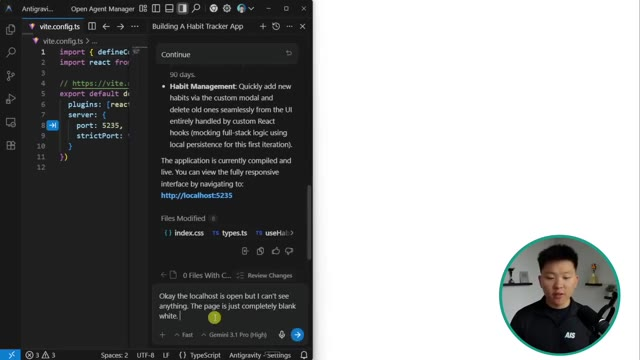
*⏱️ 00:14:53 — Capture d'écran de l'éditeur Cursor affichant le fichier 'vite.config.ts' et un panneau latéral de discussion avec une IA signalant un problème d'affichage sur localhost:5235.*

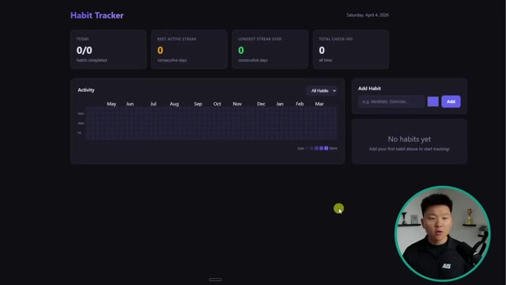
*⏱️ 00:14:58 — Interface web fonctionnelle d'une application de suivi d'habitudes ("Habit Tracker") avec des graphiques de progression et un formulaire d'ajout.*

---

### ⏱️ `[00:15:03 - 00:15:23]` | Segment #34

**🔊 Audio (Transcription Intégrale Mot pour Mot en Français) :**
> Nous avons la date d'aujourd'hui. Je peux ajouter une habitude. Disons donc que nous faisons une marche et je peux ajouter le jour. Je pourrais l'modifier. Je pourrais changer la couleur. On dirait que, d'accord, c'est plutôt pas mal. Je pourrais la supprimer. Et nous pouvons changer la couleur par ici également. Si je voulais faire une habitude verte pour YouTube et vous pouvez changer le jour. Donc voilà, vous pouvez voir, cela nous donne notre série et tout le reste. Donc pour une version 1 sans planification, c'est plutôt solide.

**👁️ Analyse Visuelle d'Écran (gemini-3.5-flash-lite) :**
**Interface & Outils** : Application web "Habit Tracker" affichée dans un navigateur.

**Contenu textuel & Code** : Tableau de bord de suivi des habitudes avec statistiques (Today, Streak, Check-ins), calendrier d'activité annuel, panneau d'ajout et modale de modification avec nom et code couleur hexadécimal (#6366f1).

**Action / Démonstration** : Le créateur montre les fonctionnalités d'édition des habitudes, notamment la modification du nom et le choix de la couleur de l'habitude.

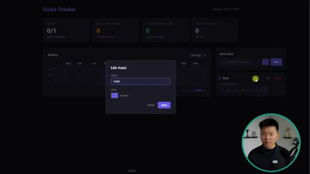
*⏱️ 00:15:08 — Interface d'un tableau de bord de suivi d'habitudes avec une fenêtre modale d'édition ouverte affichant le champ 'Walk' et un sélecteur de couleur.*

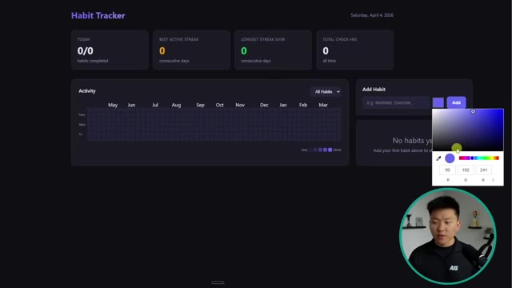
*⏱️ 00:15:13 — Interface du tableau de bord affichant le sélecteur de couleur RVB ouvert pour personnaliser une habitude, avec le présentateur visible en incrustation.*

---

### ⏱️ `[00:15:23 - 00:15:42]` | Segment #35

**🔊 Audio (Transcription Intégrale Mot pour Mot en Français) :**
> C'est ce qu'on a demandé. Ça a l'air assez stylé, mais c'est pas grave. Retournons dans Anti-Gravity, voyons ce qui s'est passé ici. Donc apparemment, ça a corrigé ces modifications. Rouvrons l'application maintenant. Waouh. OK. Donc ça, c'est Anti-Gravity. D'un point de vue design, j'aime déjà plus celui-là. Nous avons nos habitudes actives. Nous avons, nous avons complété aujourd'hui, notre score journalier. Nouvelle habitude. On peut dire, ouais, on est allés faire un, j'allais dire course, mais j'ai tapé lecture.

**👁️ Analyse Visuelle d'Écran (gemini-3.5-flash-lite) :**
**Interface & Outils** : Anti-Gravity (Open Agent Manager), interface web de l'application HabitForge

**Contenu textuel & Code** : Explication de l'agent IA sur la correction du fichier `vite.config.ts` et du problème TypeScript (import type).

**Action / Démonstration** : L'agent IA résout automatiquement une erreur de compilation TypeScript et met à jour l'application de suivi d'habitudes.

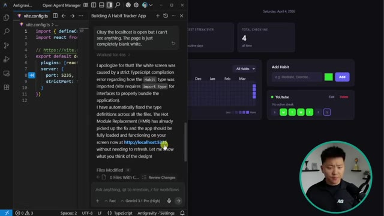
*⏱️ 00:15:28 — Vue de l'interface d'Anti-Gravity avec un panneau de chat d'agent IA expliquant la correction d'une erreur de compilation TypeScript liée à l'importation de types.*

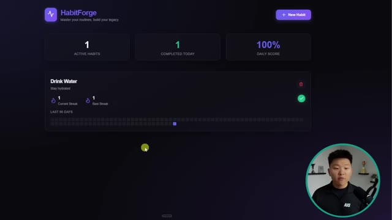
*⏱️ 00:15:32 — Affichage en plein écran de l'application de suivi d'habitudes "HabitForge" au design sombre et épuré.*

---

### ⏱️ `[00:15:42 - 00:16:00]` | Segment #36

**🔊 Audio (Transcription Intégrale Mot pour Mot en Français) :**
> Donc on lit, je lis les modèles d'argent pendant 10 minutes. Nous allons aller de l'avant et créer les habitudes. Nous pouvons le voir directement là. Et c'est là que nous pouvons cocher chaque jour. C'est donc une façon un peu différente dont cela fonctionne réellement, mais on peut toujours supprimer des trucs et des choses comme ça. Donc les deux font ce que nous avons demandé, mais ils le font de manières différentes. Très bien, test numéro deux. Nous faisons fondamentalement exactement la même chose, n'est-ce pas ?

**👁️ Analyse Visuelle d'Écran (gemini-3.5-flash-lite) :**
**Interface & Outils** : Application web (HabitForge)

**Contenu textuel & Code** : Tableau de bord affichant les statistiques globales (2 active habits, 1 completed today, 50% daily score) et deux cartes d'habitudes ('Drink Water' et 'Read' avec la description 'I read Money Models for 10 minutes') ainsi qu'une grille de suivi sur 90 jours.

**Action / Démonstration** : Visualisation du tableau de bord de suivi des habitudes et présentation de l'interface par le créateur.

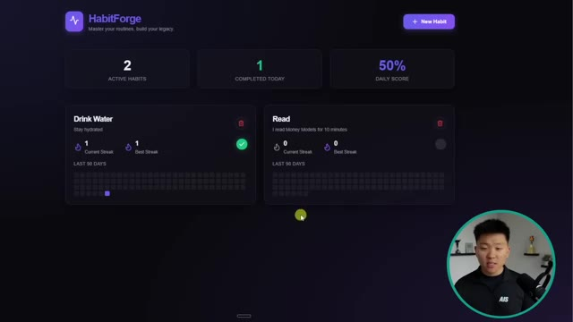
*⏱️ 00:15:47 — Capture d'écran montrant l'interface web de l'application 'HabitForge' avec un tableau de bord de suivi des habitudes et le présentateur en médaillon dans le coin inférieur droit.*

---

### ⏱️ `[00:16:00 - 00:16:20]` | Segment #37

**🔊 Audio (Transcription Intégrale Mot pour Mot en Français) :**
> Je vais lancer ça en mode plan des deux côtés. Et cette fois, je dis : j'ai besoin que tu fasses des recherches sur les tendances de l'IA sur le marché des petites et moyennes entreprises. Et j'ai besoin que tu crées un rapport au format PDF qui ne doit pas faire plus de trois pages et qui me donne une ventilation globale. Donc, ils vont adopter des approches différentes ici afin de créer un plan de mise en œuvre et de construire cela pour nous. Ils pourraient nous poser des questions, ou pas.

**👁️ Analyse Visuelle d'Écran (gemini-3.5-flash-lite) :**
**Interface & Outils** : Antigravity / Open Agent Manager (interface de gestion d'agents IA en mode double panneau).

**Contenu textuel & Code** : Le prompt saisi par l'utilisateur : "I need you to do research on AI trends in the small and medium-sized business market and create a PDF report that should be no more than three pages that gives me a holistic breakdown. Do not use your superpower skill." On y voit également les étapes de réflexion de l'agent ("Thinking", "Prioritizing Tool Selection", "Meandering...").

**Action / Démonstration** : L'utilisateur lance le prompt en mode double plan (split-screen) pour comparer les réponses ou l'exécution de l'agent des deux côtés.

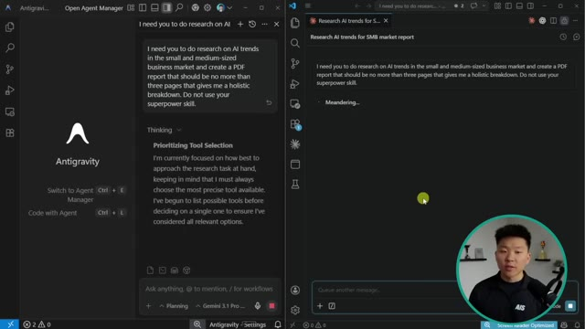
*⏱️ 00:16:05 — Vue en écran partagé affichant deux instances de l'interface Open Agent Manager (Antigravity), avec le présentateur en médaillon dans le coin inférieur droit.*

---

### ⏱️ `[00:16:20 - 00:16:38]` | Segment #38

**🔊 Audio (Transcription Intégrale Mot pour Mot en Français) :**
> Et nous allons fondamentalement comparer. Nous ne leur avons absolument rien dit sur notre pile technologique, rien du tout. Nous ne leur avons même pas dit, genre, pour qui était ce rapport ? Voyons donc laquelle des deux est capable de nous poser les meilleures questions et de nous donner le meilleur résultat. Très bien, du point de vue de la vitesse cette fois, nous avons obtenu notre plan en premier avec Cloud Code. Alors voyons ce que nous avons obtenu. Un rapport de trois pages, générer un fichier HTML stylisé pour des sorties PDF.

**👁️ Analyse Visuelle d'Écran (gemini-3.5-flash-lite) :**
**Interface & Outils** : Interface double (split-screen) d'un outil de développement ou d'agents IA (Antigravity).

**Contenu textuel & Code** : Prompt utilisateur : "I need you to do research on AI trends in the small and medium-sized business market and create a PDF report..." avec des journaux de réflexion et de recherche web ("Searched web for...").

**Action / Démonstration** : Les agents IA exécutent en parallèle une requête de recherche web pour collecter des données sur le marché des PME.

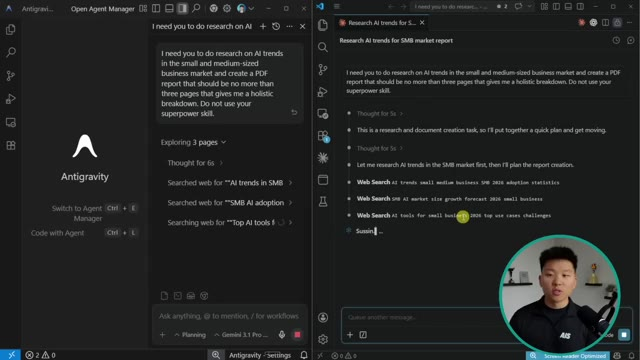
*⏱️ 00:16:24 — Comparatif de deux fenêtres d'interfaces d'agents IA montrant l'exécution d'une tâche de recherche de tendances sur l'IA pour les PME.*

---

### ⏱️ `[00:16:38 - 00:17:01]` | Segment #39

**🔊 Audio (Transcription Intégrale Mot pour Mot en Français) :**
> Nous aurons un résumé exécutif, un paysage d'adoption. Nous aurons des cas d'utilisation et un impact commercial. Nous aurons les défis, l'impact sur la main-d'œuvre, et les perspectives. et voici en gros le plan pour transformer ceci en PDF. Le but de ceci est donc juste de voir dans quelle mesure ils planifient. Je vais donc simplement aller de l'avant et dire oui, acceptation automatique. Maintenant, ici du côté anti-gravité, il est dit que j'ai terminé la recherche sur les tendances de l'IA sur le marché des petites et moyennes entreprises et que je les ai converties en un rapport PDF concis et lisible.

**👁️ Analyse Visuelle d'Écran (gemini-3.5-flash-lite) :**
**Interface & Outils** : VS Code / Open Agent Manager et visionneuse de documents/navigateur.

**Contenu textuel & Code** : Fichier Markdown `ai_trends_smb_2026.md` avec des sections sur le résumé exécutif, les cas d'utilisation, l'impact commercial, les défis et la main-d'œuvre. Invite de chat demandant la création d'un rapport PDF de trois pages.

**Action / Démonstration** : Présentation de la structure du plan de rapport transformé en document Markdown prêt à être converti en PDF.

*⏱️ 00:16:44 — Capture d'écran montrant un espace de travail divisé en deux panneaux : à gauche, un éditeur de texte (VS Code / Open Agent Manager) affichant un document Markdown sur les tendances de l'IA dans les PME avec un panneau de chat interactif ; à droite, le rendu ou un aperçu du rapport PDF structuré en plusieurs pages (Executive Summary, Use Cases + Business Impact, Challenges, Workforce Impact + Outlook). En bas à droite, une incrustation vidéo du présentateur.*

---

### ⏱️ `[00:17:01 - 00:17:28]` | Segment #40

**🔊 Audio (Transcription Intégrale Mot pour Mot en Français) :**
> Donc en fait, j'avais tort concernant toute cette histoire de vitesse. Il semble que Anti-Gravity soit en fait revenu et ait déjà fini cela. Donc dans les fichiers ici, vous pouvez voir qu'il a effectivement déjà créé un PDF. Alors, laissez-moi ouvrir ça rapidement. Très bien, donc voici à quoi ressemble le résultat d'Anti-Gravity. Ce n'est vraiment pas stylisé du tout, mais il y a des choses comme les tendances de l'IA sur le marché pour 2026, un résumé exécutif, des tendances d'options clés, des outils autonomes aux systèmes intégrés, la prise de décision guidée par les données, la mise en œuvre stratégique plutôt que par essais et erreurs, le retour sur investissement et l'impact commercial.

**👁️ Analyse Visuelle d'Écran (gemini-3.5-flash-lite) :**
**Interface & Outils** : VS Code et lecteur de PDF intégré.

**Contenu textuel & Code** : Rapport PDF structuré intitulé 'AI Trends in the SMB Market (2026)' avec sections exécutives et tendances d'adoption.

**Action / Démonstration** : Navigation dans l'IDE pour ouvrir et afficher le rapport PDF généré automatiquement par l'agent.

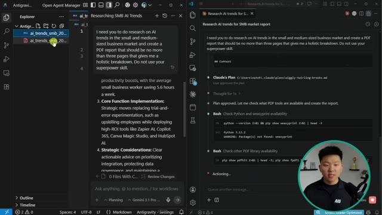
*⏱️ 00:17:08 — Vue de l'IDE VS Code montrant l'explorateur de fichiers avec les résultats générés sur l'IA et le marché des PME.*

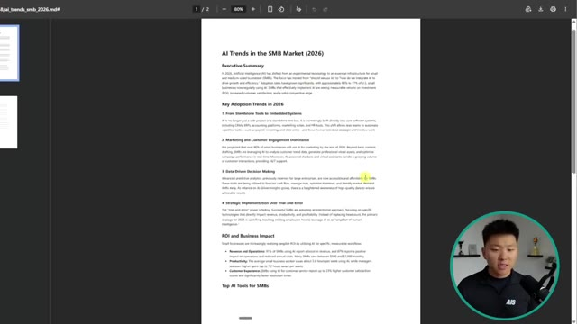
*⏱️ 00:17:14 — Affichage complet du document PDF généré intitulé 'AI Trends in the SMB Market (2026)' montrant le sommaire exécutif.*

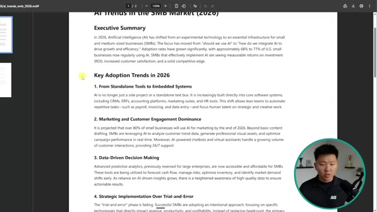
*⏱️ 00:17:21 — Gros plan sur le document PDF affichant les tendances clés d'adoption de l'IA pour 2026.*

---

### ⏱️ `[00:17:28 - 00:18:02]` | Segment #41

**🔊 Audio (Transcription Intégrale Mot pour Mot en Français) :**
> Donc nous avons d'autres outils et tout le reste. Et ce qui est intéressant, c'est qu'il n'a cité aucune de ses sources. Je ne lui avais pas demandé, mais c'est quelque que chose que j'aurais probablement aimé qu'il fasse. Donc il n'a pas cité de sources. Nous devons simplement supposer que tout cela est crédible. Et il nous a également donné des conseils de mise en œuvre stratégique. des conseils. Donc ce que je n'aime pas, c'est qu'il ne nous a pas vraiment posé de questions sur ce que nous recherchions spécifiquement. Et il nous a fondamentalement juste fourni un résultat. Maintenant, nous pourrions évidemment faire des allers-retours avec lui et lui demander de nous aider, vous savez, à faire des recherches plus approfondies sur d'autres choses ou à lui donner un peu plus d'informations. Mais c'est quelque chose que j'ai remarqué. Maintenant, de ce côté-ci, sur Claude Code, nous n'utilisons pas les compétences de brainstorming, donc il ne planifie pas aussi bien. Et je pense quand même que,

**👁️ Analyse Visuelle d'Écran (gemini-3.5-flash-lite) :**
**Interface & Outils** : Visualiseur de PDF et éditeur de code (VS Code / interface agent IA)

**Contenu textuel & Code** : Document PDF sur les tendances de l'IA en 2026, et logs d'exécution d'un agent IA dans l'éditeur de code (commandes python et vérification de bibliothèques).

**Action / Démonstration** : Navigation et présentation du rapport généré par l'agent IA, ainsi que l'affichage des étapes d'exécution dans l'IDE.

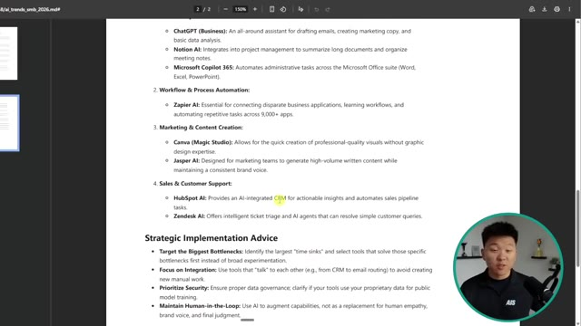
*⏱️ 00:17:36 — Image #1 : Visualisation d'un document PDF montrant la suite des recommandations stratégiques sur l'IA, avec le présentateur en médaillon.*

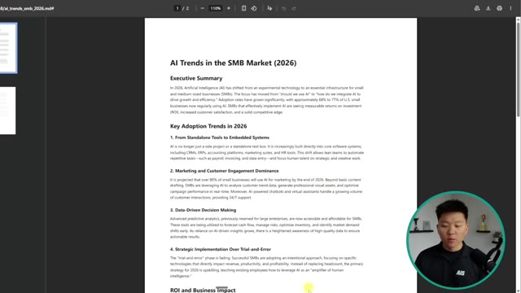
*⏱️ 00:17:45 — Image #2 : Affichage de la première page du rapport PDF intitulé 'AI Trends in the SMB Market (2026)', avec le présentateur en bas à droite.*

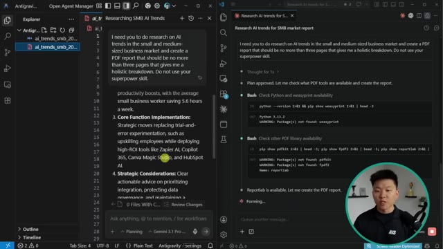
*⏱️ 00:17:53 — Image #3 : Interface d'un éditeur de code (type VS Code) avec des fenêtres divisées montrant un agent IA en train de planifier et d'exécuter des commandes Bash.*

---

### ⏱️ `[00:18:02 - 00:18:20]` | Segment #42

**🔊 Audio (Transcription Intégrale Mot pour Mot en Français) :**
> J'aimerais que ce côté-là ait aussi demandé du genre, hé, comment est-ce que tu veux que ça soit créé ? Quel est le public à qui tu essaies de donner ça ? Ce genre de questions sont vraiment utiles. Très bien. Donc le Cloud Code vient de revenir. Il a dit que c'est terminé. Vous pouvez voir qu'il est juste ici dans nos fichiers. Donc laissez-moi aller l'ouvrir depuis mon dossier. Boum, voici le rapport du Cloud Code. Vous pouvez déjà dire qu'il est un peu mieux stylisé. Il a de meilleurs en-têtes et quelques couleurs.

**👁️ Analyse Visuelle d'Écran (gemini-3.5-flash-lite) :**
**Interface & Outils** : Visual Studio Code, lecteur de PDF intégré, assistant IA (Cloud Code / Agent Manager).

**Contenu textuel & Code** : Prompt de recherche sur les tendances IA pour PME, instructions de code Python, scripts de génération de PDF (ReportLab).

**Action / Démonstration** : Exécution d'un script Python par l'assistant IA pour créer un rapport PDF complet sur les tendances de l'IA.

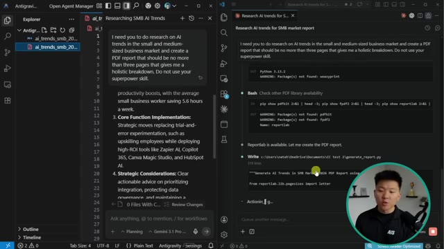
*⏱️ 00:18:07 — Interface VS Code divisée avec le panneau d'assistant IA exécutant un script Python de génération de rapport.*

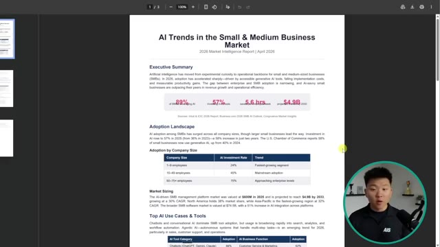
*⏱️ 00:18:16 — Affichage du rapport PDF final généré automatiquement intitulé "AI Trends in the Small & Medium Business Market".*

---

### ⏱️ `[00:18:20 - 00:18:53]` | Segment #43

**🔊 Audio (Transcription Intégrale Mot pour Mot en Français) :**
> Il y a quelques tableaux. Ça disait que les statistiques pourraient être fausses, comme vous pouvez le voir juste ici. Une chose à noter, les boîtes de mise en valeur des statistiques sur les pages un et deux ont un léger problème de mise en page, bla, bla, bla. Mais je dirais que d'un point de vue de la planification et de l'exécution ici, je donnerais définitivement ce test à Cloud Code comme vainqueur. Oh non, il l'a fait. Il a donné des sources ici en bas, rapport ICIC, business.com, LinkedIn economic graph. Il a donc cité les sources, ce qui, je pense, est aussi bien meilleur que le rapport d'Anti-Gravity. D'accord. Donc avant de lancer celui-ci, ou en fait je vais juste aller de l'avant et le lancer. Et ensuite je vais, ce dont je veux parler, la façon d'obtenir de bons résultats de ces outils, c'est en comprenant comment ils fonctionnent et en les utilisant mieux. Donc

**👁️ Analyse Visuelle d'Écran (gemini-3.5-flash-lite) :**
**Interface & Outils** : Lecteur PDF, VS Code / interface Antigravity et Claude Code

**Contenu textuel & Code** : Rapport de marché sur l'IA, prompt de création de page de destination (« Design a landing page for a premium AI automation course... ») et interface de chat d'agent.

**Action / Démonstration** : Présentation du rapport PDF généré par IA, puis affichage de l'outil de développement et des agents IA en action.

*⏱️ 00:18:29 — Aperçu du document PDF « AI Trends in the Small & Medium Business Market » avec des graphiques de statistiques et le présentateur en médaillon.*

*⏱️ 00:18:45 — Interface divisée en deux montrant l'application Antigravity avec un agent IA à gauche et Claude Code à droite.*

---

### ⏱️ `[00:18:53 - 00:19:26]` | Segment #44

**🔊 Audio (Transcription Intégrale Mot pour Mot en Français) :**
> Finalement, si vous maîtrisez vraiment bien Claude Code, je suis plutôt convaincu que vous pourriez passer sur Anti-Gravity et réussir à l'utiliser assez bien, parce que vous comprenez beaucoup de choses sur la façon dont les agents collaborent, sur la planification et sur les résultats spécifiques, bla-bla-bla. Donc pour ce dernier point, ce que je voulais faire, c'est en faire un autre où nous ne faisons pas de planification et où nous le guidons beaucoup moins. Nous voulons voir dans quelle mesure ces assistants de codage, dotés des bons modèles, sont capables d'obtenir réellement ce que nous voulons. Ici, ce que je lui ai demandé de faire, c'est de concevoir une page de destination pour un cours d'automatisation par IA de niveau supérieur, destiné aux propriétaires d'agences. Incluez une section principale, de la preuve sociale, un tableau des tarifs et un appel à l'action. N'utilisez pas la compétence de remue-méninges ni la compétence de conception front-end, car c'est quelque chose

**👁️ Analyse Visuelle d'Écran (gemini-3.5-flash-lite) :**
**Interface & Outils** : Interface Antigravity (Open Agent Manager) et éditeur VS Code.

**Contenu textuel & Code** : Prompt utilisateur : "Design a landing page for a premium AI automation course targeted at agency owners..." et réponses de l'agent en cours de réflexion.

**Action / Démonstration** : L'agent traite le prompt et planifie la création de fichiers (index.html, styles.css) avec un rendu local.

*⏱️ 00:19:02 — Interface divisée en deux fenêtres montrant l'application Antigravity avec un agent IA générant du code et du texte de prompt.*

---

### ⏱️ `[00:19:26 - 00:19:59]` | Segment #45

**🔊 Audio (Transcription Intégrale Mot pour Mot en Français) :**
> que j'ai donné à Claude Code qui l'aide essentiellement à concevoir l'UI, l'UX. Et ne me pose aucune question, donne-moi juste un résultat. Maintenant, je soupçonne ici qu'anti-gravity va revenir avec une page plus belle. On pouvait déjà s'en apercevoir un peu dans l'application de suivi des habitudes. Mais généralement, chaque fois que j'ai testé ces deux outils, l'impression que j'ai eue, c'est que Claude Code est meilleur pour créer des automatisations, des compétences et des produits. Mais anti-gravity a été meilleur pour le design d'applications web, les sites web et des choses comme ça. Donc je vais laisser tourner ceci et je vous montrerai quand nous aurons nos deux résultats finaux. Bon, encore une fois, anti-gravity, du point de vue de la vitesse, a déjà terminé. Je ne vais pas encore vous montrer le résultat. Attendons de voir quand Claude Code

**👁️ Analyse Visuelle d'Écran (gemini-3.5-flash-lite) :**
**Interface & Outils** : Interface graphique d'Antigravity / VS Code.

**Contenu textuel & Code** : Prompt utilisateur : "Design a landing page for a premium AI automation course targeted at agency owners..." et réponses de l'agent.

**Action / Démonstration** : Comparaison ou démonstration de l'exécution de deux agents en parallèle sur Antigravity.

*⏱️ 00:19:35 — Comparatif en écran partagé de l'application Antigravity montrant le panneau Open Agent Manager et l'exécution d'un prompt pour concevoir une page de vente.*

---

### ⏱️ `[00:19:59 - 00:20:32]` | Segment #46

**🔊 Audio (Transcription Intégrale Mot pour Mot en Français) :**
> termine. Très bien, voilà. Les deux sont terminés. Alors, affichons d'abord CloudCodes. Bien que le problème soit en fait qu'il s'agit du même hôte local que le suivi d'habitudes. Donc, ça a simplement affiché ça. Ce que je dois faire rapidement, c'est lui dire de remplacer le suivi d'habitudes par ce nouveau site. Cet hôte local affiche toujours le suivi d'habitudes. Peux-tu s'endormir... enfin, le mettre à jour pour afficher le nouveau site Web que tu viens de créer ? Bon, il semble que le problème soit réglé. Ouvrons le site de Cloud Code. Et voilà. Nous avons Agency AI mastery, arrêtez d'échanger du temps contre de l'argent, automatisez votre agence, rejoignez la cohorte sept. Vous pouvez voir que nous avons quelques statistiques ici. Nous avons quelques marques qui pourraient nous faire confiance. Huit semaines, zéro bla-bla, de la pure mise en œuvre. Nous avons un peu

**👁️ Analyse Visuelle d'Écran (gemini-3.5-flash-lite) :**
**Interface & Outils** : Navigateur web affichant des applications et sites web.

**Contenu textuel & Code** : Tableaux de bord d'applications web et pages de vente de formations en automatisation.

**Action / Démonstration** : Présentation et navigation à travers les différentes interfaces web générées ou créées.

*⏱️ 00:20:08 — Interface web du tableau de bord "Habit Tracker" avec des graphiques d'activité et des statistiques.*

*⏱️ 00:20:24 — Page d'accueil web du site "AgencyAI Mastery" avec le titre "Stop Trading Time for Money. Automate Your Agency."*

---

### ⏱️ `[00:20:32 - 00:21:05]` | Segment #47

**🔊 Audio (Transcription Intégrale Mot pour Mot en Français) :**
> d'un programme ici avec quelques éléments d'arrière-plan lorsque vous mettez en valeur ces cases. Ne vous contentez pas de nous croire sur parole. Nous avons nos témoignages ici en bas et quelques statistiques flottantes créées par quelqu'un qui a été à votre place. Vous avez une tarification. D'accord. Donc ça n'a pas l'air horrible, n'est-ce pas ? Pour une seule instruction, ce n'est pas mal. On peut clairement voir que ça a été codé au feeling, mais ce n'est pas horrible. Allons voir la version d'Anti-Gravity, qui, à première vue, je pense est déjà meilleure. Ça a encore l'air un tout petit peu codé au feeling, mais nous avons vraiment une très belle, je veux dire, regardez cette animation là. Ce panneau est sympa. Cette chose flotte. Nous avons de jolies couleurs. Nous avons des éléments dynamiques en arrière-plan ici. On a l'impression qu'il y a plus de profondeur.

**👁️ Analyse Visuelle d'Écran (gemini-3.5-flash-lite) :**
**Interface & Outils** : Éditeur de code (type VS Code / Cursor) avec panneau de chat IA intégré.

**Contenu textuel & Code** : Code HTML (`index.html`) dans le volet gauche et prompt de l'assistant IA dans le panneau de chat ("Design a landing page for a premium AI automation course...").

**Action / Démonstration** : Génération et édition de code pour la landing page du cours à l'aide d'un assistant de programmation IA.

*⏱️ 00:20:48 — Capture d'écran d'un environnement de développement (éditeur de code type VS Code ou Cursor) avec un panneau latéral d'assistant IA affichant un prompt de génération de landing page.*

---

### ⏱️ `[00:21:05 - 00:21:37]` | Segment #48

**🔊 Audio (Transcription Intégrale Mot pour Mot en Français) :**
> Même ceux-là remontent également. Continuons. Nous avons les deux prix ici en bas. Nous avons de jolies couleurs. Alors attendez, en fait, voyons si nous cliquons sur l'histoire à succès. D'accord. Donc tout cela n'est toujours qu'une seule page de destination. Très bien. D'accord. Donc, quand nous pensons à ces deux-là, je dirais probablement que je préfère l'Aura.ai. Pensez au fait que nous venons juste de dire tout cela. Nous avons dit, Hé, donnez-nous une page de destination pour un cours d'automatisation par IA haut de gamme. Et c'était fondamentalement tout. Donc à ce stade, vous les avez vus faire des allers-retours et nous les avons vus comparés à travers trois tests différents. Il est donc temps pour le verdict final. Je suis sûr que vous voyez déjà un peu vers quoi je penche, mais plongeons-dedans. Donc après cela, parlons de

**👁️ Analyse Visuelle d'Écran (gemini-3.5-flash-lite) :**
**Interface & Outils** : Navigateur web, VS Code / Éditeur de code, Interface de terminal / Assistant IA

**Contenu textuel & Code** : Code HTML de la page web, instructions de prompt pour concevoir une page de destination d'IA, et commandes de terminal pour exécuter un serveur local.
[DESC_IMAGE_3 correspond au code source et à l'assistant, DESC_IMAGE_2 montre le résultat sur le web et les logs du terminal, DESC_IMAGE_1 présente le rendu de la page de tarification].

**Action / Démonstration** : Navigation et présentation de la page de destination générée par IA, avec le code source et le rendu visuel en direct.

*⏱️ 00:21:13 — Vue rapprochée de la page de destination « AURA.AI » montrant les plans tarifaires (Operator et Architect) avec des prix en dollars et des listes de fonctionnalités.*

*⏱️ 00:21:21 — Affichage en écran partagé montrant la page web d'un côté et un environnement de développement avec des commandes Bash de l'autre, illustrant le serveur local sur le port 5234.*

*⏱️ 00:21:29 — Interface de développement divisée en deux panneaux montrant le code source HTML (« index.html ») à gauche et l'historique des interactions avec l'assistant IA à droite.*

---

### ⏱️ `[00:21:37 - 00:22:10]` | Segment #49

**🔊 Audio (Transcription Intégrale Mot pour Mot en Français) :**
> les résultats. Dans le test un, j'ai préféré la logique de Claude Code, mais j'ai préféré le design d'Anti-Gravity. Je pense que Claude Code a fait un meilleur travail en réfléchissant à ce que nous voulions et en réfléchissant en quelque sorte au parcours et à l'expérience utilisateur, puis en nous donnant cet outil qui semblait un peu mieux comparé à celui d'Anti-Gravity qui semblait un peu plus limité. Mais comme je l'ai dit, j'ai beaucoup plus aimé l'apparence du design d'Anti-Gravity. Dans le test deux, Claude Code a clairement gagné. C'était beaucoup plus réfléchi. Il y avait des sources. Je pensais que la recherche avait même l'air meilleure. Donc le test deux, je vais l'attribuer à Claude Code. Et puis dans le dernier test, Claude Code avait de meilleurs textes et une meilleure structure. Mais encore une fois, le design et l'ambiance générale d'Anti-Gravity étaient beaucoup plus forts. Donc ce qui est intéressant ici, c'est qu'il y a un

**👁️ Analyse Visuelle d'Écran (gemini-3.5-flash-lite) :**
**Interface & Outils** : Interface graphique de comparaison de résultats avec des cartes textuelles.

**Contenu textuel & Code** : Évaluation comparative sous forme de points clés : Claude Code (Logic, Source Links, Better Research) versus Antigravity (Good design, Limited research).

**Action / Démonstration** : Comparaison et notation des performances des deux outils lors des différents tests.

*⏱️ 00:22:02 — Un tableau comparatif affichant les résultats des tests entre Claude Code (Test 1 : Logic, Test 2 : Source Links, Better Research) et Antigravity (Test 1 : Good design, Test 2 : Limited research).*

---

### ⏱️ `[00:22:10 - 00:22:35]` | Segment #50

**🔊 Audio (Transcription Intégrale Mot pour Mot en Français) :**
> modèle, n'est-ce pas ? Je pense que Cloud Code réfléchit mieux, mais je pense qu'anti-gravity donne un meilleur aspect aux choses. Et Gemini est aussi sensiblement plus rapide. Vous savez, je ne travaille généralement pas sur des projets où je suis extrêmement, vous savez, pressé par le temps. Donc ça ne me dérange pas si Opus est un peu plus lent, surtout si cela signifie que le résultat est de meilleure qualité. Et en particulier avec les compétences de la communauté et les instructions personnalisées que vous pouvez donner et intégrer dans la conception de Claude Code, alors tout le reste que vous faites avec Claude Code peut en quelque sorte combler ces lacunes que Gemini pourrait être capable de vous combler.

**👁️ Analyse Visuelle d'Écran (gemini-3.5-flash-lite) :**
**Interface & Outils** : Editeur de code, YouTube et interface de configuration de Claude Code.

**Contenu textuel & Code** : Code source sur écran secondaire et menus de configuration pour le design de Claude Code.

**Action / Démonstration** : Navigation et présentation des outils de développement et de configuration.

*⏱️ 00:22:23 — Vue de dos du présentateur devant un double écran montrant YouTube et un éditeur de code.*

*⏱️ 00:22:29 — Interface graphique affichant le logo "CLAUDE CODE DESIGN" et une option "CUSTOM INSTRUCTIONS".*

---

### ⏱️ `[00:22:35 - 00:23:08]` | Segment #51

**🔊 Audio (Transcription Intégrale Mot pour Mot en Français) :**
> Donc, pour ainsi dire, ma règle générale serait d'utiliser Anti-Gravity si le design et la vitesse sont votre priorité, ou si vous voulez tester quelque chose gratuitement avant de vous engager, et d'utiliser Claude Code si vous vous souciez de la vraie qualité du code, de la configurabilité et de la fiabilité en production. Personnellement, j'utilise Claude Code. La qualité du résultat et le rythme auquel ils sortent des nouveautés en ce moment sont vraiment difficiles à battre. Ce que je trouve intéressant, c'est qu'il ne s'agit pas toujours de savoir quel outil est le meilleur. Vous savez, ceci contre cela, ceci tue cela. Je pense que la vraie question que nous devrions nous poser et à laquelle nous devrions répondre est : pour cette tâche, quel outil fait le mieux ce travail ou quelle combinaison de différents outils puis-je utiliser pour différentes parties de ce travail ? Donc, de toute façon, j'espère que vous avez apprécié celui-ci

**👁️ Analyse Visuelle d'Écran (gemini-3.5-flash-lite) :**
**Interface & Outils** : Aucun éditeur de code ou terminal interactif affiché.

**Contenu textuel & Code** : Texte comparatif sur les avantages de Claude Code et Antigravity.

**Action / Démonstration** : Le présentateur s'exprime et présente les critères de sélection.

---

### ⏱️ `[00:23:08 - 00:23:32]` | Segment #52

**🔊 Audio (Transcription Intégrale Mot pour Mot en Français) :**
> utile. J'ai rassemblé tout ce dont nous avons parlé aujourd'hui dans un guide de ressources complet que vous pouvez obtenir tout à fait gratuitement au sein de ma communauté School gratuite. Le lien pour cela se trouve dans la description. Et si vous cherchez à aller plus loin et à vous connecter avec des milliers d'autres personnes qui construisent des entreprises basées sur l'IA, allez voir ma communauté Plus, également liée dans la description. Mais de toute façon, c'est tout pour celui-ci, si vous avez apprécié, vous avez appris quelque chose de nouveau, veuillez mettre un pouce bleu, cela m'aide vraiment énormément et comme toujours, je vous remercie d'être arrivés jusqu'à la fin de la vidéo, je vous vois sur la prochaine, merci tout le monde.

**👁️ Analyse Visuelle d'Écran (gemini-3.5-flash-lite) :**
**Interface & Outils** : Navigateur web (Skool, YouTube)

**Contenu textuel & Code** : Pages de la communauté Skool, profils de membres et page de lecture YouTube.

**Action / Démonstration** : Présentation de la communauté Skool gratuite et navigation visuelle.

---

